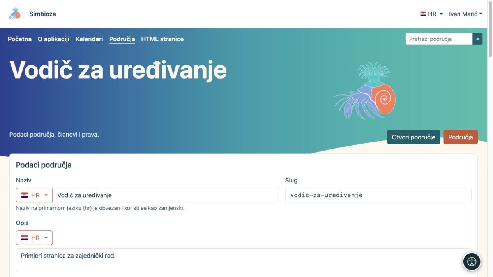
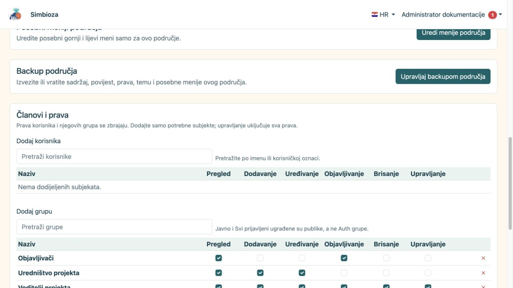
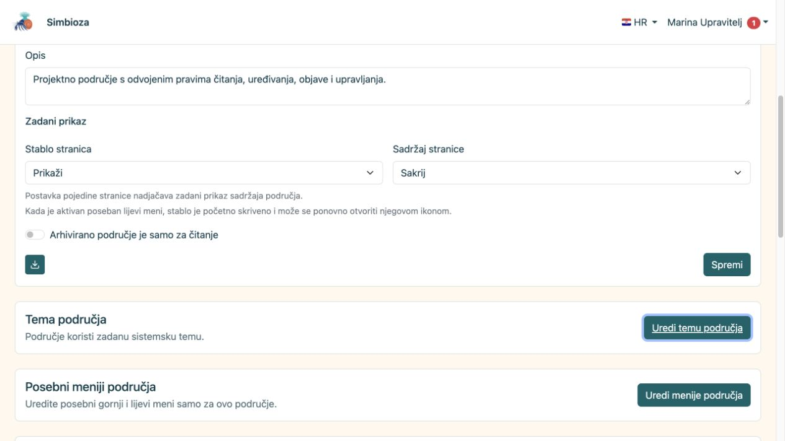

# Upravljajte svojim područjem

[Područja](podrucja_hr.md)

**Za koga:** za korisnika s pravom **Upravljanje** na odabranom području i za administratora. Upravitelj jednog područja time ne postaje administrator cijele Simbioze.

## Promijenite podatke i prikaz

1. Otvorite područje i njegovu ikonu postavki, odnosno **Upravljaj područjem** u popisu područja.
2. U **Podaci područja** uredite naziv i opis na željenom jeziku. Slug mijenjajte samo ako treba promijeniti adresu.
3. Za **Stablo stranica** i **Sadržaj stranice** odaberite **Prikaži**, **Sakrij** ili nasljeđivanje. Pojedina stranica može nadjačati početni prikaz svojega sadržaja.
4. Odaberite **Spremi**, otvorite područje i provjerite rezultat.

**Rezultat:** područje dobiva nove podatke i početni raspored. Korisnik i dalje može otvoriti ili sakriti navigaciju ponuđenom ikonom; skriveno stablo nije sigurnosno ograničenje.

<figure class="my-4">

<figcaption>Ivan uređuje podatke oglednog područja bez otvaranja globalnih administratorskih Postavki.</figcaption>
</figure>

<figure class="my-4">

<figcaption>Podaci područja, zadani prikaz, tema, posebni izbornici, backup te prava korisnika i grupa.</figcaption>
</figure>

## Što održavati na kojem mjestu?

| Želite promijeniti… | Otvorite… |
| --- | --- |
| Tko može čitati, dodavati ili objavljivati | [Članovi i prava](podrucja-clanovi-prava_hr.md) |
| Redoslijed, roditelja, oznake ili svojstva stranice | [Stablo i podaci stranice](podrucja-stablo_hr.md) |
| Pristup samo jednoj stranici | [Prava stranice](podrucja-prava-stranice_hr.md) |
| Boje, kartice, zaglavlje ili hero područja | **Uredi temu područja**; [upute za teme](teme-pocetak_hr.md) |
| Posebnu navigaciju projekta | **Uredi menije područja**; [izbornici područja](izbornici-podrucja_hr.md) |
| Statični paket ili povratnu kopiju | [HTML izvoz i backup](podrucja-izvoz-backup_hr.md) |

Privatna tema područja ne mijenja globalnu temu drugih područja. Posebni gornji i lijevi meni vrijede samo za to područje i spremaju se odvojeno. Kada lijevi meni zauzima navigacijsku poziciju, stablo možete ponovno otvoriti njegovom ikonom.

<figure class="my-4">

<figcaption>Upravitelj područja u njegovim postavkama vidi poveznicu Uredi temu područja. Sam Theme editor obrađen je u zasebnim uputama.</figcaption>
</figure>

## Završeni projekt: arhivirati ili obrisati?

**Arhivirano područje je samo za čitanje** zadržava stranice i njihove adrese, ali zaustavlja izmjene. Uključite tu postavku i spremite područje. Kada ponovno želite raditi, isključite je i spremite; dotadašnja prava ponovno određuju radnje.

**Obriši područje** uklanja ga iz redovnih popisa. Pročitajte potvrdu i prije brisanja provjerite naslovnice, poveznice i ugrađene sadržaje koji ga koriste. Administrator ga može vratiti iz obrisanih područja dok nije trajno uklonjeno.

Arhiviranje cijelog područja nije isto što i arhiviranje pojedine stranice. [Tijek objave stranice](podrucja-objava_hr.md) ima zasebna pravila vidljivosti.

**Provjerite:** otvorite područje i kao njegov čitatelj. Vaš upraviteljski prikaz pokazuje više mogućnosti pa nije dokaz onoga što vidi drugi korisnik.
