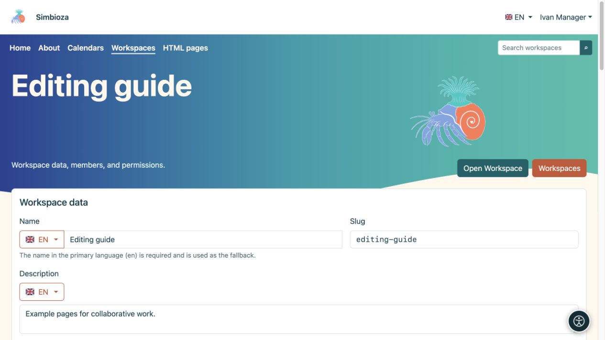
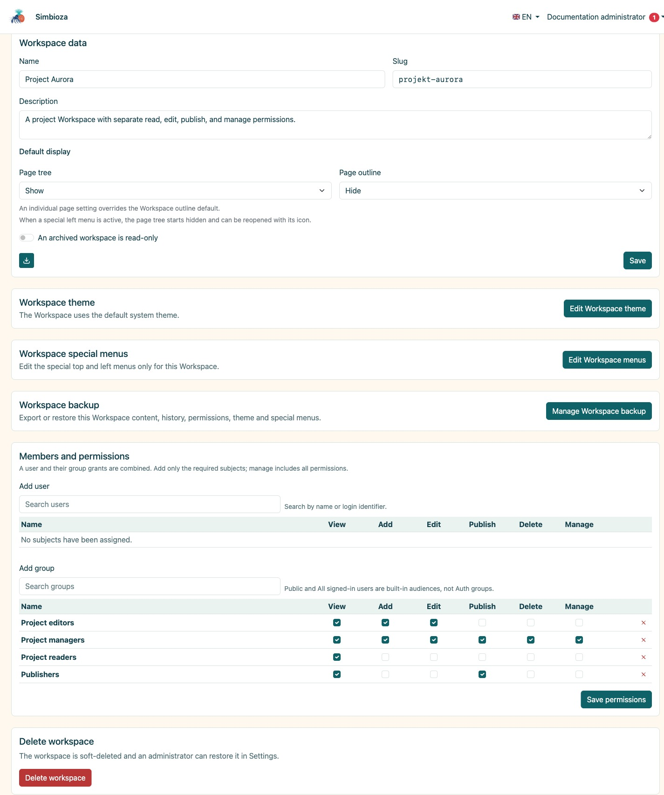

# Gestisci la tua area di lavoro

> Le schermate mostrano l’interfaccia in inglese.

[Aree di lavoro](podrucja_it.md)

**Per:** utenti con autorizzazione **Gestisci** per l'area di lavoro selezionata e amministratori. La gestione di un'area di lavoro non ti rende un amministratore Simbioza.

## Modifica dettagli e visualizzazione

1. Apri l'area di lavoro e la relativa icona delle impostazioni oppure **Gestisci area di lavoro** nell'elenco delle aree di lavoro.
2. In **Dettagli area di lavoro**, modifica il nome e la descrizione nella lingua desiderata. Cambia lo slug solo quando è necessario cambiare l'indirizzo.
3. Per **Struttura della pagina** e **Contenuto della pagina**, scegli **Mostra**, **Nascondi** o ereditarietà. Una pagina può sovrascrivere la visualizzazione iniziale del proprio pannello dei contenuti.
4. Scegli **Salva**, apri l'area di lavoro e controlla il risultato.

**Risultato:** l'area di lavoro utilizza i nuovi dettagli e il layout iniziale. I lettori possono comunque aprire o nascondere la navigazione utilizzando l'icona offerta; nascondere un albero non è una restrizione di accesso.

<figure class="my-4">

<figcaption>Ivan gestisce l'area di lavoro di esempio senza aprire le impostazioni dell'amministratore globale.</figcaption>
</figure>

<figure class="my-4">

<figcaption>Dati dell'area di lavoro, visualizzazione predefinita, tema, menu privati, backup e matrice dei permessi utente/gruppo.</figcaption>
</figure>

## Dove posso modificare ciascuna impostazione?

| Per cambiare… | Aprire… |
| --- | --- |
| Chi può leggere, aggiungere o pubblicare | [Membri e autorizzazioni](podrucja-clanovi-prava_it.md) |
| Ordine delle pagine, pagine superiori, etichette o proprietà | [Dettagli albero e pagina](podrucja-stablo_it.md) |
| Accesso ad una singola pagina | [Accesso alla pagina](podrucja-prava-stranice_it.md) |
| Colori dell'area di lavoro, riquadri, intestazione o sezione principale | **Modifica tema dell'area di lavoro**; [istruzioni sul tema](teme-pocetak_it.md) |
| Navigazione specifica del progetto | **Modifica i menu dell'area di lavoro**; [menu dell'area di lavoro](izbornici-podrucja_it.md) |
| Un pacchetto statico o una copia ripristinabile | [HTML esportazione e backup](podrucja-izvoz-backup_it.md) |

Un tema dell'area di lavoro privata non modifica il tema globale delle altre aree di lavoro. I menu speciali in alto e a sinistra si applicano solo a questa area di lavoro e vengono salvati separatamente. Quando il menu di sinistra occupa la posizione di navigazione, l'albero rimane disponibile tramite la sua icona.

<figure class="my-4">

<figcaption>Un gestore dell'area di lavoro vede il collegamento Modifica tema area di lavoro nelle impostazioni dell'area di lavoro. L'editor del tema stesso è trattato in una guida separata.</figcaption>
</figure>

## Progetto finito: archiviare o eliminare?

**L'area di lavoro archiviata è di sola lettura** mantiene le pagine e i loro indirizzi, impedendo ulteriori modifiche. Abilita l'impostazione e salva. Per riprendere il lavoro, disabilitala e salva; le azioni disponibili vengono nuovamente determinate dalle autorizzazioni esistenti.

**Elimina area di lavoro** la rimuove dagli elenchi ordinari. Leggi la conferma e, prima di eliminarla, controlla le pagine iniziali, i collegamenti e i contenuti incorporati che la utilizzano. Un amministratore può ripristinarla dalle aree eliminate finché non viene rimossa definitivamente.

Archiviare un'intera area di lavoro è diverso dall'archiviare una pagina. Il [processo di pubblicazione della pagina](podrucja-objava_it.md) ha regole di visibilità separate.

**Verifica:** apri l'area di lavoro anche come uno dei suoi lettori. La vista del responsabile offre più azioni e non dimostra cosa vede un altro utente.
