# Područja

Područja su temelj organizacije sadržaja u Simbiozi. Ove upute objašnjavaju globalne postavke, stvaranje područja i stabla stranica, vidljivost, prava, tijek objave, izravna dopuštenja, ograničenja, teme područja, HTML izvoz, sigurnosne kopije i ponašanje na mobilnom uređaju.

**Primjeri su izrađeni na zasebnoj čistoj SQLite instalaciji.** Korišteni su izmišljeni lokalni računi, grupe i sadržaj. Snimke ne prikazuju lozinke, API ključeve, fraze za šifriranje ni druge tajne vrijednosti.

## Sadržaj

1.  [Područje, stranica i slug](#pojmovi)
2.  [Globalne postavke područja](#globalne-postavke)
3.  [Stvaranje i upravljanje područjem](#stvaranje)
4.  [Prava i model pristupa](#prava)
5.  [Stablo, sadržaj, postavke stranice i posebni meniji](#stablo)
6.  [Uređivanje, pregled i objavljivanje](#objava)
7.  [Ograničenja i izravna dopuštenja](#ogranicenja)
8.  [Usporedni scenariji korisnika](#scenariji)
9.  [Uključeni sadržaj i provjera prava](#ukljuceni-sadrzaj)
10. [Tema područja](#teme)
11. [Statični HTML izvoz](#izvoz)
12. [Backup i vraćanje područja](#backup)
13. [Mobilni prikaz](#mobilni)
14. [Arhiviranje, brisanje, pretraga i održavanje](#odrzavanje)
15. [Završna provjera](#provjera)

## 1. Područje, stranica i slug

**Područje** je zaseban prostor s vlastitim stablom stranica, početnom stranicom, pravima, temom, posebnim izbornicima i sigurnosnom kopijom. Jedno područje obično predstavlja projekt, odjel, tim, zbirku javnih uputa ili internu bazu znanja.

**Stranica** je stavka stabla. Može sadržavati HTML dokument, vanjsku poveznicu ili drugi podržani tip sadržaja. Roditeljski i podređeni odnosi određuju redoslijed, navigaciju i nasljeđivanje ograničenja.

**Slug** je stabilni URL-identifikator bez razmaka, primjerice `projekt-aurora` ili `plan-rada`. Putanja se sastavlja od korijena, sluga područja i sluga stranice, primjerice `/workspace/projekt-aurora/plan-rada`.

- Slug neka bude kratak, razumljiv i trajan.
- Promjena sluga mijenja URL. Nakon promjene provjerite vanjske poveznice, ugrađeni sadržaj i oznake preglednika.
- Pri vraćanju backupa slug određuje hoće li se sadržaj povezati s postojećim područjem, zamijeniti ga ili stvoriti novu kopiju.

## 2. Globalne postavke područja

Ovaj dio vidi administrator u **Postavke → Područja**. Upravitelj pojedinog područja ne mijenja globalne zadane vrijednosti.

### 2.1. Opće postavke

Administrator ovdje određuje zadano ponašanje svih novih područja. Postavke ne mijenjaju već spremljene iznimke pojedinog područja ili stranice, nego služe kao polazište koje se po potrebi nadjača.

<figure class="my-4">
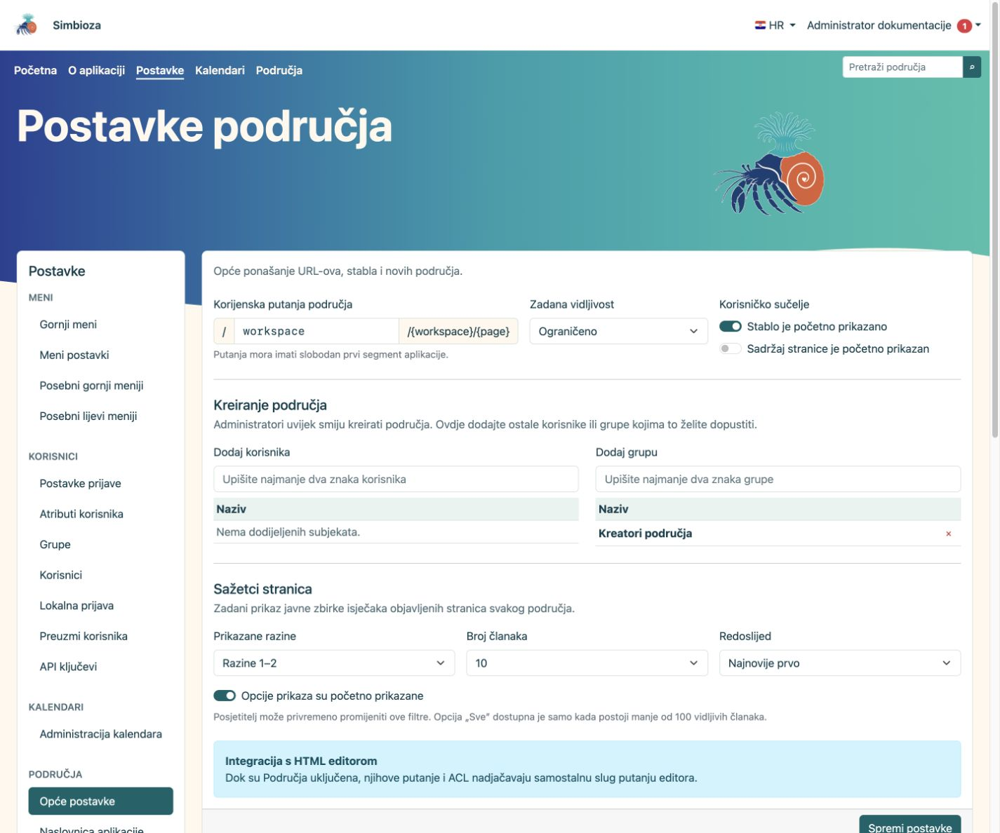
<figcaption>Cijeli odjeljak prikazuje korijensku putanju, zadanu vidljivost, početni prikaz stabla i sadržaja, grupu Kreatori područja te postavke sažetaka stranica.</figcaption>
</figure>

**Korijenska putanja područja**

Prvi segment URL-a svih područja. U prikazanom primjeru stranice koriste oblik `/workspace/{područje}/{stranica}`. Segment mora biti slobodan i ne smije se preklapati s rutama drugog modula.

**Zadana vidljivost**

Početna ACL razina novog područja: javno, svi prijavljeni ili ograničeno. Nakon stvaranja stvarni pristup i dalje određuju spremljena prava područja.

**Stablo je početno prikazano**

Određuje otvara li se navigacijsko stablo automatski. Korisnik ga na stranici može privremeno sakriti ili otvoriti.

**Sadržaj stranice je početno prikazan**

Određuje početno stanje kartice sadržaja, odnosno popisa naslova na stranici. Područje i pojedina stranica mogu postaviti svoju vrijednost.

**Kreiranje područja**

Pretraživanjem se dodaju korisnici ili grupe koji smiju otvoriti obrazac *Novo područje*. U primjeru je dodana grupa *Kreatori područja*. Administrator to pravo uvijek ima. Ovo nije pravo upravljanja postojećim područjem.

**Sažetci stranica**

Postavlja početni broj prikazanih razina stabla, broj članaka, redoslijed i vidljivost filtara na javnom popisu sažetaka. Posjetitelj filtre može privremeno promijeniti; mogućnost *Sve* nudi se samo kada ima manje od 100 vidljivih članaka.

Ne postoji poseban vlasnik područja: pravo **Upravljanje** određuje tko održava postojeće područje, dok odjeljak **Kreiranje područja** određuje samo tko smije stvoriti novo.

### 2.2. Javna i prijavljena naslovnica

Moguće je odabrati dvije različite početne stranice aplikacije:

- **Javna naslovnica** otvara se posjetitelju bez prijave i mora se nalaziti u javno dostupnom području.
- **Naslovnica za prijavljene** otvara se nakon prijave i može biti u području dostupnom svim prijavljenim korisnicima.

<figure class="my-4">
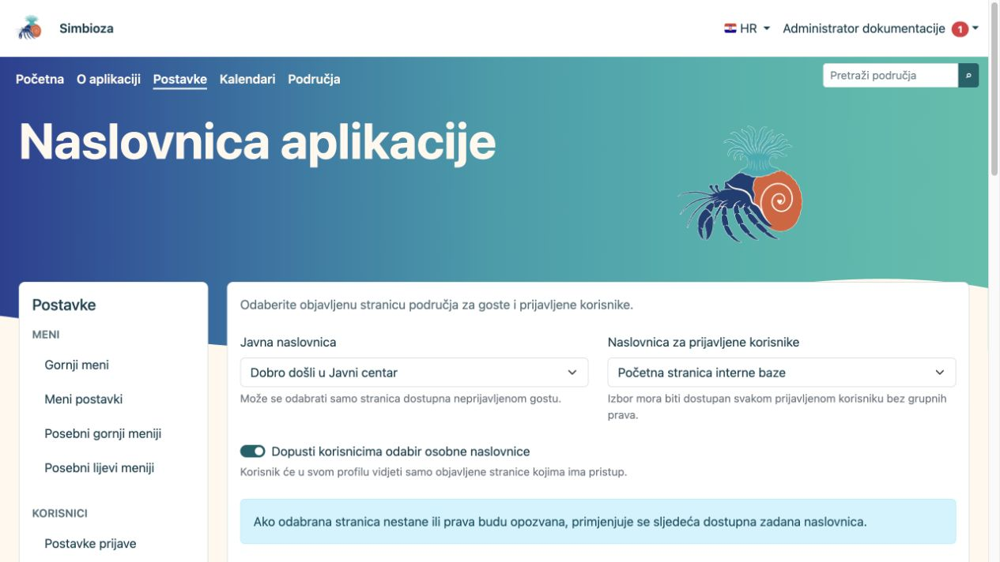
<figcaption>Odvojeni odabir početne stranice za gosta i prijavljenog korisnika.</figcaption>
</figure>

<figure class="my-4">
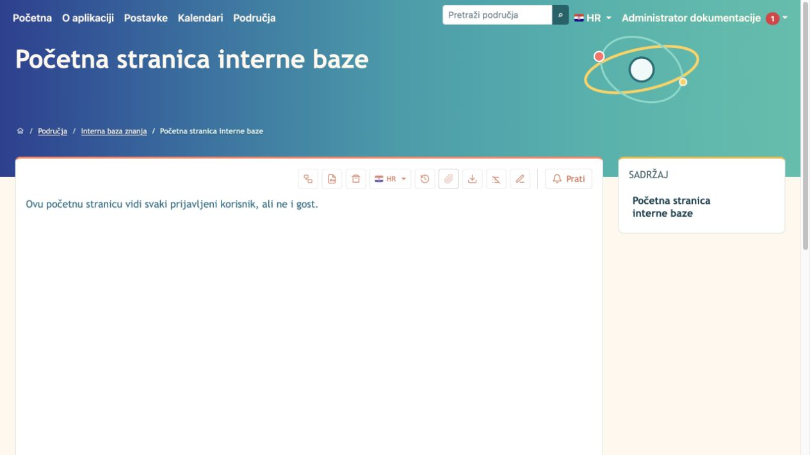
<figcaption>Prijavljeni administrator preusmjeren je na početnu stranicu interne baze znanja.</figcaption>
</figure>

### 2.3. Administratorski pregledi

Administratorski izbornik ne služi samo kao popis. Svaki ekran ima zasebnu operativnu namjenu:

- **Sva područja** prikazuje aktivna i arhivirana područja, njihov slug i stanje te daje brzi ulaz u postavke. Ovdje je najlakše provjeriti postoji li duplikat prije stvaranja ili vraćanja backupa.
- **Obrisana područja** sadrži samo soft-obrisana područja. Dok su ovdje, mogu se vratiti; trajno brisanje izvodi se zasebnom, potvrđenom akcijom u održavanju.
- **Indeks pretrage** pokazuje broj indeksiranih zapisa i stanje obrade. Ponovna izgradnja koristi se nakon većeg importa, vraćanja ili kada rezultat pretrage ne prati objavljeni sadržaj.
- **Održavanje** mjeri zauzeće, optimizira slike, čisti povijest/obrisane stavke i trajno uklanja prethodno obrisana područja. Sve akcije detaljno su opisane u 14. poglavlju.
- **Osobna područja** određuje jesu li osobna područja omogućena i pod kojim se pravilima stvaraju za korisnike.

<figure class="my-4">
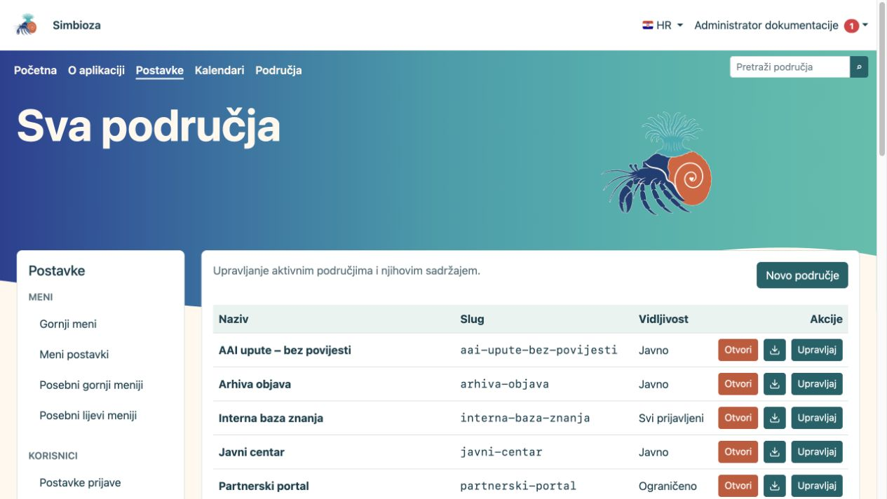
<figcaption>Administrator vidi aktivna, arhivirana i ograničena područja te može otvoriti njihove postavke.</figcaption>
</figure>

<figure class="my-4">
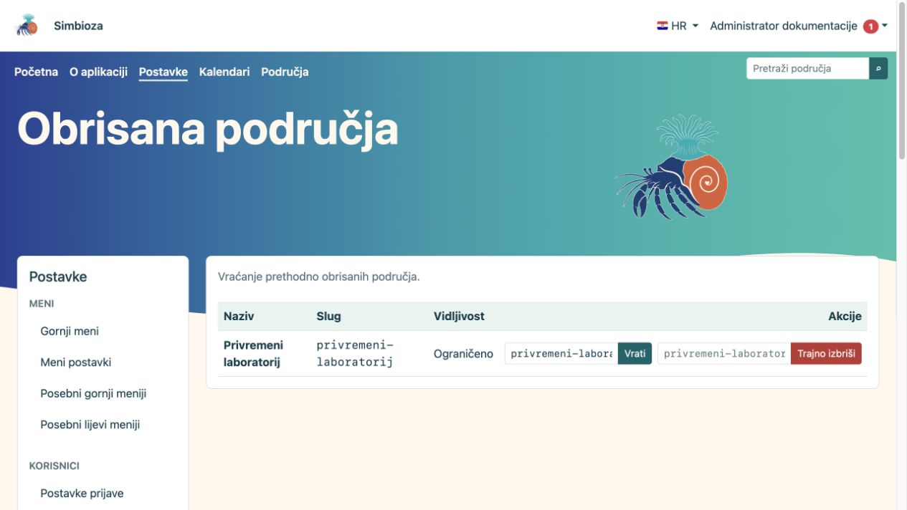
<figcaption>Soft-obrisano područje može se vratiti ili trajno ukloniti prema pravilima održavanja.</figcaption>
</figure>

<figure class="my-4">
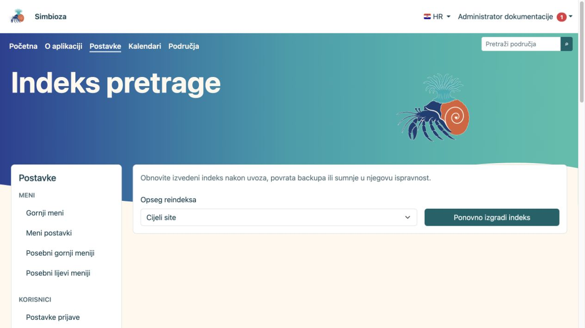
<figcaption>Stanje indeksiranja sadržaja područja i akcije ponovne izgradnje indeksa.</figcaption>
</figure>

<figure class="my-4">
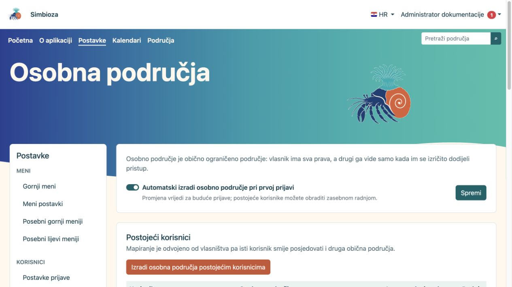
<figcaption>Postavke osobnih područja i pravila njihova stvaranja.</figcaption>
</figure>

### 2.4. Prava korisnika osobnog područja

Kada se osobno područje izradi nakon prve prijave, skupnom administratorskom radnjom ili gumbom **Izradi sada**, član kojemu područje pripada automatski se dodaje u **Članovi i prava**. Dobiva **Pregled**, **Dodavanje**, **Uređivanje**, **Objavljivanje**, **Brisanje** i **Upravljanje**; administrator ih ne mora naknadno uključivati.

<figure class="my-4">
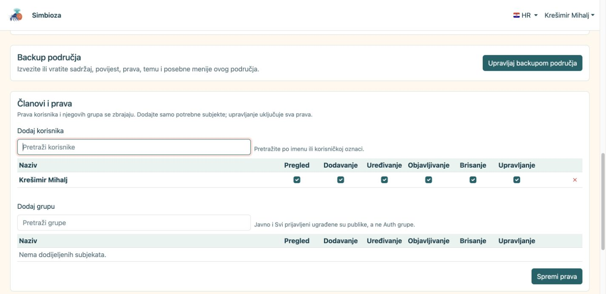
<figcaption>Krešimir Mihalj automatski je jedini korisnički član osobnog područja i ima svih šest prava.</figcaption>
</figure>

To ne vraća opći koncept vlasnika područja. U običnom području upravlja svaki korisnik s pravom *Upravljanje*. Osobno područje dodatno je stabilno mapirano na konkretnog člana, pa sustav tome članu automatski održava puni ACL. Ako je osobno područje nastalo prije ovog pravila, prva sljedeća uspješna prijava ponovno osigurava svih šest prava bez stvaranja duplikata.

## 3. Stvaranje i upravljanje područjem

1.  Otvorite **Područja** i odaberite **Novo područje**. Gumb je dostupan administratoru i korisniku/grupi kojoj je globalno dopušteno stvaranje.
2.  Upišite naziv, trajni slug i opis po kojem će drugi administratori razumjeti namjenu područja.
3.  Odaberite početno stanje stabla stranica i sadržaja stranice ili ostavite nasljeđivanje globalne postavke.
4.  Odaberite **Spremi**. Nakon stvaranja dodijelite grupe i korisnike, temu i posebne menije te izradite početnu stranicu.

<figure class="my-4">
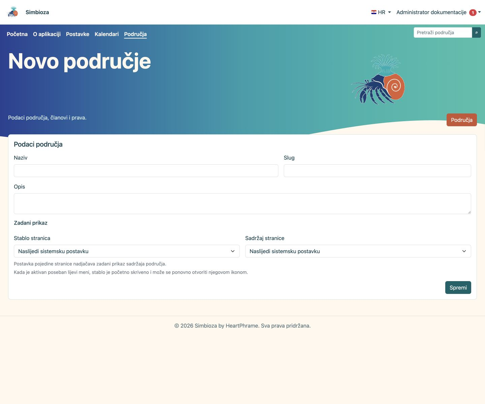
<figcaption>Relevantan cijeli obrazac s nazivom, slugom, opisom, zadanim prikazom stabla i sadržaja te gumbom Spremi.</figcaption>
</figure>

### 3.1. Polja obrasca Novo područje

- **Naziv** je naslov koji se prikazuje korisnicima u popisu područja, zaglavlju i stablu.
- **Slug** je URL-identifikator. Ne koristite datum ili privremeni naziv ako očekujete dugotrajne poveznice. Promjena sluga poslije zahtijeva provjeru vanjskih poveznica i integracija.
- **Opis** se prikazuje kao objašnjenje područja i pomaže administratorima razlikovati područja sličnih naziva.
- **Stablo stranica** postavlja početno stanje lijeve hijerarhijske navigacije: naslijedi, prikaži ili sakrij.
- **Sadržaj stranice** postavlja početno stanje popisa naslova te ga pojedina stranica može nadjačati.

Vidljivost i članovi ne određuju se u prvom kratkom obrascu. Nakon spremanja otvorite upravljanje područjem i uredite matricu **Članovi i prava**. Time se izbjegava stvaranje područja s polovično spremljenim ACL-om.

### 3.2. Upravljanje postojećim područjem

Ekran za upravljanje sadrži osnovne podatke, arhiviranje, temu, posebne menije, backup i matricu prava. Prava korisnika i njegovih grupa zbrajaju se.

<figure class="my-4">
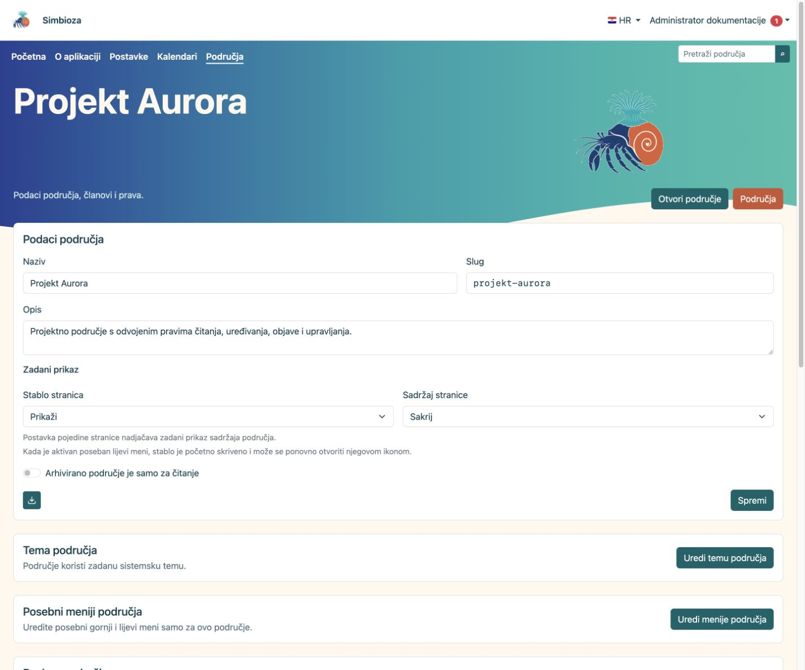
<figcaption>Naziv, slug, opis, postavke stabla i sadržaja, arhiviranje, izvoz te ulazi u temu i posebne menije.</figcaption>
</figure>

<figure class="my-4">
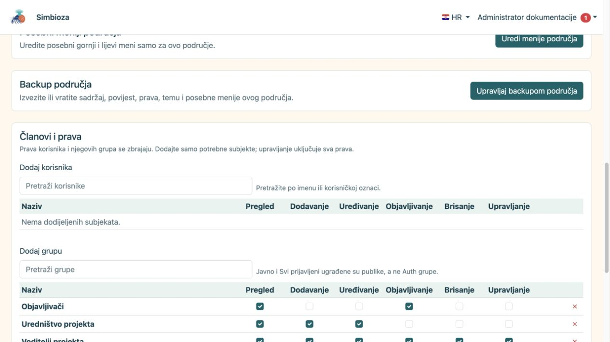
<figcaption>Podaci područja, zadani prikaz, tema, posebni izbornici, backup te prava korisnika i grupa.</figcaption>
</figure>

- **Arhivirano područje je samo za čitanje** privremeno zaustavlja izmjene bez uklanjanja sadržaja i URL-ova.
- **Uredi temu područja** otvara privatnu temu tog područja; tema se dokumentira zasebno.
- **Uredi menije područja** otvara posebni gornji i lijevi meni, opisane u odjeljku 5.4.
- **Upravljaj backupom područja** vodi na izvoz i vraćanje cijelog područja.
- Ikona izvoza u kartici podataka izrađuje statični HTML paket, što nije isto što i sigurnosna kopija.
- **Obriši područje** prvo izvodi soft brisanje. Povrat i trajno uklanjanje ostaju administratorske operacije.

**Nema vlasnika područja.** Korisnik s pravom *Upravljanje* ima ovlasti održavanja područja. To uključuje i poveznicu **Uredi temu područja**, gdje može izraditi ili odabrati privatnu temu samo za to područje. Uređivanje same teme opisuje se u zasebnim uputama; ovdje je važno samo gdje se mogućnost nalazi.

## 4. Prava i model pristupa

| Pravo | Omogućuje | Napomena |
|----|----|----|
| **Pregled** | Otvaranje područja i objavljenih stranica. | Osnova svih ostalih prava. |
| **Dodavanje** | Stvaranje nove stranice u dopuštenom dijelu stabla. | Ne daje automatski objavu. |
| **Uređivanje** | Izrada i promjena nacrta. | Objavljena verzija ostaje vidljiva dok nacrt nije objavljen. |
| **Objavljivanje** | Pregled i objava tuđih ili vlastitih nacrta. | Pogodno za odobravatelja sadržaja. |
| **Brisanje** | Arhiviranje ili brisanje stranice prema dostupnoj akciji. | Brisanje podstabla obuhvaća podređene stavke. |
| **Upravljanje** | Postavke područja, prava, stablo, temu, izbornike, izvoz i backup. | Upravljanje uključuje sva operativna prava. |

### 4.1. Tri razine vidljivosti

- **Javno**: objavljeni sadržaj čitljiv je bez prijave. Gost ne može uređivati.
- **Svi prijavljeni**: svaki aktivni prijavljeni korisnik može čitati objavljeni sadržaj, čak i bez retka u ACL-u.
- **Ograničeno**: pristup daju samo izravna prava područja, članstvo u grupi ili izravno dopuštenje na stranici.

### 4.2. Kako se prava zbrajaju

Izravna prava korisnika i sva prava njegovih grupa tvore zbroj. Ako jedna grupa daje pregled, a druga uređivanje, korisnik dobiva oba prava. Ograničenje na stranici zatim može odabranom korisniku uskratiti dio već naslijeđenih prava.

## 5. Stablo, sadržaj i postavke stranice

Stablo je hijerarhijska navigacija jednog područja. Upravitelj ga može uređivati bez otvaranja HTML editora: dodavati postojeći dokument, internu ili vanjsku poveznicu, mijenjati roditelja i redoslijed te otvarati postavke svake stranice. U ovim uputama koriste se već pripremljeni dokumenti; uređivanje njihova sadržaja obrađuje zasebna uputa.

### 5.1. Postavke stabla i sadržaja

Postavke imaju tri razine. Globalna vrijednost vrijedi kada područje nasljeđuje; vrijednost područja vrijedi za njegove stranice; postavka pojedine stranice najvišeg je prioriteta za sadržaj. Tako možete na svim stranicama pokazati stablo, ali na naslovnoj stranici sakriti sadržaj, ili obrnuto.

<figure class="my-4">

<figcaption>Upravitelj postavlja Stablo stranica i Sadržaj stranice na Prikaži, Sakrij ili Naslijedi sistemsku postavku.</figcaption>
</figure>

- **Stablo stranica** upravlja početnom vidljivošću navigacijskog stabla. Korisnik ga i dalje može otvoriti ili sakriti ikonom *Stablo*.
- **Sadržaj stranice** upravlja početnom vidljivošću kartice s naslovima trenutnog dokumenta. Stranica može izabrati *Naslijedi postavku područja*, *Prikaži* ili *Sakrij*.
- Kada je aktivan poseban lijevi meni, on zauzima lijevu poziciju pa je stablo početno skriveno; stablo se i dalje može otvoriti njegovom ikonom.

### 5.2. Uređivanje rasporeda stabla

Odaberite ikonu **Stablo**, a zatim **Uredi stablo**. Svaki red dobiva olovčicu i četiri smjerne akcije. Strelice gore/dolje mijenjaju redoslijed među stavkama iste razine, strelica ulijevo izvlači stavku jednu razinu, a strelica udesno uvlači je pod prethodnu stavku. Nedostupna akcija je zasivljena kako se ne bi stvorila nevaljana hijerarhija.

<figure class="my-4">
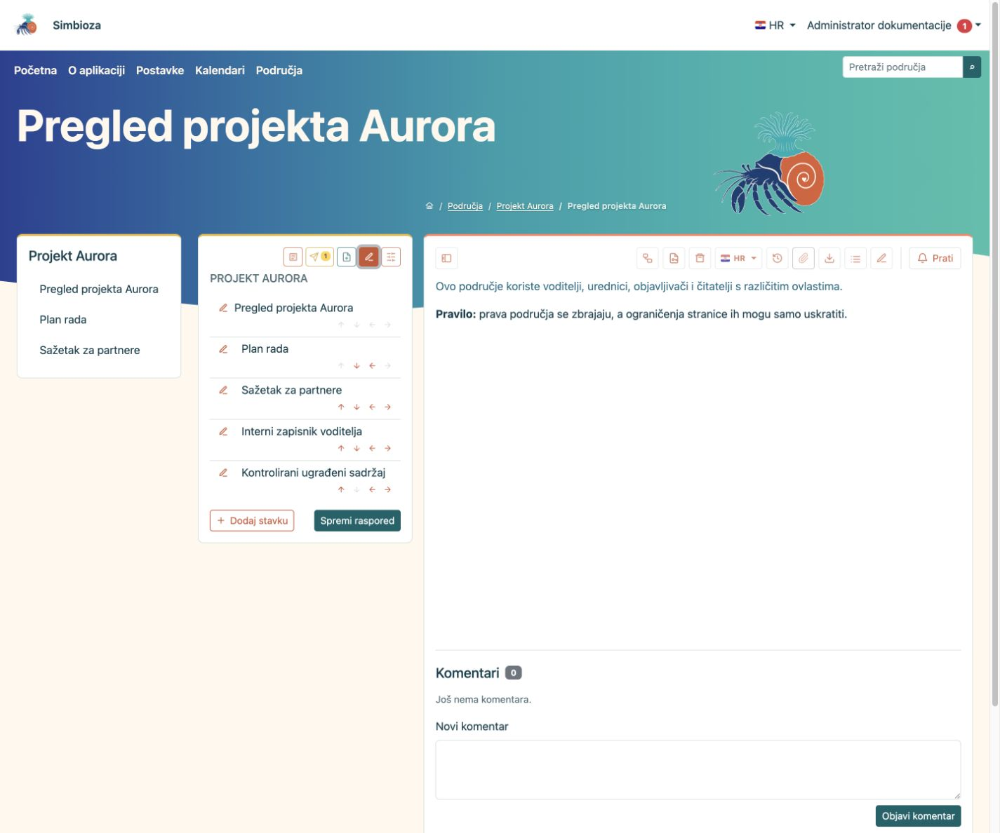
<figcaption>Prikaz svih stavki, olovčica za postavke, strelice za redoslijed i hijerarhiju, Dodaj stavku i Spremi raspored.</figcaption>
</figure>

Promjene položaja prvo su lokalne u organizatoru. Tek **Spremi raspored** zapisuje novi redoslijed. Prije spremanja provjerite roditelje stranica jer ograničenje postavljeno na roditelju vrijedi i na njegovoj podgrani.

### 5.3. Dodavanje i postavke stavke stabla

**Dodaj stavku** ne znači nužno stvaranje novog HTML sadržaja. Obrazac podržava tri tipa:

- **Stranica (HTML dokument)** povezuje postojeći dokument ili stvara novu stranicu kada je to ponuđeno.
- **Interni link** vodi na imenovanu rutu aplikacije ili internu putanju, primjerice kalendare.
- **Vanjski link** vodi na puni vanjski URL. Naslov i slug i dalje određuju kako se stavka prikazuje i adresira u stablu.

Polje **Roditeljska stranica** odmah određuje mjesto nove stavke; naknadno se može promijeniti strelicama u organizatoru.

<figure class="my-4">
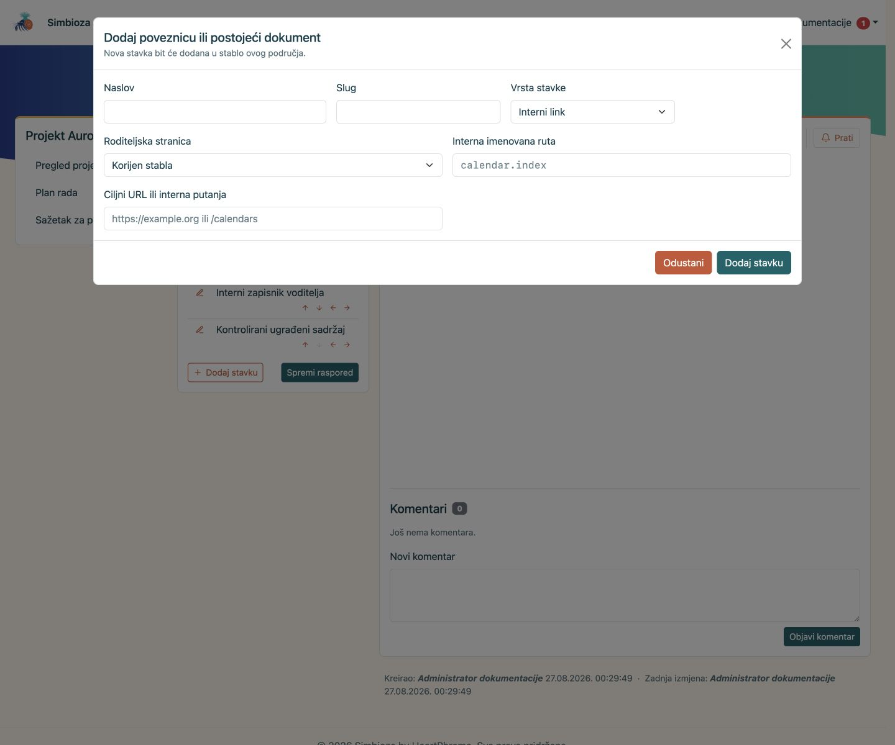
<figcaption>Obrazac jasno prikazuje naslov, slug, tip stavke, roditeljsku stranicu i cilj internog linka.</figcaption>
</figure>

Olovčica uz postojeću stavku i ikona **Upravljaj stranicom i dozvolama** u sadržaju otvaraju isti ekran. Dostupne su administratoru i korisniku s pravom upravljanja područjem.

<figure class="my-4">
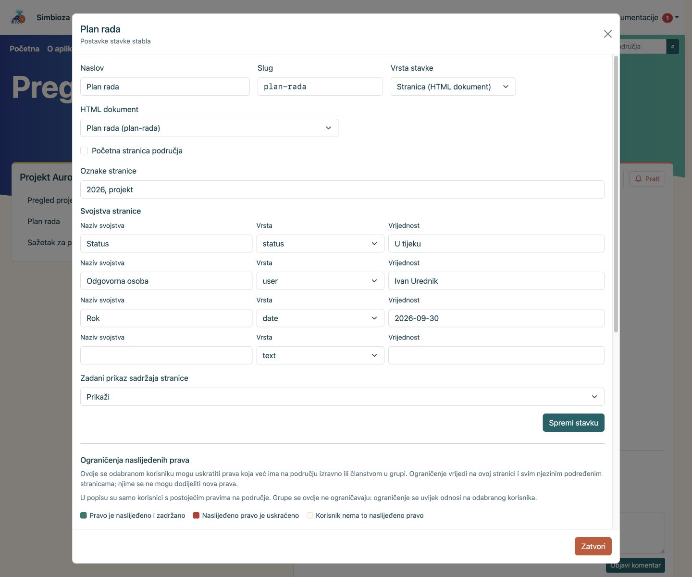
<figcaption>Naslov, slug, tip stavke, povezani dokument, početna stranica, oznake, svojstva i zadani prikaz sadržaja.</figcaption>
</figure>

- **Naslov i slug** određuju prikaz i URL stranice.
- **Početna stranica područja** određuje dokument koji se otvara kada se posjeti URL područja bez sluga stranice.
- **Oznake stranice** služe filtriranju i organizaciji.
- **Svojstva stranice** spremaju strukturirane vrijednosti kao tekst, status, broj, datum, korisnik ili poveznica. Prikazuju se uz sadržaj gdje ih tema/modul koristi.
- **Zadani prikaz sadržaja stranice** nadjačava vrijednost područja samo za tu stranicu.
- **Obriši podgranu** obuhvaća odabranu stavku i sve podređene stavke; prije akcije provjerite cijelu granu.

<figure class="my-4">
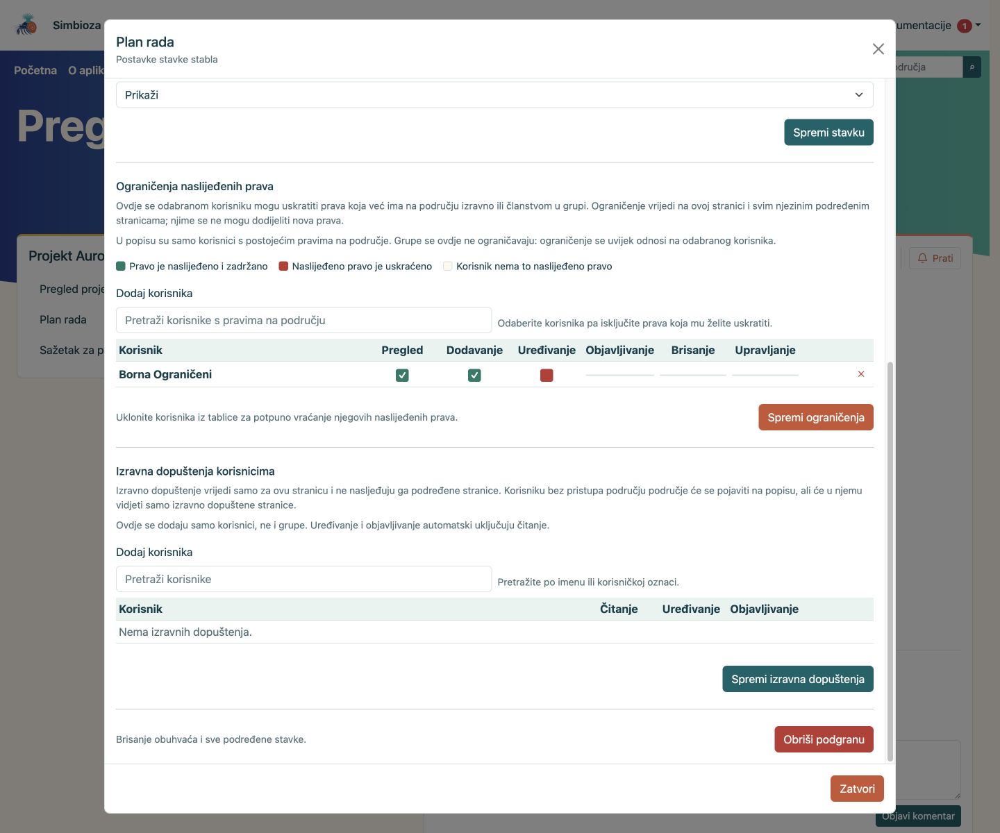
<figcaption>Odvojeni odjeljci jasno prikazuju ograničavanje naslijeđenih prava i dodavanje izravnih dopuštenja.</figcaption>
</figure>

### 5.4. Posebni gornji i lijevi meni područja

Posebni meniji vrijede samo na putanji odabranog područja i njegovih stranica. Gornji i lijevi meni uređuju se i spremaju odvojeno; promjena ili uklanjanje jednoga ne mijenja drugi.

<figure class="my-4">
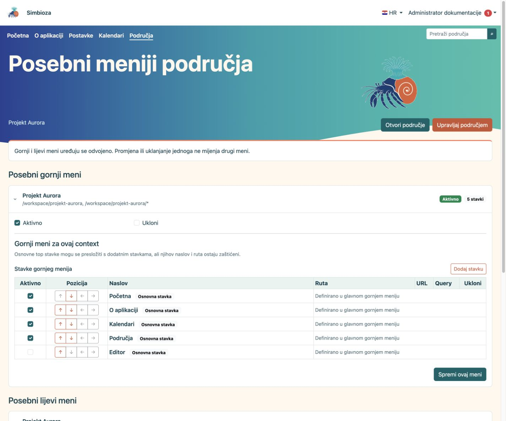
<figcaption>Upravitelj uključuje osnovne stavke, mijenja njihov redoslijed i dodaje vlastite stavke, dok su naziv i ruta zaštićenih osnovnih stavki zaključani.</figcaption>
</figure>

<figure class="my-4">
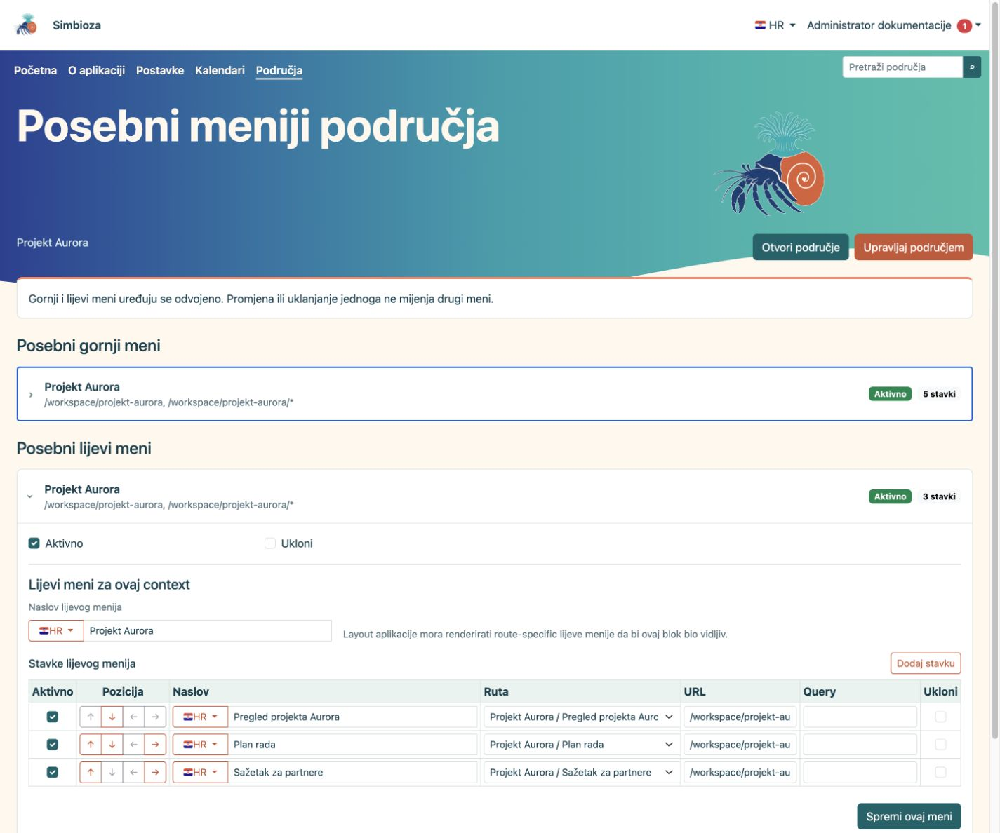
<figcaption>Poseban naslov i tri stavke lijevog menija s odredišnim rutama, redoslijedom i stanjem Aktivno.</figcaption>
</figure>

- **Aktivno** uključuje meni za kontekst područja; **Ukloni** označava cijeli kontekst za brisanje nakon spremanja.
- Zaštićene osnovne stavke gornjeg menija mogu se uključiti/isključiti i presložiti, ali im se ne mijenjaju naziv ni ruta.
- Vlastita stavka može koristiti imenovanu rutu, izravni URL i query parametre. Za interne ciljeve preferirajte rutu jer ostaje ispravna ako se osnovna putanja aplikacije promijeni.
- Lijevi meni ima vlastiti prevedivi naslov i vlastiti redoslijed stavki. U prikazanom primjeru služi kao kratka projektna navigacija.

<figure class="my-4">
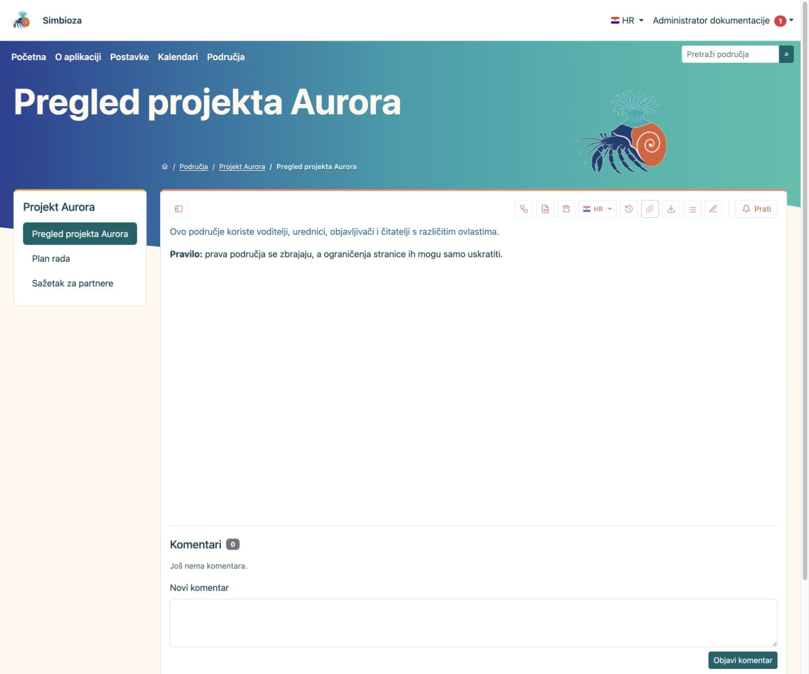
<figcaption>Projektna navigacija vidljiva je lijevo, dok se stablo po potrebi ponovno otvara njegovom ikonom u retku akcija.</figcaption>
</figure>

<figure class="my-4">
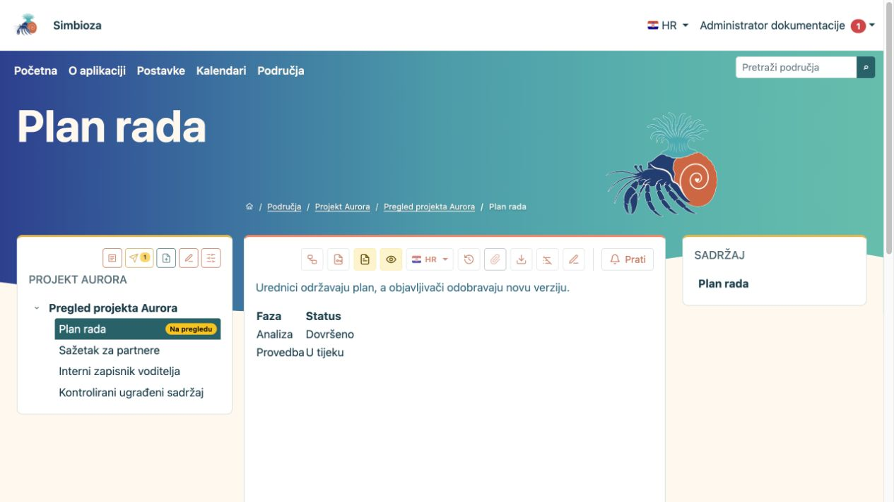
<figcaption>Administrator vidi stablo, akcije stranice, stanje nacrta i tijek objave.</figcaption>
</figure>

## 6. Uređivanje, pregled i objavljivanje

Simbioza odvaja uređivanje od objavljivanja. Urednik može spremiti nacrt, ali objavljena verzija ostaje dostupna čitateljima. Objavljivač otvara pregled nacrta i potvrđuje objavu.

<figure class="my-4">
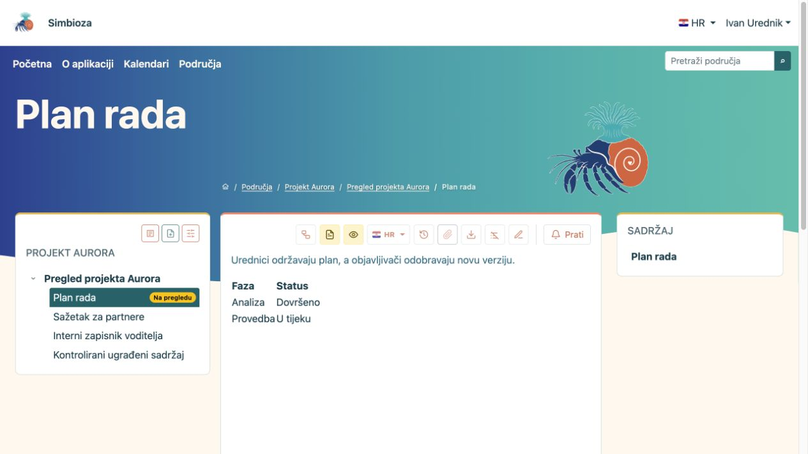
<figcaption>Ivan vidi uređivanje nacrta i pregled, ali nema akciju objave.</figcaption>
</figure>

<figure class="my-4">
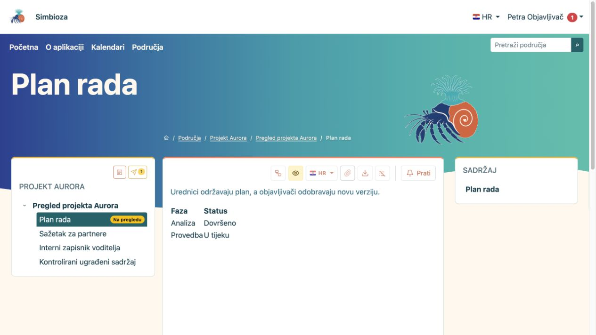
<figcaption>Petra vidi da postoji nacrt i može ga otvoriti radi odobravanja.</figcaption>
</figure>

<figure class="my-4">
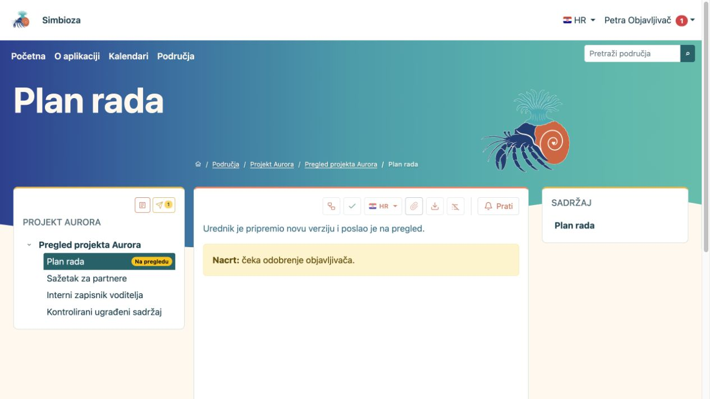
<figcaption>Objavljivač pregledava nacrt prije akcije Objavi.</figcaption>
</figure>

## 7. Ograničenja i izravna dopuštenja

Ta dva mehanizma namjerno su odvojena jer rješavaju suprotne potrebe.

### 7.1. Ograničenja naslijeđenih prava

U padajućem pretraživanju nalaze se samo korisnici koji već imaju neko pravo na području, izravno ili članstvom u grupi. Odabrani korisnik dodaje se u tablicu:

- zeleno s kvačicom znači da je pravo naslijeđeno i zadržano;
- crveno bez kvačice znači da je naslijeđeno pravo izričito uskraćeno;
- bijelo bez kvačice znači da korisnik to pravo uopće nema.

Ograničenje ne dodjeljuje novo pravo. Vrijedi na odabranoj stranici i svim njezinim podređenim stranicama. Uklanjanje korisnika iz tablice vraća potpuno nasljeđivanje.

<figure class="my-4">
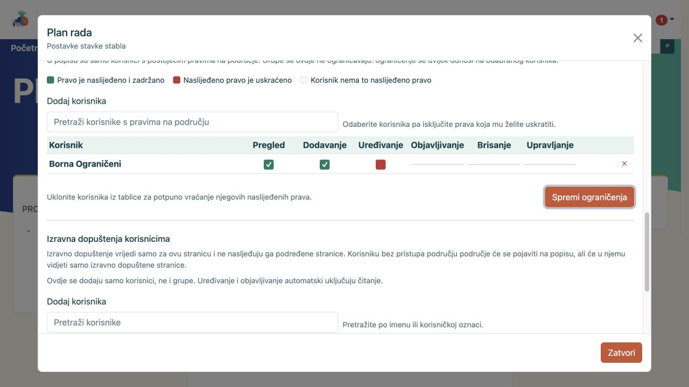
<figcaption>Borni je na stranici Plan rada uskraćeno uređivanje koje inače dobiva preko grupe.</figcaption>
</figure>

<figure class="my-4">
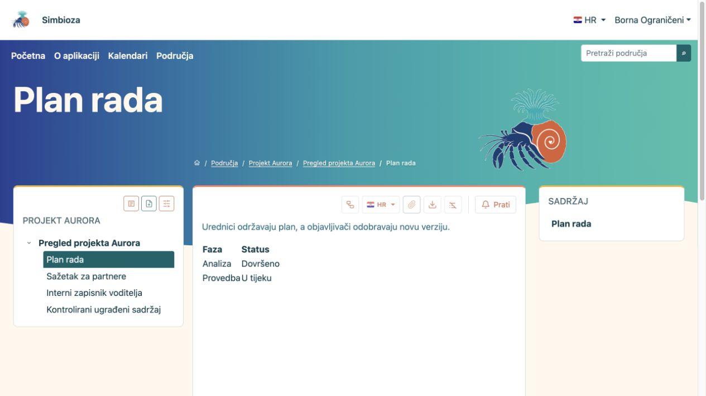
<figcaption>Borna i dalje čita Plan rada, ali više nema akcije uređivanja.</figcaption>
</figure>

### 7.2. Izravna dopuštenja

Izravno dopuštenje dodaje korisnika ili grupu na jednu stranicu. Može dati **čitanje**, **uređivanje** i **objavljivanje**; ne prenosi se na podređene stranice. U biraču grupa možete odabrati i **Javno**, koje daje samo čitanje bez prijave, ili **Svi prijavljeni**.

Na postavkama stranice pronađite **Izravna dopuštenja za korisnike i grupe**, odaberite osobu ili grupu, označite prava i spremite. Klik na birač otvara prvu skupinu, a pretraga i pomicanje učitavaju dodatne rezultate. Privatno područje tada se prikazuje osobi koja smije čitati barem tu stranicu. Nedostupni roditelji i ostale stranice ostaju skriveni; sama poveznica na njih ne daje pristup. Isto vrijedi za objavljenu anketu u području. Nacrti anketa time ne postaju javni.

<figure class="my-4">
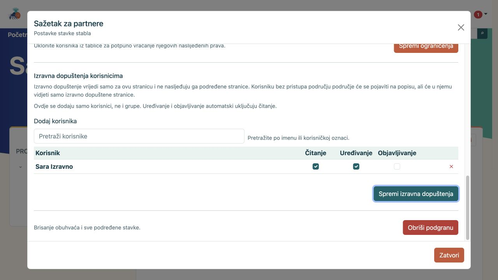
<figcaption>Sara dobiva čitanje i uređivanje Sažetka za partnere bez pristupa ostatku područja.</figcaption>
</figure>

<figure class="my-4">

<figcaption>Projekt Aurora pojavljuje se na Sarinom popisu područja.</figcaption>
</figure>

<figure class="my-4">
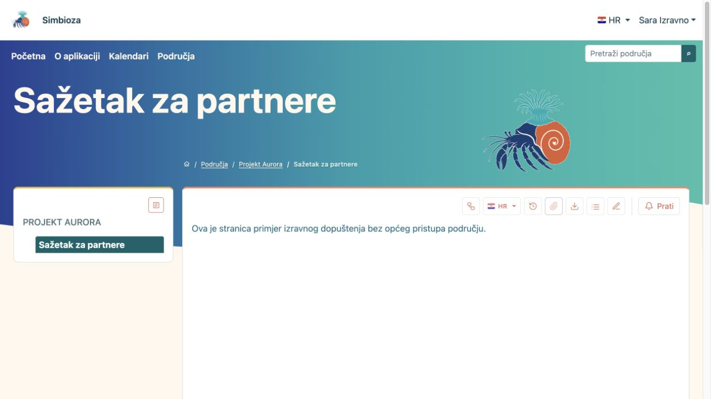
<figcaption>Sara vidi i uređuje samo izravno dopuštenu stranicu.</figcaption>
</figure>

<figure class="my-4">
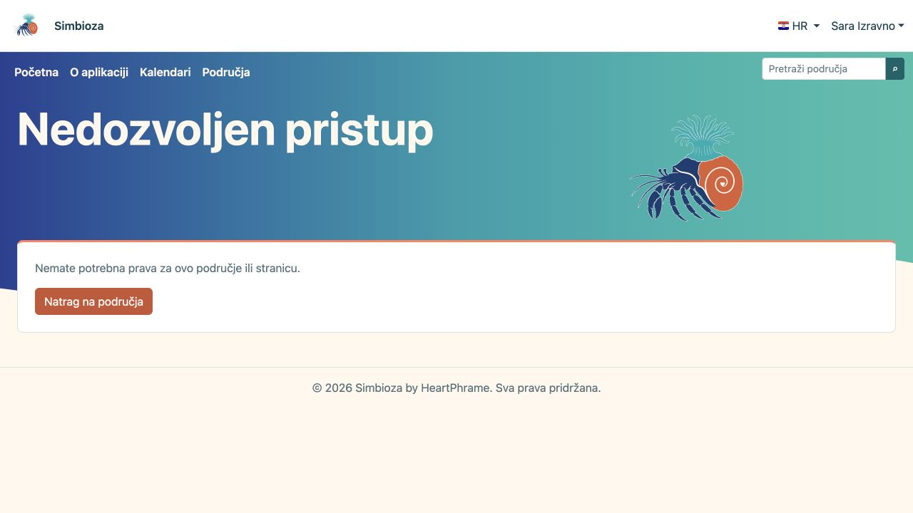
<figcaption>Pokušaj otvaranja druge stranice istog područja završava nedozvoljenim pristupom.</figcaption>
</figure>

## 8. Usporedni scenariji korisnika

| Uloga u primjeru | Što vidi i može |
|----|----|
| Administrator | Sva područja, globalne postavke, održavanje i sve akcije. |
| Upravitelj područja | Postavke jednog područja, prava, stablo, privatnu temu, posebne izbornike, izvoz i backup. |
| Urednik | Čitanje, dodavanje i uređivanje nacrta, bez objave. |
| Objavljivač | Pregled nacrta i objavu, bez uređivanja sadržaja ako pravo nije dodatno dano. |
| Čitatelj | Samo objavljene stranice na koje ima pravo. |
| Korisnik s izravnim dopuštenjem | Područje se pojavljuje u popisu, ali dostupna je samo izravno dopuštena stranica. |
| Prijavljeni bez posebnih prava | Javna područja, područja za sve prijavljene te izravno dopuštene stranice u privatnim područjima. |
| Gost | Javni sadržaj, uključujući objavljene stranice/ankete s javnom iznimkom u privatnom području. |

<figure class="my-4">
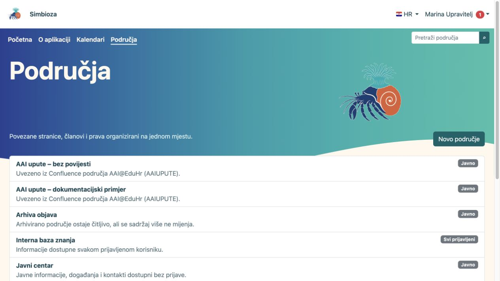
<figcaption>Marina vidi područja na koja ima pravo i akciju upravljanja Projektom Aurora.</figcaption>
</figure>

<figure class="my-4">
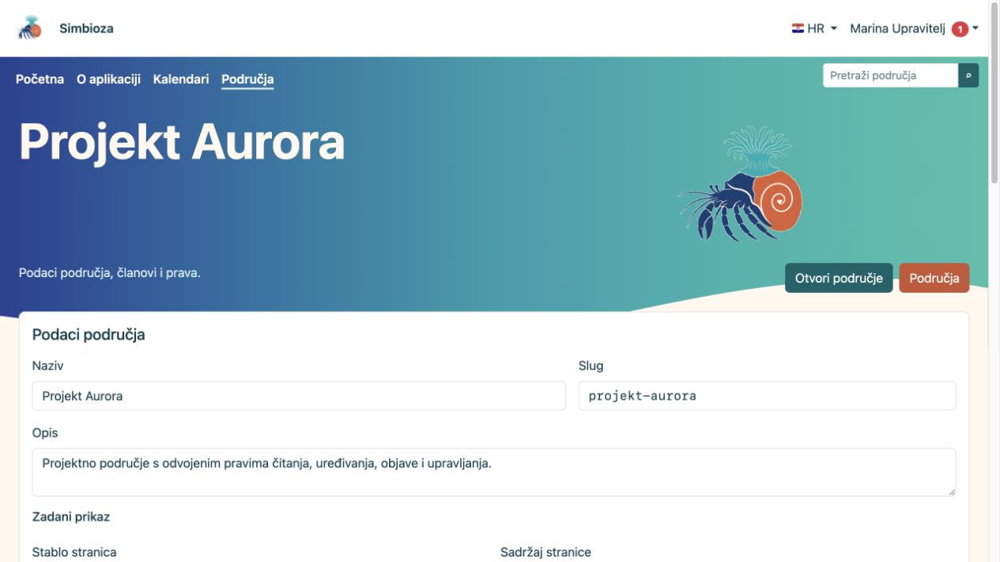
<figcaption>Upravitelj ima postavke područja bez administratorskih globalnih postavki.</figcaption>
</figure>

<figure class="my-4">
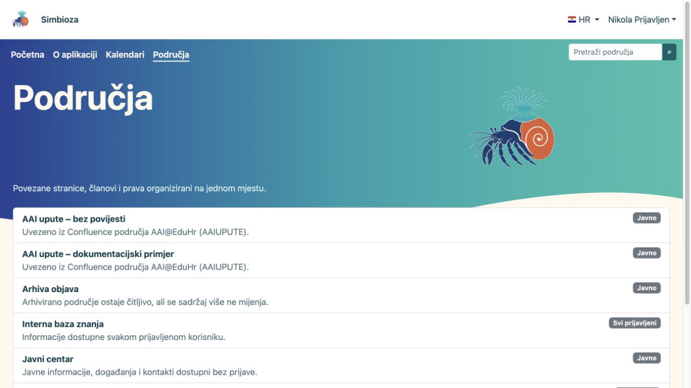
<figcaption>Nikola vidi javno područje i internu bazu dostupnu svim prijavljenima, ali ne ograničeni projekt.</figcaption>
</figure>

<figure class="my-4">
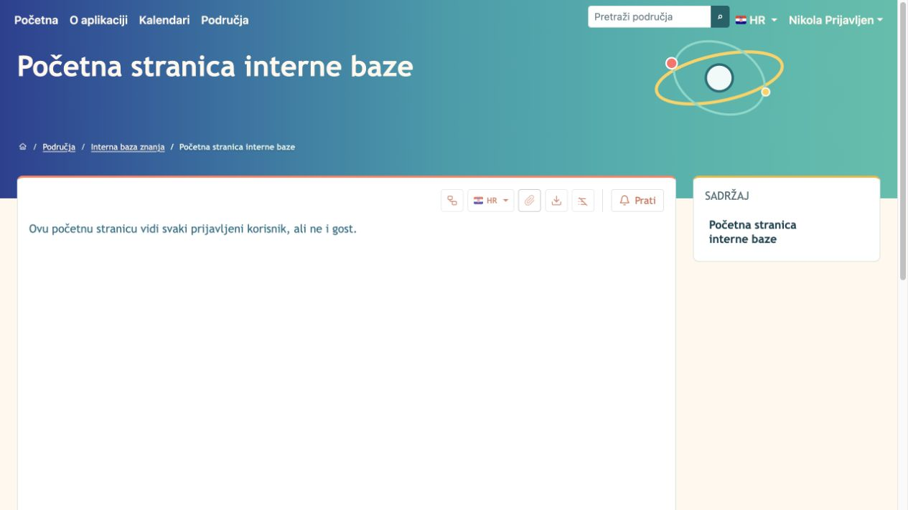
<figcaption>Nikola nakon prijave dolazi na početnu stranicu interne baze znanja.</figcaption>
</figure>

<figure class="my-4">
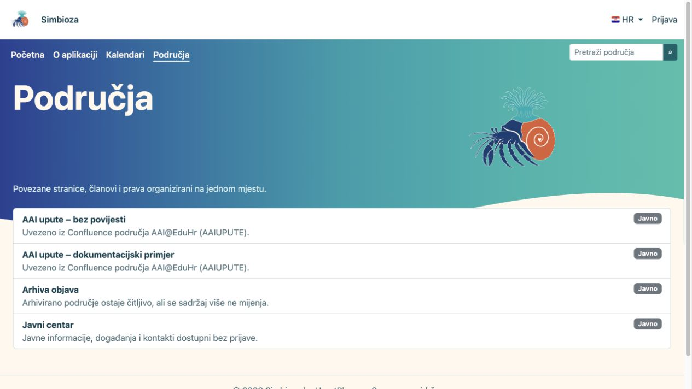
<figcaption>Primjer javno dostupnih područja u popisu neprijavljenog posjetitelja.</figcaption>
</figure>

<figure class="my-4">
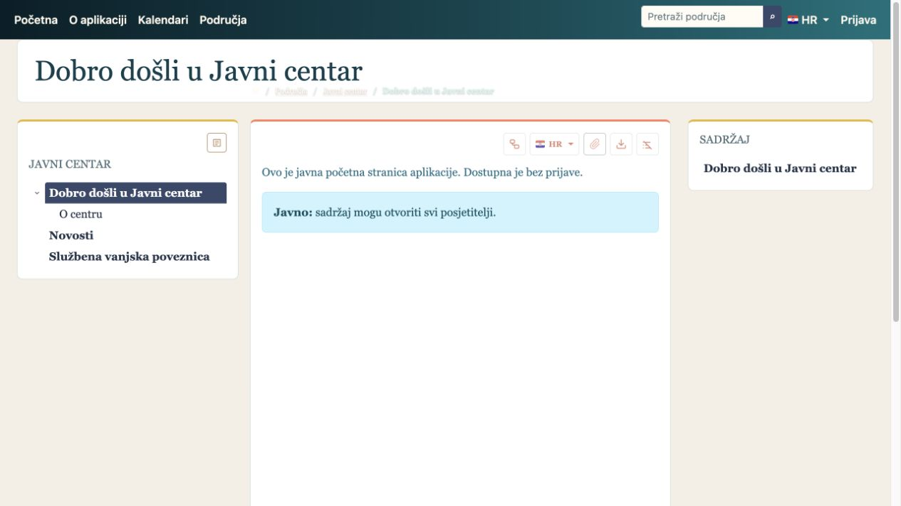
<figcaption>Gost se otvara na javno postavljenoj početnoj stranici.</figcaption>
</figure>

## 9. Uključeni sadržaj i provjera prava

Stranica može uključiti drugi dokument, kalendar ili drugi modul. Uključivanje ne zaobilazi prava izvora. Svaki gledatelj dobiva samo ono što bi smio otvoriti izravno:

- ako nema pravo na uključenu stranicu, prikazuje se kontrolirana poruka umjesto sadržaja;
- ako nema pravo na kalendar, njegovi događaji se ne otkrivaju;
- administrator ne treba zaključiti da će obični korisnik vidjeti isto samo zato što administratoru uključivanje radi.

<figure class="my-4">
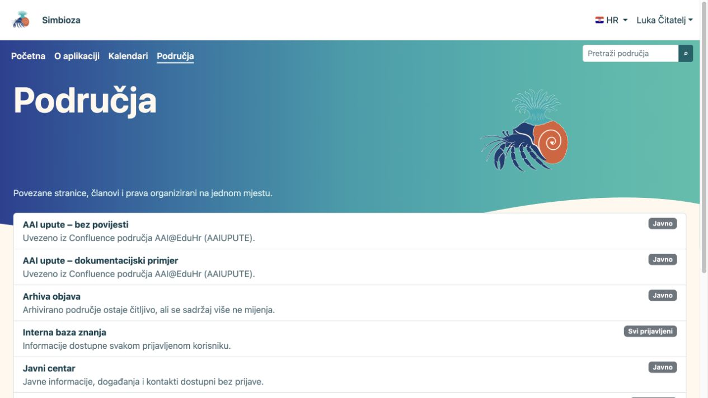
<figcaption>Luka vidi ograničeni projekt jer njegova grupa ima pravo pregleda.</figcaption>
</figure>

<figure class="my-4">
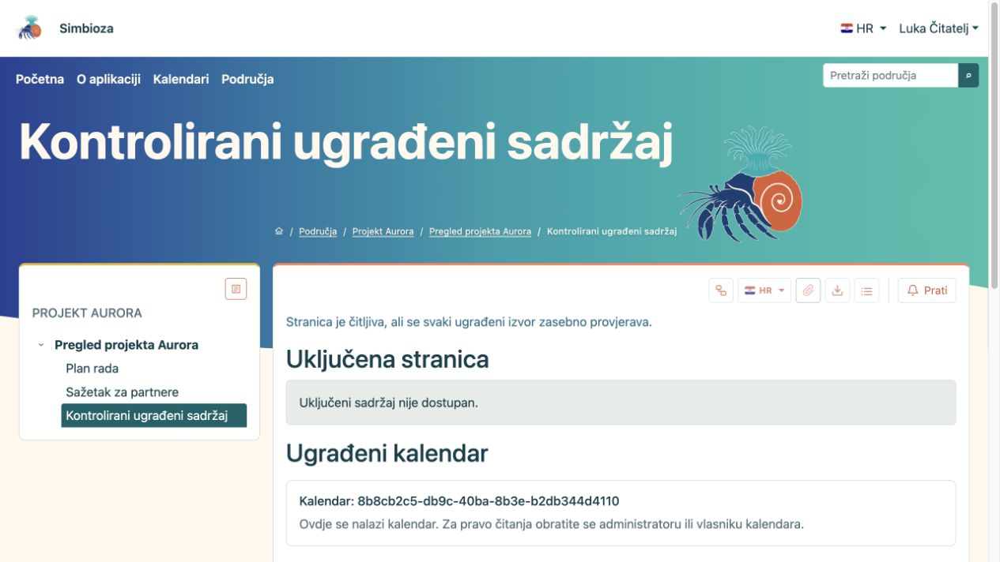
<figcaption>Na istoj stranici čitatelju se ne otkrivaju uključena privatna stranica ni kalendar za koje nema pravo.</figcaption>
</figure>

## 10. Tema područja

Područje može naslijediti sistemsku temu ili koristiti vlastitu privatnu temu. Korisnik s pravom **Upravljanje** otvara **Postavke područja → Uredi temu područja**. Tamo može odabrati ili izraditi temu samo za to područje. Sam postupak uređivanja teme nije dio ovih uputa.

<figure class="my-4">
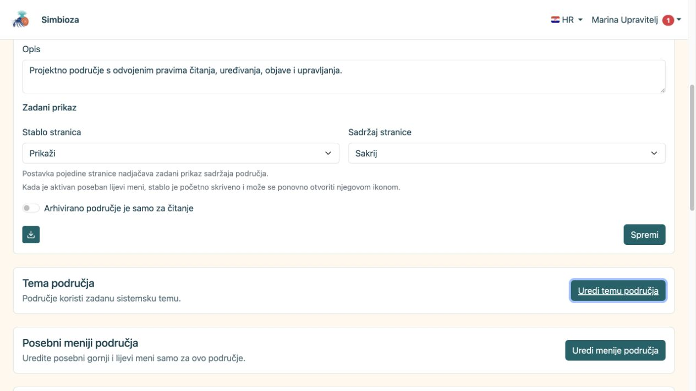
<figcaption>Upravitelj područja u njegovim postavkama vidi poveznicu Uredi temu područja. Sam Theme editor obrađen je u zasebnim uputama.</figcaption>
</figure>

Sljedeća dva gotova primjera pokazuju da tema može promijeniti zaglavlje, položaj naslova, hero ukras, tipografiju i boje, dok prava, stablo i sadržaj ostaju isti:

<figure class="my-4">
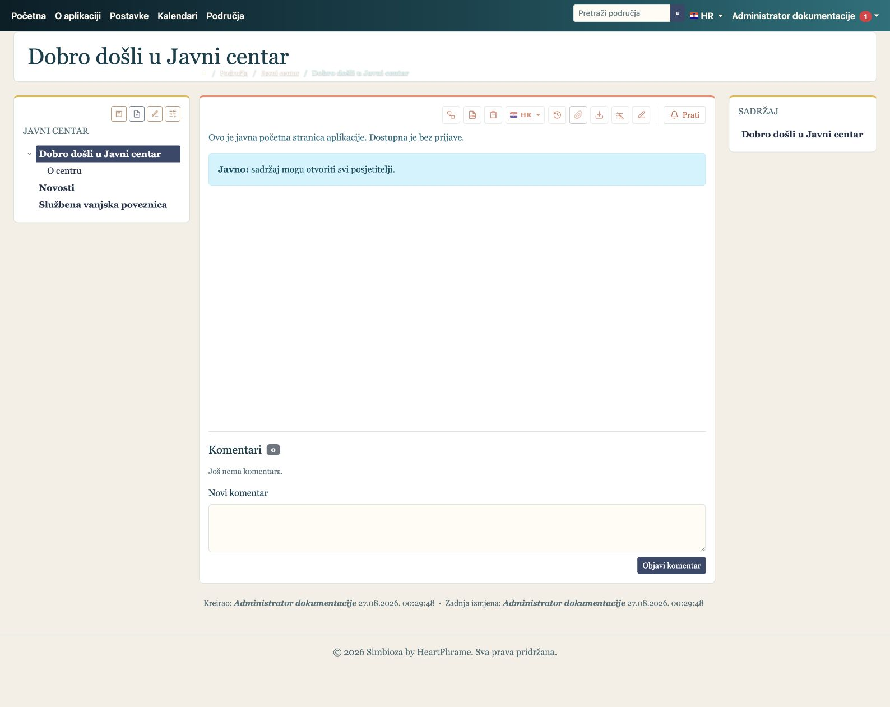
<figcaption>Javno područje bez klasičnog zaglavlja i bez naslova u hero elementu, s krem podlogom i serifnom tipografijom.</figcaption>
</figure>

<figure class="my-4">
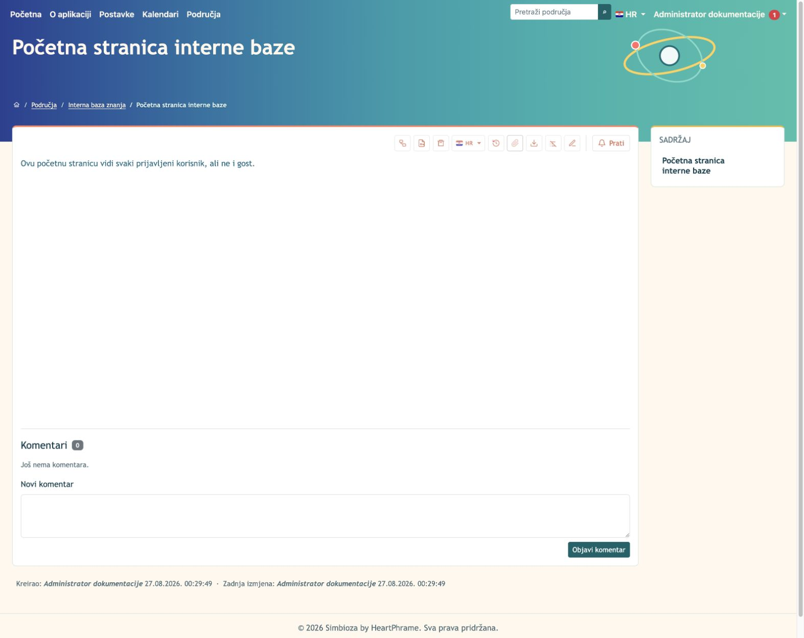
<figcaption>Interna baza bez klasičnog zaglavlja, ali s naslovom u prilagođenom hero elementu i drugačijim ukrasom.</figcaption>
</figure>

## 11. Statični HTML izvoz

Upravitelj može izvesti objavljene stranice koje smije čitati u samostalni ZIP paket. Izvoz je prikladan za predaju dokumentacije, arhivu ili offline pregled.

<figure class="my-4">
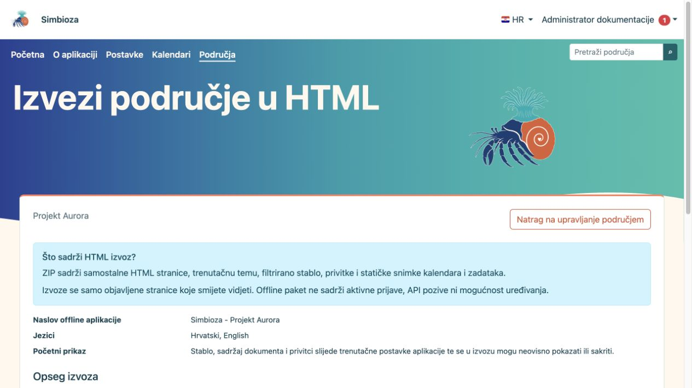
<figcaption>Izvoz obuhvaća dostupne objavljene stranice, navigaciju i potrebne javne resurse.</figcaption>
</figure>

<figure class="my-4">
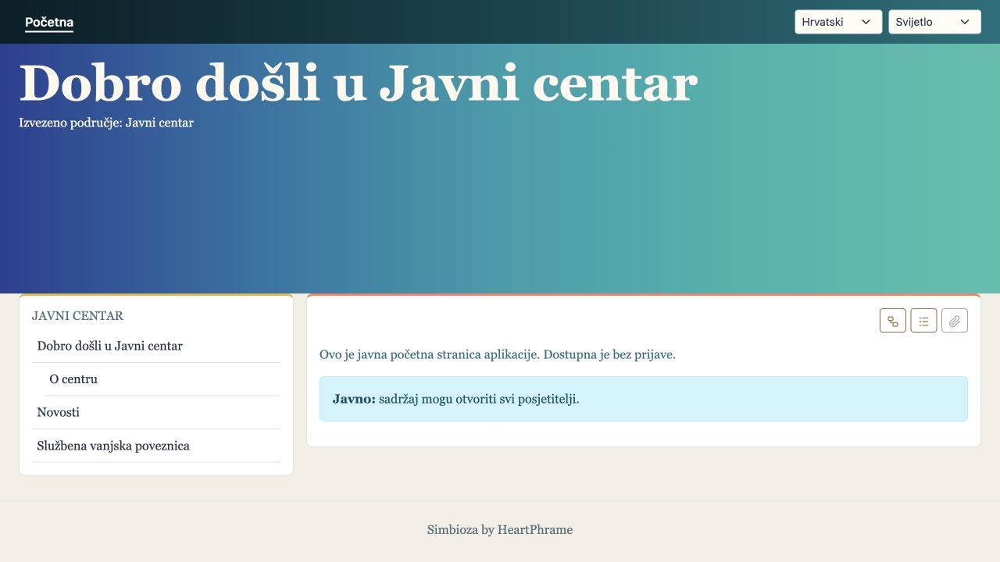
<figcaption>Izvezena stranica radi bez prijave i bez živog Simbioza API-ja.</figcaption>
</figure>

- Neobjavljeni nacrti i nedostupne stranice ne ulaze u izvoz.
- Ankete se izostavljaju: HTML paket ne može ponovno stvoriti prijavu ispitanika, prikupljanje odgovora i rezultate. Za prijenos anketa koristite backup.
- Ako dokument koristi odobrene skripte, lokalne datoteke i ugrađeni kod ulaze u izvoz, a odobreni vanjski CSS/JavaScript ostaju poveznice. Za njih je potrebna mreža; neprihvaćene skripte ne uključuju se. Vlastite interaktivne tablice Simbioze imaju lokalni izvršni kod.
- Interaktivne funkcije koje ovise o prijavi, pravima ili API-ju ne postaju offline aplikacija.
- Nakon izvoza raspakirajte ZIP i provjerite `index.html`, navigaciju, slike i poveznice.

## 12. Backup i vraćanje područja

Backup je namijenjen prijenosu i vraćanju područja. Sadrži podržani sadržaj, povijest, privitke, stablo, prava, privatnu temu, posebne izbornike i indeksne podatke. Ako su u području ankete, njihov provider prenosi pitanja, prijevode, revizije, prihvaćene odgovore, ovlasti i pripadajuće medije. Postavke vanjskih providera i globalne postavke anketa pripadaju backupu cijelog sitea; vidi [Sigurnosne kopije anketa](ankete-backup-detalji_hr.md).

**Za potpuni oporavak sastanaka koristite backup komponente Kalendari ili cijelog sitea.** Backup područja prenosi povezane kalendare i njihove događaje, ali ne zasebne zapise sudionika, odgovora, rezervacija i odobravatelja ni CalDAV vjerodajnice. Pri vraćanju kopije već postojeći kalendar s istim UUID-om ponovno se koristi; ne stvara se neovisna kopija dijeljenog rasporeda.

<figure class="my-4">
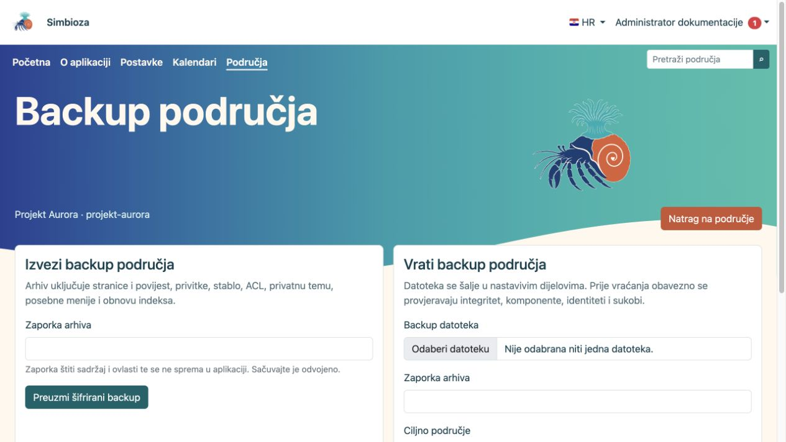
<figcaption>Izvoz šifrirane sigurnosne kopije i obrazac za prijenos backupa.</figcaption>
</figure>

1.  Na postavkama područja otvorite **Upravljaj backupom područja**.
2.  Pri izvozu postavite jaku frazu i spremite je odvojeno. Fraza se ne pohranjuje u backup.
3.  Pri vraćanju prenesite ZIP, unesite frazu i prvo pokrenite provjeru.
4.  Pregledajte verziju formata, module, broj stranica, prava, temu i moguće sukobe sluga.
5.  Odaberite vraćanje u postojeće područje ili stvaranje nove kopije s novim slugom.

<figure class="my-4">
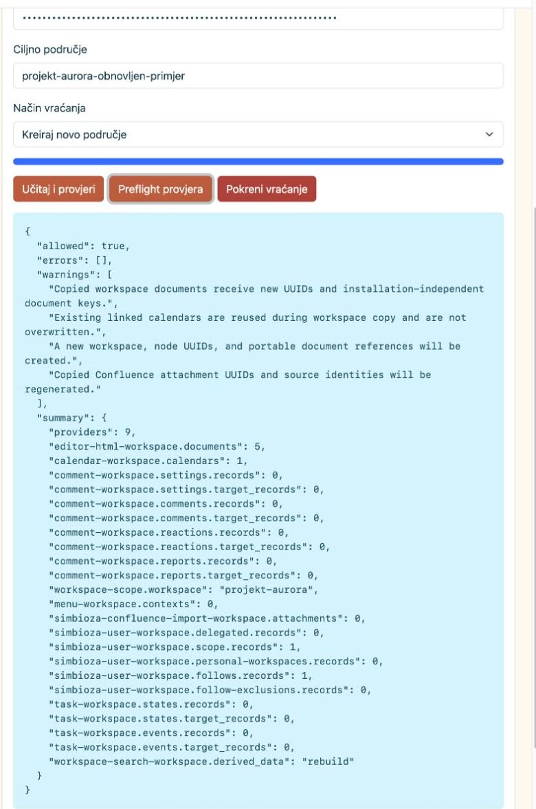
<figcaption>Preflight prikazuje sadržaj i omogućuje novi ciljni slug prije stvaranja kopije.</figcaption>
</figure>

<figure class="my-4">
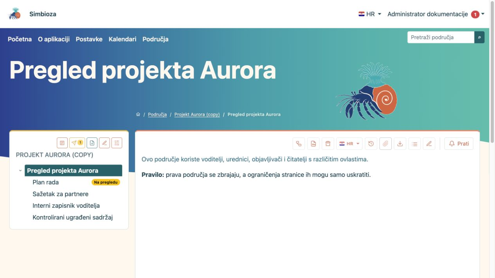
<figcaption>Projekt Aurora uspješno je vraćen kao zasebno područje s novim slugom.</figcaption>
</figure>

Vraćanje u postojeće područje može zamijeniti postojeće podatke. Prije potvrde napravite aktualni backup cilja. Za probu koristite novu kopiju i novi slug; tek nakon provjere planirajte zamjenu produkcijskog područja.

## 13. Mobilni prikaz

Na uskom zaslonu stablo i sadržaj pretvaraju se u bočne gumbe. Dodir otvara karticu preko stranice, a zatvaranje vraća sadržaj. Akcije dokumenta ostaju u kompaktnom retku.

<figure class="my-4">
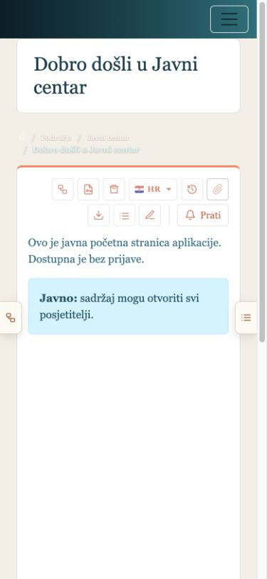
<figcaption>Cijeli mobilni viewport s bočnim gumbima za stablo i sadržaj.</figcaption>
</figure>

<figure class="my-4">
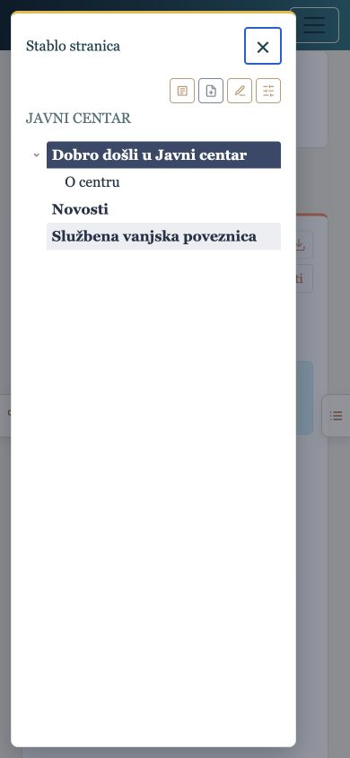
<figcaption>Stablo područja otvara se kao zasebna kartica prikladna dodiru.</figcaption>
</figure>

<figure class="my-4">
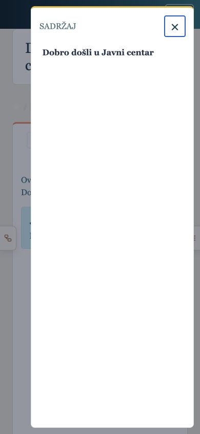
<figcaption>Sadržaj dokumenta otvara se kao zasebna mobilna kartica.</figcaption>
</figure>

<figure class="my-4">
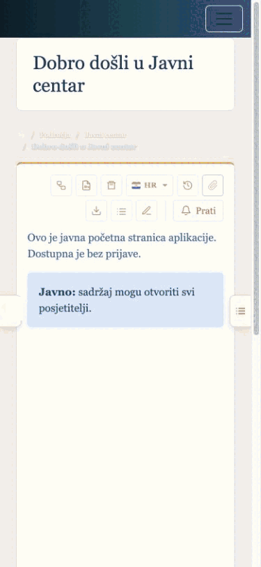
<figcaption>Animacija s vidljivim pokazivačem miša prikazuje otvaranje kartice stabla i kartice sadržaja.</figcaption>
</figure>

## 14. Arhiviranje, brisanje, pretraga i održavanje

### 14.1. Arhiviranje i soft brisanje

**Arhivirano područje** ostaje dostupno čitateljima, ali je samo za čitanje. Koristite ga za završene projekte kojima URL-ovi i povijest moraju ostati dostupni. Ponovnim isključivanjem arhiviranja vraćaju se izmjene prema postojećim pravima.

**Soft brisanje** uklanja područje iz normalnih popisa, ali čuva podatke za administratorski povrat. Prije brisanja provjerite naslovnicu aplikacije, ugrađene stranice, posebne menije i vanjske poveznice koje bi mogle upućivati na područje.

### 14.2. Indeks pretrage

Indeks sadrži samo sadržaj koji modul pretrage treba ponuditi korisnicima uz primjenu njihovih prava. Ponovna izgradnja ne mijenja dokumente; ponovno čita objavljene stranice i osvježava pretražive zapise. Pokrenite je nakon velikog importa, masovnog vraćanja, promjene većeg broja sluga ili kada rezultat ostane zastario. Tijekom dijagnostike najprije pogledajte stanje i broj zapisa, a tek zatim pokrenite izgradnju.

<figure class="my-4">

<figcaption>Stanje indeksa i administratorske akcije za ponovnu izgradnju pretraživih zapisa.</figcaption>
</figure>

### 14.3. Pregled zauzeća

Vrh ekrana **Održavanje** je izvještaj prije čišćenja. *Povijesne verzije* i *Obrisane stranice* prikazuju broj zapisa, *Procjena baze* procjenjuje korisni sadržaj redaka, a *Datotečni sustav* prikazuje zauzeće datoteka. Odvojeni zbrojevi za povijest i obrisano pomažu procijeniti koliko bi ciljano čišćenje oslobodilo. Tablica po području otkriva koji prostor zapravo troši resurse.

<figure class="my-4">
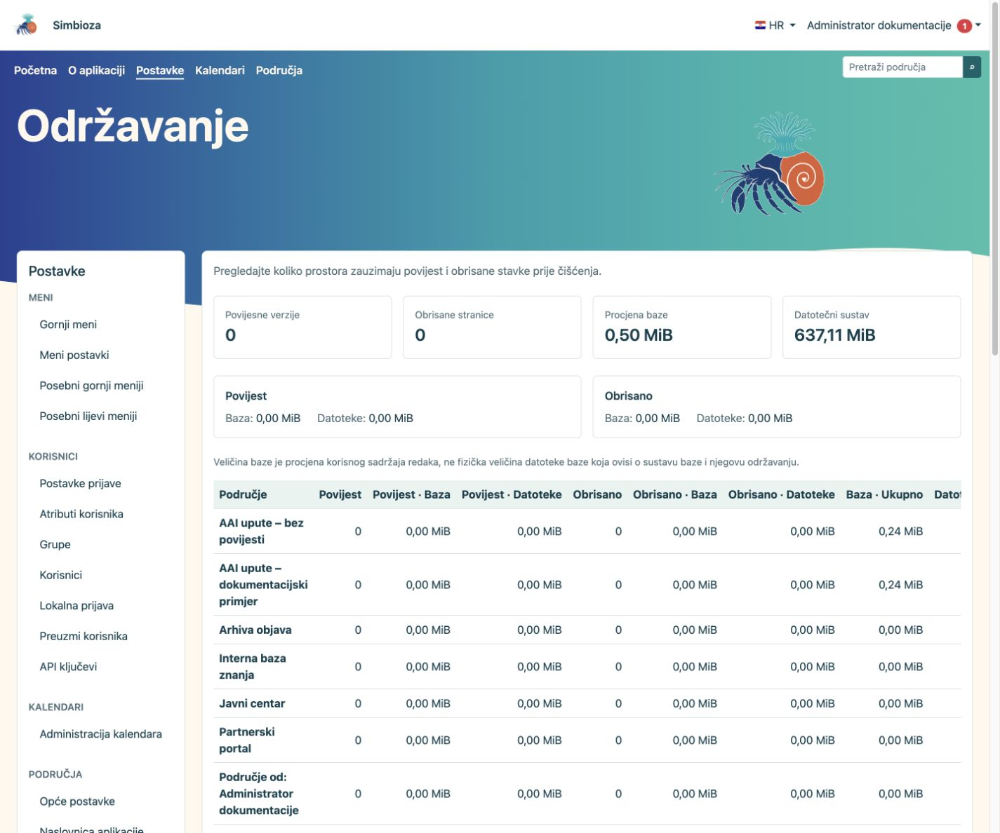
<figcaption>Broj povijesnih i obrisanih zapisa, procjena baze, datoteke i usporedba po području.</figcaption>
</figure>

Procjena baze nije fizička veličina SQLite/MySQL/PostgreSQL datoteke. Nakon brisanja redaka fizičko smanjenje može ovisiti o zasebnom održavanju odabranog sustava baze.

### 14.4. Optimizacija slika

**Optimiziraj postojeće slike** izrađuje manje web-kopije radi bržeg učitavanja. Original ostaje sačuvan i dostupan otvaranjem slike, pa akcija ne služi kompresiranju ili uklanjanju izvornika. Pokrenite je nakon velikog importa ili dodavanja većeg broja neoptimiziranih fotografija.

### 14.5. Čišćenje povijesti i obrisanih stavki

<figure class="my-4">
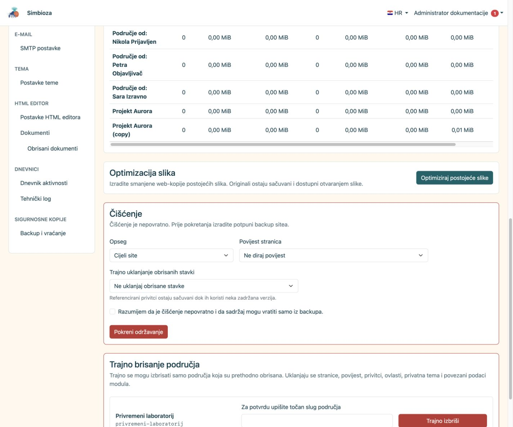
<figcaption>Vidljivi su opseg, politika povijesti, starost obrisanih stavki, potvrda nepovratnosti i gumb Pokreni održavanje.</figcaption>
</figure>

Čišćenje je nepovratno i mora mu prethoditi potpuni backup sitea. Svako polje ima zasebnu svrhu:

- **Opseg** ograničava akciju na cijeli site ili jedno odabrano područje. Za rutinsko održavanje preferirajte najmanji potreban opseg.
- **Povijest stranica** može ostati netaknuta, ukloniti svu povijest osim aktualnih i objavljenih verzija, zadržati zadnjih 3/5/10 verzija ili ukloniti verzije starije od 10/30/90 dana.
- **Trajno uklanjanje obrisanih stavki** može biti isključeno ili obuhvatiti stavke starije od 10, 30 ili 90 dana.
- Privitak se ne uklanja dok ga koristi bilo koja zadržana verzija. Time se sprječava lomljenje aktualnog ili zadržanog povijesnog sadržaja.
- Akcija se ne pokreće bez ručne potvrde da je sadržaj moguće vratiti samo iz backupa.

### 14.6. Trajno brisanje područja

<figure class="my-4">
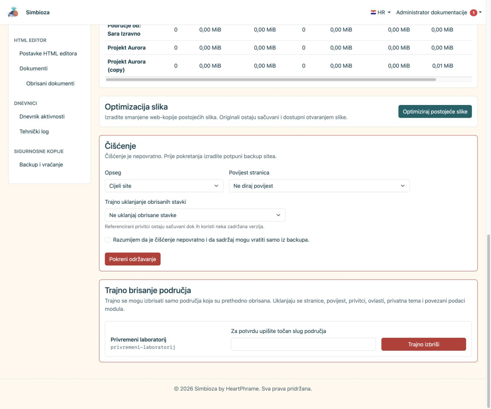
<figcaption>Za potvrdu se mora upisati točan slug; uklanjanje obuhvaća stranice, povijest, privitke, ovlasti, privatnu temu i podatke povezanih modula.</figcaption>
</figure>

Na popisu se pojavljuju samo već soft-obrisana područja. Točan slug služi kao namjerna zaštita od slučajnog klika. Nakon potvrde uklanjaju se stranice, povijest, privitci, ACL, privatna tema, posebni meniji i povezani podaci modula. Povrat je moguć samo iz valjanog backupa, zato najprije provjerite probno vraćanje i tek potom trajno brišite.

## 15. Završna provjera

1.  Otvorite područje kao administrator i kao korisnik s pravom upravljanja.
2.  Provjerite urednika bez objave i objavljivača bez uređivanja.
3.  Provjerite barem jednog čitatelja, prijavljenog korisnika bez ACL-a i gosta.
4.  Provjerite ograničenje na roditeljskoj i podređenoj stranici.
5.  Provjerite izravno dopuštenje i potvrdite da ostatak područja nije dostupan.
6.  Otvorite ugrađenu stranicu i kalendar s korisnikom koji nema prava na izvor.
7.  Provjerite zadani i pojedinačni prikaz stabla/sadržaja na računalu i mobitelu.
8.  Izvezite HTML i otvorite ga izvan prijavljene sesije.
9.  Napravite backup, vratite probnu kopiju s novim slugom i usporedite broj stranica i prava.

Dobro podešeno područje pokazuje svakom korisniku samo potreban sadržaj i samo dopuštene akcije. Ne provjeravajte prava isključivo administratorskim računom: završna provjera mora uključiti sve stvarne uloge.

