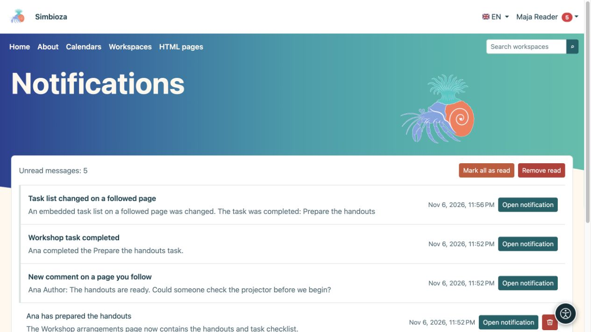

# Änderungen verfolgen und Benachrichtigungen lesen

> Die Bildschirmaufnahmen zeigen die englische Benutzeroberfläche.

[Zusammenarbeit](suradnja_de.md)

**Ziel:** Erfahren Sie, wann sich für Sie wichtige Inhalte ändern, ohne sie ständig zu überprüfen. Das Folgende ist eine persönliche Auswahl für angemeldete Benutzer und gewährt keinen zusätzlichen Zugriff.

## Beginnen oder stoppen Sie das Folgen

Wählen Sie in einem Arbeitsbereich, einer veröffentlichten Seite oder einer Aufgabenliste die glockenförmige Aktion **Folgen** aus. Wählen Sie **Nicht mehr folgen**, um die Benachrichtigungen dieses Ziels zu stoppen, ohne Inhalte zu löschen.

Ein Kalenderabonnement aktiviert das Folgen. In Ihrem Profil können Sie Benachrichtigungen stummschalten, ohne das Abonnement zu beenden oder den Kalender aus der Ansicht auszublenden. Den Kalender selbst finden Sie unter [Kalenderabonnements](kalendari-pregled_de.md).

## Zustellung auswählen

1. Öffnen Sie **Mein Profil → Folgen und Benachrichtigungen**.
2. Wählen Sie unter **Benachrichtigungseinstellungen** aus, ob Sie auch E-Mails erhalten möchten.
3. Wählen Sie den **Standard-Zustellungsmodus** und optional Benachrichtigungen über Ihre eigenen Änderungen.
4. Wählen Sie **Einstellungen zum Folgen speichern** und lesen Sie die Bestätigung.

| Modus | Ergebnis |
| --- | --- |
| Nur In-App | Benachrichtigungen in Ihrem Posteingang ohne E-Mail-Kopien. |
| Sofort per E-Mail senden | Eine In-App-Benachrichtigung und E-Mail, ohne auf eine tägliche Zusammenfassung warten zu müssen. |
| Tägliche Zusammenfassung | Sofortige In-App-Benachrichtigungen; E-Mail fasst Änderungen am nächsten Tag in einem Digest zusammen. |
| Nur wichtige Änderungen | Alle zulässigen Änderungen in der App, E-Mail jedoch nur für unterstützte wichtige Aktionen. |

Suchen Sie unter **Verfolgte Inhalte** nach dem Namen oder filtern Sie nach dem Status. Für jeden Eintrag können Sie mit den Zustellungsschaltflächen eine abweichende Einstellung wählen. Die aktive Schaltfläche und der Hinweistext zeigen den aktuellen Modus an. Warten Sie nach einer Änderung auf die Bestätigung. Der Hauptschalter für E-Mail hat Vorrang vor den einzelnen Einstellungen.

**Ergebnis:** Sie folgen den Inhalten im gewählten Tempo. Seiten werden bei Veröffentlichung benachrichtigt; Durch das alleinige Speichern eines Entwurfs werden die Leser nicht benachrichtigt. Änderungen an eingebetteten Kalendern oder Aufgabenlisten können Follower auch über die enthaltene Seite informieren. Die Zustellung hängt auch von aktivierten Modulen und konfiguriertem E-Mail-Versand ab.

## Öffnen Sie Ihren Posteingang

1. Wählen Sie im Kontomenü **Benachrichtigungen**.
2. Öffnen Sie eine Nachricht oder ihre Aktion. Bei Besprechungen kann **Besprechung öffnen und antworten** angeboten werden, während bei einer Reservierung **Anfrage öffnen und entscheiden** angeboten werden kann.
3. Verwenden Sie **Vorherige / Nächste** für zusätzliche Seiten.
4. **Alle als gelesen markieren** ändert den Nachrichtenstatus; **Gelesene entfernen** entfernt gelesene Nachrichten aus Ihrem Posteingang.

<figure class="my-4">

<figcaption>Nachrichten verweisen auf eine verfolgte Seite, einen Kommentar oder eine Aufgabenänderung. Durch das Markieren oder Entfernen von Nachrichten wird dieser Inhalt nicht gelöscht.</figcaption>
</figure>

Durch das Entfernen einer Benachrichtigung wird die Quellseite, Besprechung oder Aufgabe nicht gelöscht. Der Verlust des Zugriffs auf die Quelle bedeutet, dass eine alte Benachrichtigung sie nicht erneut öffnen oder den Zugriff wiederherstellen kann. Erwarten Sie nicht, dass jeder gespeicherte Entwurf oder Ihre eigene Änderung Sie benachrichtigt: Überprüfen Sie die Veröffentlichungsregeln und die Präferenz für eigene Änderungen.
