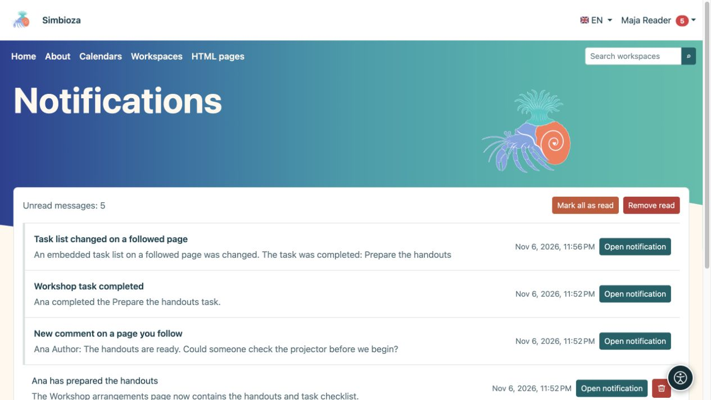

# Follow changes and read notifications

[Collaboration](suradnja_en.md)

**Goal:** learn when content important to you changes without constantly checking it. Following is a personal choice for signed-in users and grants no additional access.

## Start or stop following

On a workspace, published page or task list, select the bell-shaped **Follow** action. Select **Unfollow** to stop that target's notifications without deleting content.

A calendar subscription enables following. In your profile you may mute its notifications without unsubscribing or hiding it from the schedule. See [calendar subscriptions](kalendari-pregled_en.md) for the schedule itself.

## Choose delivery

1. Open **My profile → Following and notifications**.
2. Under **Notification settings**, choose whether to receive email as well.
3. Choose the **Default delivery mode** and optionally notifications about your own changes.
4. Select **Save following settings** and read the confirmation.

| Mode | Result |
| --- | --- |
| In-app only | Notifications in your inbox without email copies. |
| Email immediately | An in-app notification and email without waiting for a daily digest. |
| Daily digest | Immediate in-app notifications; email combines changes into a digest the following day. |
| Important changes only | All permitted changes in-app, but email only for supported important actions. |

Under **Followed content**, search by name or filter the state. Each item's delivery buttons may override the default. The active button and explanation show the current mode; wait for confirmation after changing it. The main email switch takes precedence over individual choices.

**Result:** you follow content at the chosen pace. Pages notify on publication; saving a draft alone does not notify readers. Changes to embedded calendars or task lists may also notify followers of their containing page. Delivery also depends on enabled modules and configured email sending.

## Open your inbox

1. Choose **Notifications** in the account menu.
2. Open a message or its action. Meetings may offer **Open meeting and respond**, while a reservation may offer **Open request and decide**.
3. Use **Previous / Next** for additional pages.
4. **Mark all as read** changes message state; **Remove read** removes read messages from your inbox.

<figure class="my-4">

<figcaption>Messages link to a followed page, comment or task change. Marking or removing messages does not delete that content.</figcaption>
</figure>

Removing a notification does not delete its source page, meeting or task. Losing access to the source means an old notification cannot reopen it or restore access. Do not expect every saved draft or your own change to notify you: check publication rules and the own-change preference.
