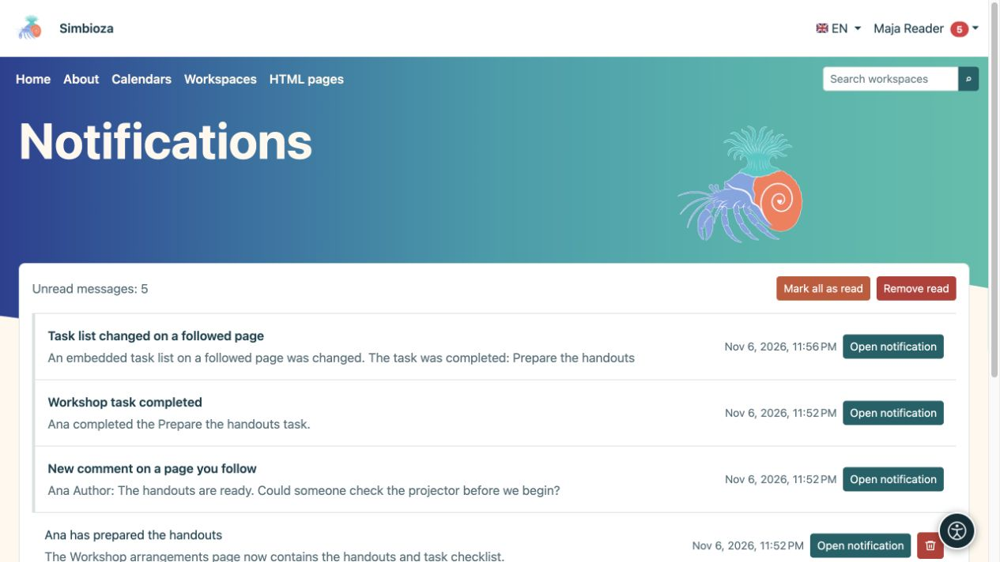

# Seguir cambios y leer notificaciones

> Las capturas de pantalla muestran la interfaz en inglés.

[Colaboración](suradnja_es.md)

**Objetivo:** saber cuándo cambia el contenido importante para usted sin comprobarlo constantemente. Lo siguiente es una elección personal para los usuarios que han iniciado sesión y no otorga acceso adicional.

## Empezar o dejar de seguir

En un espacio de trabajo, página publicada o lista de tareas, seleccione la acción **Seguir** en forma de campana. Seleccione **Dejar de seguir** para detener las notificaciones de ese objetivo sin eliminar el contenido.

Suscribirse a un calendario activa su seguimiento. En el perfil puede silenciar las notificaciones sin cancelar la suscripción ni ocultarlo de la vista. Para consultar el calendario, vea [suscripciones a calendarios](kalendari-pregled_es.md).

## Elija la entrega

1. Abra **Mi perfil → Seguimiento y notificaciones**.
2. En **Configuración de notificaciones**, elija si desea recibir también correo electrónico.
3. Elija el **Modo de entrega predeterminado** y, opcionalmente, notificaciones sobre sus propios cambios.
4. Seleccione **Guardar la siguiente configuración** y lea la confirmación.

| Modo | Resultado |
| --- | --- |
| Solo en la aplicación | Notificaciones en su bandeja de entrada sin copias de correo electrónico. |
| Envíe un correo electrónico inmediatamente | Una notificación en la aplicación y un correo electrónico sin esperar un resumen diario. |
| Resumen diario | Notificaciones inmediatas dentro de la aplicación; El correo electrónico combina los cambios en un resumen al día siguiente. |
| Sólo cambios importantes | Todos los cambios permitidos en la aplicación, pero solo por correo electrónico para acciones importantes admitidas. |

En **Contenido seguido**, busque por nombre o filtre por estado. Los botones de entrega de cada elemento pueden sustituir la opción predeterminada. El botón activo y su explicación indican el modo actual; espere la confirmación después de cambiarlo. El interruptor general del correo electrónico tiene prioridad sobre las opciones individuales.

**Resultado:** sigue el contenido al ritmo elegido. Las páginas notifican sobre la publicación; guardar un borrador por sí solo no notifica a los lectores. Los cambios en los calendarios integrados o las listas de tareas también pueden notificar a los seguidores la página que los contiene. La entrega también depende de los módulos habilitados y del envío de correo electrónico configurado.

## Abra su bandeja de entrada

1. Elija **Notificaciones** en el menú de la cuenta.
2. Abrir un mensaje o su acción. Las reuniones pueden ofrecer **Abrir reunión y responder**, mientras que una reserva puede ofrecer **Abrir solicitud y decidir**.
3. Utilice **Anterior/Siguiente** para páginas adicionales.
4. **Marcar todo como leído** cambia el estado del mensaje; **Eliminar leído** elimina los mensajes leídos de su bandeja de entrada.

<figure class="my-4">

<figcaption>Los mensajes enlazan a una página seguida, un comentario o un cambio de tarea. Marcar o eliminar mensajes no elimina ese contenido.</figcaption>
</figure>

Eliminar una notificación no elimina su página de origen, reunión o tarea. Perder el acceso a la fuente significa que una notificación antigua no puede reabrirla ni restaurar el acceso. No espere que cada borrador guardado o su propio cambio le notifiquen: verifique las reglas de publicación y la preferencia de cambio propio.
