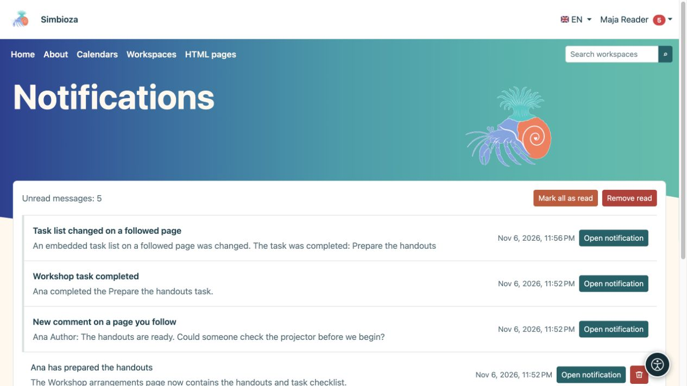

# Suivre les modifications et lire les notifications

> Les captures d’écran présentent l’interface en anglais.

[Collaboration](suradnja_fr.md)

**Objectif :** savoir quand le contenu important pour vous change sans le vérifier constamment. Ce qui suit est un choix personnel pour les utilisateurs connectés et n’accorde aucun accès supplémentaire.

## Commencer ou arrêter de suivre

Sur un espace de travail, une page publiée ou une liste de tâches, sélectionnez l'action **Suivre** en forme de cloche. Sélectionnez **Ne plus suivre** pour arrêter les notifications de cette cible sans supprimer le contenu.

Un abonnement au calendrier permet de suivre. Dans votre profil, vous pouvez désactiver ses notifications sans vous désinscrire ni le masquer de la programmation. Voir [abonnements au calendrier](kalendari-pregled_fr.md) pour le calendrier lui-même.

## Choisissez la livraison

1. Ouvrez **Mon profil → Suivis et notifications**.
2. Sous **Paramètres de notification**, choisissez si vous souhaitez également recevoir des e-mails.
3. Choisissez le **Mode de livraison par défaut** et éventuellement des notifications concernant vos propres modifications.
4. Sélectionnez **Enregistrer les paramètres suivants** et lisez la confirmation.

| Mode | Résultat |
| --- | --- |
| Dans l'application uniquement | Notifications dans votre boîte de réception sans copies d'e-mails. |
| Envoyez un e-mail immédiatement | Une notification et un e-mail dans l'application sans attendre un résumé quotidien. |
| Résumé quotidien | Notifications immédiates dans l'application ; l'e-mail combine les modifications dans un résumé le lendemain. |
| Modifications importantes uniquement | Toutes les modifications autorisées dans l'application, mais par e-mail uniquement pour les actions importantes prises en charge. |

Sous **Contenu suivi**, recherchez par nom ou filtrez l'état. Les boutons de livraison de chaque article peuvent remplacer ceux par défaut. Le bouton actif et l'explication affichent le mode actuel ; attendez la confirmation après l'avoir modifié. Le commutateur principal de messagerie a priorité sur les choix individuels.

**Résultat :** vous suivez le contenu au rythme choisi. Les pages notifient la publication ; l'enregistrement d'un brouillon à lui seul n'informe pas les lecteurs. Les modifications apportées aux calendriers intégrés ou aux listes de tâches peuvent également informer les abonnés de la page qui les contient. La livraison dépend également des modules activés et de l'envoi d'e-mails configurés.

## Ouvrez votre boîte de réception

1. Choisissez **Notifications** dans le menu du compte.
2. Ouvrez un message ou son action. Les réunions peuvent proposer **Ouvrir la réunion et répondre**, tandis qu'une réservation peut proposer **Ouvrir la demande et décider**.
3. Utilisez **Précédent/Suivant** pour des pages supplémentaires.
4. **Marquer tout comme lu** change l'état du message ; **Supprimer la lecture** supprime les messages lus de votre boîte de réception.

<figure class="my-4">

<figcaption>Les messages renvoient vers une page suivie, un commentaire ou un changement de tâche. Marquer ou supprimer des messages ne supprime pas ce contenu.</figcaption>
</figure>

La suppression d'une notification ne supprime pas sa page source, sa réunion ou sa tâche. La perte d'accès à la source signifie qu'une ancienne notification ne peut pas la rouvrir ou restaurer l'accès. Ne vous attendez pas à ce que chaque brouillon enregistré ou votre propre modification vous en informe : vérifiez les règles de publication et la préférence de modification propre.
