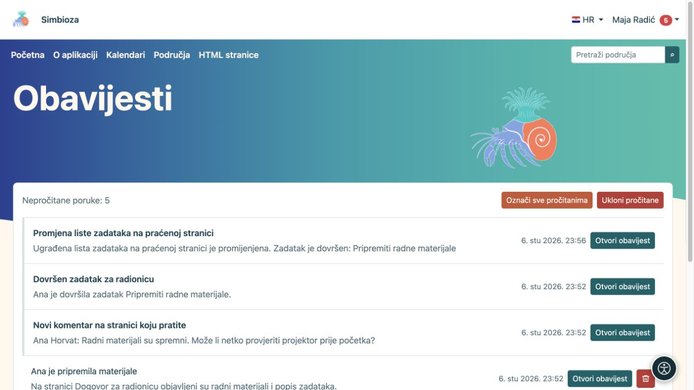

# Pratite promjene i pročitajte obavijesti

[Suradnja](suradnja_hr.md)

**Cilj:** saznati da se vama važan sadržaj promijenio, bez stalnog provjeravanja. Praćenje je osobni izbor prijavljenog korisnika i ne daje nova prava pristupa.

## Uključite ili prekinite praćenje

Na području, objavljenoj stranici ili listi zadataka odaberite gumb **Prati** sa zvonom. Ponovnim odabirom **Prestani pratiti** isključujete obavijesti tog cilja, a ne brišete sadržaj.

Pretplata na kalendar uključuje njegovo praćenje. U profilu možete utišati obavijesti kalendara bez prekida pretplate i bez skrivanja kalendara iz rasporeda. Za sam raspored pogledajte [pretplate](kalendari-pregled_hr.md).

## Podesite kako primate promjene

1. Otvorite **Moj profil → Praćenje i obavijesti**.
2. U **Postavkama obavijesti** odaberite želite li i e-mail.
3. Odaberite **Zadani način dostave** i po želji obavijesti o vlastitim promjenama.
4. Odaberite **Spremi postavke praćenja** i pročitajte potvrdu.

| Način | Što dobivate |
| --- | --- |
| Samo u aplikaciji | Obavijesti u svojem pretincu, bez kopije e-mailom. |
| E-pošta odmah | Obavijest u aplikaciji i e-mail bez čekanja dnevnog sažetka. |
| Dnevni sažetak | Obavijesti odmah u aplikaciji; e-mail objedinjuje promjene u sažetak sljedećeg dana. |
| Samo važne promjene | Sve dopuštene promjene u aplikaciji; e-mail samo za važne podržane radnje. |

Pod **Praćeni sadržaj** pretražite naziv ili filtrirajte stanje. Za svaku stavku ponuđeni gumbi dostave omogućuju drukčiji izbor od zadanoga. Aktivni gumb i opis pokazuju trenutačni način; nakon promjene pričekajte potvrdu. Isključen glavni prekidač e-maila ima prednost nad pojedinačnim odabirom.

**Rezultat:** sadržaj pratite odabranim ritmom. Za stranicu obavijest prati objavu; samo spremanje nacrta ne obavještava čitatelje. Promjene ugrađenog kalendara ili liste zadataka mogu obavijestiti i pratitelje te stranice. Dostava ovisi i o tome jesu li potrebni moduli i slanje e-maila podešeni.

## Otvorite svoj pretinac

1. U korisničkom izborniku otvorite **Obavijesti**.
2. Odaberite poruku ili njezinu radnju. Za sastanke to može biti **Otvori sastanak i odgovori**, a za rezervaciju **Otvori zahtjev i odluči**.
3. Za više stranica upotrijebite **Prethodna / Sljedeća**.
4. **Označi sve pročitanima** mijenja stanje poruka; **Ukloni pročitane** uklanja pročitane poruke iz vašega pretinca.

<figure class="my-4">

<figcaption>Poruke vode do praćene stranice, komentara ili promjene zadatka. Označavanje ili uklanjanje poruka ne briše taj sadržaj.</figcaption>
</figure>

Uklanjanje obavijesti ne briše izvornu stranicu, sastanak ni zadatak. Ako izgubite pravo pristupa izvoru, stara obavijest ga ne otvara niti vraća pristup. Ne očekujte da će vas tuđi spremljeni nacrt ili vaša vlastita promjena uvijek obavijestiti: provjerite pravilo objave i postavku vlastitih promjena.
