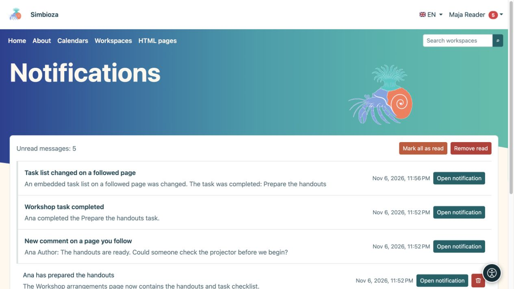

# Segui le modifiche e leggi le notifiche

> Le schermate mostrano l’interfaccia in inglese.

[Collaborazione](suradnja_it.md)

**Obiettivo:** sapere quando cambiano i contenuti importanti senza doverli controllare continuamente. Seguire un contenuto è una scelta personale degli utenti che hanno effettuato l'accesso e non concede accessi aggiuntivi.

## Inizia o smetti di seguire

In un'area di lavoro, una pagina pubblicata o un elenco di attività, seleziona l'azione **Segui** a forma di campana. Seleziona **Smetti di seguire** per interrompere le notifiche di quella destinazione senza eliminare il contenuto.

Un abbonamento al calendario consente di seguire. Nel tuo profilo puoi disattivare le sue notifiche senza annullare l'iscrizione o nasconderlo dal programma. Vedi [iscrizioni al calendario](kalendari-pregled_it.md) per il programma stesso.

## Scegli la consegna

1. Apri **Il mio profilo → Seguiti e notifiche**.
2. In **Impostazioni di notifica**, scegli se ricevere anche email.
3. Scegli la **Modalità di consegna predefinita** e, facoltativamente, le notifiche sulle tue modifiche.
4. Seleziona **Salva impostazioni degli elementi seguiti** e leggi la conferma.

| Modalità | Risultato |
| --- | --- |
| Solo in-app | Notifiche nella tua casella di posta senza copie di posta elettronica. |
| Invia immediatamente un'e-mail | Una notifica in-app e un'e-mail senza attendere un riepilogo giornaliero. |
| Riepilogo giornaliero | Notifiche in-app immediate; l'e-mail combina le modifiche in un riepilogo il giorno successivo. |
| Solo modifiche importanti | Tutte le modifiche consentite nell'app, ma solo tramite e-mail per le azioni importanti supportate. |

In **Contenuti seguiti**, cerca per nome o filtra lo stato. I pulsanti di consegna di ciascun elemento possono sostituire l'impostazione predefinita. Il pulsante attivo e la spiegazione mostrano la modalità corrente; dopo averla cambiata, attendi la conferma. L'interruttore principale dell'email ha la precedenza sulle scelte individuali.

**Risultato:** segui i contenuti al ritmo scelto. Le pagine avvisano della pubblicazione; il solo salvataggio di una bozza non avvisa i lettori. Le modifiche ai calendari incorporati o agli elenchi di attività possono anche avvisare gli utenti che seguono la pagina che li contiene. La consegna dipende anche dai moduli abilitati e dall'invio di email configurato.

## Apri la tua casella di posta

1. Scegli **Notifiche** nel menu dell'account.
2. Apri un messaggio o la sua azione. Le riunioni possono proporre **Apri riunione e rispondi**, mentre una prenotazione può proporre **Apri richiesta e decidi**.
3. Utilizza **Precedente/Successivo** per pagine aggiuntive.
4. **Segna tutto come letto** cambia lo stato del messaggio; **Rimuovi letti** rimuove i messaggi letti dalla tua casella di posta.

<figure class="my-4">

<figcaption>I messaggi si collegano a una pagina seguita, a un commento o a una modifica dell'attività. Contrassegnare o rimuovere i messaggi non elimina il contenuto.</figcaption>
</figure>

La rimozione di una notifica non elimina la pagina di origine, la riunione o l'attività. Perdere l'accesso alla fonte significa che una vecchia notifica non può riaprirla o ripristinare l'accesso. Non aspettarti che ogni bozza salvata o la tua modifica ti avvisino: controlla le regole di pubblicazione e la preferenza di modifica propria.
