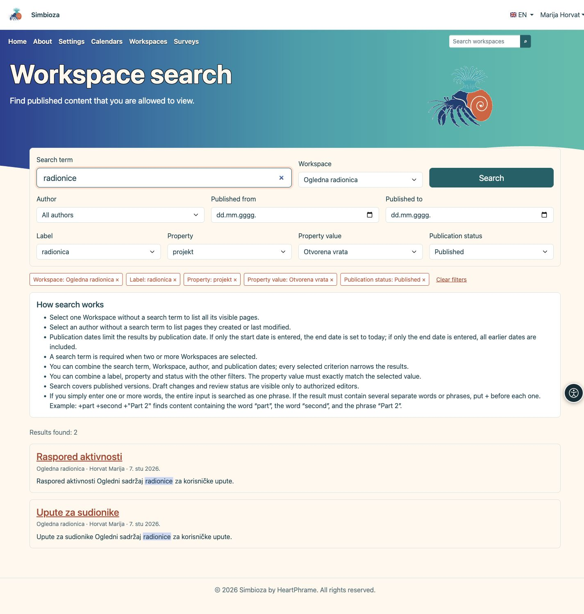
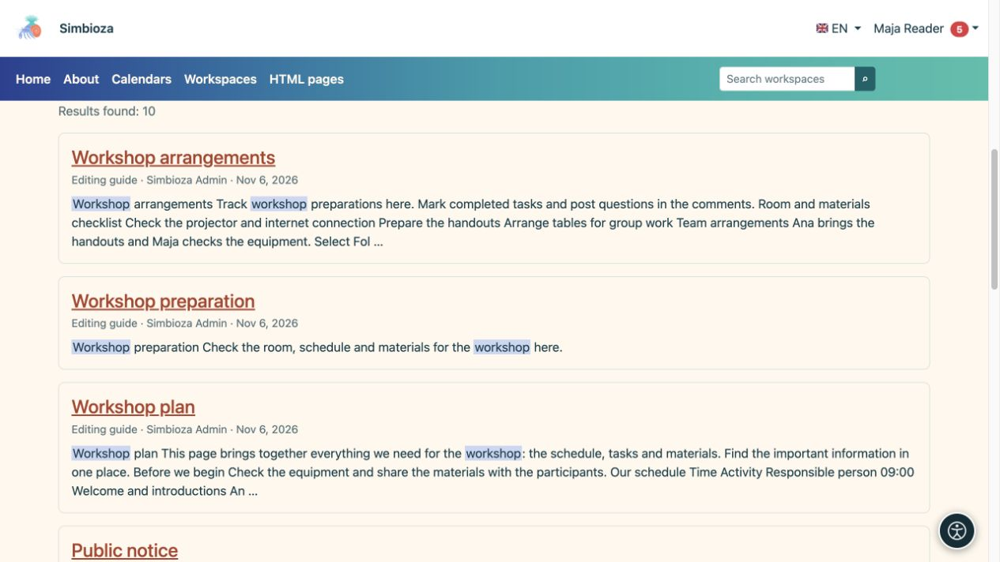

# Inhalte mit der Suche finden

> Die Bildschirmaufnahmen zeigen die englische Benutzeroberfläche.

[Arbeitsbereiche](podrucja_de.md)

**Ziel:** Finden Sie einen veröffentlichten Arbeitsbereich oder eine Seite, die Sie lesen können. Durch die Suche werden keine privaten Informationen oder unveröffentlichten Entwürfe einer anderen Person preisgegeben.

## Fangen Sie einfach an

1. Suchen Sie in der Hauptnavigation nach Arbeitsbereichssuche und geben Sie einen Begriff ein.
2. Wählen Sie einen Vorschlag aus oder verwenden Sie **Suchen** für die vollständige Ergebnisliste.
3. Öffnen Sie den Titel der entsprechenden Seite oder des Arbeitsbereichs.

**Ergebnis:** Zugängliche Übereinstimmungen zeigen ihren Arbeitsbereich und ihre Beschreibung an. Wenn keine angezeigt werden, überprüfen Sie die Rechtschreibung und Filter. Wenn Sie die Suche als Administrator wiederholen, wird möglicherweise ein umfassenderer Zugriff angezeigt als das für Ihr Konto vorgesehene Ergebnis.

## Schränken Sie die Liste ein

| Filtern / kontrollieren | Zweck |
| --- | --- |
| Arbeitsbereich | Durchsucht alle sichtbaren oder ausgewählten Arbeitsbereiche. Geben Sie eine Abfrage ein, wenn Sie zwei oder mehr Arbeitsbereiche auswählen. |
| Autor | Finden Sie eine angebotene Person; Ohne eine Abfrage können Sie die von ihnen erstellten oder zuletzt geänderten Seiten auflisten. |
| Veröffentlicht von / bis | Beschränkt die Veröffentlichungsdaten und nicht die Besuchszeit. Allein ein Starttermin endet heute; Allein ein Enddatum umfasst frühere Veröffentlichungen. |
| Etikett | Wählen Sie ein vorhandenes Seitenetikett aus. |
| Eigenschaft / Eigenschaftswert | Wählen Sie eine Eigenschaft und bei Bedarf ihren genauen Wert. Ohne Wert werden alle Seiten mit dieser Eigenschaft berücksichtigt. |
| Veröffentlichungsstatus | Grenzen Sie veröffentlichte Seiten nach einem verfügbaren Status ein. Änderungsentwürfe und Prüfstatus sind nur berechtigten Bearbeitern zugänglich. |
| Spaltenüberschriften | Durch die angebotene Tabellensortierung ändert sich die Reihenfolge, z. B. nach Titel, Autor oder Publikation. |
| Ergebnisseiten | Öffnet weitere Ergebnisse unter Beibehaltung der Filter. |

Kriterien kombinieren: Mehr Filter können zu weniger Übereinstimmungen führen. Die in eine Seite eingebettete Suche zielt möglicherweise gezielt auf ausgewählte Arbeitsbereiche ab und wird nicht automatisch auf die gesamte Installation ausgeweitet.

## Etiketten, Eigenschaften und Veröffentlichungsstatus

1. Öffnen Sie **Etikett** und suchen Sie ein vorhandenes Etikett, indem Sie einen Teil seines Namens eingeben. Wählen Sie einen Eintrag aus der Liste.
2. Für strukturierte Angaben öffnen Sie **Eigenschaft**. Wählen Sie eine Eigenschaft und bei Bedarf einen **Eigenschaftswert**, um das Ergebnis weiter einzugrenzen. Der Wert muss genau dem ausgewählten Wert entsprechen; hier wird nicht nach einem Textausschnitt gesucht.
3. Wählen Sie bei Bedarf einen **Veröffentlichungsstatus** und starten Sie **Suchen**. Jedes zusätzliche Kriterium schränkt die Ergebnisse ein. Eine Seite muss alle ausgewählten Filter erfüllen.

Die Optionen werden erst beim Öffnen des Auswahlfelds oder beim Fokussieren mit der Tastatur geladen. Es erscheinen höchstens 25 Optionen auf einmal. Geben Sie einen genaueren Namensteil ein oder wählen Sie **Mehr laden**. Angezeigt werden nur Werte von Seiten, die Sie in den ausgewählten Arbeitsbereichen sehen dürfen. Wenn Sie die Eigenschaft ändern, wird der zuvor ausgewählte Wert zurückgesetzt.

Sie können den Suchbegriff leer lassen, wenn ein Etikett, eine Eigenschaft oder ein Status die Liste eingrenzt. Bei zwei oder mehr ausdrücklich ausgewählten Arbeitsbereichen bleibt ein Suchbegriff erforderlich. Diese Filter liefern Seiten mit passenden Metadaten.

<figure class="my-4">

<figcaption>Kombinieren Sie die verfügbaren Filter. Die Auswahl oberhalb der Ergebnisse zeigt, was die Liste gerade eingrenzt.</figcaption>
</figure>

### Einen Filter ändern oder entfernen

Jede Auswahl erscheint oberhalb der Ergebnisse als Markierung mit einer **×**-Schaltfläche. Entfernen Sie einen einzelnen Filter oder wählen Sie **Filter zurücksetzen**, um alle Auswahlwerte zu entfernen. Suchbegriff und Sprache bleiben erhalten. Beim Entfernen einer Eigenschaft wird auch ihr Wert entfernt. Sortierung und Seitenwechsel behalten die Filter bei. Sie können die Suchadresse speichern oder teilen; andere Personen sehen darüber nur Inhalte, für die sie selbst berechtigt sind.

### Was bedeuten die Status?

Für Leser umfasst **Veröffentlicht** alle lesbaren veröffentlichten Seiten, auch wenn ein Bearbeiter neue Änderungen vorbereitet. **Änderungsentwurf** und **Änderungen in Prüfung** liefern nur dann Treffer, wenn Sie die betreffende Seite bearbeiten, veröffentlichen oder verwalten dürfen. Diese Status beziehen sich auf Änderungen einer bereits veröffentlichten Seite.

Auch mit einem Statusfilter werden Titel und Text der **veröffentlichten Version** durchsucht, nicht der Entwurfstext. Noch nie veröffentlichte und archivierte Seiten sind ausgeschlossen. Eigene Entwürfe und Inhalte zur Prüfung finden Sie unter **Meine Arbeit** im persönlichen Menü. Prüfen Sie bei fehlenden Treffern die Filterkombination und Ihre Berechtigungen. Trefferzahlen und angebotene Werte geben keine verborgenen Seiten preis.

## Eine Phrase oder mehrere erforderliche Wörter

Eine gewöhnliche Mehrwortabfrage durchsucht den gesamten Ausdruck als Phrase. **Workshopplan** sucht beispielsweise nach diesem verbundenen Ausdruck.

Für mehrere separate erforderliche Wörter oder Phrasen stellen Sie jeweils `+` voran. Beispielsweise erfordert `+plan +"professional development"` den Wortplan und die zitierte Phrase. Beginnen Sie mit einem einfachen Begriff und verwenden Sie diese Syntax, wenn Sie eine präzisere Auswahl benötigen.

<figure class="my-4">

<figcaption>Wählen Sie einen Titel, um das Ergebnis zu öffnen. Die Suche zeigt nur Inhalte an, die Sie möglicherweise lesen.</figcaption>
</figure>

## Warum fehlt eine neue Änderung?

Durch das Speichern eines Entwurfs werden veröffentlichte Suchinhalte nicht ersetzt. Prüfen Sie, ob die neue Version veröffentlicht ist und ob Sie die vorgesehene Sprache verwenden. Sollten noch veröffentlichte Inhalte fehlen, senden Sie Titel, Arbeitsbereich und Abfrage an den Administrator. Sie können den Index einsehen; sie müssen das Dokument nicht nur ändern, um es neu zu indizieren.
