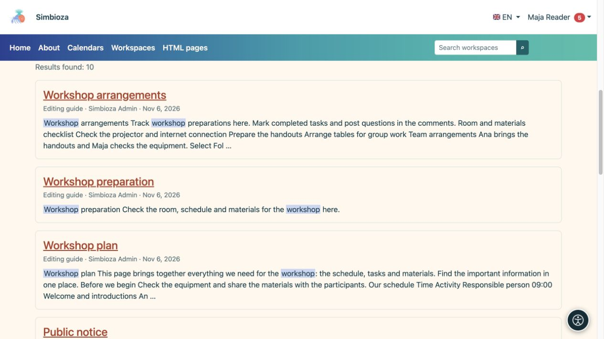

# Find content with search

[Workspaces](podrucja_en.md)

**Goal:** find a published workspace or page you may read. Search does not reveal someone else's private information or unpublished drafts.

## Start simply

1. Find workspace search in the main navigation and enter a term.
2. Select a suggestion or use **Search** for the full result list.
3. Open the title of the relevant page or workspace.

**Result:** accessible matches show their workspace and description. If none appear, check spelling and filters. Repeating the search as an administrator may show broader access rather than the result intended for your account.

## Narrow the list

| Filter / control | Purpose |
| --- | --- |
| Workspace | Searches all visible or selected workspaces. Enter a query when choosing two or more workspaces. |
| Author | Find an offered person; without a query you may list pages they created or last modified. |
| Published from / to | Limits publication dates rather than the time you visit. A start date alone ends today; an end date alone includes earlier publications. |
| Column headings | Offered table sorting changes the order, such as title, author or publication. |
| Result pages | Opens more results while retaining filters. |

Criteria combine: more filters can produce fewer matches. Search embedded in a page may deliberately target selected workspaces and does not automatically expand to the whole installation.

## A phrase or several required words

An ordinary multiword query searches the whole expression as a phrase. For example, **workshop plan** looks for that connected expression.

For several separate required words or phrases, prefix each with `+`. For example, `+plan +"professional development"` requires the word plan and the quoted phrase. Start with a simple term and use this syntax when you need a more precise selection.

<figure class="my-4">

<figcaption>Choose a title to open the result. Search shows only content you may read.</figcaption>
</figure>

## Why is a new change missing?

Saving a draft does not replace published search content. Check whether the new version is published and whether you are using the intended language. If published content is still missing, send the title, workspace and query to the administrator. They can inspect the index; you do not need to change the document merely to reindex it.
