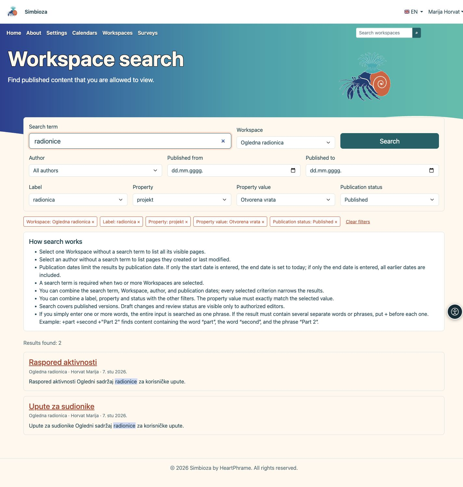
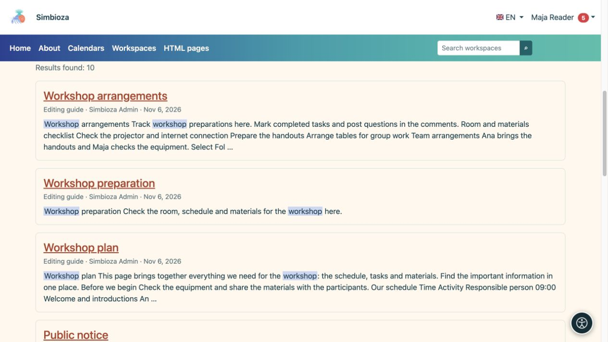

# Buscar contenidos con el buscador

> Las capturas de pantalla muestran la interfaz en inglés.

[Espacios de trabajo](podrucja_es.md)

**Objetivo:** encontrar un espacio de trabajo publicado o una página que pueda leer. La búsqueda no revela información privada de otra persona ni borradores no publicados.

## Comience simplemente

1. Busque la búsqueda de espacio de trabajo en la navegación principal e ingrese un término.
2. Seleccione una sugerencia o utilice **Buscar** para ver la lista completa de resultados.
3. Abra el título de la página o espacio de trabajo correspondiente.

**Resultado:** las coincidencias accesibles muestran su espacio de trabajo y descripción. Si no aparece ninguno, revisa la ortografía y los filtros. Repetir la búsqueda como administrador puede mostrar un acceso más amplio que el resultado previsto para su cuenta.

## Reducir la lista

| Filtro / control | Finalidad |
| --- | --- |
| Espacio de trabajo | Busca todos los espacios de trabajo visibles o seleccionados. Ingrese una consulta al elegir dos o más espacios de trabajo. |
| Autor | Encuentra una persona ofrecida; sin realizar una consulta, puede enumerar las páginas que crearon o modificaron por última vez. |
| Publicado desde/hasta | Limita las fechas de publicación en lugar del horario de visita. Una fecha de inicio por sí sola termina hoy; una fecha de finalización por sí sola incluye publicaciones anteriores. |
| Etiqueta | Seleccione una etiqueta de página existente. |
| Propiedad / Valor de la propiedad | Seleccione una propiedad y, si lo desea, su valor exacto. Sin valor, se incluyen todas las páginas que tengan esa propiedad. |
| Estado de publicación | Limite las páginas publicadas por un estado disponible. Los borradores de cambios y la revisión solo están disponibles para los editores autorizados. |
| Encabezados de columna | La clasificación de tablas ofrecida cambia el orden, como título, autor o publicación. |
| Páginas de resultados | Abre más resultados manteniendo los filtros. |

Combinación de criterios: más filtros pueden producir menos coincidencias. La búsqueda incrustada en una página puede apuntar deliberadamente a espacios de trabajo seleccionados y no se expande automáticamente a toda la instalación.

## Etiquetas, propiedades y estado de publicación

1. Abra **Etiqueta** y escriba parte del nombre para encontrar una etiqueta existente. Seleccione una opción de la lista.
2. Para los datos estructurados, abra **Propiedad**. Seleccione una propiedad y, si necesita precisar el resultado, **Valor de la propiedad**. El valor debe coincidir exactamente con el seleccionado; no se busca un fragmento de su texto.
3. Si lo necesita, seleccione **Estado de publicación** y pulse **Buscar**. Cada criterio añadido limita los resultados: una página debe cumplir todos los filtros seleccionados.

Las opciones se cargan al abrir el selector o darle el foco con el teclado. Se muestran como máximo 25 opciones a la vez; escriba una parte más precisa del nombre o seleccione **Carga más**. Solo se ofrecen valores de páginas que puede ver en los espacios de trabajo seleccionados. Cambiar la propiedad borra su valor previamente seleccionado.

Puede dejar vacío el término de búsqueda cuando una etiqueta, una propiedad o un estado limiten la lista. El término sigue siendo obligatorio al seleccionar expresamente dos o más espacios de trabajo. Estos filtros devuelven páginas con los metadatos correspondientes.

<figure class="my-4">

<figcaption>Combine los filtros disponibles. Las selecciones sobre los resultados indican qué limita la lista.</figcaption>
</figure>

### Cambiar o quitar un filtro

Cada selección aparece sobre los resultados en una etiqueta con el botón **×**. Quite un filtro o seleccione **Borrar filtros** para quitar todas las selecciones; se conservan el término de búsqueda y el idioma. Quitar una propiedad también quita su valor. La ordenación y el cambio de página conservan los filtros. Puede guardar o compartir la dirección de búsqueda; quien la reciba solo verá el contenido permitido por sus propios permisos.

### ¿Qué significan los estados?

Para quien lee, **Publicado** incluye las páginas publicadas accesibles aunque un editor esté preparando cambios. **Borrador de cambios** y **Cambios en revisión** solo devuelven resultados a quien pueda editar, publicar o administrar esa página. Estos estados describen cambios en una página ya publicada.

Incluso con un filtro de estado se buscan el título y el texto de la **versión publicada**, no el texto del borrador. Se excluyen las páginas nunca publicadas y las archivadas. Para encontrar sus borradores y el contenido pendiente de revisión, abra **Mi trabajo** en el menú personal. Si no hay resultados, revise los filtros y sus permisos: los recuentos y los valores ofrecidos no revelan páginas ocultas.

## Una frase o varias palabras requeridas

Una consulta ordinaria de varias palabras busca la expresión completa como una frase. Por ejemplo, **plan de taller** busca esa expresión conectada.

Para varias palabras o frases requeridas separadas, preceda cada una con `+`. Por ejemplo, `+plan +"professional development"` requiere la palabra plan y la frase entre comillas. Comience con un término simple y utilice esta sintaxis cuando necesite una selección más precisa.

<figure class="my-4">

<figcaption>Elija un título para abrir el resultado. La búsqueda muestra sólo contenido que puede leer.</figcaption>
</figure>

## ¿Por qué falta un nuevo cambio?

Guardar un borrador no reemplaza el contenido de búsqueda publicado. Compruebe si la nueva versión está publicada y si está utilizando el idioma previsto. Si aún falta contenido publicado, envíe el título, el espacio de trabajo y la consulta al administrador. Pueden inspeccionar el índice; no es necesario cambiar el documento simplemente para reindexarlo.
