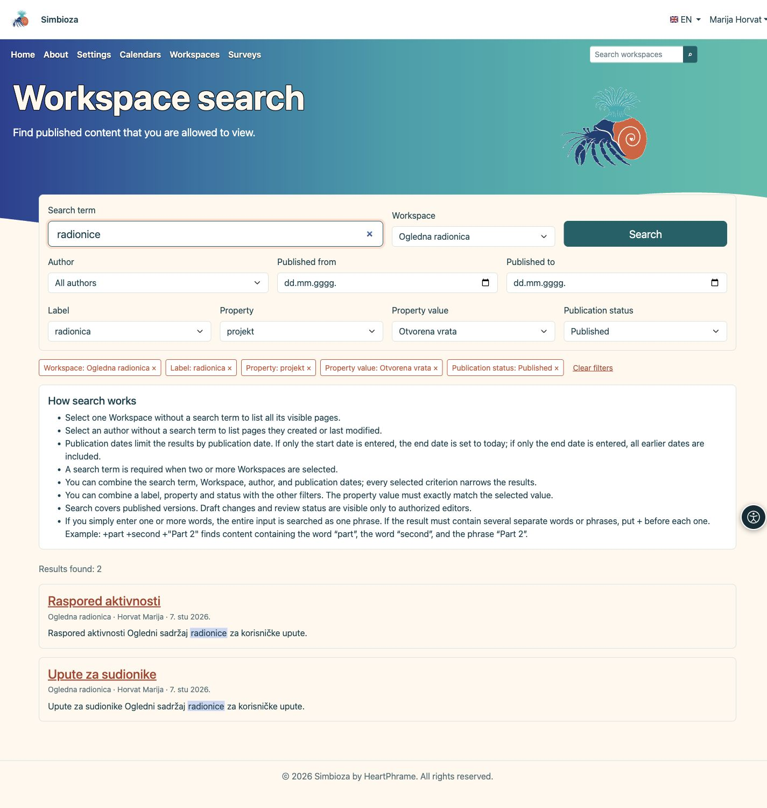
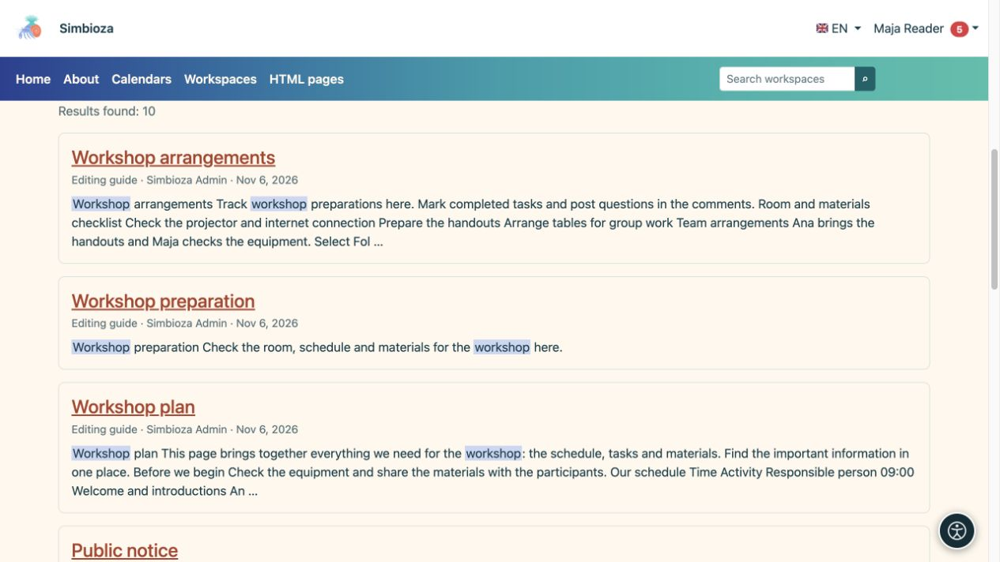

# Trouver du contenu avec la recherche

> Les captures d’écran présentent l’interface en anglais.

[Espaces de travail](podrucja_fr.md)

**Objectif :** recherchez un espace de travail ou une page publié que vous êtes susceptible de lire. La recherche ne révèle pas les informations privées de quelqu'un d'autre ni les brouillons non publiés.

## Commencez simplement

1. Recherchez la recherche d'espace de travail dans la navigation principale et saisissez un terme.
2. Sélectionnez une suggestion ou utilisez **Rechercher** pour obtenir la liste complète des résultats.
3. Ouvrez le titre de la page ou de l'espace de travail concerné.

**Résultat :** les correspondances accessibles affichent leur espace de travail et leur description. Si aucun n’apparaît, vérifiez l’orthographe et les filtres. Répéter la recherche en tant qu'administrateur peut afficher un accès plus large plutôt que le résultat destiné à votre compte.

## Affiner la liste

| Filtrer / contrôler | But |
| --- | --- |
| Espace de travail | Recherche tous les espaces de travail visibles ou sélectionnés. Saisissez une requête lorsque vous choisissez deux espaces de travail ou plus. |
| Auteur | Trouver une personne proposée ; sans requête, vous pouvez lister les pages qu'ils ont créées ou modifiées pour la dernière fois. |
| Publié de / à | Limite les dates de publication plutôt que l’heure de votre visite. Une date de début à elle seule se termine aujourd'hui ; une date de fin à elle seule inclut les publications antérieures. |
| Étiquette | Sélectionnez une étiquette de page existante. |
| Propriété / Valeur de la propriété | Sélectionnez une propriété puis, si nécessaire, sa valeur exacte. Sans valeur, toutes les pages possédant cette propriété peuvent correspondre. |
| État de publication | Limitez les pages publiées à un état disponible. Les modifications en brouillon et leur révision ne sont accessibles qu’aux personnes autorisées. |
| En-têtes de colonnes | Le tri des tableaux proposé modifie l'ordre, tel que le titre, l'auteur ou la publication. |
| Pages de résultats | Ouvre plus de résultats tout en conservant les filtres. |

Les critères se combinent : plus de filtres peuvent produire moins de correspondances. La recherche intégrée dans une page peut délibérément cibler des espaces de travail sélectionnés et ne s'étend pas automatiquement à l'ensemble de l'installation.

## Étiquettes, propriétés et état de publication

1. Ouvrez **Étiquette** et saisissez une partie du nom pour trouver une étiquette existante. Sélectionnez une proposition dans la liste.
2. Pour les informations structurées, ouvrez **Propriété**. Sélectionnez une propriété puis, si nécessaire, une **Valeur de la propriété** pour préciser le résultat. La valeur doit correspondre exactement à celle choisie ; il ne s’agit pas d’une recherche dans une partie de son texte.
3. Au besoin, choisissez un **État de publication**, puis lancez **Rechercher**. Chaque critère ajouté réduit les résultats : une page doit respecter tous les filtres sélectionnés.

Les options se chargent à l’ouverture du sélecteur ou lorsqu’il reçoit le focus au clavier. Jusqu’à 25 choix sont proposés à la fois. Saisissez une partie plus précise du nom ou sélectionnez **Charger plus**. Les sélecteurs ne proposent que des valeurs issues de pages que vous pouvez consulter dans les espaces de travail choisis. Changer de propriété efface la valeur précédemment sélectionnée.

Vous pouvez laisser le terme de recherche vide lorsqu’une étiquette, une propriété ou un état limite la liste. Un terme reste obligatoire si vous sélectionnez explicitement au moins deux espaces de travail. Ces filtres renvoient les pages possédant les métadonnées correspondantes.

<figure class="my-4">

<figcaption>Combinez les filtres disponibles. Les sélections au-dessus des résultats indiquent ce qui limite la liste.</figcaption>
</figure>

### Modifier ou supprimer un filtre

Chaque sélection apparaît au-dessus des résultats sous forme de pastille avec un bouton **×**. Supprimez un seul filtre ou choisissez **Effacer les filtres** pour toutes les sélections ; le terme de recherche et la langue sont conservés. Supprimer une propriété supprime aussi sa valeur. Le tri et le changement de page conservent les filtres. Vous pouvez enregistrer ou partager l’adresse de recherche : chaque destinataire ne verra que le contenu permis par ses propres droits.

### Que signifient les états ?

Pour un lecteur, **Publié** comprend les pages publiées accessibles, même lorsqu’une personne prépare des modifications. **Modifications en brouillon** et **Modifications en cours de révision** ne renvoient des résultats qu’aux personnes autorisées à modifier, publier ou gérer la page. Ces états concernent les modifications d’une page déjà publiée.

Même avec un filtre d’état, la recherche porte sur le titre et le texte de la **version publiée**, pas sur le brouillon. Les pages jamais publiées et les pages archivées sont exclues. Pour retrouver vos brouillons et le contenu à réviser, ouvrez **Mon travail** dans le menu personnel. En l’absence de résultats, vérifiez les filtres et vos droits : les nombres et les valeurs proposés ne révèlent aucune page masquée.

## Une phrase ou plusieurs mots obligatoires

Une requête multimot ordinaire recherche l’expression entière sous forme d’expression. Par exemple, **plan d'atelier** recherche cette expression connectée.

Pour plusieurs mots ou expressions requis distincts, préfixez chacun avec `+`. Par exemple, `+plan +"professional development"` nécessite le mot plan et la phrase citée. Commencez par un terme simple et utilisez cette syntaxe lorsque vous avez besoin d'une sélection plus précise.

<figure class="my-4">

<figcaption>Choisissez un titre pour ouvrir le résultat. La recherche affiche uniquement le contenu que vous pouvez lire.</figcaption>
</figure>

## Pourquoi manque-t-il un nouveau changement ?

L'enregistrement d'un brouillon ne remplace pas le contenu de recherche publié. Vérifiez si la nouvelle version est publiée et si vous utilisez la langue prévue. Si le contenu publié est toujours manquant, envoyez le titre, l'espace de travail et la requête à l'administrateur. Ils peuvent inspecter l'index ; vous n'avez pas besoin de modifier le document simplement pour le réindexer.
