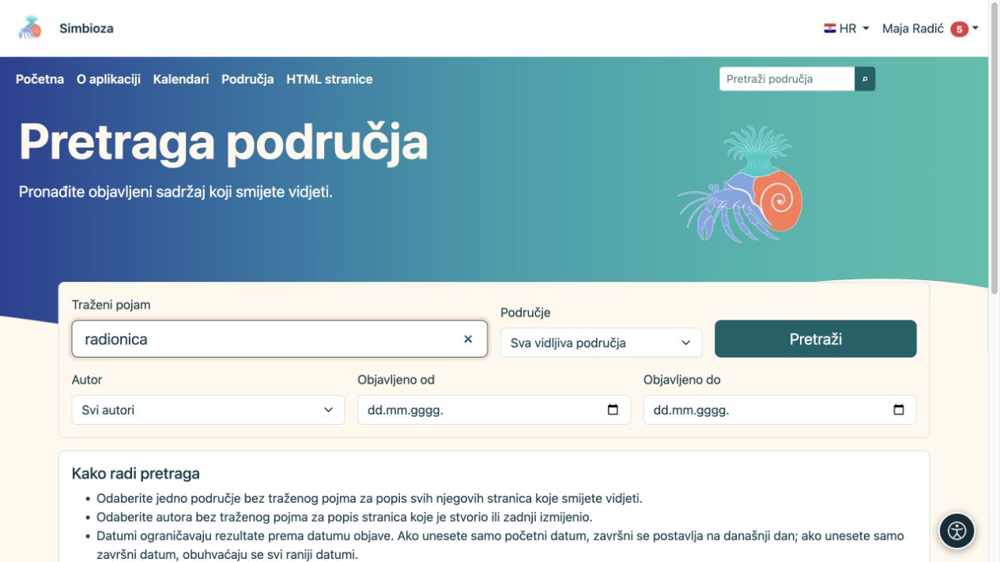
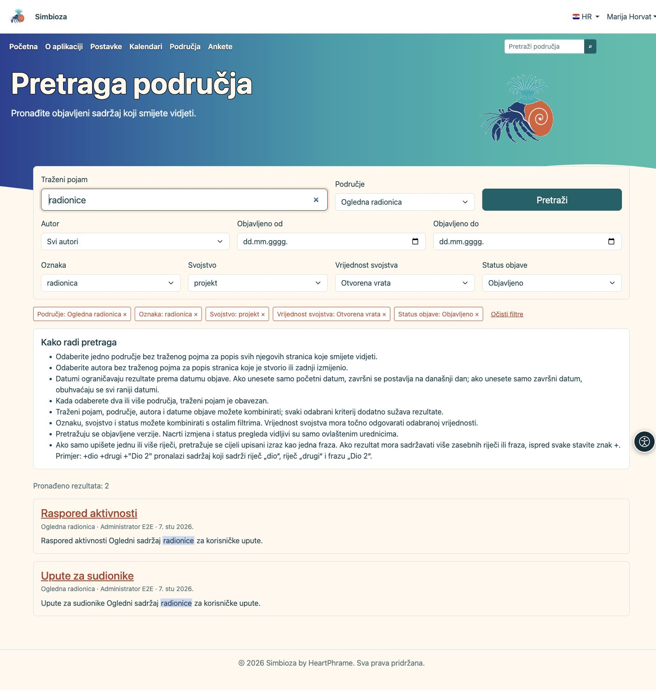
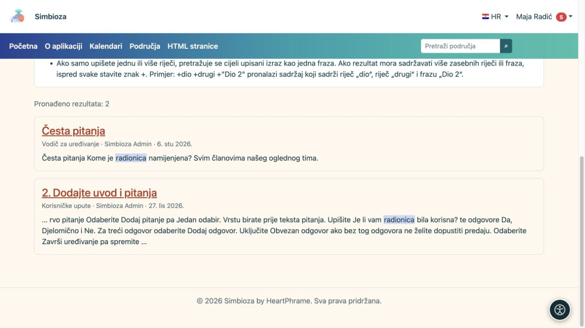

# Pronađite sadržaj pretragom

[Područja](podrucja_hr.md)

**Cilj:** pronaći objavljeno područje ili stranicu koju smijete čitati. Pretraga ne otkriva tuđe privatne podatke niti neobjavljeni nacrt.

## Počnite jednostavno

1. U glavnoj navigaciji pronađite pretragu područja i upišite pojam.
2. Odaberite rezultat prijedloga ili pokrenite **Pretraži** za cijeli popis.
3. Na rezultatima otvorite naslov odgovarajuće stranice ili područja.

**Rezultat:** vidite dostupne rezultate s pripadajućim područjem i opisom. Ako nema rezultata, provjerite pravopis i odabrane filtre. Nije potrebno stalno ponavljati isti upit kao administrator; njegov pristup može biti širi od vašega.

<figure class="my-4">

<figcaption>Unesite pojam i po potrebi odaberite područje, autora ili datume objave prije pretraživanja.</figcaption>
</figure>

## Suzite popis

| Filtar / kontrola | Kako pomaže |
| --- | --- |
| Područje | Traži u svim vidljivim ili odabranim područjima. Za dva ili više područja upišite i pojam. |
| Autor | Pronađite ponuđenu osobu; bez pojma možete dobiti njezine stvorene ili zadnje izmijenjene stranice. |
| Objavljeno od / do | Ograničuje datum objave, a ne proizvoljno vrijeme vašega posjeta. Sam početni datum završava današnjim danom; samo završni obuhvaća ranije objave. |
| Oznaka | Odaberite postojeću oznaku stranice. |
| Svojstvo / Vrijednost svojstva | Odaberite svojstvo, a zatim po želji njegovu točnu vrijednost. Bez vrijednosti dobivate sve stranice koje imaju odabrano svojstvo. |
| Status objave | Ograničite objavljene stranice prema dostupnom statusu; nacrti izmjena i pregled dostupni su samo ovlaštenim urednicima. |
| Naslovi stupaca | U tabličnom rezultatu ponuđeno sortiranje mijenja redoslijed, primjerice po naslovu, autoru ili objavi. |
| Stranice rezultata | Listaju dodatne rezultate i zadržavaju filtre. |

Kriteriji se kombiniraju: više filtara može dati manje rezultata. Ako je pretraga ugrađena u jednu stranicu, može biti namjerno ograničena na unaprijed odabrana područja; ne širi se automatski na cijelu instalaciju.

## Oznake, svojstva i status objave

1. Otvorite **Oznaka** i pronađite postojeću oznaku upisivanjem dijela naziva. Odaberite je s ponuđenog popisa.
2. Za strukturirane podatke otvorite **Svojstvo**. Odaberite svojstvo, a zatim, ako trebate precizniji rezultat, **Vrijednost svojstva**. Vrijednost mora točno odgovarati odabranoj vrijednosti; nije riječ o pretrazi dijela teksta.
3. Po potrebi odaberite **Status objave** i pokrenite **Pretraži**. Svaki dodani kriterij dodatno sužava rezultate; stranica mora zadovoljiti sve odabrane filtre.

Opcije se učitavaju tek kada otvorite birač ili ga fokusirate tipkovnicom. Prikazuje se najviše 25 ponuđenih vrijednosti odjednom; upišite precizniji dio naziva ili odaberite **Učitaj još**. Birači nude samo vrijednosti sa stranica koje smijete vidjeti u odabranim područjima. Promjena svojstva poništava njegovu ranije odabranu vrijednost.

Pojam možete ostaviti praznim kada popis sužavate oznakom, svojstvom ili statusom. Za dva ili više izričito odabranih područja pojam je i dalje obavezan. Kod ovih filtara dobivate stranice s odgovarajućim metapodacima.

<figure class="my-4">

<figcaption>Kombinirajte ponuđene filtre. Iznad rezultata vidite što trenutačno ograničava popis.</figcaption>
</figure>

### Promijenite ili uklonite filtar

Iznad rezultata svaki odabir ima svoju oznaku s gumbom **×**. Uklonite pojedini filtar ili odaberite **Očisti filtre** za sve odabire; traženi pojam i jezik ostaju. Uklanjanje svojstva uklanja i njegovu vrijednost. Promjena stranice rezultata ili redoslijeda zadržava filtre, a adresu pretrage možete spremiti ili podijeliti. Primatelj poveznice uvijek vidi samo ono za što ima vlastite ovlasti.

### Što znače statusi?

**Objavljeno** za čitatelja obuhvaća dostupne objavljene stranice i kada urednik priprema nove izmjene. **Nacrt izmjena** i **Izmjene na pregledu** nude rezultate samo korisniku koji smije uređivati, objavljivati ili upravljati tom stranicom. Ti statusi odnose se na izmjene već objavljene stranice.

I uz taj filtar traži se naslov i tekst **objavljene verzije**, ne tekst nacrta. Stranice koje još nikada nisu objavljene i arhivirane stranice nisu dio ove pretrage. Za vlastite nacrte i sadržaje koji čekaju pregled otvorite **Moj rad** u osobnom izborniku. Ako nema rezultata, provjerite kombinaciju filtara i svoja prava; broj rezultata i ponuđene vrijednosti ne otkrivaju skrivene stranice.

## Jedan izraz ili više obveznih riječi

Običan unos više riječi pretražuje cijeli izraz kao frazu. Primjer **plan radionice** traži taj povezani izraz.

Ako rezultat mora sadržavati nekoliko odvojenih riječi ili fraza, ispred svake upišite `+`. Primjer `+plan +"stručno usavršavanje"` zahtijeva riječ plan i navedenu frazu. Za početak koristite jednostavan pojam, a ovakvu pretragu kad trebate precizniji izbor.

<figure class="my-4">

<figcaption>Odaberite naslov da otvorite rezultat. Pretraga prikazuje samo sadržaj koji smijete čitati.</figcaption>
</figure>

## Zašto nova izmjena nije pronađena?

Spremanje nacrta ne zamjenjuje objavljeni sadržaj pretrage. Provjerite je li nova inačica objavljena i čitate li odgovarajući jezik. Ako se objavljeni sadržaj i dalje ne nalazi, pošaljite administratoru naslov, područje i upit. Administrator provjerava indeks; vi ne trebate mijenjati dokument samo radi ponovnog indeksiranja.
