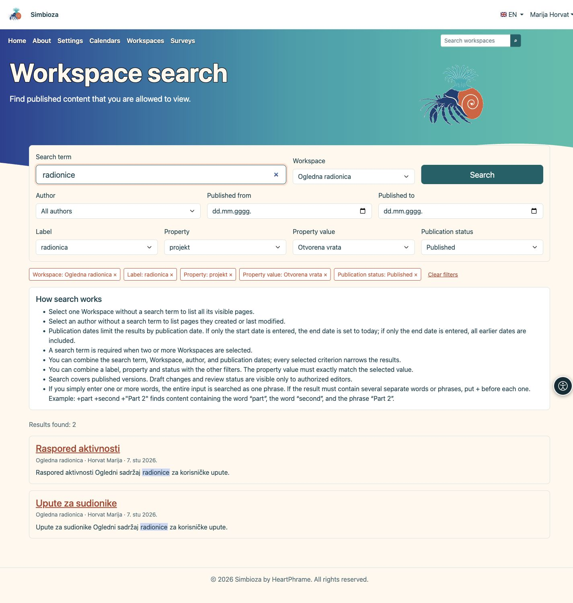
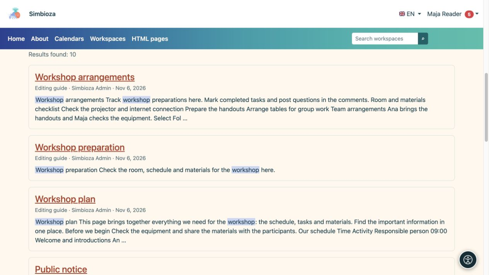

# Trova contenuti con la ricerca

> Le schermate mostrano l’interfaccia in inglese.

[Aree di lavoro](podrucja_it.md)

**Obiettivo:** trovare un’area di lavoro o una pagina pubblicata che puoi leggere. La ricerca non rivela informazioni private o bozze non pubblicate di qualcun altro.

## Inizia semplicemente

1. Trova la ricerca dell'area di lavoro nella navigazione principale e inserisci un termine.
2. Seleziona un suggerimento o utilizza **Cerca** per l'elenco completo dei risultati.
3. Apri il titolo della pagina o dell'area di lavoro pertinente.

**Risultato:** i risultati accessibili mostrano l’area di lavoro e una descrizione. Se non ne compare nessuno, controlla l’ortografia e i filtri. La ricerca eseguita come amministratore può mostrare più contenuti rispetto al tuo account.

## Restringere l'elenco

| Filtra/controlla | Scopo |
| --- | --- |
| Area di lavoro | Cerca tutte le aree di lavoro visibili o selezionate. Inserisci una query quando scegli due o più aree di lavoro. |
| Autore | Seleziona una persona dall’elenco; senza un termine di ricerca puoi vedere le pagine che ha creato o modificato per ultima. |
| Pubblicato da/a | Limita le date di pubblicazione anziché l'orario di visita. Solo una data di inizio termina oggi; la sola data di fine include le pubblicazioni precedenti. |
| Etichetta | Seleziona un’etichetta di pagina esistente. |
| Proprietà / Valore della proprietà | Seleziona una proprietà e, se necessario, il suo valore esatto. Senza valore vengono considerate tutte le pagine che hanno quella proprietà. |
| Stato di pubblicazione | Limita le pagine pubblicate a uno stato disponibile. Le modifiche in bozza e in revisione sono accessibili solo agli editor autorizzati. |
| Intestazioni di colonna | L'ordinamento delle tabelle offerto modifica l'ordine, ad esempio titolo, autore o pubblicazione. |
| Pagine dei risultati | Apre più risultati mantenendo i filtri. |

I criteri si combinano: più filtri possono produrre meno corrispondenze. La ricerca incorporata in una pagina può prendere di mira deliberatamente aree di lavoro selezionate e non si espande automaticamente all'intera installazione.

## Etichette, proprietà e stato di pubblicazione

1. Apri **Etichetta** e digita parte del nome per trovare un’etichetta esistente. Seleziona una voce dall’elenco.
2. Per le informazioni strutturate apri **Proprietà**. Seleziona una proprietà e, se vuoi precisare il risultato, un **Valore della proprietà**. Il valore deve corrispondere esattamente a quello scelto: non viene cercata una parte del suo testo.
3. Se necessario, scegli **Stato di pubblicazione** e premi **Cerca**. Ogni criterio aggiunto restringe i risultati: una pagina deve soddisfare tutti i filtri selezionati.

Le opzioni si caricano solo quando apri il selettore o lo raggiungi con la tastiera. Compaiono al massimo 25 voci alla volta; digita una parte più precisa del nome o seleziona **Carica più**. I selettori propongono soltanto valori di pagine che puoi vedere nelle aree di lavoro scelte. Cambiare proprietà cancella il valore selezionato in precedenza.

Puoi lasciare vuoto il termine di ricerca quando un’etichetta, una proprietà o uno stato restringono l’elenco. Il termine rimane obbligatorio se selezioni esplicitamente due o più aree di lavoro. Questi filtri restituiscono pagine con i metadati corrispondenti.

<figure class="my-4">

<figcaption>Combina i filtri disponibili. Le selezioni sopra i risultati mostrano quali criteri restringono l’elenco.</figcaption>
</figure>

### Modificare o rimuovere un filtro

Ogni selezione compare sopra i risultati come etichetta con un pulsante **×**. Rimuovi un singolo filtro oppure seleziona **Cancella filtri** per eliminare tutte le selezioni; il termine di ricerca e la lingua rimangono. Rimuovendo una proprietà si elimina anche il suo valore. L’ordinamento e il cambio di pagina conservano i filtri. Puoi salvare o condividere l’indirizzo della ricerca: ogni destinatario vede soltanto i contenuti consentiti dai propri permessi.

### Che cosa significano gli stati?

Per chi legge, **Pubblicato** comprende le pagine pubblicate accessibili anche mentre un editor prepara nuove modifiche. **Modifiche in bozza** e **Modifiche in revisione** restituiscono risultati solo a chi può modificare, pubblicare o gestire quella pagina. Questi stati descrivono modifiche a una pagina già pubblicata.

Anche con un filtro di stato vengono cercati il titolo e il testo della **versione pubblicata**, non il testo della bozza. Sono escluse le pagine mai pubblicate e quelle archiviate. Per trovare le tue bozze e i contenuti da revisionare, apri **Il mio lavoro** nel menu personale. Se non ci sono risultati, controlla i filtri e i tuoi permessi: i conteggi e i valori proposti non rivelano pagine nascoste.

## Una frase o più parole richieste

Una normale query composta da più parole ricerca l'intera espressione come una frase. Ad esempio, **piano del seminario** cerca quell'espressione connessa.

Per più parole o frasi richieste separate, prefissare ciascuna con `+`. Ad esempio, `+plan +"professional development"` richiede la parola `plan` e la frase tra virgolette. Inizia con un termine semplice e usa questa sintassi quando hai bisogno di una selezione più precisa.

<figure class="my-4">

<figcaption>Scegli un titolo per aprire il risultato. La ricerca mostra solo i contenuti che puoi leggere.</figcaption>
</figure>

## Perché manca una nuova modifica?

Il salvataggio di una bozza non sostituisce il contenuto di ricerca pubblicato. Controlla se è stata pubblicata la nuova versione e se stai utilizzando la lingua prevista. Se il contenuto pubblicato risulta ancora mancante, invia il titolo, l'area di lavoro e la query all'amministratore. Possono ispezionare l'indice; non è necessario modificare il documento semplicemente per reindicizzarlo.
