# Anmeldung und Benutzer

> Die Bildschirmaufnahmen zeigen die englische Benutzeroberfläche.

Dieses Handbuch führt einen Administrator durch alle Anmeldeeinstellungen, Benutzerattribute, Gruppen, Benutzerkonten, lokale Registrierung, Identitätswechsel, API-Schlüssel, SSO-Anbieter und persönliche Sicherheits- und Zugriffsbildschirme.

**Die Beispiele wurden auf einer Neuinstallation von SQLite erstellt.** Die hier gezeigten Konten, Gruppen und Schlüssel dienen nur der Dokumentation. Geheimnisse und persönliche Attributwerte wurden aus Screenshots entfernt. Verwenden Sie in der Produktion Ihre eigenen Namen, Domänen, Lebensdauern und Regeln für die geringsten Rechte.

## Inhalt

1.  [Anmeldeeinstellungen](#1-login-settings)
2.  [Benutzerattribute](#2-user-attributes)
3.  [Gruppen](#3-groups)
4.  [Benutzer und lokale Konten](#4-users-and-local-accounts)
5.  [Lokale Anmeldung und Registrierung](#5-local-login-and-registration)
6.  [Identitätswechsel](#6-impersonation)
7.  [API Schlüssel](#7-api-keys)
8.  [Allgemeiner SSO-Workflow](#8-common-sso-workflow)
9.  [SAML](#9-saml)
10. [SAML-Proxy](#10-saml-proxy-and-child-profiles)
11. [CAS](#11-cas)
12. [OIDC](#12-oidc)
13. [OAuth2](#13-oauth2)
14. [Persönliches Profil: Sicherheit und Zugang](#14-personal-profile-security-and-access)
15. [Verifizierungs- und Sicherheitscheckliste](#15-verification-and-security-checklist)

## 1. Anmeldeeinstellungen

Öffnen Sie **Einstellungen → Benutzer → Anmeldeeinstellungen**. Auf dieser Seite werden Authentifizierungsmethoden für die Anwendung aktiviert. Durch die Aktivierung eines Anbieters werden nur dessen Konfiguration und Menü verfügbar; Jedes einzelne Profil muss noch gespeichert, aktiviert, getestet und korrekt zugeordnet werden.

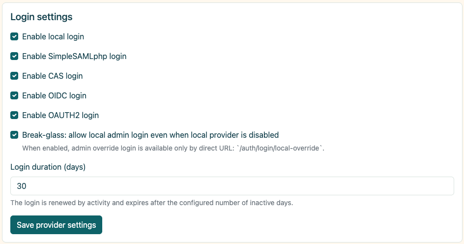Übersicht über die Anmeldeeinstellungen

<figure class="my-4">

<figcaption>Anmeldeeinstellungen in der englischen Benutzeroberfläche.</figcaption>
</figure>

### Hauptschalter

- **Lokale Anmeldung** ermöglicht die von Simbioza gespeicherte Authentifizierung mit Benutzername und Passwort.
- **SimpleSAMLphp, CAS, OIDC und OAuth2** aktivieren die entsprechenden Profilgruppen SSO.
- **Lokale Break-Glass-Anmeldung** hält eine separate direkte Administratorroute verfügbar, wenn die normale lokale Anmeldung deaktiviert ist. Schützen Sie dieses Konto mit einem starken, eindeutigen Passwort und verwenden Sie es nur zur Wiederherstellung.
- **Anmeldedauer** ist ein Inaktivitätslimit in Tagen (1–365), das verlängert wird, solange der angemeldete Benutzer aktiv bleibt. Verwenden Sie auf administrativen und gemeinsam genutzten Geräten einen kürzeren Zeitraum.

**„Profil aktiv“ ist nicht dasselbe wie das grüne Häkchen.** Aktiv bedeutet, dass das Profil verwendet werden darf. Das grüne Häkchen und der Status „Getestet und betriebsbereit“ werden erst nach einem erfolgreichen Anbietertest und gültigen erforderlichen Zuordnungen angezeigt. Ein aktives Profil ist möglicherweise immer noch nicht betriebsbereit.

## 2. Benutzerattribute

Öffnen Sie **Benutzerattribute**. Das Modell umfasst normalerweise E-Mail, Vorname und Nachname. Fügen Sie ein Attribut hinzu, wenn die Anwendung einen Wert außerhalb des Basisprofils speichern muss, beispielsweise eine Institution, Abteilung, Mitarbeiternummer oder eine externe Verzeichnisrolle.

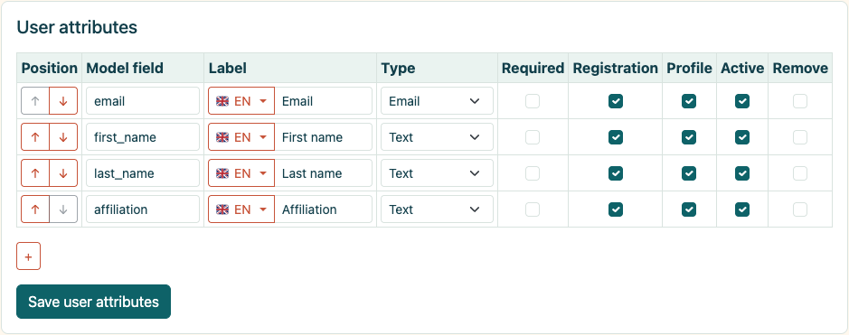Benutzerattribute

<figure class="my-4">

<figcaption>Standard- und benutzerdefinierte Attribute in der englischen Benutzeroberfläche.</figcaption>
</figure>

### Ein Attribut hinzufügen

1.  Geben Sie einen stabilen Maschinennamen in Kleinbuchstaben ohne Leerzeichen ein, z. B. `affiliation` .
2.  Geben Sie separate kroatische und englische Etiketten an.
3.  Wählen Sie den Datentyp und konfigurieren Sie **Erforderlich**, **Registrierung**, **Profil** und **Aktiv** unabhängig voneinander.
4.  Speichern Sie es. Das neue Feld wird in Benutzerprofilen und in jeder Profilzuordnungstabelle SSO verfügbar.

<figure class="my-4">
 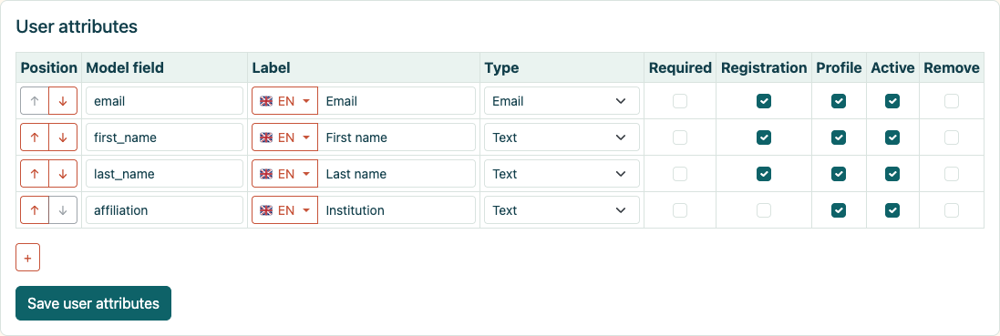 Beispiel für ein zweisprachiges benutzerdefiniertes Attribut 
<figcaption>Das Feld „Zugehörigkeitsmodell“ trägt die Bezeichnung „Ustanova/Institution“, bleibt für Profile und SSO-Zuordnungen verfügbar und ist von der Selbstregistrierung ausgeschlossen.</figcaption>
</figure>

**Mapping** verbindet ein Simbioza-Modellfeld mit dem genauen Attributnamen, der vom Anbieter zurückgegeben wird. Die Attributnamen sind genau: `mail`, `givenName` und `given_name` sind unterschiedliche Felder. Testen Sie zuerst, überprüfen Sie die zurückgegebenen Namen und geben Sie erst dann die Zuordnungen ein. Eine SSO-Zuordnung fügt das Feld nicht automatisch zum öffentlichen Registrierungsformular hinzu.

**Welche Felder sind in der Selbstregistrierung enthalten?** Der Administrator wählt dies pro Attribut aus. **Registrierung** steuert, ob ein Feld im öffentlichen Formular angezeigt wird, während **Erforderlich** einen leeren Wert in Kontexten ablehnt, in denen dieses Feld beteiligt ist. Wenn beide Einstellungen aktiviert sind, ist das Feld bei der Selbstregistrierung ein Pflichtfeld. Ein erforderliches Attribut muss außerdem über eine gültige SSO-Zuordnung verfügen, damit ein Anbieterprofiltest betriebsbereit ist. In diesem Beispiel speichert `affiliation` die von einem Anbieter bereitgestellte Institution und erscheint im Profil, sodass sie absichtlich von der Registrierung ausgeschlossen wird.

## 3. Gruppen

Gruppen sammeln Benutzer und übertragen Berechtigungen. Die Administratorgruppe ist eine geschützte Systemgruppe und sollte nicht als normale Unternehmensgruppe verwendet werden. Erstellen Sie separate Gruppen mit den geringsten Rechten für Abteilungen, Projekte oder Rollen.

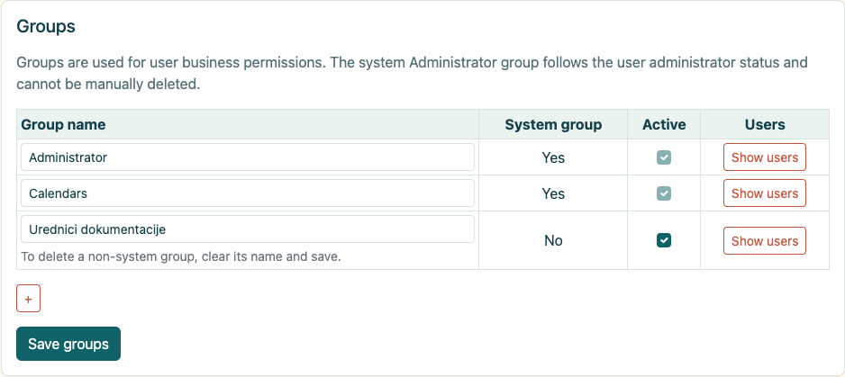Gruppen

System- und Beispielgruppen in der englischen Benutzeroberfläche.\

1.  Wählen Sie **Gruppe hinzufügen** (die Plus-Schaltfläche), geben Sie einen erkennbaren **Gruppennamen** ein und aktivieren Sie **Aktiv**.
2.  Wählen Sie **Gruppen speichern**. Dieser Bildschirm enthält keine Beschreibung oder Inhaltsberechtigungen.
3.  Fügen Sie den Details jedes Benutzers eine Gruppenmitgliedschaft hinzu oder entfernen Sie sie.
4.  Gewähren Sie der Gruppe die erforderlichen Berechtigungen in den Einstellungen eines Arbeitsbereichs, einer Seite, eines Kalenders oder einer Umfrage. Die SSO-Mitgliedschaft kann auch Regeln folgen, die auf einem zugeordneten Attribut basieren.

**Ergebnis:** Die Gruppe existiert und kann beim Zuweisen von Berechtigungen ausgewählt werden. Durch die alleinige Erstellung werden keine Inhalte für die Mitglieder geöffnet.

Um eine Nicht-Systemgruppe vorübergehend zu deaktivieren, deaktivieren Sie **Aktiv** und speichern Sie. Um es dauerhaft zu löschen, **leeren Sie seinen Namen und wählen Sie Gruppen speichern**. Dadurch werden die Gruppe, ihre Mitgliedschaften und ihre automatischen Zuordnungsregeln gelöscht. Benutzerkonten bleiben bestehen. Überprüfen Sie zunächst, wo die Gruppe für den Inhaltszugriff verwendet wurde. Eine neu erstellte Gruppe mit demselben Namen hat eine andere Identität und stellt die alten Mitgliedschaften oder Berechtigungen nicht wieder her. Systemgruppen können auf diese Weise nicht gelöscht werden.

<figure class="my-4">
 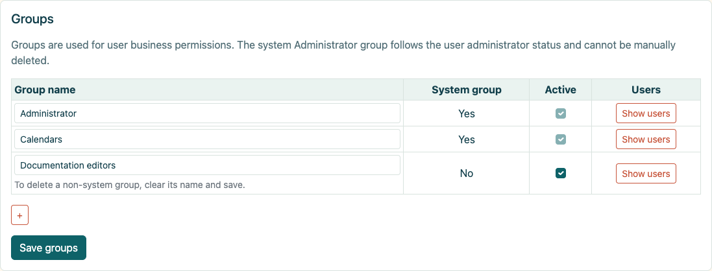 Beispielgruppe vor dem Speichern 
<figcaption>Eine Dokumentationsgruppe vor dem Speichern; Beschriftungen folgen der aktuell ausgewählten Site-Sprache.</figcaption>
</figure>

## 4. Benutzer und lokale Konten

Öffnen Sie **Einstellungen → Benutzer → Benutzer**, um Konten zu finden, ihren Status zu überprüfen und Mitgliedschaft und Zugriff zu verwalten.

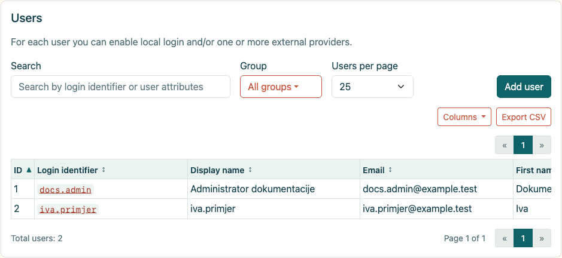Responsive Benutzertabelle

<figure class="my-4">
Ausgewogene Benutzertabellenspalten in der englischen Benutzeroberfläche.
</figure>

### Erstellen eines lokalen Benutzers

1.  Wählen Sie **Neuer Benutzer** aus.
2.  Geben Sie eine eindeutige Anmeldekennung, einen Anzeigenamen und eine E-Mail-Adresse ein.
3.  Wählen Sie die lokale Authentifizierungsquelle und weisen Sie ein sicheres temporäres Passwort zu.
4.  Bei der ersten Anmeldung ist eine Passwortänderung erforderlich.
5.  Weisen Sie nur die erforderlichen Gruppen zu. Der Administratorzugriff darf nicht die Standardeinstellung sein.

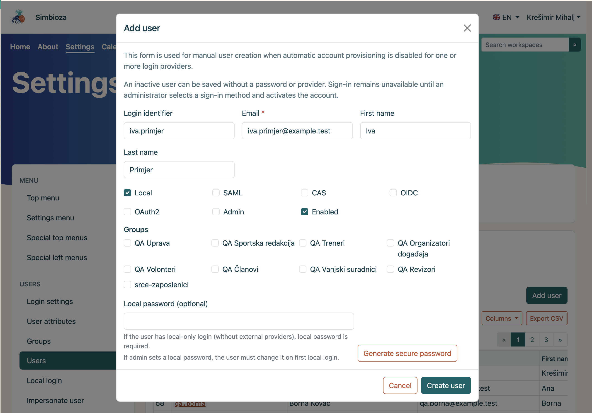Erstellen Sie ein lokales Benutzerformular

<figure class="my-4">
Beispiel für ein lokales Kontoformular ohne angezeigtes Passwort.
</figure>

<figure class="my-4">
 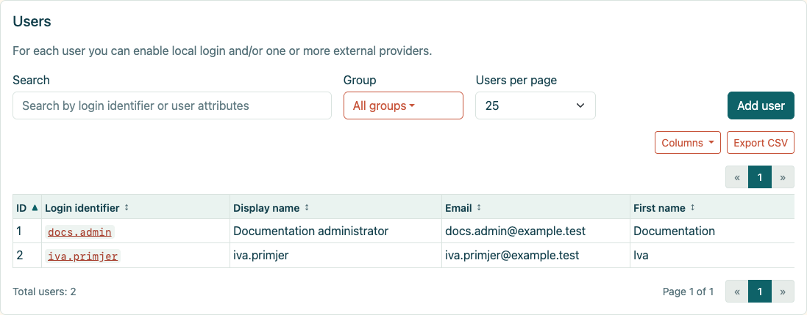 Neuer Benutzer in der Liste 
<figcaption>Der Dokumentationsbenutzer nach der Erstellung.</figcaption>
</figure>

<figure class="my-4">
 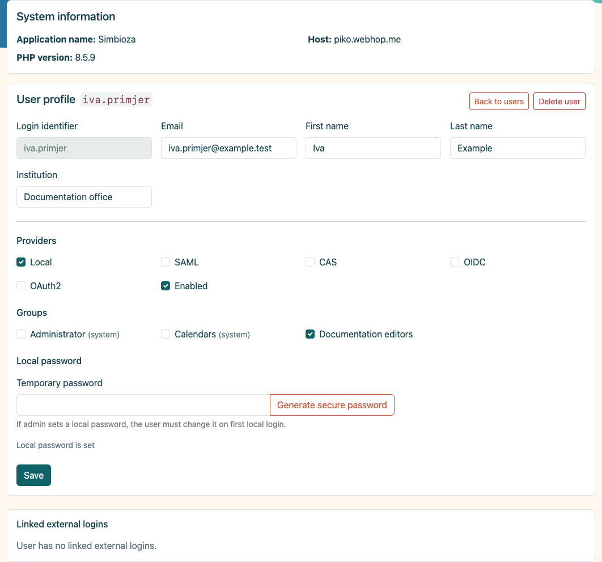 Benutzerdetails 
<figcaption>Kontostatus, verknüpfte Anbieter und Gruppenmitgliedschaften.</figcaption>
</figure>

<figure class="my-4">
  Obligatorische Passwortänderung bei der ersten Anmeldung 
<figcaption>Ein temporäres Passwort zwingt den Benutzer, ein neues zu wählen, bevor er fortfahren kann.</figcaption>
</figure>

Überprüfen Sie auf der Detailseite die Kontoaktivität, die Authentifizierungsquelle, verknüpfte externe Identitäten und Gruppenmitgliedschaften. Die Deaktivierung ist in der Regel sicherer als das Löschen, da dadurch der Prüfpfad erhalten bleibt. Ersetzen Sie niemals manuell die stabile Betreff-ID eines externen Anbieters.

## 5. Lokale Anmeldung und Registrierung

**Lokale Anmeldung** steuert die Selbstregistrierung. Lassen Sie es für geschlossene Systeme deaktiviert und erstellen Sie Konten administrativ oder über vertrauenswürdige SSO. Wenn diese Option aktiviert ist, erstellt die Registrierung ein aktives normales Konto und meldet den Benutzer an. Es wird keine Bestätigungs-E-Mail gesendet und der Besitz der eingegebenen Adresse wird nicht nachgewiesen. Lassen Sie bei einem geschlossenen System die Registrierung deaktiviert und verwenden Sie vom Administrator erstellte Konten oder einen vertrauenswürdigen SSO-Anbieter. Veröffentlichen Sie eine entsprechende Datenschutzerklärung, bevor Sie Registrierungen annehmen. Das öffentliche Formular enthält nur Benutzerattribute, deren Option **Registrierung** aktiviert ist; das SSO-nur-Feld *Institution* wird daher hier nicht angezeigt.

<figure class="my-4">
 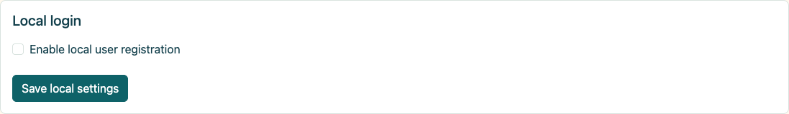 Registrierung deaktiviert 
<figcaption>Empfohlener Ausgangszustand für eine geschlossene Anwendung.</figcaption>
</figure>

<figure class="my-4">
 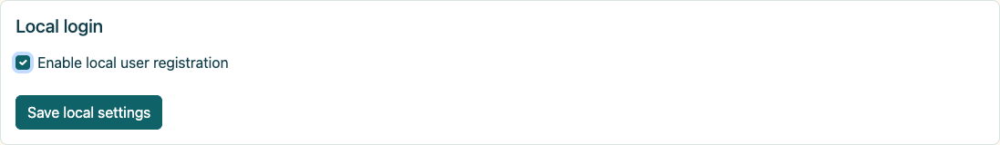 Registrierung aktiviert 
<figcaption>Die Registrierung ist nur für ein kontrolliertes Beispiel aktiviert.</figcaption>
</figure>

<figure class="my-4">
 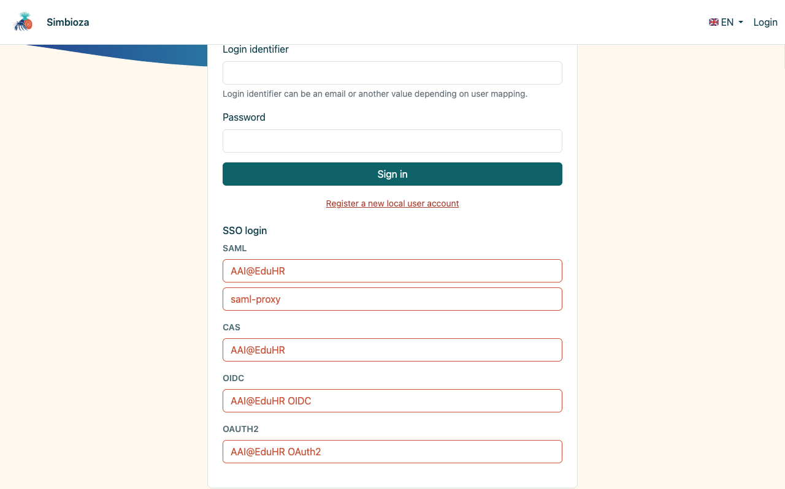 Registrierungslink 
<figcaption>Der Anmeldebildschirm zeigt die Registrierung erst an, nachdem sie aktiviert wurde.</figcaption>
</figure>

<figure class="my-4">
 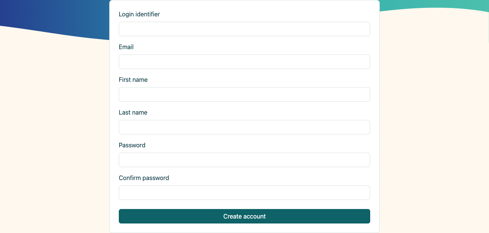 Anmeldeformular 
<figcaption>Öffentliches Formular mit den ausgewählten Registrierungsfeldern; das für die Zuordnung SSO verwendete Institutionsattribut ist absichtlich ausgeblendet.</figcaption>
</figure>

Stellen Sie nach dem Testen den vorgesehenen Produktionszustand wieder her. Passwörter sollten eindeutig und ausreichend lang sein und in einem Passwort-Manager gespeichert werden. Administratoren dürfen Benutzer niemals nach ihrem aktuellen Passwort fragen.

## 6. Identitätswechsel

**Benutzer imitieren** öffnet die Anwendung vorübergehend im Kontext des ausgewählten Benutzers. Verwenden Sie es für Berechtigungs- und Anzeigediagnosen, nicht für die Durchführung von Geschäftsaktionen im Namen des Benutzers.

<figure class="my-4">
 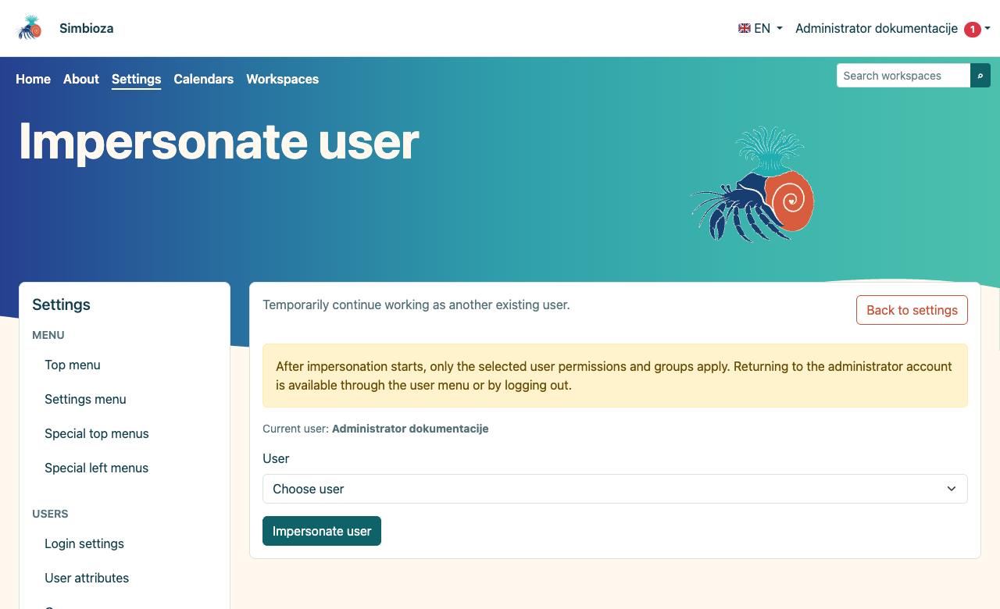 Bildschirm „Identitätswechsel“. 
<figcaption>Auswählen eines Kontos für die kontrollierte Support-Diagnose. Wählen Sie nur das Konto aus, das für den Supportfall benötigt wird.</figcaption>
</figure>

<figure class="my-4">
Die Schnittstelle zeigt deutlich die aktive imitierte Sitzung an.
</figure>

<figure class="my-4">
 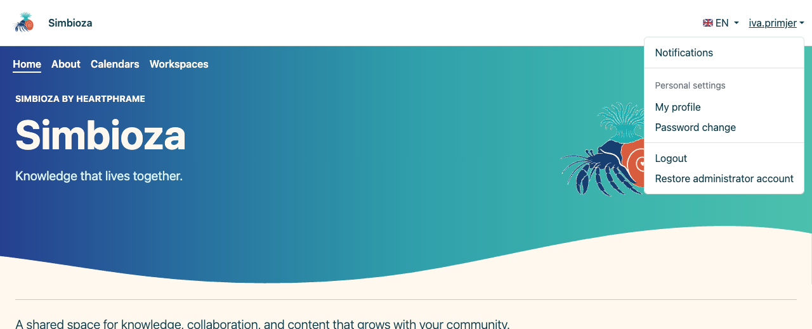 Zurück zum Administrator 
<figcaption>Beenden Sie die Aufgabe, indem Sie zu Ihrem Administratorkonto zurückkehren.</figcaption>
</figure>

Der Identitätswechsel testet nicht die tatsächliche SSO-Authentifizierung, MFA oder die Anbieterrichtlinie. Nutzen Sie dazu den Profiltest oder ein dediziertes Testkonto.

## 7. API-Tasten

Diese Ansichten stehen zur Verfügung, wenn das API-Modul installiert und aktiviert ist. Ein API-Schlüssel handelt mit den Rechten seines Besitzers. Scopes können dessen vorhandene Berechtigungen nur weiter einschränken; sie gewähren keine zusätzlichen Rechte. Verwenden Sie für jede Anbindung einen eigenen Schlüssel, eine aussagekräftige Bezeichnung, eine möglichst kurze Gültigkeit und möglichst wenige Scopes.

<figure class="my-4">
 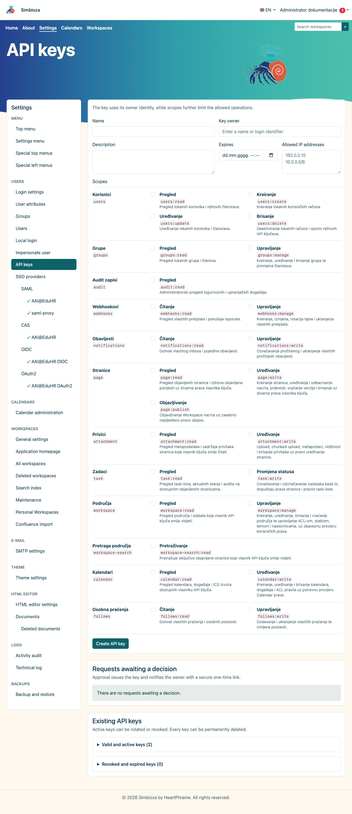 API Schlüsselverwaltung 
<figcaption>API Schlüsselverwaltung in der englischen Oberfläche.</figcaption>
</figure>

### Direkte Schlüsselausgabe

1.  Wählen Sie den Eigentümer und nur die erforderlichen Scopes aus.
2.  Legen Sie ein Ablaufdatum und bei Bedarf eine zulässige IP-Adresse oder Netzwerkbeschränkung fest.
3.  Erstellen Sie den Schlüssel und kopieren Sie das Geheimnis sofort in den sicheren Speicher.
4.  Das Geheimnis wird nur einmal gezeigt. Bei Verlust den Schlüssel widerrufen und einen neuen ausstellen.

<figure class="my-4">
 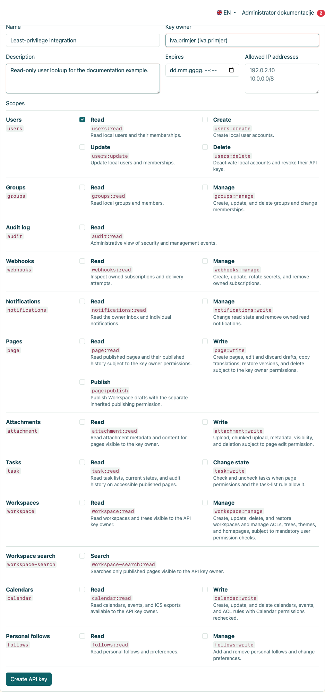 Schlüssel mit der geringsten Berechtigung API 
<figcaption>Ein absichtlich eingeschränkter Schlüssel vor der Erstellung.</figcaption>
</figure>

<figure class="my-4">
 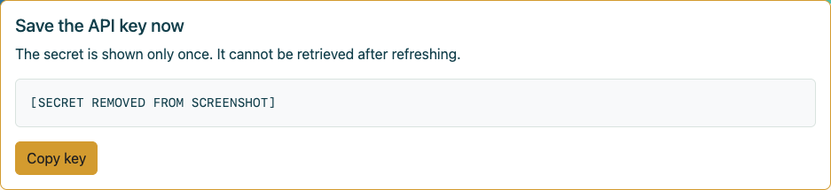 Einmaliges API-Geheimnis 
<figcaption>Das Geheimnis wurde aus dem Screenshot entfernt.</figcaption>
</figure>

<figure class="my-4">
 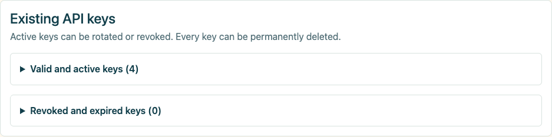 Aktive API-Schlüssel 
<figcaption>Überprüfen und widerrufen Sie aktive Schlüssel aus dieser Liste.</figcaption>
</figure>

### Benutzeranfrage und Administratorgenehmigung

Ein Benutzer kann einen Schlüssel aus dem persönlichen Profil anfordern und seinen Zweck erläutern. Der Administrator überprüft Eigentümer, Scopes, Lebensdauer und Begründung und genehmigt dann die Anfrage oder lehnt sie ab. Nach der Freigabe kann der Nutzer das Geheimnis einmalig im persönlichen Profil preisgeben. Wenn Benachrichtigungen aktiviert sind, verweist eine In-App-Benachrichtigung auch auf diesen Bildschirm. Weder die Benachrichtigung noch eine E-Mail sollten das Geheimnis enthalten.

<figure class="my-4">
 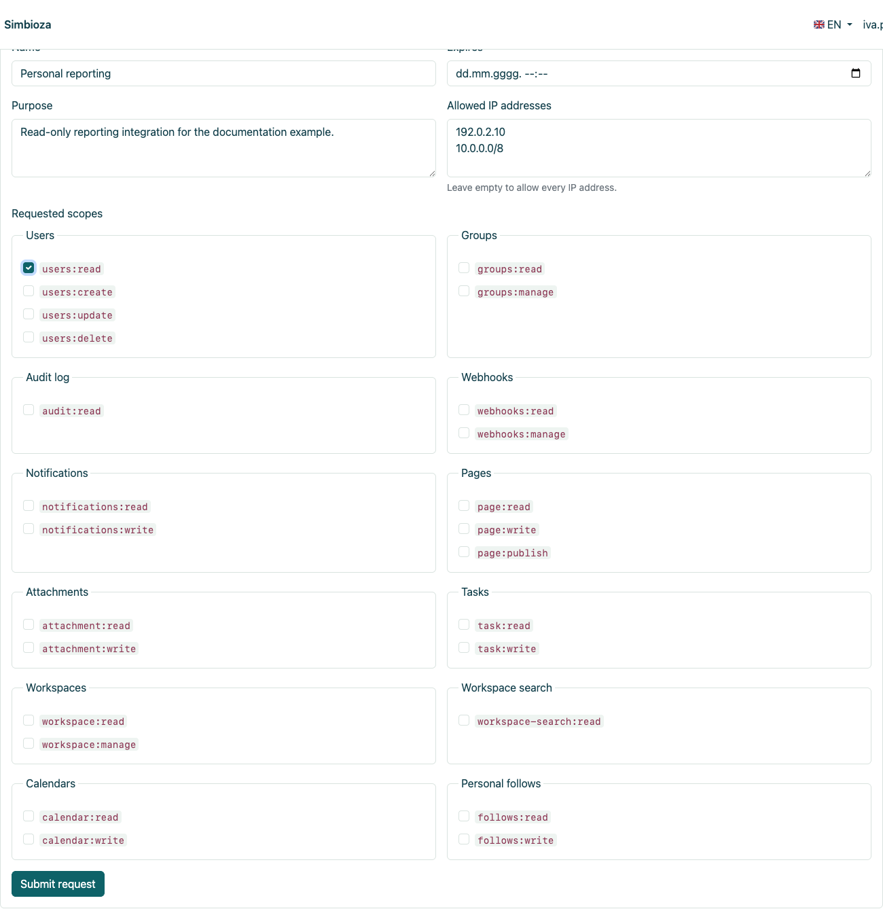 API Schlüsselanforderungsformular 
<figcaption>Der Benutzer fordert einen eingeschränkten Schlüssel an und gibt seinen Zweck an.</figcaption>
</figure>

<figure class="my-4">
 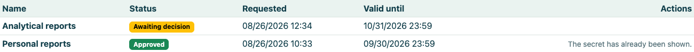 Anfrage gesendet 
<figcaption>Die Anfrage wartet auf die Überprüfung durch den Administrator.</figcaption>
</figure>

<figure class="my-4">
 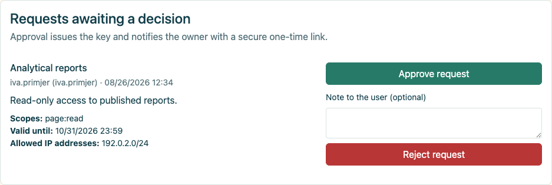 Ausstehende API-Anfrage 
<figcaption>Der Administrator prüft die Anfrage vor der Genehmigung.</figcaption>
</figure>

<figure class="my-4">
 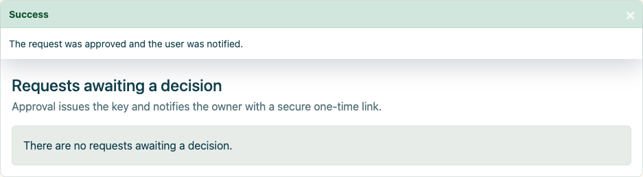 Genehmigte API-Anfrage 
<figcaption>Die Genehmigung erstellt den Schlüssel, ohne das Geheimnis dem Administrator preiszugeben.</figcaption>
</figure>

<figure class="my-4">
 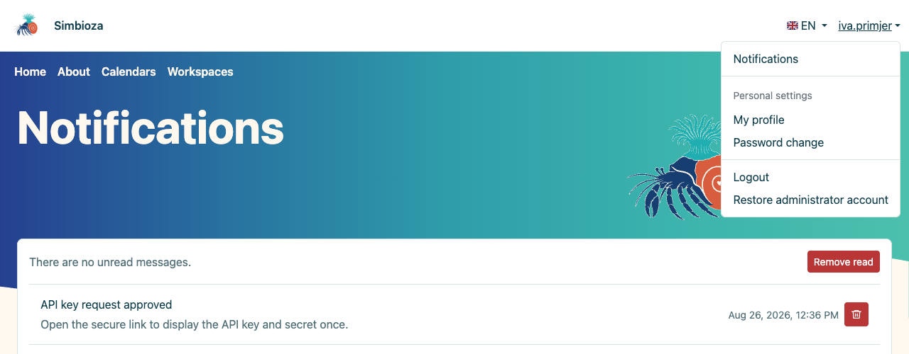 API Schlüsselbenachrichtigung 
<figcaption>Der Benutzer wird über die Entscheidung benachrichtigt.</figcaption>
</figure>

<figure class="my-4">
 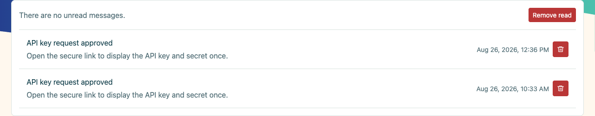 Genehmigte Anforderungsbenachrichtigung 
<figcaption>Die Benachrichtigung führt zur einmaligen Geheimabfrage.</figcaption>
</figure>

<figure class="my-4">
 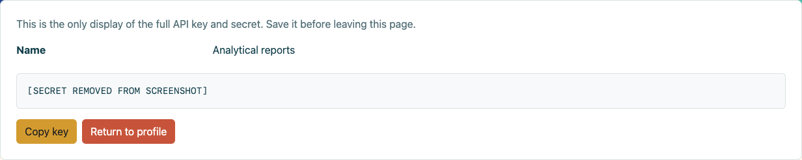 Einmaliger Abruf des Geheimnisses API 
<figcaption>Das Geheimnis wird entfernt und kann nach dem Schließen nicht mehr angezeigt werden.</figcaption>
</figure>

<figure class="my-4">
 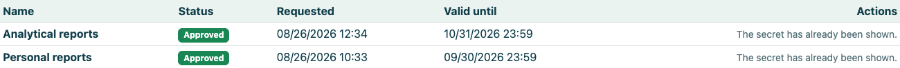 API-Anfrage abgeschlossen 
<figcaption>Die abgeschlossene Anfrage bleibt überprüfbar, ohne dass das Geheimnis preisgegeben wird.</figcaption>
</figure>

## 8. Allgemeiner SSO-Workflow

1.  Registrieren Sie die Anwendung beim Anbieter und geben Sie nur die erforderlichen Endpunkte, die Client-ID und das Geheimnis ein.
2.  Speichern Sie das aktive Profil. Vorhandene Geheimnisse werden beim Bearbeiten nie angezeigt; Wenn Sie das geheime Feld leer lassen, bleibt der serverseitige Wert erhalten.
3.  Wählen Sie **Profil testen**, bevor Sie Zuordnungen erraten. Führen Sie eine echte Anmeldung durch, um die tatsächlichen Attribute des Anbieters zu erfassen.
4.  Ordnen Sie die Felder Betreff, Login, Anzeigename und Benutzer den zurückgegebenen Namen zu.
5.  Testen Sie noch einmal. Nur **Getestet und betriebsbereit** zusammen mit einem grünen Häkchen bestätigt ein vollständiges Profil.

### Erlaubte Domänen

Die Liste beschränkt die Anmeldung auf Organisationsdomänen. Geben Sie eine Domäne pro Zeile oder eine durch Kommas getrennte Liste ein. `example.org` lässt diese Domäne und ihre Unterdomänen zu; ein Suffix wie `hr` lässt Bezeichner zu, deren Domäne auf `.hr` endet. Eine leere Liste erlegt keine Domänenbeschränkung auf.

**Domänenquellenattribut** muss das echte Anbieterattribut sein, das einen Wert wie `user@example.org` oder eine Domäne enthält. Dies ist nur erforderlich, wenn die Liste der zulässigen Domänen ausgefüllt ist. Verwenden Sie keinen Anzeigenamen oder einen anderen veränderlichen Wert.

### Öffentliche Rückrufadressen

Der Anbieter muss den Browser auf die öffentliche URL derselben Installation zurückführen. Schließen Sie ein Unterverzeichnis ein, wenn eines verwendet wird: Geben Sie für eine Anwendung unter `https://simbioza.example.org/simbioza` diesen vollständigen Wert als öffentliche Basis-URL ein. Es handelt sich nicht um die interne PHP-FPM-, Container- oder Datenbankadresse. Registrieren Sie die genauen Rückruf-URLs, die vom Profil angezeigt werden.

## 9. SAML

Ein SAML-Profil hängt von einem separat installierten und korrekt konfigurierten **SimpleSAMLphp** ab. Sein Autoloader, die SP-Authentifizierungsquelle, Zertifikate, Metadaten und Rückgabe-URLs müssen bereits funktionieren. Der Pfad zu `vendor/autoload.php` und der Name der Authentifizierungsquelle müssen mit dieser Installation übereinstimmen.

<figure class="my-4">
 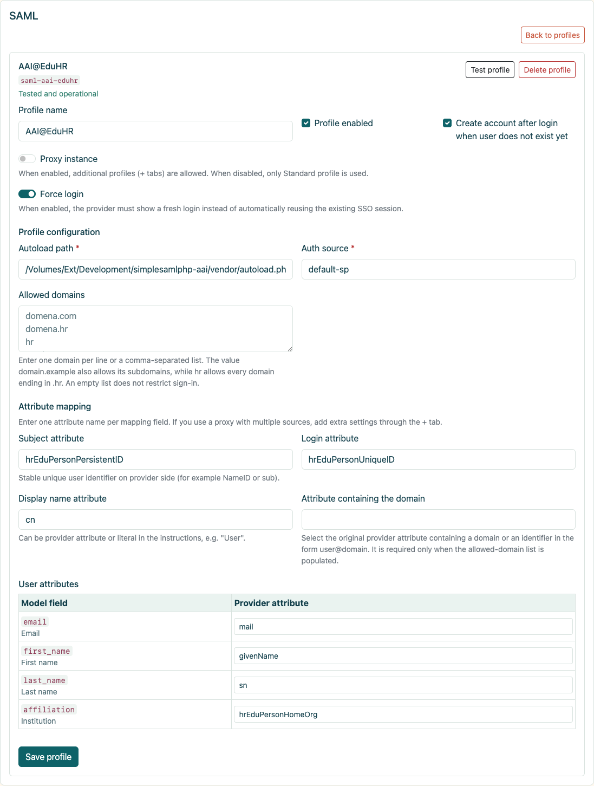 Erstkonfiguration SAML 
<figcaption>Das Profil wird gespeichert, die Zuordnungen sind jedoch noch nicht bestätigt.</figcaption>
</figure>

<figure class="my-4">
  Erster SAML-Test 
<figcaption>Konnektivitätsarbeiten und -attribute wurden gesammelt; Werte werden geschwärzt.</figcaption>
</figure>

<figure class="my-4">
 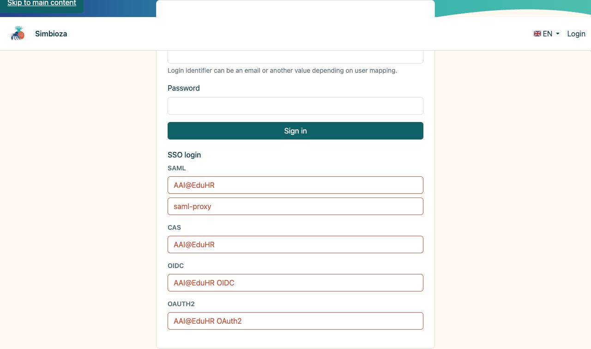 Starten des AAI-Logins 
<figcaption>Der englische Anmeldebildschirm Simbioza startet den konfigurierten AAI@EduHr SSO-Ablauf, ohne Anmeldeinformationen preiszugeben.</figcaption>
</figure>

<figure class="my-4">
  SAML Zuordnungen 
<figcaption>Erforderliche Zuordnungen, die aus den tatsächlich zurückgegebenen Attributen eingegeben wurden.</figcaption>
</figure>

<figure class="my-4">
 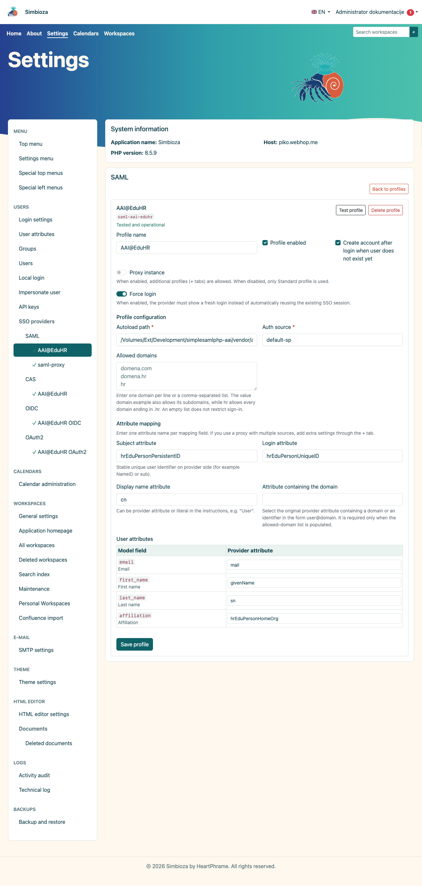 Betriebsprofil SAML 
<figcaption>Der wiederholte Test bestätigt ein funktionsfähiges SAML-Profil.</figcaption>
</figure>

## 10. SAML-Proxy- und untergeordnete Profile

Eine Proxy-Instanz stellt eine SimpleSAMLphp-Authentifizierungsquelle dar, die mehrere Upstream-Anbieter verfügbar machen kann. Auf der Registerkarte **Standard** werden der gemeinsame Autoload-Pfad, die Authentifizierungsquelle und die Basiszuordnung definiert. Zusätzliche untergeordnete Registerkarten erben die gemeinsamen Verbindungseinstellungen und behalten gleichzeitig ihre eigenen Attributzuordnungen bei.

**Ein Proxy hat keine Felder für zulässige Domänen oder Domänenquellenattribute.** Dies ist beabsichtigt: Upstream-Anbieter geben möglicherweise unterschiedliche Kennungen und Domänen zurück. Erzwingen Sie Einschränkungen beim Proxy oder Upstream-Anbieter, nicht durch eine gemeinsame Domänenregel Simbioza.

<figure class="my-4">
 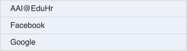 Auswahl des Proxy-Anbieters 
<figcaption>Der echte Proxy-Login bietet AAI@EduHR, Facebook und Google und erklärt die drei untergeordnete Profile.</figcaption>
</figure>

### Standard / AAI@EduHR

<figure class="my-4">
 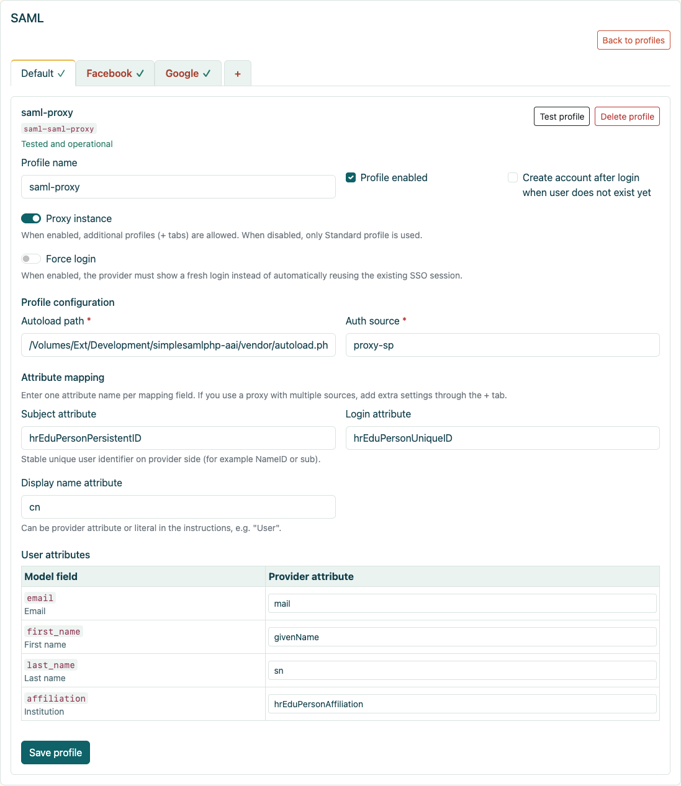 Erster Standard-Proxy-Test 
<figcaption>Vor dem Mapping gesammelte Attribute, wobei die Werte entfernt wurden.</figcaption>
</figure>

<figure class="my-4">
  Standard-Proxy-Zuordnungen 
<figcaption>Zuordnungen für die Standard-AAI-Quelle.</figcaption>
</figure>

<figure class="my-4">
 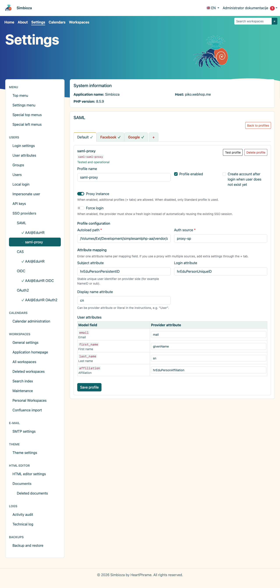 Operatives Standard-Proxy-Profil 
<figcaption>Standard-Proxy-Registerkarte nach erfolgreichem Wiederholungstest.</figcaption>
</figure>

### Facebook

<figure class="my-4">
  Erster Facebook-Proxy-Test 
<figcaption>Vor dem Mapping gesammelte Facebook-Attribute, wobei die Werte entfernt wurden.</figcaption>
</figure>

<figure class="my-4">
  Facebook-Zuordnungen des untergeordneten Profils 
<figcaption>Stabile Facebook-ID, Login und Benutzerfelder werden unabhängig voneinander zugeordnet.</figcaption>
</figure>

<figure class="my-4">
 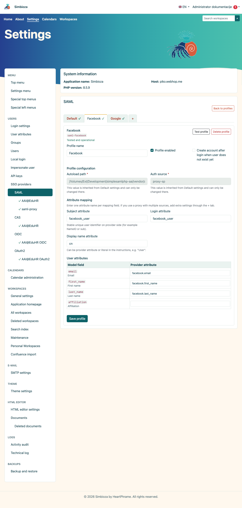 Funktionales Facebook-untergeordnetes Profil 
<figcaption>Untergeordneter Facebook-Tab nach erfolgreicher Zuordnung und Prüfung.</figcaption>
</figure>

### Google

<figure class="my-4">
  Erster Google-Proxy-Test 
<figcaption>Vor der Zuordnung erfasste Google-Attribute, wobei die Werte entfernt wurden.</figcaption>
</figure>

<figure class="my-4">
  Google-Zuordnungen des untergeordneten Profils 
<figcaption>Google UID ist der Betreff, Google E-Mail ist der Login und Namensfelder werden dem Modell zugeordnet.</figcaption>
</figure>

<figure class="my-4">
  Betriebsfähiges Google-untergeordnetes Profil 
<figcaption>Google Child-Tab nach erfolgreichem Wiederholungstest.</figcaption>
</figure>

## 11. CAS

Ein CAS-Profil benötigt die Server-Basis-URL und seine Anmelde-, Validierungs- und Abmelde-Endpunkte. Wenn eine private CA-Kette verwendet wird, stellen Sie einen lesbaren Zertifikatspfad bereit. Deaktivieren Sie niemals die TLS-Validierung, um eine falsche Zertifikatkonfiguration zu umgehen.

<figure class="my-4">
 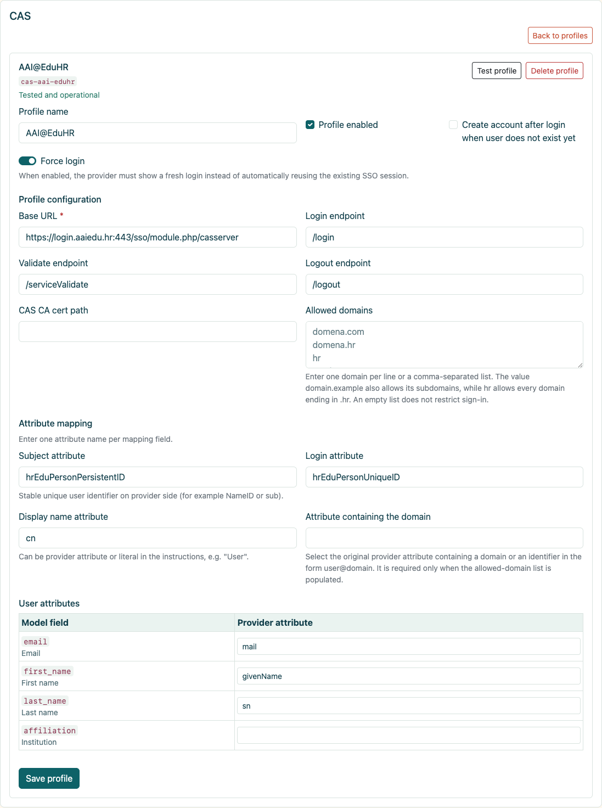 Erstkonfiguration CAS 
<figcaption>Die Verbindung CAS ist vorbereitet, aber die Zuordnungen sind noch nicht vollständig.</figcaption>
</figure>

<figure class="my-4">
  Erster CAS-Test 
<figcaption>CAS Authentifizierung gibt Attribute zurück; Werte werden geschwärzt.</figcaption>
</figure>

<figure class="my-4">
  CAS Zuordnungen 
<figcaption>Stabile Betreff-, Anmelde-, Anzeigename- und Modellfelder, die aus dem Test zugeordnet wurden.</figcaption>
</figure>

<figure class="my-4">
 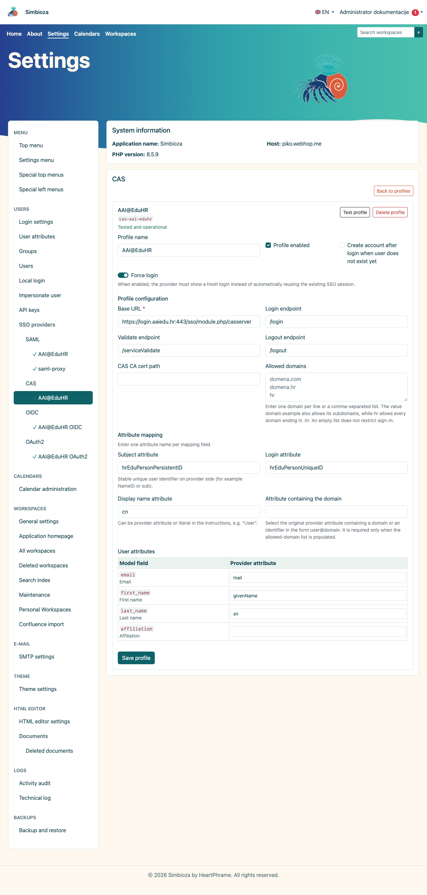 Betriebsprofil CAS 
<figcaption>Der wiederholte Test bestätigt das Profil CAS.</figcaption>
</figure>

## 12. OIDC

OIDC verwendet eine Client-ID und ein Geheimnis, eine Autorisierung, ein Token, Benutzerinformationen und optional Sitzungsendpunkte. Der Bereich muss `openid` enthalten, gefolgt von nur erforderlichen Daten wie `profile` und `email`. **Öffentliche Redirect-Basis-URL** ist die vollständige öffentliche Basisadresse dieser Installation, einschließlich eines Unterverzeichnisses, sofern vorhanden.

<figure class="my-4">
 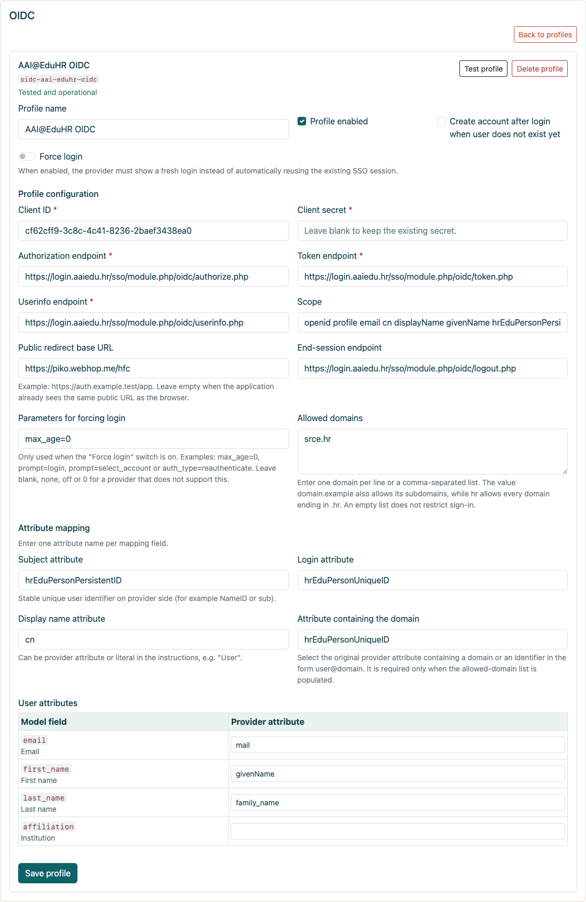 Erstkonfiguration OIDC 
<figcaption>OIDC Endpunkte und öffentliche Basis-URL vor der Zuordnung.</figcaption>
</figure>

<figure class="my-4">
  Erster OIDC-Test 
<figcaption>OIDC Ansprüche, die vor der Zuordnung erfasst wurden, wobei die Werte entfernt wurden.</figcaption>
</figure>

<figure class="my-4">
  OIDC Zuordnung und Domäne 
<figcaption>Betreff, Login, Anzeigename, Benutzerfelder und Domänenquelle, zugeordnet aus tatsächlichen Ansprüchen.</figcaption>
</figure>

<figure class="my-4">
 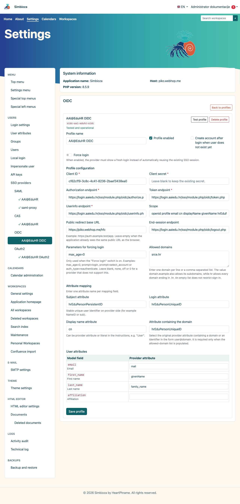 Betriebsprofil OIDC 
<figcaption>Der wiederholte Test bestätigt OIDC und zeigt das grüne Häkchen an.</figcaption>
</figure>

Verwenden Sie einen erzwungenen Anmeldeparameter wie `max_age=0` nur, wenn der Anbieter dies unterstützt und **Anmeldung erzwingen** aktiviert ist. Andernfalls lassen Sie das Feld leer, um eine gültige vorhandene SSO-Sitzung beizubehalten.

## 13. OAuth2

OAuth2 verwendet Autorisierungs-, Token- und Benutzerinfo-Endpunkte sowie die für Benutzerdaten erforderlichen Scopes. Wenn der Anbieter OpenID Connect unterstützt, bevorzugen Sie OIDC, da es die Identitäts- und Tokenvalidierung standardisiert. OAuth2 Für die Abmeldung ist möglicherweise ein dedizierter Endpunkt, ein Umleitungsparametername oder ein Hinweis erforderlich. Geben Sie nur Werte ein, die in der Anbieterdokumentation erforderlich sind.

<figure class="my-4">
 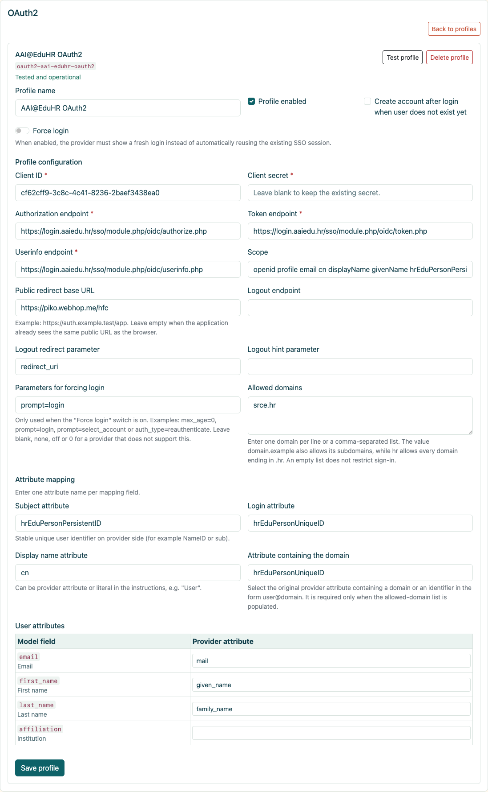 Erstkonfiguration OAuth2 
<figcaption>OAuth2 Profil vor der Attributzuordnung.</figcaption>
</figure>

<figure class="my-4">
  Erster OAuth2-Test 
<figcaption>Benutzerinfo-Attribute, die durch eine echte Anmeldung erfasst wurden, wobei die Werte entfernt wurden.</figcaption>
</figure>

<figure class="my-4">
  OAuth2 Zuordnung und Domäne 
<figcaption>Aus dem Testergebnis eingetragene Zuordnungen und Domäneneinschränkungen.</figcaption>
</figure>

<figure class="my-4">
 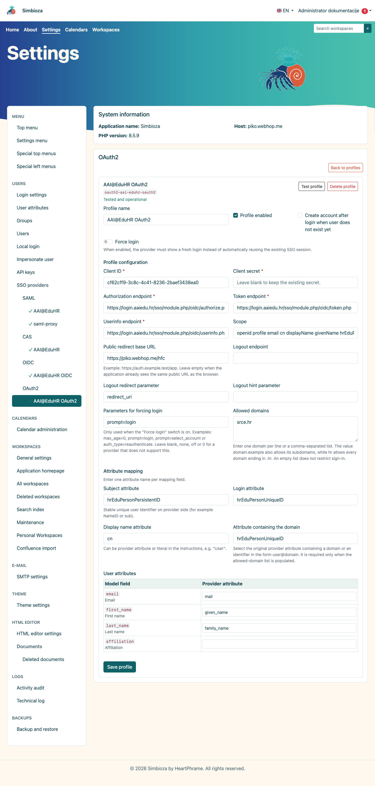 Betriebsprofil OAuth2 
<figcaption>Der wiederholte Test bestätigt das Profil OAuth2.</figcaption>
</figure>

## 14. Persönliches Profil: Sicherheit und Zugang

Öffnen Sie **Persönliches Profil** aus dem Benutzermenü. Der Hauptabschnitt zeigt Identität und benutzerdefinierte Attribute. **Sicherheit und Zugriff** zeigt Gruppenmitgliedschaft, lokalen Passwortstatus, verknüpfte externe Anmeldungen und API Schlüsselanforderungen an.

<figure class="my-4">
 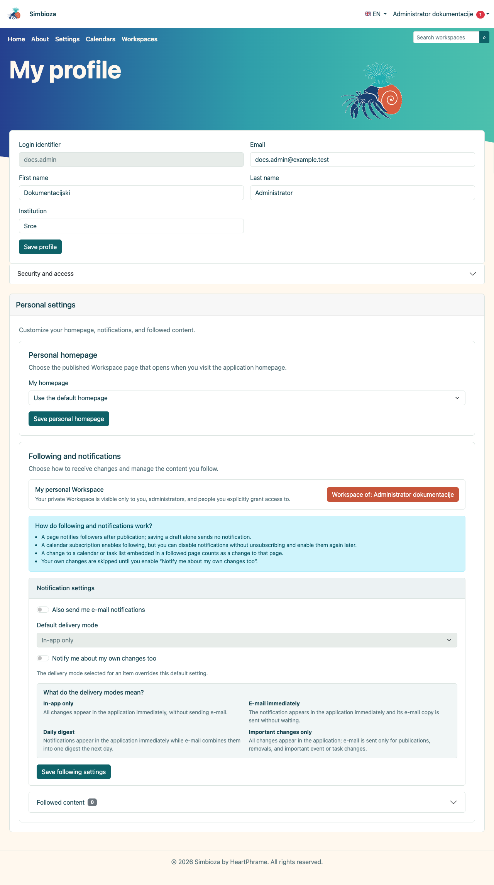 Persönliches Profil 
<figcaption>Persönliche Daten und benutzerdefinierte Attribute in der englischen Benutzeroberfläche.</figcaption>
</figure>

<figure class="my-4">
 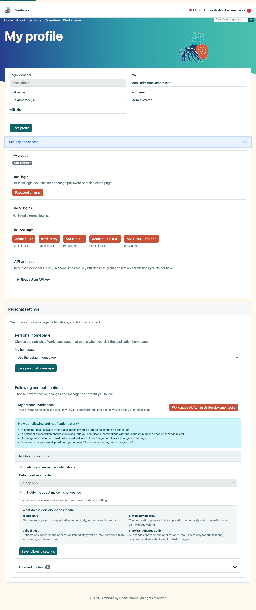 Sicherheit und Zugriff erweitert 
<figcaption>Gruppen, lokale Anmeldung, verknüpfte Anbieter und API-Anfragen an einem Ort.</figcaption>
</figure>

Verknüpfen Sie ein externes Konto nur, solange Sie beide Identitäten kontrollieren. Entfernen Sie unbekannte oder nicht verwendete Links, aber stellen Sie zunächst sicher, dass weiterhin eine andere Anmeldemethode verfügbar ist. Ändern Sie lokale Passwörter über dieses sichere Formular, niemals per E-Mail oder einer Administratornachricht.

## 15. Verifizierungs- und Sicherheitscheckliste

- Halten Sie mindestens einen kontrollierten Administrator-Login bereit; Bewahren Sie das Glasbruchkonto außerhalb des normalen täglichen Gebrauchs auf.
- Überprüfen Sie für jedes SSO-Profil die genauen Rückruf-URLs, TLS-Zertifikate, erforderliche Scopes und geheime Rotation.
- Akzeptieren Sie kein aktives Kontrollkästchen als Beweis. Erfordern den grünen Betriebszustand nach dem wiederholten Test.
- Der Betreff muss eine unveränderliche Anbieterkennung sein. Login und E-Mail können sich ändern und sind nicht immer geeignete primäre Identifikatoren.
- Testen Sie Domäneneinschränkungen mit einem zugelassenen und einem verweigerten Testkonto.
- Überprüfen Sie regelmäßig Administratoren, Gruppenmitgliedschaften, verknüpfte externe Anmeldungen, aktive API-Schlüssel und ausstehende Anfragen.
- Geben Sie niemals Passwörter, Client-Geheimnisse, Token, API-Geheimnisse oder rohe persönliche Attribute in Screenshots, Dokumentationen, Tickets oder in der Quellcodeverwaltung ein.
- Entfernen oder deaktivieren Sie nach dem Testen nicht mehr benötigte Dokumentationskonten und Schlüssel.

Testen Sie nach dem Speichern eine normale Anmeldung und ein abgelehntes Konto. Stellen Sie sicher, dass jeder Benutzer nur die Inhalte und Aktionen sieht, die seinen Gruppen zugewiesen sind.

