# Login and users

This guide takes an administrator through every login setting, user attribute, group, user account, local registration, impersonation, API key, SSO provider, and personal security and access screen.

**The examples were created on a clean SQLite installation.** Accounts, groups, and keys shown here exist only for documentation. Secrets and personal attribute values have been removed from screenshots. In production, use your own names, domains, lifetimes, and least-privilege rules.

## Contents

1.  [Login settings](#1-login-settings)
2.  [User attributes](#2-user-attributes)
3.  [Groups](#3-groups)
4.  [Users and local accounts](#4-users-and-local-accounts)
5.  [Local login and registration](#5-local-login-and-registration)
6.  [Impersonation](#6-impersonation)
7.  [API keys](#7-api-keys)
8.  [Common SSO workflow](#8-common-sso-workflow)
9.  [SAML](#9-saml)
10. [SAML proxy](#10-saml-proxy-and-child-profiles)
11. [CAS](#11-cas)
12. [OIDC](#12-oidc)
13. [OAuth2](#13-oauth2)
14. [Personal profile: security and access](#14-personal-profile-security-and-access)
15. [Verification and security checklist](#15-verification-and-security-checklist)

## 1. Login settings

Open **Settings → Users → Login settings** . This page enables authentication methods for the application. Enabling a provider only makes its configuration and menu available; every individual profile must still be saved, activated, tested, and mapped correctly.

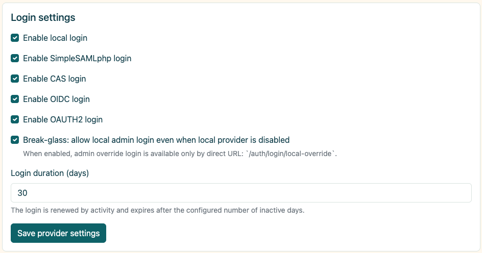Login settings overview

<figure class="my-4">

<figcaption>Login settings in the English interface.</figcaption>
</figure>

### Main switches

- **Local login** enables username and password authentication stored by Simbioza.
- **SimpleSAMLphp, CAS, OIDC, and OAuth2** enable the corresponding SSO profile groups.
- **Break-glass local login** keeps a separate direct administrator route available when normal local login is disabled. Protect that account with a strong unique password and use it only for recovery.
- **Login duration** is an inactivity limit in days (1–365), renewed while the signed-in user remains active. Use a shorter period on administrative and shared devices.

**“Profile active” is not the same as the green check mark.** Active means that the profile may be used. The green check and *Tested and operational* status appear only after a successful provider test and valid required mappings. An active profile may still be non-operational.

## 2. User attributes

Open **User attributes** . The model normally includes e-mail, first name, and last name. Add an attribute when the application must store a value outside the basic profile, such as an institution, department, employee number, or an external directory role.

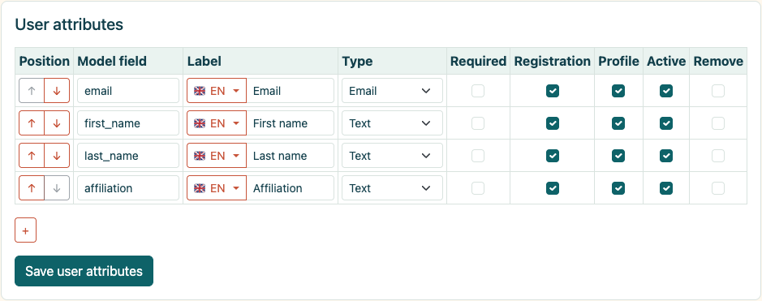User attributes

<figure class="my-4">

<figcaption>Default and custom attributes in the English interface.</figcaption>
</figure>

### Adding an attribute

1.  Enter a stable machine name in lowercase without spaces, such as `affiliation` .
2.  Provide separate Croatian and English labels.
3.  Choose the data type and configure **Required** , **Registration** , **Profile** , and **Active** independently.
4.  Save it. The new field becomes available in user profiles and in every SSO profile mapping table.

<figure class="my-4">
 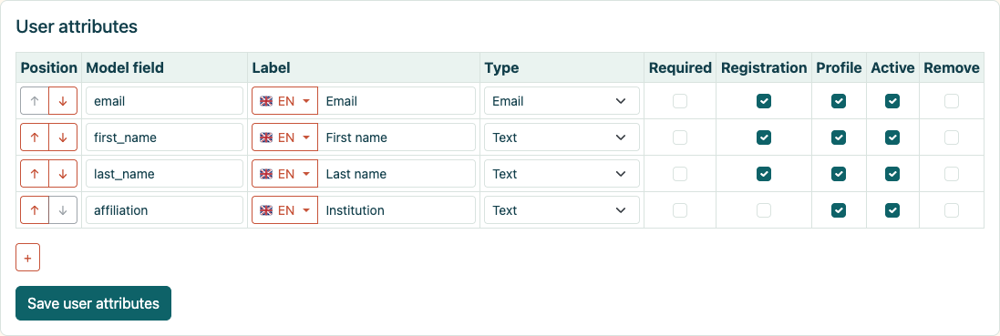 Bilingual custom attribute example 
<figcaption>The affiliation model field is labelled Ustanova / Institution, remains available to profiles and SSO mappings, and is excluded from self-registration.</figcaption>
</figure>

**Mapping** connects a Simbioza model field to the exact attribute name returned by the provider. Attribute names are exact: `mail` , `givenName` , and `given_name` are different fields. Test first, inspect the returned names, and only then enter the mappings. An SSO mapping does not automatically add the field to the public registration form.

**Which fields are included in self-registration?** The administrator chooses this per attribute. **Registration** controls whether a field appears in the public form, while **Required** rejects an empty value in contexts where that field participates. When both settings are enabled, the field is mandatory during self-registration. A required attribute must also have a valid SSO mapping for a provider profile test to become operational. In this example, `affiliation` stores the institution supplied by a provider and appears in the profile, so it is intentionally excluded from registration.

## 3. Groups

Groups collect users and carry permissions. The Administrator group is a protected system group and should not be used as a normal business group. Create separate least-privilege groups for departments, projects, or roles.

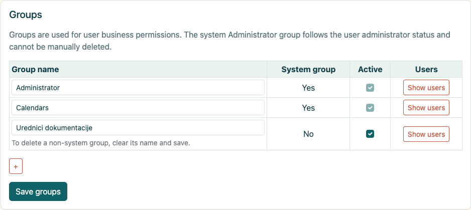Groups

System and example groups in the English interface.\

1.  Select **New group** and enter a clear name and description.
2.  Assign only the permissions members actually need.
3.  Save the group, then add or remove membership from the user detail screen.
4.  Where supported by the installation, SSO users can also be assigned through a rule based on a mapped attribute.

<figure class="my-4">
 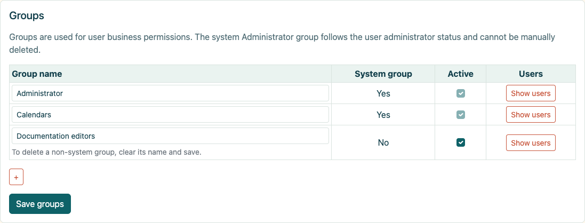 Example group before saving 
<figcaption>A documentation group before saving; labels follow the currently selected site language.</figcaption>
</figure>

## 4. Users and local accounts

Open **Settings → Users → Users** to find accounts, inspect their state, and manage membership and access.

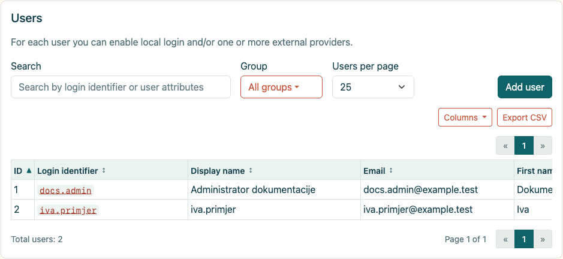Responsive user table

<figure class="my-4">
Balanced user table columns in the English interface.
</figure>

### Creating a local user

1.  Select **New user** .
2.  Enter a unique login identifier, display name, and e-mail.
3.  Choose the local authentication source and assign a strong temporary password.
4.  Require a password change on first login.
5.  Assign only the required groups; administrator access must not be the default.

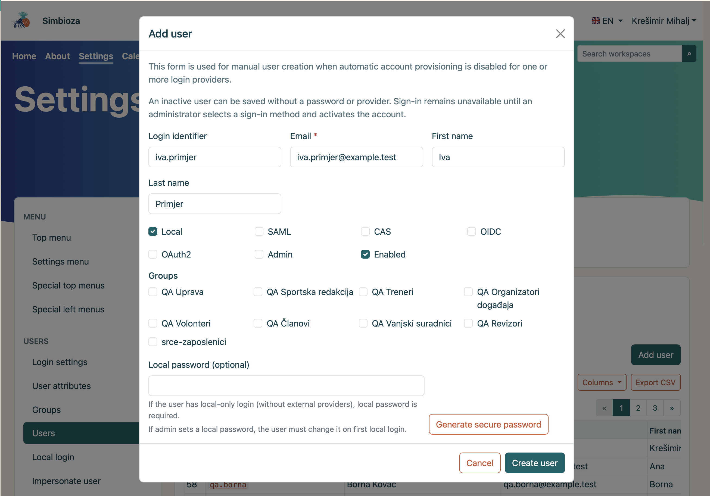Create local user form

<figure class="my-4">
Example local account form with no password shown.
</figure>

<figure class="my-4">
 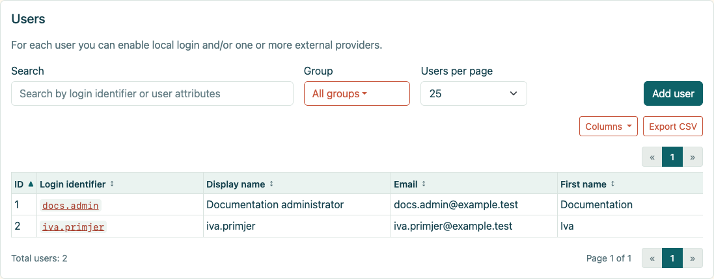 New user in the list 
<figcaption>The documentation user after creation.</figcaption>
</figure>

<figure class="my-4">
 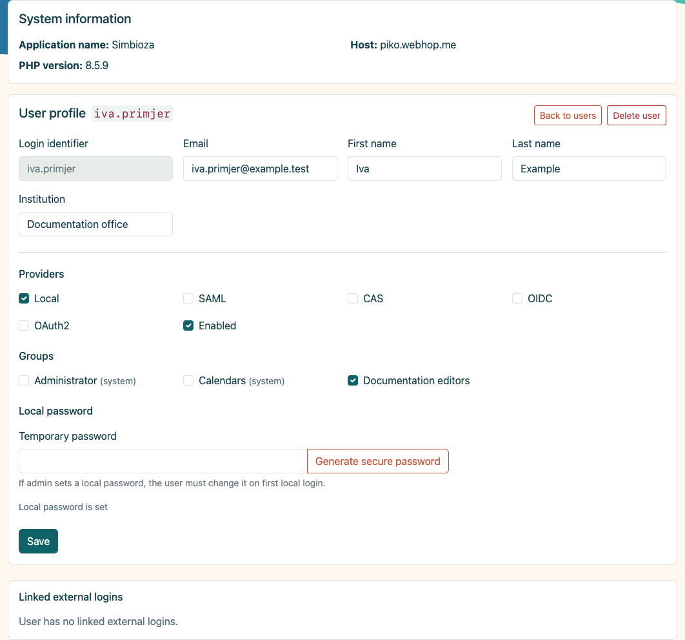 User details 
<figcaption>Account state, linked providers, and group memberships.</figcaption>
</figure>

<figure class="my-4">
  Mandatory first-login password change 
<figcaption>A temporary password forces the user to choose a new one before continuing.</figcaption>
</figure>

On the detail page, verify account activity, authentication source, linked external identities, and group memberships. Deactivation is usually safer than deletion because it preserves the audit trail. Never manually replace an external provider's stable subject identifier.

## 5. Local login and registration

**Local login** controls self-registration. Keep it disabled for closed systems and create accounts administratively or through trusted SSO. If enabled, registration creates an active ordinary account and signs the user in. It does not send a verification e-mail or prove ownership of the entered address. For a closed system, keep registration disabled and use administrator-created accounts or a trusted SSO provider. Publish an appropriate privacy notice before accepting registrations. The public form includes only user attributes whose **Registration** option is enabled; the SSO-only *Institution* field is therefore not shown here.

<figure class="my-4">
 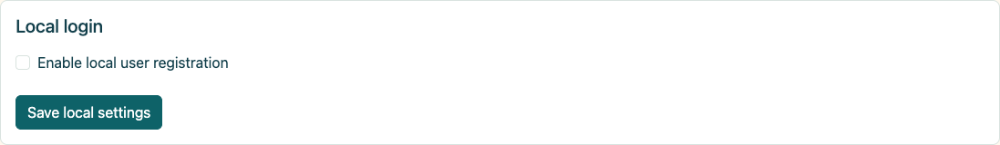 Registration disabled 
<figcaption>Recommended initial state for a closed application.</figcaption>
</figure>

<figure class="my-4">
 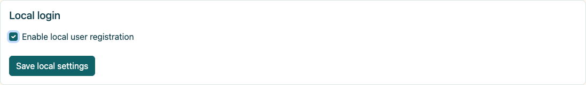 Registration enabled 
<figcaption>Registration enabled only for a controlled example.</figcaption>
</figure>

<figure class="my-4">
 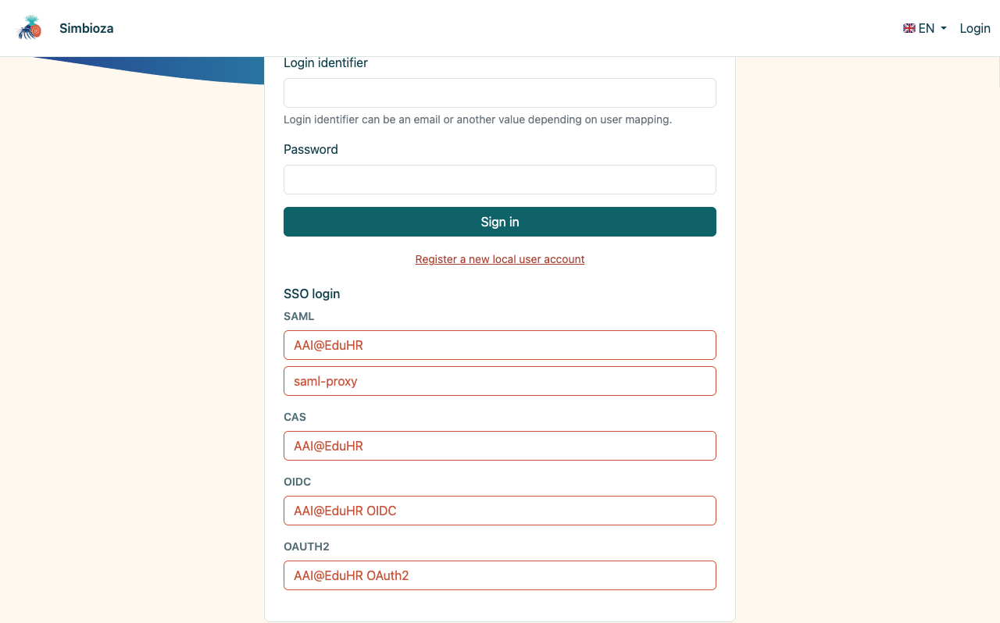 Registration link 
<figcaption>The login screen shows registration only after it is enabled.</figcaption>
</figure>

<figure class="my-4">
 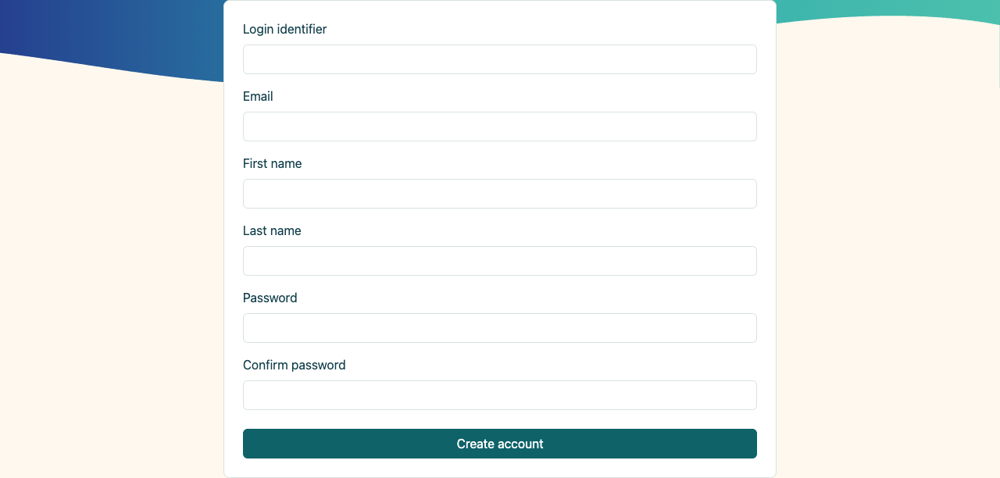 Registration form 
<figcaption>Public form with the selected registration fields; the Institution attribute used for SSO mapping is intentionally hidden.</figcaption>
</figure>

After testing, restore the intended production state. Passwords should be unique, sufficiently long, and stored in a password manager. Administrators must never ask users for their current password.

## 6. Impersonation

**Impersonate user** temporarily opens the application in the selected user's context. Use it for permission and display diagnostics, not for performing business actions on behalf of the user.

<figure class="my-4">
 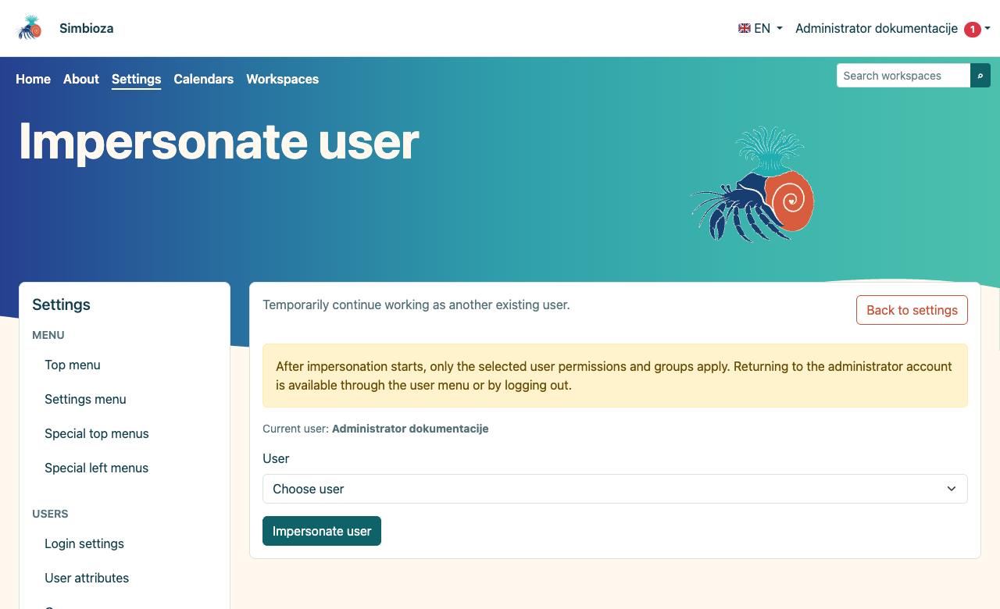 Impersonation screen 
<figcaption>Selecting an account for controlled support diagnostics. Select only the account needed for the support case.</figcaption>
</figure>

<figure class="my-4">
The interface clearly indicates the active impersonated session.
</figure>

<figure class="my-4">
 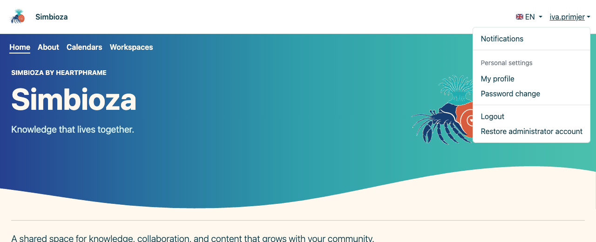 Return to administrator 
<figcaption>End the task by returning to your administrator account.</figcaption>
</figure>

Impersonation does not test actual SSO authentication, MFA, or provider policy. Use the profile test or a dedicated test account for that purpose.

## 7. API keys

These screens are available when the API module is installed and enabled. An API key acts as its owner. Scopes can only reduce the owner's existing permissions; they cannot grant permissions the owner does not have. Use a separate key per integration, a descriptive label, the shortest practical lifetime, and the smallest set of scopes.

<figure class="my-4">
 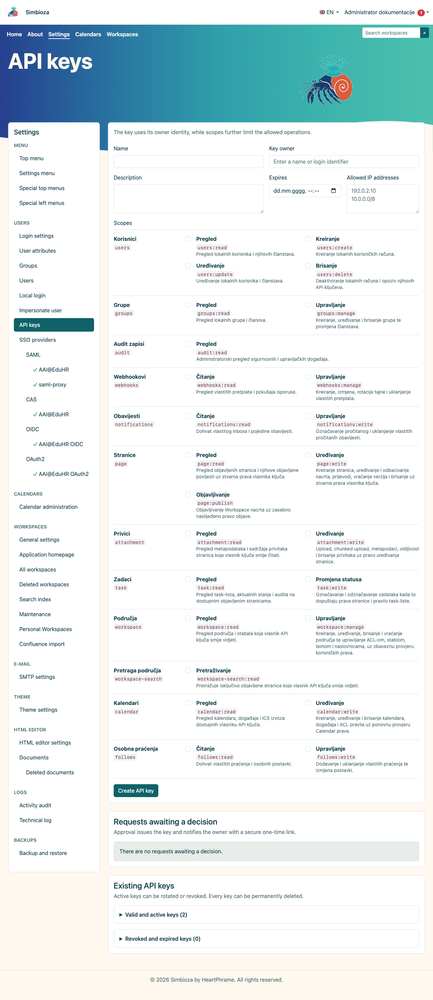 API key administration 
<figcaption>API key administration in the English interface.</figcaption>
</figure>

### Direct key issuance

1.  Select the owner and only the required scopes.
2.  Set an expiry date and, if needed, an allowed IP address or network restriction.
3.  Create the key and immediately copy the secret to secure storage.
4.  The secret is shown only once. If it is lost, revoke the key and issue a new one.

<figure class="my-4">
 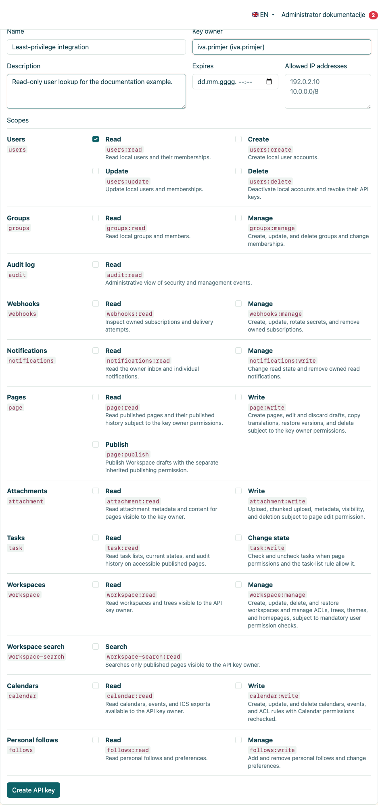 Least-privilege API key 
<figcaption>An intentionally restricted key before creation.</figcaption>
</figure>

<figure class="my-4">
 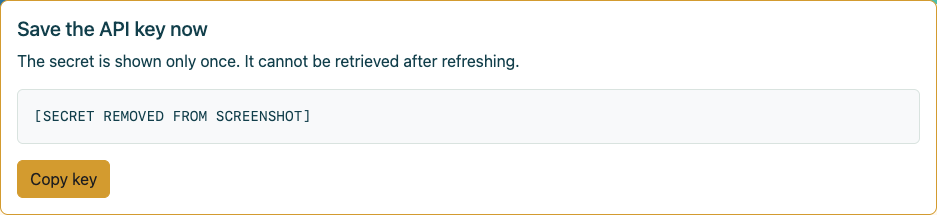 One-time API secret 
<figcaption>The secret has been removed from the screenshot.</figcaption>
</figure>

<figure class="my-4">
 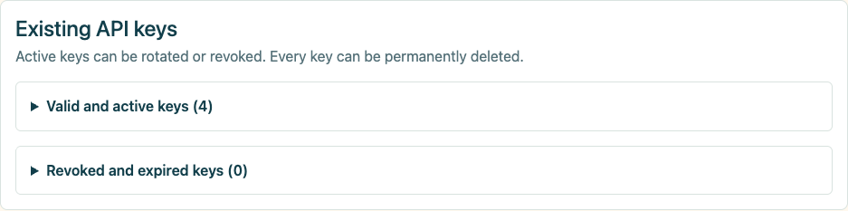 Active API keys 
<figcaption>Review and revoke active keys from this list.</figcaption>
</figure>

### User request and administrator approval

A user may request a key from the personal profile and explain its purpose. The administrator reviews owner, scopes, lifetime, and justification, then approves or rejects the request. After approval the user can reveal the secret once in the personal profile. When Notifications is enabled, an in-app notification also points to that screen. Neither the notification nor an e-mail should contain the secret.

<figure class="my-4">
 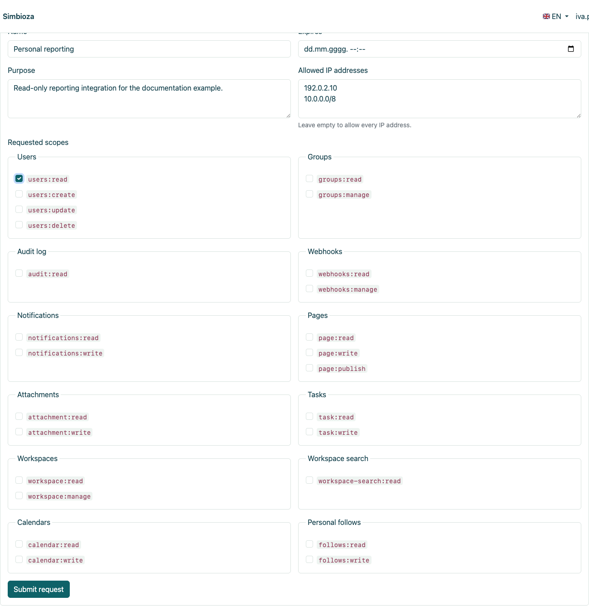 API key request form 
<figcaption>The user requests a restricted key and states its purpose.</figcaption>
</figure>

<figure class="my-4">
 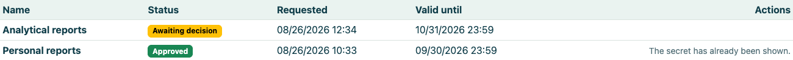 Request sent 
<figcaption>The request waits for administrator review.</figcaption>
</figure>

<figure class="my-4">
 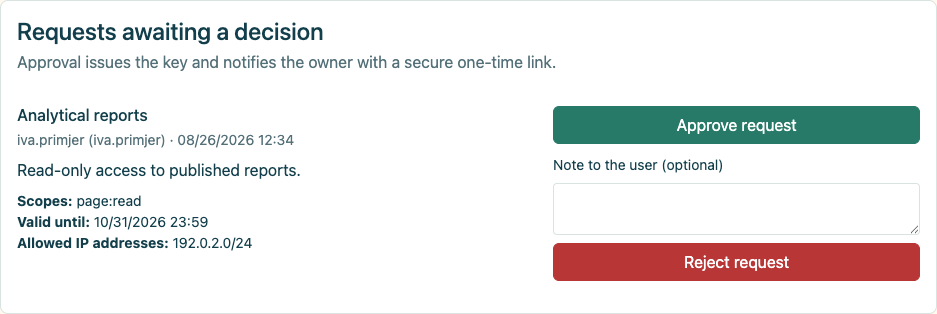 Pending API request 
<figcaption>The administrator checks the request before approval.</figcaption>
</figure>

<figure class="my-4">
 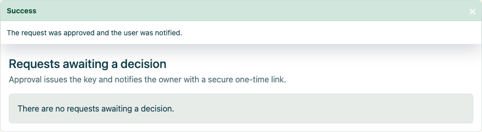 Approved API request 
<figcaption>Approval creates the key without revealing the secret to the administrator.</figcaption>
</figure>

<figure class="my-4">
 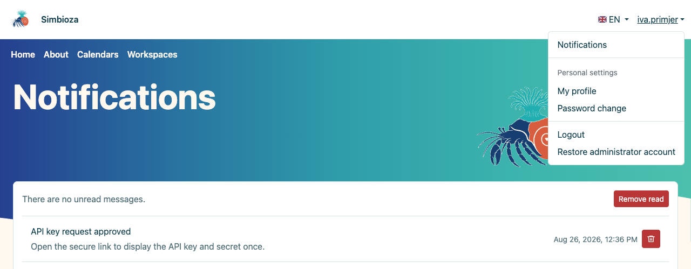 API key notification 
<figcaption>The user is notified about the decision.</figcaption>
</figure>

<figure class="my-4">
 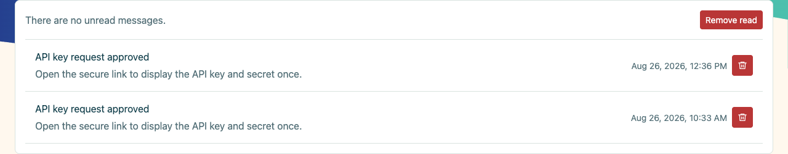 Approved request notification 
<figcaption>The notification leads to one-time secret retrieval.</figcaption>
</figure>

<figure class="my-4">
 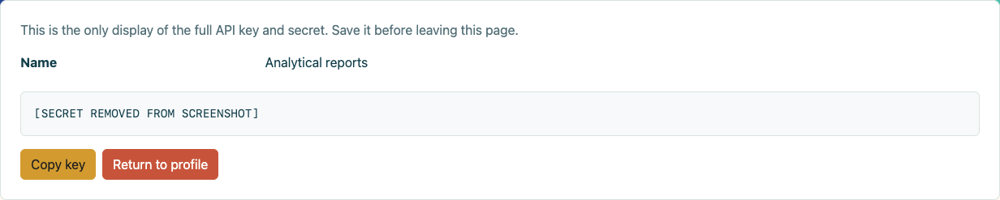 One-time API secret retrieval 
<figcaption>The secret is removed and cannot be displayed again after closing.</figcaption>
</figure>

<figure class="my-4">
 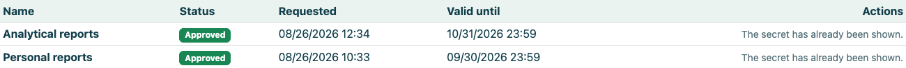 Completed API request 
<figcaption>The completed request remains auditable without exposing the secret.</figcaption>
</figure>

## 8. Common SSO workflow

1.  Register the application with the provider and enter only the necessary endpoints, Client ID, and secret.
2.  Save the active profile. Existing secrets are never displayed while editing; leaving the secret field empty retains the server-side value.
3.  Select **Test profile** before guessing mappings. Complete a real login to collect the provider's actual attributes.
4.  Map subject, login, display name, and user fields from the returned names.
5.  Test again. Only **Tested and operational** together with a green check confirms a complete profile.

### Allowed domains

The list restricts login to organizational domains. Enter one domain per line or a comma-separated list. `example.org` allows that domain and its subdomains; a suffix such as `hr` permits identifiers whose domain ends in `.hr` . An empty list imposes no domain restriction.

**Domain source attribute** must be the real provider attribute containing a value such as `user@example.org` or a domain. It is required only when the allowed-domain list is populated. Do not use a display name or another mutable value.

### Public callback addresses

The provider must return the browser to the public URL of the same installation. Include a subdirectory when one is used: for an application at `https://simbioza.example.org/simbioza` , enter that complete value as the public base URL. It is not the internal PHP-FPM, container, or database address. Register the exact callback URLs shown by the profile.

## 9. SAML

A SAML profile depends on a separately installed and correctly configured **SimpleSAMLphp** . Its autoloader, SP auth source, certificates, metadata, and return URLs must already work. The path to `vendor/autoload.php` and the auth source name must match that installation.

<figure class="my-4">
  Initial SAML configuration 
<figcaption>The profile is saved, but mappings are not yet confirmed.</figcaption>
</figure>

<figure class="my-4">
  First SAML test 
<figcaption>Connectivity works and attributes were collected; values are redacted.</figcaption>
</figure>

<figure class="my-4">
 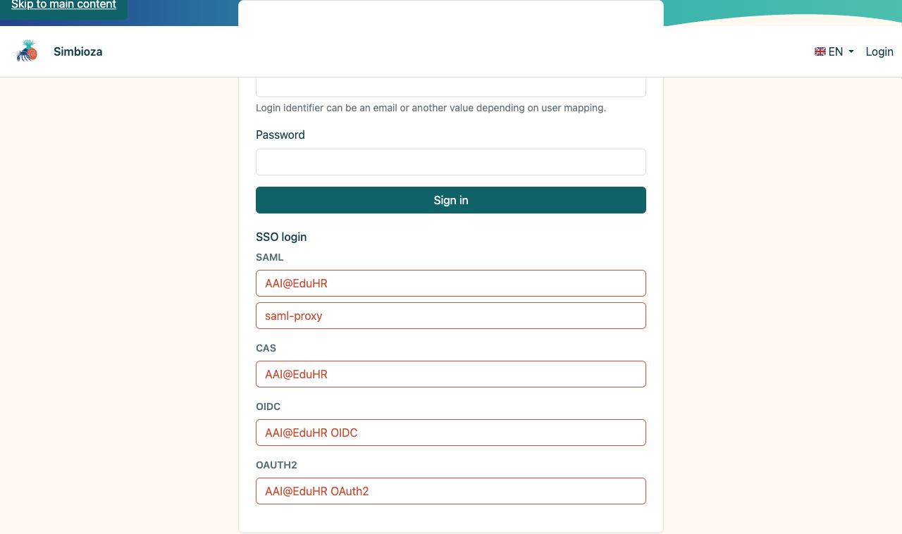 Launching the AAI login 
<figcaption>The English Simbioza login screen starts the configured AAI@EduHr SSO flow without exposing credentials.</figcaption>
</figure>

<figure class="my-4">
 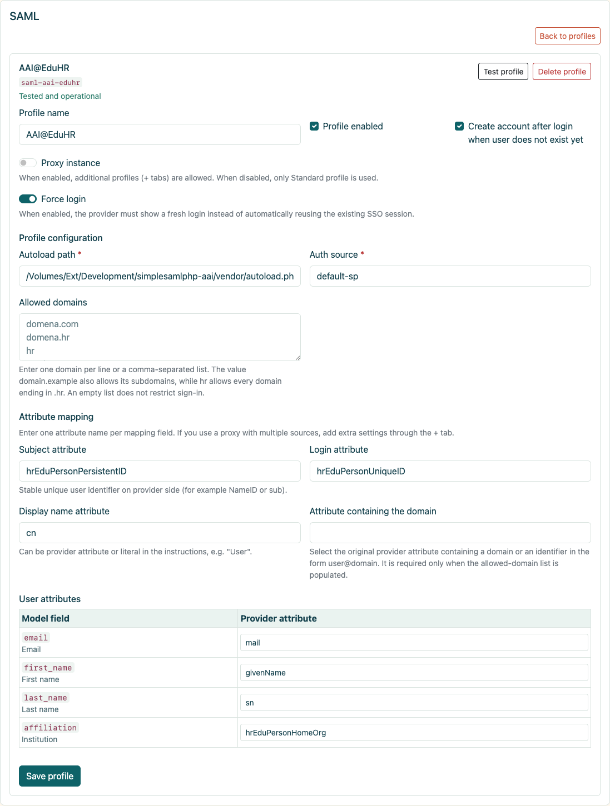 SAML mappings 
<figcaption>Required mappings entered from the actual returned attributes.</figcaption>
</figure>

<figure class="my-4">
 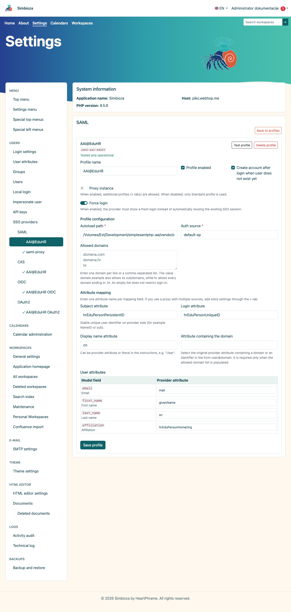 Operational SAML profile 
<figcaption>The repeated test confirms an operational SAML profile.</figcaption>
</figure>

## 10. SAML proxy and child profiles

A proxy instance represents one SimpleSAMLphp auth source that can expose several upstream providers. The **Default** tab defines the shared autoload path, auth source, and base mapping. Additional child tabs inherit the shared connection settings while keeping their own attribute mappings.

**A proxy has no Allowed domains or Domain source attribute fields.** This is deliberate: upstream providers may return different identifiers and domains. Enforce restrictions at the proxy or upstream provider, not through one shared Simbioza domain rule.

<figure class="my-4">
 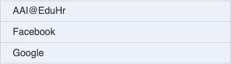 Proxy provider selection 
<figcaption>The real proxy login offers AAI@EduHR, Facebook, and Google, explaining the three child profiles.</figcaption>
</figure>

### Default / AAI@EduHR

<figure class="my-4">
  First default proxy test 
<figcaption>Attributes collected before mapping, with values removed.</figcaption>
</figure>

<figure class="my-4">
  Default proxy mappings 
<figcaption>Mappings for the default AAI source.</figcaption>
</figure>

<figure class="my-4">
 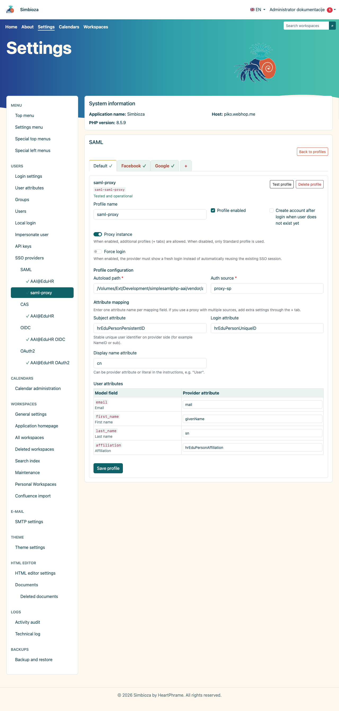 Operational default proxy profile 
<figcaption>Default proxy tab after the successful repeated test.</figcaption>
</figure>

### Facebook

<figure class="my-4">
  First Facebook proxy test 
<figcaption>Facebook attributes collected before mapping, with values removed.</figcaption>
</figure>

<figure class="my-4">
 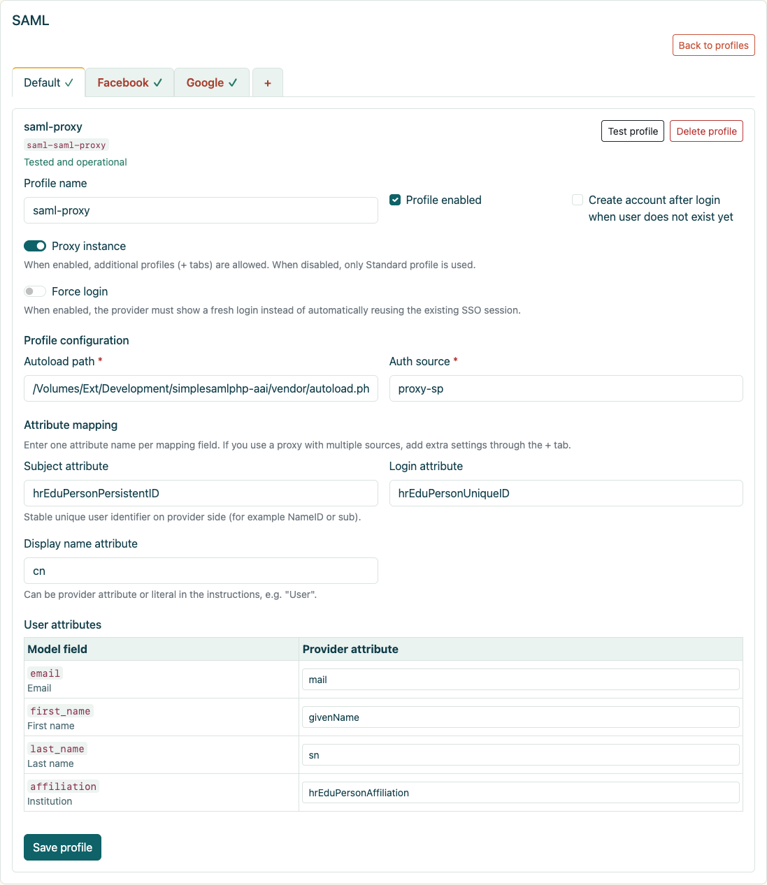 Facebook child mappings 
<figcaption>Stable Facebook ID, login, and user fields mapped independently.</figcaption>
</figure>

<figure class="my-4">
 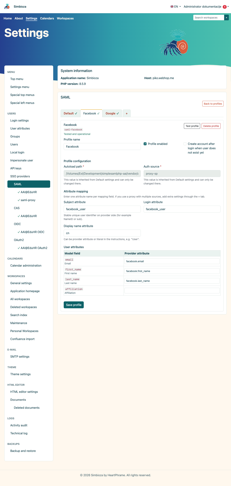 Operational Facebook child profile 
<figcaption>Facebook child tab after successful mapping and test.</figcaption>
</figure>

### Google

<figure class="my-4">
  First Google proxy test 
<figcaption>Google attributes collected before mapping, with values removed.</figcaption>
</figure>

<figure class="my-4">
  Google child mappings 
<figcaption>Google UID is the subject, Google e-mail is the login, and name fields map into the model.</figcaption>
</figure>

<figure class="my-4">
  Operational Google child profile 
<figcaption>Google child tab after the successful repeated test.</figcaption>
</figure>

## 11. CAS

A CAS profile needs the server base URL and its login, validation, and logout endpoints. If a private CA chain is used, provide a readable certificate path. Never disable TLS validation to work around an incorrect certificate configuration.

<figure class="my-4">
  Initial CAS configuration 
<figcaption>The CAS connection is prepared but mappings are not complete.</figcaption>
</figure>

<figure class="my-4">
 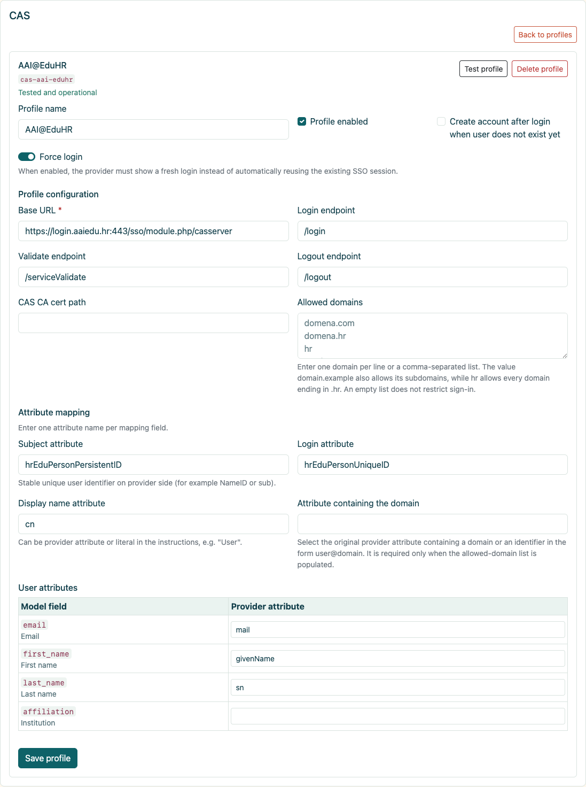 First CAS test 
<figcaption>CAS authentication returns attributes; values are redacted.</figcaption>
</figure>

<figure class="my-4">
  CAS mappings 
<figcaption>Stable subject, login, display name, and model fields mapped from the test.</figcaption>
</figure>

<figure class="my-4">
 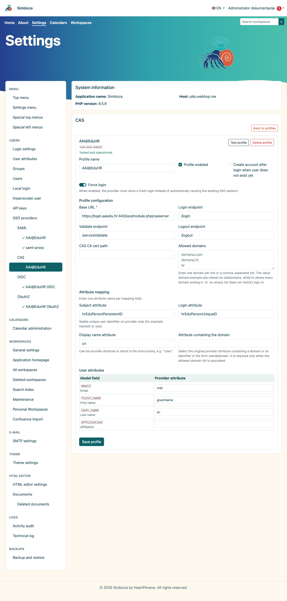 Operational CAS profile 
<figcaption>The repeated test confirms the CAS profile.</figcaption>
</figure>

## 12. OIDC

OIDC uses a Client ID and secret, authorization, token, userinfo, and optionally end-session endpoints. Scope must include `openid` , followed only by required data such as `profile` and `email` . **Public redirect base URL** is the complete public base address of this installation, including a subdirectory where present.

<figure class="my-4">
  Initial OIDC configuration 
<figcaption>OIDC endpoints and public base URL before mapping.</figcaption>
</figure>

<figure class="my-4">
 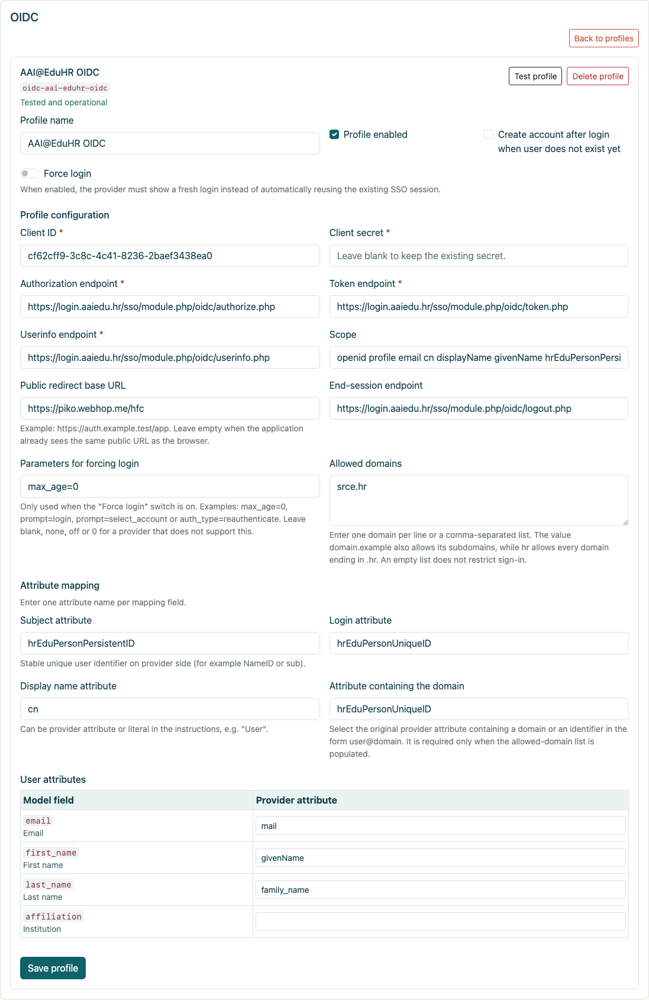 First OIDC test 
<figcaption>OIDC claims collected before mapping, with values removed.</figcaption>
</figure>

<figure class="my-4">
  OIDC mapping and domain 
<figcaption>Subject, login, display name, user fields, and domain source mapped from actual claims.</figcaption>
</figure>

<figure class="my-4">
 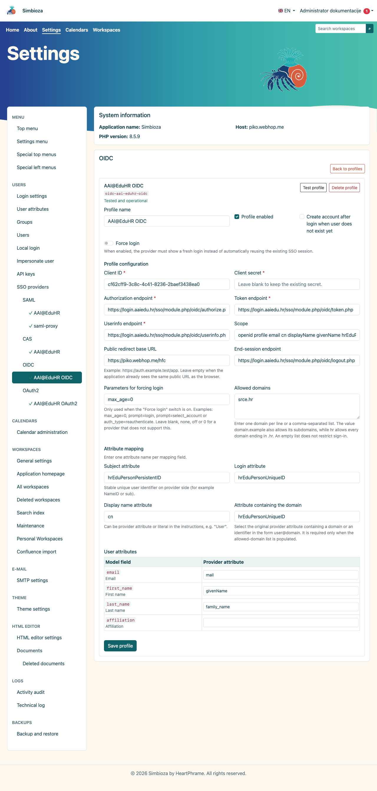 Operational OIDC profile 
<figcaption>The repeated test confirms OIDC and displays the green check.</figcaption>
</figure>

Use a forced-login parameter such as `max_age=0` only when the provider supports it and **Force login** is enabled. Otherwise leave it blank to preserve a valid existing SSO session.

## 13. OAuth2

OAuth2 uses authorization, token, and userinfo endpoints plus the scopes required for user data. If the provider supports OpenID Connect, prefer OIDC because it standardizes identity and token validation. OAuth2 logout may require a dedicated endpoint, redirect parameter name, or hint; enter only values required by the provider documentation.

<figure class="my-4">
  Initial OAuth2 configuration 
<figcaption>OAuth2 profile before attribute mapping.</figcaption>
</figure>

<figure class="my-4">
 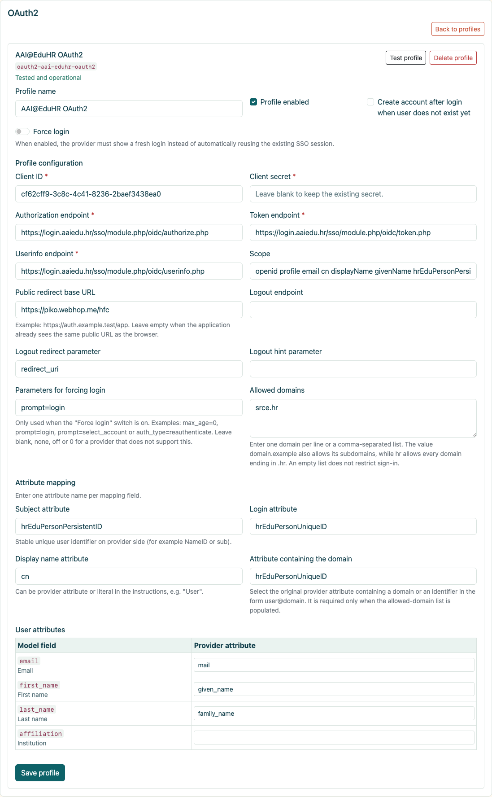 First OAuth2 test 
<figcaption>Userinfo attributes collected through a real login, with values removed.</figcaption>
</figure>

<figure class="my-4">
  OAuth2 mapping and domain 
<figcaption>Mappings and domain restriction entered from the test result.</figcaption>
</figure>

<figure class="my-4">
 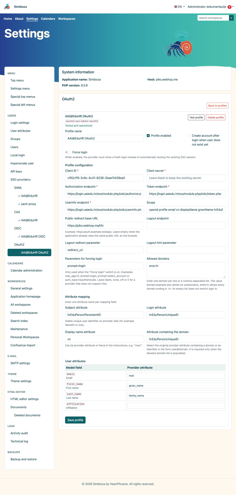 Operational OAuth2 profile 
<figcaption>The repeated test confirms the OAuth2 profile.</figcaption>
</figure>

## 14. Personal profile: security and access

Open **Personal profile** from the user menu. The main section shows identity and custom attributes. **Security and access** displays group membership, local password state, linked external logins, and API key requests.

<figure class="my-4">
 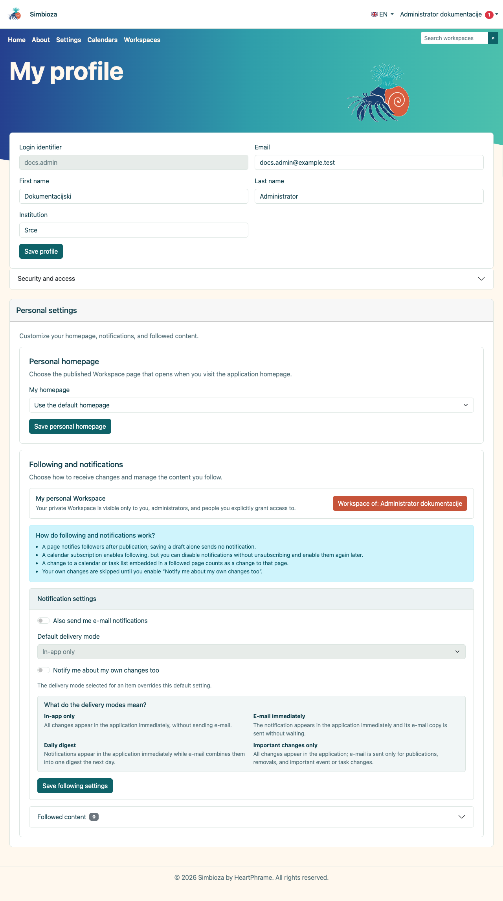 Personal profile 
<figcaption>Personal data and custom attributes in the English interface.</figcaption>
</figure>

<figure class="my-4">
 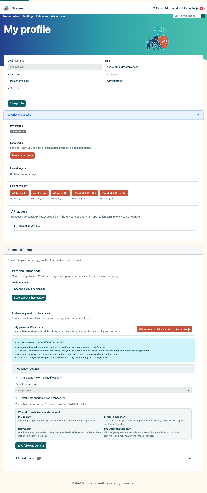 Security and access expanded 
<figcaption>Groups, local login, linked providers, and API requests in one place.</figcaption>
</figure>

Link an external account only while you control both identities. Remove unknown or unused links, but first confirm another login method remains available. Change local passwords through this secure form, never through e-mail or an administrator message.

## 15. Verification and security checklist

- Keep at least one controlled administrator login available; store the break-glass account outside normal daily use.
- For every SSO profile, verify exact callback URLs, TLS certificates, minimum scopes, and secret rotation.
- Do not accept an active checkbox as proof. Require the green operational state after the repeated test.
- The subject must be an immutable provider identifier. Login and e-mail may change and are not always suitable primary identifiers.
- Test domain restrictions with both an allowed and a denied test account.
- Regularly review administrators, group memberships, linked external logins, active API keys, and pending requests.
- Never put passwords, client secrets, tokens, API secrets, or raw personal attributes in screenshots, documentation, tickets, or source control.
- After testing, remove or deactivate documentation accounts and keys that are no longer required.

After saving, test a normal login and a denied account. Confirm that each user sees only the content and actions assigned to their groups.

