# Inicio de sesión y usuarios

> Las capturas de pantalla muestran la interfaz en inglés.

Esta guía guía al administrador a través de cada configuración de inicio de sesión, atributo de usuario, grupo, cuenta de usuario, registro local, suplantación, clave de API, proveedor SSO y pantalla de acceso y seguridad personal.

**Los ejemplos se crearon en una instalación limpia SQLite.** Las cuentas, los grupos y las claves que se muestran aquí existen solo para documentación. Los secretos y los valores de atributos personales se han eliminado de las capturas de pantalla. En producción, utilice sus propios nombres, dominios, vidas útiles y reglas de privilegios mínimos.

## Contenido

1.  [Configuración de inicio de sesión](#1-login-settings)
2.  [Atributos de usuario](#2-user-attributes)
3.  [Grupos](#3-groups)
4.  [Usuarios y cuentas locales](#4-users-and-local-accounts)
5.  [Inicio de sesión y registro local](#5-local-login-and-registration)
6.  [Suplantación](#6-impersonation)
7.  [clave de APIs](#7-api-keys)
8.  [Flujo de trabajo común SSO](#8-common-sso-workflow)
9.  [SAML](#9-saml)
10. [SAML proxy](#10-saml-proxy-and-child-profiles)
11. [CAS](#11-cas)
12. [OIDC](#12-oidc)
13. [OAuth2](#13-oauth2)
14. [Perfil personal: seguridad y acceso](#14-personal-profile-security-and-access)
15. [Lista de verificación y seguridad](#15-verification-and-security-checklist)

## 1. Configuración de inicio de sesión

Abra **Configuración → Usuarios → Configuración de inicio de sesión**. Esta página habilita métodos de autenticación para la aplicación. Habilitar un proveedor solo hace que su configuración y menú estén disponibles; cada perfil individual aún debe guardarse, activarse, probarse y asignarse correctamente.

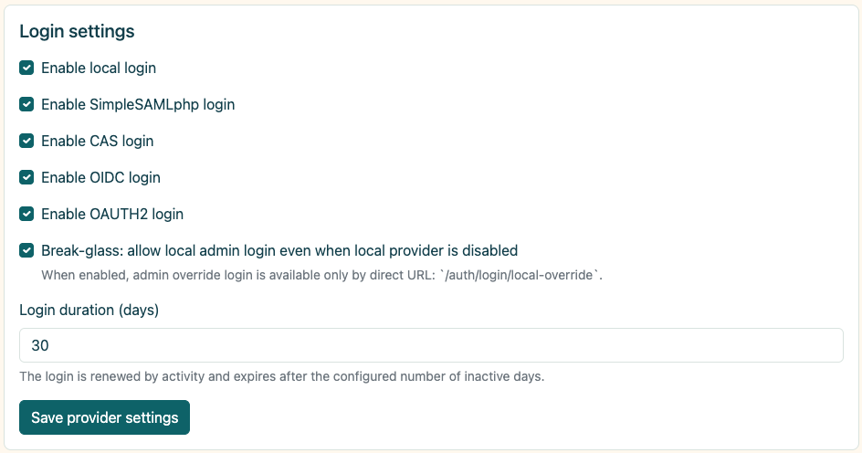Descripción general de la configuración de inicio de sesión

<figure class="my-4">

<figcaption>Configuración de inicio de sesión en la interfaz en inglés.</figcaption>
</figure>

### interruptores principales

- **El inicio de sesión local** habilita la autenticación de nombre de usuario y contraseña almacenados por Simbioza.
- **SimpleSAMLphp, CAS, OIDC y OAuth2** habilitan los grupos de perfiles SSO correspondientes.
- **El inicio de sesión local de emergencia** mantiene disponible una ruta de administrador directa separada cuando el inicio de sesión local normal está deshabilitado. Proteja esa cuenta con una contraseña única y segura y úsela solo para recuperación.
- **Duración del inicio de sesión** es un límite de inactividad en días (1 a 365), que se renueva mientras el usuario que inició sesión permanece activo. Utilice un período más corto en dispositivos administrativos y compartidos.

**“Perfil activo” no es lo mismo que la marca de verificación verde.** Activo significa que se puede utilizar el perfil. La marca verde y el estado *Probado y operativo* aparecen solo después de una prueba de proveedor exitosa y asignaciones requeridas válidas. Es posible que un perfil activo aún no esté operativo.

## 2. Atributos del usuario

Abra **Atributos de usuario**. El modelo normalmente incluye correo electrónico, nombre y apellido. Agregue un atributo cuando la aplicación deba almacenar un valor fuera del perfil básico, como una institución, departamento, número de empleado o una función de directorio externo.

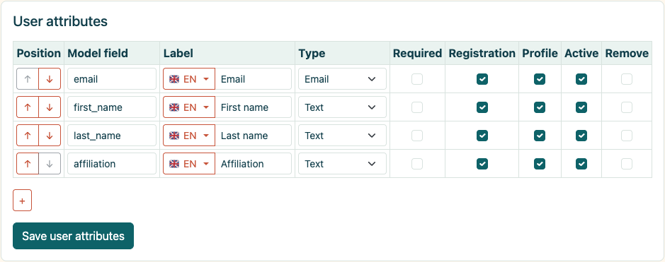Atributos de usuario

<figure class="my-4">

<figcaption>Atributos predeterminados y personalizados en la interfaz en inglés.</figcaption>
</figure>

### Agregar un atributo

1.  Ingrese un nombre de máquina estable en minúsculas y sin espacios, como `affiliation`.
2.  Proporcione etiquetas separadas en croata e inglés.
3.  Elija el tipo de datos y configure **Obligatorio**, **Registro**, **Perfil** y **Activo** de forma independiente.
4.  Guárdelo. El nuevo campo pasa a estar disponible en los perfiles de usuario y en cada tabla de asignación de perfiles SSO.

<figure class="my-4">
 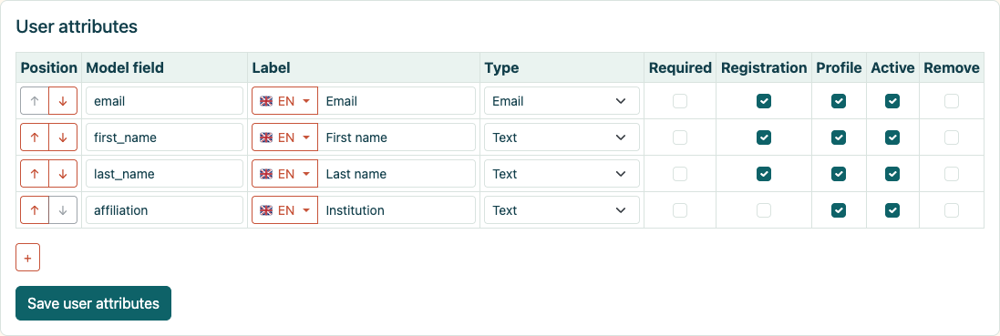 Ejemplo de atributo personalizado bilingüe 
<figcaption>El campo del modelo de afiliación tiene la etiqueta Ustanova/Institución, permanece disponible para perfiles y asignaciones SSO y está excluido del autorregistro.</figcaption>
</figure>

**Asignación** conecta un campo de modelo Simbioza con el nombre de atributo exacto devuelto por el proveedor. Los nombres de los atributos son exactos: `mail` , `givenName` y `given_name` son campos diferentes. Pruebe primero, inspeccione los nombres devueltos y solo luego ingrese las asignaciones. Una asignación SSO no agrega automáticamente el campo al formulario de registro público.

**¿Qué campos se incluyen en el autorregistro?** El administrador elige esto por atributo. **Registro** controla si un campo aparece en el formulario público, mientras que **Obligatorio** rechaza un valor vacío en contextos donde ese campo participa. Cuando ambas configuraciones están habilitadas, el campo es obligatorio durante el autorregistro. Un atributo requerido también debe tener una asignación SSO válida para que una prueba de perfil de proveedor entre en funcionamiento. En este ejemplo, `affiliation` almacena la institución proporcionada por un proveedor y aparece en el perfil, por lo que se excluye intencionalmente del registro.

## 3. Grupos

Los grupos recopilan usuarios y otorgan permisos. El grupo Administrador es un grupo de sistema protegido y no debe utilizarse como un grupo empresarial normal. Cree grupos separados con privilegios mínimos para departamentos, proyectos o roles.

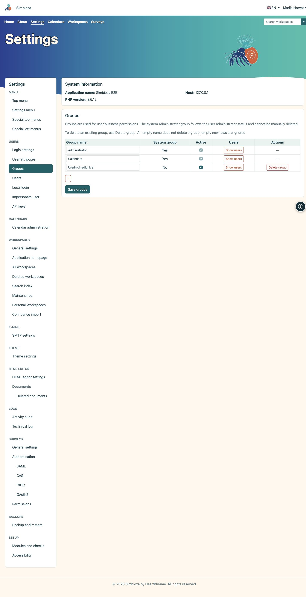Grupos

Sistema y grupos de ejemplo en la interfaz en inglés.\

1.  Elija **Agregar grupo** (el botón más), ingrese un **Nombre de grupo** reconocible y marque **Activo**.
2.  Elija **Guardar grupos**. Esta pantalla no contiene descripción ni permisos de contenido.
3.  Agregue o elimine membresía de grupo de los detalles de cada usuario.
4.  Otorgue al grupo los permisos necesarios en la configuración de un espacio de trabajo, página, calendario o encuesta. La membresía SSO también puede seguir reglas basadas en un atributo asignado.

**Resultado:** el grupo existe y se puede seleccionar al asignar permisos. Crearlo por sí solo no abre contenido a sus miembros.

Para desactivar temporalmente un grupo que no sea del sistema, desmarque **Activo** y guarde. Para eliminarlo definitivamente, elija **Eliminar grupo**. En la pantalla de confirmación, compruebe el nombre y las consecuencias indicadas para las membresías y las reglas de asignación; después confirme la eliminación o cancele. Las cuentas de usuario se conservan. Un nombre vacío ya no elimina un grupo. Antes de confirmar, compruebe dónde se usa el grupo para acceder al contenido. Un grupo nuevo con el mismo nombre tiene otra identidad y no recupera las membresías ni los permisos anteriores. Los grupos del sistema no se pueden eliminar.

<figure class="my-4">
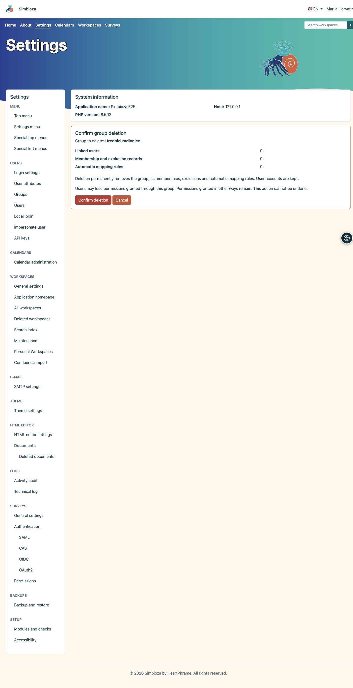
<figcaption>Compruebe el nombre y las consecuencias antes de confirmar. Cancelar vuelve a la lista sin eliminar nada.</figcaption>
</figure>

## 4. Usuarios y cuentas locales

Abra **Configuración → Usuarios → Usuarios** para buscar cuentas, inspeccionar su estado y administrar la membresía y el acceso.

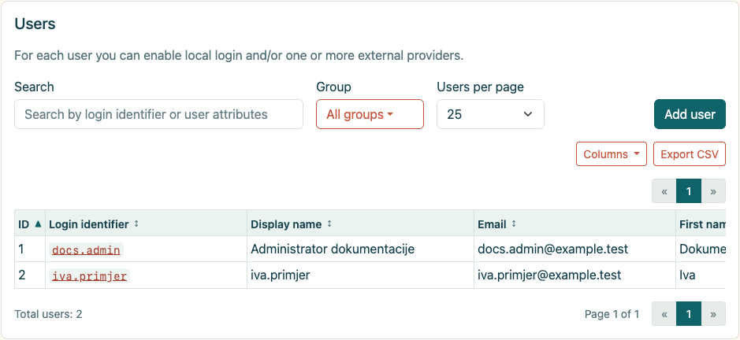Tabla de usuario responsiva

<figure class="my-4">
Columnas equilibradas de la tabla de usuarios en la interfaz en inglés.
</figure>

### Creando un usuario local

1.  Seleccione **Nuevo usuario**.
2.  Ingrese un identificador de inicio de sesión único, un nombre para mostrar y un correo electrónico.
3.  Elija la fuente de autenticación local y asigne una contraseña temporal segura.
4.  Requerir un cambio de contraseña en el primer inicio de sesión.
5.  Asigne sólo los grupos requeridos; el acceso de administrador no debe ser el predeterminado.

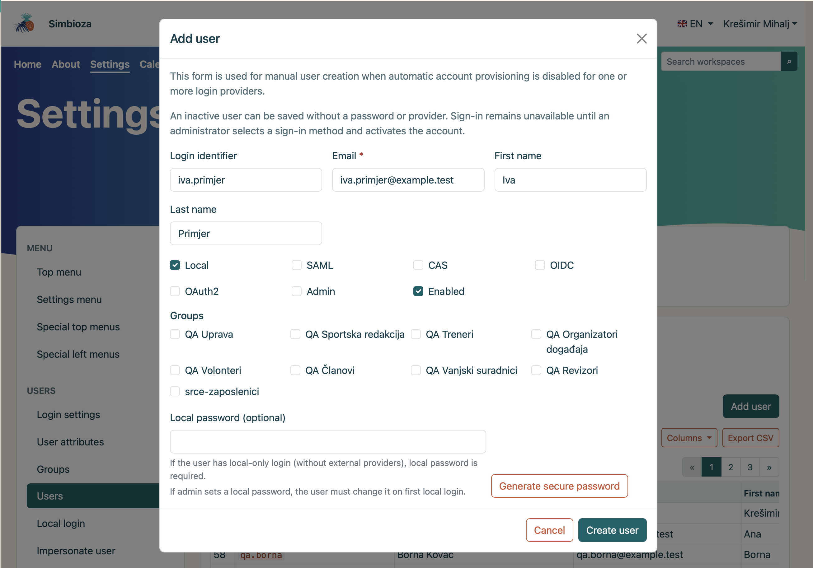Crear formulario de usuario local

<figure class="my-4">
Ejemplo de formulario de cuenta local sin contraseña.
</figure>

<figure class="my-4">
 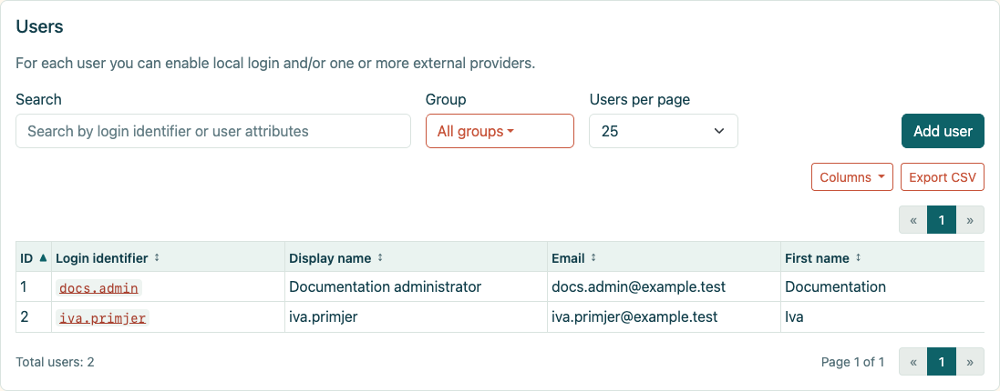 Nuevo usuario en la lista 
<figcaption>El usuario de la documentación después de la creación.</figcaption>
</figure>

<figure class="my-4">
 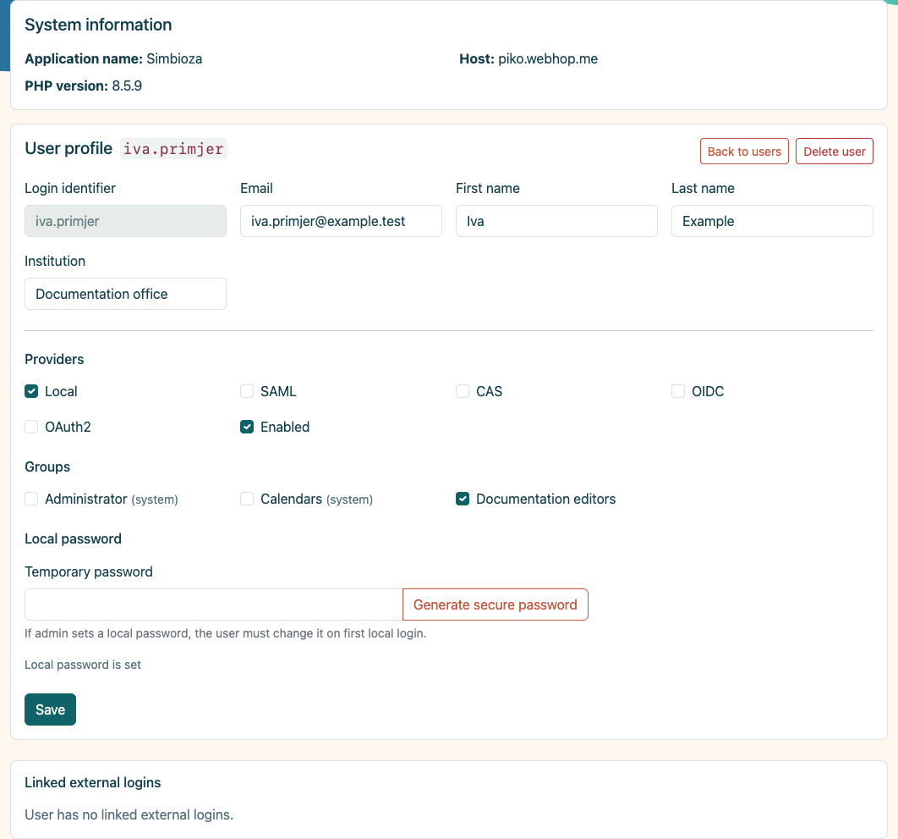 Detalles del usuario 
<figcaption>Estado de la cuenta, proveedores vinculados y membresías de grupos.</figcaption>
</figure>

<figure class="my-4">
  Cambio de contraseña obligatorio en el primer inicio de sesión 
<figcaption>Una contraseña temporal obliga al usuario a elegir una nueva antes de continuar.</figcaption>
</figure>

En la página de detalles, verifique la actividad de la cuenta, la fuente de autenticación, las identidades externas vinculadas y las membresías de grupos. La desactivación suele ser más segura que la eliminación porque preserva el rastro de auditoría. Nunca reemplace manualmente el identificador de sujeto estable de un proveedor externo.

## 5. Inicio de sesión y registro local

**El inicio de sesión local** controla el autorregistro. Manténgalo deshabilitado para sistemas cerrados y crea cuentas administrativamente o a través de SSO de confianza. Si está habilitado, el registro crea una cuenta ordinaria activa e inicia la sesión del usuario. No envíe un correo electrónico de verificación ni prueba la propiedad de la dirección ingresada. Para un sistema cerrado, mantenga el registro desactivado y utilice cuentas creadas por el administrador o un proveedor SSO de confianza. Publicar un aviso de privacidad adecuado antes de aceptar registros. El formulario público incluye solo atributos de usuario cuya opción **Registro** está habilitada; por lo tanto, el campo *Institución* exclusivo de SSO no se muestra aquí.

<figure class="my-4">
 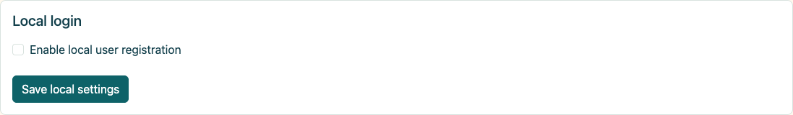 Registro deshabilitado 
<figcaption>Estado inicial recomendado para una aplicación cerrada.</figcaption>
</figure>

<figure class="my-4">
 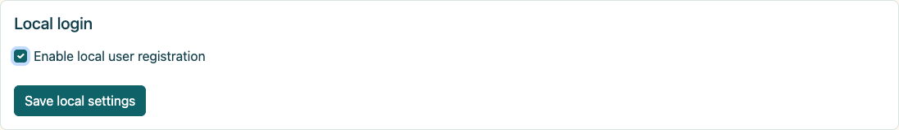 Registro habilitado 
<figcaption>Registro habilitado solo para un ejemplo controlado.</figcaption>
</figure>

<figure class="my-4">
 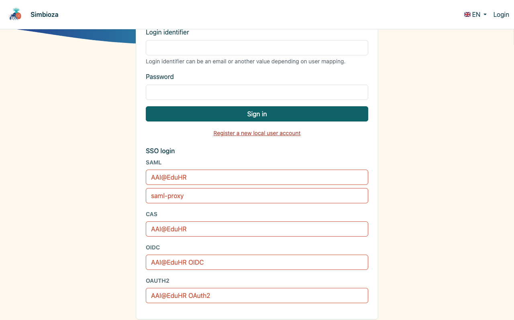 Enlace de registro 
<figcaption>La pantalla de inicio de sesión muestra el registro solo después de que esté habilitado.</figcaption>
</figure>

<figure class="my-4">
 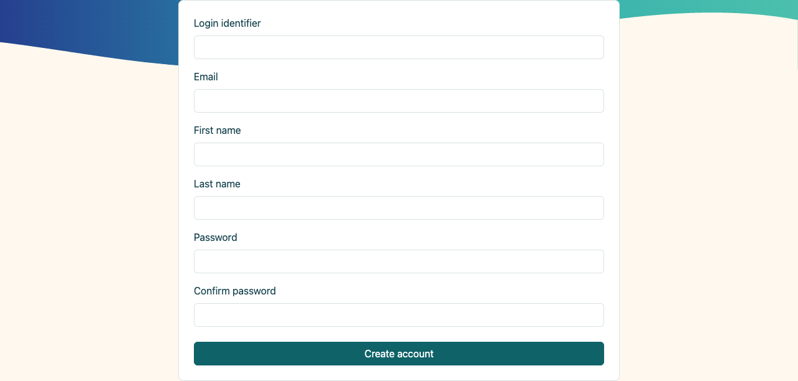 Formulario de inscripción 
<figcaption>Formulario público con los campos de registro seleccionados; el atributo Institución utilizado para el mapeo SSO está oculto intencionalmente.</figcaption>
</figure>

Después de la prueba, restablezca el estado de producción previsto. Las contraseñas deben ser únicas, suficientemente largas y almacenadas en un administrador de contraseñas. Los administradores nunca deben pedir a los usuarios su contraseña actual.

## 6. Suplantación

**Suplantar usuario** abre temporalmente la aplicación en el contexto del usuario seleccionado. Úselo para obtener permisos y mostrar diagnósticos, no para realizar acciones comerciales en nombre del usuario.

<figure class="my-4">
 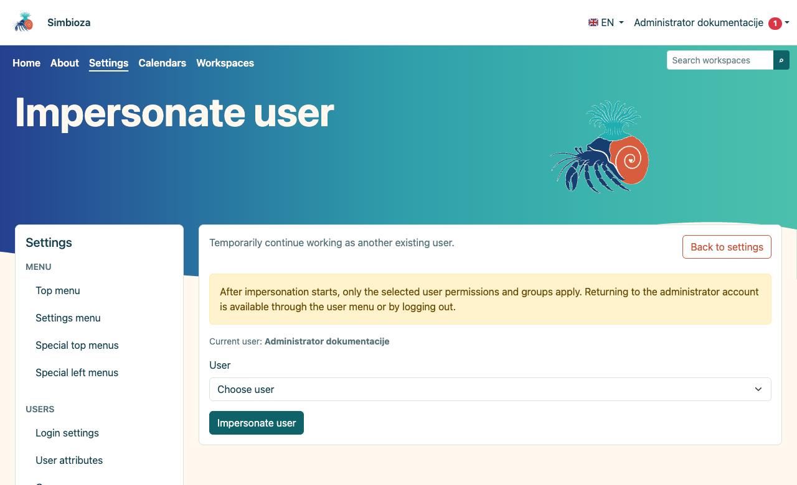 Pantalla de suplantación 
<figcaption>Seleccionar una cuenta para diagnósticos de soporte controlados. Seleccione solo la cuenta necesaria para el caso de soporte.</figcaption>
</figure>

<figure class="my-4">
La interfaz indica claramente la sesión suplantada activa.
</figure>

<figure class="my-4">
 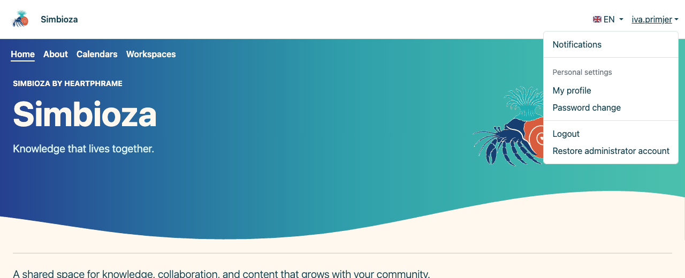 Volver al administrador 
<figcaption>Finalice la tarea regresando a su cuenta de administrador.</figcaption>
</figure>

La suplantación no prueba la autenticación SSO real, MFA ni la política del proveedor. Utilice la prueba de perfil o una cuenta de prueba dedicada para ese fin.

## 7. Teclas API

Estas pantallas están disponibles cuando el módulo API está instalado y activado. Una clave de API actúa con los derechos de su propietario. Los ámbitos solo pueden limitar los permisos existentes; no conceden permisos que el propietario no tenga. Use una clave distinta para cada integración, una etiqueta descriptiva, la menor duración práctica y el mínimo conjunto de ámbitos necesario.

<figure class="my-4">
 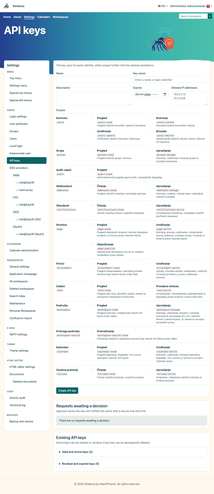 API administración de claves 
<figcaption>API administración de claves en la interfaz en inglés.</figcaption>
</figure>

### Emisión de clave directa

1.  Seleccione el propietario y solo los ámbitos requeridos.
2.  Establezca una fecha de vencimiento y, si es necesario, una dirección IP permitida o una restricción de red.
3.  Cree la clave y copie inmediatamente el secreto para un almacenamiento seguro.
4.  El secreto se muestra sólo una vez. Si se pierde, revoque la clave y emita una nueva.

<figure class="my-4">
 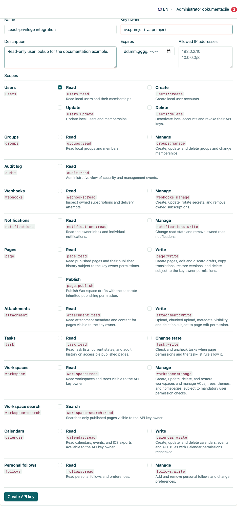 Clave de API de privilegios mínimos 
<figcaption>Una clave restringida intencionalmente antes de la creación.</figcaption>
</figure>

<figure class="my-4">
 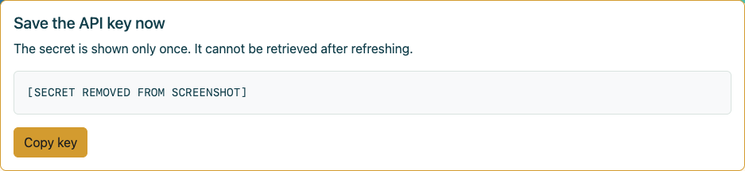 Secreto único API 
<figcaption>El secreto ha sido eliminado de la captura de pantalla.</figcaption>
</figure>

<figure class="my-4">
 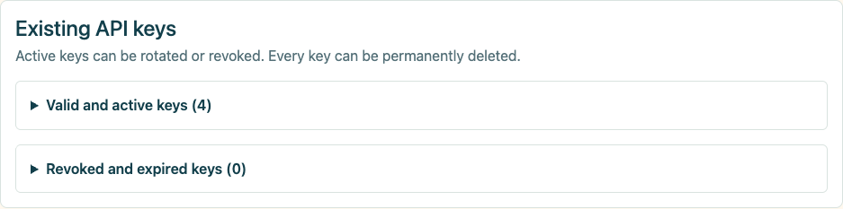 Teclas API activas 
<figcaption>Revise y revoque las claves activas de esta lista.</figcaption>
</figure>

### Solicitud de usuario y aprobación del administrador.

Un usuario puede solicitar una clave desde su perfil personal y explicar su finalidad. El administrador revisa el propietario, los alcances, la duración y la justificación y luego aprueba o rechaza la solicitud. Después de la aprobación, el usuario puede revelar el secreto una vez en el perfil personal. Cuando las Notificaciones están habilitadas, una notificación dentro de la aplicación también apunta a esa pantalla. Ni la notificación ni un correo electrónico deben contener el secreto.

<figure class="my-4">
 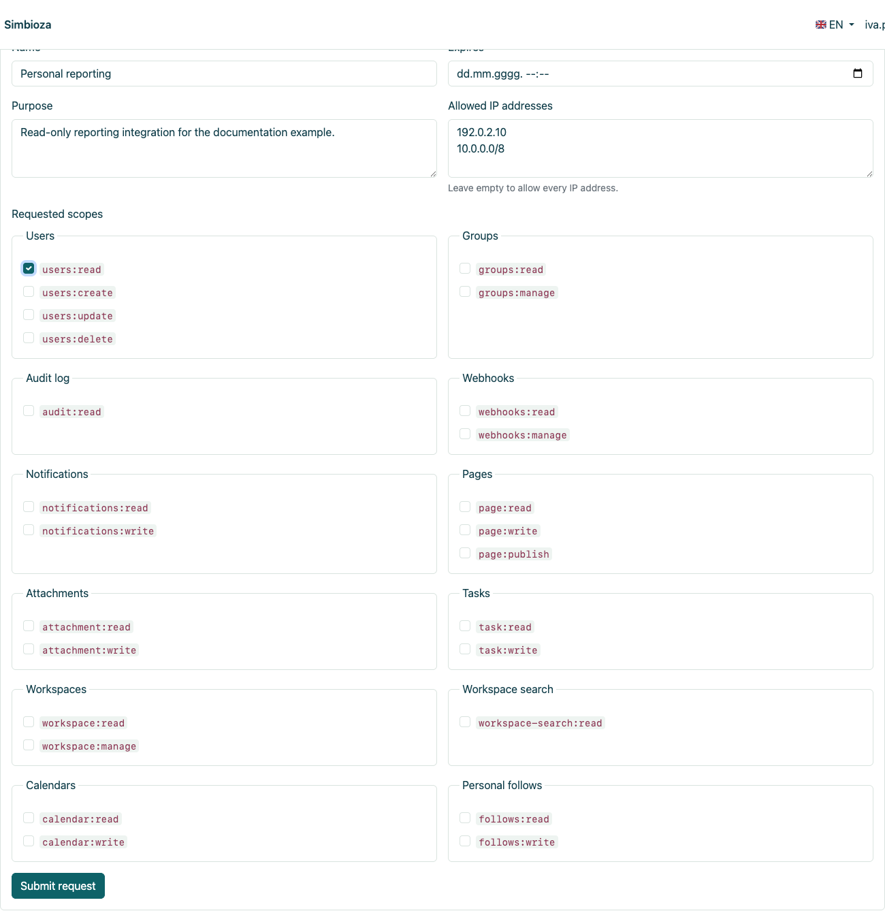 API formulario de solicitud de clave 
<figcaption>El usuario solicita una clave restringida y declara su finalidad.</figcaption>
</figure>

<figure class="my-4">
 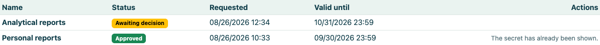 Solicitud enviada 
<figcaption>La solicitud espera la revisión del administrador.</figcaption>
</figure>

<figure class="my-4">
 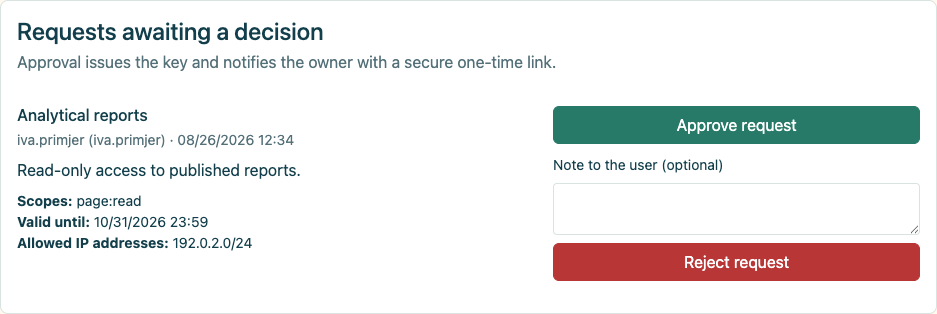 Solicitud pendiente API 
<figcaption>El administrador verifica la solicitud antes de aprobarla.</figcaption>
</figure>

<figure class="my-4">
 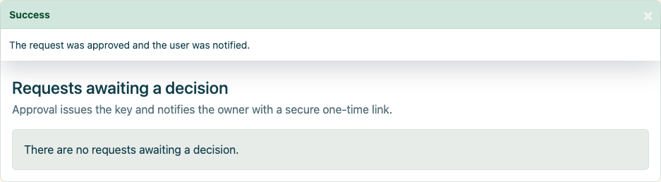 Solicitud API aprobada 
<figcaption>La aprobación crea la clave sin revelar el secreto al administrador.</figcaption>
</figure>

<figure class="my-4">
 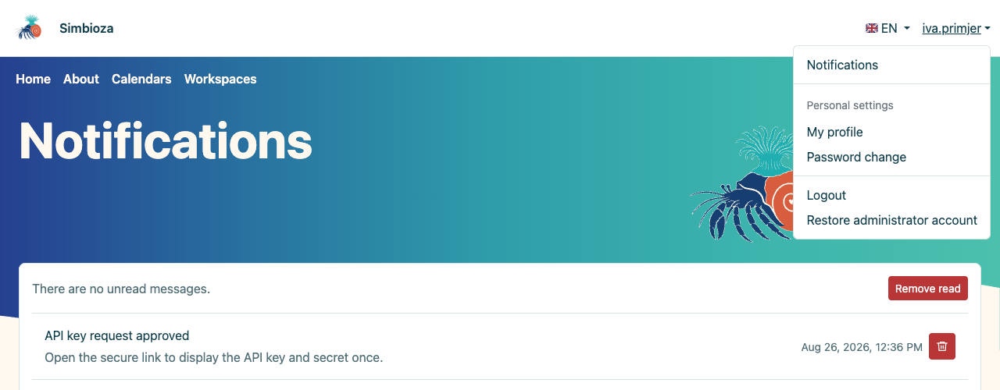 API notificación clave 
<figcaption>Se notifica al usuario sobre la decisión.</figcaption>
</figure>

<figure class="my-4">
 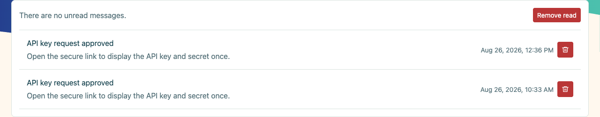 Notificación de solicitud aprobada 
<figcaption>La notificación conduce a la recuperación secreta por única vez.</figcaption>
</figure>

<figure class="my-4">
 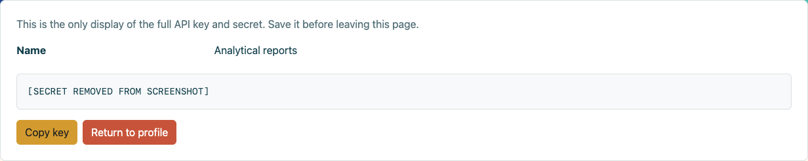 Recuperación secreta única API 
<figcaption>El secreto se elimina y no se puede volver a mostrar después del cierre.</figcaption>
</figure>

<figure class="my-4">
 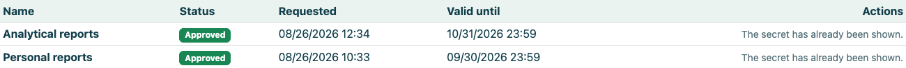 Solicitud API completada 
<figcaption>La solicitud completada sigue siendo auditable sin exponer el secreto.</figcaption>
</figure>

## 8. Flujo de trabajo común SSO

1.  Registre la aplicación con el proveedor e ingrese solo los puntos finales, la identificación del cliente y el secreto necesarios.
2.  Guarde el perfil activo. Los secretos existentes nunca se muestran durante la edición; dejar el campo secreto vacío conserva el valor del lado del servidor.
3.  Seleccione **Probar perfil** antes de adivinar las asignaciones. Complete un inicio de sesión real para recopilar los atributos reales del proveedor.
4.  Asigne los campos de identificador de sujeto, inicio de sesión, nombre para mostrar y usuario de los nombres devueltos.
5.  Prueba de nuevo. Solo **Probado y operativo** junto con una marca verde confirma un perfil completo.

### Dominios permitidos

La lista restringe el inicio de sesión a dominios organizacionales. Ingrese un dominio por línea o una lista separada por comas. `example.org` permite ese dominio y sus subdominios; un sufijo como `hr` permite identificadores cuyo dominio termina en `.hr`. Una lista vacía no impone ninguna restricción de dominio.

**El atributo de origen del dominio** debe ser el atributo del proveedor real que contiene un valor como `user@example.org` o un dominio. Sólo es necesario cuando la lista de dominios permitidos está completa. No utilice un nombre para mostrar ni otro valor mutable.

### Direcciones públicas de devolución de llamadas

El proveedor deberá devolver el navegador a la URL pública de la misma instalación. Incluya un subdirectorio cuando se utilice uno: para una aplicación en `https://simbioza.example.org/simbioza`, ingrese ese valor completo como la URL base pública. No es la dirección interna PHP-FPM, contenedor o base de datos. Registre las URL de devolución de llamada exactas que muestra el perfil.

## 9. SAML

Un perfil SAML depende de un **SimpleSAMLphp** instalado por separado y configurado correctamente. Su cargador automático, fuente de autenticación de SP, certificados, metadatos y URL de retorno ya deben funcionar. La ruta a `vendor/autoload.php` y el nombre de la fuente de autenticación deben coincidir con esa instalación.

<figure class="my-4">
 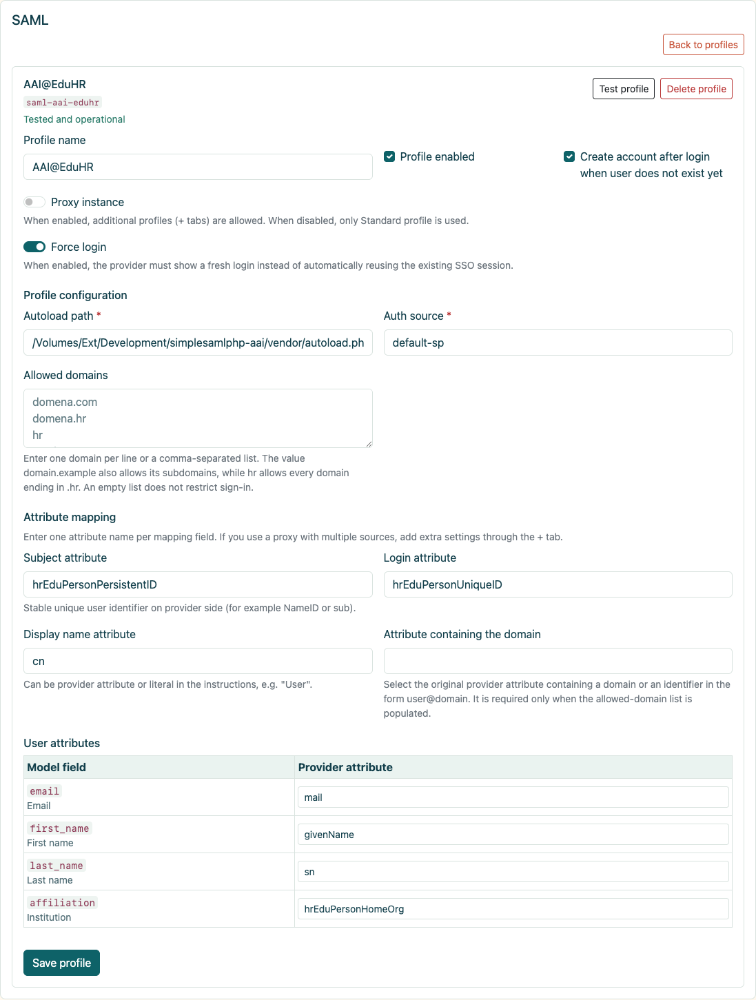 Configuración inicial SAML 
<figcaption>El perfil se guarda, pero las asignaciones aún no están confirmadas.</figcaption>
</figure>

<figure class="my-4">
  Primera prueba SAML 
<figcaption>Se recogieron obras y atributos de conectividad; los valores están redactados.</figcaption>
</figure>

<figure class="my-4">
 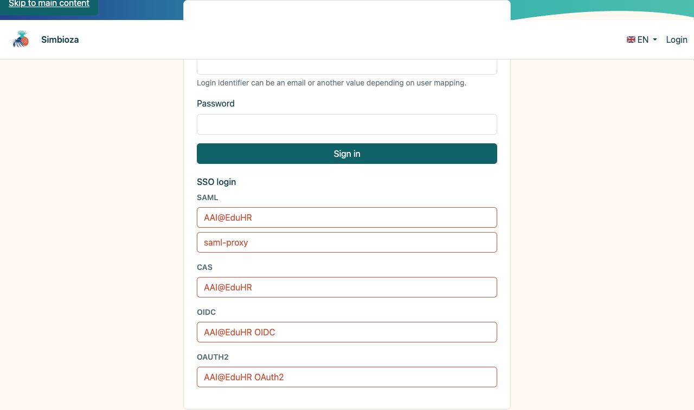 Iniciar el inicio de sesión de AAI 
<figcaption>La pantalla de inicio de sesión en inglés Simbioza inicia el flujo AAI@EduHr SSO configurado sin exponer las credenciales.</figcaption>
</figure>

<figure class="my-4">
  SAML asignaciones 
<figcaption>Asignaciones requeridas ingresadas a partir de los atributos devueltos reales.</figcaption>
</figure>

<figure class="my-4">
 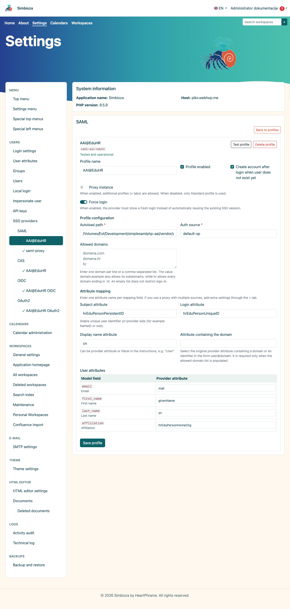 Perfil operativo SAML 
<figcaption>La prueba repetida confirma un perfil SAML operativo.</figcaption>
</figure>

## 10. SAML perfiles secundarios y de proxy

Una instancia de proxy representa una fuente de autenticación SimpleSAMLphp que puede exponer varios proveedores ascendentes. La pestaña **Predeterminada** define la ruta de carga automática compartida, la fuente de autenticación y la asignación base. Las pestañas secundarias adicionales heredan la configuración de conexión compartida y mantienen sus propias asignaciones de atributos.

**Un proxy no tiene campos de atributos de origen de dominio ni dominios permitidos.** Esto es deliberado: los proveedores ascendentes pueden devolver identificadores y dominios diferentes. Aplique restricciones en el proxy o en el proveedor ascendente, no a través de una regla de dominio compartida Simbioza.

<figure class="my-4">
 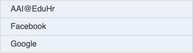 Selección de proveedor de proxy 
<figcaption>El inicio de sesión de proxy real ofrece AAI@EduHR, Facebook y Google, lo que explica los tres perfiles infantiles.</figcaption>
</figure>

### Predeterminado / AAI@EduHR

<figure class="my-4">
 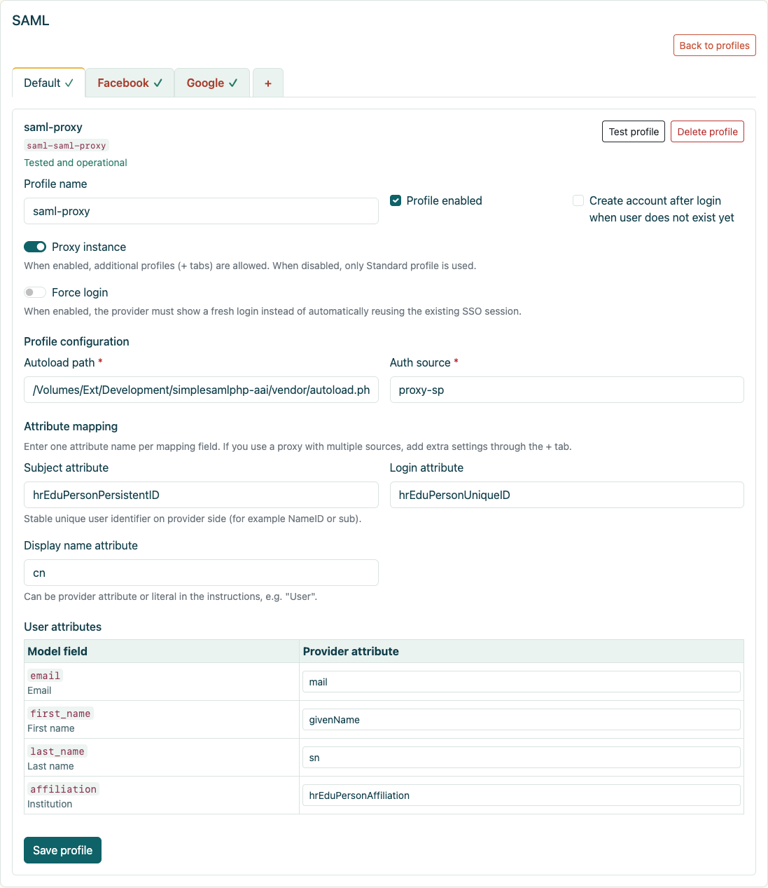 Primera prueba de proxy predeterminada 
<figcaption>Atributos recopilados antes del mapeo, con valores eliminados.</figcaption>
</figure>

<figure class="my-4">
  Asignaciones de proxy predeterminadas 
<figcaption>Asignaciones para la fuente de AAI predeterminada.</figcaption>
</figure>

<figure class="my-4">
 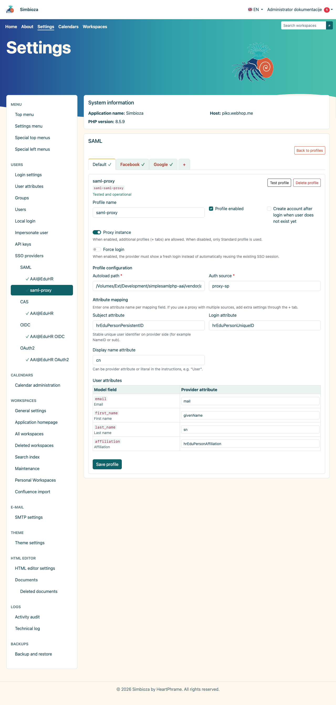 Perfil de proxy predeterminado operativo 
<figcaption>Pestaña de proxy predeterminada después de la prueba repetida exitosa.</figcaption>
</figure>

### Facebook

<figure class="my-4">
  Primera prueba de proxy de Facebook 
<figcaption>Atributos de Facebook recopilados antes del mapeo, con valores eliminados.</figcaption>
</figure>

<figure class="my-4">
  Mapeos infantiles de Facebook 
<figcaption>Campos estables de ID de Facebook, inicio de sesión y usuario asignados de forma independiente.</figcaption>
</figure>

<figure class="my-4">
 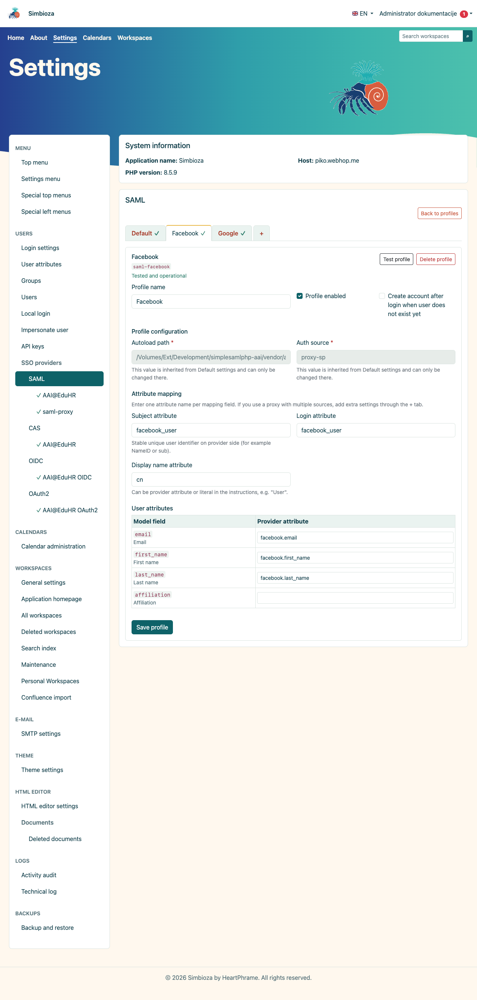 Perfil infantil de Facebook operativo 
<figcaption>Pestaña secundaria de Facebook después de un mapeo y una prueba exitosos.</figcaption>
</figure>

### Google

<figure class="my-4">
  Primera prueba de proxy de Google 
<figcaption>Atributos de Google recopilados antes del mapeo, con valores eliminados.</figcaption>
</figure>

<figure class="my-4">
  Asignaciones infantiles de Google 
<figcaption>El UID de Google es el identificador de sujeto, el correo electrónico de Google es el inicio de sesión y los campos de nombre se asignan al modelo.</figcaption>
</figure>

<figure class="my-4">
  Perfil infantil de Google operativo 
<figcaption>Pestaña secundaria de Google después de la prueba repetida exitosa.</figcaption>
</figure>

## 11. CAS

Un perfil CAS necesita la URL base del servidor y sus puntos finales de inicio de sesión, validación y cierre de sesión. Si se utiliza una cadena de CA privada, proporcione una ruta de certificado legible. Nunca deshabilite la validación TLS para solucionar una configuración de certificado incorrecta.

<figure class="my-4">
 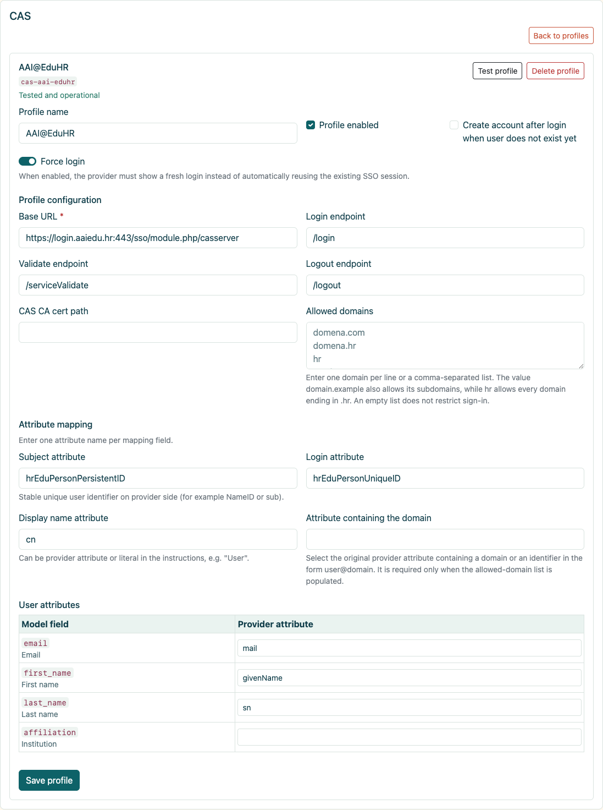 Configuración inicial CAS 
<figcaption>La conexión CAS está preparada pero las asignaciones no están completas.</figcaption>
</figure>

<figure class="my-4">
  Primera prueba CAS 
<figcaption>CAS la autenticación devuelve atributos; los valores están redactados.</figcaption>
</figure>

<figure class="my-4">
  CAS asignaciones 
<figcaption>Campos estables de identificador de sujeto, inicio de sesión, nombre para mostrar y modelo asignados a partir de la prueba.</figcaption>
</figure>

<figure class="my-4">
 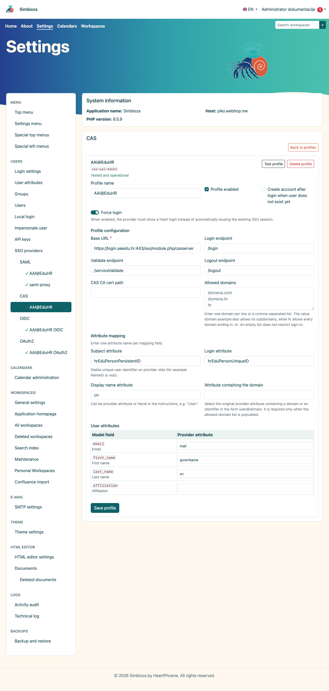 Perfil operativo CAS 
<figcaption>La prueba repetida confirma el perfil CAS.</figcaption>
</figure>

## 12. OIDC

OIDC utiliza un ID de cliente y un secreto, autorización, token, información de usuario y, opcionalmente, puntos finales de finalización de sesión. El alcance debe incluir `openid` , seguido únicamente de datos obligatorios como `profile` y `email` . **URL base de redireccionamiento público** es la dirección base pública completa de esta instalación, incluido un subdirectorio cuando esté presente.

<figure class="my-4">
 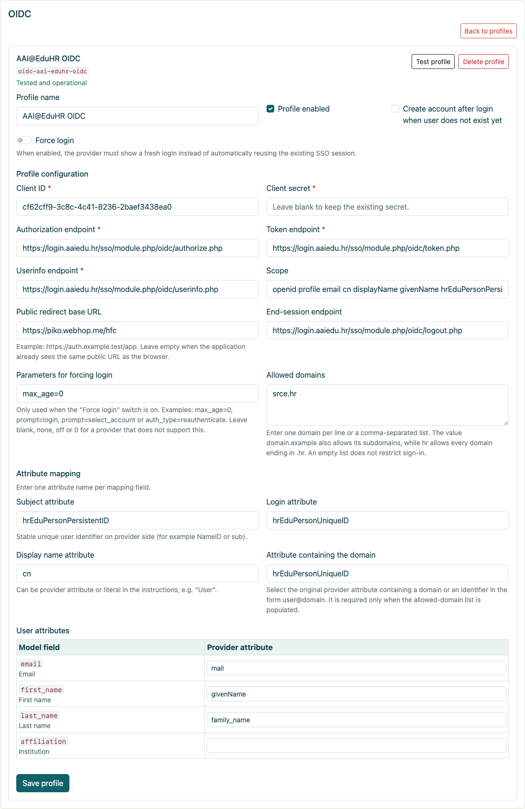 Configuración inicial OIDC 
<figcaption>OIDC puntos finales y URL base pública antes del mapeo.</figcaption>
</figure>

<figure class="my-4">
  Primera prueba OIDC 
<figcaption>OIDC atributos recibidos recopiladas antes del mapeo, con valores eliminados.</figcaption>
</figure>

<figure class="my-4">
  OIDC mapeo y dominio 
<figcaption>Identificador de sujeto, inicio de sesión, nombre para mostrar, campos de usuario y origen del dominio mapeados a partir de atributos recibidos reales.</figcaption>
</figure>

<figure class="my-4">
 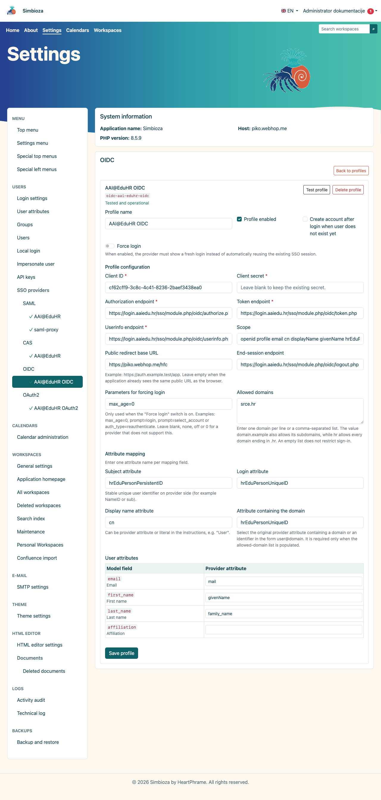 Perfil operativo OIDC 
<figcaption>La prueba repetida confirma OIDC y muestra la marca de verificación verde.</figcaption>
</figure>

Utilice un parámetro de inicio de sesión forzado como `max_age=0` solo cuando el proveedor lo admita y **Forzar inicio de sesión** esté habilitado. De lo contrario, déjelo en blanco para conservar una sesión SSO existente válida.

## 13. OAuth2

OAuth2 utiliza puntos finales de autorización, token e información de usuario, además de los ámbitos necesarios para los datos del usuario. Si el proveedor admite OpenID Connect, prefiera OIDC porque estandariza la validación de identidades y tokens. OAuth2 cerrar sesión puede requerir un punto final dedicado, un nombre de parámetro de redireccionamiento o una sugerencia; introduzca sólo los valores requeridos por la documentación del proveedor.

<figure class="my-4">
 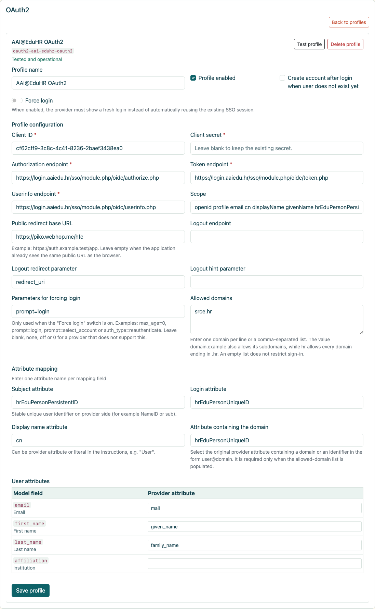 Configuración inicial OAuth2 
<figcaption>OAuth2 perfil antes de la asignación de atributos.</figcaption>
</figure>

<figure class="my-4">
  Primera prueba OAuth2 
<figcaption>Atributos de información de usuario recopilados a través de un inicio de sesión real, con valores eliminados.</figcaption>
</figure>

<figure class="my-4">
  OAuth2 mapeo y dominio 
<figcaption>Asignaciones y restricción de dominio ingresadas a partir del resultado de la prueba.</figcaption>
</figure>

<figure class="my-4">
 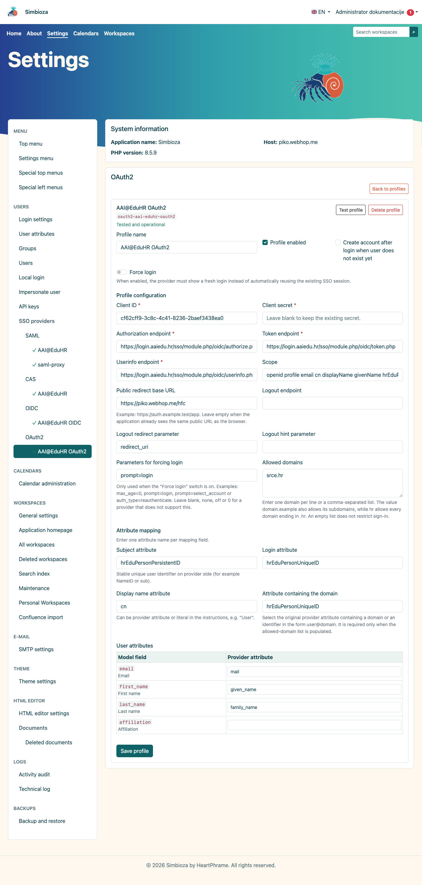 Perfil operativo OAuth2 
<figcaption>La prueba repetida confirma el perfil OAuth2.</figcaption>
</figure>

## 14. Perfil personal: seguridad y acceso

Abra **Perfil personal** desde el menú de usuario. La sección principal muestra identidad y atributos personalizados. **Seguridad y acceso** muestra la membresía del grupo, el estado de la contraseña local, los inicios de sesión externos vinculados y las solicitudes de clave de API.

<figure class="my-4">
 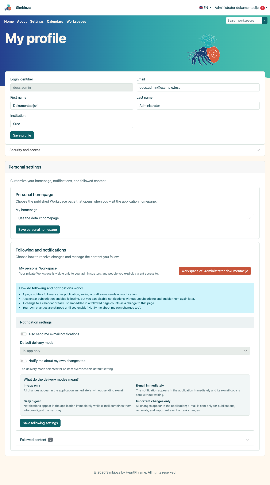 perfil personal 
<figcaption>Datos personales y atributos personalizados en la interfaz en inglés.</figcaption>
</figure>

<figure class="my-4">
 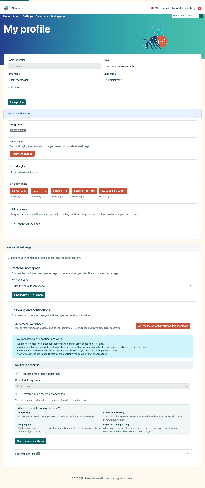 Seguridad y acceso ampliados 
<figcaption>Grupos, inicio de sesión local, proveedores vinculados y solicitudes API en un solo lugar.</figcaption>
</figure>

Vincula una cuenta externa solo mientras controlas ambas identidades. Elimine los enlaces desconocidos o no utilizados, pero primero confirme que haya otro método de inicio de sesión disponible. Cambie las contraseñas locales a través de este formulario seguro, nunca a través de un correo electrónico o un mensaje de administrador.

## 15. Lista de verificación y seguridad

- Mantenga disponible al menos un inicio de sesión de administrador controlado; guarde la cuenta de acceso de emergencia fuera del uso diario normal.
- Para cada perfil SSO, verifique las URL de devolución de llamada exactas, los certificados TLS, los alcances mínimos y la rotación de secretos.
- No acepte una casilla de verificación activa como prueba. Requiere el estado operativo verde después de la prueba repetida.
- El identificador de sujeto debe ser un identificador de proveedor inmutable. El inicio de sesión y el correo electrónico pueden cambiar y no siempre son identificadores primarios adecuados.
- Pruebe las restricciones de dominio con una cuenta de prueba permitida y denegada.
- Revise periódicamente los administradores, las membresías de grupos, los inicios de sesión externos vinculados, las claves API activas y las solicitudes pendientes.
- Nunca incluya contraseñas, secretos de cliente, tokens, secretos API ni atributos personales sin procesar en capturas de pantalla, documentación, tickets o control de fuente.
- Después de la prueba, elimine o desactive las cuentas de documentación y las claves que ya no sean necesarias.

Después de guardar, pruebe un inicio de sesión normal y una cuenta denegada. Confirme que cada usuario vea solo el contenido y las acciones asignadas a sus grupos.

