# Connexion et utilisateurs

> Les captures d’écran présentent l’interface en anglais.

Ce guide présente à l'administrateur tous les paramètres de connexion, attributs utilisateur, groupes, comptes d'utilisateurs, enregistrements locaux, usurpations d'identité, clés API, fournisseurs SSO et écrans de sécurité et d'accès personnels.

**Les exemples ont été créés sur une nouvelle installation SQLite.** Les comptes, groupes et clés présentés ici n'existent qu'à des fins de documentation. Les secrets et les valeurs d'attributs personnels ont été supprimés des captures d'écran. En production, utilisez vos propres noms, domaines, durées de vie et règles de moindre privilège.

## Contenu

1.  [Paramètres de connexion](#login-settings)
2.  [Attributs utilisateur](#attributes)
3.  [Groupes](#groups)
4.  [Utilisateurs et comptes locaux](#users)
5.  [Connexion et enregistrement locaux](#local-login)
6.  [Usurpation d'identité](#impersonation)
7.  [Touches API](#api-keys)
8.  [Flux de travail SSO commun](#sso)
9.  [SAML](#saml)
10. [SAML proxy](#saml-proxy)
11. [CAS](#cas)
12. [OIDC](#oidc)
13. [OAuth2](#oauth2)
14. [Profil personnel : sécurité et accès](#personal-profile)
15. [Liste de contrôle de vérification et de sécurité](#verification)

## 1. Paramètres de connexion

Ouvrez **Paramètres → Utilisateurs → Paramètres de connexion** . Cette page active les méthodes d'authentification pour l'application. L'activation d'un fournisseur rend uniquement sa configuration et son menu disponibles ; chaque profil individuel doit toujours être enregistré, activé, testé et mappé correctement.

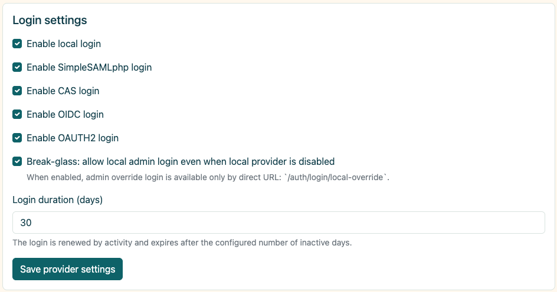Aperçu des paramètres de connexion

<figure class="my-4">

<figcaption>Paramètres de connexion dans l'interface anglaise.</figcaption>
</figure>

### Interrupteurs principaux

- **La connexion locale** permet l'authentification du nom d'utilisateur et du mot de passe stockés par Simbioza.
- **SimpleSAMLphp, CAS, OIDC et OAuth2** activent les groupes de profils SSO correspondants.
- **La connexion locale en cas de bris de verre** conserve une route d'administrateur directe distincte disponible lorsque la connexion locale normale est désactivée. Protégez ce compte avec un mot de passe unique et fort et utilisez-le uniquement à des fins de récupération.
- **La durée de connexion** est une limite d'inactivité en jours (1 à 365), renouvelée pendant que l'utilisateur connecté reste actif. Utilisez une période plus courte sur les appareils administratifs et partagés.

**« Profil actif » n'est pas la même chose que la coche verte.** Actif signifie que le profil peut être utilisé. La coche verte et le statut *Testé et opérationnel* n'apparaissent qu'après un test réussi du fournisseur et des mappages requis valides. Un profil actif peut toujours être non opérationnel.

## 2. Attributs utilisateur

Ouvrez les **Attributs utilisateur** . Le modèle comprend normalement l’e-mail, le prénom et le nom. Ajoutez un attribut lorsque l'application doit stocker une valeur en dehors du profil de base, comme une institution, un service, un numéro d'employé ou un rôle d'annuaire externe.

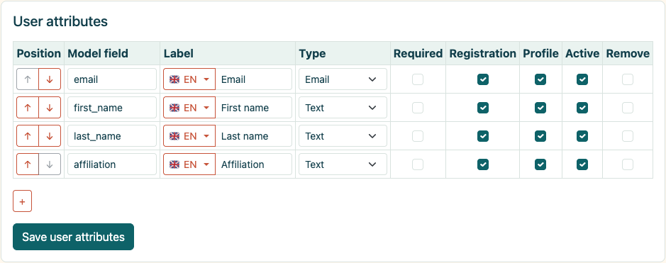Attributs utilisateur

<figure class="my-4">

<figcaption>Attributs par défaut et personnalisés dans l'interface anglaise.</figcaption>
</figure>

### Ajout d'un attribut

1.  Entrez un nom de machine stable en minuscules sans espaces, tel que `affiliation` .
2.  Fournissez des étiquettes croates et anglaises distinctes.
3.  Choisissez le type de données et configurez **Required** , **Registration** , **Profile** et **Active** indépendamment.
4.  Enregistrez-le. Le nouveau champ devient disponible dans les profils utilisateur et dans chaque table de mappage de profil SSO.

<figure class="my-4">
 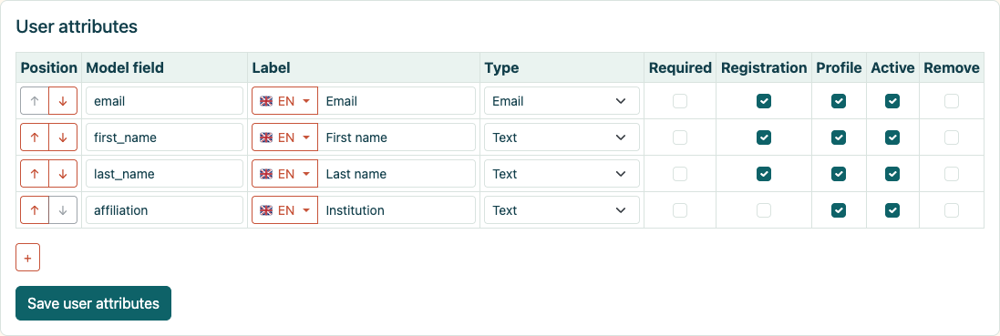 Exemple d'attribut personnalisé bilingue 
<figcaption>Le champ du modèle d'affiliation est étiqueté Ustanova / Institution, reste disponible pour les profils et les mappages SSO et est exclu de l'auto-inscription.</figcaption>
</figure>

Le **Mapping** connecte un champ de modèle Simbioza au nom d'attribut exact renvoyé par le fournisseur. Les noms d'attribut sont exacts : `mail` , `givenName` et `given_name` sont des champs différents. Testez d’abord, inspectez les noms renvoyés, puis entrez ensuite les mappages. Un mappage SSO n’ajoute pas automatiquement le champ au formulaire d’inscription public.

**Quels champs sont inclus dans l'auto-inscription ?** L'administrateur choisit cela par attribut. **Inscription** contrôle si un champ apparaît dans le formulaire public, tandis que **Obligatoire** rejette une valeur vide dans les contextes où ce champ participe. Lorsque les deux paramètres sont activés, le champ est obligatoire lors de l'auto-inscription. Un attribut obligatoire doit également avoir un mappage SSO valide pour qu'un test de profil de fournisseur devienne opérationnel. Dans cet exemple, `affiliation` stocke l'institution fournie par un fournisseur et apparaît dans le profil, elle est donc intentionnellement exclue de l'enregistrement.

## 3. Groupes

Les groupes collectent des utilisateurs et disposent d'autorisations. Le groupe Administrateur est un groupe système protégé et ne doit pas être utilisé comme un groupe professionnel normal. Créez des groupes de moindre privilège distincts pour les départements, les projets ou les rôles.

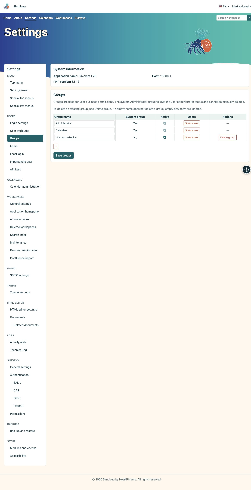Groupes

Groupes système et exemples dans l'interface anglaise.\

1.  Choisissez **Ajouter un groupe** (le bouton plus), saisissez un **Nom de groupe** reconnaissable et cochez **Actif**.
2.  Choisissez **Enregistrer les groupes**. Cet écran ne contient pas de description ni d'autorisations de contenu.
3.  Ajoutez ou supprimez l'appartenance à un groupe dans les détails de chaque utilisateur.
4.  Accordez au groupe les autorisations requises dans les paramètres d'un espace de travail, d'une page, d'un calendrier ou d'un sondage. L’adhésion SSO peut également suivre des règles basées sur un attribut mappé.

**Résultat :** le groupe existe et peut être sélectionné lors de l'attribution des autorisations. Le créer à lui seul n’ouvre pas le contenu à ses membres.

Pour désactiver temporairement un groupe non système, décochez **Actif** et enregistrez. Pour le supprimer définitivement, choisissez **Supprimer le groupe**. Sur la page de confirmation, vérifiez son nom et les conséquences affichées pour les appartenances et les règles de mappage, puis confirmez la suppression ou annulez. Les comptes utilisateurs sont conservés. Un nom vide ne supprime plus un groupe. Avant de confirmer, vérifiez où le groupe donne accès au contenu. Un nouveau groupe de même nom possède une autre identité et ne récupère ni les anciennes appartenances ni les autorisations. Les groupes système ne peuvent pas être supprimés.

<figure class="my-4">
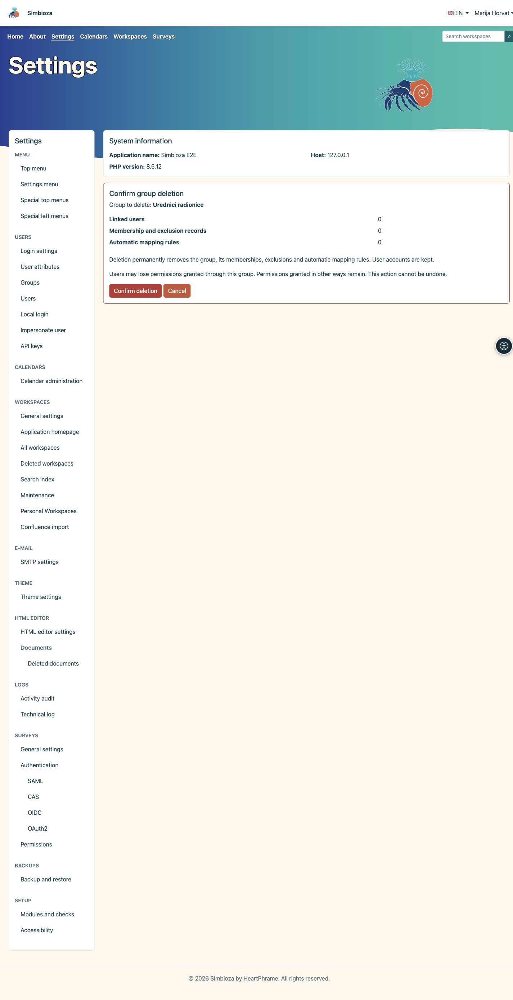
<figcaption>Vérifiez le nom et les conséquences avant de confirmer. Annuler revient à la liste sans suppression.</figcaption>
</figure>

## 4. Utilisateurs et comptes locaux

Ouvrez **Paramètres → Utilisateurs → Utilisateurs** pour rechercher des comptes, inspecter leur état et gérer l'adhésion et l'accès.

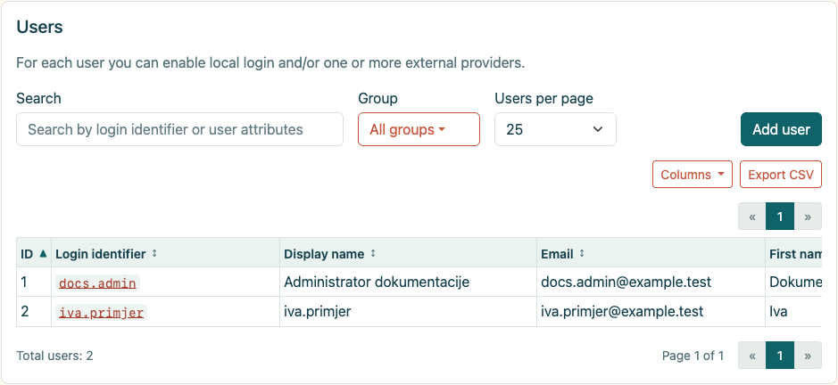Tableau utilisateur réactif

<figure class="my-4">
Colonnes de table utilisateur équilibrées dans l'interface anglaise.
</figure>

### Création d'un utilisateur local

1.  Sélectionnez **Nouvel utilisateur** .
2.  Entrez un identifiant de connexion unique, un nom d'affichage et une adresse e-mail.
3.  Choisissez la source d'authentification locale et attribuez un mot de passe temporaire fort.
4.  Exiger un changement de mot de passe lors de la première connexion.
5.  Attribuez uniquement les groupes requis ; l'accès administrateur ne doit pas être la valeur par défaut.

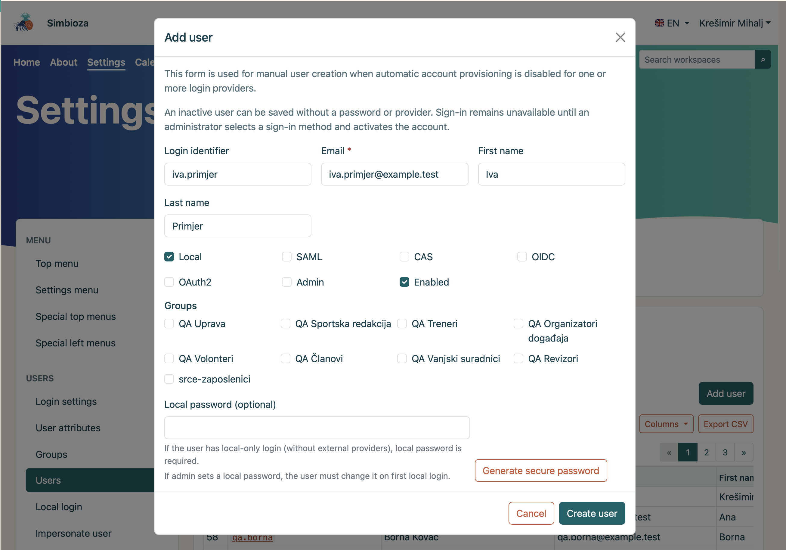Créer un formulaire d'utilisateur local

<figure class="my-4">
Exemple de formulaire de compte local sans mot de passe affiché.
</figure>

<figure class="my-4">
 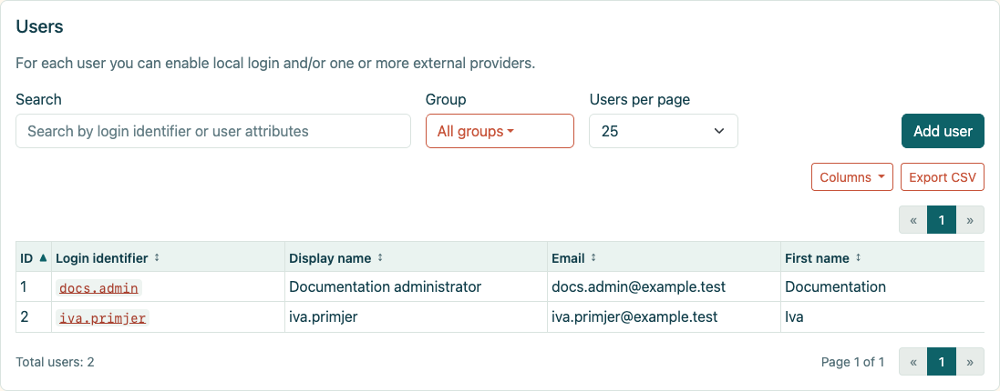 Nouvel utilisateur dans la liste 
<figcaption>L'utilisateur de la documentation après la création.</figcaption>
</figure>

<figure class="my-4">
 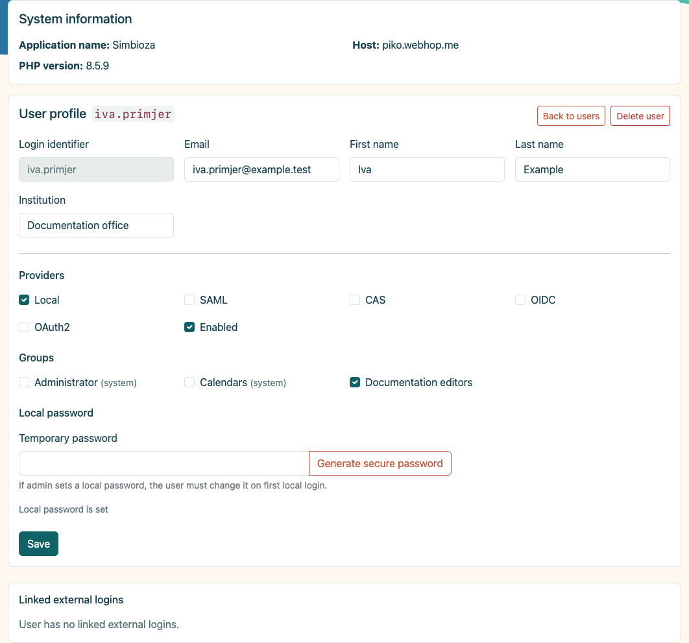 Détails de l'utilisateur 
<figcaption>État du compte, fournisseurs liés et adhésions aux groupes.</figcaption>
</figure>

<figure class="my-4">
  Changement obligatoire du mot de passe de première connexion 
<figcaption>Un mot de passe temporaire oblige l'utilisateur à en choisir un nouveau avant de continuer.</figcaption>
</figure>

Sur la page de détails, vérifiez l'activité du compte, la source d'authentification, les identités externes liées et les appartenances aux groupes. La désactivation est généralement plus sûre que la suppression car elle préserve la piste d'audit. Ne remplacez jamais manuellement l’identifiant de sujet stable d’un fournisseur externe.

## 5. Connexion et inscription locales

**Connexion locale** contrôle l'auto-inscription. Gardez-le désactivé pour les systèmes fermés et créez des comptes de manière administrative ou via SSO de confiance. Si elle est activée, l'inscription crée un compte ordinaire actif et connecte l'utilisateur. Elle n'envoie pas d'e-mail de vérification et ne prouve pas la propriété de l'adresse saisie. Pour un système fermé, laissez l'enregistrement désactivé et utilisez des comptes créés par l'administrateur ou un fournisseur SSO de confiance. Publiez un avis de confidentialité approprié avant d’accepter les inscriptions. Le formulaire public inclut uniquement les attributs utilisateur dont l'option **Inscription** est activée ; le champ *Institution* uniquement SSO n'est donc pas affiché ici.

<figure class="my-4">
 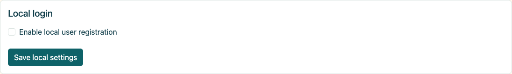 Inscription désactivée 
<figcaption>État initial recommandé pour une application fermée.</figcaption>
</figure>

<figure class="my-4">
 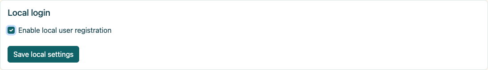 Inscription activée 
<figcaption>Inscription activée uniquement pour un exemple contrôlé.</figcaption>
</figure>

<figure class="my-4">
 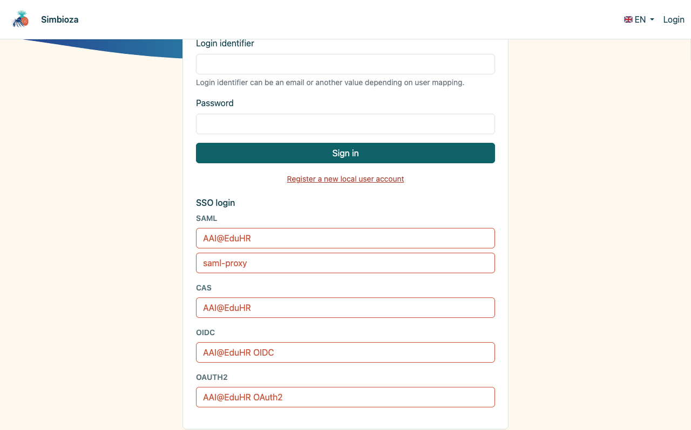 Lien d'inscription 
<figcaption>L'écran de connexion affiche l'enregistrement uniquement après son activation.</figcaption>
</figure>

<figure class="my-4">
 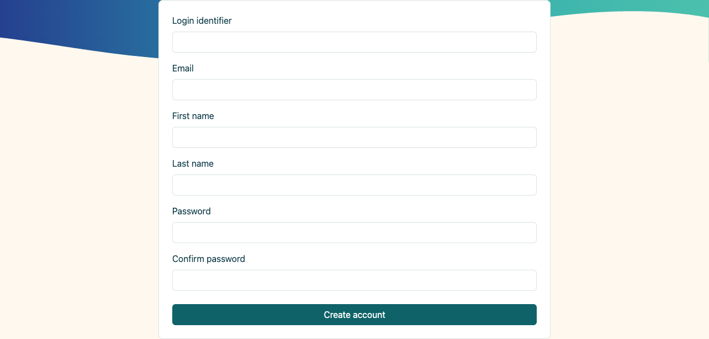 Formulaire d'inscription 
<figcaption>Formulaire public avec les champs d'inscription sélectionnés ; l'attribut Institution utilisé pour le mappage SSO est intentionnellement masqué.</figcaption>
</figure>

Après le test, restaurez l’état de production prévu. Les mots de passe doivent être uniques, suffisamment longs et stockés dans un gestionnaire de mots de passe. Les administrateurs ne doivent jamais demander aux utilisateurs leur mot de passe actuel.

## 6. Usurpation d'identité

**Usurper l'identité d'un utilisateur** ouvre temporairement l'application dans le contexte de l'utilisateur sélectionné. Utilisez-le pour obtenir des autorisations et afficher des diagnostics, et non pour effectuer des actions commerciales au nom de l'utilisateur.

<figure class="my-4">
 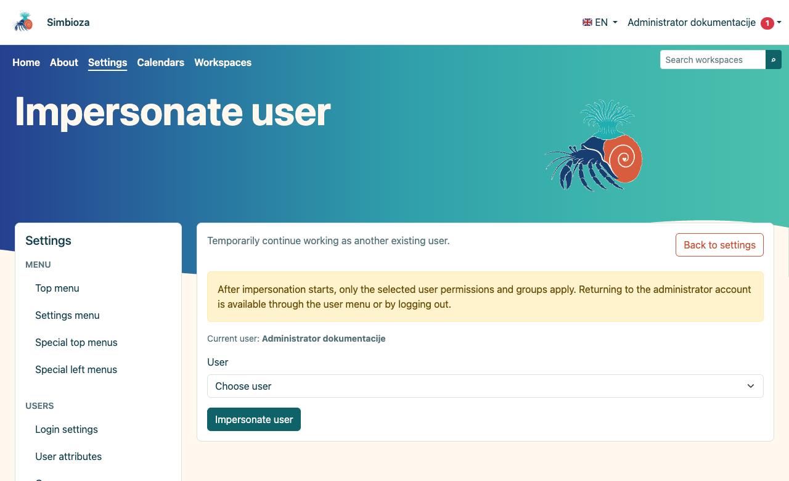 Écran d'usurpation d'identité 
<figcaption>Sélection d'un compte pour les diagnostics de support contrôlés. Sélectionnez uniquement le compte nécessaire pour le dossier de support.</figcaption>
</figure>

<figure class="my-4">
L'interface indique clairement la session active avec emprunt d'identité.
</figure>

<figure class="my-4">
 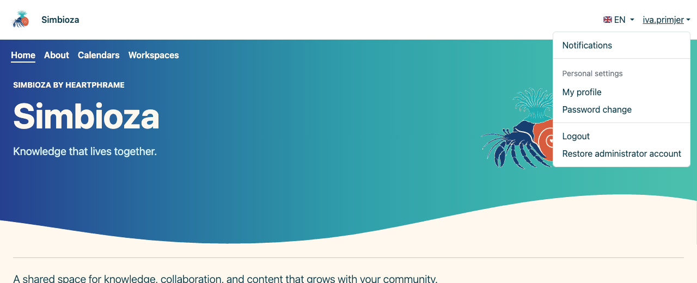 Retour à l'administrateur 
<figcaption>Terminez la tâche en revenant à votre compte administrateur.</figcaption>
</figure>

L’usurpation d’identité ne teste pas l’authentification réelle SSO, MFA ou la stratégie du fournisseur. Utilisez le test de profil ou un compte de test dédié à cet effet.

## 7. Touches API

Ces écrans sont disponibles lorsque le modul’API est installé et activé. Une clé API agit en tant que propriétaire. Les étendues peuvent uniquement réduire les autorisations existantes du propriétaire ; ils ne peuvent pas accorder d'autorisations dont le propriétaire ne dispose pas. Utilisez une clé distincte par intégration, une étiquette descriptive, la durée de vie pratique la plus courte et le plus petit ensemble de portées.

<figure class="my-4">
 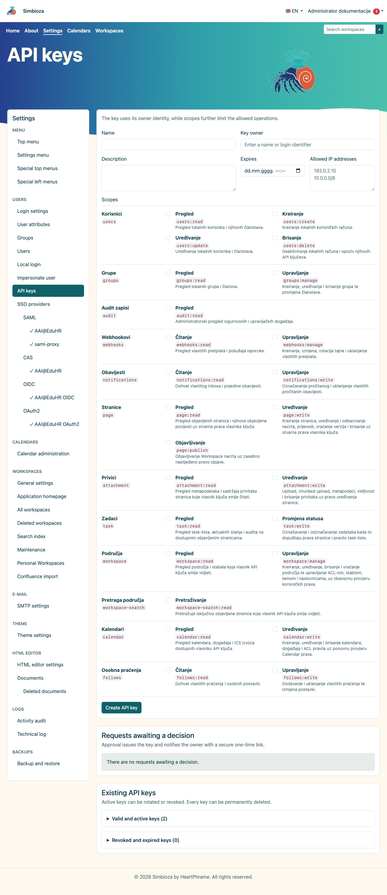 Administration des clés API 
<figcaption>Administration des clés API dans l'interface anglaise.</figcaption>
</figure>

### Émission directe de la clé

1.  Sélectionnez le propriétaire et uniquement les étendues requises.
2.  Définissez une date d'expiration et, si nécessaire, une adresse IP autorisée ou une restriction réseau.
3.  Créez la clé et copiez immédiatement le secret pour sécuriser le stockage.
4.  Le secret n'est révélé qu'une seule fois. En cas de perte, révoquez la clé et attribuez-en une nouvelle.

<figure class="my-4">
 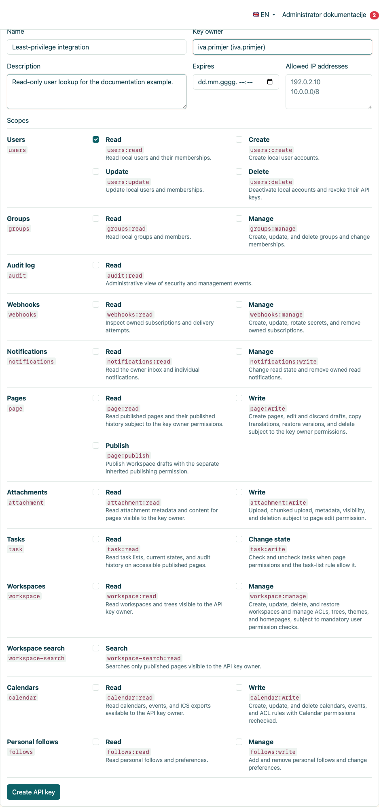 Clé API de moindre privilège 
<figcaption>Une clé intentionnellement restreinte avant la création.</figcaption>
</figure>

<figure class="my-4">
 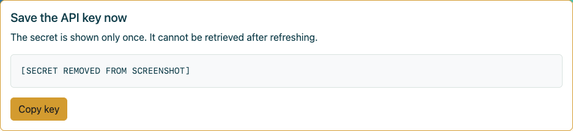 Secret API unique 
<figcaption>Le secret a été supprimé de la capture d'écran.</figcaption>
</figure>

<figure class="my-4">
 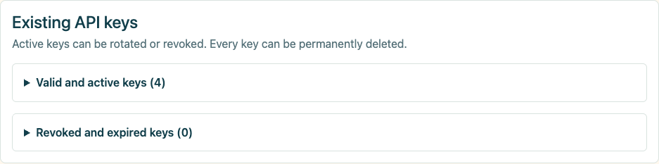 Clés API actives 
<figcaption>Vérifiez et révoquez les clés actives de cette liste.</figcaption>
</figure>

### Demande de l'utilisateur et approbation de l'administrateur

Un utilisateur peut demander une clé à partir du profil personnel et expliquer son objectif. L'administrateur examine le propriétaire, les étendues, la durée de vie et la justification, puis approuve ou rejette la demande. Après approbation, l'utilisateur peut révéler le secret une fois dans son profil personnel. Lorsque les notifications sont activées, une notification dans l'application pointe également vers cet écran. Ni la notification ni un e-mail ne doivent contenir le secret.

<figure class="my-4">
 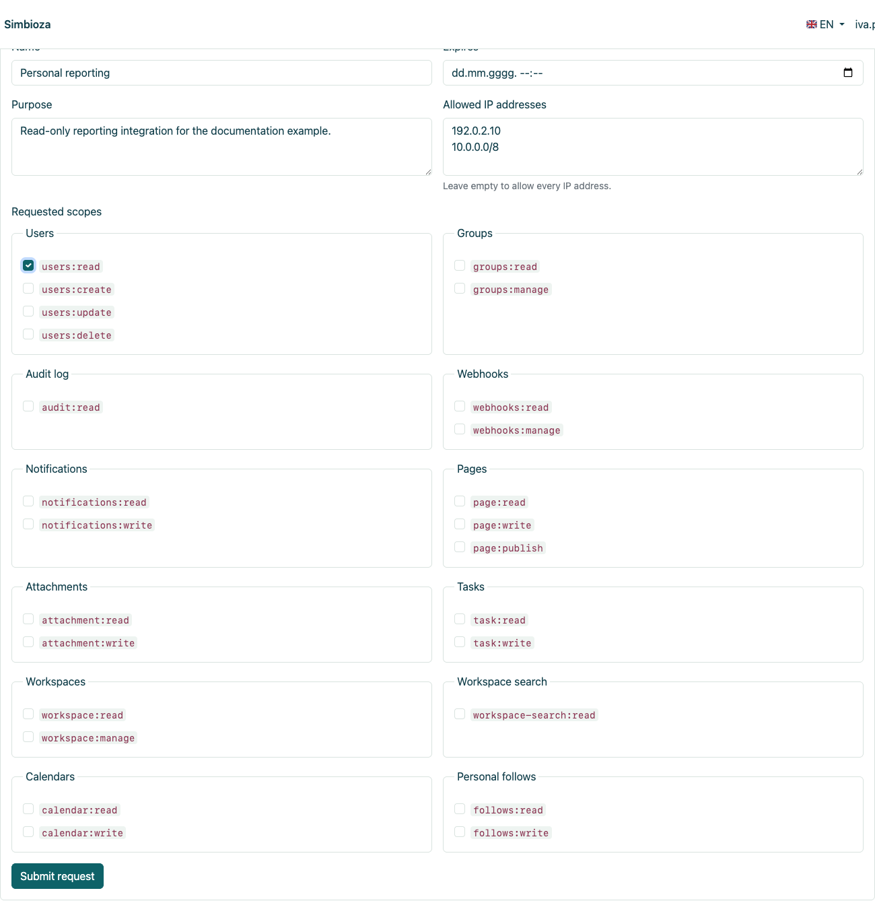 Formulaire de demande de clé API 
<figcaption>L'utilisateur demande une clé restreinte et indique son objectif.</figcaption>
</figure>

<figure class="my-4">
 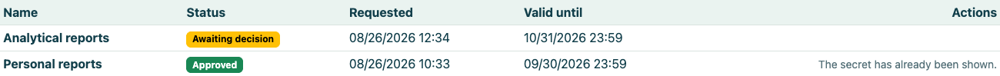 Demande envoyée 
<figcaption>La demande attend l'examen de l'administrateur.</figcaption>
</figure>

<figure class="my-4">
 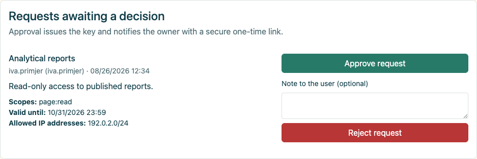 En attente de demand’API 
<figcaption>L'administrateur vérifie la demande avant son approbation.</figcaption>
</figure>

<figure class="my-4">
 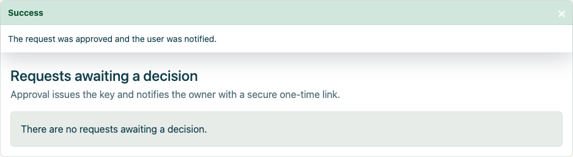 Demand’API approuvée 
<figcaption>L'approbation crée la clé sans révéler le secret à l'administrateur.</figcaption>
</figure>

<figure class="my-4">
 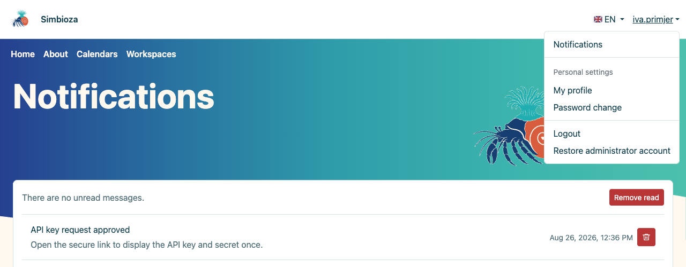 Notification de clé API 
<figcaption>L'utilisateur est informé de la décision.</figcaption>
</figure>

<figure class="my-4">
 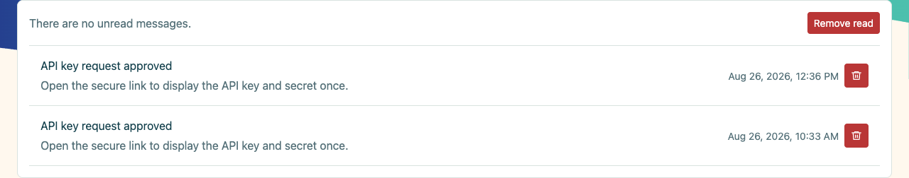 Notification de demande approuvée 
<figcaption>La notification conduit à une récupération unique du secret.</figcaption>
</figure>

<figure class="my-4">
 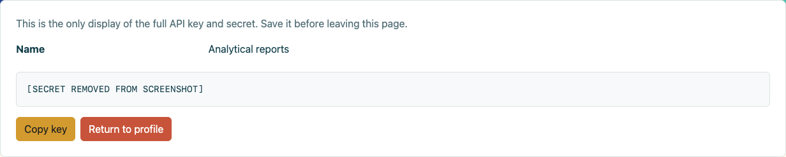 Récupération unique du secret API 
<figcaption>Le secret est supprimé et ne peut plus être affiché après la fermeture.</figcaption>
</figure>

<figure class="my-4">
 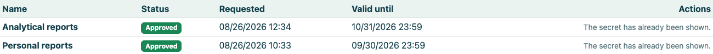 Demand’API terminée 
<figcaption>La demande complétée reste auditable sans exposer le secret.</figcaption>
</figure>

## 8. Flux de travail commun SSO

1.  Enregistrez l'application auprès du fournisseur et entrez uniquement les points de terminaison, l'ID client et le secret nécessaires.
2.  Enregistrez le profil actif. Les secrets existants ne sont jamais affichés lors de l'édition ; laisser le champ secret vide conserve la valeur côté serveur.
3.  Sélectionnez **Tester le profil** avant de deviner les mappages. Effectuez une véritable connexion pour collecter les attributs réels du fournisseur.
4.  Mappez les champs d'objet, de connexion, de nom d'affichage et d'utilisateur à partir des noms renvoyés.
5.  Testez à nouveau. Seul **Testé et opérationnel** accompagné d'une coche verte confirme un profil complet.

### Domaines autorisés

La liste restreint la connexion aux domaines organisationnels. Saisissez un domaine par ligne ou une liste séparée par des virgules. `example.org` autorise ce domaine et ses sous-domaines ; un suffixe tel que `hr` autorise les identifiants dont le domaine se termine par `.hr` . Une liste vide n'impose aucune restriction de domaine.

**L'attribut source du domaine** doit être l'attribut réel du fournisseur contenant une valeur telle que `user@example.org` ou un domaine. Il est requis uniquement lorsque la liste des domaines autorisés est renseignée. N'utilisez pas de nom d'affichage ou une autre valeur modifiable.

### Adresses de rappel publiques

Le fournisseur doit renvoyer le navigateur à l'URL publique de la même installation. Incluez un sous-répertoire lorsqu'un sous-répertoire est utilisé : pour une application sur `https://simbioza.example.org/simbioza` , entrez cette valeur complète comme URL de base publique. Il ne s'agit pas de l'adresse interne PHP-FPM, du conteneur ou de la base de données. Enregistrez les URL de rappel exactes affichées par le profil.

## 9. SAML

Un profil SAML dépend d'un **SimpleSAMLphp** installé séparément et correctement configuré. Son chargeur automatique, sa source d'authentification SP, ses certificats, ses métadonnées et ses URL de retour doivent déjà fonctionner. Le chemin d'accès à `vendor/autoload.php` et le nom de la source d'authentification doivent correspondre à cette installation.

<figure class="my-4">
 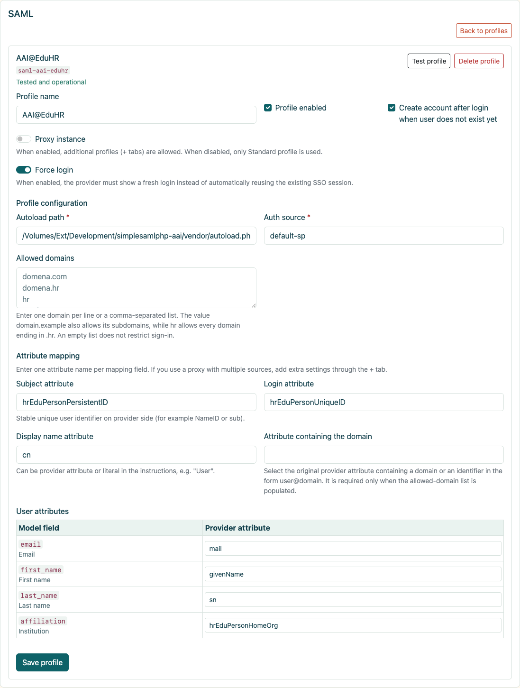 Configuration initiale SAML 
<figcaption>Le profil est enregistré, mais les mappages ne sont pas encore confirmés.</figcaption>
</figure>

<figure class="my-4">
  Premier test SAML 
<figcaption>Les travaux et attributs de connectivité ont été collectés ; les valeurs sont expurgées.</figcaption>
</figure>

<figure class="my-4">
 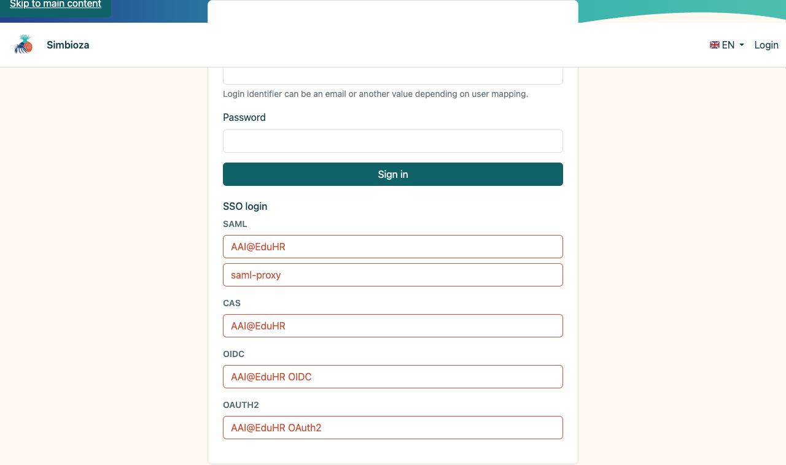 Lancement de la connexion AAI 
<figcaption>L'écran de connexion en anglais Simbioza démarre le flux AAI@EduHr SSO configuré sans exposer les informations d'identification.</figcaption>
</figure>

<figure class="my-4">
  Mappages SAML 
<figcaption>Mappages requis saisis à partir des attributs renvoyés réels.</figcaption>
</figure>

<figure class="my-4">
 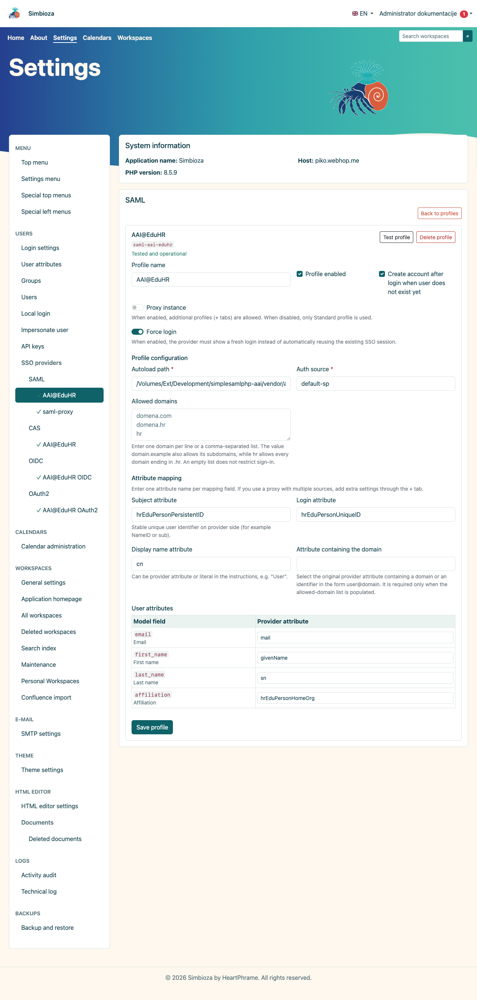 Profil opérationnel SAML 
<figcaption>Le test répété confirme un profil SAML opérationnel.</figcaption>
</figure>

## 10. SAML profils proxy et enfants

Une instance de proxy représente une source d'authentification SimpleSAMLphp qui peut exposer plusieurs fournisseurs en amont. L'onglet **Par défaut** définit le chemin de chargement automatique partagé, la source d'authentification et le mappage de base. Les onglets enfants supplémentaires héritent des paramètres de connexion partagés tout en conservant leurs propres mappages d'attributs.

**Un proxy n'a pas de champs d'attribut Domaines autorisés ou Source de domaine.** Ceci est délibéré : les fournisseurs en amont peuvent renvoyer des identifiants et des domaines différents. Appliquez des restrictions au niveau du proxy ou du fournisseur en amont, et non via une règle de domaine Simbioza partagée.

<figure class="my-4">
 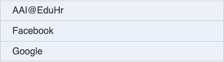 Sélection du fournisseur de proxy 
<figcaption>La véritable connexion proxy propose AAI@EduHR, Facebook et Google, expliquant les trois profils d'enfants.</figcaption>
</figure>

### Par défaut / AAI@EduHR

<figure class="my-4">
 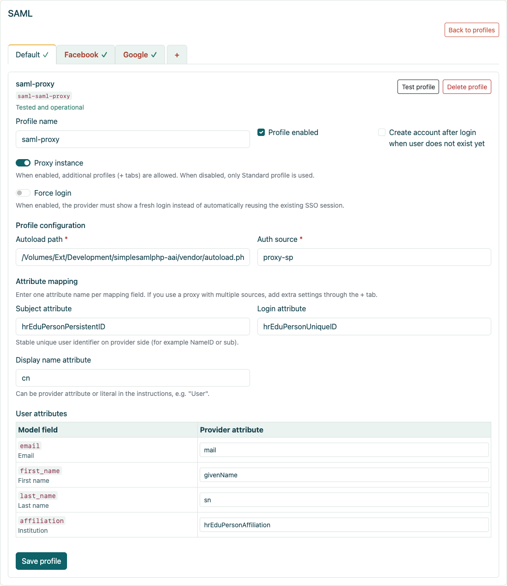 Premier test de proxy par défaut 
<figcaption>Attributs collectés avant le mappage, avec valeurs supprimées.</figcaption>
</figure>

<figure class="my-4">
  Mappages de proxy par défaut 
<figcaption>Mappages pour la source AAI par défaut.</figcaption>
</figure>

<figure class="my-4">
 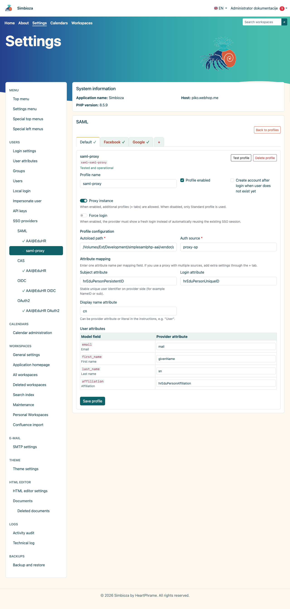 Profil proxy opérationnel par défaut 
<figcaption>Onglet proxy par défaut après le test répété réussi.</figcaption>
</figure>

### Facebook

<figure class="my-4">
  Premier test de proxy Facebook 
<figcaption>Attributs Facebook collectés avant le mappage, avec valeurs supprimées.</figcaption>
</figure>

<figure class="my-4">
  Cartographies d'enfants sur Facebook 
<figcaption>Identifiant Facebook stable, champs de connexion et utilisateur mappés indépendamment.</figcaption>
</figure>

<figure class="my-4">
 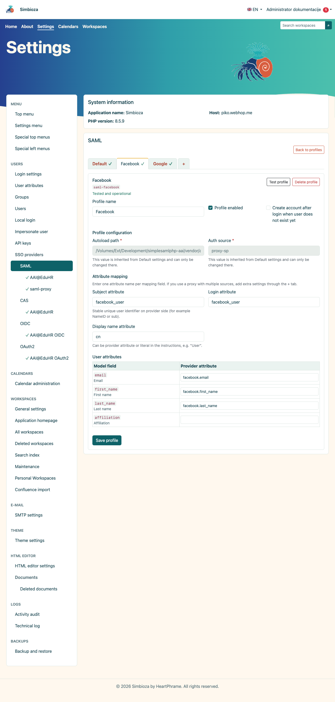 Profil enfant Facebook opérationnel 
<figcaption>Onglet enfant Facebook après une cartographie et un test réussis.</figcaption>
</figure>

### Google

<figure class="my-4">
  Premier test de proxy Google 
<figcaption>Attributs Google collectés avant le mappage, avec valeurs supprimées.</figcaption>
</figure>

<figure class="my-4">
  Mappages enfants Google 
<figcaption>L'UID de Google est le sujet, l'e-mail de Google est la connexion et les champs de nom sont mappés dans le modèle.</figcaption>
</figure>

<figure class="my-4">
  Profil enfant Google opérationnel 
<figcaption>Onglet enfant Google après le test répété réussi.</figcaption>
</figure>

## 11. CAS

Un profil CAS a besoin de l'URL de base du serveur et de ses points de terminaison de connexion, de validation et de déconnexion. Si une chaîne d'autorité de certification privée est utilisée, fournissez un chemin de certificat lisible. Ne désactivez jamais la validation TLS pour contourner une configuration de certificat incorrecte.

<figure class="my-4">
 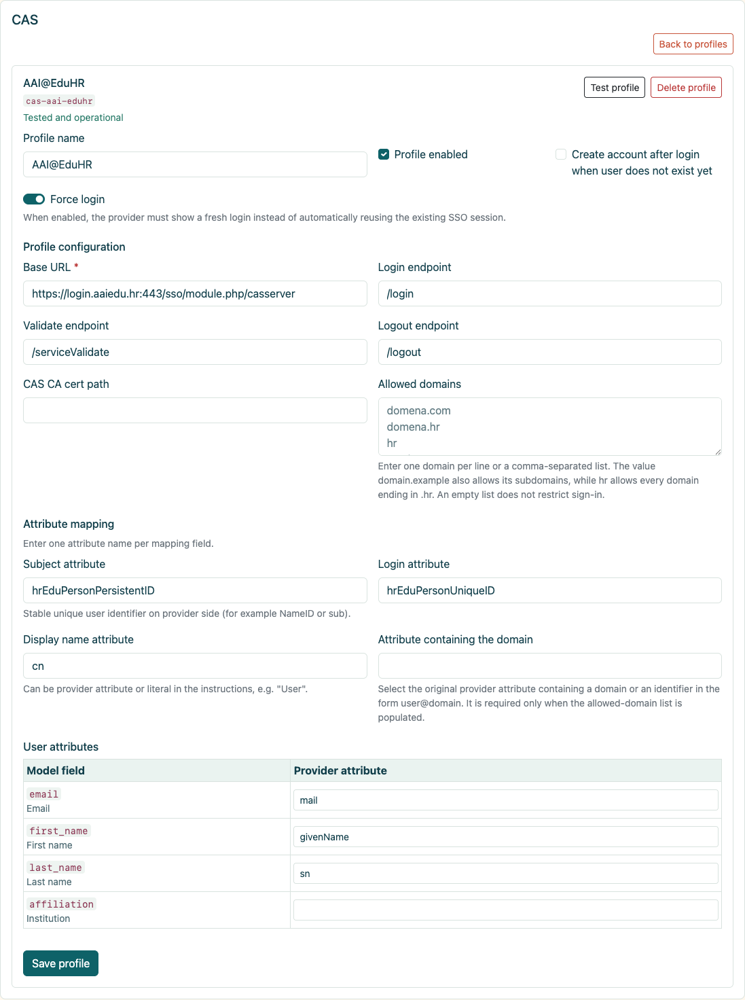 Configuration initiale CAS 
<figcaption>La connexion CAS est préparée mais les mappages ne sont pas terminés.</figcaption>
</figure>

<figure class="my-4">
  Premier test CAS 
<figcaption>L'authentification CAS renvoie les attributs ; les valeurs sont expurgées.</figcaption>
</figure>

<figure class="my-4">
  Mappages CAS 
<figcaption>Champs stables d’objet, de connexion, de nom d’affichage et de modèle mappés à partir du test.</figcaption>
</figure>

<figure class="my-4">
 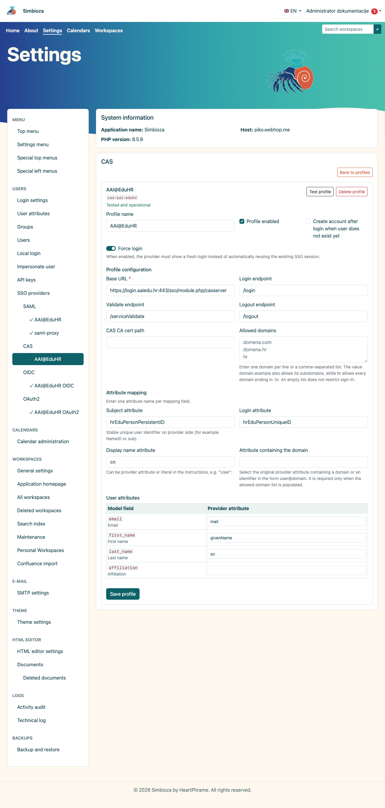 Profil opérationnel CAS 
<figcaption>Le test répété confirme le profil CAS.</figcaption>
</figure>

## 12. OIDC

OIDC utilise un ID client et un secret, une autorisation, un jeton, des informations utilisateur et éventuellement des points de terminaison de fin de session. La portée doit inclure `openid` , suivi uniquement des données requises telles que `profile` et `email` . **L'URL de base de redirection publique** est l'adresse de base publique complète de cette installation, y compris un sous-répertoire le cas échéant.

<figure class="my-4">
 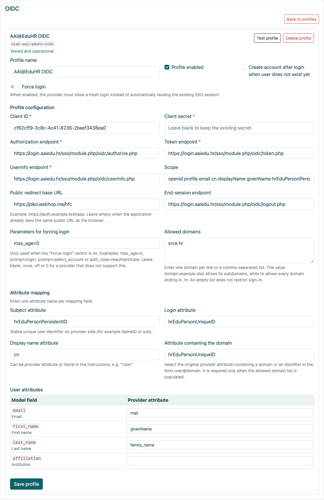 Configuration initiale OIDC 
<figcaption>Points de terminaison OIDC et URL de base publique avant le mappage.</figcaption>
</figure>

<figure class="my-4">
  Premier test OIDC 
<figcaption>OIDC revendications collectées avant le mappage, avec les valeurs supprimées.</figcaption>
</figure>

<figure class="my-4">
  Mappage et domaine OIDC 
<figcaption>Objet, identifiant, nom d'affichage, champs utilisateur et source de domaine mappés à partir de revendications réelles.</figcaption>
</figure>

<figure class="my-4">
 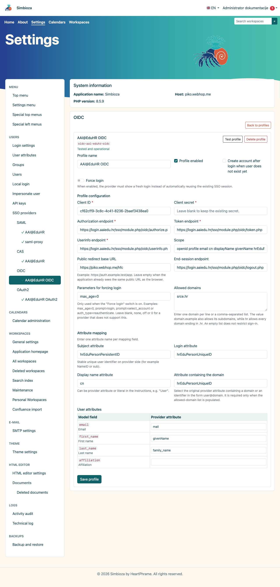 Profil opérationnel OIDC 
<figcaption>Le test répété confirme OIDC et affiche la coche verte.</figcaption>
</figure>

Utilisez un paramètre de connexion forcée tel que `max_age=0` uniquement lorsque le fournisseur le prend en charge et que **Forcer la connexion** est activé. Sinon, laissez-le vide pour conserver une session SSO existante valide.

## 13. OAuth2

OAuth2 utilise les points de terminaison d'autorisation, de jeton et d'informations utilisateur ainsi que les étendues requises pour les données utilisateur. Si le fournisseur prend en charge OpenID Connect, préférez OIDC car il standardise la validation des identités et des jetons. La déconnexion OAuth2 peut nécessiter un point de terminaison dédié, un nom de paramètre de redirection ou un indice ; entrez uniquement les valeurs requises par la documentation du fournisseur.

<figure class="my-4">
 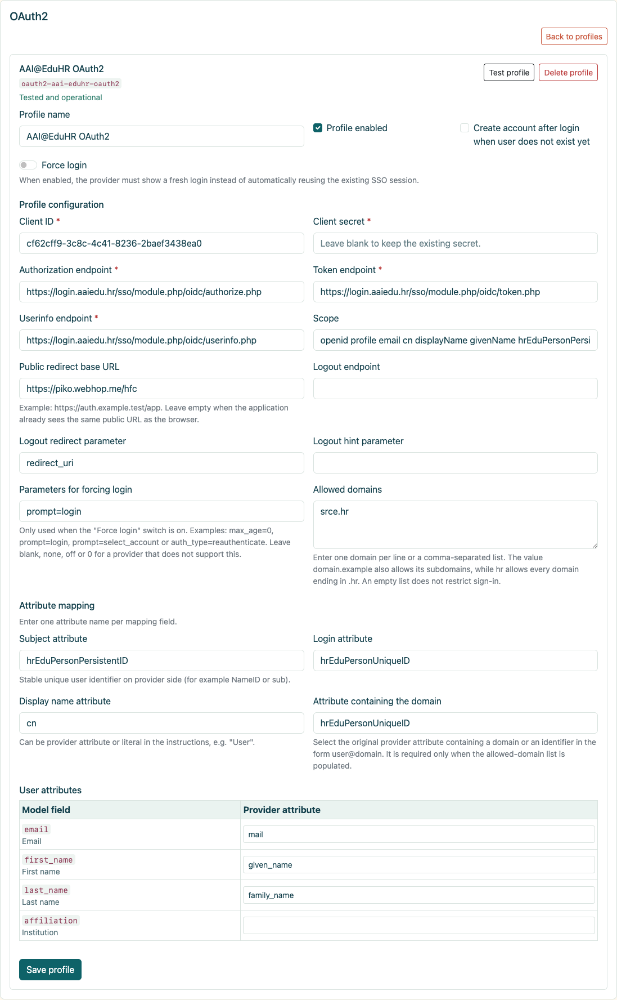 Configuration initiale OAuth2 
<figcaption>Profil OAuth2 avant le mappage des attributs.</figcaption>
</figure>

<figure class="my-4">
  Premier test OAuth2 
<figcaption>Attributs Userinfo collectés via une connexion réelle, avec les valeurs supprimées.</figcaption>
</figure>

<figure class="my-4">
  Mappage et domaine OAuth2 
<figcaption>Mappages et restriction de domaine saisis à partir du résultat du test.</figcaption>
</figure>

<figure class="my-4">
 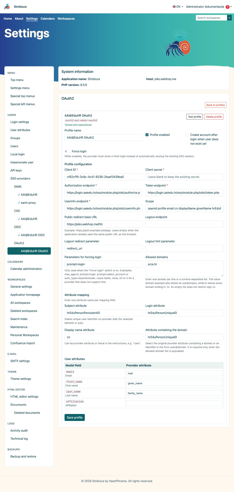 Profil opérationnel OAuth2 
<figcaption>Le test répété confirme le profil OAuth2.</figcaption>
</figure>

## 14. Profil personnel : sécurité et accès

Ouvrez **Profil personnel** dans le menu utilisateur. La section principale affiche l'identité et les attributs personnalisés. **Sécurité et accès** affiche l'appartenance au groupe, l'état du mot de passe local, les connexions externes liées et les demandes de clé API.

<figure class="my-4">
 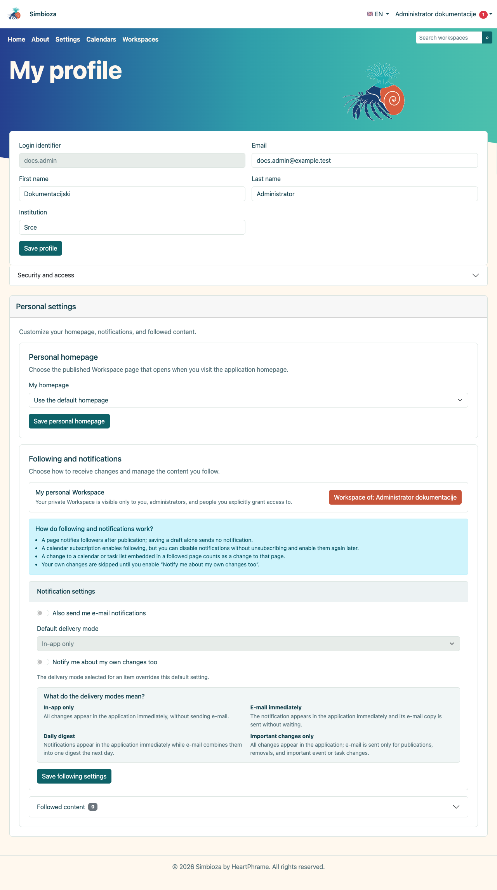 Profil personnel 
<figcaption>Données personnelles et attributs personnalisés dans l'interface anglaise.</figcaption>
</figure>

<figure class="my-4">
 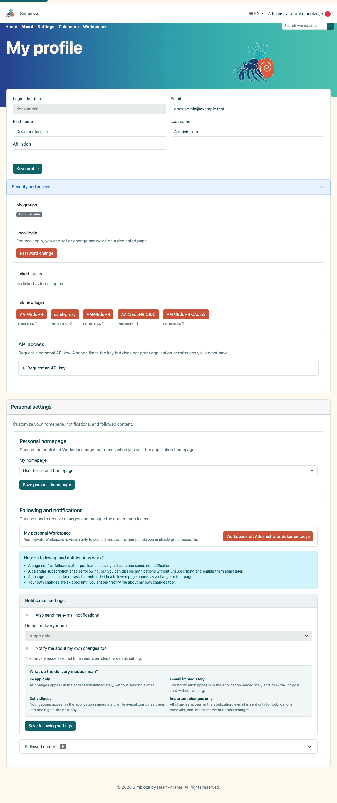 Sécurité et accès étendus 
<figcaption>Groupes, connexion locale, fournisseurs liés et requêtes API en un seul endroit.</figcaption>
</figure>

Liez un compte externe uniquement pendant que vous contrôlez les deux identités. Supprimez les liens inconnus ou inutilisés, mais confirmez d'abord qu'une autre méthode de connexion reste disponible. Modifiez les mots de passe locaux via ce formulaire sécurisé, jamais par e-mail ou par message de l'administrateur.

## 15. Liste de contrôle de vérification et de sécurité

- Gardez au moins une connexion d'administrateur contrôlée disponible ; conserver le compte bris de glace en dehors d'une utilisation quotidienne normale.
- Pour chaque profil SSO, vérifiez les URL de rappel exactes, les certificats TLS, les étendues minimales et la rotation des secrets.
- N'acceptez pas une case à cocher active comme preuve. Exiger l'état opérationnel vert après le test répété.
- Le sujet doit être un identifiant de fournisseur immuable. L'identifiant et l'adresse e-mail peuvent changer et ne constituent pas toujours des identifiants principaux appropriés.
- Testez les restrictions de domaine avec un compte test autorisé et refusé.
- Examinez régulièrement les administrateurs, les adhésions aux groupes, les connexions externes liées, les clés API actives et les demandes en attente.
- Ne mettez jamais de mots de passe, de secrets clients, de jetons, de secrets API ou d'attributs personnels bruts dans des captures d'écran, de la documentation, des tickets ou du contrôle de source.
- Après le test, supprimez ou désactivez les comptes de documentation et les clés qui ne sont plus nécessaires.

Après avoir enregistré, testez une connexion normale et un compte refusé. Confirmez que chaque utilisateur voit uniquement le contenu et les actions attribués à ses groupes.

