# Prijava i korisnici

Ove upute vode administratora kroz sve postavke prijave, korisničke atribute, grupe, korisnike, lokalnu registraciju, preuzimanje korisnika, API ključeve, SSO providere te osobnu sigurnost i pristup.

**Primjeri su izrađeni na čistoj SQLite instalaciji.** Prikazani računi, grupe i ključevi služe samo za dokumentaciju. Tajne vrijednosti i osobni atributi uklonjeni su sa screenshotova. U produkciji koristite vlastite nazive, domene, rokove važenja i načelo najmanjih ovlasti.

## Sadržaj

1.  [Postavke prijave](#postavke-prijave)
2.  [Atributi korisnika](#atributi)
3.  [Grupe](#grupe)
4.  [Korisnici i lokalni računi](#korisnici)
5.  [Lokalna prijava i registracija](#lokalna-prijava)
6.  [Preuzimanje korisnika](#preuzimanje)
7.  [API ključevi](#api-kljucevi)
8.  [Zajednički postupak za SSO](#sso)
9.  [SAML](#saml)
10. [SAML proxy](#saml-proxy)
11. [CAS](#cas)
12. [OIDC](#oidc)
13. [OAuth2](#oauth2)
14. [Osobni profil: sigurnost i pristup](#osobni-profil)
15. [Provjera i sigurnosne preporuke](#provjera)

## 1. Postavke prijave

Otvorite **Postavke → Korisnici → Postavke prijave**. Ovdje se uključuju načini prijave za cijelu aplikaciju. Uključivanje providera samo omogućuje njegovu konfiguraciju i prikaz u meniju; svaki konkretan profil mora biti zasebno spremljen, aktiviran, testiran i ispravno mapiran.

<figure class="my-4">
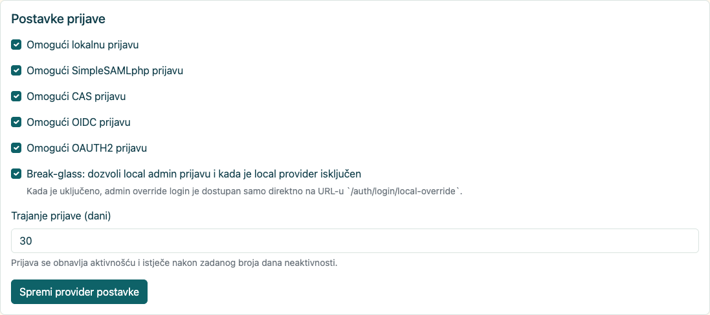Pregled postavki prijave
<figcaption>Postavke prijave na čistoj instalaciji.</figcaption>
</figure>

<figure class="my-4">

<figcaption>Što znače glavne postavke 
</figcaption>
</figure>

- **Lokalna prijava** omogućuje prijavu korisničkom oznakom i lozinkom iz Simbioze.
- **SimpleSAMLphp, CAS, OIDC i OAuth2** uključuju odgovarajuće skupine SSO profila.
- **Break-glass lokalna prijava** ostavlja zasebnu, izravnu administratorsku adresu kada se redovna lokalna prijava isključi. Taj račun zaštitite snažnom jedinstvenom lozinkom i koristite samo u nuždi.
- **Trajanje prijave** određuje dopuštenu neaktivnost u danima (1–365); rok se obnavlja dok je prijavljeni korisnik aktivan. Kraći rok je sigurniji za administrativna i javna računala.

**„Profil aktivan” nije isto što i zelena kvačica.** Aktivna kvačica znači da se profil smije koristiti. Zelena kvačica i poruka *Testirano i operativno* pojavljuju se tek nakon uspješnog testa veze i ispravnog mapiranja obaveznih atributa. Profil može biti aktivan, a ipak neoperativan.

## 2. Atributi korisnika

Otvorite **Atributi korisnika**. Model obično već sadrži e-mail, ime i prezime. Dodatni atribut dodajte kada aplikacija treba pohraniti podatak koji nije dio osnovnog korisničkog profila, primjerice ustanovu, odjel, broj zaposlenika ili ulogu iz vanjskog imenika.

<figure class="my-4">
Zadani korisnički atributi
<figcaption>Zadani atributi korisnika na čistoj instalaciji.</figcaption>
</figure>

### Dodavanje atributa

1.  Unesite stabilnu programsku oznaku, malim slovima i bez razmaka, primjerice `affiliation`.
2.  Unesite odvojeni hrvatski i engleski naziv koji će korisnici vidjeti.
3.  Odaberite vrstu podatka te zasebno postavite **Obavezno**, **Registracija**, **Profil** i **Aktivno**.
4.  Spremite atribut. Novo polje pojavljuje se u korisničkim profilima i u tablici mapiranja svakog SSO profila.

<figure class="my-4">
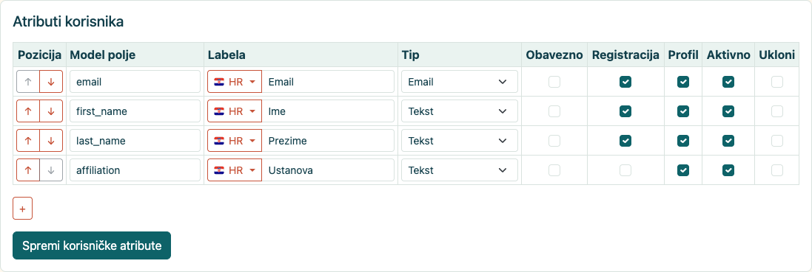Primjer dvojezičnog atributa
<figcaption>Tehničko polje affiliation ima nazive Ustanova / Institution, vidljivo je u profilu i SSO mapiranju, ali nije uključeno u samostalnu registraciju.</figcaption>
</figure>

**Mapiranje** povezuje polje modela Simbioze s nazivom atributa koji vraća provider. Nazivi su osjetljivi na točan zapis: `mail`, `givenName` i `given_name` nisu ista polja. Najprije testirajte profil i pročitajte stvarno vraćene nazive, a tek zatim ih upišite u mapiranje. SSO mapiranje ne dodaje polje automatski u javni obrazac registracije.

**Koja polja ulaze u samostalnu registraciju?** To bira administrator za svaki atribut. **Registracija** određuje prikazuje li se polje u javnom obrascu, a **Obavezno** zabranjuje praznu vrijednost u kontekstima u kojima se polje koristi. Ako su uključene obje postavke, polje je obavezno pri samostalnoj registraciji. Obavezni atribut mora imati i valjano SSO mapiranje da bi test profila bio operativan. Polje `affiliation` u ovom primjeru služi za mapiranje ustanove providera i prikaz u profilu, pa je namjerno isključeno iz registracije.

## 3. Grupe

Grupe okupljaju korisnike i nose skup prava. Administratorska grupa je sistemska i ne treba je koristiti kao običnu poslovnu grupu. Za odjele, projekte ili uloge izradite zasebne grupe s najmanjim potrebnim skupom prava.

<figure class="my-4">
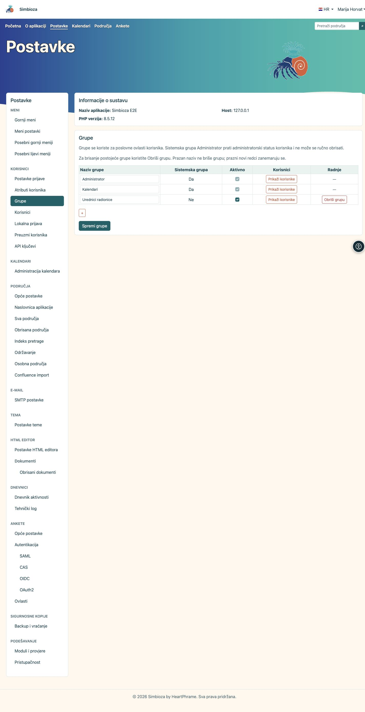Popis sistemskih grupa
<figcaption>Sistemske grupe na čistoj instalaciji.</figcaption>
</figure>

### Primjer nove grupe

1.  Odaberite **Dodaj grupu** (gumb s plusom), unesite prepoznatljiv **Naziv grupe** i provjerite kućicu **Aktivno**.
2.  Odaberite **Spremi grupe**. Na ovom se ekranu ne unose opis ni prava na sadržaj.
3.  U detaljima korisnika dodajte ili uklonite članstvo u grupi.
4.  Potrebna prava dodijelite toj grupi u postavkama područja, stranice, kalendara ili ankete. Za SSO korisnike članstvo se može određivati i pravilima mapiranog atributa.

**Rezultat:** grupa postoji i može se odabrati pri dodjeli ovlasti. Samo stvaranje grupe ne otvara sadržaj njezinim članovima.

Za privremeno isključivanje nesistemske grupe uklonite kvačicu **Aktivno** i spremite. Za trajno brisanje odaberite **Obriši grupu**. Na posebnom ekranu provjerite naziv grupe i prikazane posljedice za članstva i pravila mapiranja, zatim odaberite **Potvrdi brisanje** ili odustanite. Korisnički računi ostaju. Prazan naziv više ne briše grupu. Prije potvrde provjerite gdje se grupa koristi za pristup sadržaju. Nova grupa istog imena dobiva drugi identitet i ne vraća stara članstva ni ovlasti. Sistemske grupe ne mogu se obrisati.

<figure class="my-4">
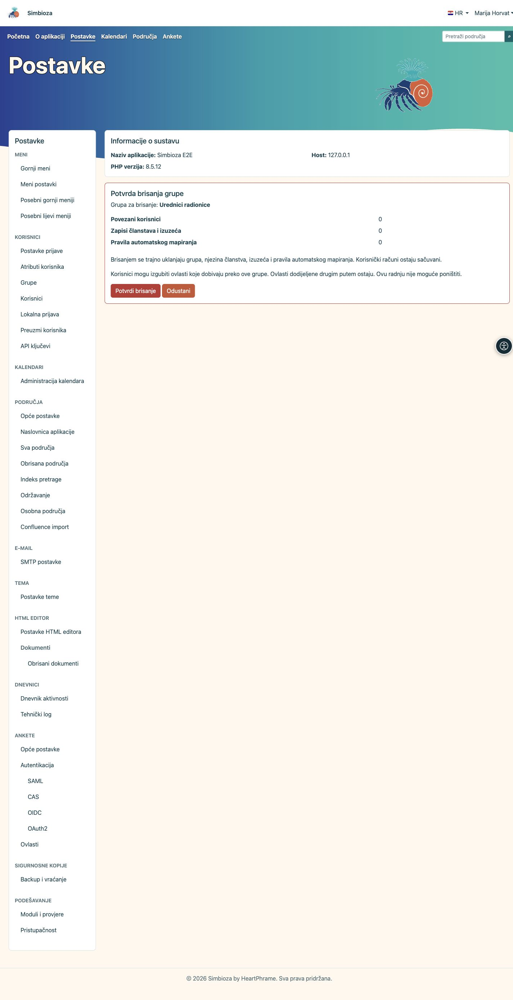
<figcaption>Prije potvrde provjerite naziv grupe i posljedice. Odustani vraća popis bez brisanja.</figcaption>
</figure>

## 4. Korisnici i lokalni računi

Otvorite **Postavke → Korisnici → Korisnici** da biste pronašli račun, provjerili njegovo stanje te uredili članstvo i pristup.

<figure class="my-4">
Responzivni popis korisnika
<figcaption>Popis korisnika s uravnoteženim širinama stupaca.</figcaption>
</figure>

### Stvaranje lokalnog korisnika

1.  Odaberite **Novi korisnik**.
2.  Unesite jedinstvenu login oznaku, ime za prikaz i e-mail.
3.  Odaberite lokalni izvor prijave i dodijelite privremenu snažnu lozinku.
4.  Uključite obaveznu promjenu lozinke pri prvom loginu.
5.  Dodijelite samo potrebne grupe; administratorska ovlast ne smije biti zadana.

<figure class="my-4">
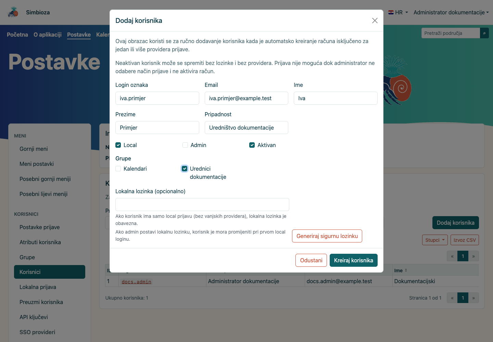Obrazac za lokalnog korisnika
<figcaption>Primjer obrasca za stvaranje lokalnog korisnika bez prikazane lozinke.</figcaption>
</figure>

<figure class="my-4">
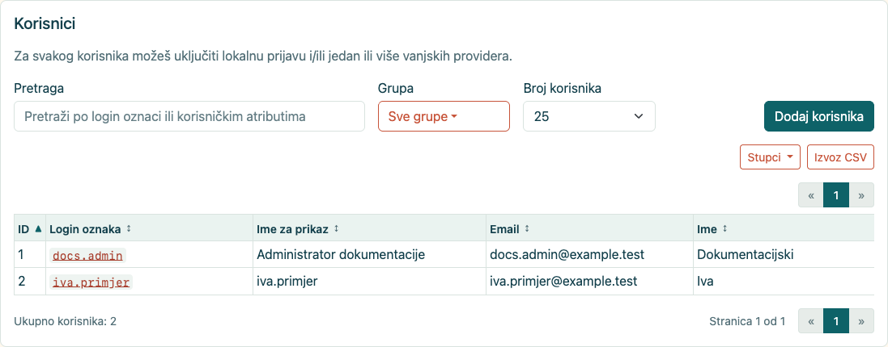Novi korisnik na popisu
<figcaption>Dokumentacijski korisnik nakon stvaranja.</figcaption>
</figure>

<figure class="my-4">
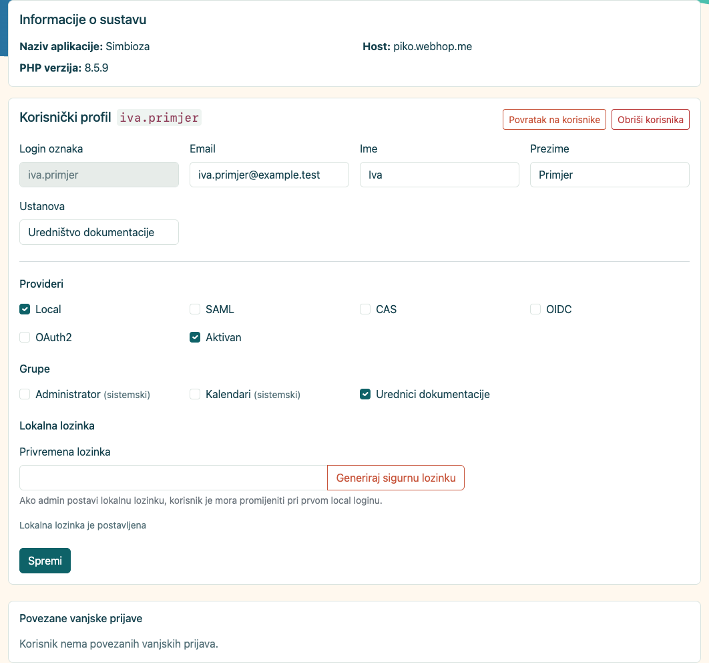Detalji korisnika
<figcaption>Detalji računa, povezani provideri i članstva u grupama.</figcaption>
</figure>

<figure class="my-4">
Obavezna promjena lozinke
<figcaption>Privremena lozinka vodi na obaveznu promjenu prije nastavka rada.</figcaption>
</figure>

U detaljima računa provjerite je li korisnik aktivan, koji je izvor prijave, koje su vanjske prijave povezane i kojim grupama pripada. Deaktivacija je sigurniji prvi korak od brisanja jer čuva trag aktivnosti. Za vanjske račune ne mijenjajte ručno stabilni identifikator providera.

## 5. Lokalna prijava i registracija

U **Lokalnoj prijavi** određujete smiju li se korisnici sami registrirati. Za zatvorene sustave registraciju ostavite isključenom i račune stvarajte administrativno ili kroz provjereni SSO. Uključena registracija odmah stvara aktivan običan račun i prijavljuje korisnika. Ne šalje poruku za potvrdu e-maila niti dokazuje vlasništvo unesene adrese. Za zatvoreni sustav koristite račune koje stvara administrator ili provjereni SSO. Prije prihvata registracija objavite odgovarajuću obavijest o privatnosti. Javni obrazac prikazuje samo korisničke atribute kojima je u **Atributima korisnika** uključena postavka **Registracija**; SSO-only polje *Ustanova* zato se ovdje ne prikazuje.

<figure class="my-4">
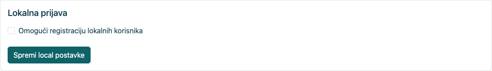Registracija isključena
<figcaption>Preporučeno početno stanje za zatvorenu aplikaciju.</figcaption>
</figure>

<figure class="my-4">
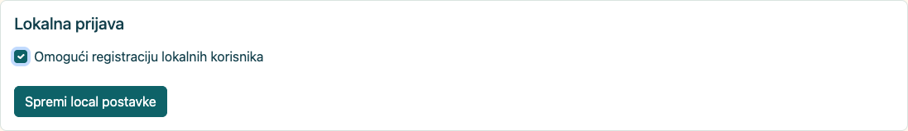Registracija uključena
<figcaption>Registracija uključena samo za kontrolirani primjer.</figcaption>
</figure>

<figure class="my-4">
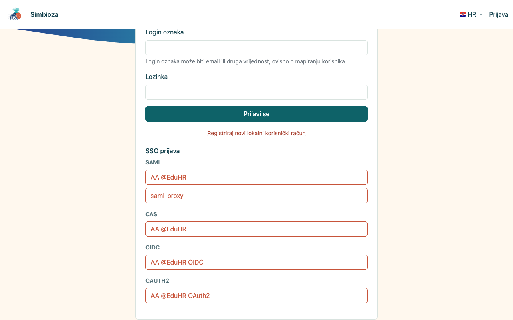Poveznica za registraciju
<figcaption>Ekran prijave prikazuje poveznicu tek kada je registracija dopuštena.</figcaption>
</figure>

<figure class="my-4">
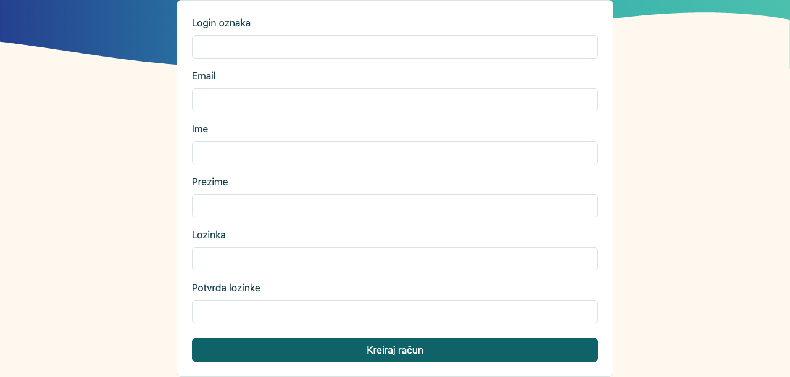Obrazac registracije
<figcaption>Javni obrazac s odabranim registracijskim poljima; atribut Ustanova iz SSO mapiranja namjerno je skriven.</figcaption>
</figure>

Nakon demonstracije vratite željeno produkcijsko stanje. Lozinke moraju biti jedinstvene, dovoljne duljine i po mogućnosti spremljene u upravitelju lozinki. Administrator nikada ne treba tražiti korisnikovu postojeću lozinku.

## 6. Preuzimanje korisnika

**Preuzmi korisnika** privremeno otvara aplikaciju u kontekstu odabranog korisnika. Služi dijagnostici ovlasti i prikaza, ne radu umjesto korisnika.

1.  Odaberite korisnika i zabilježite razlog u internom postupku podrške.
2.  Potvrdite preuzimanje. Aplikacija jasno označava da je impersonacija aktivna.
3.  Provjerite samo prijavljeni problem; ne mijenjajte poslovne podatke bez odobrenja.
4.  Odmah odaberite povratak na administratorski račun.

<figure class="my-4">
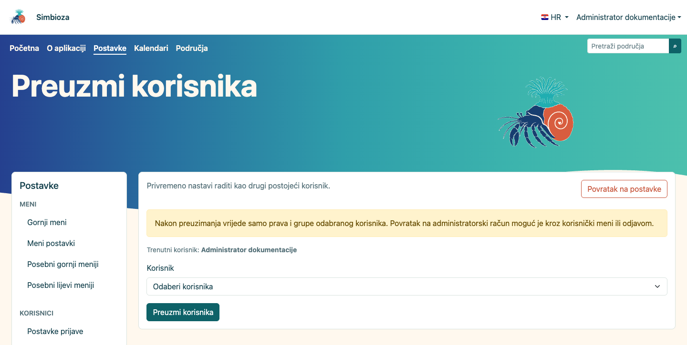Odabir korisnika za preuzimanje
<figcaption>Administrator odabire račun za kontroliranu dijagnostiku.</figcaption>
</figure>

<figure class="my-4">
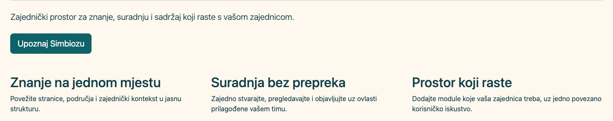Aktivno preuzimanje korisnika
<figcaption>Jasna oznaka da se radi u kontekstu drugog korisnika.</figcaption>
</figure>

<figure class="my-4">
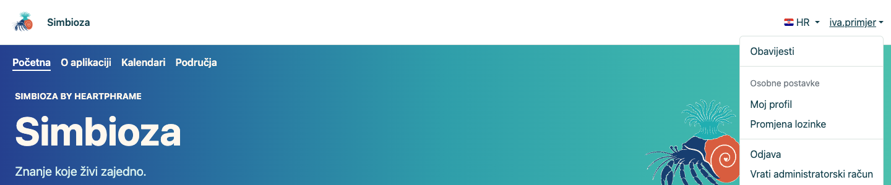Povratak administratoru
<figcaption>Radnju završite povratkom na svoj administratorski račun.</figcaption>
</figure>

Preuzimanje ne testira stvarnu SSO autentikaciju, MFA ni pravila providera. Za to koristite test profila ili zaseban testni račun.

## 7. API ključevi

Ovi se ekrani prikazuju kada je API modul instaliran i uključen. API ključ predstavlja korisnika koji ga je dobio. Dopušteni opsezi mogu samo suziti njegove postojeće ovlasti; ne mogu mu dati prava koja vlasnik nema. Za svaku integraciju koristite zaseban ključ, opisnu oznaku, najkraći potreban rok i najmanji skup opsega.

### Izravno izdavanje ključa

1.  Odaberite vlasnika i samo potrebne opsege.
2.  Postavite datum isteka i, prema potrebi, dopuštenu IP adresu ili mrežu.
3.  Stvorite ključ i odmah kopirajte tajnu u sigurno spremište.
4.  Tajna se više ne prikazuje. Ako je izgubljena, opozovite ključ i izdajte novi.

<figure class="my-4">
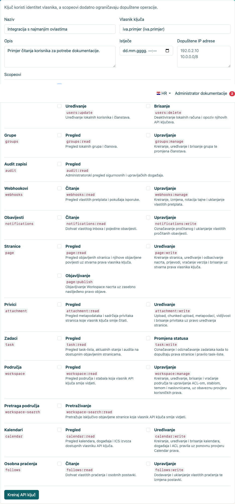API ključ s najmanjim ovlastima
<figcaption>Primjer ograničenog API ključa prije stvaranja.</figcaption>
</figure>

<figure class="my-4">
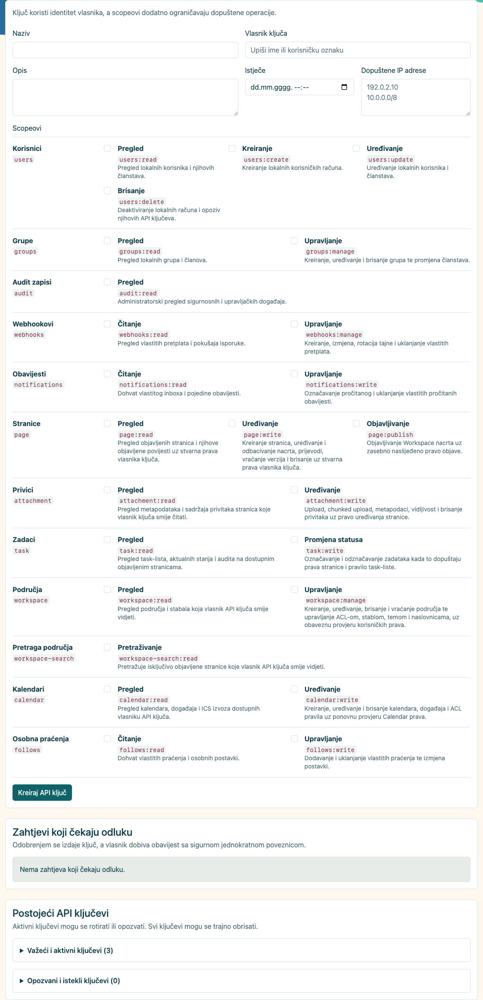Jednokratna API tajna
<figcaption>Tajna je namjerno uklonjena sa screenshota.</figcaption>
</figure>

<figure class="my-4">
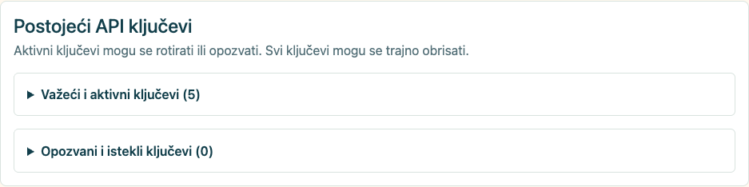Aktivni API ključevi
<figcaption>Popis aktivnih ključeva za reviziju i opoziv.</figcaption>
</figure>

### Zahtjev korisnika i odobrenje administratora

Korisnik može u osobnom profilu zatražiti ključ i obrazložiti namjenu. Administrator pregleda vlasnika, opsege, rok i razlog te zahtjev odobri ili odbije. Nakon odobrenja korisnik u osobnom profilu može jednom preuzeti tajnu. Ako je modul Obavijesti uključen, do tog ga ekrana vodi i obavijest u aplikaciji. Tajna se ne šalje u obavijesti ili e-mailu.

<figure class="my-4">
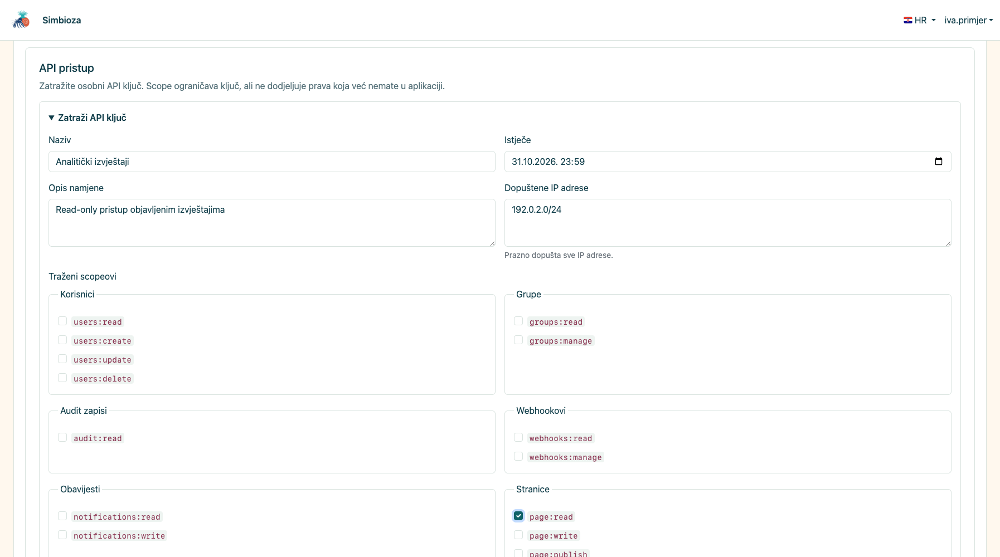Zahtjev za API ključ
<figcaption>Korisnik traži ograničeni ključ i navodi namjenu.</figcaption>
</figure>

<figure class="my-4">
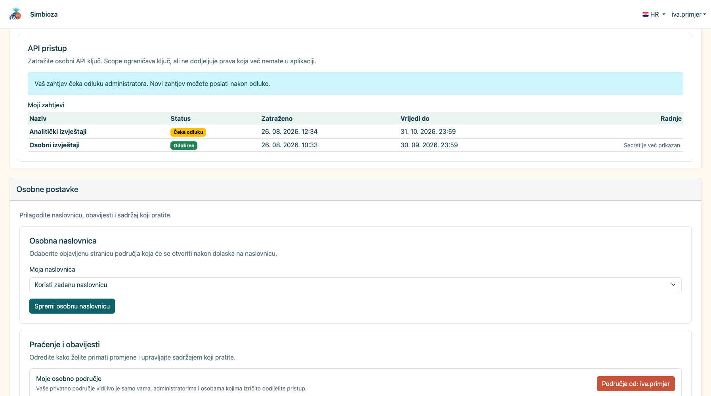Poslan zahtjev
<figcaption>Zahtjev čeka administratorsku odluku.</figcaption>
</figure>

<figure class="my-4">
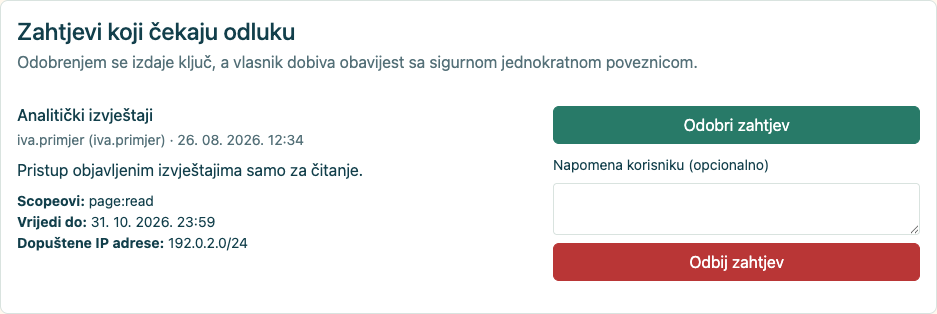Zahtjev na čekanju
<figcaption>Administrator provjerava detalje prije odobrenja.</figcaption>
</figure>

<figure class="my-4">
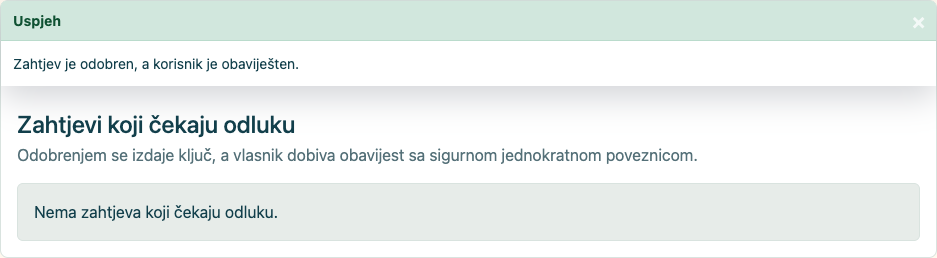Odobren API zahtjev
<figcaption>Odobrenje stvara ključ bez otkrivanja tajne administratoru.</figcaption>
</figure>

<figure class="my-4">
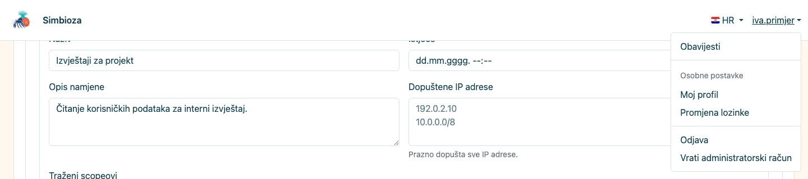Obavijest o API ključu
<figcaption>Korisnik dobiva obavijest o odluci.</figcaption>
</figure>

<figure class="my-4">
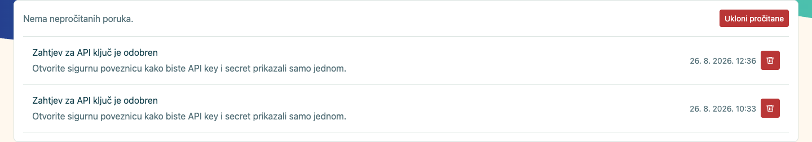Odobren zahtjev korisnika
<figcaption>Obavijest vodi na jednokratno preuzimanje tajne.</figcaption>
</figure>

<figure class="my-4">
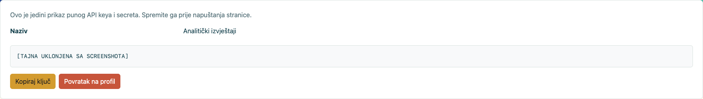Jednokratno preuzimanje API tajne
<figcaption>Tajna je uklonjena sa slike i nakon zatvaranja se ne može ponovno prikazati.</figcaption>
</figure>

<figure class="my-4">
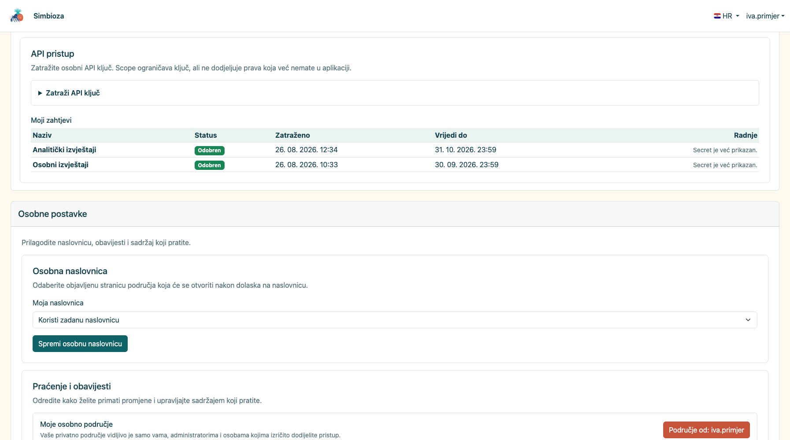Dovršen API zahtjev
<figcaption>Dovršen zahtjev ostaje evidentiran bez otkrivanja tajne.</figcaption>
</figure>

## 8. Zajednički postupak za SSO profile

Za svaki SSO profil koristite isti sigurni slijed:

1.  Registrirajte aplikaciju kod providera i upišite samo nužne endpointove, Client ID i tajnu.
2.  Spremite profil kao aktivan. Tajna se pri kasnijem uređivanju ne prikazuje; prazno polje zadržava postojeću tajnu.
3.  Prvi put odaberite **Testiraj profil** bez nagađanja mapiranja. Nakon stvarne prijave prikazat će se zadnje dohvaćeni atributi.
4.  Prema vraćenim nazivima upišite atribut subjekta, atribut za prijavu, prikazno ime i korisnička polja.
5.  Ponovno testirajte. Tek poruka **Testirano i operativno** i zelena kvačica potvrđuju cjelovit profil.

### Dopuštene domene

Popis ograničava prijavu na organizacijske domene. Jedna domena ide u svaki red ili se koristi popis odvojen zarezima. Vrijednost `domena.hr` dopušta tu domenu i njezine poddomene; kraći sufiks poput `hr` dopušta sve identifikatore čija domena završava s `.hr`. Prazan popis ne ograničava prijavu.

**Atribut koji sadrži domenu** mora biti stvarni atribut providera s vrijednošću oblika `korisnik@domena` ili samom domenom. Obavezan je samo kada je popis dopuštenih domena popunjen. Ne oslanjajte se na prikazno ime ili drugi promjenjivi atribut.

### Javne povratne adrese

Provider mora vratiti preglednik na javnu adresu iste instalacije. Za aplikaciju u poddirektoriju uključite i poddirektorij, primjerice `https://simbioza.example.org/simbioza`. To je osnovna javna adresa koju korisnički preglednik vidi, a ne interna adresa PHP-FPM-a, kontejnera ili baze. Konkretne callback adrese prikazane na profilu registrirajte točno, bez preusmjeravanja na drugu instalaciju.

## 9. SAML

SAML profil ovisi o zasebno instaliranom i ispravno podešenom **SimpleSAMLphp**. Prije konfiguracije Simbioze moraju raditi njegov autoload, SP auth source, certifikati, metadata i povratne adrese. Putanja do `vendor/autoload.php` i naziv auth sourcea moraju odgovarati stvarnoj instalaciji.

<figure class="my-4">
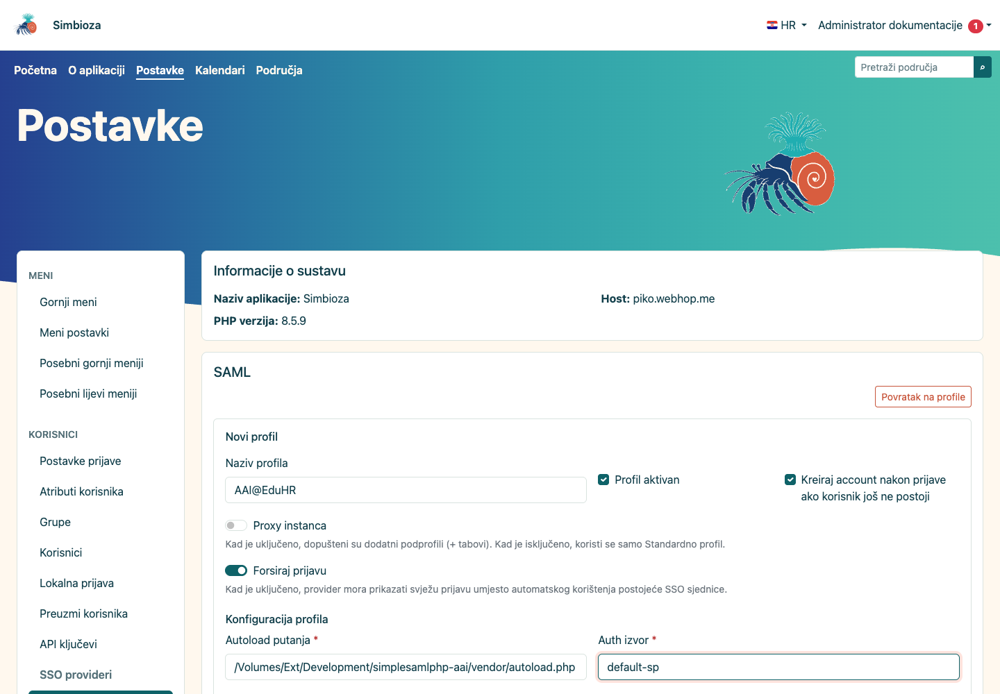Početna SAML konfiguracija
<figcaption>Profil je spremljen, ali mapiranje još nije potvrđeno.</figcaption>
</figure>

<figure class="my-4">
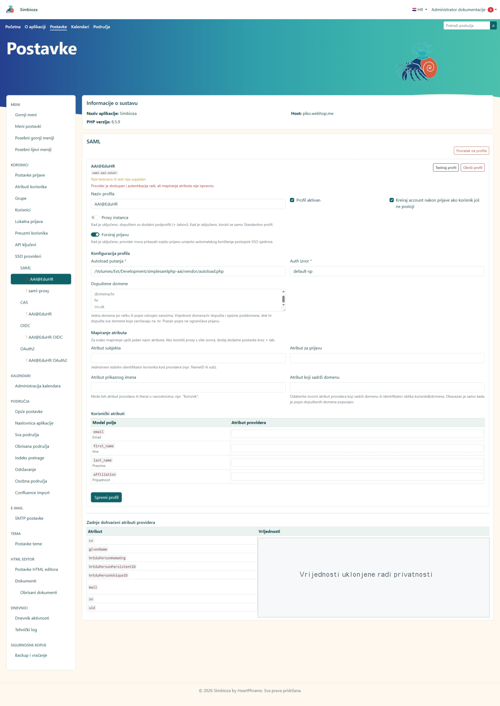Prvi SAML test
<figcaption>Veza radi i atributi su dohvaćeni; vrijednosti su uklonjene radi privatnosti.</figcaption>
</figure>

<figure class="my-4">
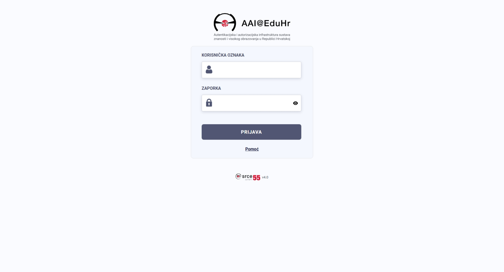AAI prijava bez podataka
<figcaption>Čist ekran stvarne AAI prijave bez korisničke oznake i lozinke.</figcaption>
</figure>

<figure class="my-4">
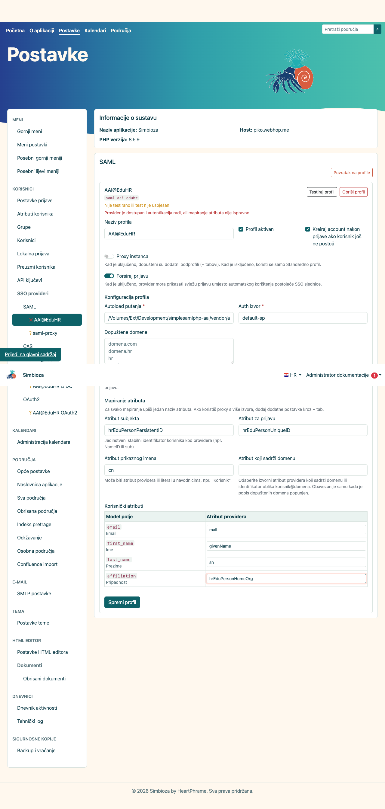SAML mapiranje
<figcaption>Obavezni atributi mapirani prema stvarno vraćenim nazivima.</figcaption>
</figure>

<figure class="my-4">
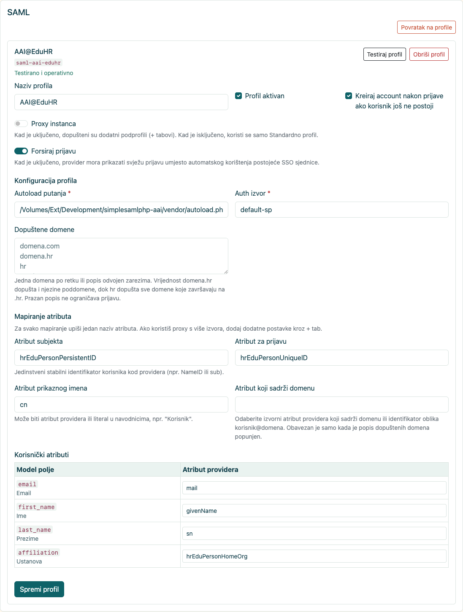Operativni SAML profil
<figcaption>Ponovljeni test potvrđuje ispravnu vezu i mapiranje.</figcaption>
</figure>

## 10. SAML proxy i podprofili

Proxy instanca predstavlja jedan SimpleSAMLphp auth source iza kojega se može nalaziti više upstream providera. Na kartici **Standardno** postavljaju se zajednička autoload putanja, auth source i osnovna mapiranja. Dodatni podprofili nasljeđuju te zajedničke vrijednosti, a svaka kartica dobiva vlastito mapiranje atributa.

**Proxy nema Dopuštene domene ni Atribut koji sadrži domenu.** To je namjerno: različiti upstream provideri mogu vraćati različite vrste stabilnih identifikatora i domene. Ograničenje treba provesti na proxyju ili pojedinom upstream provideru, a ne jednom zajedničkom domenom u Simbiozi.

<figure class="my-4">
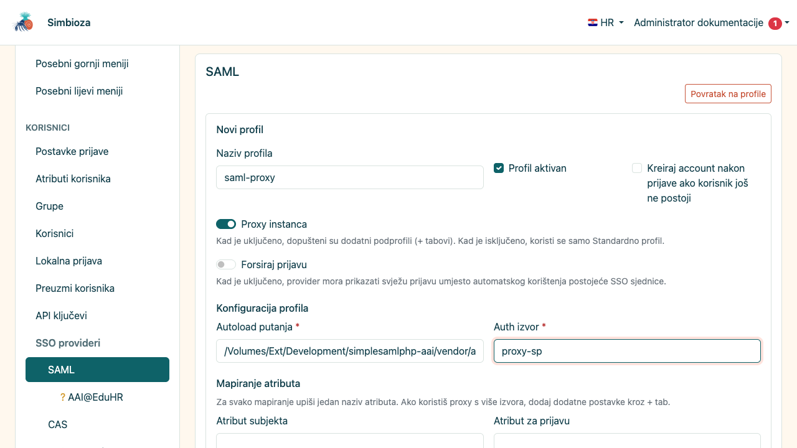Početna proxy konfiguracija
<figcaption>Standardna kartica proxy instance prije mapiranja.</figcaption>
</figure>

<figure class="my-4">
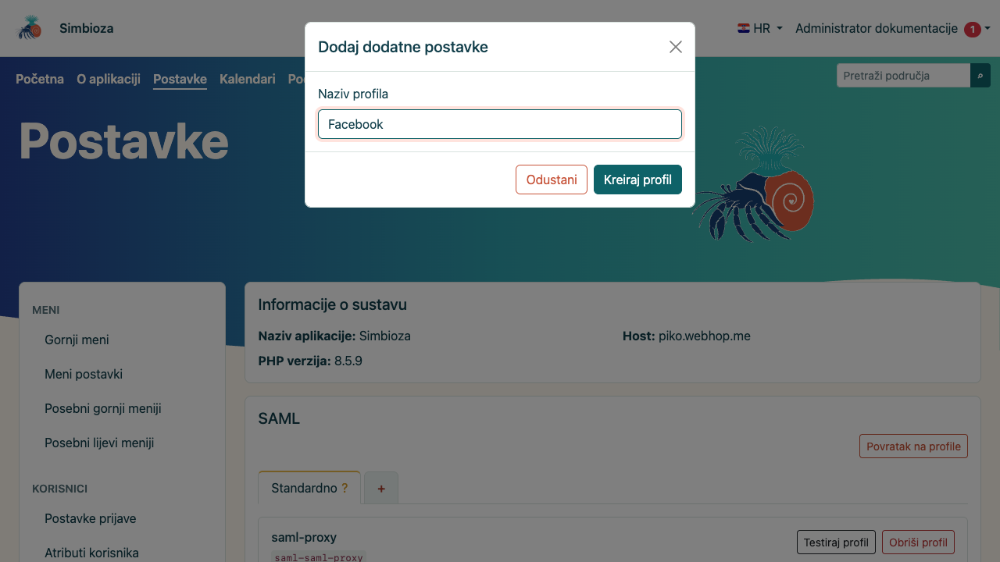Dodavanje proxy podprofila
<figcaption>Gumb plus dodaje zasebnu karticu za novi upstream izvor.</figcaption>
</figure>

<figure class="my-4">
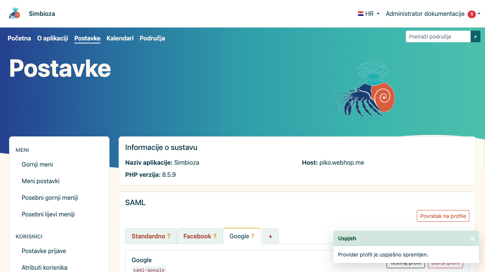Tri proxy podprofila
<figcaption>Standardno, Facebook i Google prije dovršetka testova.</figcaption>
</figure>

<figure class="my-4">
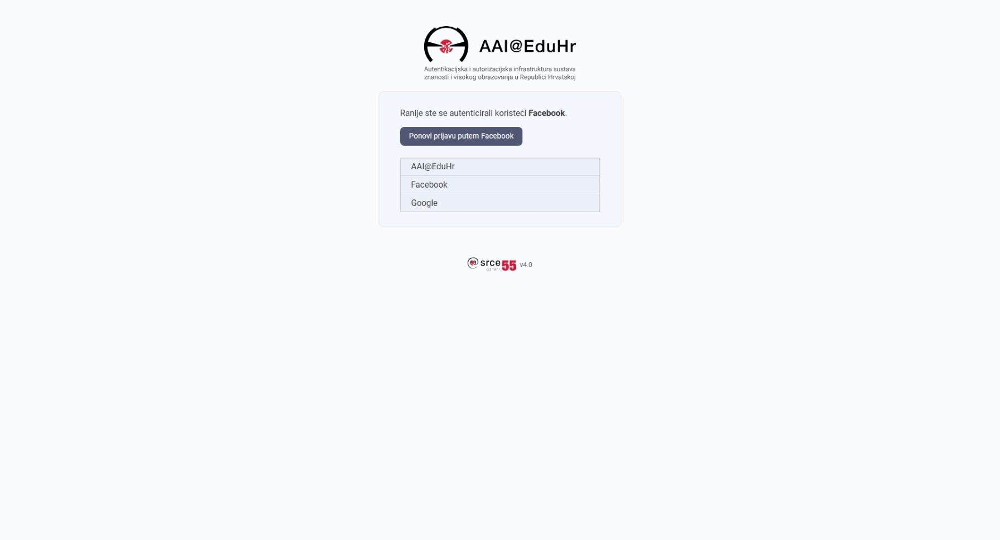Izbor providera na proxyju
<figcaption>Stvarna proxy prijava nudi AAI@EduHR, Facebook i Google.</figcaption>
</figure>

### Standardno / AAI@EduHR

<figure class="my-4">
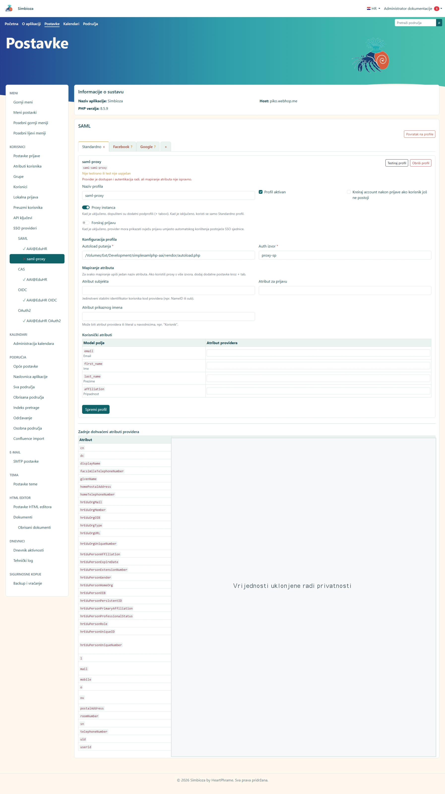Prvi test standardnog proxy profila
<figcaption>Dohvaćeni atributi prije mapiranja, s uklonjenim vrijednostima.</figcaption>
</figure>

<figure class="my-4">
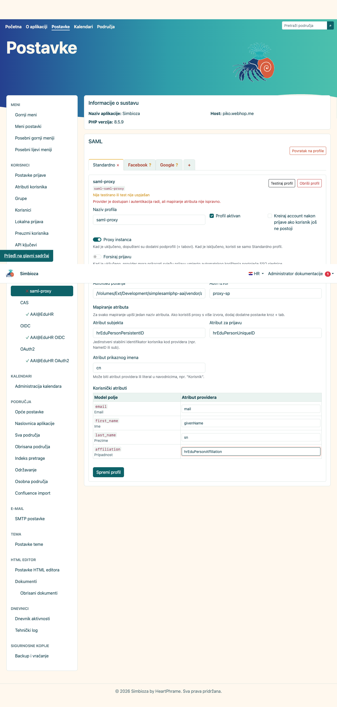Mapiranje standardnog proxy profila
<figcaption>Mapiranje standardnog AAI izvora.</figcaption>
</figure>

<figure class="my-4">
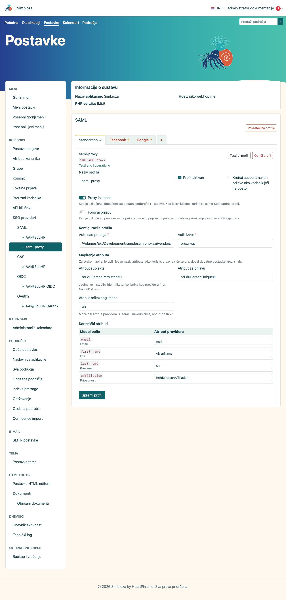Operativni standardni proxy profil
<figcaption>Standardna kartica nakon uspješnog ponovljenog testa.</figcaption>
</figure>

### Facebook

<figure class="my-4">
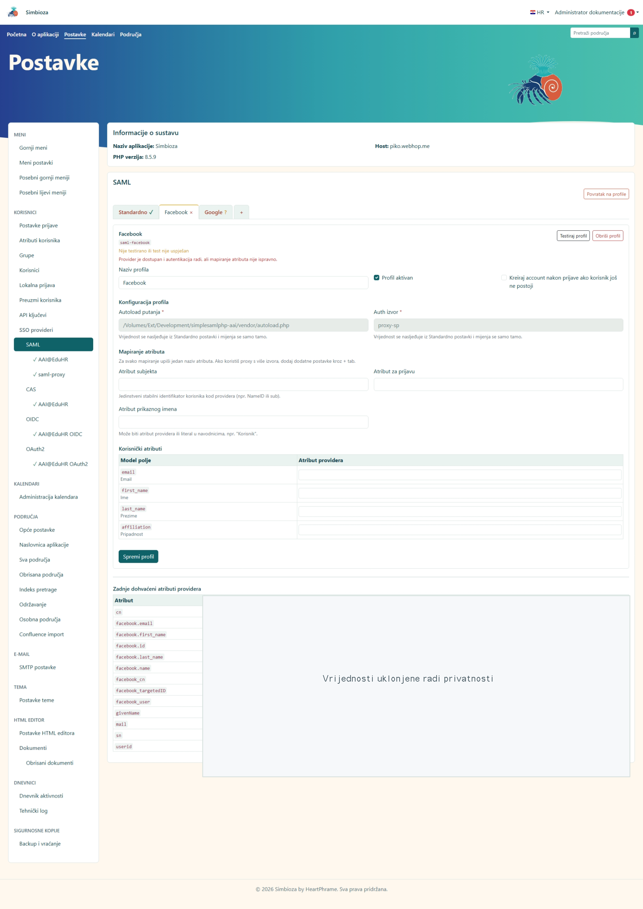Prvi Facebook proxy test
<figcaption>Dohvaćeni Facebook atributi prije mapiranja, s uklonjenim vrijednostima.</figcaption>
</figure>

<figure class="my-4">
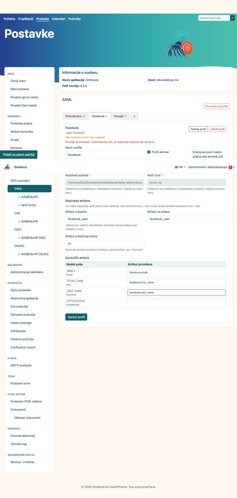Mapiranje Facebook podprofila
<figcaption>Stabilni Facebook identifikator, login i korisnička polja mapirani su zasebno.</figcaption>
</figure>

<figure class="my-4">
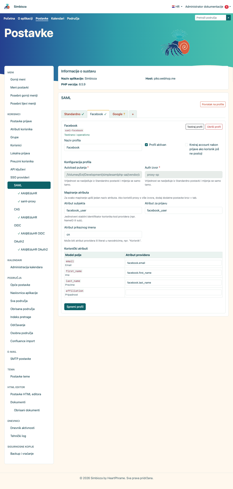Operativni Facebook podprofil
<figcaption>Facebook kartica nakon uspješnog testa.</figcaption>
</figure>

### Google

<figure class="my-4">
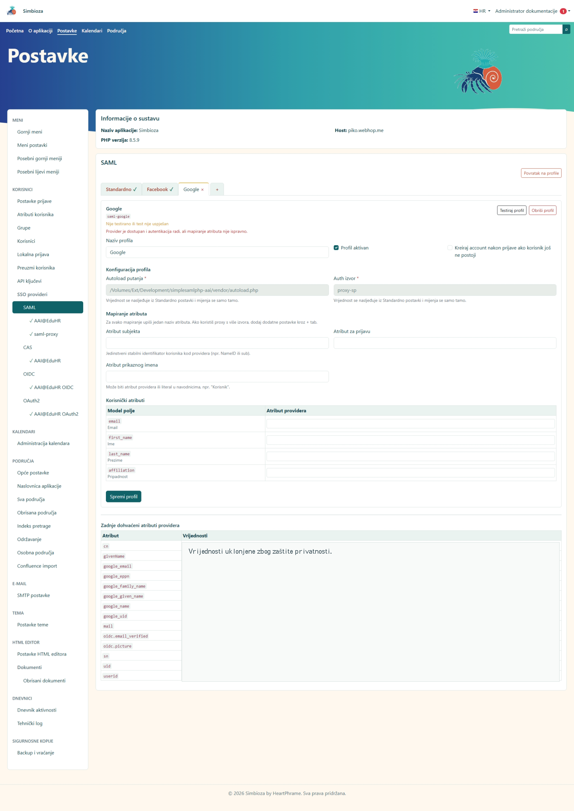Prvi Google proxy test
<figcaption>Dohvaćeni Google atributi prije mapiranja, s uklonjenim vrijednostima.</figcaption>
</figure>

<figure class="my-4">
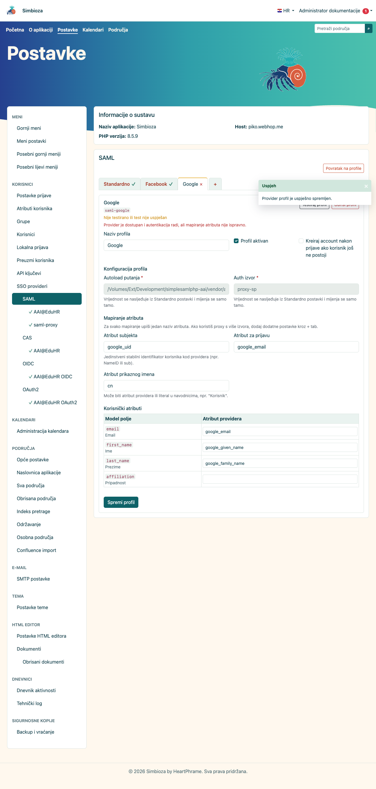Mapiranje Google podprofila
<figcaption>Google UID je subjekt, Google e-mail login, a ime i prezime mapiraju se u model.</figcaption>
</figure>

<figure class="my-4">
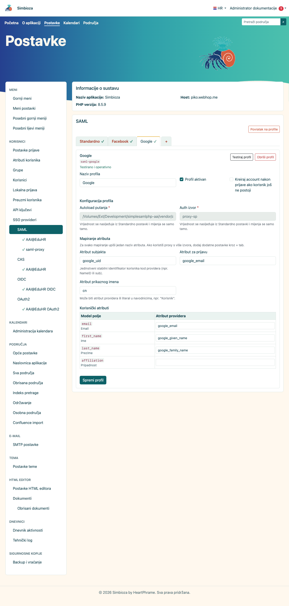Operativni Google podprofil
<figcaption>Google kartica nakon uspješnog ponovljenog testa.</figcaption>
</figure>

## 11. CAS

CAS profil traži bazni URL poslužitelja te login, validate i logout endpoint. Ako se koristi vlastiti CA lanac, navedite čitljivu putanju do odgovarajućeg certifikata. Ne isključujte TLS provjeru radi zaobilaženja pogrešne konfiguracije certifikata.

<figure class="my-4">
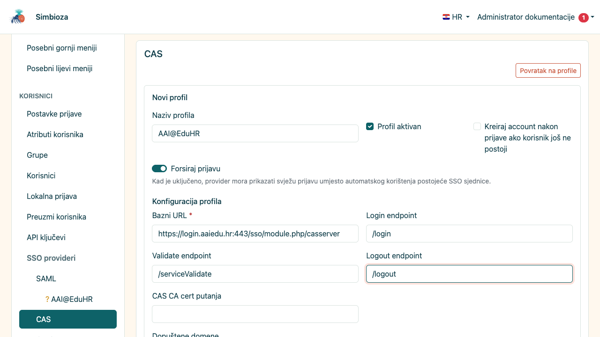Početna CAS konfiguracija
<figcaption>CAS veza je pripremljena, a mapiranje još nije dovršeno.</figcaption>
</figure>

<figure class="my-4">
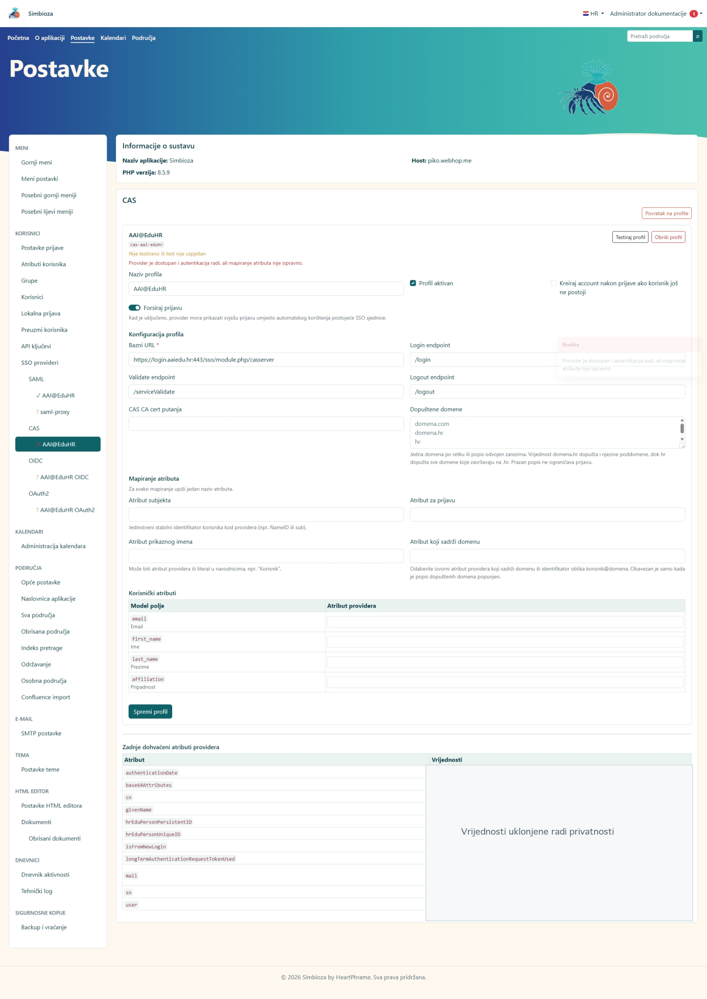Prvi CAS test
<figcaption>CAS autentikacija radi i vraća atribute; vrijednosti su uklonjene.</figcaption>
</figure>

<figure class="my-4">
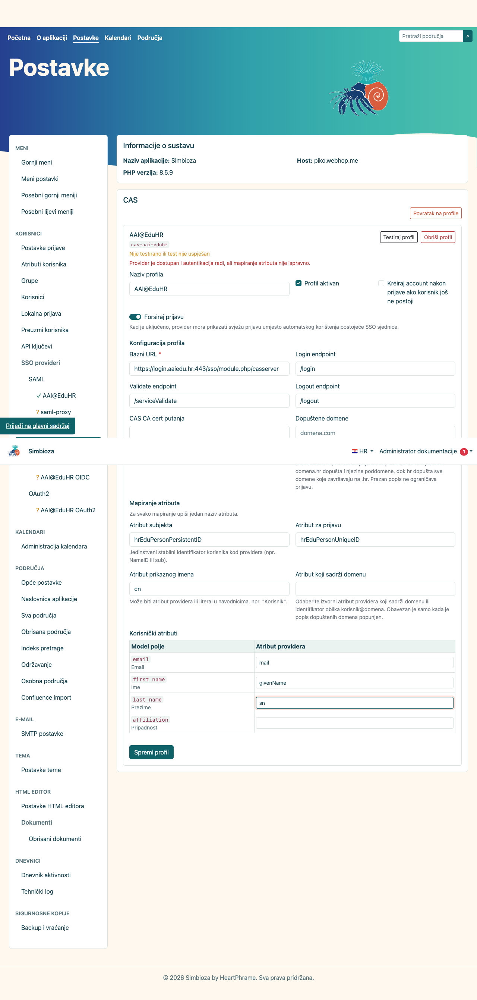CAS mapiranje
<figcaption>Stabilni subjekt, login, ime i korisnička polja mapirani su prema rezultatu testa.</figcaption>
</figure>

<figure class="my-4">
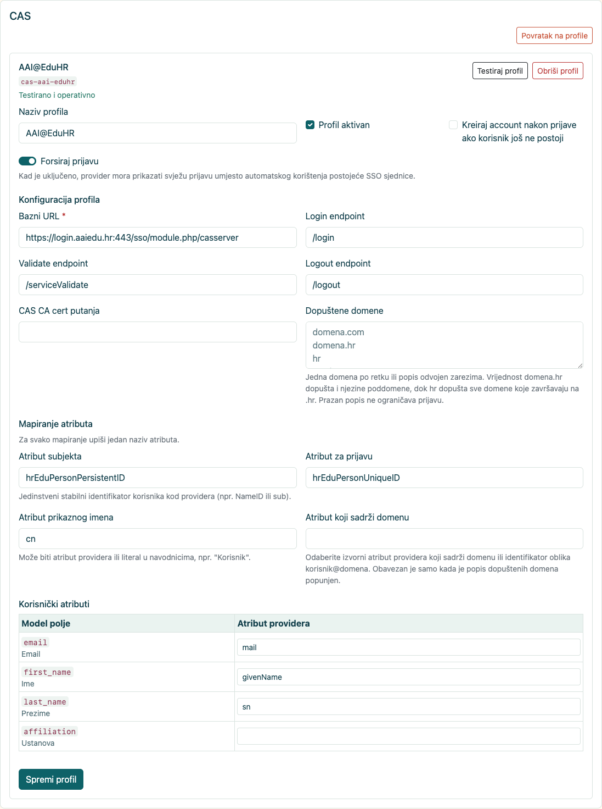Operativni CAS profil
<figcaption>Ponovljeni test potvrđuje operativan CAS profil.</figcaption>
</figure>

## 12. OIDC

OIDC koristi Client ID i tajnu, authorization, token, userinfo i po mogućnosti end-session endpoint. Scope mora sadržavati `openid`, a zatim samo podatke koji su potrebni, primjerice `profile` i `email`. **Javni redirect base URL** je javna osnovna adresa ove instalacije; za `https://simbioza.example.org/simbioza` upisuje se upravo cijela ta vrijednost s poddirektorijem.

<figure class="my-4">
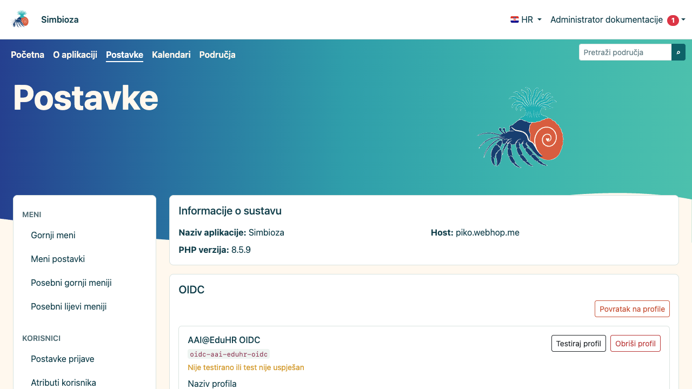Početna OIDC konfiguracija
<figcaption>OIDC endpointovi i javna osnovna adresa prije mapiranja.</figcaption>
</figure>

<figure class="my-4">
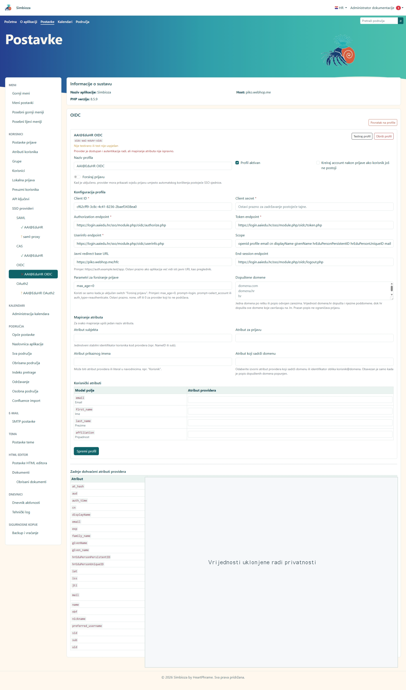Prvi OIDC test
<figcaption>Dohvaćeni OIDC claimovi prije mapiranja; vrijednosti su uklonjene.</figcaption>
</figure>

<figure class="my-4">
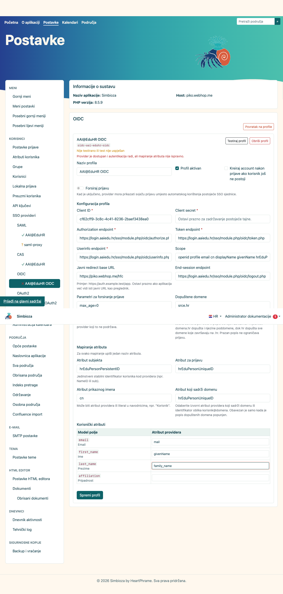OIDC mapiranje i domena
<figcaption>Subjekt, login, prikazno ime, korisnička polja i domenski atribut nakon pregleda claimova.</figcaption>
</figure>

<figure class="my-4">
Operativni OIDC profil
<figcaption>Ponovljeni test potvrđuje OIDC profil i prikazuje zelenu kvačicu.</figcaption>
</figure>

Parametar forsiranja prijave, primjerice `max_age=0`, koristite samo kada provider podržava tu semantiku i kada je uključeno **Forsiraj prijavu**. Inače ostavite prazno kako se ne bi nepotrebno prekidala postojeća SSO sesija.

## 13. OAuth2

OAuth2 profil koristi authorization, token i userinfo endpoint te scopeove potrebne za korisničke podatke. Za providere koji nude OpenID Connect prednost dajte OIDC profilu jer standardizira identitet i validaciju tokena. OAuth2 logout može tražiti poseban endpoint, naziv redirect parametra i dodatni hint; popunite samo ono što dokumentacija providera izričito zahtijeva.

<figure class="my-4">
Početna OAuth2 konfiguracija
<figcaption>OAuth2 profil prije mapiranja atributa.</figcaption>
</figure>

<figure class="my-4">
Prvi OAuth2 test
<figcaption>Userinfo atributi dohvaćeni su stvarnom prijavom; vrijednosti su uklonjene.</figcaption>
</figure>

<figure class="my-4">
OAuth2 mapiranje i domena
<figcaption>Mapiranje i domensko ograničenje upisani prema rezultatima testa.</figcaption>
</figure>

<figure class="my-4">
Operativni OAuth2 profil
<figcaption>Ponovljeni test potvrđuje operativan OAuth2 profil.</figcaption>
</figure>

<figure class="my-4">
Svi SSO profili operativni
<figcaption>Zelene kvačice u meniju potvrđuju sve testirane profile i proxy kartice.</figcaption>
</figure>

## 14. Osobni profil: sigurnost i pristup

U korisničkom meniju otvorite **Osobni profil**. Osnovni dio prikazuje identitet i prilagođene atribute. U odjeljku **Sigurnost i pristup** korisnik može provjeriti grupe, lokalnu lozinku, povezane vanjske prijave i zahtjeve za API ključeve.

<figure class="my-4">
Prilagođeni atribut u profilu
<figcaption>Dodatni atribut prikazuje se u osobnom profilu.</figcaption>
</figure>

<figure class="my-4">
Sigurnost i pristup
<figcaption>Sažetak sigurnosnih postavki osobnog računa.</figcaption>
</figure>

<figure class="my-4">
Proširena sigurnost i pristup
<figcaption>Grupe, lokalna prijava, povezani provideri i API zahtjevi na jednom mjestu.</figcaption>
</figure>

Vanjski račun povežite samo dok ste sigurni da upravljate oba identiteta. Nepoznatu ili više nepotrebnu vezu uklonite, ali prije toga provjerite postoji li drugi način prijave kako se korisnik ne bi zaključao izvan računa. Promjenu lokalne lozinke obavite kroz ovaj sigurni obrazac, nikada e-poštom ili administrativnom porukom.

## 15. Završna provjera i sigurnosne preporuke

- Najmanje jedan kontrolirani administratorski način prijave mora ostati dostupan; break-glass račun čuvajte izvan redovne uporabe.
- Za svaki SSO profil provjerite točne callback adrese, TLS certifikate, najmanje scopeove i rotaciju tajni.
- Ne smatrajte profil ispravnim samo zato što je aktivan. Tražite zeleno operativno stanje nakon ponovljenog testa.
- Stabilni subjekt mora biti nepromjenjiv identifikator providera. Login i e-mail mogu se promijeniti i nisu uvijek dobar primarni ključ.
- Domensko ograničenje testirajte dopuštenim i nedopuštenim testnim računom.
- Redovito pregledavajte administratore, članstva grupa, povezana vanjska prijavljivanja, aktivne API ključeve i zahtjeve na čekanju.
- API tajne, lozinke, tokene i sirove osobne atribute ne stavljajte u screenshots, dokumentaciju, tickete ni repozitorij.
- Nakon testiranja obrišite ili deaktivirajte dokumentacijske račune i ključeve koji više nisu potrebni.

Nakon spremanja isprobajte redovnu prijavu i račun kojem pristup nije dopušten. Provjerite da svaki korisnik vidi samo sadržaj i radnje dodijeljene njegovim grupama.

