# Accesso e utenti

> Le schermate mostrano l’interfaccia in inglese.

Questa guida accompagna l'amministratore attraverso tutte le impostazioni di accesso, gli attributi utente, i gruppi, gli account, la registrazione locale, l'accesso temporaneo come altro utente, le chiavi API, i servizi SSO e la schermata personale Sicurezza e accesso.

**Gli esempi sono stati creati su un'installazione pulita SQLite.** Gli account, i gruppi e le chiavi mostrati qui esistono solo a scopo di documentazione. I segreti e i valori degli attributi personali sono stati rimossi dagli screenshot. Nella produzione, utilizza i tuoi nomi, domini, durate e regole di privilegio minimo.

## Contenuto

1.  [Impostazioni di accesso](#login-settings)
2.  [Attributi utente](#attributes)
3.  [Gruppi](#groups)
4.  [Utenti e account locali](#users)
5.  [Accesso locale e registrazione](#local-login)
6.  [Accesso temporaneo come altro utente](#impersonation)
7.  [API chiavi](#api-keys)
8.  [Flusso di lavoro comune SSO](#sso)
9.  [SAML](#saml)
10. [SAMLproxy](#saml-proxy)
11. [CAS](#cas)
12. [OIDC](#oidc)
13. [OAuth2](#oauth2)
14. [Profilo personale: sicurezza e accesso](#personal-profile)
15. [Elenco di controllo per la verifica e la sicurezza](#verification)

## 1. Impostazioni di accesso

Apri **Impostazioni → Utenti → Impostazioni di accesso**. Questa pagina abilita i metodi di autenticazione per l'applicazione. L'abilitazione di un provider rende disponibile solo la sua configurazione e il suo menu; ogni singolo profilo deve comunque essere salvato, attivato, testato e mappato correttamente.

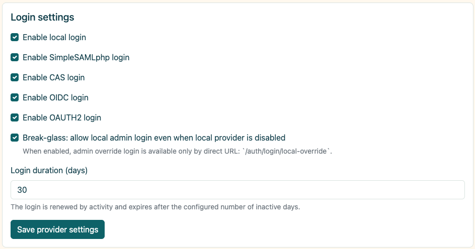Panoramica delle impostazioni di accesso

<figure class="my-4">

<figcaption>Impostazioni di accesso nell'interfaccia inglese.</figcaption>
</figure>

### Interruttori principali

- **Accesso locale** abilita l'autenticazione del nome utente e della password memorizzata da Simbioza.
- **SimpleSAMLphp, CAS, OIDC e OAuth2** abilitano i gruppi di profili SSO corrispondenti.
- **L'accesso locale break-glass** mantiene disponibile un percorso amministrativo diretto separato quando l'accesso locale normale è disabilitato. Proteggi quell'account con una password univoca complessa e utilizzala solo per il ripristino.
- **Durata dell'accesso** è un limite di inattività espresso in giorni (1–365), rinnovato mentre l'utente che ha effettuato l'accesso rimane attivo. Utilizza un periodo più breve sui dispositivi amministrativi e condivisi.

**"Profilo attivo" non equivale al segno di spunta verde.** Attivo significa che il profilo può essere utilizzato. Il segno di spunta verde e lo stato *Testato e operativo* vengono visualizzati solo dopo che il test del fornitore ha avuto esito positivo e le mappature richieste sono valide. Un profilo attivo potrebbe essere ancora non operativo.

## 2. Attributi dell'utente

Apri **Attributi utente**. Il modello normalmente include e-mail, nome e cognome. Aggiungi un attributo quando l'applicazione deve memorizzare un valore esterno al profilo di base, ad esempio un'istituzione, un dipartimento, una matricola del dipendente o un ruolo di directory esterna.

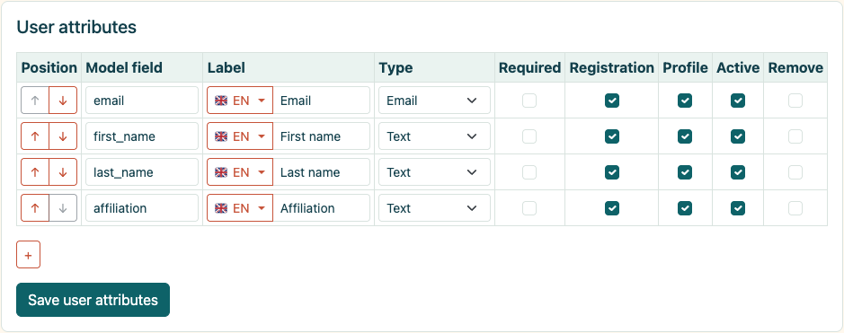Attributi dell'utente

<figure class="my-4">

<figcaption>Attributi predefiniti e personalizzati nell'interfaccia inglese.</figcaption>
</figure>

### Aggiunta di un attributo

1.  Immettere un nome macchina stabile in lettere minuscole senza spazi, ad esempio `affiliation` .
2.  Fornire etichette croate e inglesi separate.
3.  Scegli il tipo di dati e configura **Obbligatorio** , **Registrazione** , **Profilo** e **Attivo** in modo indipendente.
4.  Salvalo. Il nuovo campo diventa disponibile nei profili utente e in ogni tabella di mappatura dei profili SSO.

<figure class="my-4">
 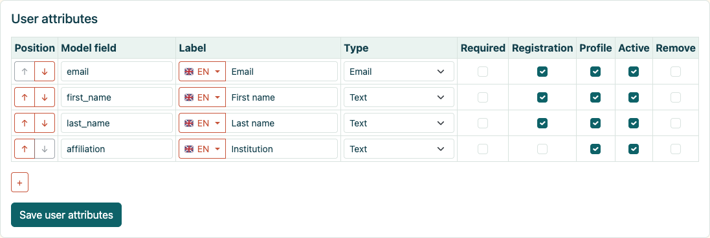 Esempio di attributo personalizzato bilingue 
<figcaption>Il campo del modello di affiliazione è etichettato Ustanova / Istituzione, rimane disponibile per i profili e le mappature SSO ed è escluso dall'autoregistrazione.</figcaption>
</figure>

La **Mappatura** collega un campo del modello Simbioza al nome esatto dell'attributo restituito dal provider. I nomi degli attributi sono esatti: `mail` , `givenName` e `given_name` sono campi diversi. Prima prova, controlla i nomi restituiti e solo dopo inserisci le mappature. Una mappatura SSO non aggiunge automaticamente il campo al modulo di registrazione pubblico.

**Quali campi sono inclusi nell'autoregistrazione?** L'amministratore lo sceglie per attributo. La **Registrazione** controlla se un campo appare nel modulo pubblico, mentre **Obbligatorio** rifiuta un valore vuoto nei contesti in cui quel campo partecipa. Quando entrambe le impostazioni sono abilitate, il campo è obbligatorio durante l'autoregistrazione. Un attributo obbligatorio deve avere anche una mappatura SSO valida affinché un test del profilo del provider diventi operativo. In questo esempio, `affiliation` memorizza l'istituzione fornita da un fornitore e appare nel profilo, quindi è intenzionalmente esclusa dalla registrazione.

## 3. Gruppi

I gruppi raccolgono gli utenti e portano le autorizzazioni. Il gruppo Amministratore è un gruppo di sistema protetto e non deve essere utilizzato come un normale gruppo aziendale. Crea gruppi separati con privilegi minimi per dipartimenti, progetti o ruoli.

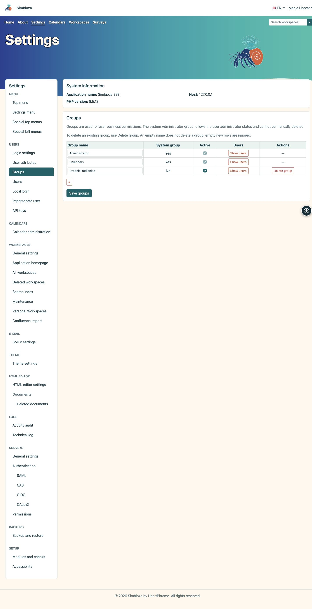Gruppi

Gruppi di sistema e di esempio nell'interfaccia inglese.\

1.  Scegli **Aggiungi gruppo** (il pulsante più), inserisci un **Nome gruppo** riconoscibile e seleziona **Attivo**.
2.  Scegli **Salva gruppi**. Questa schermata non contiene una descrizione o autorizzazioni per i contenuti.
3.  Aggiungi o rimuovi l'appartenenza al gruppo dai dettagli di ciascun utente.
4.  Concedi al gruppo le autorizzazioni richieste nelle impostazioni di un'area di lavoro, pagina, calendario o sondaggio. L'appartenenza a SSO può anche seguire regole basate su un attributo mappato.

**Risultato:** il gruppo esiste e può essere selezionato durante l'assegnazione delle autorizzazioni. Crearlo da solo non apre il contenuto ai suoi membri.

Per disattivare temporaneamente un gruppo non di sistema, deseleziona **Attivo** e salva. Per eliminarlo definitivamente, scegli **Elimina gruppo**. Nella schermata di conferma controlla il nome e le conseguenze indicate per le appartenenze e le regole di mappatura, quindi conferma l’eliminazione oppure annulla. Gli account utente rimangono. Un nome vuoto non elimina più un gruppo. Prima di confermare, verifica dove il gruppo consente l’accesso ai contenuti. Un nuovo gruppo con lo stesso nome ha un’altra identità e non ripristina le appartenenze o le autorizzazioni precedenti. I gruppi di sistema non possono essere eliminati.

<figure class="my-4">
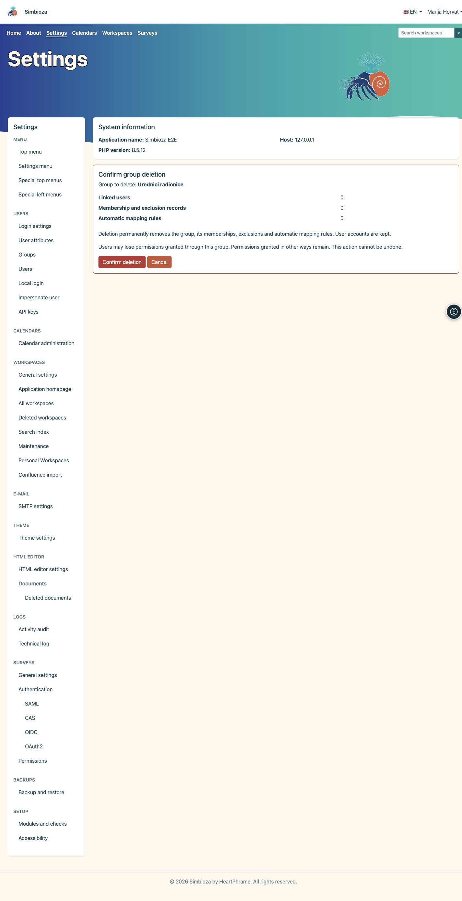
<figcaption>Controlla il nome e le conseguenze prima di confermare. Annulla torna all’elenco senza eliminare nulla.</figcaption>
</figure>

## 4. Utenti e account locali

Apri **Impostazioni → Utenti → Utenti** per trovare gli account, controllarne lo stato e gestire l'iscrizione e l'accesso.

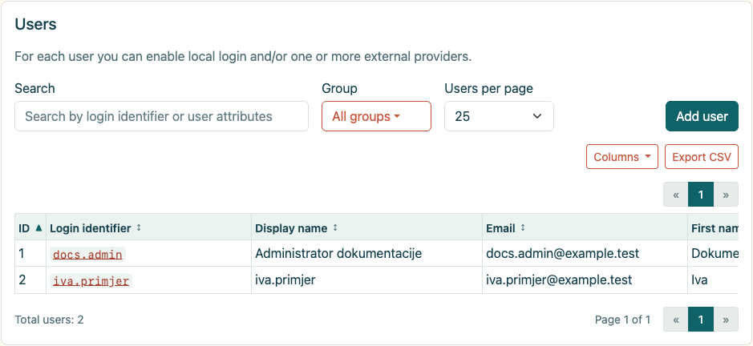Tabella utenti reattivi

<figure class="my-4">
Colonne bilanciate della tabella utente nell'interfaccia inglese.
</figure>

### Creazione di un utente locale

1.  Seleziona **Nuovo utente** .
2.  Inserisci un identificatore di accesso univoco, un nome visualizzato e un indirizzo e-mail.
3.  Scegli la fonte di autenticazione locale e assegna una password temporanea complessa.
4.  Richiedi la modifica della password al primo accesso.
5.  Assegnare solo i gruppi richiesti; l'accesso come amministratore non deve essere l'impostazione predefinita.

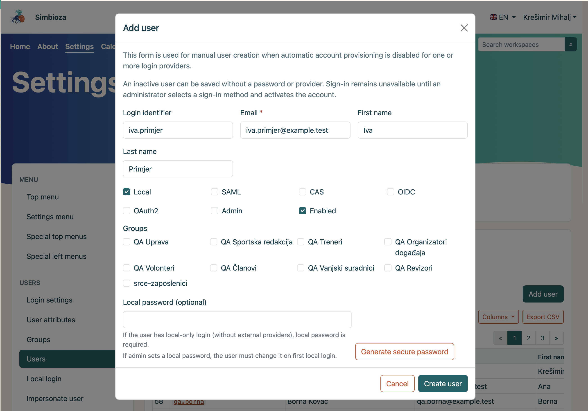Crea modulo utente locale

<figure class="my-4">
Esempio di modulo di account locale senza password visualizzata.
</figure>

<figure class="my-4">
 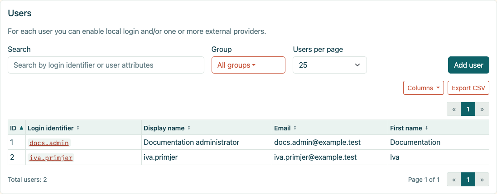 Nuovo utente nell'elenco 
<figcaption>L'utente della documentazione dopo la creazione.</figcaption>
</figure>

<figure class="my-4">
 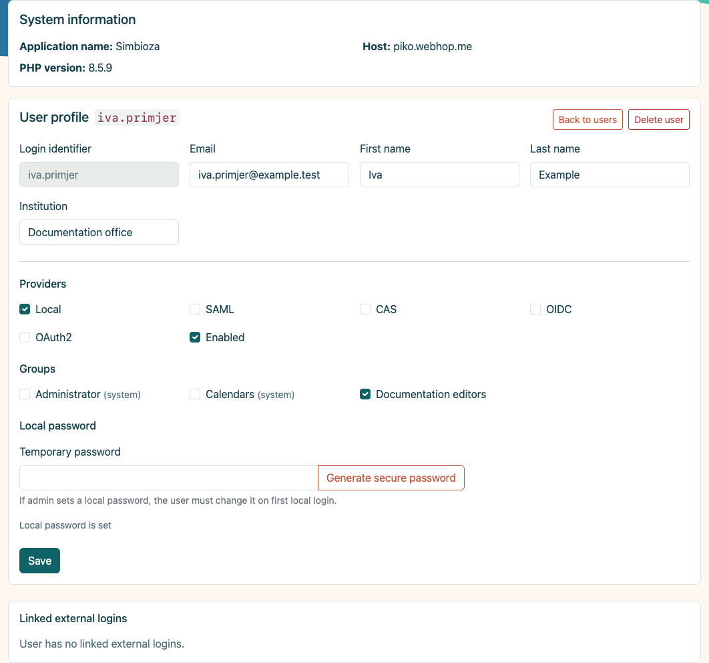 Dettagli dell'utente 
<figcaption>Stato dell'account, fornitori collegati e appartenenze ai gruppi.</figcaption>
</figure>

<figure class="my-4">
  Modifica obbligatoria della password di primo accesso 
<figcaption>Una password temporanea obbliga l'utente a sceglierne una nuova prima di continuare.</figcaption>
</figure>

Nella pagina dei dettagli, verifica l'attività dell'account, l'origine di autenticazione, le identità esterne collegate e le appartenenze ai gruppi. La disattivazione è solitamente più sicura dell'eliminazione perché preserva la traccia di controllo. Non sostituire mai manualmente l'identificatore di soggetto stabile di un provider esterno.

## 5. Accesso locale e registrazione

**Accesso locale** controlla l'autoregistrazione. Mantienilo disabilitato per i sistemi chiusi e crea account in modo amministrativo o tramite SSO attendibile. Se abilitata, la registrazione crea un account ordinario attivo e fa accedere l'utente. Non invia un'e-mail di verifica né dimostra la proprietà dell'indirizzo inserito. Per un sistema chiuso, mantieni la registrazione disabilitata e utilizza gli account creati dall'amministratore o un provider SSO attendibile. Pubblicare un'apposita informativa sulla privacy prima di accettare le registrazioni. Il modulo pubblico include solo gli attributi utente la cui opzione **Registrazione** è abilitata; pertanto il campo *Istituzione* SSO-only non viene visualizzato qui.

<figure class="my-4">
 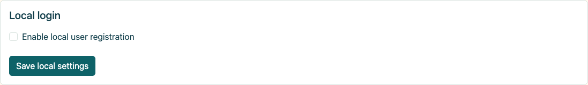 Registrazione disabilitata 
<figcaption>Stato iniziale consigliato per un'applicazione chiusa.</figcaption>
</figure>

<figure class="my-4">
 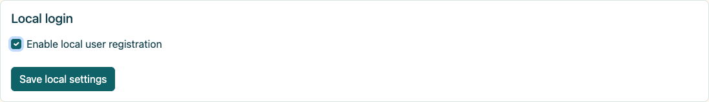 Registrazione abilitata 
<figcaption>Registrazione abilitata solo per un esemplare controllato.</figcaption>
</figure>

<figure class="my-4">
 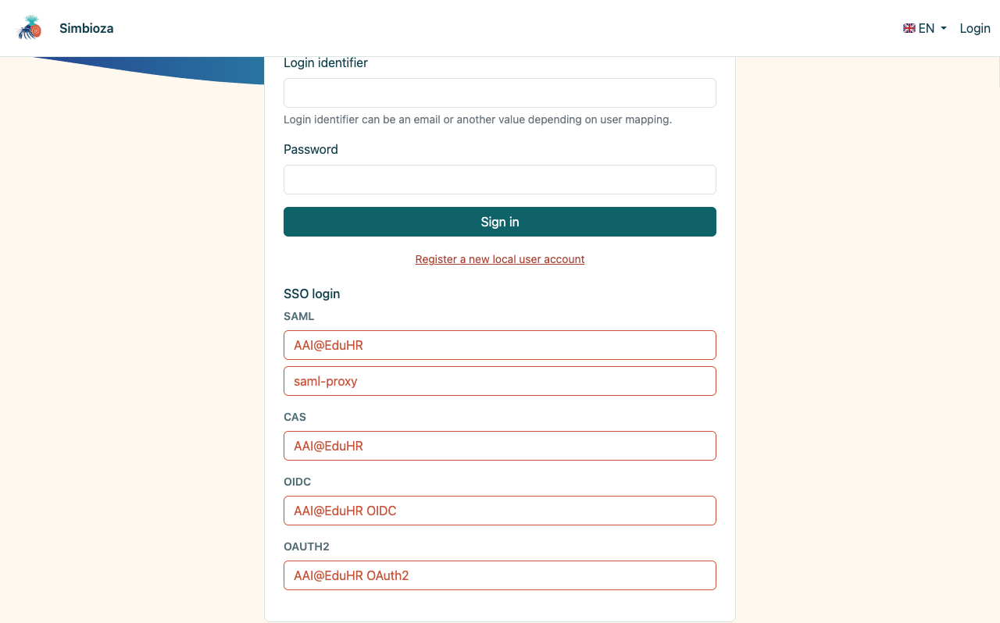 Collegamento di registrazione 
<figcaption>La schermata di accesso mostra la registrazione solo dopo che è stata abilitata.</figcaption>
</figure>

<figure class="my-4">
 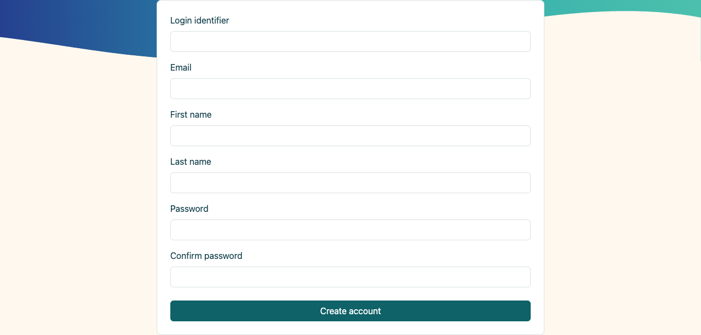 Modulo di registrazione 
<figcaption>Modulo pubblico con i campi di registrazione selezionati; l'attributo dell'istituto utilizzato per la mappatura SSO è intenzionalmente nascosto.</figcaption>
</figure>

Dopo il test, ripristinare lo stato di produzione previsto. Le password devono essere univoche, sufficientemente lunghe e archiviate in un gestore di password. Gli amministratori non devono mai chiedere agli utenti la password attuale.

## 6. Accesso temporaneo come altro utente

**Accedi come utente** apre temporaneamente l'applicazione nel contesto dell'utente selezionato. Usalo per verificare autorizzazioni e visualizzazione, non per svolgere operazioni di lavoro per conto dell'utente.

<figure class="my-4">
 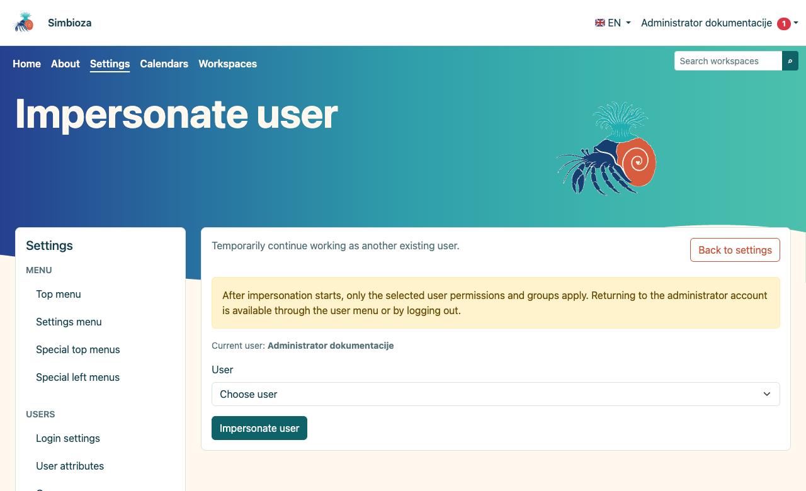 Schermata per l'accesso temporaneo come altro utente 
<figcaption>Selezione di un account per la diagnostica di supporto controllata. Seleziona solo l'account necessario per il caso di supporto.</figcaption>
</figure>

<figure class="my-4">
L'interfaccia indica chiaramente la sessione rappresentata attiva.
</figure>

<figure class="my-4">
 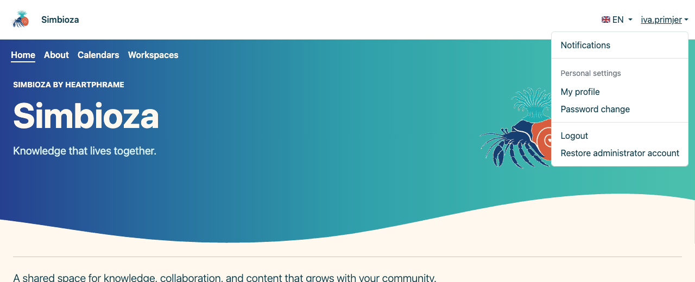 Ritorna all'amministratore 
<figcaption>Termina l'attività tornando al tuo account amministratore.</figcaption>
</figure>

L'accesso temporaneo come altro utente non verifica l'autenticazione SSO effettiva, MFA o i criteri del servizio di accesso. A questo scopo usa la verifica del profilo oppure un account di prova dedicato.

## 7. Chiavi API

Queste schermate sono disponibili quando il modulo API è installato e abilitato. Una chiave API funge da proprietario. Gli ambiti possono solo ridurre le autorizzazioni esistenti del proprietario; non possono concedere autorizzazioni di cui il proprietario non dispone. Utilizzare una chiave separata per integrazione, un'etichetta descrittiva, la durata pratica più breve e il set di ambiti più piccolo.

<figure class="my-4">
 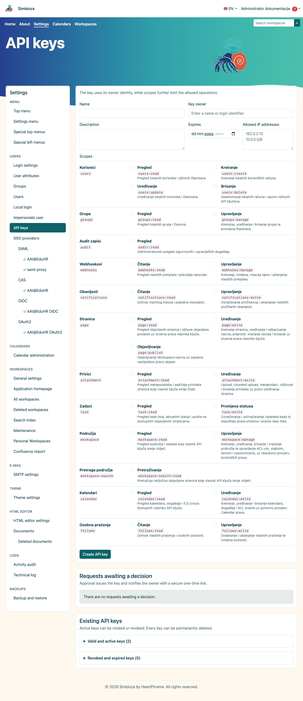 API amministrazione chiavi 
<figcaption>API amministrazione delle chiavi nell'interfaccia inglese.</figcaption>
</figure>

### Emissione diretta delle chiavi

1.  Seleziona il proprietario e solo gli ambiti richiesti.
2.  Imposta una data di scadenza e, se necessario, un indirizzo IP consentito o una restrizione di rete.
3.  Crea la chiave e copia subito il segreto in un luogo di conservazione sicuro.
4.  Il segreto viene mostrato solo una volta. In caso di smarrimento revocare la chiave ed emetterne una nuova.

<figure class="my-4">
 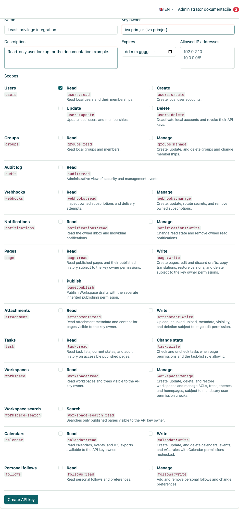 Chiave API con privilegi minimi 
<figcaption>Una chiave intenzionalmente limitata prima della creazione.</figcaption>
</figure>

<figure class="my-4">
 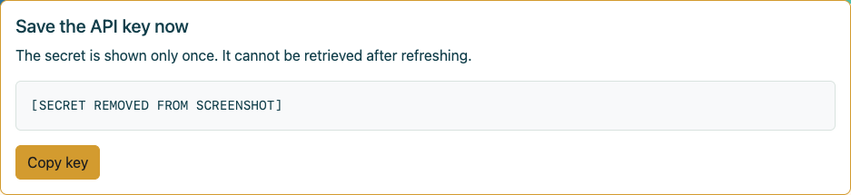 Segreto API una tantum 
<figcaption>Il segreto è stato rimosso dallo screenshot.</figcaption>
</figure>

<figure class="my-4">
 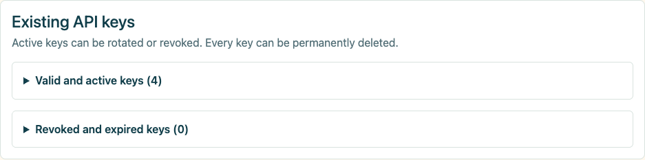 Chiavi API attive 
<figcaption>Rivedi e revoca le chiavi attive da questo elenco.</figcaption>
</figure>

### Richiesta dell'utente e approvazione dell'amministratore

Un utente può richiedere una chiave dal profilo personale e spiegarne lo scopo. L'amministratore esamina il proprietario, gli ambiti, la durata e la giustificazione, quindi approva o rifiuta la richiesta. Dopo l'approvazione l'utente potrà rivelare il segreto una sola volta nel profilo personale. Quando Notifiche è abilitato, anche una notifica in-app punta a quella schermata. Né la notifica né l'e-mail devono contenere il segreto.

<figure class="my-4">
 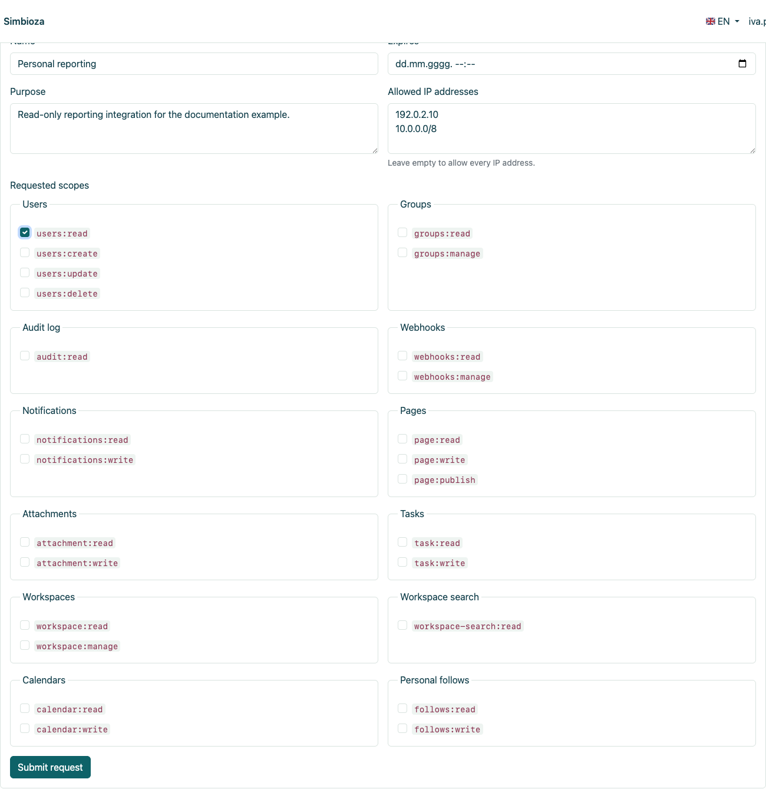 API modulo di richiesta chiave 
<figcaption>L'utente richiede una chiave limitata e ne dichiara lo scopo.</figcaption>
</figure>

<figure class="my-4">
 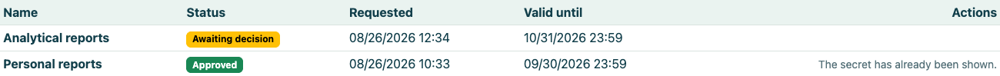 Richiesta inviata 
<figcaption>La richiesta attende la revisione dell'amministratore.</figcaption>
</figure>

<figure class="my-4">
 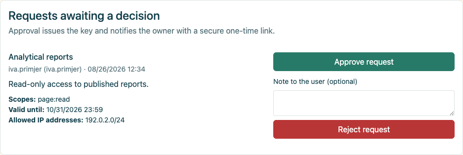 Richiesta API in sospeso 
<figcaption>L'amministratore controlla la richiesta prima dell'approvazione.</figcaption>
</figure>

<figure class="my-4">
 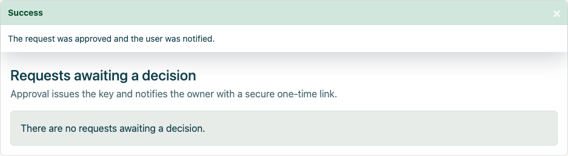 Richiesta API approvata 
<figcaption>L'approvazione crea la chiave senza rivelare il segreto all'amministratore.</figcaption>
</figure>

<figure class="my-4">
 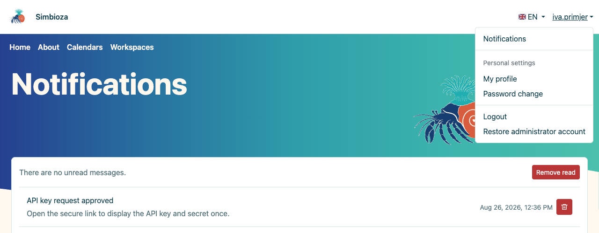 Notifica chiave API 
<figcaption>L'utente viene informato della decisione.</figcaption>
</figure>

<figure class="my-4">
 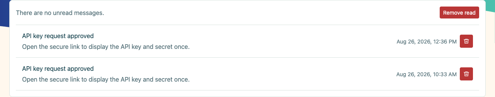 Notifica di richiesta approvata 
<figcaption>La notifica comporta il recupero del segreto una tantum.</figcaption>
</figure>

<figure class="my-4">
 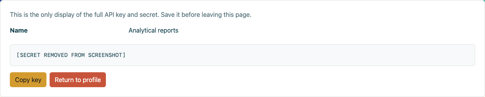 Recupero segreto API una tantum 
<figcaption>Il segreto viene rimosso e non può essere visualizzato nuovamente dopo la chiusura.</figcaption>
</figure>

<figure class="my-4">
 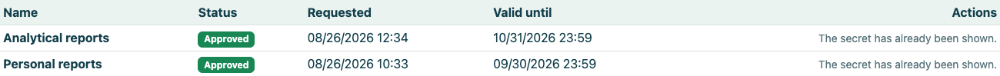 Richiesta API completata 
<figcaption>La richiesta completata rimane controllabile senza esporre il segreto.</figcaption>
</figure>

## 8. Flusso di lavoro comune SSO

1.  Registra l'applicazione presso il provider e inserisci solo gli endpoint, l'ID client e il segreto necessari.
2.  Salva il profilo attivo. I segreti esistenti non vengono mai visualizzati durante la modifica; lasciando vuoto il campo segreto si mantiene il valore lato server.
3.  Seleziona **Prova profilo** prima di indovinare le mappature. Completa un login reale per raccogliere gli attributi effettivi del provider.
4.  Associa soggetto, identificatore di accesso, nome visualizzato e campi utente ai nomi restituiti.
5.  Prova di nuovo. Solo **Testato e operativo** insieme a un segno di spunta verde conferma un profilo completo.

### Domini consentiti

L'elenco limita l'accesso ai domini dell'organizzazione. Inserisci un dominio per riga o un elenco separato da virgole. `example.org` consente quel dominio e i suoi sottodomini; un suffisso come `hr` consente identificatori il cui dominio termina con `.hr` . Un elenco vuoto non impone alcuna restrizione di dominio.

**Attributo origine dominio** deve essere l'attributo reale del provider contenente un valore come `user@example.org` o un dominio. È obbligatorio solo quando l'elenco dei domini consentiti è popolato. Non utilizzare un nome visualizzato o un altro valore modificabile.

### Indirizzi di richiamata pubblici

Il provider deve restituire il browser all'URL pubblico della stessa installazione. Includere una sottodirectory quando ne viene utilizzata una: per un'applicazione in `https://simbioza.example.org/simbioza`, immettere il valore completo come URL di base pubblico. Non è l'indirizzo interno PHP-FPM, il contenitore o il database. Registra gli URL di richiamata esatti mostrati dal profilo.

## 9. SAML

Un profilo SAML dipende da un **SimpleSAMLphp** installato separatamente e correttamente configurato. Il caricatore automatico, l'origine di autenticazione SP, i certificati, i metadati e gli URL di ritorno devono già funzionare. Il percorso di `vendor/autoload.php` e il nome dell'origine di autenticazione devono corrispondere all'installazione.

<figure class="my-4">
 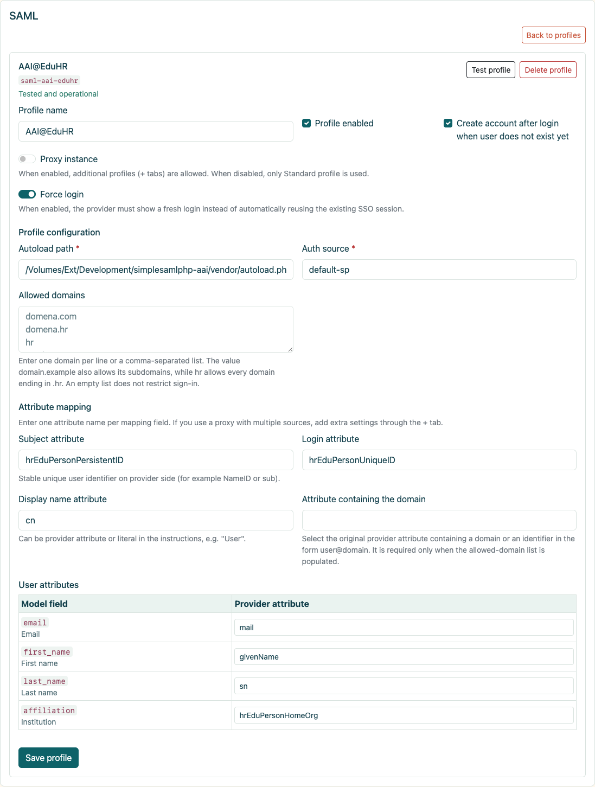 Configurazione iniziale SAML 
<figcaption>Il profilo è salvato, ma le mappature non sono ancora confermate.</figcaption>
</figure>

<figure class="my-4">
  Primo test SAML 
<figcaption>Il collegamento funziona e gli attributi sono stati raccolti; i valori sono oscurati.</figcaption>
</figure>

<figure class="my-4">
 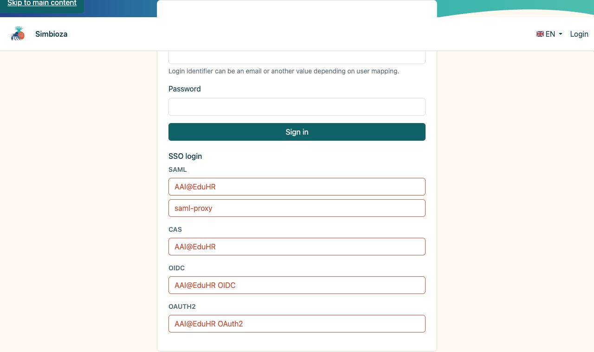 Avvio dell'accesso AAI 
<figcaption>La schermata di accesso in inglese Simbioza avvia il flusso AAI@EduHr SSO configurato senza esporre le credenziali.</figcaption>
</figure>

<figure class="my-4">
  SAML mappature 
<figcaption>Mappature richieste immesse dagli attributi effettivamente restituiti.</figcaption>
</figure>

<figure class="my-4">
 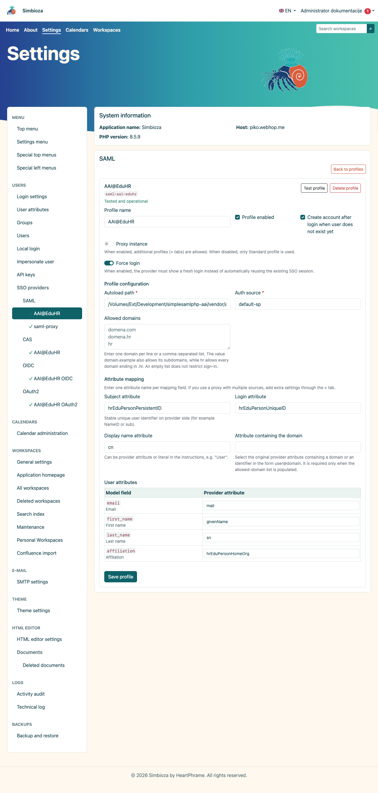 Profilo operativo SAML 
<figcaption>Il test ripetuto conferma un profilo SAML operativo.</figcaption>
</figure>

## 10. SAML proxy e profili secondari

Un'istanza proxy rappresenta una sorgente di autenticazione SimpleSAMLphp che può esporre più servizi a monte. La scheda **Default** definisce il percorso autoload condiviso, la sorgente di autenticazione e la mappatura di base. Le schede secondarie ereditano le impostazioni di collegamento condivise, mantenendo le proprie mappature degli attributi.

**Un proxy non ha domini consentiti o campi di attributi di origine del dominio.** Questo è intenzionale: i provider upstream possono restituire identificatori e domini diversi. Applica le restrizioni al proxy o al provider upstream, non tramite una regola di dominio condivisa Simbioza.

<figure class="my-4">
 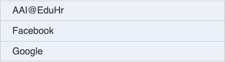 Selezione del fornitore proxy 
<figcaption>Il vero accesso proxy offre AAI@EduHR, Facebook e Google, spiegando i tre profili figlio.</figcaption>
</figure>

### Predefinito / AAI@EduHR

<figure class="my-4">
 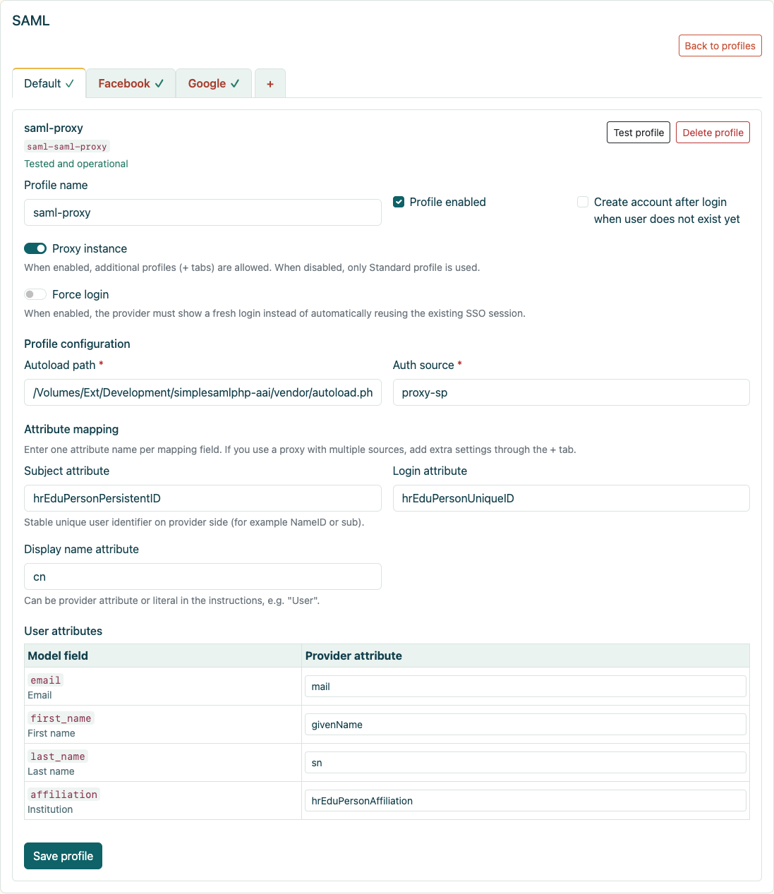 Primo test proxy predefinito 
<figcaption>Attributi raccolti prima della mappatura, con valori rimossi.</figcaption>
</figure>

<figure class="my-4">
  Mappature proxy predefinite 
<figcaption>Mappature per l'origine AAI predefinita.</figcaption>
</figure>

<figure class="my-4">
 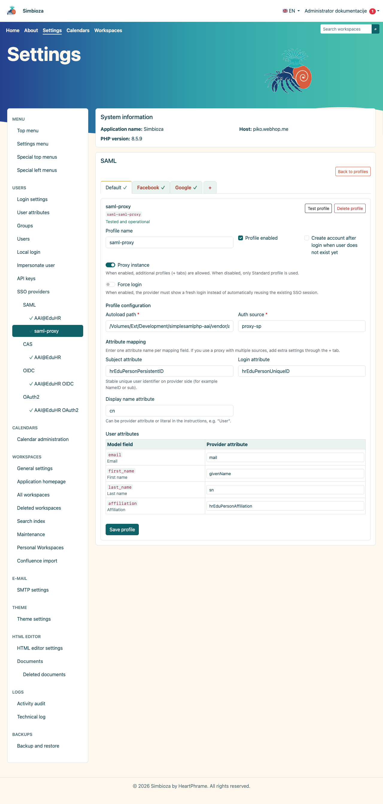 Profilo proxy operativo predefinito 
<figcaption>Scheda proxy predefinita dopo il test ripetuto con esito positivo.</figcaption>
</figure>

### Facebook

<figure class="my-4">
  Primo test proxy di Facebook 
<figcaption>Attributi di Facebook raccolti prima della mappatura, con valori rimossi.</figcaption>
</figure>

<figure class="my-4">
  Mappature del sottoprofilo Facebook 
<figcaption>ID Facebook stabile, login e campi utente mappati in modo indipendente.</figcaption>
</figure>

<figure class="my-4">
 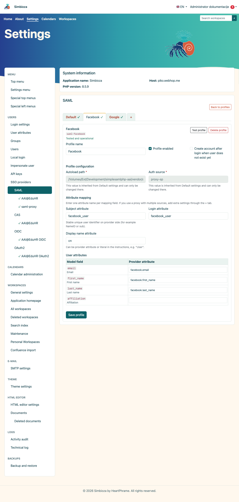 Sottoprofilo Facebook operativo 
<figcaption>Scheda secondaria di Facebook dopo la mappatura e il test riusciti.</figcaption>
</figure>

### Google

<figure class="my-4">
  Primo test proxy di Google 
<figcaption>Attributi Google raccolti prima della mappatura, con valori rimossi.</figcaption>
</figure>

<figure class="my-4">
  Mappature del sottoprofilo Google 
<figcaption>L'UID Google è il soggetto, l'email Google è l'identificatore di accesso e i campi del nome sono associati al modello.</figcaption>
</figure>

<figure class="my-4">
  Sottoprofilo Google operativo 
<figcaption>Scheda secondaria di Google dopo il test ripetuto con successo.</figcaption>
</figure>

## 11. CAS

Un profilo CAS necessita dell'URL di base del server e dei relativi endpoint di accesso, convalida e disconnessione. Se viene utilizzata una catena di CA privata, fornire un percorso del certificato leggibile. Non disabilitare mai la convalida TLS per aggirare una configurazione del certificato errata.

<figure class="my-4">
 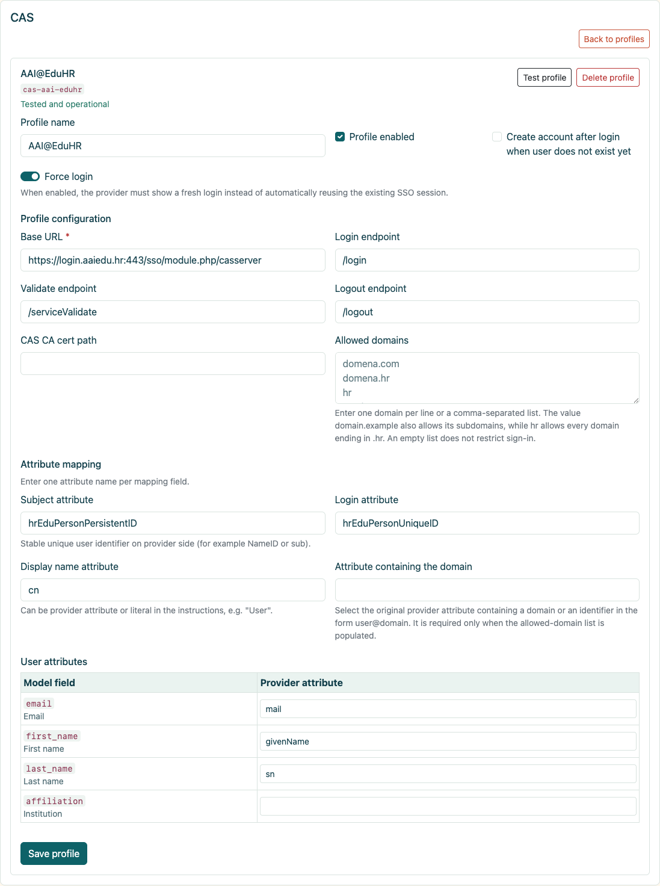 Configurazione iniziale CAS 
<figcaption>La connessione CAS è preparata ma le mappature non sono complete.</figcaption>
</figure>

<figure class="my-4">
  Primo test CAS 
<figcaption>L'autenticazione CAS restituisce gli attributi; i valori vengono redatti.</figcaption>
</figure>

<figure class="my-4">
  CAS mappature 
<figcaption>Soggetto stabile, identificatore di accesso, nome visualizzato e campi del modello associati in base alla verifica.</figcaption>
</figure>

<figure class="my-4">
 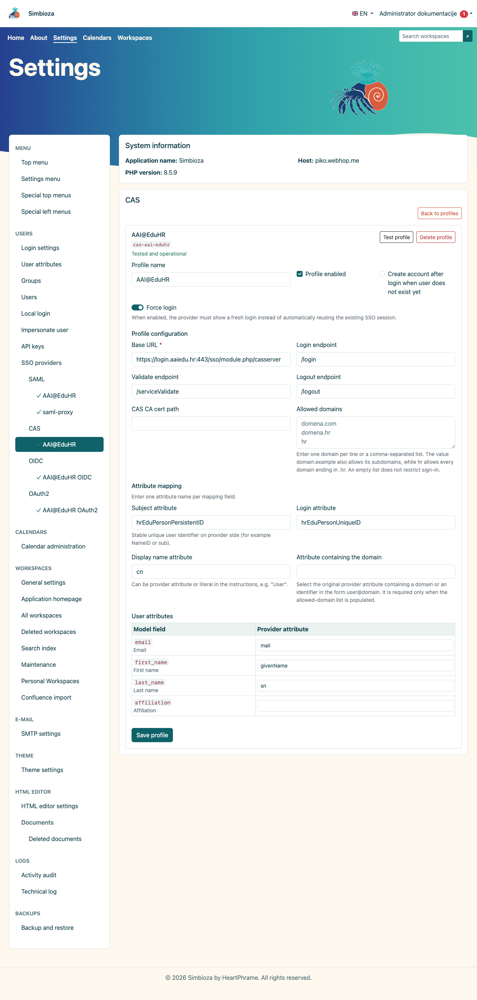 Profilo operativo CAS 
<figcaption>Il test ripetuto conferma il profilo CAS.</figcaption>
</figure>

## 12. OIDC

OIDC utilizza un ID client e un segreto, un'autorizzazione, un token, informazioni utente e, facoltativamente, endpoint di fine sessione. L'ambito deve includere `openid` , seguito solo dai dati obbligatori come `profile` e `email` . **URL di base di reindirizzamento pubblico** è l'indirizzo di base pubblico completo di questa installazione, inclusa una sottodirectory ove presente.

<figure class="my-4">
 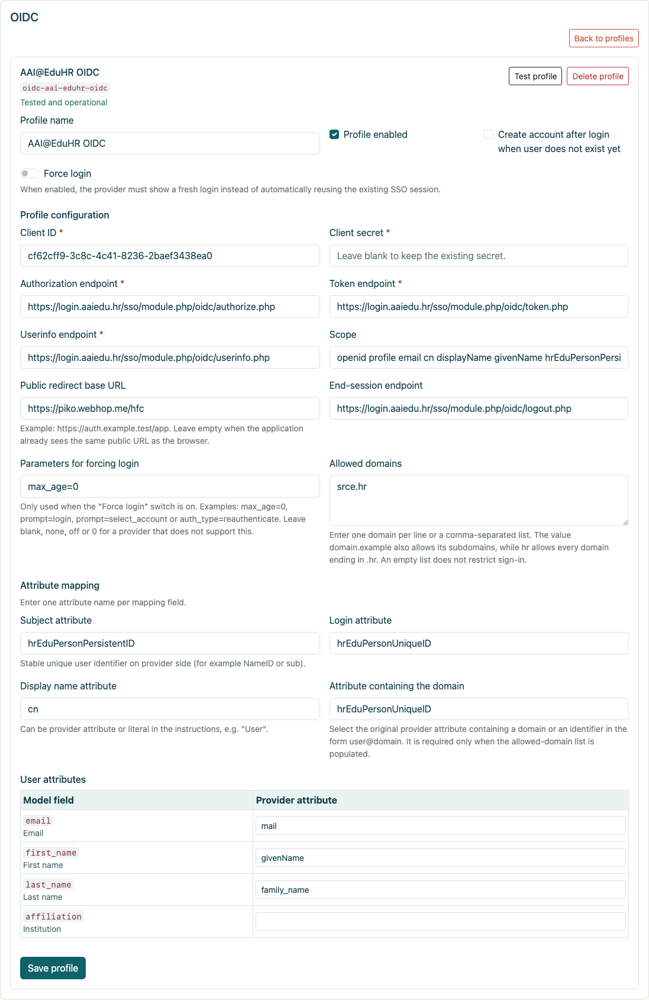 Configurazione iniziale OIDC 
<figcaption>Endpoint OIDC e URL di base pubblica prima della mappatura.</figcaption>
</figure>

<figure class="my-4">
  Primo test OIDC 
<figcaption>OIDC attestazioni raccolte prima della mappatura, con valori rimossi.</figcaption>
</figure>

<figure class="my-4">
  OIDC mappatura e dominio 
<figcaption>Soggetto, identificatore di accesso, nome visualizzato, campi utente e origine del dominio associati ai valori effettivamente restituiti.</figcaption>
</figure>

<figure class="my-4">
 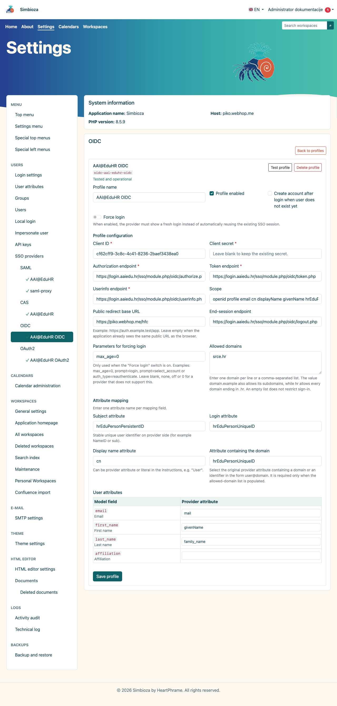 Profilo operativo OIDC 
<figcaption>Il test ripetuto conferma OIDC e visualizza il segno di spunta verde.</figcaption>
</figure>

Utilizza un parametro di accesso forzato come `max_age=0` solo quando il provider lo supporta e **Forza accesso** è abilitato. Altrimenti lascialo vuoto per preservare una sessione SSO esistente valida.

## 13. OAuth2

OAuth2 utilizza endpoint di autorizzazione, token e informazioni utente oltre agli ambiti richiesti per i dati utente. Se il provider supporta OpenID Connect, preferisci OIDC perché standardizza la convalida dell'identità e del token. OAuth2 Il logout può richiedere un endpoint dedicato, un nome di parametro di reindirizzamento o un suggerimento; inserire solo i valori richiesti dalla documentazione del provider.

<figure class="my-4">
 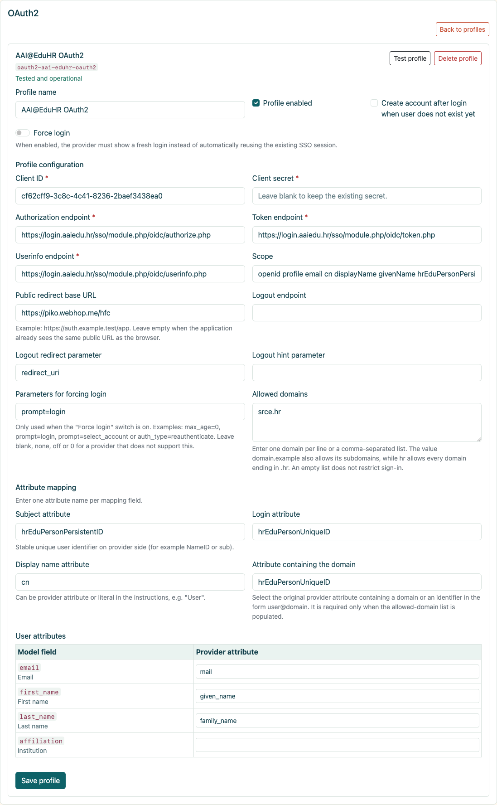 Configurazione iniziale OAuth2 
<figcaption>Profilo OAuth2 prima della mappatura degli attributi.</figcaption>
</figure>

<figure class="my-4">
  Primo test OAuth2 
<figcaption>Attributi Userinfo raccolti tramite un accesso reale, con valori rimossi.</figcaption>
</figure>

<figure class="my-4">
  OAuth2 mappatura e dominio 
<figcaption>Mappature e restrizioni di dominio immesse dal risultato del test.</figcaption>
</figure>

<figure class="my-4">
 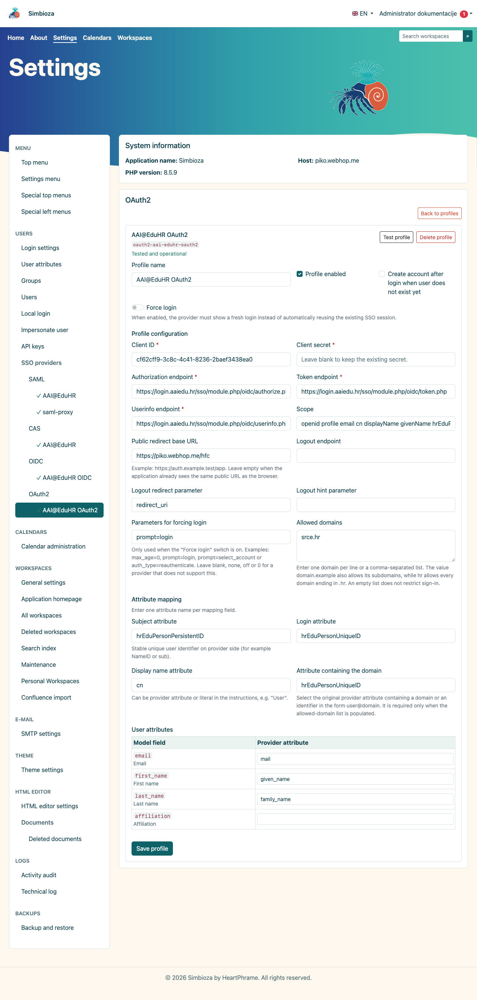 Profilo operativo OAuth2 
<figcaption>Il test ripetuto conferma il profilo OAuth2.</figcaption>
</figure>

## 14. Profilo personale: sicurezza e accesso

Apri **Profilo personale** dal menu utente. La sezione principale mostra l'identità e gli attributi personalizzati. **Sicurezza e accesso** visualizza l'appartenenza al gruppo, lo stato della password locale, gli accessi esterni collegati e le richieste di chiave API.

<figure class="my-4">
 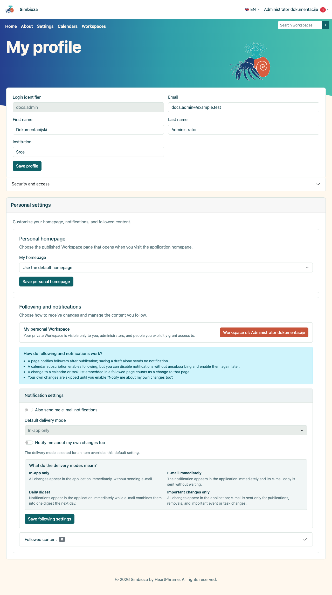 Profilo personale 
<figcaption>Dati personali e attributi personalizzati nell'interfaccia inglese.</figcaption>
</figure>

<figure class="my-4">
 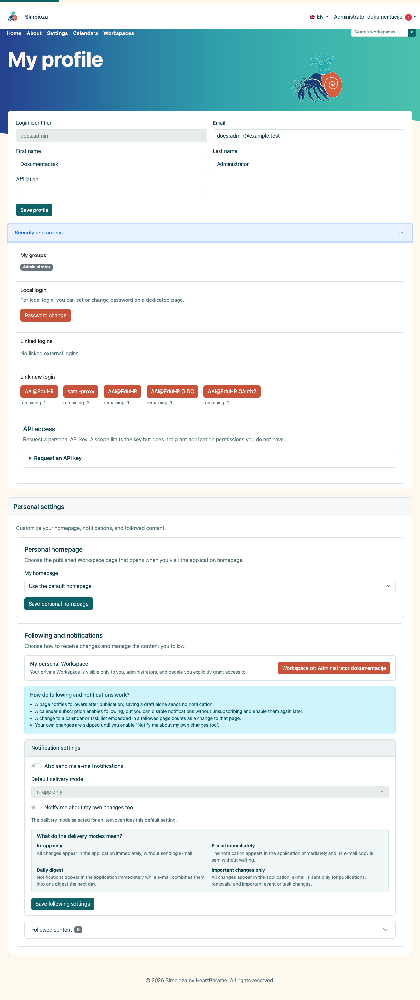 Sicurezza e accesso ampliati 
<figcaption>Gruppi, accesso locale, provider collegati e richieste API in un unico posto.</figcaption>
</figure>

Collega un account esterno solo mentre controlli entrambe le identità. Rimuovi i collegamenti sconosciuti o non utilizzati, ma verifica prima che sia disponibile un altro metodo di accesso. Modifica le password locali tramite questo modulo sicuro, mai tramite e-mail o un messaggio dell'amministratore.

## 15. Verifica e checklist di sicurezza

- Mantieni disponibile almeno un accesso amministrativo controllato; conserva l'account di emergenza separato dal normale uso quotidiano.
- Per ogni profilo SSO, verifica gli URL di richiamata esatti, i certificati TLS, gli ambiti minimi e la rotazione dei segreti.
- Non accettare una casella di controllo attiva come prova. Richiedere lo stato operativo verde dopo il test ripetuto.
- Il soggetto deve essere un identificatore immutabile del servizio di accesso. Identificatore di accesso ed email possono cambiare e non sono sempre adatti come identificatori principali.
- Testare le restrizioni del dominio sia con un account di prova consentito che con uno negato.
- Esamina regolarmente gli amministratori, le appartenenze ai gruppi, gli accessi esterni collegati, le chiavi API attive e le richieste in sospeso.
- Non inserire mai password, segreti client, token, segreti API o attributi personali non elaborati in screenshot, documentazione, ticket o controllo del codice sorgente.
- Dopo il test, rimuovi o disattiva gli account e le chiavi della documentazione che non sono più necessari.

Dopo aver salvato, prova un accesso normale e un account negato. Conferma che ogni utente veda solo il contenuto e le azioni assegnate ai propri gruppi.

