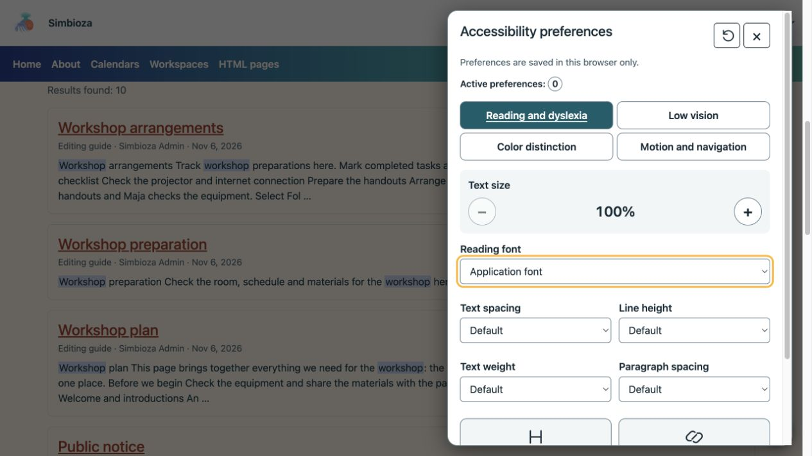
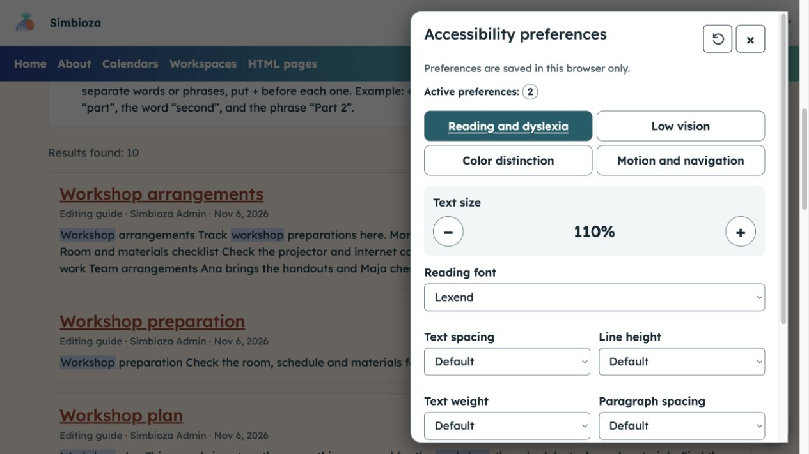
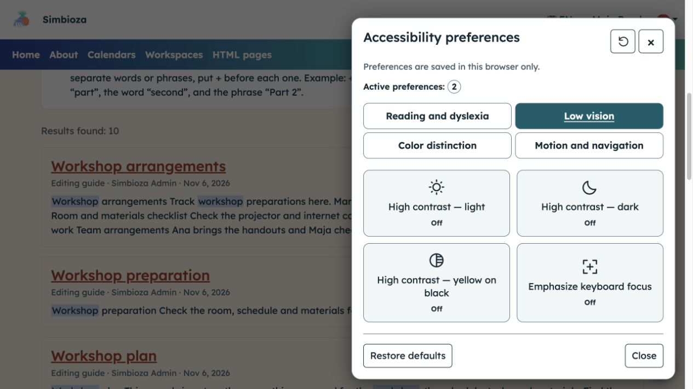
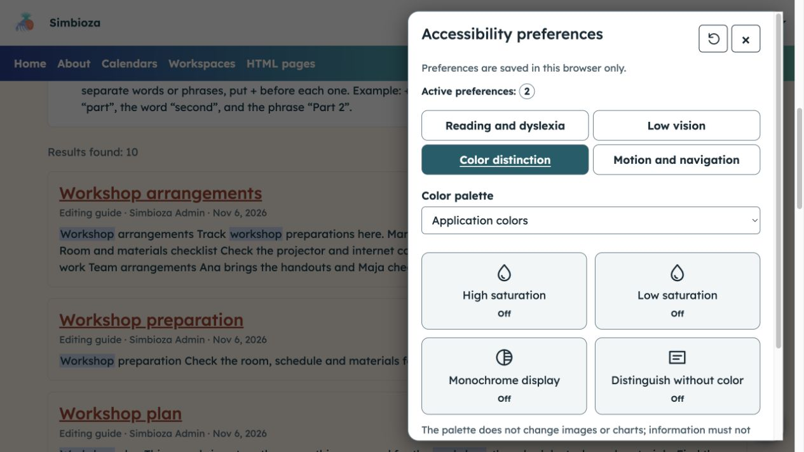
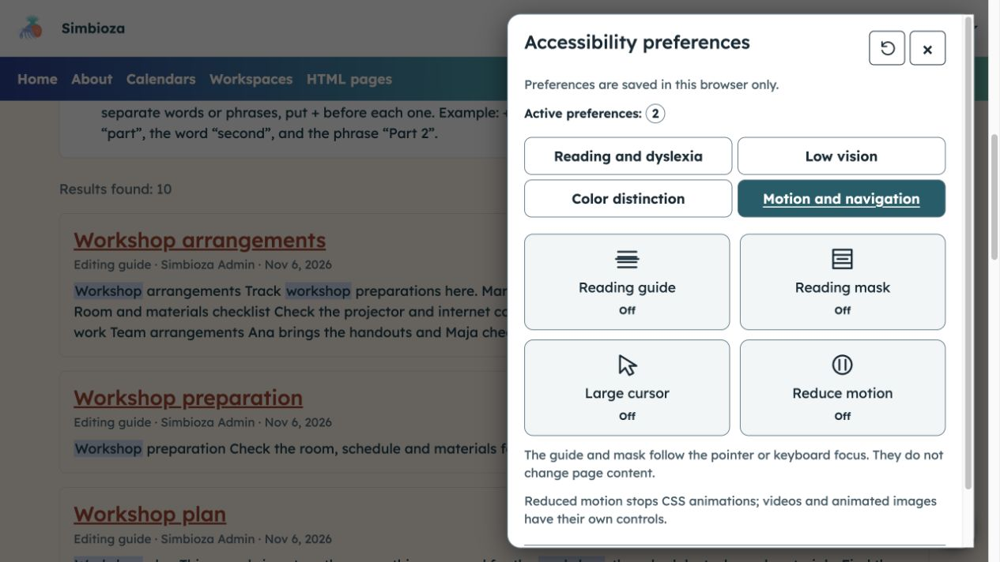

# Die Anzeige für leichteres Lesen anpassen

> Die Bildschirmaufnahmen zeigen die englische Benutzeroberfläche.

**Ziel:** Text, Farben und Bewegung personalisieren, ohne den Inhalt für andere Leser zu ändern. Wenn das Modul verfügbar ist, öffnen Sie unten rechts die runde Barrierefreiheitsschaltfläche.

## Wählen Sie die Unterstützung, die Sie benötigen

Das Gremium besteht aus vier Gruppen. Wählen Sie eine aus, ändern Sie eine einzelne Option und prüfen Sie deren Auswirkung auf der Seite. Schalten Sie es aus oder wählen Sie bei Bedarf einen anderen Wert aus.

| Gruppe | Anpassungen |
| --- | --- |
| Lesen und Legasthenie | 100–200 % Textgröße, Schriftart, Textabstand, Zeilenhöhe, Absatzabstand, Textstärke und Hervorhebung für Überschriften und Links. |
| Geringe Sehkraft | Hoher Hell-, Dunkel- oder Gelb-auf-Schwarz-Kontrast und stärkerer Tastaturfokus. |
| Farbunterscheidung | Alternative Paletten, hohe/niedrige Sättigung, monochrome Anzeige und Hinweise, die nicht auf Farbe basieren. |
| Bewegung und Navigation | Lesehilfe oder -maske, großer Cursor und reduzierte Bewegung. |

<figure class="my-4">

<figcaption>Im geöffneten Bereich werden Standardwerte und die Anzahl der aktiven Anpassungen angezeigt.</figcaption>
</figure>

## Erhöhen Sie die Textgröße und wählen Sie eine Schriftart

Bei **Lesen und Legasthenie** verwenden Sie ***+**, um den Text zu vergrößern, oder **−**, um eine frühere Vergrößerung zu verkleinern. Wählen Sie eine angebotene **Leseschrift**. Sie können den Abstand, die Zeilenhöhe und den Absatzabstand separat erhöhen, die Textstärke ändern und Überschriften oder Links hervorheben.

**Ergebnis:** Text wird für Sie angenehmer zu lesen. Der Browser-Zoom bleibt unabhängig verfügbar.

<figure class="my-4">

<figcaption>In diesem Beispiel sind zwei Anpassungen aktiv: 110 % Textgröße und die Lexend-Schriftart.</figcaption>
</figure>

## Stärken Sie den Kontrast oder den Tastaturfokus

Aktivieren Sie unter **Schwachsichtigkeit** eine Option für hohen Kontrast und prüfen Sie die Lesbarkeit. Wählen Sie dieselbe Schaltfläche erneut, um sie auszuschalten. **Betonen Sie den Tastaturfokus** und helfen Sie dabei, Schaltflächen und Felder zu verfolgen, die mit der Tabulatortaste erreicht werden.

Es kann nur ein Hochkontrastmodus aktiv sein; es hat vorübergehend Vorrang vor den Auswahlmöglichkeiten für Palette und Sättigung.

<figure class="my-4">

<figcaption>Low Vision bietet drei Kontrastmodi und eine separate Fokusbetonung; Diese Schaltflächen sind in diesem Bild deaktiviert.</figcaption>
</figure>

## Unterscheiden Sie Inhalte, ohne sich nur auf die Farbe zu verlassen

Wählen Sie unter **Farbunterscheidung** eine **Farbpalette** oder eine Sättigungssteuerung aus. **Monochromes Display** beseitigt Farbunterschiede; **Unterscheiden ohne Farbe** fügt unterstützte visuelle Hinweise hinzu. Wählen Sie die Anzeige, die die Unterscheidung wichtiger Elemente erleichtert.

Die Palette verändert weder Bilder noch Diagramme; Sättigungsfilter können sich auch auf Bilder auswirken. Ihr Browser unterstützt möglicherweise einige Filter nicht. Die Informationen des Autors erfordern immer noch Texterklärungen, anstatt sich nur auf die Farbe zu verlassen.

<figure class="my-4">

<figcaption>Wählen Sie eine Palette oder eine einzelne Anpassung aus und überprüfen Sie dann deren Auswirkung auf den tatsächlichen Seiteninhalt.</figcaption>
</figure>

## Folgen Sie einer Linie oder reduzieren Sie die Bewegung

Aktivieren Sie unter **Bewegung und Navigation** die **Lesehilfe** oder die **Lesemaske**, wenn Sie damit dem Text folgen können. Sie folgen dem Zeiger oder fokussierten Element, ohne Klicks abzufangen. Aktivieren Sie bei Bedarf **Großer Cursor** oder **Bewegung reduzieren**.

Reduzierte Bewegungslimits unterstützten CSS-Animationen und -Übergänge; es stoppt nicht jedes Video, GIF oder jede beliebige Seitenanimation.

<figure class="my-4">

<figcaption>Diese Steuerelemente verändern Ihr Lese- und Navigationserlebnis, nicht den Dokumentinhalt.</figcaption>
</figure>

## Verwendung der Tastatur

Verwenden Sie **Tabulator**, um auf Schaltflächen und Felder zuzugreifen. Verwenden Sie auf Gruppenregisterkarten **Links/Rechts** und **Startseite/Ende**. Aktivieren Sie die Tasten mit **Leertaste/Eingabetaste**. **Escape** schließt das Bedienfeld und setzt den Fokus wieder auf die Öffnungsschaltfläche zurück. Ein Link zum Springen zum Inhalt, sofern aktiviert, hilft dabei, wiederholtes Navigieren zu vermeiden.

## Speichern und zurücksetzen

Die Auswahlmöglichkeiten bleiben für diese Installation erhalten, wenn die Browserspeicherung zulässig ist. Wenn der Speicher blockiert ist, wird in einer Meldung erklärt, dass Änderungen nur für die aktuelle Seite gelten. **Standardeinstellungen wiederherstellen** entfernt die Anpassungen dieses Panels, ohne die Sprache, das globale Design oder das Konto zu ändern. Schließen Sie das Panel und lesen Sie weiter.

Diese Tools ersetzen keine klare Schrift, aussagekräftige Bildbeschreibungen oder ordnungsgemäß beschriftete Felder. Wenn Inhalte weiterhin nicht zugänglich sind, senden Sie dem Autor oder Administrator den Link und die spezifische Schwierigkeit.
