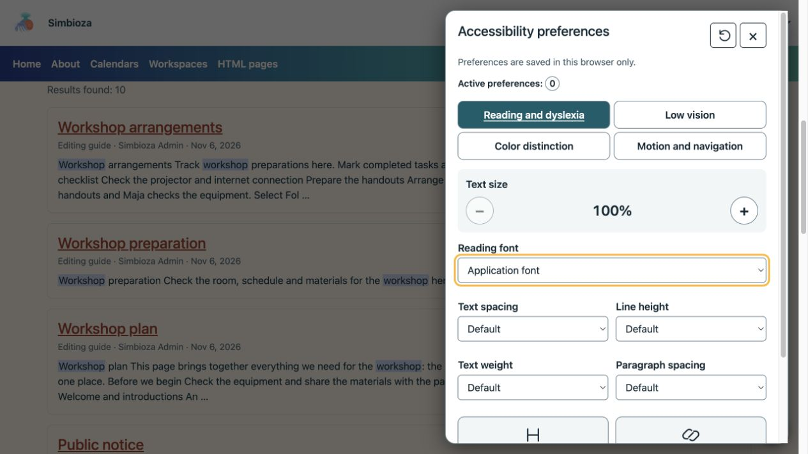
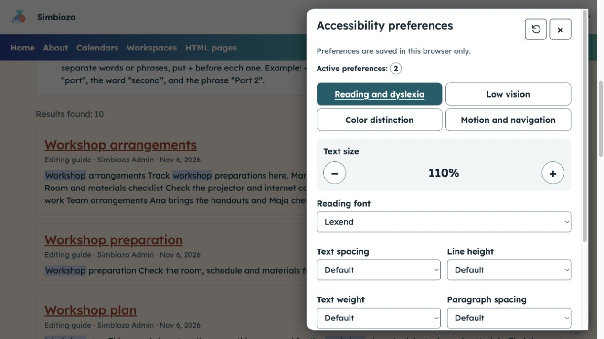
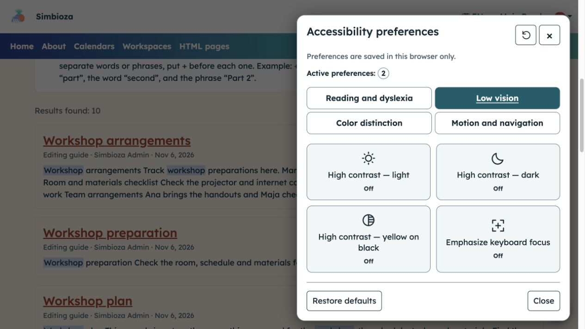
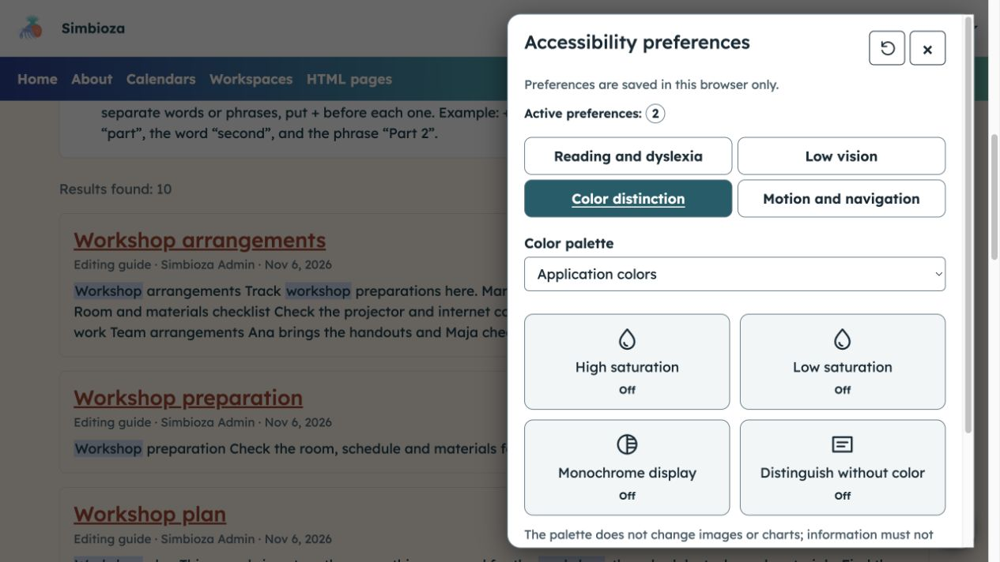
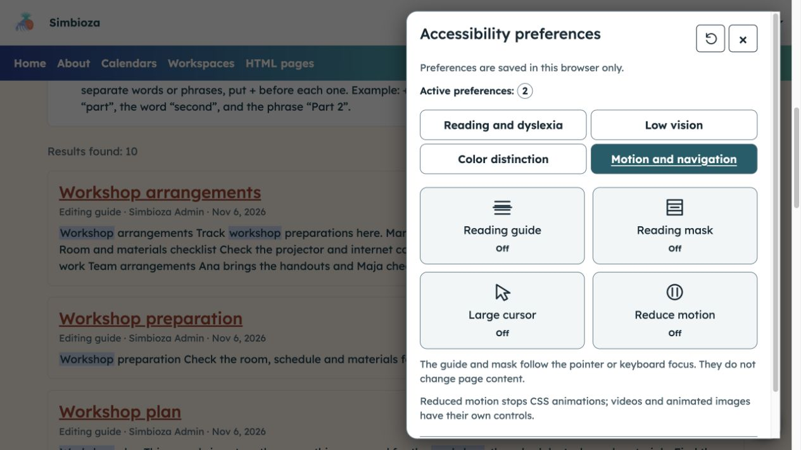

# Adjust the display for easier reading

**Goal:** personalise text, colours and motion without changing content for other readers. Where the module is available, open the round accessibility button at the bottom right.

## Choose the assistance you need

The panel has four groups. Choose one, change a single option and inspect its effect on the page. Turn it off or select another value if needed.

| Group | Adjustments |
| --- | --- |
| Reading and dyslexia | 100–200% text size, font, text spacing, line height, paragraph spacing, text weight and emphasis for headings and links. |
| Low vision | High light, dark or yellow-on-black contrast and stronger keyboard focus. |
| Color distinction | Alternative palettes, high/low saturation, monochrome display and cues that do not rely on colour. |
| Motion and navigation | Reading guide or mask, large cursor and reduced motion. |

<figure class="my-4">

<figcaption>The open panel shows default values and a count of active adjustments.</figcaption>
</figure>

## Increase text size and choose a font

In **Reading and dyslexia**, use **+** to enlarge text or **−** to reduce an earlier enlargement. Choose an offered **Reading font**. You can separately increase spacing, line height and paragraph spacing, change text weight and emphasise headings or links.

**Result:** text becomes more comfortable for you to read. Browser zoom remains independently available.

<figure class="my-4">

<figcaption>Two adjustments are active in this example: 110% text size and the Lexend font.</figcaption>
</figure>

## Strengthen contrast or keyboard focus

In **Low vision**, enable one high-contrast option and check readability. Choose the same button again to turn it off. **Emphasize keyboard focus** helps you track buttons and fields reached with Tab.

Only one high-contrast mode can be active; it temporarily takes precedence over palette and saturation choices.

<figure class="my-4">

<figcaption>Low vision offers three contrast modes and separate focus emphasis; these buttons are off in this image.</figcaption>
</figure>

## Distinguish content without relying only on colour

In **Color distinction**, select a **Color palette** or a saturation control. **Monochrome display** removes colour differences; **Distinguish without color** adds supported visual cues. Choose the display that makes important elements easier to distinguish.

The palette does not change images or charts; saturation filters may also affect images. Your browser may not support some filters. The author's information still needs text explanations rather than relying only on colour.

<figure class="my-4">

<figcaption>Select a palette or an individual adjustment, then inspect its effect on the actual page content.</figcaption>
</figure>

## Follow a line or reduce motion

In **Motion and navigation**, enable the **Reading guide** or **Reading mask** if it helps you follow text. They follow the pointer or focused element without intercepting clicks. Enable **Large cursor** or **Reduce motion** if needed.

Reduced motion limits supported CSS animations and transitions; it does not stop every video, GIF or arbitrary page animation.

<figure class="my-4">

<figcaption>These controls change your reading and navigation experience, not the document content.</figcaption>
</figure>

## Keyboard use

Use **Tab** to reach buttons and fields. On group tabs, use **Left/Right** and **Home/End**. Activate buttons with **Space/Enter**. **Escape** closes the panel and returns focus to its opening button. A skip-to-content link, where enabled, helps bypass repeated navigation.

## Saving and reset

Choices are retained for that installation when browser storage is allowed. If storage is blocked, a message explains that changes apply only to the current page. **Restore defaults** removes this panel's adjustments without changing the language, global theme or account. Close the panel and continue reading.

These tools do not replace clear writing, meaningful image descriptions or properly labelled fields. If content remains inaccessible, send its author or administrator the link and the specific difficulty.
