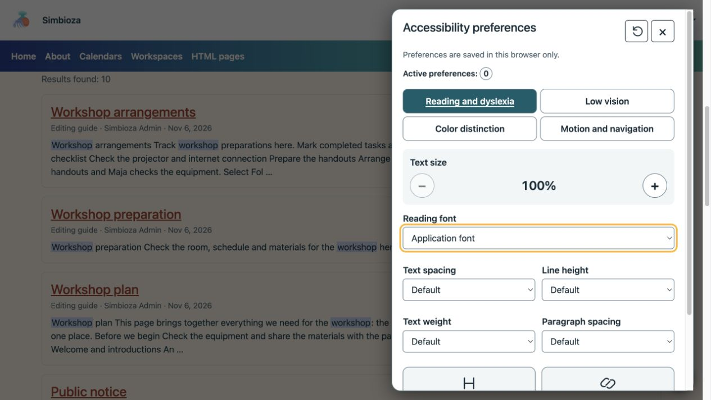
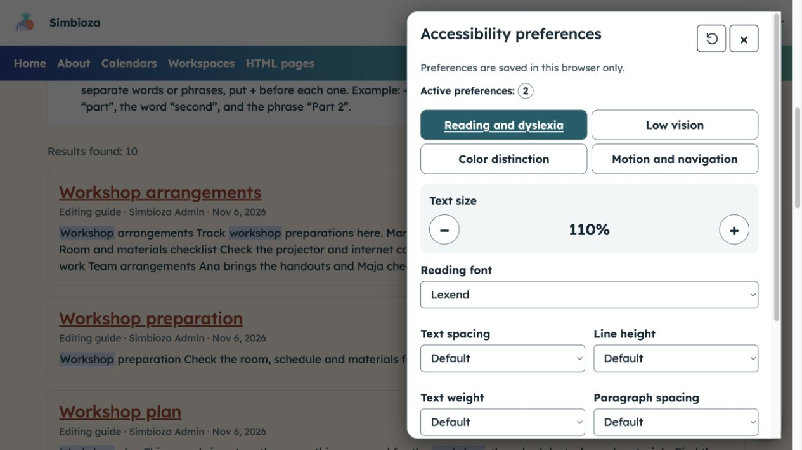
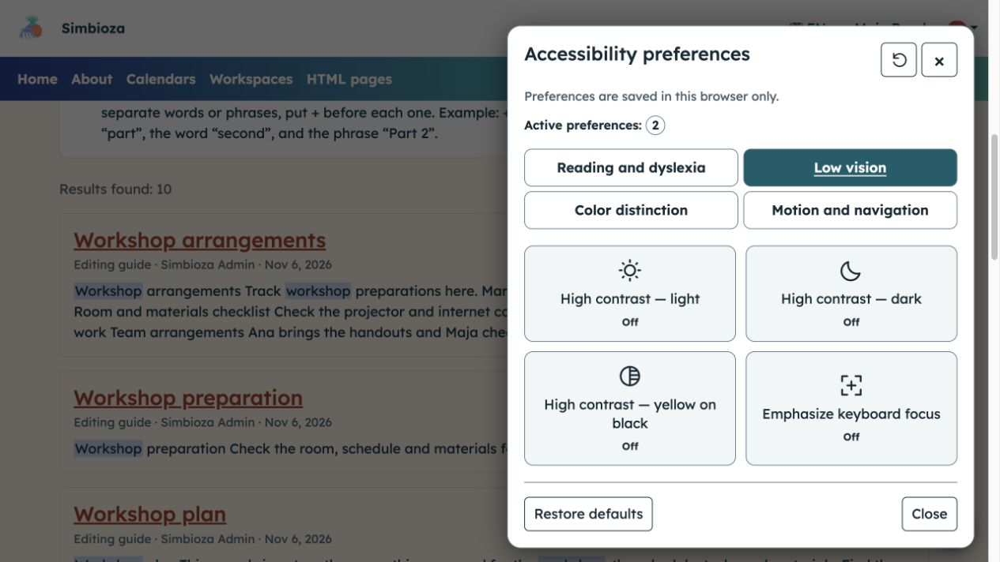
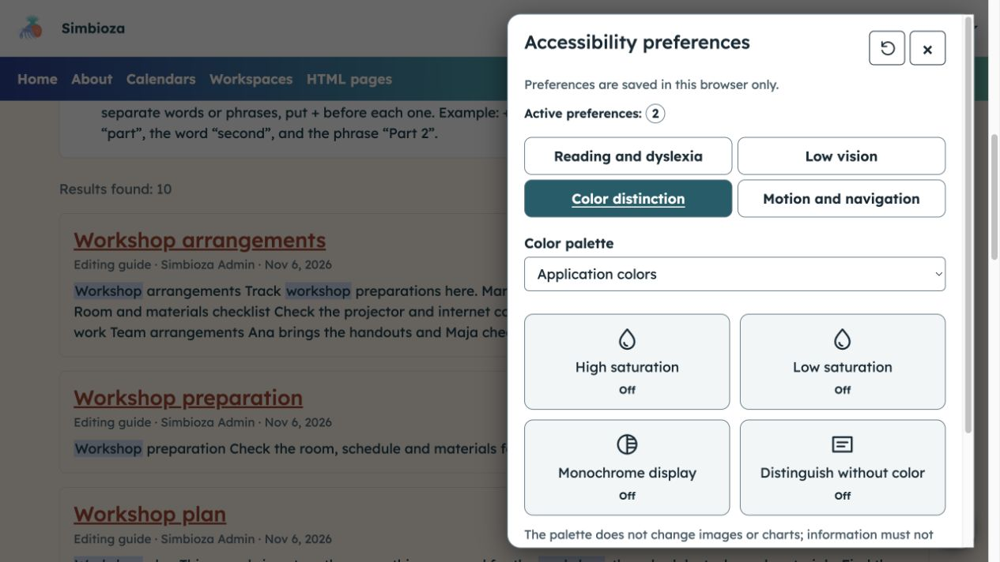
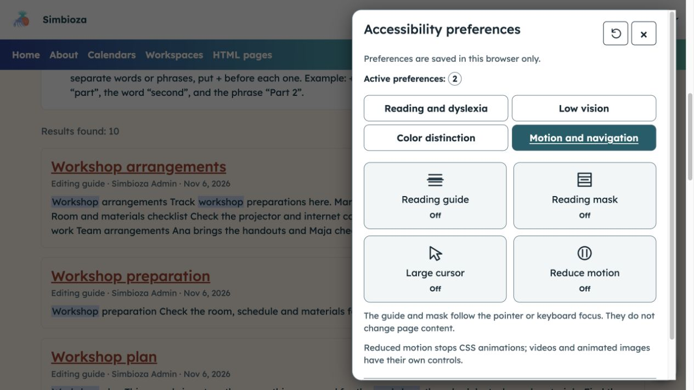

# Ajustar la visualización para facilitar la lectura

> Las capturas de pantalla muestran la interfaz en inglés.

**Objetivo:** personalizar el texto, los colores y el movimiento sin cambiar el contenido para otros lectores. Cuando el módulo esté disponible, abra el botón redondo de accesibilidad en la parte inferior derecha.

## Elija la asistencia que necesita

El panel tiene cuatro grupos. Elija una, cambie una sola opción e inspeccione su efecto en la página. Desactívelo o seleccione otro valor si es necesario.

| Grupo | Ajustes |
| --- | --- |
| Lectura y dislexia | 100-200% del tamaño del texto, fuente, espaciado del texto, alto de línea, espaciado del párrafo, peso del texto y énfasis para títulos y enlaces. |
| Baja visión | Alto contraste de luz, oscuridad o amarillo sobre negro y mayor enfoque del teclado. |
| Distinción de color | Paletas alternativas, saturación alta/baja, visualización monocromática y señales que no dependen del color. |
| Movimiento y navegación | Guía o máscara de lectura, cursor grande y movimiento reducido. |

<figure class="my-4">

<figcaption>El panel abierto muestra los valores predeterminados y un recuento de ajustes activos.</figcaption>
</figure>

## Aumenta el tamaño del texto y elige una fuente.

En **Lectura y dislexia**, utilice **+** para ampliar el texto o **−** para reducir una ampliación anterior. Elija una **fuente de lectura** ofrecida. Puede aumentar por separado el espaciado, la altura de las líneas y el espaciado entre párrafos, cambiar el peso del texto y enfatizar los títulos o enlaces.

**Resultado:** el texto se vuelve más cómodo de leer. El zoom del navegador permanece disponible de forma independiente.

<figure class="my-4">

<figcaption>En este ejemplo hay dos ajustes activos: 110% de tamaño de texto y la fuente Lexend.</figcaption>
</figure>

## Fortalecer el contraste o el enfoque del teclado

En **Baja visión**, habilite una opción de alto contraste y verifique la legibilidad. Elija el mismo botón nuevamente para apagarlo. **Enfatizar el enfoque del teclado** le ayuda a realizar un seguimiento de los botones y campos alcanzados con Tab.

Sólo puede estar activo un modo de alto contraste; temporalmente tiene prioridad sobre las opciones de paleta y saturación.

<figure class="my-4">

<figcaption>La baja visión ofrece tres modos de contraste y énfasis de enfoque separado; Estos botones están desactivados en esta imagen.</figcaption>
</figure>

## Distinguir el contenido sin depender únicamente del color

En **Distinción de color**, seleccione una **Paleta de colores** o un control de saturación. **Pantalla monocromática** elimina las diferencias de color; **Distinguir sin color** agrega señales visuales compatibles. Elija la pantalla que haga que los elementos importantes sean más fáciles de distinguir.

La paleta no cambia imágenes ni gráficos; Los filtros de saturación también pueden afectar las imágenes. Es posible que su navegador no admita algunos filtros. La información del autor todavía necesita explicaciones textuales en lugar de depender únicamente del color.

<figure class="my-4">

<figcaption>Seleccione una paleta o un ajuste individual y luego inspeccione su efecto en el contenido real de la página.</figcaption>
</figure>

## Seguir una línea o reducir el movimiento

En **Movimiento y navegación**, habilita la **Guía de lectura** o la **Máscara de lectura** si le ayuda a seguir el texto. Siguen el puntero o elemento enfocado sin interceptar clics. Habilite **Cursor grande** o **Reducir movimiento** si es necesario.

Los límites de movimiento reducidos admitieron animaciones y transiciones CSS; no detiene todos los videos, GIF o animaciones de páginas arbitrarias.

<figure class="my-4">

<figcaption>Estos controles cambian su experiencia de lectura y navegación, no el contenido del documento.</figcaption>
</figure>

## Uso del teclado

Utilice **Tab** para acceder a botones y campos. En pestañas de grupo, utilice **Izquierda/Derecha** y **Inicio/Fin**. Active los botones con **Espacio/Entrar**. **Escape** cierra el panel y vuelve a centrarse en su botón de apertura. Un enlace para saltar al contenido, cuando está habilitado, ayuda a evitar la navegación repetida.

## Guardar y restablecer

Las opciones se conservan para esa instalación cuando se permite el almacenamiento en el navegador. Si el almacenamiento está bloqueado, un mensaje explica que los cambios se aplican solo a la página actual. **Restaurar valores predeterminados** elimina los ajustes de este panel sin cambiar el idioma, el tema global o la cuenta. Cierra el panel y continúa leyendo.

Estas herramientas no reemplazan la escritura clara, las descripciones de imágenes significativas o los campos correctamente etiquetados. Si el contenido permanece inaccesible, envíe a su autor o administrador el enlace y la dificultad específica.
