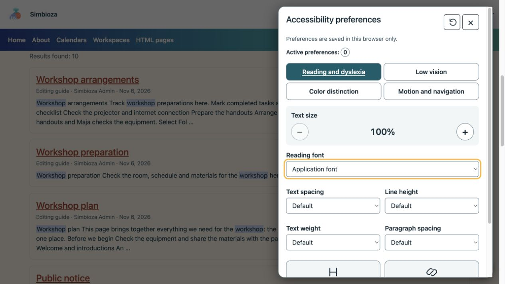
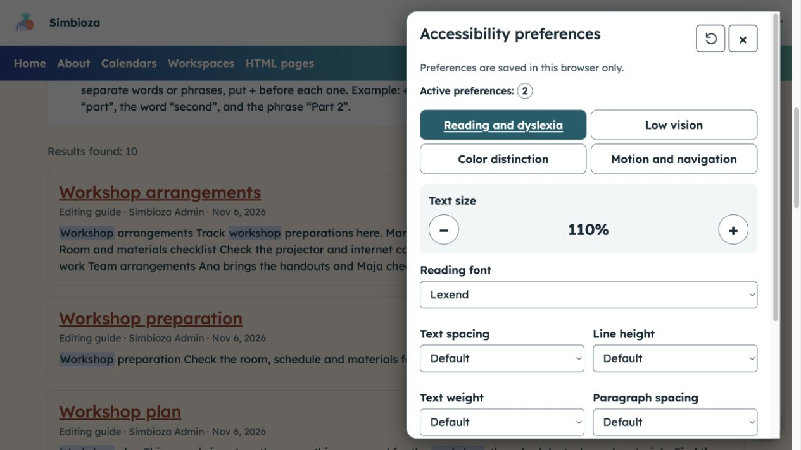
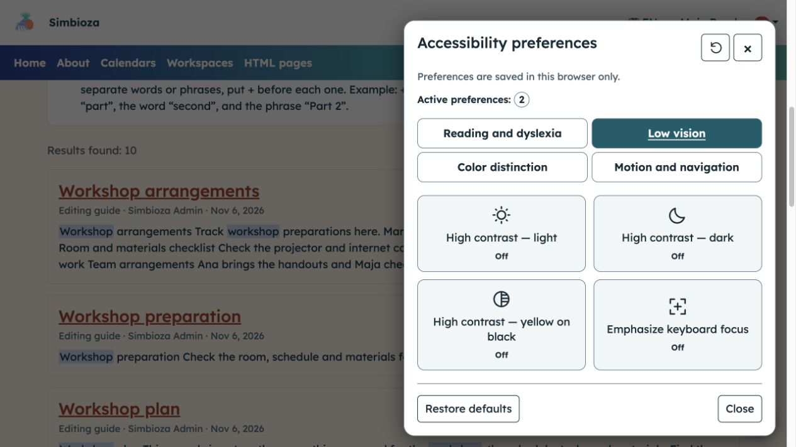
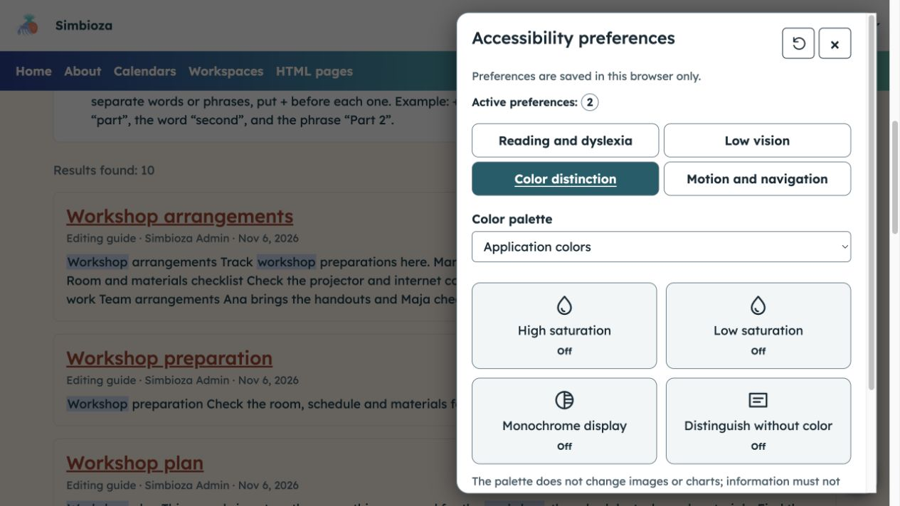
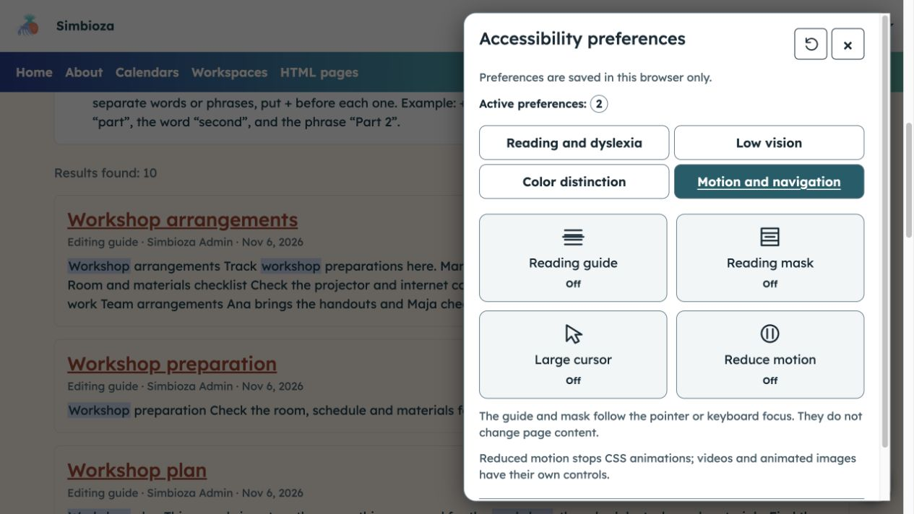

# Adapter l’affichage pour faciliter la lecture

> Les captures d’écran présentent l’interface en anglais.

**Objectif :** personnalisez le texte, les couleurs et les mouvements sans modifier le contenu pour les autres lecteurs. Lorsque le module est disponible, ouvrez le bouton rond d’accessibilité en bas à droite.

## Choisissez l'assistance dont vous avez besoin

Le panel comprend quatre groupes. Choisissez-en une, modifiez une seule option et inspectez son effet sur la page. Désactivez-le ou sélectionnez une autre valeur si nécessaire.

| Groupe | Ajustements |
| --- | --- |
| Lecture et dyslexie | Taille du texte de 100 à 200 %, police, espacement du texte, hauteur des lignes, espacement des paragraphes, poids du texte et emphase pour les titres et les liens. |
| Basse vision | Contraste élevé de lumière, d'obscurité ou de jaune sur noir et mise au point plus forte du clavier. |
| Distinction des couleurs | Palettes alternatives, saturation haute/basse, affichage monochrome et signaux qui ne dépendent pas de la couleur. |
| Mouvement et navigation | Guide ou masque de lecture, grand curseur et mouvement réduit. |

<figure class="my-4">

<figcaption>Le panneau ouvert affiche les valeurs par défaut et un nombre d'ajustements actifs.</figcaption>
</figure>

## Augmentez la taille du texte et choisissez une police

Dans **Lecture et dyslexie**, utilisez **+** pour agrandir le texte ou **−** pour réduire un agrandissement antérieur. Choisissez une **police de lecture** proposée. Vous pouvez augmenter séparément l'espacement, la hauteur des lignes et l'espacement des paragraphes, modifier l'épaisseur du texte et mettre en valeur les titres ou les liens.

**Résultat :** le texte devient plus confortable à lire. Le zoom du navigateur reste disponible indépendamment.

<figure class="my-4">

<figcaption>Deux ajustements sont actifs dans cet exemple : la taille du texte à 110 % et la police Lexend.</figcaption>
</figure>

## Renforcer le contraste ou la mise au point du clavier

En **Basse vision**, activez une option de contraste élevé et vérifiez la lisibilité. Choisissez à nouveau le même bouton pour le désactiver. **Insister sur le focus du clavier** vous aide à suivre les boutons et les champs atteints avec Tab.

Un seul mode à contraste élevé peut être actif ; il prend temporairement le pas sur les choix de palette et de saturation.

<figure class="my-4">

<figcaption>La basse vision offre trois modes de contraste et une mise au point séparée ; ces boutons sont désactivés dans cette image.</figcaption>
</figure>

## Distinguer le contenu sans se fier uniquement à la couleur

Dans **Distinction des couleurs**, sélectionnez une **Palette de couleurs** ou un contrôle de saturation. **L'affichage monochrome** supprime les différences de couleur ; **Distinguer sans couleur** ajoute des repères visuels pris en charge. Choisissez l’affichage qui permet de distinguer plus facilement les éléments importants.

La palette ne modifie pas les images ou les graphiques ; les filtres de saturation peuvent également affecter les images. Votre navigateur peut ne pas prendre en charge certains filtres. Les informations de l'auteur nécessitent toujours des explications textuelles plutôt que de s'appuyer uniquement sur la couleur.

<figure class="my-4">

<figcaption>Sélectionnez une palette ou un ajustement individuel, puis inspectez son effet sur le contenu réel de la page.</figcaption>
</figure>

## Suivre une ligne ou réduire le mouvement

Dans **Mouvement et navigation**, activez le **Guide de lecture** ou le **Masque de lecture** s'il vous aide à suivre le texte. Ils suivent le pointeur ou l'élément ciblé sans intercepter les clics. Activez **Grand curseur** ou **Réduire le mouvement** si nécessaire.

Limites de mouvement réduites prenant en charge les animations et transitions CSS ; il n'arrête pas toutes les vidéos, GIF ou animations de pages arbitraires.

<figure class="my-4">

<figcaption>Ces contrôles modifient votre expérience de lecture et de navigation, pas le contenu du document.</figcaption>
</figure>

## Utilisation du clavier

Utilisez **Tab** pour accéder aux boutons et aux champs. Dans les onglets de groupe, utilisez **Gauche/Droite** et **Accueil/Fin**. Activez les boutons avec **Espace/Entrée**. **Escape** ferme le panneau et renvoie le focus sur son bouton d'ouverture. Un lien d'accès au contenu, lorsqu'il est activé, permet d'éviter la navigation répétée.

## Sauvegarde et réinitialisation

Les choix sont conservés pour cette installation lorsque le stockage du navigateur est autorisé. Si le stockage est bloqué, un message explique que les modifications s'appliquent uniquement à la page en cours. **Restaurer les paramètres par défaut** supprime les ajustements de ce panneau sans modifier la langue, le thème global ou le compte. Fermez le panneau et continuez la lecture.

Ces outils ne remplacent pas une écriture claire, des descriptions d'images significatives ou des champs correctement étiquetés. Si le contenu reste inaccessible, envoyez à son auteur ou administrateur le lien et la difficulté spécifique.
