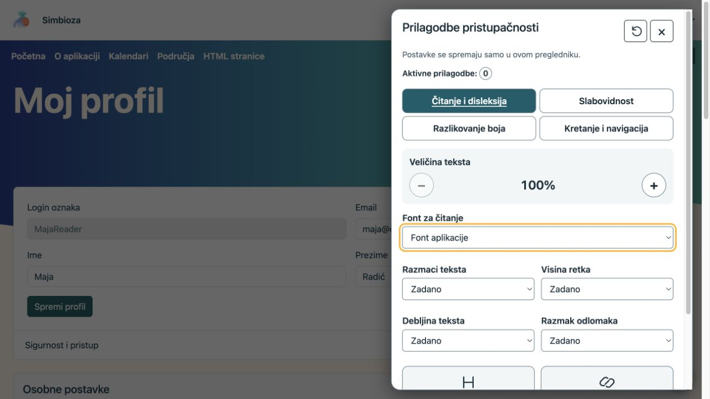
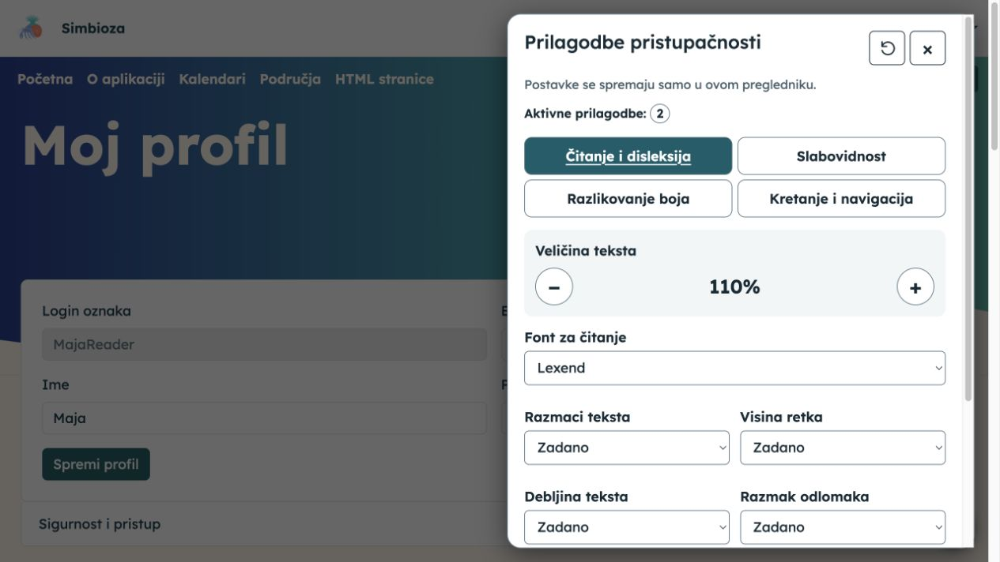
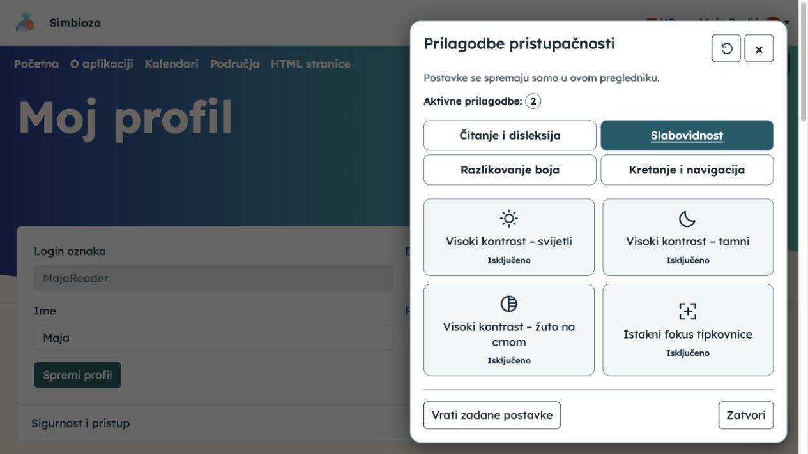
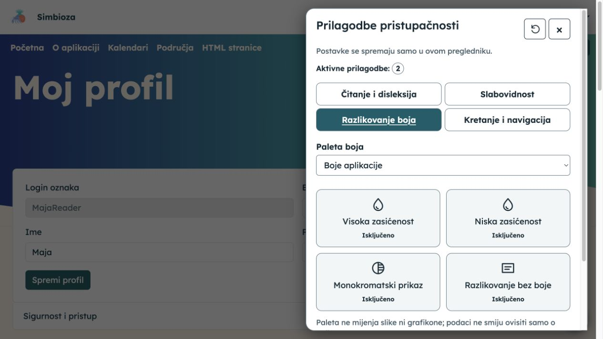
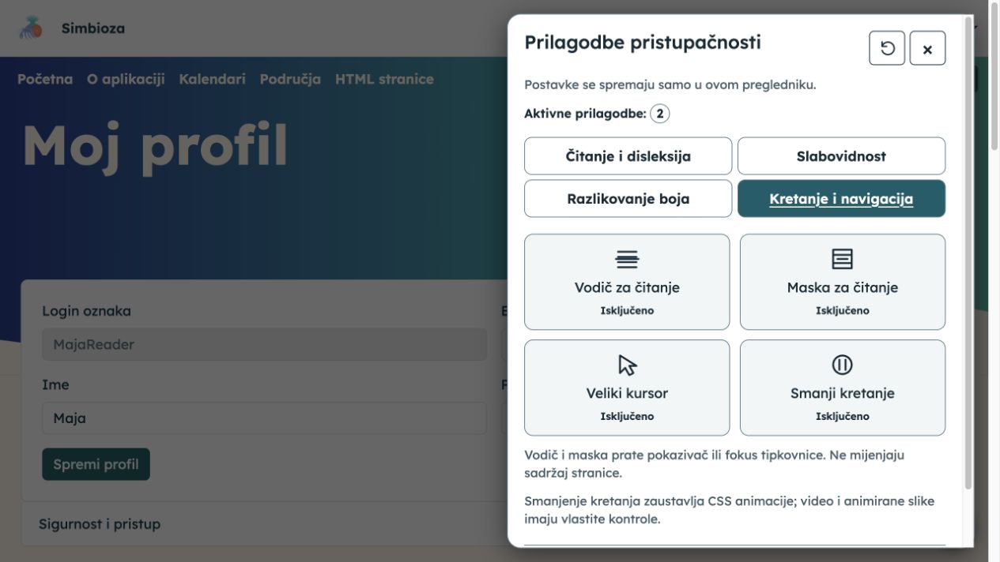

# Prilagodite prikaz za lakše čitanje

**Cilj:** osobno prilagoditi tekst, boje i kretanje bez mijenjanja sadržaja drugim čitateljima. Ako je modul dostupan, otvorite okrugli gumb pristupačnosti u donjem desnom kutu.

## Odaberite pomoć koja vam treba

Panel ima četiri skupine. Odaberite jednu, promijenite jednu mogućnost i pogledajte učinak na stranici. Po potrebi promjenu isključite ili odaberite drugu vrijednost.

| Skupina | Dostupne prilagodbe |
| --- | --- |
| Čitanje i disleksija | Veličina 100–200 %, font, razmaci teksta, visina retka, razmak odlomaka, debljina teksta te isticanje naslova i poveznica. |
| Slabovidnost | Visoki svijetli, tamni ili žuto-crni kontrast te isticanje fokusa tipkovnice. |
| Razlikovanje boja | Alternativne palete, visoka/niska zasićenost, monokromatski prikaz i razlikovanje bez boje. |
| Kretanje i navigacija | Vodič ili maska za čitanje, veliki kursor i smanjeno kretanje. |

<figure class="my-4">

<figcaption>Otvoreni panel pokazuje zadane vrijednosti i broj aktivnih prilagodbi.</figcaption>
</figure>

## Povećajte tekst i odaberite font

U **Čitanje i disleksija** gumbom **+** povećajte tekst ili gumbom **−** smanjite prethodno povećanje. U **Font za čitanje** odaberite ponuđeni font. Zasebno možete povećati razmake, visinu retka i razmak odlomaka, podebljati tekst te istaknuti naslove i poveznice.

**Rezultat:** tekst postaje ugodniji za vaše čitanje. Povećanje preglednika i dalje možete koristiti zasebno.

<figure class="my-4">

<figcaption>U primjeru su aktivne dvije prilagodbe: veličina 110 % i font Lexend.</figcaption>
</figure>

## Pojačajte kontrast ili fokus tipkovnice

U **Slabovidnost** uključite jedan od ponuđenih visokih kontrasta i provjerite čitljivost. Ponovni odabir istog gumba isključuje ga. **Istakni fokus tipkovnice** olakšava praćenje gumba i polja na koje dolazite tipkom Tab.

Samo jedna mogućnost visokog kontrasta može biti aktivna; ona privremeno daje prednost pred paletom i zasićenošću.

<figure class="my-4">

<figcaption>Skupina Slabovidnost nudi tri kontrasta i zasebno isticanje fokusa; na ovoj su snimci ti gumbi isključeni.</figcaption>
</figure>

## Razlikujte sadržaj bez oslanjanja samo na boju

U **Razlikovanje boja** odaberite **Paleta boja** ili jednu od kontrola zasićenosti. **Monokromatski prikaz** uklanja razlike u boji, a **Razlikovanje bez boje** dodaje podržane vizualne oznake. Birajte prikaz u kojem lakše razlikujete važne elemente.

Paleta ne mijenja same slike ni grafikone; filtri zasićenosti mogu promijeniti i slike. Neke filtre preglednik možda ne podržava. Autorovi podaci i dalje trebaju imati tekstualna objašnjenja, a ne ovisiti samo o boji.

<figure class="my-4">

<figcaption>Odaberite paletu ili pojedinu prilagodbu; njihov učinak provjerite na stvarnom sadržaju stranice.</figcaption>
</figure>

## Lakše pratite redak ili smanjite kretanje

U **Kretanje i navigacija** uključite **Vodič za čitanje** ili **Maska za čitanje** ako vam pomažu pratiti tekst. Prate pokazivač ili fokusirani element, bez preuzimanja klikova. Po potrebi uključite **Veliki kursor** ili **Smanji kretanje**.

Smanjeno kretanje smanjuje podržane CSS animacije i prijelaze; ne zaustavlja svaki video, GIF ili proizvoljnu animaciju stranice.

<figure class="my-4">

<figcaption>Gumbi mijenjaju vaš način čitanja i kretanja, a ne sadržaj dokumenta.</figcaption>
</figure>

## Tipkovnica

Do gumba i polja dođite tipkom **Tab**. Na odabiru skupina koristite **Lijevo/Desno**, **Home/End**. Gumbe uključite pomoću **Space/Enter**. **Escape** zatvara panel i vraća fokus na njegov početni gumb. Poveznica za preskok na sadržaj, gdje je uključena, pomaže preskočiti ponavljajuću navigaciju.

## Spremanje i povrat

Odabiri se pamte za tu instalaciju ako preglednik dopušta pohranu. Ako je pohrana blokirana, poruka objašnjava da promjene vrijede samo na trenutačnoj stranici. **Vrati zadane postavke** uklanja prilagodbe ovoga panela; ne mijenja jezik, temu cijele instalacije ni račun. Zatvorite panel i nastavite čitati.

Ove prilagodbe ne zamjenjuju dobro napisan tekst, smislen alternativni opis slike i pravilno označena polja. Ako neki sadržaj i dalje nije pristupačan, javite autoru ili administratoru poveznicu i konkretnu poteškoću.
