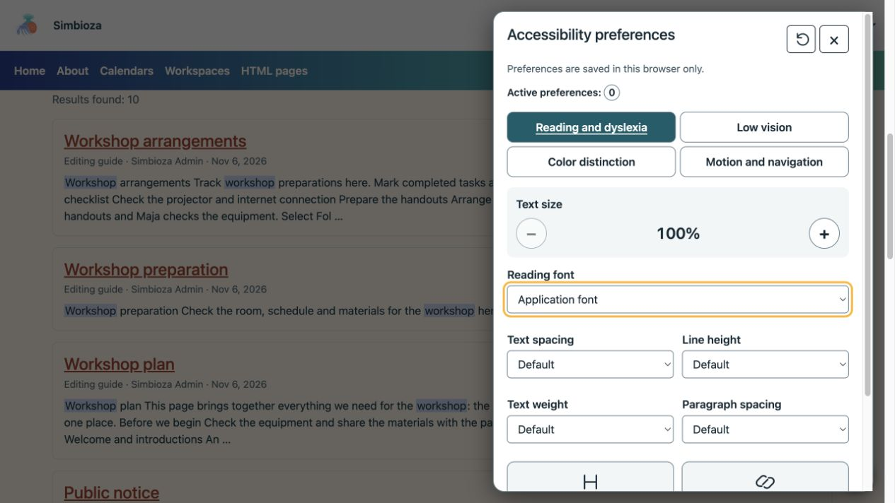
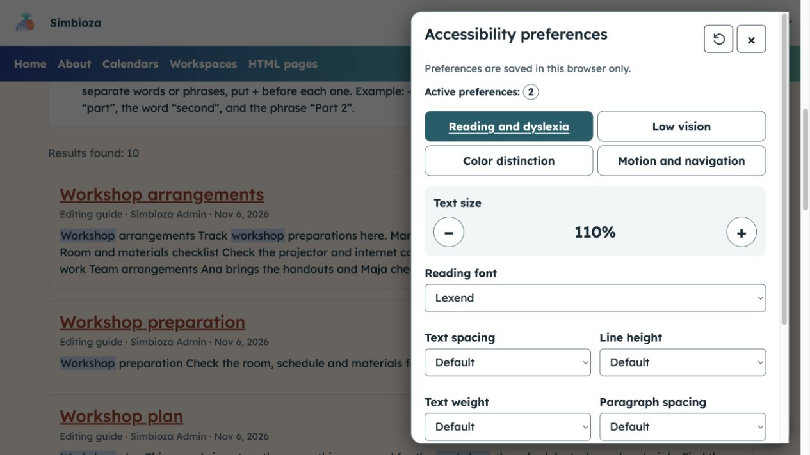
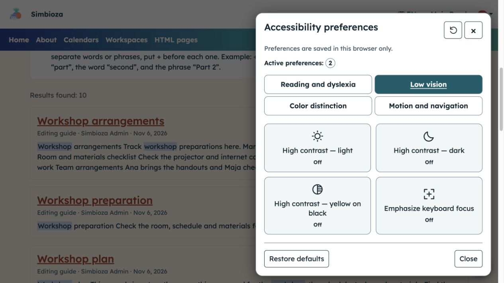
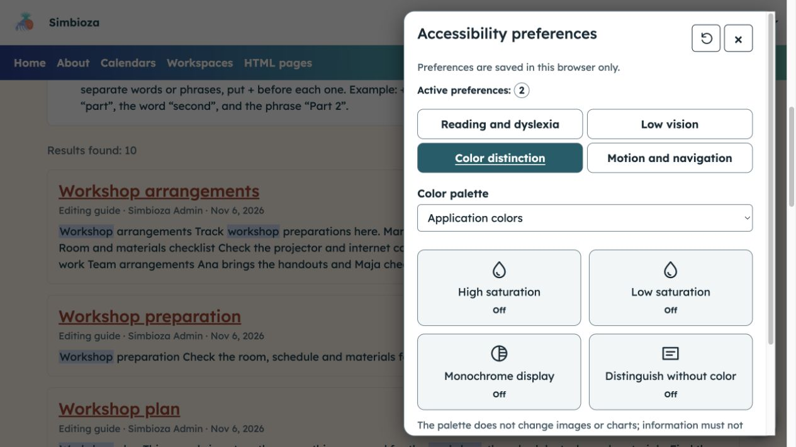
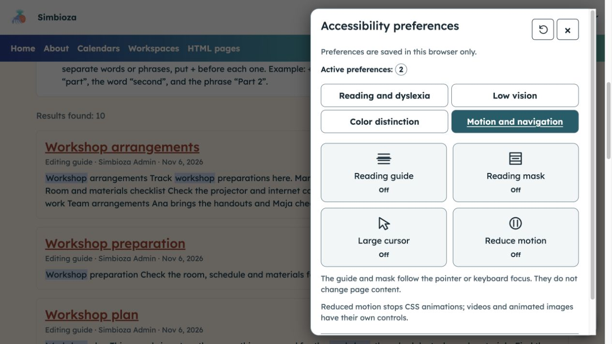

# Adatta la visualizzazione per facilitare la lettura

> Le schermate mostrano l’interfaccia in inglese.

**Obiettivo:** personalizzare testo, colori e animazioni senza modificare i contenuti per gli altri lettori. Laddove il modulo sia disponibile, apri il pulsante rotondo di accessibilità in basso a destra.

## Scegli l'assistenza di cui hai bisogno

Il pannello ha quattro gruppi. Scegline uno, modifica una singola opzione e controlla il suo effetto sulla pagina. Disattivalo o seleziona un altro valore, se necessario.

| Gruppo | Aggiustamenti |
| --- | --- |
| Lettura e dislessia | 100–200% di dimensione del testo, carattere, spaziatura del testo, altezza della riga, spaziatura del paragrafo, peso del testo ed enfasi per titoli e collegamenti. |
| Ipovisione | Contrasto elevato chiaro, scuro o giallo su nero e indicatore di selezione da tastiera più evidente. |
| Distinzione di colore | Tavolozze alternative, saturazione alta/bassa, visualizzazione monocromatica e segnali che non si basano sul colore. |
| Movimento e navigazione | Guida alla lettura o maschera, cursore grande e movimento ridotto. |

<figure class="my-4">

<figcaption>Il pannello aperto mostra i valori predefiniti e il conteggio delle regolazioni attive.</figcaption>
</figure>

## Aumenta la dimensione del testo e scegli un carattere

In **Lettura e dislessia**, utilizzare **+** per ingrandire il testo o **−** per ridurre un ingrandimento precedente. Scegli un **carattere di lettura** offerto. Puoi aumentare separatamente la spaziatura, l'altezza della riga e la spaziatura del paragrafo, modificare il peso del testo ed enfatizzare intestazioni o collegamenti.

**Risultato:** il testo diventa più comodo da leggere. Lo zoom del browser rimane disponibile in modo indipendente.

<figure class="my-4">

<figcaption>In questo esempio sono attive due regolazioni: dimensione del testo del 110% e carattere Lexend.</figcaption>
</figure>

## Aumentare il contrasto o rendere più evidente la selezione da tastiera

In **Ipovisione**, attiva un'opzione ad alto contrasto e verifica la leggibilità. Scegli di nuovo lo stesso pulsante per disattivarlo. **Enfatizza il focus della tastiera** ti aiuta a tenere traccia dei pulsanti e dei campi raggiunti con Tab.

Può essere attiva solo una modalità ad alto contrasto; ha temporaneamente la precedenza sulle scelte di tavolozza e saturazione.

<figure class="my-4">

<figcaption>Ipovisione offre tre modalità di contrasto e un'opzione separata per evidenziare la selezione da tastiera; in questa immagine i pulsanti sono disattivati.</figcaption>
</figure>

## Distinguere i contenuti senza fare affidamento solo sul colore

In **Distinzione colore**, seleziona una **Tavolozza colori** o un controllo di saturazione. **Display monocromatico** rimuove le differenze di colore; **Distingui senza colore** aggiunge segnali visivi supportati. Scegli il display che rende più facile distinguere gli elementi importanti.

La tavolozza non modifica le immagini o i grafici; anche i filtri di saturazione possono influenzare le immagini. Il tuo browser potrebbe non supportare alcuni filtri. Le informazioni dell'autore necessitano ancora di spiegazioni testuali piuttosto che fare affidamento solo sul colore.

<figure class="my-4">

<figcaption>Seleziona una tavolozza o una singola regolazione, quindi controlla il suo effetto sul contenuto effettivo della pagina.</figcaption>
</figure>

## Segui una linea o riduci il movimento

In **Movimento e navigazione**, attiva la **Guida alla lettura** o la **Maschera di lettura** se ti aiuta a seguire il testo. Seguono il puntatore o l'elemento focalizzato senza intercettare i clic. Abilita **Cursore grande** o **Riduci movimento** se necessario.

Movimento ridotto limita le animazioni e le transizioni CSS supportate; non arresta tutti i video, le GIF o le animazioni arbitrarie della pagina.

<figure class="my-4">

<figcaption>Questi controlli modificano la tua esperienza di lettura e navigazione, non il contenuto del documento.</figcaption>
</figure>

## Utilizzo della tastiera

Usa **Tab** per raggiungere pulsanti e campi. Nelle schede dei gruppi, usa **Sinistra/Destra** e **Home/Fine**. Attiva i pulsanti con **Spazio/Invio**. **Escape** chiude il pannello e riporta la selezione al pulsante che lo ha aperto. Il collegamento per saltare al contenuto, quando abilitato, aiuta a evitare di ripercorrere la navigazione.

## Salvataggio e ripristino

Le scelte vengono conservate per tale installazione quando è consentita la memorizzazione nel browser. Se lo spazio di archiviazione è bloccato, un messaggio spiega che le modifiche si applicano solo alla pagina corrente. **Ripristina impostazioni predefinite** rimuove le regolazioni di questo pannello senza modificare la lingua, il tema globale o l'account. Chiudi il pannello e continua a leggere.

Questi strumenti non sostituiscono una scrittura chiara, descrizioni di immagini significative o campi adeguatamente etichettati. Se il contenuto rimane inaccessibile, invia al suo autore o amministratore il collegamento e la difficoltà specifica.
