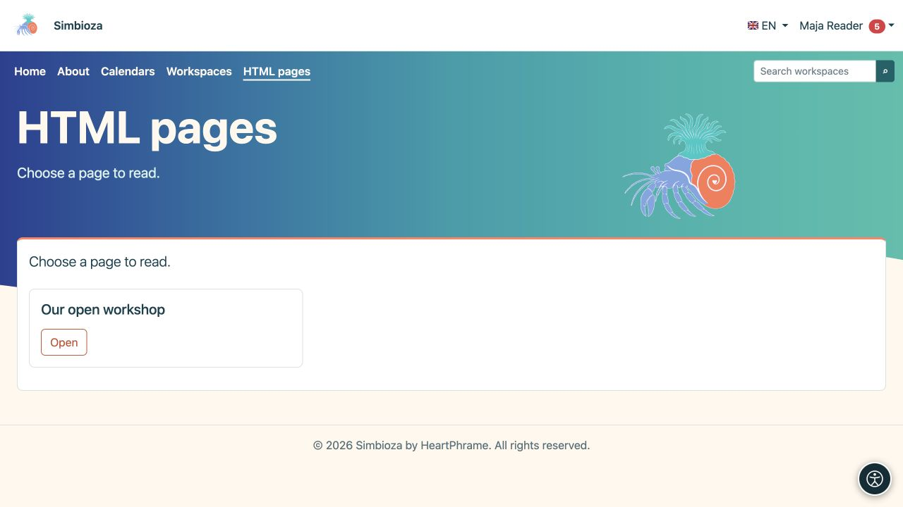

# Eigenständige HTML-Seiten

> Die Bildschirmaufnahmen zeigen die englische Benutzeroberfläche.

**Ziel:** Seiten ohne Arbeitsbereiche veröffentlichen, beispielsweise auf einer einfachen Website. Sie verwenden denselben [HTML-Editor](uredivanje-stranica_de.md), mit unterschiedlicher Organisation, Speicherung und Berechtigungen.

## Lesen Sie eine Seite

Wählen Sie in der Navigation **HTML-Seiten** aus und öffnen Sie einen aufgelisteten Titel. Es werden nur Seiten angezeigt, die Sie lesen dürfen. Bei einer vollständigen Installation mit Arbeitsbereiche fehlt dieser Menüpunkt möglicherweise, wenn keine eigenständigen Seiten vorhanden sind. Finden Sie Arbeitsbereichsinhalte über [Arbeitsbereiche](podrucja-citanje_de.md).

<figure class="my-4">

<figcaption>Wählen Sie neben einer Seite, auf die Sie zugreifen dürfen, „Öffnen“. Diese Leseansicht enthält keine Verwaltungsaktionen.</figcaption>
</figure>

## Erstellen oder bearbeiten Sie eine Seite

1. Wenn Sie über die Erstellungsberechtigung verfügen, wählen Sie in der Seitenliste **Inhalt verwalten** aus.
2. Wählen Sie im Editor **Erstellen** für eine neue Seite oder **Öffnen** für eine vorhandene Seite, auf die Sie zugreifen dürfen.
3. Geben Sie den erforderlichen Titel/Details ein und bearbeiten Sie den Inhalt.
4. Wählen Sie **Speichern** und öffnen Sie die Leseansicht, um Text, Medien und Links zu überprüfen.

**Ergebnis:** Eine eigenständige Seite wird direkt gespeichert, ohne dass eine Arbeitsbereichsüberprüfung eingereicht und eine separate Veröffentlichung erforderlich ist. Wenden Sie das Verfahren zur Arbeitsbereichsveröffentlichung nicht auf diese Art von Seite an.

Mit der Berechtigung **Hinzufügen** können Sie eigene Seiten erstellen und bearbeiten. Die globale Berechtigung **Bearbeiten** erlaubt die Arbeit an allen eigenständigen HTML-Seiten. Fehlen diese Aktionen, bitten Sie den Administrator, Ihre Berechtigungen zu prüfen. Öffentlicher Lesezugriff erlaubt keine Bearbeitung.

## Leserkreis festlegen

Eine autorisierte Person öffnet die Zugriffseinstellungen der Standalone-Seite. **Seitenzugriff** und Benutzer-/Gruppenberechtigungen bestimmen das Lesen der Seite und ihrer Anhänge. Lesen ist kein Bearbeiten.

Um den öffentlichen Zugriff zu überprüfen, öffnen Sie den Link „abgemeldet“. Testen Sie für eine private Seite sowohl einen zugelassenen Leser als auch ein Konto ohne Zugriff. Eine Meldung, dass der Zugriff verweigert oder nicht gefunden wurde, kann nicht durch Umschreiben der URL umgangen werden. den Zugang bei der verantwortlichen Person beantragen.

## Später hinzugefügte Arbeitsbereiche

Vorhandene eigenständige Seiten funktionieren weiterhin, bis ein Administrator sie explizit verschiebt. Der Administrator verwendet **HTML-Editoreinstellungen → Seiten außerhalb von Arbeitsbereichen** und überprüft den Zielarbeitsbereich und seine Berechtigungen. Danach gehört die Seite zum Arbeitsbereich und seinem Workflow; Verschieben Sie Serverdateien nicht manuell.

Für Bilder, Anhänge, Übersetzungen, Verlauf und Export verwenden Sie [das Editor-Handbuch](uredivanje-stranica_de.md). Site-Menüs können eigenständige Seiten, Kalender und Umfragen verknüpfen, ohne deren separate Zugriffsregeln zu ersetzen.
