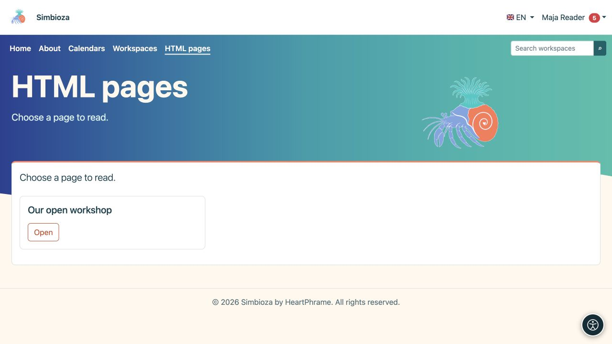

# Standalone HTML pages

**Goal:** publish pages without workspaces, for example on a simple website. They use the same [HTML Editor](uredivanje-stranica_en.md), with different organisation, saving and permissions.

## Read a page

Choose **HTML pages** in navigation and open a listed title. Only pages you may read appear. In a full installation with Workspaces, this menu item may be absent when no standalone pages exist; find workspace content through [Workspaces](podrucja-citanje_en.md).

<figure class="my-4">

<figcaption>Choose Open beside an accessible page. This reader view does not show administrator actions.</figcaption>
</figure>

## Create or edit a page

1. With creation permission, select **Manage content** on the page list.
2. In the editor, choose **Create** for a new page or **Open** for an accessible existing page.
3. Enter the required title/details and edit the content.
4. Select **Save** and open its reader view to check text, media and links.

**Result:** a standalone page saves directly, without workspace review submission and separate publication. Do not apply the workspace publication procedure to this kind of page.

**Add** permission allows creating and editing your own pages. Global **Edit** permits work with all standalone HTML pages. Ask the administrator to check these permissions if actions are missing; public read access does not allow editing.

## Set its audience

An authorised person opens the standalone page's access settings. **Page access** and user/group grants determine reading the page and its attachments. Reading is not editing.

To check public access, open the link signed out. For a private page, test both an allowed reader and an account without access. An access-denied or not-found message cannot be bypassed by rewriting the URL; request access from the responsible person.

## Workspaces added later

Existing standalone pages continue working until an administrator explicitly moves them. The administrator uses **HTML Editor settings → Pages outside workspaces**, reviewing the target workspace and its permissions. Afterwards, the page belongs to the workspace and its workflow; do not move server files manually.

For images, attachments, translations, history and export, use [the editor guide](uredivanje-stranica_en.md). Site menus may link standalone pages, calendars and surveys without replacing their separate access rules.
