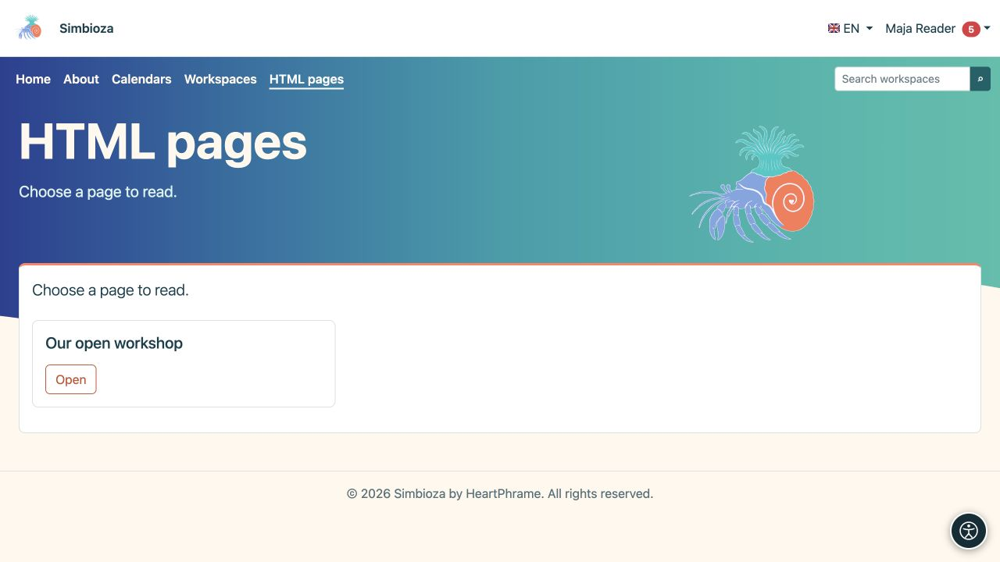

# Páginas HTML independientes

> Las capturas de pantalla muestran la interfaz en inglés.

**Objetivo:** publicar páginas sin espacios de trabajo, por ejemplo, en un sitio web sencillo. Usan el mismo [HTML Editor](uredivanje-stranica_es.md), con diferente organización, guardado y permisos.

## leer una pagina

Elija **HTML páginas** en la navegación y abra un título listado. Sólo aparecen las páginas que puede leer. En una instalación completa con Workspaces, este elemento de menú puede estar ausente cuando no existen páginas independientes; encuentre el contenido del espacio de trabajo a través de [Espacios de trabajo](podrucja-citanje_es.md).

<figure class="my-4">

<figcaption>Elija Abrir junto a una página accesible. Esta vista del lector no muestra las acciones del administrador.</figcaption>
</figure>

## Crear o editar una página

1. Con permiso de creación, seleccione **Administrar contenido** en la lista de páginas.
2. En el editor, elija **Crear** para una página nueva o **Abrir** para una página existente accesible.
3. Ingrese el título/los detalles requeridos y edite el contenido.
4. Seleccione **Guardar** y abra la vista de lector para verificar el texto, los medios y los enlaces.

**Resultado:** una página independiente se guarda directamente, sin envío de revisión del espacio de trabajo ni publicación por separado. No aplicar el procedimiento de publicación del espacio de trabajo a este tipo de páginas.

El permiso **Añadir** permite crear y editar sus propias páginas. El permiso global **Editar** permite trabajar con todas las páginas HTML independientes. Si faltan acciones, pida al administrador que revise estos permisos; el acceso público de lectura no permite editar.

## Establecer su audiencia

Una persona autorizada abre la configuración de acceso a la página independiente. El **acceso a la página** y las concesiones de usuario/grupo determinan la lectura de la página y sus archivos adjuntos. Leer no es editar.

Para comprobar el acceso público, abra el enlace cerrado. Para una página privada, pruebe tanto un lector permitido como una cuenta sin acceso. Un mensaje de acceso denegado o no encontrado no se puede omitir reescribiendo la URL; solicitar acceso a la persona responsable.

## Espacios de trabajo agregados más tarde

Las páginas independientes existentes continúan funcionando hasta que un administrador las mueve explícitamente. El administrador usa **HTML Configuración del editor → Páginas fuera de los espacios de trabajo**, revisando el espacio de trabajo de destino y sus permisos. Posteriormente, la página pertenece al espacio de trabajo y su flujo de trabajo; no mueva los archivos del servidor manualmente.

Para imágenes, archivos adjuntos, traducciones, historial y exportación, utilice [la guía del editor](uredivanje-stranica_es.md). Los menús del sitio pueden vincular páginas independientes, calendarios y encuestas sin reemplazar sus reglas de acceso independientes.
