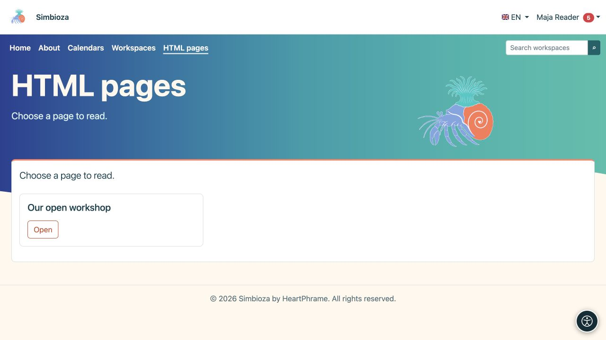

# Pages HTML autonomes

> Les captures d’écran présentent l’interface en anglais.

**Objectif :** publier des pages sans espaces de travail, par exemple sur un simple site Web. Ils utilisent le même [HTML Editor](uredivanje-stranica_fr.md), avec une organisation, une sauvegarde et des autorisations différentes.

## Lire une page

Choisissez **HTML pages** dans la navigation et ouvrez un titre répertorié. Seules les pages que vous pouvez lire apparaissent. Dans une installation complète avec Espaces de travail, cet élément de menu peut être absent lorsqu'aucune page autonome n'existe ; recherchez le contenu de l’espace de travail via [Espaces de travail](podrucja-citanje_fr.md).

<figure class="my-4">

<figcaption>Choisissez Ouvrir à côté d’une page accessible. Cette vue du lecteur n'affiche pas les actions de l'administrateur.</figcaption>
</figure>

## Créer ou modifier une page

1. Avec l'autorisation de création, sélectionnez **Gérer le contenu** dans la liste des pages.
2. Dans l'éditeur, choisissez **Créer** pour une nouvelle page ou **Ouvrir** pour une page existante accessible.
3. Entrez le titre/les détails requis et modifiez le contenu.
4. Sélectionnez **Enregistrer** et ouvrez la vue Lecteur pour vérifier le texte, les médias et les liens.

**Résultat :** une page autonome est enregistrée directement, sans soumission de révision de l'espace de travail ni publication séparée. N'appliquez pas la procédure de publication de l'espace de travail à ce type de page.

L'autorisation **Ajouter** permet de créer et de modifier vos propres pages. Global **Edit** permet de travailler avec toutes les pages HTML autonomes. Demandez à l'administrateur de vérifier ces autorisations si des actions sont manquantes ; l'accès public en lecture ne permet pas l'édition.

## Définir son audience

Une personne autorisée ouvre les paramètres d'accès de la page autonome. **L'accès à la page** et les autorisations d'utilisateur/groupe déterminent la lecture de la page et de ses pièces jointes. Lire n’est pas éditer.

Pour vérifier l'accès public, ouvrez le lien déconnecté. Pour une page privée, testez à la fois un lecteur autorisé et un compte sans accès. Un message d'accès refusé ou introuvable ne peut pas être contourné en réécrivant l'URL ; demander l’accès à la personne responsable.

## Espaces de travail ajoutés ultérieurement

Les pages autonomes existantes continuent de fonctionner jusqu'à ce qu'un administrateur les déplace explicitement. L'administrateur utilise **HTML Paramètres de l'éditeur → Pages en dehors des espaces de travail**, en examinant l'espace de travail cible et ses autorisations. Ensuite, la page appartient à l'espace de travail et à son workflow ; ne déplacez pas les fichiers du serveur manuellement.

Pour les images, les pièces jointes, les traductions, l'historique et l'exportation, utilisez [le guide de l'éditeur](uredivanje-stranica_fr.md). Les menus du site peuvent relier des pages autonomes, des calendriers et des sondages sans remplacer leurs règles d'accès distinctes.
