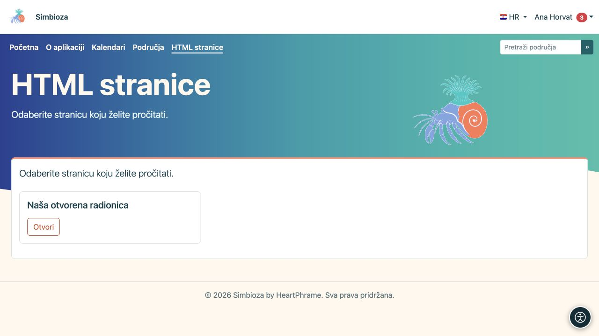

# Samostalne HTML stranice

**Cilj:** objavljivati stranice bez područja, primjerice na jednostavnom webu. Koristi se isti [HTML editor](uredivanje-stranica_hr.md); razlikuju se organizacija, spremanje i prava.

## Pročitajte stranicu

U izborniku **HTML stranice** otvorite naslov s popisa. Prikazane su samo stranice koje smijete čitati. Na punoj instalaciji s Područjima ova stavka ne mora postojati ako nema samostalnih stranica; sadržaj područja tada tražite kroz [Područja](podrucja-citanje_hr.md).

<figure class="my-4">

<figcaption>Odaberite Otvori uz dopuštenu stranicu. Ovaj čitateljski prikaz ne prikazuje administratorske radnje.</figcaption>
</figure>

## Napravite ili uredite stranicu

1. Ako imate pravo stvaranja, na popisu odaberite **Upravljanje sadržajem**.
2. U editoru odaberite **Kreiraj** za novu ili **Otvori** za postojeću dopuštenu stranicu.
3. Unesite traženi naslov/podatke i uredite sadržaj.
4. Odaberite **Spremi** i otvorite čitateljski prikaz radi provjere teksta, medija i poveznica.

**Rezultat:** samostalna stranica sprema se izravno; nema područnog postupka slanja na pregled i odvojene objave. Ne primjenjujte postupak objave iz Područja na ovaj oblik stranice.

Pravo **Dodavanje** dopušta stvaranje i uređivanje vlastitih stranica. Globalno **Uređivanje** dopušta rad sa svim samostalnim HTML stranicama. Ako nemate te radnje, administrator treba provjeriti odgovarajuća prava; javna čitljivost ne daje uređivanje.

## Odredite publiku

Ovlaštena osoba otvara postavke pristupa odabrane samostalne stranice. **Pristup stranici** i dodjele korisnicima/grupama određuju čitanje stranice i njezinih privitaka. Pravo čitanja nije pravo uređivanja.

Za provjeru javnosti otvorite poveznicu bez prijave. Za privatnu stranicu provjerite i račun koji smije čitati i račun koji ne smije. Poruka o odbijenom pristupu ili nepronađenoj stranici ne zaobilazi se prepisivanjem URL-a; zatražite pravo od odgovorne osobe.

## Kasnije dodana Područja

Postojeće samostalne stranice nastavljaju raditi dok ih administrator izričito ne premjesti. Premještanje kroz **Postavke HTML editora → Stranice izvan područja** obavlja administrator, uz pregled ciljnoga područja i njegovih prava. Nakon premještanja stranica pripada području i njegovu postupku rada; nemojte samostalno premještati datoteke na poslužitelju.

Za umetanje slika, privitke, prijevode, povijest i izvoz koristite [upute editora](uredivanje-stranica_hr.md). Izbornik sitea može povezivati samostalne stranice, kalendare i ankete; to nije zamjena za njihove zasebne dozvole.
