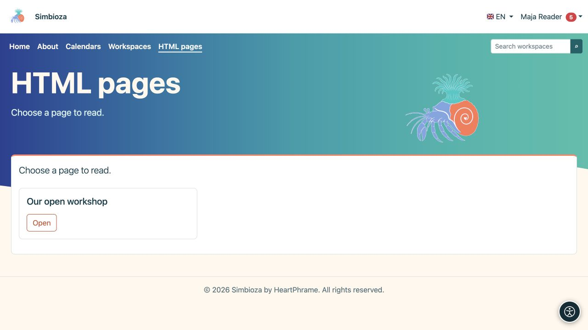

# Pagine HTML indipendenti

> Le immagini mostrano l'interfaccia in inglese.

**Obiettivo:** pubblicare pagine senza aree di lavoro, per esempio in un sito semplice. Utilizzano lo stesso [editor HTML](uredivanje-stranica_it.md), con organizzazione, salvataggio e autorizzazioni differenti.

## Leggere una pagina

Scegliere **Pagine HTML** nella navigazione e aprire uno dei titoli elencati. Compaiono soltanto le pagine che si è autorizzati a leggere. In un'installazione completa con aree di lavoro, questa voce del menu può essere assente quando non esistono pagine indipendenti; cercare i contenuti delle aree attraverso [Aree di lavoro](podrucja-citanje_it.md).

<figure class="my-4">

<figcaption>Scegliere Apri accanto a una pagina accessibile. Questa vista per i lettori non mostra le azioni di amministrazione.</figcaption>
</figure>

## Creare o modificare una pagina

1. Se si dispone dell'autorizzazione alla creazione, selezionare **Gestisci contenuti** nell'elenco delle pagine.
2. Nell'editor, scegliere **Crea** per una pagina nuova oppure **Apri** per una pagina esistente accessibile.
3. Inserire il titolo e i dettagli richiesti e modificare il contenuto.
4. Selezionare **Salva** e aprire la vista per i lettori per verificare testo, contenuti multimediali e collegamenti.

**Risultato:** una pagina indipendente viene salvata direttamente, senza l'invio per revisione e la pubblicazione separata previsti nelle aree di lavoro. Non applicare la procedura di pubblicazione delle aree di lavoro a questo tipo di pagina.

L'autorizzazione **Aggiungi** consente di creare e modificare le proprie pagine. L'autorizzazione globale **Modifica** permette di lavorare su tutte le pagine HTML indipendenti. Se mancano alcune azioni, chiedere all'amministratore di verificare queste autorizzazioni; l'accesso pubblico in lettura non permette la modifica.

## Impostare i destinatari

Una persona autorizzata apre le impostazioni di accesso della pagina indipendente. **Accesso alla pagina** e le autorizzazioni assegnate a utenti e gruppi determinano la possibilità di leggere la pagina e i suoi allegati. La lettura non comporta il diritto di modifica.

Per verificare l'accesso pubblico, aprire il collegamento senza aver effettuato l'accesso. Per una pagina privata, provare sia con un lettore autorizzato sia con un account privo di accesso. Un messaggio di accesso negato o di pagina non trovata non può essere aggirato riscrivendo l'URL; richiedere l'accesso alla persona responsabile.

## Aree di lavoro aggiunte successivamente

Le pagine indipendenti esistenti continuano a funzionare finché un amministratore non le sposta esplicitamente. L'amministratore utilizza **Impostazioni dell'editor HTML → Pagine esterne alle aree di lavoro**, verificando l'area di destinazione e le relative autorizzazioni. Dopo lo spostamento, la pagina appartiene all'area di lavoro e ne segue il flusso di gestione; non spostare manualmente i file del server.

Per immagini, allegati, traduzioni, cronologia ed esportazione, consultare [la guida dell'editor](uredivanje-stranica_it.md). I menu del sito possono collegare pagine indipendenti, calendari e sondaggi senza sostituirne le rispettive regole di accesso.
