# Besprechungen – Schritt für Schritt

> Die Bildschirmaufnahmen zeigen die englische Benutzeroberfläche.

## 1. Bevor Sie beginnen: Was ein Meeting ist

Dieser Leitfaden führt Sie durch die Planung, die Reservierung eines Raums und die Teilnahme an einer Besprechung. Es sind keine technischen Kenntnisse erforderlich. Öffnen Sie **Kalender → Besprechung planen**. Öffnen Sie Vorschläge, obligatorische Besprechungen und Reservierungsanfragen erneut über **Meine Besprechungen** oder einen Link unter **Benachrichtigungen** in Ihrem Benutzermenü.

**Eine Besprechung wird nur einmal gespeichert.** Wählen Sie den Quellkalender. Wenn der Raum zu einem anderen Kalender gehört, ist seine Reservierung mit derselben Besprechung verknüpft: Es werden keine unabhängigen Kopien für jeden Teilnehmer erstellt. Teilnehmer sehen es über *Meine Besprechungen*, auch wenn sie den Teamkalender nicht abonniert haben.

Beispiele verwenden eine neue Testinstallation, fiktive Benutzer und Daten im Oktober 2026. Alle Screenshots verwenden das helles Design. Ihre Namen und Daten können abweichen; die Schritte sind die gleichen. Es werden keine echten privaten Verpflichtungen ausgewiesen.

## 2. Rollen und Berechtigungen

| Rolle | Was Sie tun können |
|----|----|
| Veranstalter | Jeder angemeldete Benutzer kann die Zeiten überprüfen. Speichern Sie es in einem Kalender, in den Sie schreiben können, wählen Sie Teilnehmer aus und fordern Sie eine Reservierung an, wenn Sie nicht an die Ressource schreiben können. |
| Ressourcengenehmiger | Öffnen Sie die Anfrage und genehmigen oder lehnen Sie den Raum ab. Der Veranstalter entscheidet, wer die Anfrage erhält; es muss nicht jedermanns Sache sein. |
| Teilnehmer | Sehen Sie sich Ihr Meeting an. Wenn eine Antwort angefordert wird, wählen Sie „Ja“, „Vielleicht“ oder „Nein“ und fügen Sie einen Kommentar hinzu. Dadurch wird keine Berechtigung erteilt, den Kalender einer anderen Person zu bearbeiten oder die Besprechung abzusagen. |
| Kalendermanager/Administrator | Verwalten Sie den Zugriff, die Standardteilnehmer und optionale Ressourcenprofile entsprechend Ihren Berechtigungen. |

Die Erlaubnis, ein Zimmer zu besichtigen, ist nicht dasselbe wie die Erlaubnis, es zu reservieren. Durch das Abonnieren eines Teamkalenders sind Sie nicht Teilnehmer jeder Veranstaltung.

## 3. Sie haben keinen eigenen Kalender

1.  Öffnen Sie den Planer. Sie können ohne eigenen Kalender nach verfügbaren Zeiten suchen.
2.  Wenn Sie eine möchten, wählen Sie im blauen Feld **Offiziell** für geschäftliche Zwecke, **Persönlich** für private Verpflichtungen oder **Benutzerdefiniert** für Ihren eigenen Namen aus.
3.  Nur **Ausgewählten Kalender erstellen** erstellt ihn. Beim Öffnen des Planers entsteht nichts.
4.  Wenn Sie bereits in einen Team- oder Ressourcenkalender schreiben können, speichern Sie ihn dort, ohne einen eigenen zu erstellen.

Beide Typen gehören zu einer Person; Wie Sie sie verwenden, ist Ihre Entscheidung. Verwalten Sie den Kalender, Importe und Zugriff später in Ihren Kalendereinstellungen.

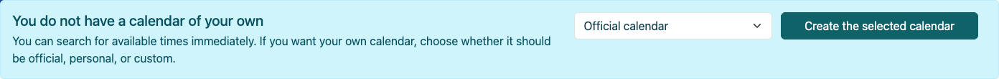Wählen Sie einen Typ aus, bevor Sie einen Kalender erstellen.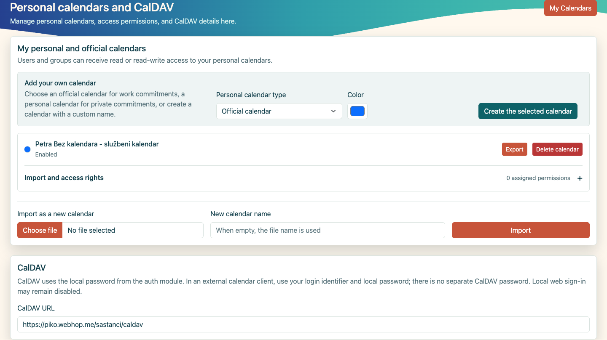Persönliche Kalendereinstellungen: Import- und Zugriffskontrollen befinden sich in einem erweiterbaren Bereich.

## 4. Schritt 1 – Titel, Beschreibung und Zielkalender

1.  Geben Sie einen eindeutigen **Besprechungstitel** ein, zum Beispiel „Projektbesprechung“.
2.  Verwenden Sie **Beschreibung und Anweisungen** für das Thema, die Tagesordnung oder den Link zur Online-Besprechung.
3.  **Im Kalender speichern** bietet Ihre persönlichen und offiziellen Kalender sowie Team- und Ressourcenkalender, in die Sie schreiben können.
4.  Wenn Sie einen bestimmten Teamkalender wünschen, wählen Sie ihn selbst aus. Diese Wahl bleibt bestehen, wenn Sie eine Zeit und einen Raum auswählen.

Wenn Sie nicht explizit ein anderes Ziel ausgewählt haben, wird ein beschreibbarer Raum zum Standard-Quellkalender. Wenn Sie nicht in den Raum schreiben können, ist die Quelle Ihr ausgewählter persönlicher, offizieller oder Teamkalender und die Raumreservierung ist damit verknüpft.

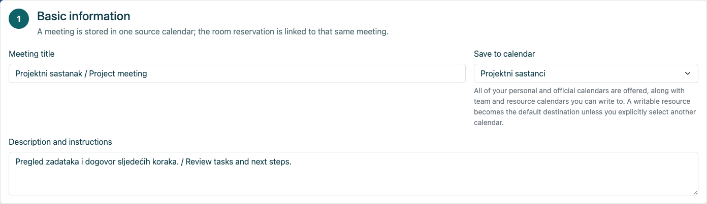Der Organisator hat einen Teamkalender als Besprechungsquelle ausgewählt.

## 5. Schritt 2 – Personen, Gruppen und Alle

1.  Öffnen Sie für eine Einzelperson **Person hinzufügen**, suchen Sie einen Benutzer und klicken Sie auf **Hinzufügen**. Wiederholen Sie dies für andere.
2.  Überprüfen Sie für ein Team eine Gruppe wie **Projektni tim**. Auth-Gruppenmitglieder werden zu Teilnehmern, ohne dass jede einzelne Person eingegeben werden muss.
3.  Aktivieren Sie für ein organisationsweites Meeting **Alle aktiven Benutzer**. Wenn die Site auch externe Benutzer hat, wählen Sie stattdessen die entsprechende Mitarbeitergruppe aus, wenn nur Mitarbeiter teilnehmen sollen.
4.  **Die Standardteilnehmer des ausgewählten Kalenders einbeziehen** fügt Personen und Gruppen hinzu, die mit diesem Kalender verknüpft sind. Schalten Sie es aus, wenn sie für dieses Ereignis nicht benötigt werden.

Eine Person wird einmal gezählt, auch wenn sie direkt und über mehrere Gruppen ausgewählt wird. Abonnements sind keine Anwesenheitslisten. Veranstaltungen ohne Teilnehmer können informativ bleiben.

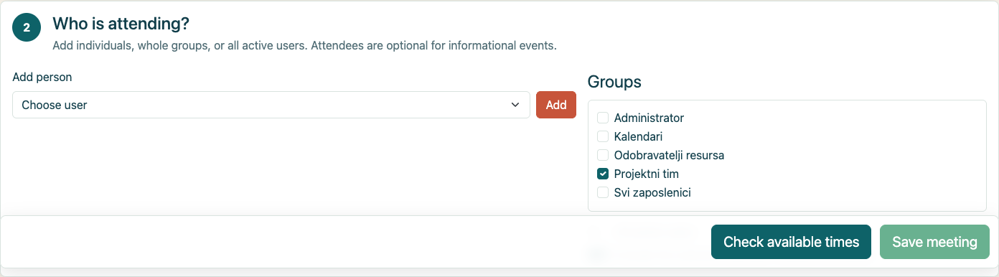Gruppenteilnehmer und optionale Übernahme aus dem Kalender.

## 6. Schritt 3 – Den besten Zeitpunkt finden

1.  Wählen Sie **Beste Zeiten finden**.
2.  Geben Sie das erste und letzte Datum ein. Beginnen Sie mit einem oder mehreren Tagen.
3.  Legen Sie den frühesten Start, das späteste Ende und die **Dauer** fest.
4.  Überprüfen Sie die zulässigen Wochentage, zum Beispiel Montag und Mittwoch.
5.  Wählen Sie **Wie viele Teilnehmer müssen verfügbar sein?**: Jeder, Große Mehrheit, Mehrheit oder alle Optionen.
6.  Wählen Sie im nächsten Schritt ein Zimmer aus und klicken Sie auf **Verfügbare Zeiten prüfen**.

Die besten Optionen werden zuerst angezeigt. Lesen Sie immer die tatsächliche Anzahl der verfügbaren Teilnehmer: Die Überprüfung der Verfügbarkeit ist nicht dasselbe wie der Empfang ihrer Antworten.

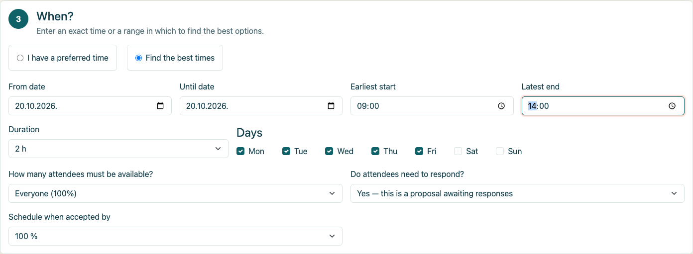Suchbedingungen: Datum, Uhrzeit, Dauer und Wochentage.

## 7. Schritt 3a – Sie haben bereits einen Wunschtermin

1.  Wählen Sie **Ich habe eine Wunschzeit**.
2.  Geben Sie ein Datum, einen Start und ein Ende ein. Das Ende muss nach dem Anfang liegen.
3.  Fügen Sie Teilnehmer und eine Ressource hinzu und klicken Sie dann auf **Verfügbare Zeiten prüfen**.
4.  Lesen Sie die verfügbare Teilnehmerzahl und erweitern Sie bei Bedarf **Beschäftigte Teilnehmer**.
5.  Wenn einige nicht teilnehmen können, ändern Sie das Datum oder die Uhrzeit oder wählen Sie bewusst eine Besprechung mit weniger verfügbaren Teilnehmern.

Die Verfügbarkeit umfasst persönliche und offizielle Kalender und Ereignisse, an denen die Person tatsächlich als Teilnehmer teilnimmt. Eine Person gilt nicht nur deshalb als beschäftigt, weil sie einen Informationskalender abonniert hat. Das System kennt nur Obligos, die in Simbioza erfasst sind.

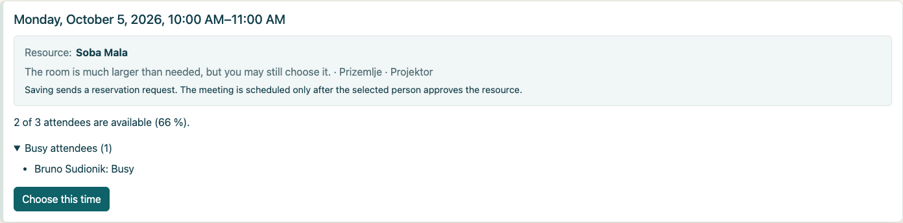Dass Bruno beschäftigt ist, sieht der Veranstalter, nicht aber die Einzelheiten seines privaten Engagements.

## 8. Schritt 4 – Welcher Raum überprüft werden soll

1.  Wählen Sie einen oder mehrere Räume mit Kontrollkästchen aus. Klicken Sie erneut, um die Auswahl aufzuheben.
2.  Wenn nichts ausgewählt ist, werden **alle tatsächlichen Ressourcen** überprüft.
3.  Aktivieren Sie für ein Online-Meeting, Ihr eigenes Büro oder ein nicht gelistetes Restaurant explizit **Keine Ressource**. Diese Option wird nie automatisch hinzugefügt.
4.  Geben Sie die erforderliche Anzahl an Sitzplätzen ein. Wenn einige Raumkapazitäten unbekannt sind, entscheiden Sie, ob **Ressourcen ohne angegebene Kapazität** einbezogen werden sollen.
5.  Klicken Sie auf **Verfügbare Zeiten prüfen**.

Ein Ressourcenprofil ist optional. Bei unbekanntem Fassungsvermögen prüfen Sie selbst die Eignung. In einem viel größeren oder kleineren Raum wird eine Warnung angezeigt, die jedoch nicht verboten ist. Zusätzliche Stühle oder eine andere Anordnung sind möglicherweise möglich.

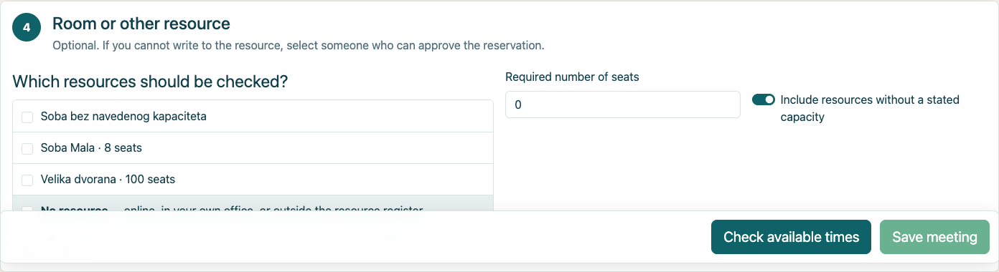Kontrollkästchen können aktiviert und deaktiviert werden; Keine Ressource ist eine explizite Wahl.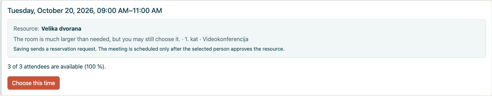Ein großer Raum ist nicht verboten, aber der Warnhinweis hilft bei der Auswahl.

## 9. Ergebnisse – jede Karte hat bereits eine Zeit und eine Ressource

1.  Lesen Sie Datum und Uhrzeit der Karte ab.
2.  Lesen Sie direkt darunter den Ressourcennamen, die Kapazität und die verfügbaren Rauminformationen.
3.  Lesen Sie den Anteil der verfügbaren Teilnehmer. Beim Durchsuchen aller Räume können mehrere Karten gleichzeitig angezeigt werden, eine für jede freie Ressource.
4.  Klicken Sie auf der gewünschten Karte auf **Dieses Mal auswählen**. Es gibt kein späteres Ressourcen-Dropdown.
5.  Folgen Sie der Bestätigung auf dieser Karte. Nachdem Sie die Suchbedingungen geändert haben, überprüfen Sie die Zeit erneut und wählen Sie sie aus.

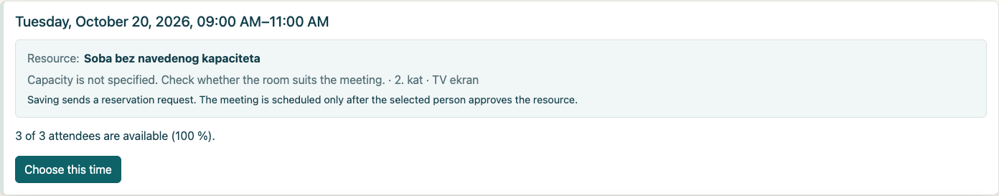Der Zeitpunkt und ein bestimmter Raum bilden eine angebotene Option.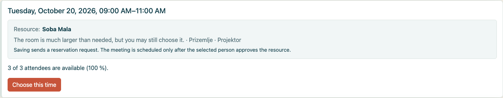Eine andere Karte bietet die gleiche Zeit mit einem anderen Zimmer.

## 10. Sie können in den Ressourcenkalender schreiben

1.  Wählen Sie eine kostenlose Zimmerkarte. In der Beschreibung steht, dass die Reservierung sofort bestätigt wird.
2.  Klicken Sie auf **Dieses Mal auswählen**.
3.  Klicken Sie in der grünen Bestätigung auf derselben Karte auf **Besprechung speichern**. Sie müssen nicht nach einem nicht spezifizierten „letzten Knopf“ suchen.
4.  Die gespeicherten Besprechungsdetails werden geöffnet. Das Zimmer ist reserviert. Es ist eine Pflichtbesprechung anberaumt; ein Vorschlag wartet immer noch auf Antworten, wenn Sie diesen Modus ausgewählt haben.

Durch die Auswahl einer Zeit wird nicht gespart. Beenden Sie den Vorgang mit der Schaltfläche „Speichern“ auf der ausgewählten Karte. Das Zimmer wird zum gespeicherten Zeitpunkt noch einmal überprüft, da es möglicherweise bereits von jemand anderem reserviert wurde.

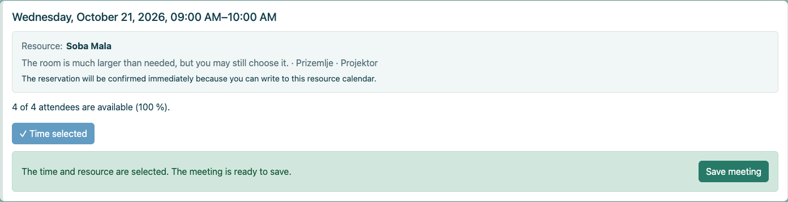Ein Benutzer mit Schreibrecht speichert ab der Bestätigung der Karte.

## 11. Sie können nicht an die Ressource schreiben – fordern Sie eine Reservierung an

1.  Wählen Sie ein freies Zimmer und klicken Sie auf **Dieses Mal auswählen**.
2.  Auf dieser Karte wird ein Reservierungsbestätigungsfeld geöffnet.
3.  Wählen Sie mindestens eine angebotene Person aus, die das Zimmer genehmigen kann. Senden Sie es nicht unnötig an alle.
4.  Verwenden Sie **Nachricht an den Genehmiger**, um den Grund zu erläutern, zum Beispiel „Bitte reservieren Sie einen Raum für das Projektteam“.
5.  Klicken Sie in der Bestätigung auf derselben Karte auf **Zeitauswahl bestätigen** und dann auf **Reservierungsanfrage senden**.
6.  Aktivieren Sie **Warten auf Ressourcenbestätigung** in den Details. Das Treffen ist noch nicht geplant.

Wenn kein Genehmiger angeboten wird, wenden Sie sich an den Kalendermanager. Sie können die Berechtigungen des Raums nicht selbst umgehen.

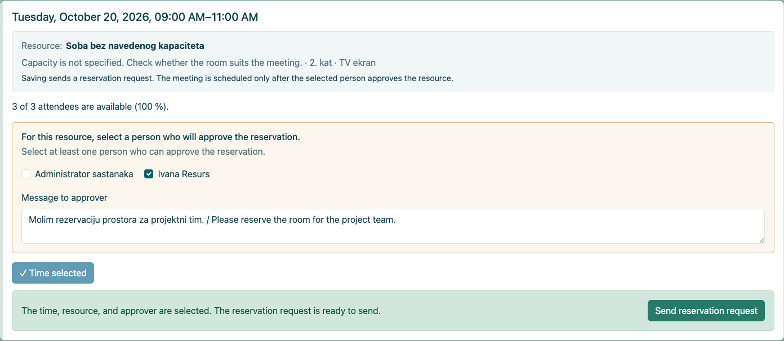Der Organisator wählt einen Genehmiger aus und sendet die Anfrage innerhalb der gewählten Zeit.

## 12. Was ist, wenn jemand anderes das Zimmer möchte, während Sie warten?

Eine Anfrage, die auf Bestätigung wartet, **hält das Zimmer vorübergehend**. Einem anderen Organisator wird mitgeteilt, dass für diesen Zeitpunkt eine Anfrage vorliegt. Dies gilt sowohl für Benutzer mit Schreibrecht als auch für andere Anfragende.

1.  Wenn Sie eine Warnung zu einer ausstehenden Anfrage sehen, betrachten Sie das Zimmer nicht als frei.
2.  Wählen Sie einen anderen Raum oder eine andere Zeit oder warten Sie auf eine Entscheidung.
3.  Bei Ablehnung oder Stornierung wird das Zimmer freigegeben, sodass es in einem neuen Prüfung angeboten werden kann.

Warten ist keine automatische Genehmigung. Eine endgültige Reservierung bedarf der Genehmigung; eine erneute Überprüfung zum Speicherzeitpunkt verhindert, dass eine weitere Anfrage umgangen wird.

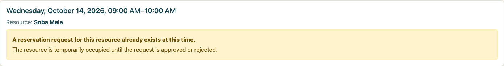Ein anderer Organisator sieht, dass der Raum durch eine frühere ausstehende Anfrage belegt ist.

## 13. Genehmiger – Benachrichtigung und Raumgenehmigung

1.  Öffnen Sie Ihr Benutzermenü und dann **Benachrichtigungen**.
2.  Suchen Sie nach **Ressourcenreservierungsanfrage**. Überprüfen Sie den Titel und die Uhrzeit des Meetings.
3.  Klicken Sie auf den Besprechungslink. Es öffnet sich diese spezifische Anfrage, nicht nur eine allgemeine Liste.
4.  Überprüfen Sie in der **Ressourcen**-Karte den Raum und fügen Sie optional eine Nachricht an den Organisator hinzu.
5.  Klicken Sie auf **Genehmigen**. Die Ressource wird **Reserviert**.

Der Veranstalter wird benachrichtigt. Dann wird ein verbindliches oder bereits vereinbartes Treffen terminiert. Bei einem Vorschlag erhalten die Teilnehmer die Einladung zur Antwort erst, nachdem der Raum bestätigt wurde.

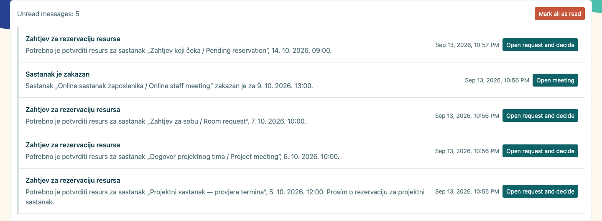Ivana erhält eine Benachrichtigung mit einem Link zur Anfrage.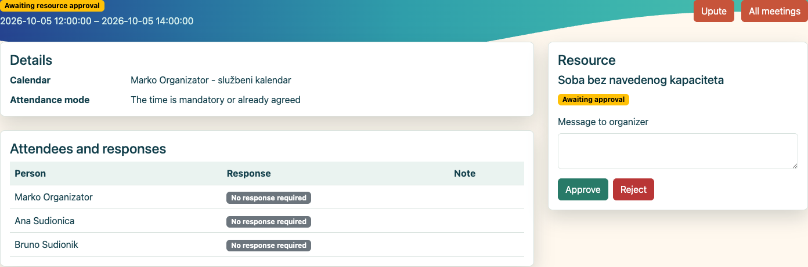Der Genehmiger entscheidet in der Ressourcenkarte.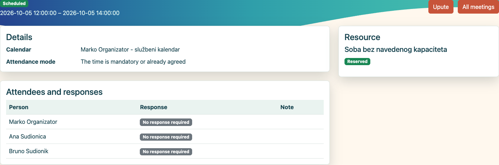Genehmigter Raum und geplante obligatorische Besprechung.

## 14. Genehmigen – den Raum ablehnen

1.  Öffnen Sie die Anfrage über ihre Benachrichtigung.
2.  Erläutern Sie den Grund in der **Nachricht an den Organisator**, zum Beispiel, dass der Raum ungeeignet ist.
3.  Klicken Sie auf **Ablehnen**.
4.  Überprüfen Sie **Ressourcenreservierung abgelehnt**.

Der Raum wird für andere freigegeben. Der Organisator wird benachrichtigt und kann über **Bearbeiten** einen anderen Raum oder eine andere Zeit finden und eine neue Anfrage senden. Die Ablehnung eines Raums ist etwas anderes als die Ablehnung der Anwesenheit eines Teilnehmers.

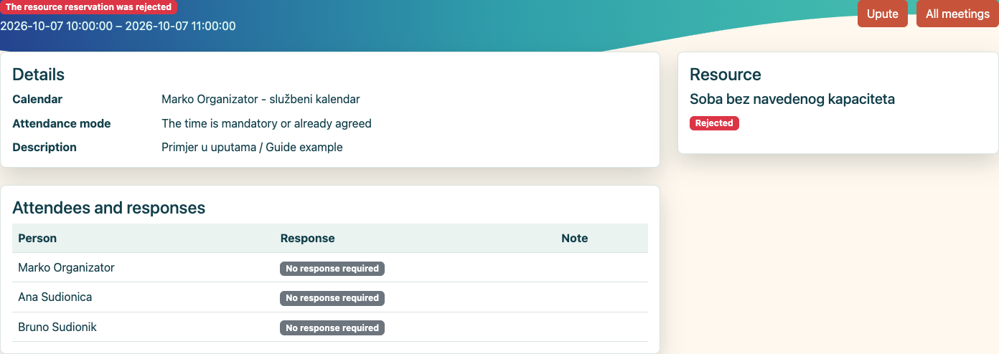Der Antrag wird abgelehnt; der Veranstalter sieht das Ergebnis im Detail.

## 15. Obligatorisches Treffen oder Vorschlag – zwei verschiedene Möglichkeiten

Wählen Sie unter **Sollten die Teilnehmer antworten?** Folgendes aus:

- **Nein – obligatorisch / bereits vereinbarter Zeitpunkt**: Die Teilnehmer werden benachrichtigt, es wird jedoch keine Ja/Nein-Antwort angefordert. Wenn für den Raum eine Genehmigung erforderlich ist, muss diese Genehmigung dennoch zuerst eingeholt werden.
- **Ja – ein Vorschlag, der auf Antworten wartet**: Teilnehmer antworten. Wählen Sie außerdem **Planung bei Annahme durch** (100 %, 80 %, 60 % oder 50 %).

Der bei der Suche verwendete Schwellenwert für die verfügbare Person unterscheidet sich vom Schwellenwert für die akzeptierte Antwort. Die erste hilft dabei, anhand der aufgezeichneten Verpflichtungen einen Zeitpunkt zu ermitteln. Die zweite bestimmt, wann die Einladung geplant wird. Der Veranstalter ist von den Personen ausgeschlossen, deren Bestätigung erwartet wird.

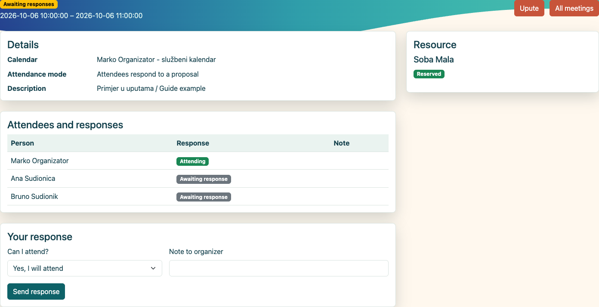Ein Vorschlag mit Teilnehmertabelle und Antwortformular.

## 16. Teilnehmer – Akzeptieren der Anwesenheit

1.  Öffnen Sie **Benachrichtigungen** und suchen Sie nach **Besprechungsvorschlag**.
2.  Öffnen Sie den Besprechungslink. Überprüfen Sie Datum, Uhrzeit, Raum und Beschreibung.
3.  Wählen Sie unter **Ihre Antwort → Kann ich teilnehmen?** die Option **Ja, ich werde teilnehmen** aus.
4.  Fügen Sie optional einen Kommentar für den Organisator hinzu.
5.  Klicken Sie auf **Antwort senden**. In Ihrer Teilnehmerzeile wird **Anwesend** angezeigt.

Der Veranstalter wird mit Ihrem Namen und Kommentar benachrichtigt. Sobald genügend andere Teilnehmer zustimmen, wird die Besprechung automatisch geplant. Bei 100 % müssen alle Eingeladenen außer dem Organisator annehmen.

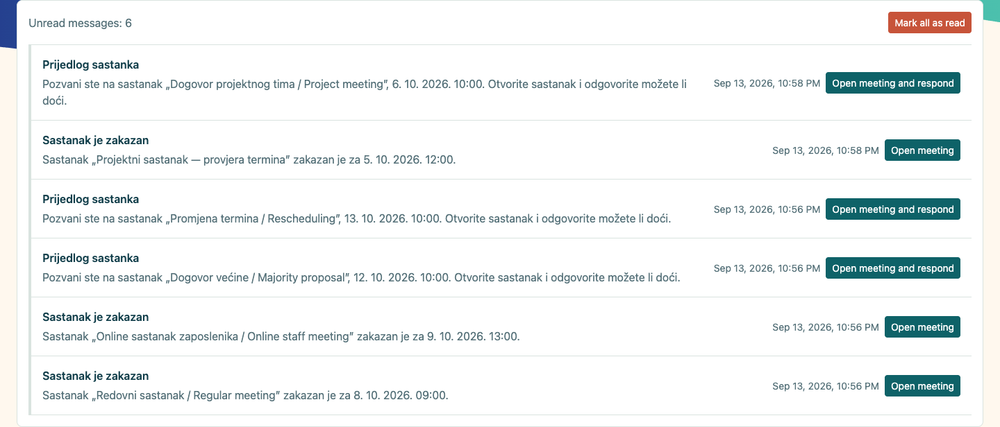Ana erhält eine Einladung; Sein Link öffnet das jeweilige Meeting.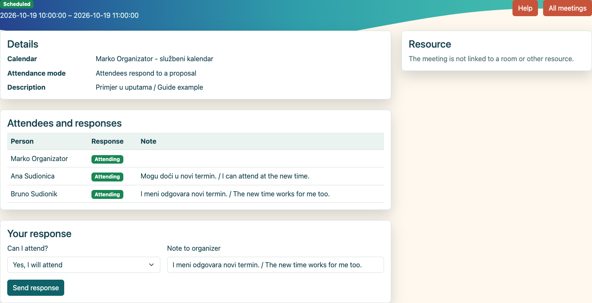Nach den erforderlichen Abnahmen wird das Treffen anberaumt.

## 17. Teilnehmer – Sie können nicht teilnehmen oder sind sich noch nicht sicher

1.  Öffnen Sie die Besprechung und wählen Sie unter **Ihre Antwort** die Option **Ich kann nicht teilnehmen** oder **Vielleicht** aus.
2.  Fügen Sie einen nützlichen Kommentar hinzu, z. B. „Bitte schlagen Sie einen anderen Zeitpunkt vor“ oder „Warten auf eine weitere Zusage“. Private Gründe müssen Sie nicht preisgeben.
3.  Klicken Sie auf **Antwort senden**.
4.  Überprüfen Sie Ihre Zeile. Die gespeicherte Auswahl und der Kommentar bleiben sichtbar, wenn Sie die Besprechung erneut öffnen.

Durch eine Ablehnung wird nicht die gesamte Sitzung abgesagt. Vielleicht ist das keine Akzeptanz. Der Veranstalter entscheidet, ob trotzdem ein neuer Zeitpunkt oder Zeitplan gefunden wird. Sie können Ihre Antwort ändern, wenn sich die Umstände ändern, während Antworten aktiviert bleiben.

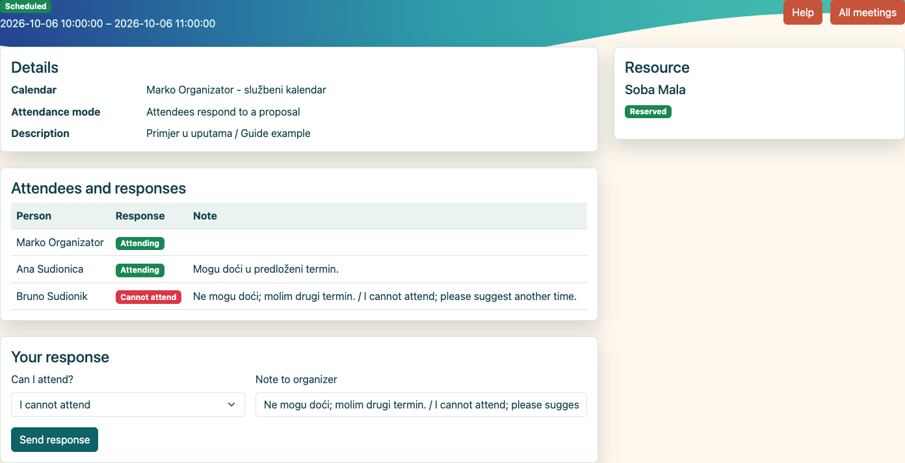Bruno lehnt die Teilnahme ab und bittet um einen anderen Termin.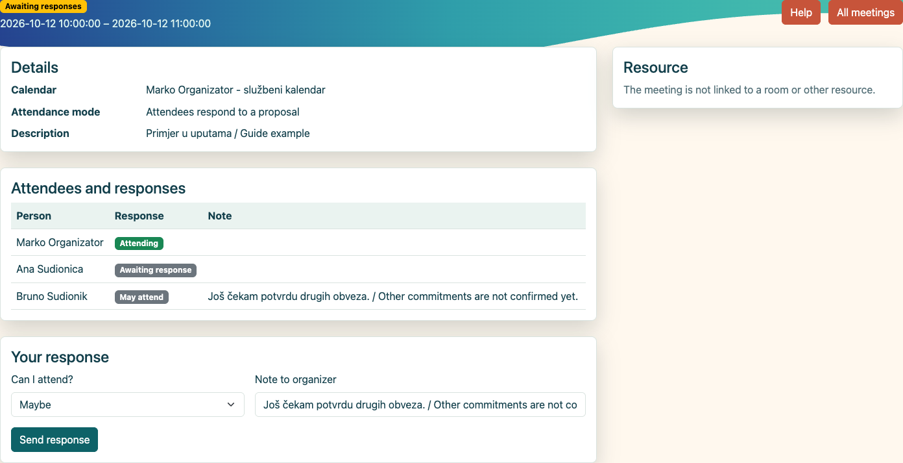Eine vorläufige Vielleicht-Antwort mit einem Kommentar.

## 18. Organisator – entscheidet, nachdem jemand abgelehnt hat

1.  Öffnen Sie die Antwortbenachrichtigung. Es identifiziert die Person und ihren Kommentar.
2.  Öffnen Sie die Besprechung und überprüfen Sie die gesamte Antworttabelle.
3.  Klicken Sie für eine andere Zeit auf **Bearbeiten**, ändern Sie das Datum oder die Uhrzeit, überprüfen Sie die Verfügbarkeit erneut und speichern Sie.
4.  Wenn die Besprechung diese Zeit trotzdem nutzen muss, klicken Sie in den Vorschlagsdetails bewusst auf **Diese Zeit trotzdem planen**.
5.  Überprüfen Sie **Geplant**. Die abgelehnte Antwort bleibt sichtbar; das System setzt es nicht in Akzeptanz um.

Bei der manuellen Planung wird die ausstehende Raumgenehmigung nicht umgangen. Die Ressource muss zuerst aufgelöst werden.

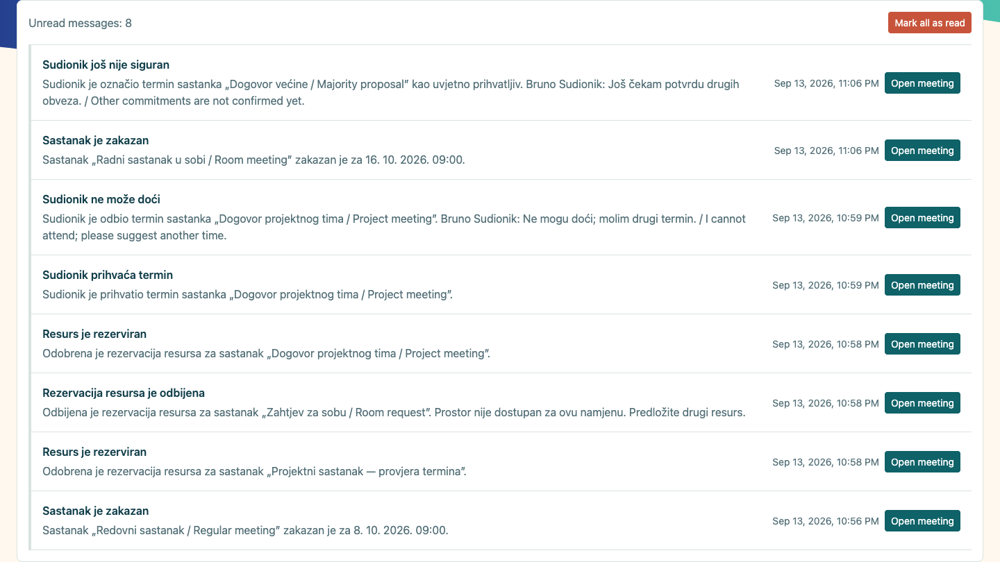Der Organisator sieht Antworten und Besprechungslinks.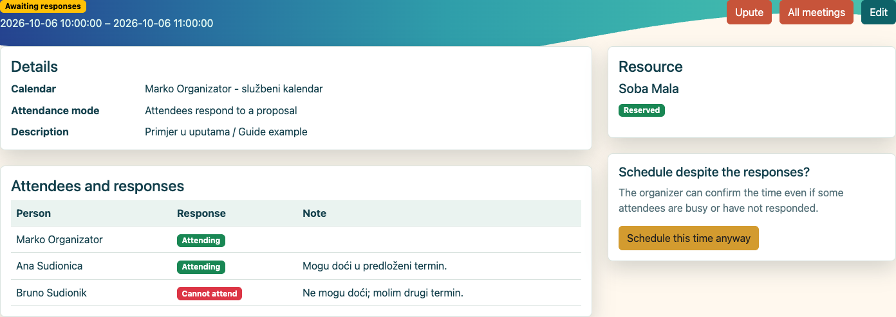Die Möglichkeit, trotz Antworten bewusst zu planen.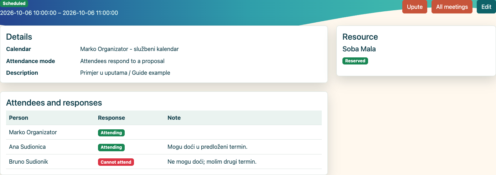Das geplante Treffen zeigt immer noch, dass Bruno nicht teilnehmen kann.

## 19. Zeit ändern und erneut um Antworten bitten

1.  Öffnen Sie das bestehende Meeting und klicken Sie auf **Bearbeiten**.
2.  Ändern Sie das Datum, den Beginn oder das Ende. Wählen Sie dieselbe oder eine andere Ressource.
3.  Klicken Sie auf **Verfügbare Zeiten prüfen**. Das alte Treffen darf nicht mit sich selbst in Konflikt geraten.
4.  Wählen Sie die neue Karte aus und speichern Sie sie oder senden Sie eine neue Zimmeranfrage.
5.  Teilnehmer erhalten eine Benachrichtigung mit der neuen Uhrzeit. Wenn Antworten erforderlich sind, werden vorherige Antworten gelöscht und neue angefordert.

Das Akzeptieren des alten Datums bedeutet nicht, dass man das neue akzeptiert. Das Treffen behält seine Identität und Verbindung; es wird keine zusätzliche Kopie erstellt. Der neue Raum oder die neue Zeit muss erneut die Verfügbarkeitsprüfung und die erforderliche Genehmigung bestehen.

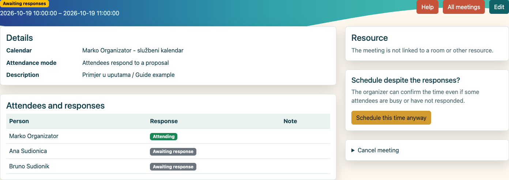Dasselbe Treffen zu einem neuen Termin; es wird nochmals um Rückmeldung gebeten.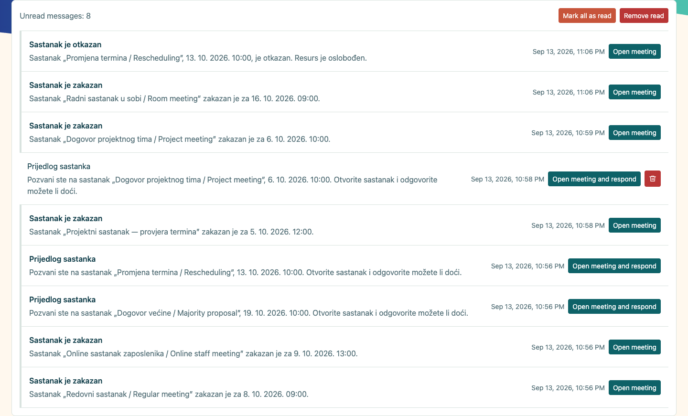Der Teilnehmer wird über die neue Uhrzeit informiert.

## 20. Eine Mehrheit akzeptiert – Verständnis der Schwelle

Beispiel: Ein Organisator und zwei weitere Personen haben ein Meeting. **Terminplan bei Annahme durch** bezieht sich auf die beiden Personen, auf deren Antworten der Organisator wartet. Eine Annahme beträgt 50 %; zwei sind 100 %. Bei 60 % reicht eine Annahme nicht aus; bei 50 % ist es so. Vielleicht und Nein gelten nicht als Akzeptanz.

1.  Wählen Sie vor dem Senden den Schwellenwert aus.
2.  Überprüfen Sie die Tabelle nach den Antworten. Der Vorschlag wartet, bis der Schwellenwert erreicht ist.
3.  Sobald der Schwellenwert erreicht und der Raum bestätigt ist, überprüfen Sie, ob der Status „Geplant“ lautet.

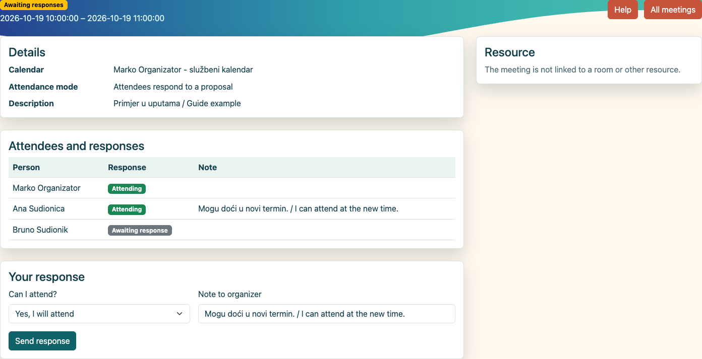Eine von zwei Personen hat zugesagt, sodass die 60 %-Hürde noch nicht erreicht ist.

## 21. Online, Ihr eigenes Büro und eine Veranstaltung für alle

1.  Aktivieren Sie **Keine Ressource**. Deaktivieren Sie ggf. tatsächliche Räume.
2.  Fügen Sie den Online-Link oder die Adresse des nicht aufgeführten Veranstaltungsortes in die Beschreibung ein.
3.  Personen oder Gruppen hinzufügen; Wählen Sie für ein allgemeines Ereignis **Alle aktiven Benutzer** aus.
4.  Überprüfen Sie die Uhrzeit und wählen Sie die Karte „Keine Ressource“.
5.  Speichern. Es wird keine Raumreservierung oder Genehmigeranfrage erstellt.

Dieses Treffen ist möglicherweise noch obligatorisch oder ein Vorschlag, der auf Antworten wartet. Mit „Jeder“ sind alle aktiven Site-Benutzer gemeint, nicht nur Mitarbeiter einer Organisation.

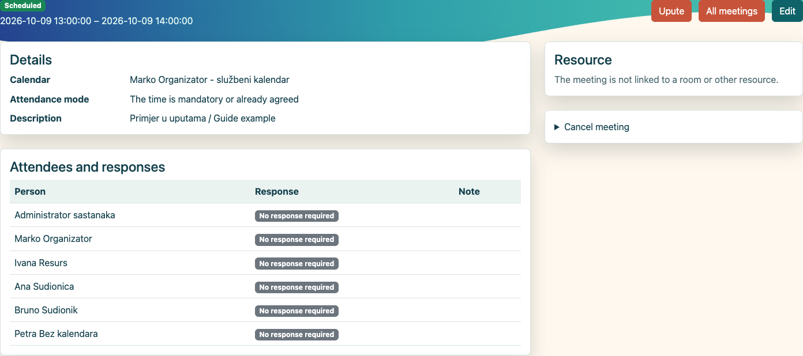Ein Pflichttreffen für alle ohne Zimmerreservierung.

## 22. Stornierung und Zimmerfreigabe

1.  Öffnen Sie als Organisator oder autorisierter Redakteur die Besprechungsdetails.
2.  Erweitern Sie **Besprechung absagen**.
3.  Lesen Sie die Warnung und klicken Sie nur dann auf **Stornierung bestätigen**, wenn die Stornierung nicht erfolgt.
4.  Überprüfen Sie **Storniert**. Die Teilnehmer werden benachrichtigt und die verknüpfte Reservierung oder Anfrage hält den Raum nicht mehr frei.

Das Nein eines Teilnehmers ist keine Absage. Die abgesagte Besprechung bleibt in ihren Details als Entscheidungsaufzeichnung identifizierbar, zählt aber nicht mehr als arbeitsreiche Zeit.

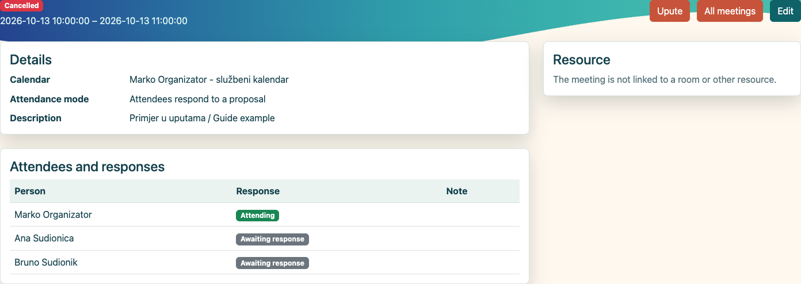Eine abgesagte Besprechung belegt weder die Teilnehmer noch den Raum mehr.

## 23. Wo Teilnehmer Besprechungen sehen: Kalender und Benachrichtigungen

1.  Öffnen Sie **Kalender**. Die Kalenderliste enthält die virtuelle Ansicht **Meine Besprechungen**.
2.  Wählen Sie Monat, Woche oder Tag und eröffnen Sie eine Veranstaltung. Es führt zu den Besprechungsdetails.
3.  Es ist nicht erforderlich, dass Personen automatisch jeden Team- oder Ressourcenkalender abonnieren.
4.  Verwenden Sie in **Benachrichtigungen** den Besprechungslink, um zu antworten, sich für einen Raum zu entscheiden oder eine Änderung zu überprüfen.

Ein Vorschlag, eine ausstehende Raumanfrage und eine geplante Besprechung haben unterschiedliche Status. Überprüfen Sie vor der Teilnahme die Details und nicht nur das Vorhandensein einer Veranstaltung im Kalender. Ein abgelehnter Raum ist kein bestätigter Veranstaltungsort.

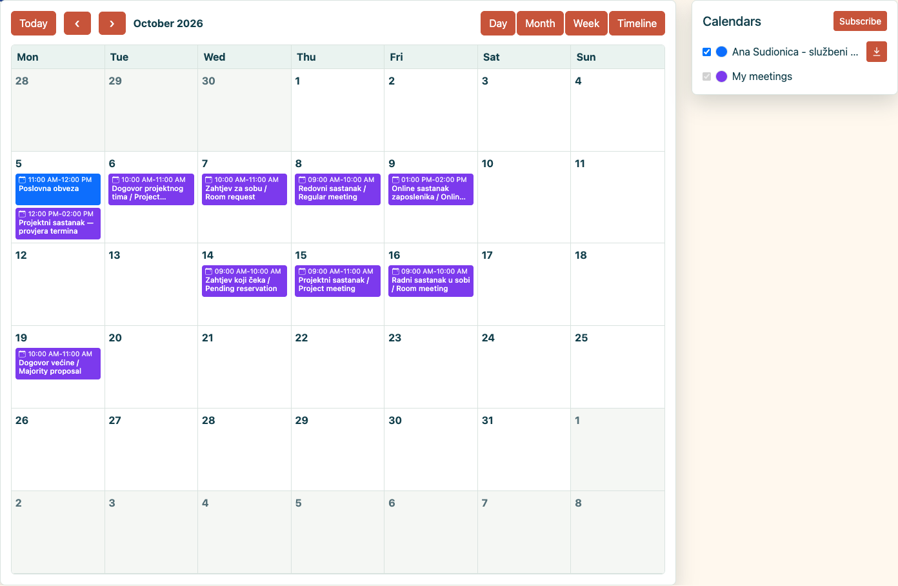Ana sieht „Meine Besprechungen“ neben ihrem offiziellen Kalender, ohne den Teamkalender zu abonnieren.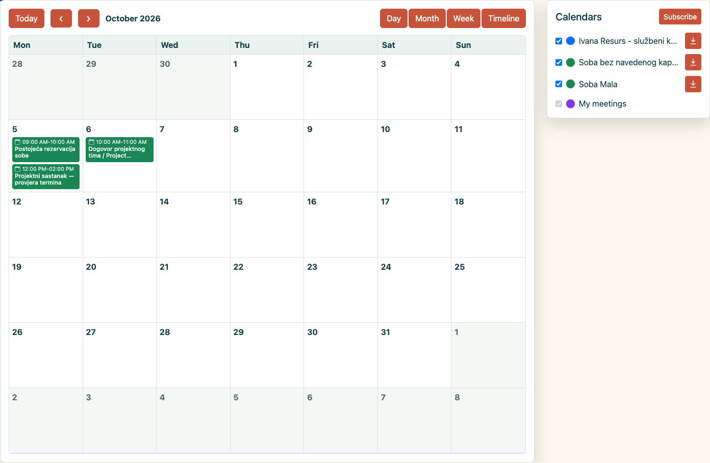Kalenderansicht eines Benutzers, der Ressourcen reserviert.

## 24. CalDAV und Antworten aus einem externen Kalender

CalDAV Discovery umfasst den virtuellen Kalender **Meine Besprechungen**. Aktivieren Sie es in Ihrem Client, wenn es nicht automatisch angezeigt wird. Es enthält Besprechungen, an denen Sie als Teilnehmer beteiligt sind, ohne unabhängige Kopien in Ihren persönlichen Kalendern oder obligatorische Abonnements für Quellteamkalender.

1.  Öffnen Sie die Besprechung in Ihrem externen Kalender.
2.  Folgen Sie dem Link Simbioza in der Veranstaltungsbeschreibung/URL.
3.  Melden Sie sich bei Bedarf mit Ihrem Konto an.
4.  Antworten Sie oder überprüfen Sie den Status in Simbioza.

Das Antworten über native Apple-/Outlook-/andere Client-Schaltflächen wird nicht unterstützt: vollständig CalDAV Scheduling/iTIP ist nicht implementiert. Die virtuelle Ansicht ist schreibgeschützt. Wenn Sie nur Ihrem eigenen Quellkalender folgen und „Meine Besprechungen“ nicht aktivieren, können Sie nicht damit rechnen, dass alle Besprechungen aus anderen Kalendern angezeigt werden.

## 25. Manager – die Standardteilnehmer eines Kalenders

1.  Öffnen Sie die Besprechungseinstellungen für einen Kalender, den Sie verwalten dürfen.
2.  Fügen Sie Personen, Gruppen oder alle Personen hinzu, die normalerweise teilnehmen sollten.
3.  Speichern Sie die Einstellungen.
4.  Verwenden Sie **Standardteilnehmer des ausgewählten Kalenders einbeziehen** für ein neues oder bestehendes Ereignis, wenn diese Liste geeignet ist.

Ein Administrator verwaltet die Gruppenmitgliedschaft. Wählen Sie für ein reguläres Team oder eine reguläre Abteilung die entsprechende Gruppe aus, anstatt jedes Mitglied einzeln einzugeben. Ein Kalenderabonnement unterscheidet sich dennoch von der Teilnahme an Besprechungen.

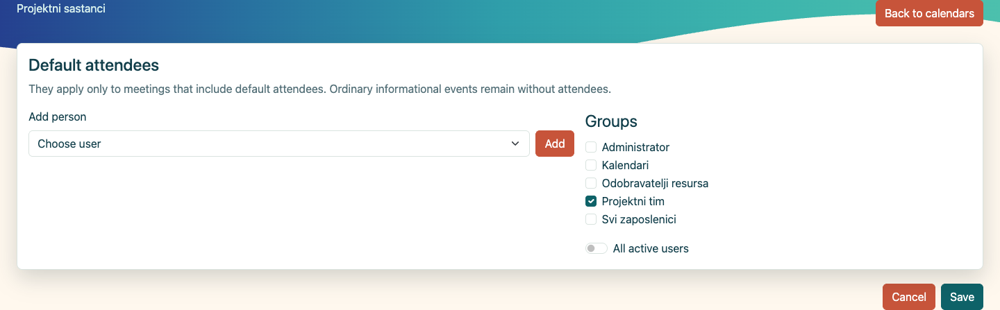Der Manager ordnet der Projektni-Tim-Gruppe einen Teamkalender zu.

## 26. Manager – optionales Raumprofil

1.  Öffnen Sie die Besprechungseinstellungen des Ressourcenkalenders.
2.  Wenn Sie über die Informationen verfügen, aktivieren Sie das Profil und geben Sie Typ, Kapazität, Standort und Ausrüstung ein.
3.  Wenn die Kapazität unbekannt ist, geben Sie sie nicht an. Erfinden Sie keine Zahl.
4.  Speichern. Diese Details helfen bei der Suche, ein Profil ist jedoch nicht erforderlich, damit eine Ressource vorhanden ist.

Die Kapazität ist eine Warnung, kein striktes Verbot: Kleinere und viel größere Räume dürfen bewusst gewählt werden. Räume mit unbekannter Kapazität werden nur berücksichtigt, wenn der Veranstalter dies zulässt.

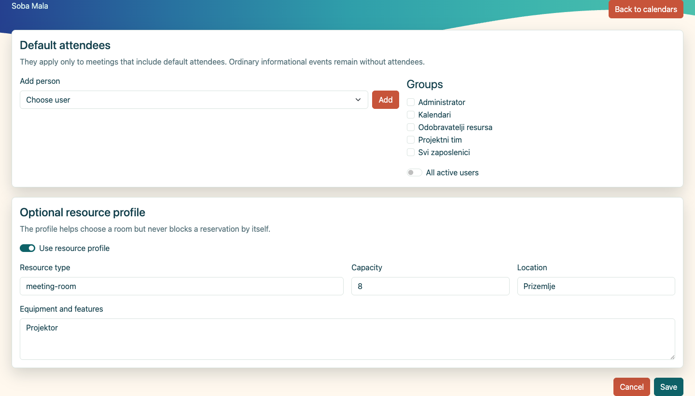Ein optionales Raumprofil mit Kapazität, Standort und Ausstattung.

## 27. Importierte und informative Kalender ohne Teilnehmer

Ein Confluence-Import weiß möglicherweise nicht, wer teilnimmt. Solche Kalender und Ereignisse können ohne Personen oder Gruppen bleiben. Ein Vorlesungsplan, dem ein Benutzer lediglich folgt, **markiert diesen Benutzer nicht automatisch als beschäftigt**.

1.  Überprüfen Sie nach dem Import den Kalender und seine Zugriffsberechtigungen.
2.  Wenn es informativ ist, fügen Sie keine Teilnehmer hinzu, nur um ein leeres Feld auszufüllen.
3.  Soll aus einer Veranstaltung tatsächlich ein Meeting werden, öffnen Sie diese und nutzen Sie den Meetingplaner / Editor.
4.  Fügen Sie die echten Personen oder Gruppen hinzu, wählen Sie aus, ob Antworten erforderlich sind, und überprüfen Sie die Zeit und den Raum.
5.  Nach Überprüfung speichern. Deaktivieren Sie die Kalendervererbung, wenn für die einzelne Veranstaltung unterschiedliche Teilnehmer erforderlich sind.

Das System kann die Teilnehmer anhand eines importierten Veranstaltungstitels nicht zuverlässig erraten. Ein Manager oder autorisierter Redakteur ordnet Personen und Gruppen zu.

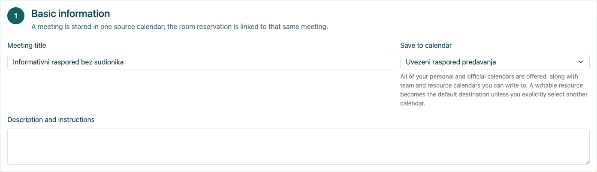Das importierte Ereignis wird zur Bearbeitung ausgewählt; der Quellkalender bleibt erhalten.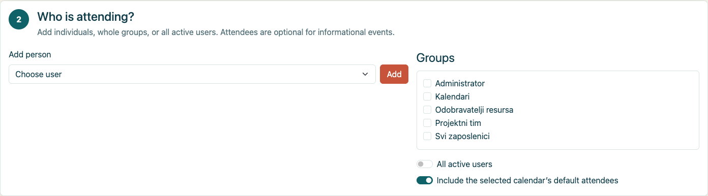Die Teilnehmerliste bleibt leer, bis eine autorisierte Person Personen oder Gruppen hinzufügt.

## 28. Häufig gestellte Fragen und abschließende Checkliste

Wählen Sie dieses Mal, ändert sich nur die Karte – wird sie gespeichert?

Nein. Wenn ein Genehmiger benötigt wird, wählen Sie einen aus und bestätigen Sie die Auswahl zunächst. Klicken Sie dann in der grünen Bestätigung auf derselben Karte auf „Besprechung speichern“ oder „Reservierungsanfrage senden“. Die Besprechungsdetails bestätigen, dass sie gespeichert wurden.

Warum kann ich nicht sehen, warum eine andere Person beschäftigt ist?

Sie können Frei/Gebucht sehen, ohne Zugriff auf ihren Kalender zu haben. Titel und Grund sind nur mit Lesezugriff auf den Quellkalender sichtbar. Durch das Organisieren einer Besprechung erhalten Sie keinen Zugriff auf private Notizen.

Warum sieht eine Person frei aus, antwortet aber mit Nein?

Möglicherweise erfassen sie nicht jede Verpflichtung in Simbioza. Die aufgezeichnete Verfügbarkeit garantiert keine Teilnahme. Verwenden Sie einen Vorschlag mit Antworten, wenn eine Bestätigung erforderlich ist.

Warum bleibt der Raum bestehen, wenn die Besprechung noch nicht geplant ist?

Eine Reservierungsanfrage schützt den Raum, während der Genehmiger entscheidet. Durch Ablehnung oder Stornierung wird es freigegeben.

Ich folge einem Kalender, bin aber kein Teilnehmer – warum bin ich dadurch nicht beschäftigt?

Das Folgende dient zur Ansicht. Die Anwesenheit muss explizit über eine Person, eine Gruppe oder „Jeder“ zugeordnet werden.

### Vor dem Absenden oder der Teilnahme

- Ist der Titel klar und sind Datum und Uhrzeit korrekt?
- Sind die Personen und Gruppen korrekt, ohne eine versehentliche Auswahl von „Jeder“?
- Ist das Zimmer geeignet und bestätigt oder steht die Anfrage noch aus?
- Sind Antworten erforderlich oder besteht Anwesenheitspflicht?
- Haben Sie den Speichervorgang abgeschlossen und nicht nur eine Karte ausgewählt?
- Haben Sie als Teilnehmer eine Antwort gesendet und den endgültigen Status überprüft?
