# Meetings — step by step

## 1. Before you begin: what a meeting is

This guide walks you through planning, reserving a room, and attending a meeting. No technical knowledge is required. Open **Calendars → Plan a meeting**. Reopen proposals, mandatory meetings, and reservation requests through **My meetings** or a link in **Notifications** in your user menu.

**A meeting is stored only once.** Choose its source calendar. If the room belongs to a different calendar, its reservation is linked to that same meeting: independent copies are not created for each attendee. Attendees see it through *My meetings*, even if they do not subscribe to the team calendar.

Examples use a fresh test installation, fictional users, and dates in October 2026. All screenshots use the light theme. Your names and dates may differ; the steps are the same. No real private commitments are shown.

## 2. Roles and permissions

| Role | What you can do |
|----|----|
| Organizer | Every signed-in user can check times. Save to a calendar you can write to, select attendees, and request a reservation if you cannot write to the resource. |
| Resource approver | Open the request and approve or reject the room. The organizer chooses who receives the request; it need not go to everyone. |
| Attendee | See your meeting. If a reply is requested, choose Yes, Maybe, or No and add a comment. This does not grant permission to edit someone else’s calendar or cancel the meeting. |
| Calendar manager / administrator | Manage access, default attendees, and optional resource profiles according to your permissions. |

Being allowed to view a room is not the same as being allowed to reserve it. Subscribing to a team calendar does not make you an attendee of every event.

## 3. You do not have your own calendar

1.  Open the planner. You can search for available times without your own calendar.
2.  If you want one, use the blue panel to choose **Official** for work, **Personal** for private commitments, or **Custom** for your own name.
3.  Only **Create the selected calendar** creates it. Opening the planner creates nothing.
4.  If you can already write to a team or resource calendar, save there without creating your own.

Both types belong to a person; how you use them is your choice. Manage the calendar, imports, and access later in your calendar settings.

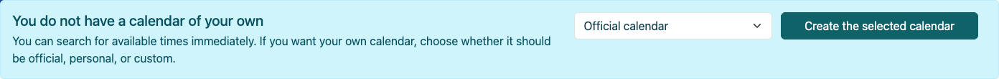Choose a type before creating a calendar.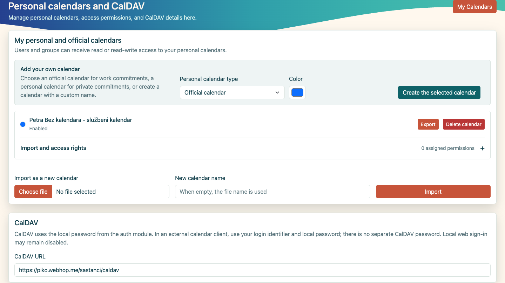Personal calendar settings: import and access controls are in an expandable section.

## 4. Step 1 — title, description, and destination calendar

1.  Enter a clear **Meeting title**, for example “Project meeting”.
2.  Use **Description and instructions** for the topic, agenda, or online meeting link.
3.  **Save to calendar** offers your personal and official calendars, plus team and resource calendars you can write to.
4.  If you want a specific team calendar, select it yourself. That choice remains when you select a time and room.

If you have not explicitly chosen another destination, a writable room becomes the default source calendar. If you cannot write to the room, the source is your selected personal, official, or team calendar and the room reservation is linked to it.

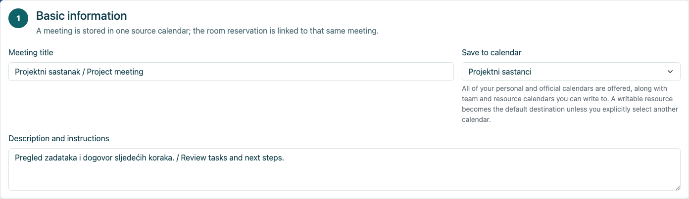The organizer has selected a team calendar as the meeting source.

## 5. Step 2 — people, groups, and Everyone

1.  For an individual, open **Add person**, find a user, and click **Add**. Repeat for others.
2.  For a team, check a group such as **Projektni tim**. Auth group members become attendees without entering each person.
3.  For an organization-wide meeting, check **All active users**. If the site also has external users, select the appropriate employee group instead when only employees should attend.
4.  **Include the selected calendar’s default attendees** adds people and groups associated with that calendar. Turn it off when they are not needed for this event.

A person is counted once even if selected directly and through multiple groups. Subscriptions are not attendance lists. Events without attendees may remain informational.

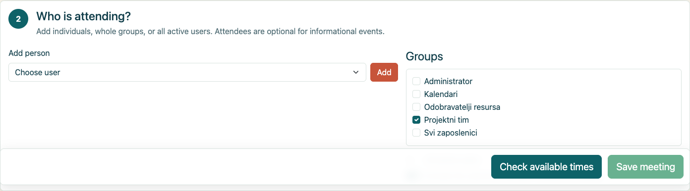Group attendees and optional inheritance from the calendar.

## 6. Step 3 — finding the best time

1.  Select **Find the best times**.
2.  Enter the first and last dates. Start with one or a few days.
3.  Set the earliest start, latest finish, and **Duration**.
4.  Check allowed weekdays, for example Monday and Wednesday.
5.  Choose **How many attendees must be available?**: Everyone, Large majority, Majority, or all options.
6.  Choose a room in the next step and click **Check available times**.

The best options appear first. Always read the actual number of available attendees: checking availability is not the same as receiving their replies.

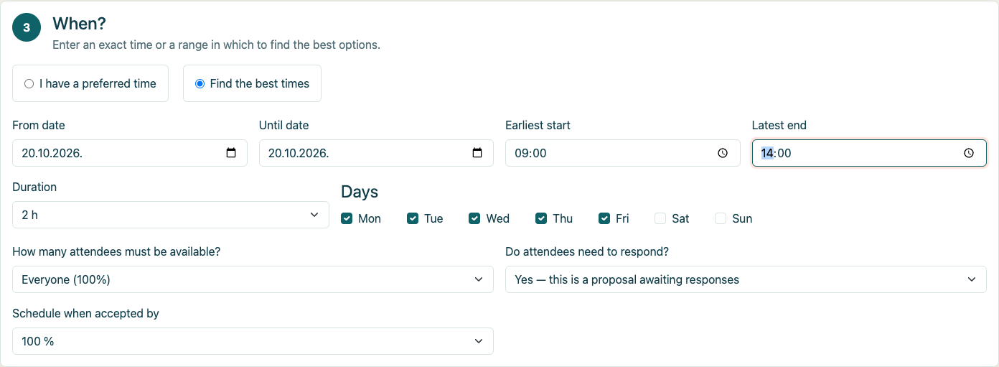Search conditions: dates, hours, duration, and weekdays.

## 7. Step 3a — you already have a preferred time

1.  Select **I have a preferred time**.
2.  Enter a date, start, and end. The end must be after the start.
3.  Add attendees and a resource, then click **Check available times**.
4.  Read the available attendee count and expand **Busy attendees** if needed.
5.  If some cannot attend, change the date or hour, or consciously choose a meeting with fewer attendees available.

Availability includes personal and official calendars and events that actually include the person as an attendee. A person is not considered busy merely because they subscribe to an informational calendar. The system only knows commitments recorded in Simbioza.

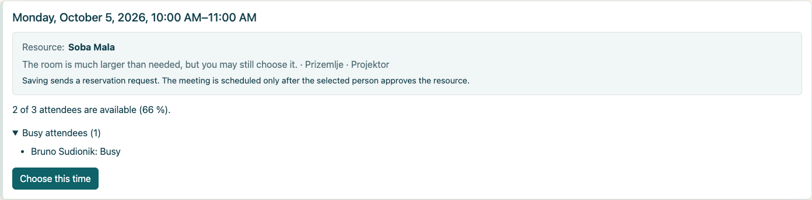The organizer sees that Bruno is busy, but not the details of his private commitment.

## 8. Step 4 — which room to check

1.  Select one or more rooms with checkboxes. Click again to deselect.
2.  If nothing is selected, **all actual resources** are checked.
3.  For an online meeting, your own office, or an unlisted restaurant, explicitly check **No resource**. This option is never added automatically.
4.  Enter the required number of seats. If some room capacities are unknown, decide whether to include **resources without a stated capacity**.
5.  Click **Check available times**.

A resource profile is optional. For unknown capacity, check suitability yourself. A much larger or smaller room displays a warning but is not forbidden; extra chairs or a different layout may be possible.

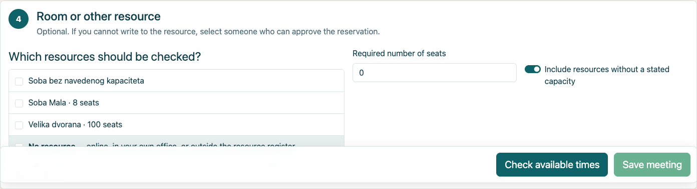Checkboxes can be selected and deselected; No resource is an explicit choice.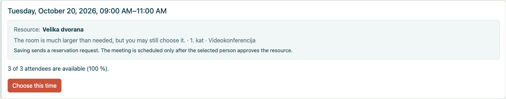A large room is not forbidden, but the warning helps you choose.

## 9. Results — each card already has a time and resource

1.  Read the card’s date and time.
2.  Immediately below, read the resource name, capacity, and available room information.
3.  Read the share of available attendees. Searching all rooms may show several cards for the same time, one for each free resource.
4.  Click **Choose this time** on the exact card you want. There is no later resource dropdown.
5.  Follow the confirmation within that card. After changing search conditions, check and select a time again.

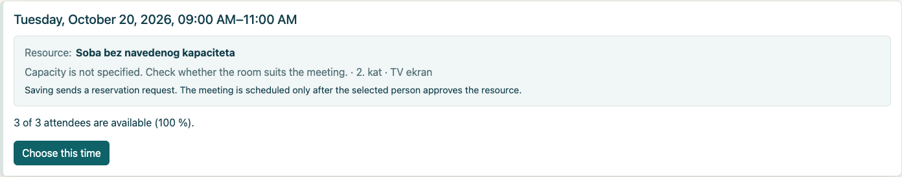The time and a specific room form one offered option.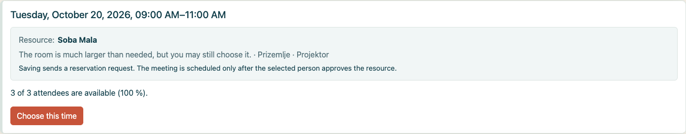Another card offers the same time with a different room.

## 10. You can write to the resource calendar

1.  Select a free room card. Its description says the reservation will be confirmed immediately.
2.  Click **Choose this time**.
3.  In the green confirmation on that same card, click **Save meeting**. You do not need to search for an unspecified “final button”.
4.  The saved meeting details open. The room is reserved. A mandatory meeting is scheduled; a proposal still waits for replies if you chose that mode.

Selecting a time is not saving. Finish with the save button on the selected card. The room is checked again at save time because someone else may have reserved it meanwhile.

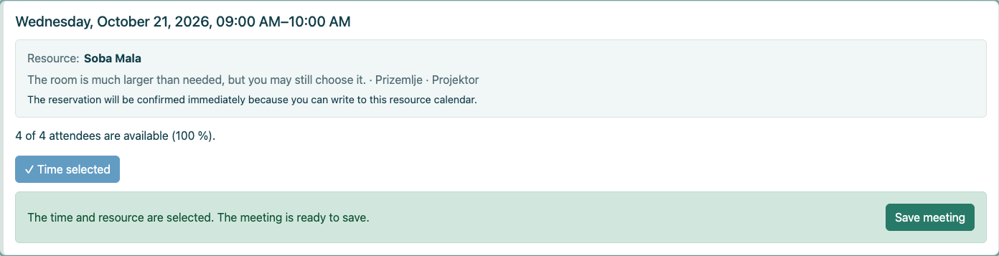A user with write access saves from the card’s confirmation.

## 11. You cannot write to the resource — request a reservation

1.  Choose a free room and click **Choose this time**.
2.  A reservation confirmation panel opens in that card.
3.  Select at least one offered person who can approve the room. Do not send to everyone unnecessarily.
4.  Use **Message to approver** to explain the reason, for example “Please reserve a room for the project team”.
5.  Click **Confirm time selection**, then **Send reservation request** in the confirmation on that same card.
6.  Check **Waiting for resource confirmation** in the details. The meeting is not scheduled yet.

If no approver is offered, contact the calendar manager. You cannot bypass the room’s permissions yourself.

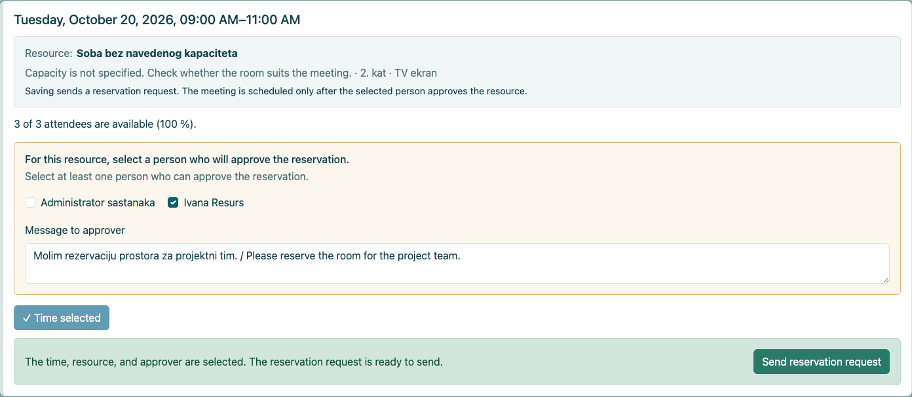The organizer selects an approver and sends the request within the chosen time.

## 12. What if someone else wants the room while you wait

A request awaiting confirmation **temporarily holds the room**. Another organizer is told that a request exists for that time. This applies to users with write access as well as other requesters.

1.  If you see a pending request warning, do not treat the room as free.
2.  Choose another room or time, or wait for a decision.
3.  Rejection or cancellation releases the room so it can be offered in a new check.

Waiting is not automatic approval. A final reservation requires approval; checking again at save time prevents bypassing another request.

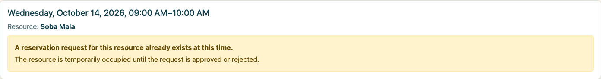Another organizer sees that the room is held by an earlier pending request.

## 13. Approver — notification and room approval

1.  Open your user menu, then **Notifications**.
2.  Find **Resource reservation request**. Check the meeting title and time.
3.  Click the meeting link. It opens that specific request, not just a general list.
4.  In the **Resource** card, check the room and optionally add a message to the organizer.
5.  Click **Approve**. The resource becomes **Reserved**.

The organizer is notified. A mandatory or already agreed meeting then becomes scheduled. For a proposal, attendees receive the invitation to reply only after the room is confirmed.

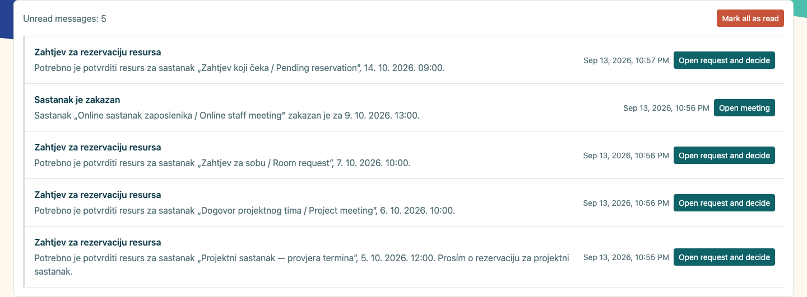Ivana receives a notification linking to the request.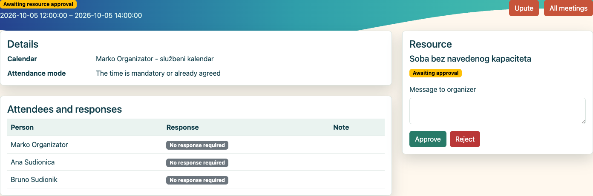The approver decides in the Resource card.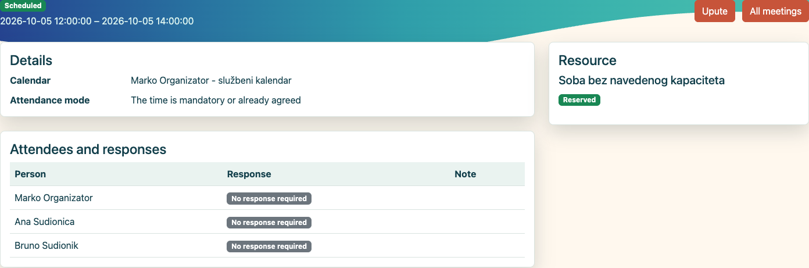Approved room and scheduled mandatory meeting.

## 14. Approver — rejecting the room

1.  Open the request from its notification.
2.  Explain the reason in **Message to organizer**, for example that the room is unsuitable.
3.  Click **Reject**.
4.  Check **Resource reservation rejected**.

The room is released for others. The organizer is notified and can use **Edit** to find another room or time and send a new request. Rejecting a room is different from an attendee declining attendance.

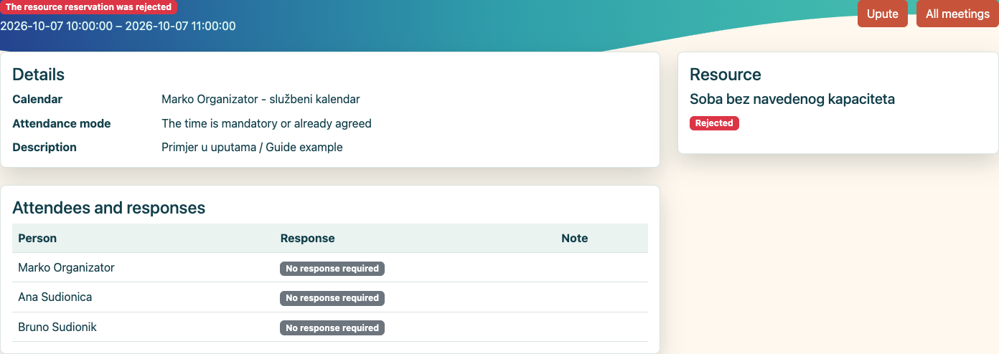The request is rejected; the organizer sees the outcome in the details.

## 15. Mandatory meeting or proposal — two different choices

Under **Should attendees reply?**, choose:

- **No — mandatory / already agreed time**: attendees are notified but no Yes/No reply is requested. If the room requires approval, that approval must still come first.
- **Yes — a proposal awaiting replies**: attendees reply. Also select **Schedule when accepted by** (100%, 80%, 60%, or 50%).

The available-person threshold used in search is different from the accepted-reply threshold. The first helps find a time from recorded commitments; the second determines when the invitation becomes scheduled. The organizer is excluded from the people whose confirmation is awaited.

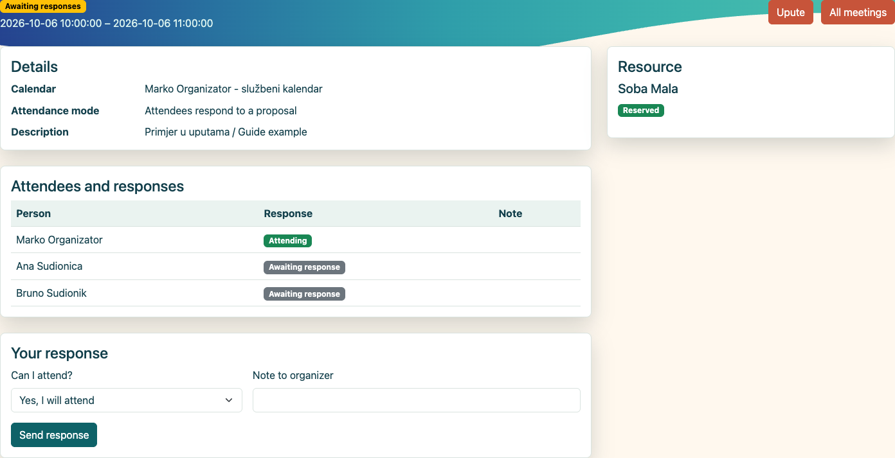A proposal with an attendee table and reply form.

## 16. Attendee — accepting attendance

1.  Open **Notifications** and find **Meeting proposal**.
2.  Open the meeting link. Check its date, time, room, and description.
3.  Under **Your reply → Can I attend?**, select **Yes, I will attend**.
4.  Optionally add a comment for the organizer.
5.  Click **Send reply**. Your attendee row shows **Attending**.

The organizer is notified with your name and comment. Once enough other attendees accept, the meeting is scheduled automatically. At 100%, everyone invited except the organizer must accept.

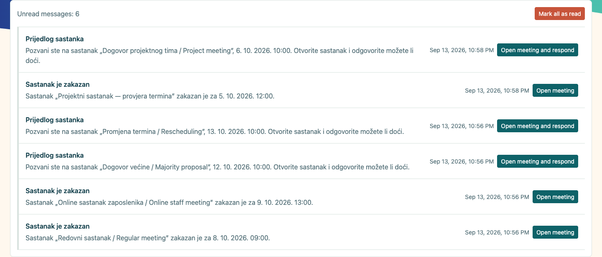Ana receives an invitation; its link opens the specific meeting.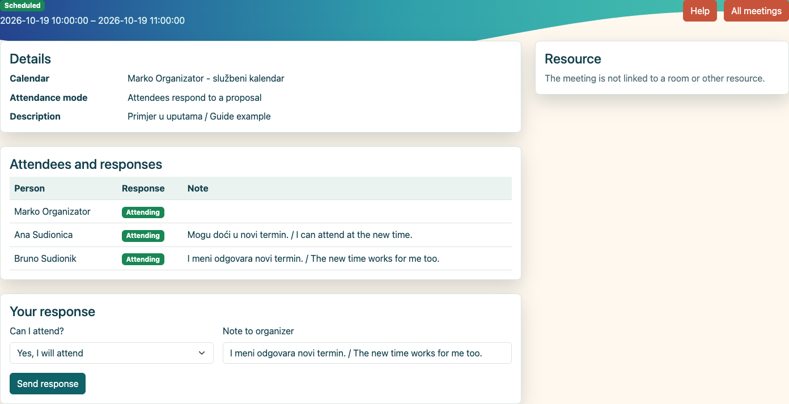After the required acceptances, the meeting is scheduled.

## 17. Attendee — you cannot attend or are not sure yet

1.  Open the meeting and choose **I cannot attend** or **Maybe** under **Your reply**.
2.  Add a useful comment such as “Please suggest another time” or “Waiting for another commitment”. You need not disclose private reasons.
3.  Click **Send reply**.
4.  Check your row. The saved choice and comment remain visible when you reopen the meeting.

Declining does not cancel the whole meeting. Maybe is not an acceptance. The organizer decides whether to find a new time or schedule anyway. You can change your reply if circumstances change while replies remain enabled.

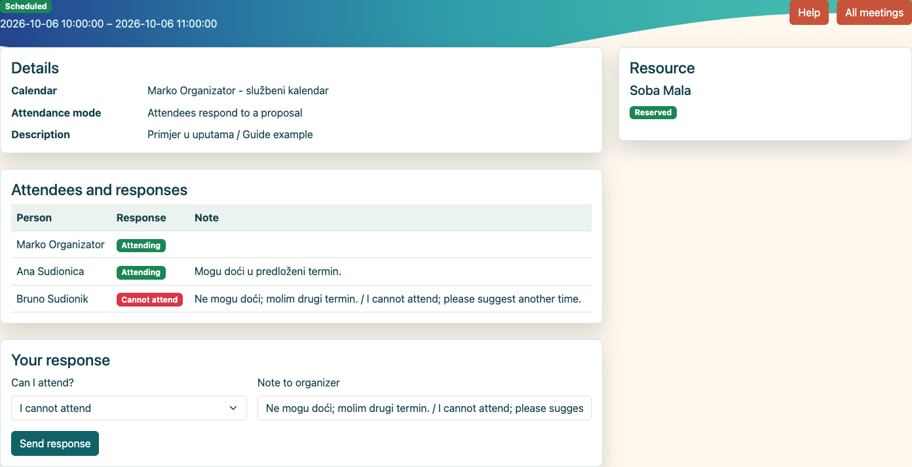Bruno declines attendance and asks for another time.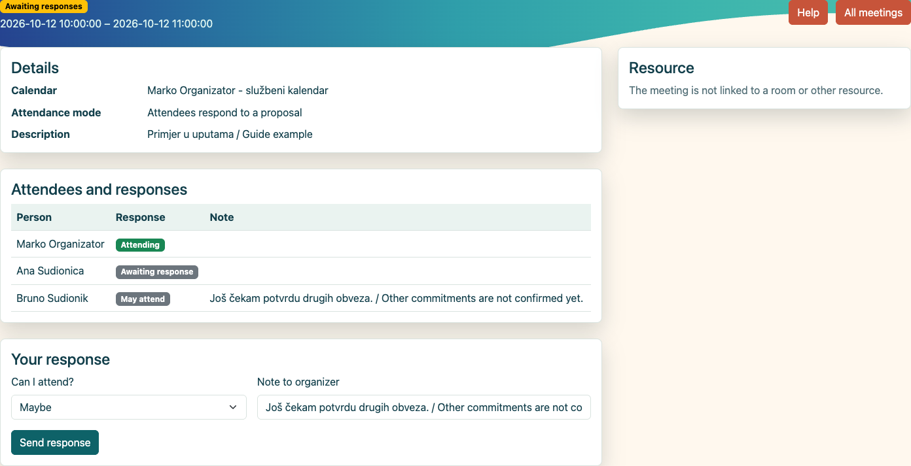A tentative Maybe reply with a comment.

## 18. Organizer — deciding after someone declines

1.  Open the reply notification. It identifies the person and their comment.
2.  Open the meeting and review the entire response table.
3.  For a different time, click **Edit**, change the date or hours, recheck availability, and save.
4.  If the meeting must still use this time, deliberately click **Schedule this time anyway** in the proposal details.
5.  Check **Scheduled**. The declined response remains visible; the system does not turn it into acceptance.

Manual scheduling does not bypass pending room approval. The resource must be resolved first.

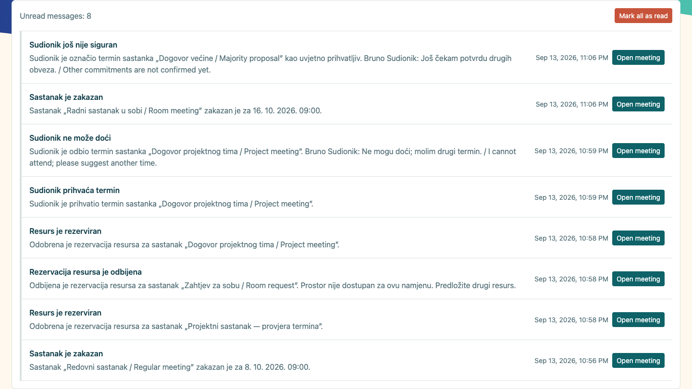The organizer sees replies and meeting links.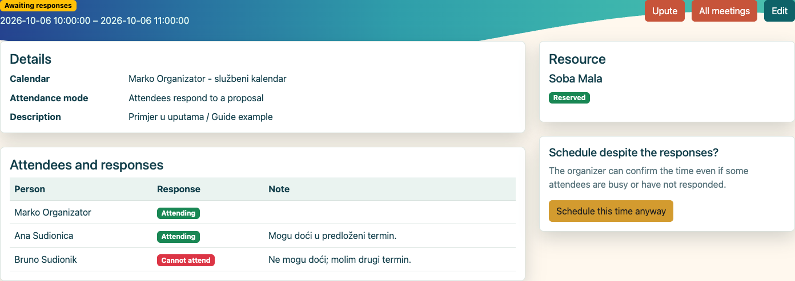The option to consciously schedule despite replies.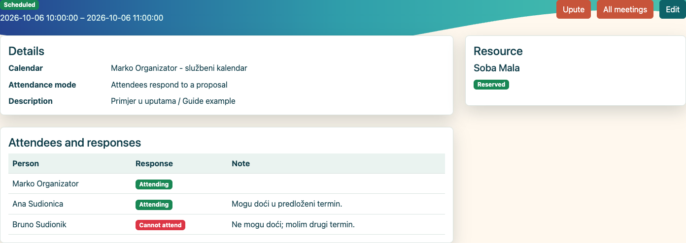The scheduled meeting still shows that Bruno cannot attend.

## 19. Changing the time and requesting replies again

1.  Open the existing meeting and click **Edit**.
2.  Change the date, start, or end. Choose the same or another resource.
3.  Click **Check available times**. The old meeting must not conflict with itself.
4.  Select the new card and save, or send a new room request.
5.  Attendees receive a notification with the new time. If replies are required, previous replies are cleared and new ones are requested.

Accepting the old date does not mean accepting the new one. The meeting retains its identity and link; no extra copy is created. The new room or time must again pass availability checks and any required approval.

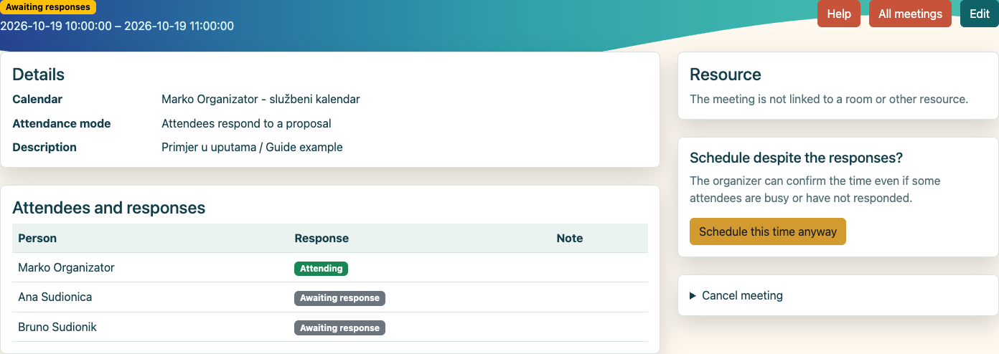The same meeting at a new date; replies are requested again.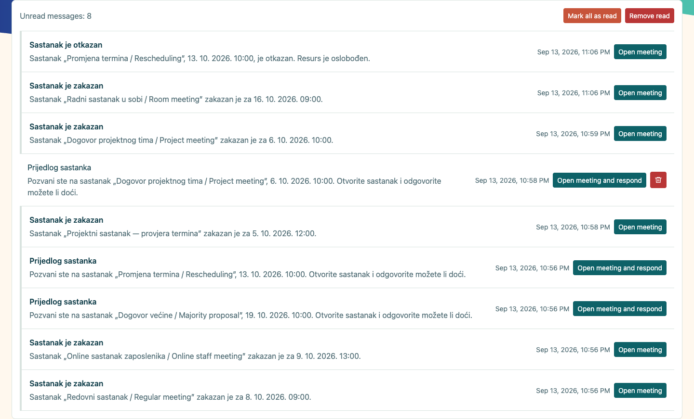The attendee is notified of the new time.

## 20. A majority accepts — understanding the threshold

Example: an organizer and two other people have a meeting. **Schedule when accepted by** refers to the two people whose replies the organizer awaits. One acceptance is 50%; two are 100%. At 60%, one acceptance is not enough; at 50%, it is. Maybe and No do not count as acceptance.

1.  Choose the threshold before sending.
2.  Review the table after replies. The proposal waits until the threshold is reached.
3.  Once the threshold is reached and the room is confirmed, check that the status is Scheduled.

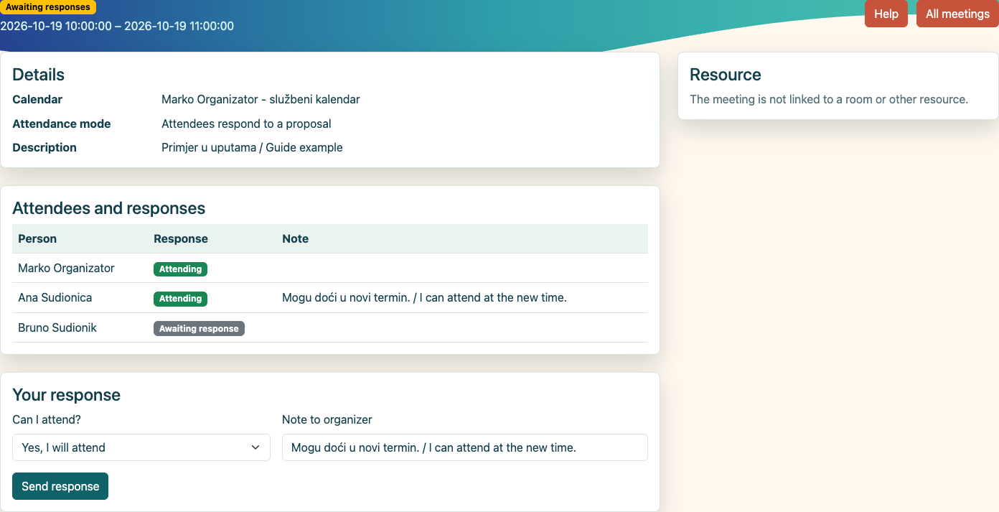One of two people has accepted, so the 60% threshold has not yet been reached.

## 21. Online, your own office, and an event for everyone

1.  Check **No resource**. Deselect actual rooms if necessary.
2.  Put the online link or unlisted venue address in the description.
3.  Add people or groups; for a general event select **All active users**.
4.  Check the time and choose the No resource card.
5.  Save. No room reservation or approver request is created.

This meeting may still be mandatory or a proposal awaiting replies. Everyone means all active site users, not only employees of one organization.

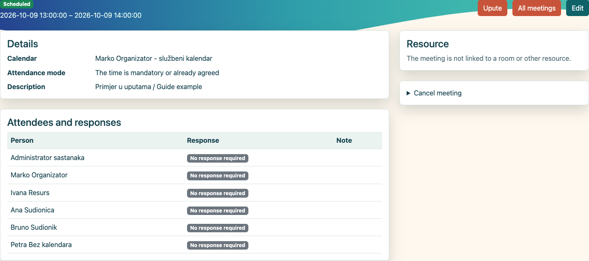A mandatory meeting for everyone without a room reservation.

## 22. Cancellation and releasing the room

1.  As the organizer or authorized editor, open the meeting details.
2.  Expand **Cancel meeting**.
3.  Read the warning and click **Confirm cancellation** only if it will not take place.
4.  Check **Cancelled**. Attendees are notified and the linked reservation or request stops holding the room.

An attendee’s No is not cancellation. The cancelled meeting remains identifiable in its details as a decision record but no longer counts as busy time.

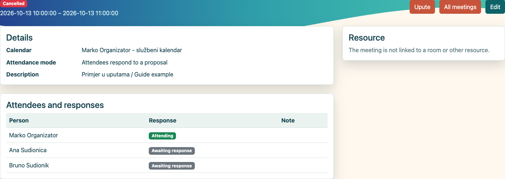A cancelled meeting no longer occupies attendees or the room.

## 23. Where attendees see meetings: calendar and notifications

1.  Open **Calendars**. The calendar list includes the virtual **My meetings** view.
2.  Choose month, week, or day and open an event. It leads to the meeting details.
3.  People need not be automatically subscribed to every team or resource calendar.
4.  In **Notifications**, use the meeting link to reply, decide on a room, or review a change.

A proposal, pending room request, and scheduled meeting have different statuses. Check the details before attending, not merely the presence of an event in the calendar. A rejected room is not a confirmed venue.

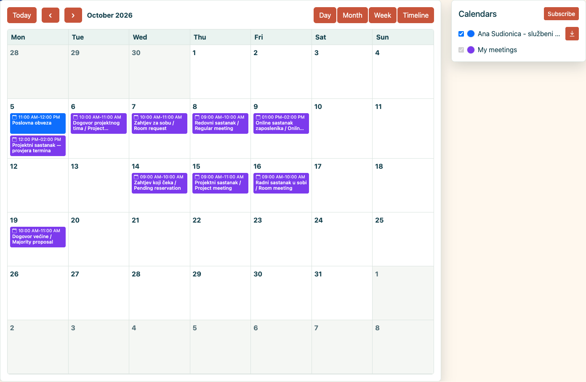Ana sees My meetings alongside her official calendar without subscribing to the team calendar.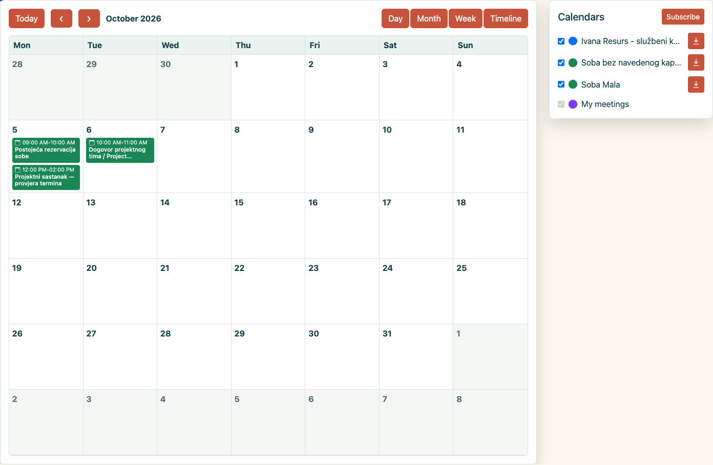Calendar view of a user who reserves resources.

## 24. CalDAV and replying from an external calendar

CalDAV discovery includes the virtual **My meetings** calendar. Enable it in your client if it is not shown automatically. It contains meetings involving you as an attendee, without independent copies in your personal calendars or mandatory subscriptions to source team calendars.

1.  Open the meeting in your external calendar.
2.  Follow the Simbioza link in the event description / URL.
3.  Sign in with your account if necessary.
4.  Reply or check the status in Simbioza.

Replying through native Apple/Outlook/other client buttons is not supported: full CalDAV Scheduling/iTIP is not implemented. The virtual view is read-only. If you follow only your own source calendar and do not enable My meetings, do not expect every meeting from other calendars to appear.

## 25. Manager — a calendar’s default attendees

1.  Open meeting settings for a calendar you are allowed to manage.
2.  Add people, groups, or Everyone who should normally attend.
3.  Save the settings.
4.  Use **Include the selected calendar’s default attendees** on a new or existing event when that list is appropriate.

An administrator manages group membership. For a regular team or department, select its group instead of entering every member separately. A calendar subscription is still different from meeting participation.

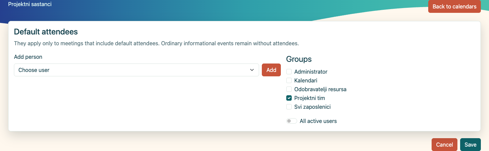The manager associates the Projektni tim group with a team calendar.

## 26. Manager — optional room profile

1.  Open the resource calendar’s meeting settings.
2.  If you have the information, enable its profile and enter type, capacity, location, and equipment.
3.  If capacity is unknown, leave it unspecified. Do not invent a number.
4.  Save. These details help search, but a profile is not required for a resource to exist.

Capacity provides a warning, not a strict prohibition: smaller and much larger rooms may be deliberately chosen. Unknown-capacity rooms are included only if the organizer allows them.

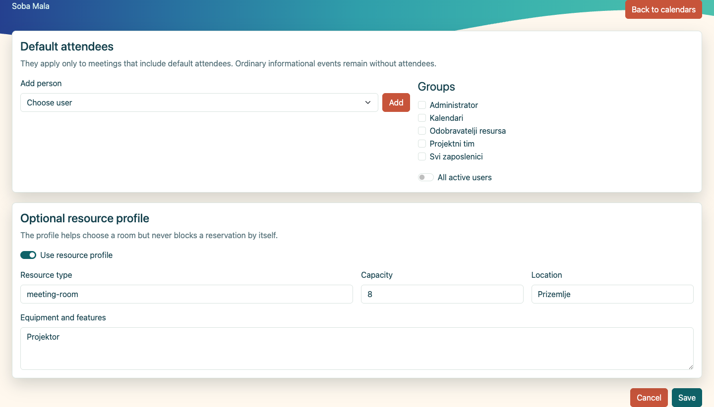An optional room profile with capacity, location, and equipment.

## 27. Imported and informational calendars without attendees

A Confluence import may not know who attends. Such calendars and events may remain without people or groups. A lecture timetable that a user merely follows **does not automatically mark that user busy**.

1.  After import, review the calendar and its access permissions.
2.  If informational, do not add attendees just to fill an empty field.
3.  If an event should actually become a meeting, open it and use the meeting planner / editor.
4.  Add the real people or groups, choose whether replies are required, and check the time and room.
5.  Save after checking. Turn off calendar inheritance when the individual event needs different attendees.

The system cannot reliably guess attendees from an imported event title. A manager or authorized editor associates people and groups.

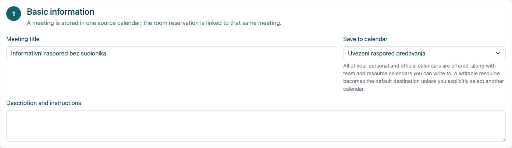The imported event is selected for editing; its source calendar is preserved.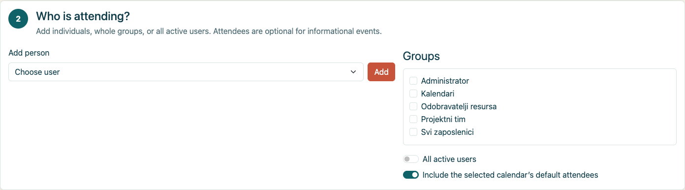The attendee list stays empty until an authorized person adds people or groups.

## 28. Frequently asked questions and final checklist

Choose this time only changes the card — is it saved?

No. If an approver is needed, select one and confirm the choice first. Then click Save meeting or Send reservation request in the green confirmation on that same card. Meeting details confirm that it was saved.

Why can I not see why another person is busy?

You can see free/busy without access to their calendar. The title and reason are visible only with read access to the source calendar. Organizing a meeting does not grant access to private notes.

Why does a person look free but reply No?

They may not record every commitment in Simbioza. Recorded availability does not guarantee attendance. Use a proposal with replies when confirmation is needed.

Why is the room held if the meeting is not scheduled yet?

A reservation request protects the room while the approver decides. Rejection or cancellation releases it.

I follow a calendar but am not an attendee — why does it not make me busy?

Following is for viewing. Attendance must be explicitly associated through a person, group, or Everyone.

### Before sending or attending

- Is the title clear, and are the date and time correct?
- Are the people and groups correct, without an accidental Everyone selection?
- Is the room suitable and confirmed, or is its request still pending?
- Are replies required or is attendance mandatory?
- Did you finish saving, not merely select a card?
- As an attendee: did you send a reply and check the final status?
