# Reuniones: paso a paso

> Las capturas de pantalla muestran la interfaz en inglés.

## 1. Antes de empezar: qué es una reunión

Esta guía lo guiará a través de la planificación, la reserva de una sala y la asistencia a una reunión. No se requieren conocimientos técnicos. Abra **Calendarios → Planificar una reunión**. Vuelva a abrir propuestas, reuniones obligatorias y solicitudes de reserva a través de **Mis reuniones** o un enlace en **Notificaciones** en su menú de usuario.

**Una reunión se almacena solo una vez.** Elija su calendario de origen. Si la sala pertenece a un calendario diferente, su reserva queda vinculada a esa misma reunión: no se crean copias independientes para cada asistente. Los asistentes lo ven a través de *Mis reuniones*, incluso si no están suscritos al calendario del equipo.

Los ejemplos utilizan una nueva instalación de prueba, usuarios ficticios y fechas de octubre de 2026. Todas las capturas de pantalla utilizan el tema claro. Sus nombres y fechas pueden diferir; los pasos son los mismos. No se muestran compromisos privados reales.

## 2. Roles y permisos

| Role | que puede hacer |
|----|----|
| Organizador | Cada usuario que haya iniciado sesión puede consultar los horarios. Guárdelo en un calendario en el que pueda escribir, seleccionar asistentes y solicitar una reserva si no puede escribir en el recurso. |
| Aprobador de recursos | Abra la solicitud y apruebe o rechace la sala. El organizador elige quién recibe la solicitud; No es necesario que llegue a todos. |
| Asistente | Vea su reunión. Si se solicita una respuesta, elija Sí, Quizás o No y agregue un comentario. Esto no otorga permiso para editar el calendario de otra persona o cancelar la reunión. |
| Gestor/administrador de calendario | Administre el acceso, los asistentes predeterminados y los perfiles de recursos opcionales según sus permisos. |

No es lo mismo poder ver una sala que poder reservarla. Suscribirse a un calendario de equipo no lo convierte en asistente de todos los eventos.

## 3. No tiene su propio calendario

1.  Abra el planificador. Puede buscar horarios disponibles sin su propio calendario.
2.  Si desea uno, use el panel azul para elegir **Oficial** para el trabajo, **Personal** para compromisos privados o **Personalicedo** para su propio nombre.
3.  Sólo **Crear el calendario seleccionado** lo crea. Abrir la agenda no crea nada.
4.  Si ya puede escribir en un calendario de equipo o de recursos, guárdelo allí sin crear el tuyo propio.

Ambos tipos pertenecen a una persona; cómo los usas es su elección. Administre el calendario, las importaciones y acceda más tarde en la configuración de su calendario.

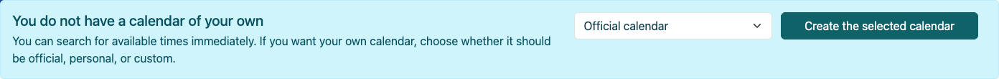Elija un tipo antes de crear un calendario.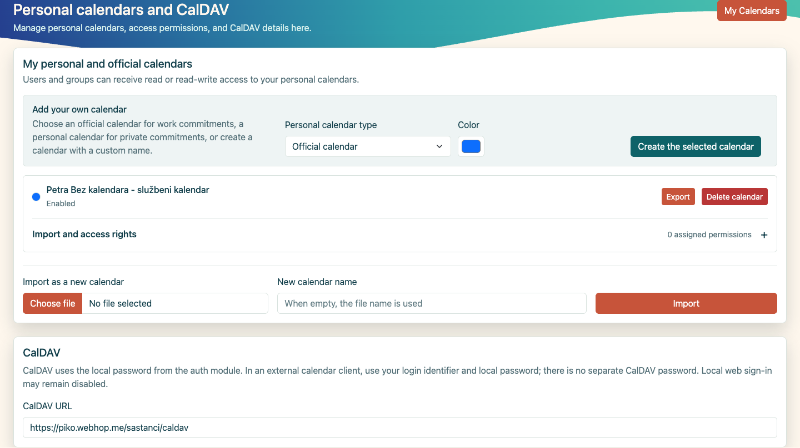Configuración del calendario personal: los controles de importación y acceso se encuentran en una sección expandible.

## 4. Paso 1: título, descripción y calendario de destino

1.  Ingrese un **Título de la reunión** claro, por ejemplo, "Reunión del proyecto".
2.  Utilice **Descripción e instrucciones** para el tema, la agenda o el enlace de la reunión en línea.
3.  **Guardar en calendario** ofrece sus calendarios personales y oficiales, además de calendarios de equipo y recursos en los que puede escribir.
4.  Si desea un calendario de equipo específico, selecciónelo usted mismo. Esa elección permanece cuando seleccionas una hora y una sala.

Si no ha elegido expresamente otro destino, el calendario de una sala que pueda modificar se convierte en el calendario de origen predeterminado. Si no puede modificar el calendario de la sala, el origen será el calendario personal, oficial o de equipo que haya seleccionado, y la reserva de la sala quedará vinculada a él.

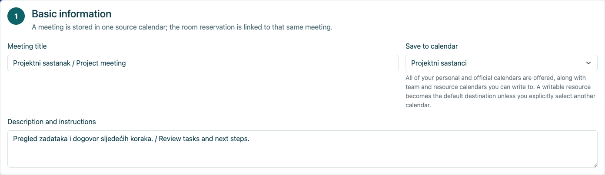El organizador ha seleccionado un calendario de equipo como fuente de reunión.

## 5. Paso 2: personas, grupos y todos

1.  Para un individuo, abra **Agregar persona**, busque un usuario y haga clic en **Agregar**. Repita para los demás.
2.  Para un equipo, consulte un grupo como **Projektni tim**. Los miembros del grupo de autenticación se convierten en asistentes sin ingresar a cada persona.
3.  Para una reunión de toda la organización, marque **Todos los usuarios activos**. Si el sitio también tiene usuarios externos, seleccione el grupo de empleados apropiado cuando solo deben asistir los empleados.
4.  **Incluir los asistentes predeterminados del calendario seleccionado** agrega personas y grupos asociados con ese calendario. Apágalo cuando no sean necesarios para este evento.

Una persona se cuenta una vez incluso si se selecciona directamente y a través de varios grupos. Las suscripciones no son listas de asistencia. Los eventos sin asistentes pueden seguir siendo informativos.

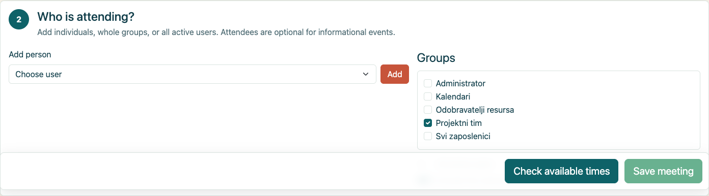Asistentes del grupo y herencia opcional del calendario.

## 6. Paso 3: encontrar el mejor momento

1.  Seleccione **Encuentra los mejores momentos**.
2.  Introduzca la primera y la última fecha. Comience con uno o varios días.
3.  Establezca el inicio más temprano, el final más tardío y la **Duración**.
4.  Verifique los días laborables permitidos, por ejemplo lunes y miércoles.
5.  Elija **¿Cuántos asistentes deben estar disponibles?**: Todos, Gran mayoría, Mayoría o todas las opciones.
6.  Elija una sala en el siguiente paso y haga clic en **Consultar horarios disponibles**.

Las mejores opciones aparecen primero. Lee siempre el número real de asistentes disponibles: comprobar la disponibilidad no es lo mismo que recibir sus respuestas.

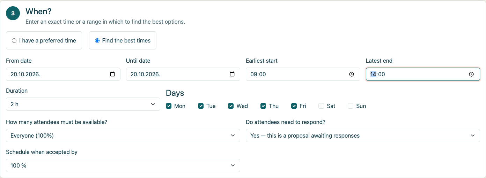Condiciones de búsqueda: fechas, horas, duración y días laborables.

## 7. Paso 3a: ya tiene un horario preferido

1.  Seleccione **Tengo un horario preferido**.
2.  Introduzca una fecha, inicio y finalización. El final debe ser después del comienzo.
3.  Agregue asistentes y un recurso, luego haga clic en **Ver horarios disponibles**.
4.  Lea el recuento de asistentes disponibles y expanda **Asistentes ocupados** si es necesario.
5.  Si algunos no pueden asistir, cambie la fecha o la hora, o elija conscientemente una reunión con menos asistentes disponibles.

La disponibilidad incluye calendarios y eventos personales y oficiales que realmente incluyen a la persona como asistente. Una persona no se considera ocupada simplemente porque se suscribe a un calendario informativo. El sistema sólo conoce los compromisos registrados en Simbioza.

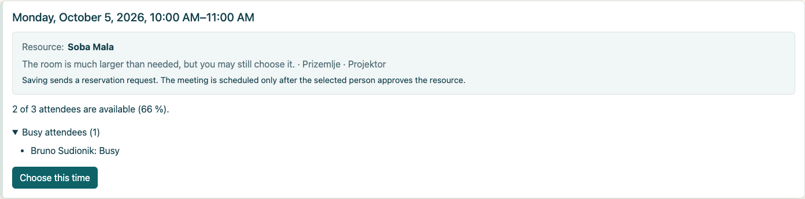El organizador ve que Bruno está ocupado, pero no los detalles de su compromiso privado.

## 8. Paso 4: qué sala revisar

1.  Seleccione una o más habitaciones con casillas de verificación. Haga clic nuevamente para anular la selección.
2.  Si no se selecciona nada, se marcan **todos los recursos reales**.
3.  Para una reunión en línea, su propia oficina o un restaurante no listado, marque explícitamente **Sin recurso**. Esta opción nunca se agrega automáticamente.
4.  Ingrese el número requerido de asientos. Si se desconoce la capacidad de algunas salas, decida si desea incluir **recursos sin una capacidad indicada**.
5.  Haga clic en **Consultar horarios disponibles**.

Un perfil de recursos es opcional. Para capacidades desconocidas, compruebe usted mismo la idoneidad. Una sala mucho más grande o más pequeña muestra una advertencia pero no está prohibida; Es posible que haya sillas adicionales o una distribución diferente.

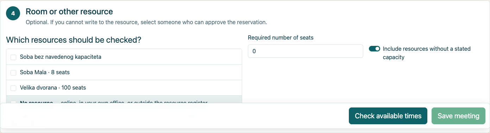Las casillas de verificación se pueden seleccionar y deseleccionar; Ningún recurso es una elección explícita.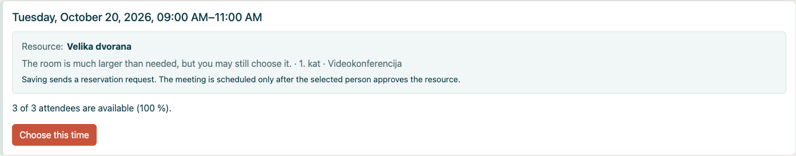Una sala grande no está prohibida, pero la advertencia le ayuda a elegir.

## 9. Resultados: cada tarjeta ya tiene un tiempo y un recurso.

1.  Lea la fecha y hora de la tarjeta.
2.  Inmediatamente debajo, lea el nombre del recurso, la capacidad y la información de las habitaciones disponibles.
3.  Consulte la proporción de asistentes disponibles. Al buscar en todas las salas, pueden aparecer varias tarjetas para una misma hora, una por cada recurso disponible.
4.  Haga clic en **Elegir este horario** en la tarjeta exacta que desee. No hay ningún menú desplegable de recursos posterior.
5.  Siga la confirmación dentro de esa tarjeta. Después de cambiar las condiciones de búsqueda, verifique y seleccione una hora nuevamente.

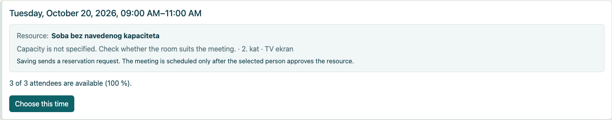El horario y una sala concreta forman una de las opciones ofrecidas.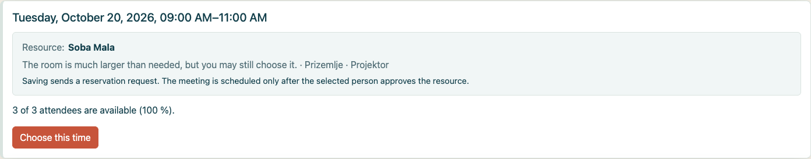Otra tarjeta ofrece el mismo horario en una sala diferente.

## 10. Puede escribir en el calendario de recursos.

1.  Seleccione una tarjeta de una sala disponible. Su descripción dice que la reserva será confirmada inmediatamente.
2.  Haga clic en **Elegir este horario**.
3.  En la confirmación verde en esa misma tarjeta, haga clic en **Guardar reunión**. No es necesario buscar un "botón final" no especificado.
4.  Se abren los detalles guardados de la reunión. La sala está reservada. Está prevista una reunión obligatoria; una propuesta aún espera respuestas si elige ese modo.

Seleccionar una hora no es guardar. Termine con el botón guardar en la tarjeta seleccionada. La sala se vuelve a comprobar en el momento de guardar porque es posible que otra persona la haya reservado mientras tanto.

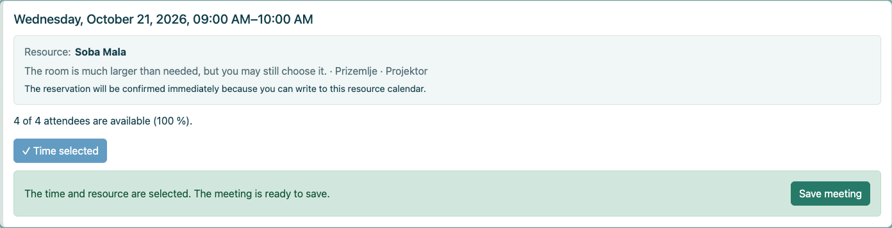Un usuario con acceso de escritura guarda desde la confirmación de la tarjeta.

## 11. No puede escribir al recurso: solicita una reserva.

1.  Elija una sala libre y haga clic en **Elegir este horario**.
2.  Se abre un panel de confirmación de reserva en esa tarjeta.
3.  Seleccione al menos una persona ofrecida que pueda aprobar la sala. No envíes a todos innecesariamente.
4.  Utilice **Mensaje al aprobador** para explicar el motivo, por ejemplo, "Reserve una sala para el equipo del proyecto".
5.  Haga clic en **Confirmar selección de hora** y luego en **Enviar solicitud de reserva** en la confirmación de esa misma tarjeta.
6.  Marque **Esperando confirmación de recursos** en los detalles. La reunión aún no está programada.

Si no se ofrece ningún aprobador, comuníquese con el gestor del calendario. No puede eludir los permisos de la sala usted mismo.

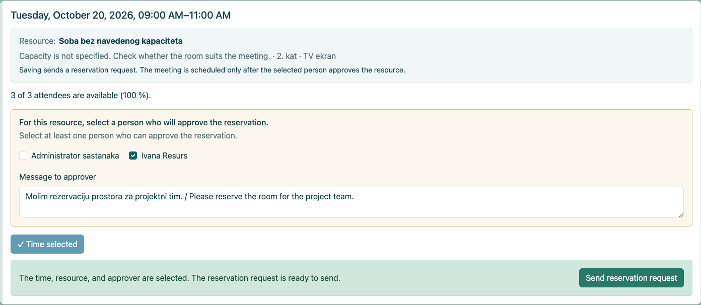El organizador selecciona un aprobador y envía la solicitud dentro del tiempo elegido.

## 12. ¿Qué pasa si alguien más quiere la sala mientras esperas?

Una solicitud pendiente de confirmación **retiene temporalmente la sala**. A otro organizador se le dice que existe una solicitud para ese momento. Esto se aplica tanto a los usuarios con acceso de escritura como a otros solicitantes.

1.  Si ve una advertencia de solicitud pendiente, no trate la sala como disponible.
2.  Elija otra sala u hora, o espere una decisión.
3.  El rechazo o cancelación libera la sala para que pueda ofrecerse en un nuevo comprobación.

Esperar no es una aprobación automática. Una reserva final requiere aprobación; verificar nuevamente al momento de guardar evita omitir otra solicitud.

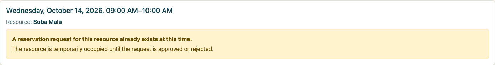Otro organizador ve que la sala está ocupada por una solicitud pendiente anterior.

## 13. Aprobador: notificación y aprobación de la sala

1.  Abra su menú de usuario, luego **Notificaciones**.
2.  Busque **Solicitud de reserva de recursos**. Verifique el título y la hora de la reunión.
3.  Haga clic en el enlace de la reunión. Abra esa solicitud específica, no solo una lista general.
4.  En la tarjeta **Recursos**, marque la sala y, opcionalmente, agregue un mensaje al organizador.
5.  Haga clic en **Aprobar**. El recurso pasa a ser **Reservado**.

Se notifica al organizador. Entonces se programa una reunión obligatoria o ya acordada. Para una propuesta, los asistentes reciben la invitación a responder solo después de que se confirme la sala.

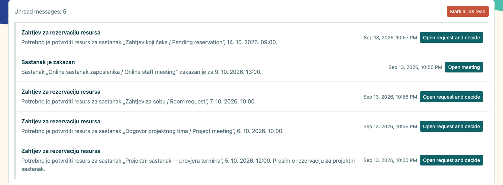Ivana recibe una notificación vinculada a la solicitud.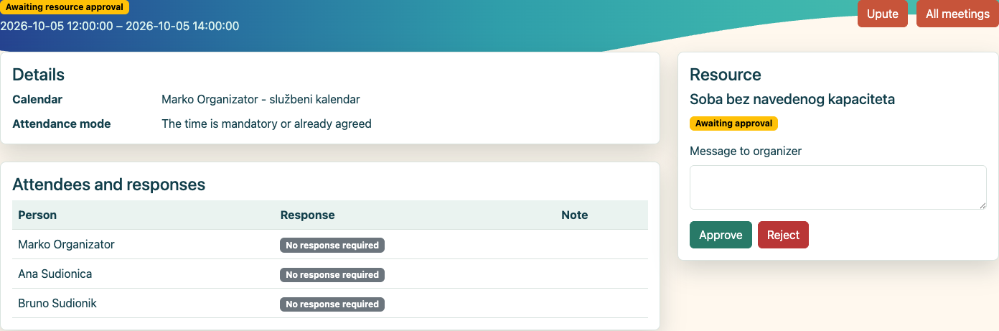El aprobador decide en la tarjeta de Recursos.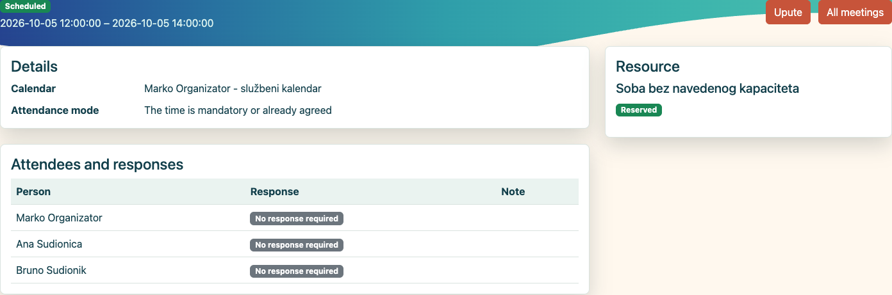Sala aprobada y reunión obligatoria programada.

## 14. Aprobador: rechazando la sala

1.  Abra la solicitud desde su notificación.
2.  Explique el motivo en **Mensaje al organizador**, por ejemplo, que la sala no es adecuada.
3.  Haga clic en **Rechazar**.
4.  Marque **Reserva del recurso rechazada**.

The room is released for others. Se notifica al organizador y puede usar **Editar** para buscar otra sala u hora y enviar una nueva solicitud. Rechazar una sala es diferente a que un asistente rechace la asistencia.

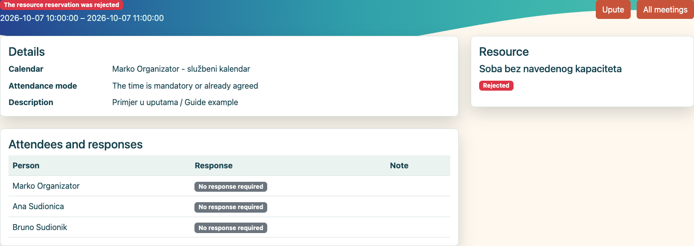La solicitud queda rechazada; el organizador puede consultar el resultado en los detalles.

## 15. Reunión obligatoria o propuesta: dos opciones diferentes

En **¿Deben responder los asistentes?**, elija:

- **No — hora obligatoria/ya acordada**: se notifica a los asistentes pero no se solicita respuesta Sí/No. Si la sala requiere aprobación, esa aprobación debe ser lo primero.
- **Sí: una propuesta pendiente de respuestas**: los asistentes deben responder. Seleccione también **Programar cuando la acepten** (100%, 80%, 60% o 50%).

El porcentaje de personas disponibles que se utiliza en la búsqueda es distinto del porcentaje de respuestas de aceptación. El primero ayuda a encontrar una hora según los compromisos registrados; el segundo determina cuándo queda programada la invitación. El organizador no se incluye entre las personas cuya confirmación se espera.

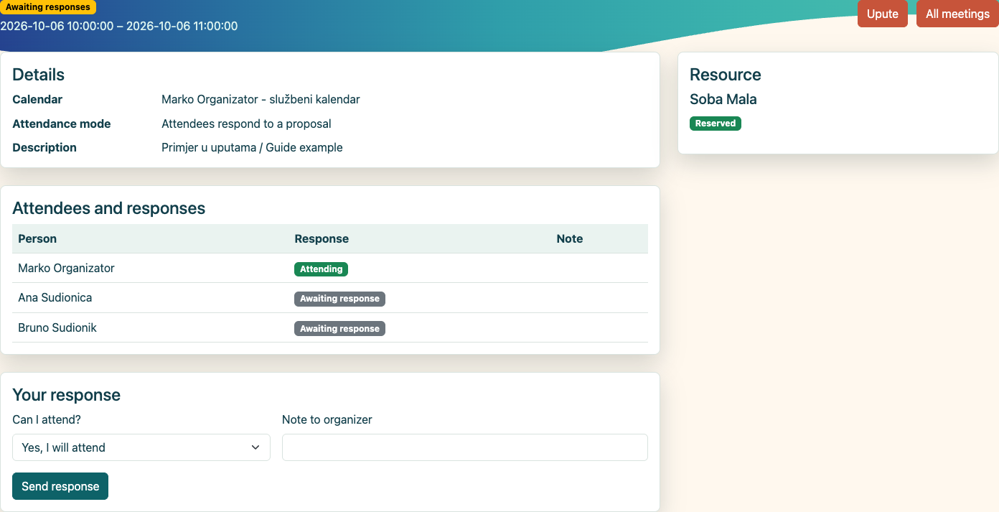Una propuesta con mesa de asistentes y formulario de respuesta.

## 16. Asistente: confirmar la asistencia

1.  Abra **Notificaciones** y busque **Propuesta de reunión**.
2.  Abra el enlace de la reunión. Compruebe la fecha, la hora, la sala y la descripción.
3.  En **Su respuesta → ¿Puedo asistir?**, seleccione **Sí, asistiré**.
4.  Si lo desea, añada un comentario para el organizador.
5.  Pulse **Enviar respuesta**. En su fila de la lista de asistentes aparecerá **Asistirá**.

The organizer is notified with your name and comment. Una vez que un número suficiente de asistentes acepten, la reunión se programa automáticamente. Al 100%, todos los invitados excepto el organizador deberán aceptar.

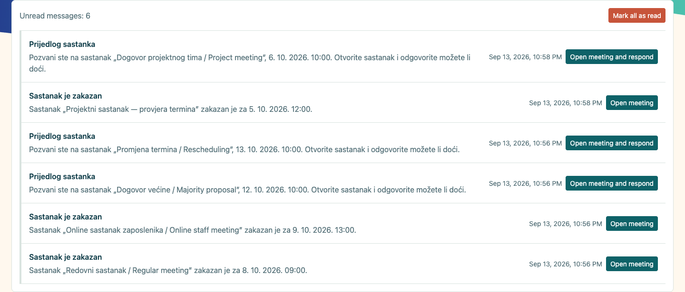Ana recibe una invitación; el enlace abre la reunión correspondiente.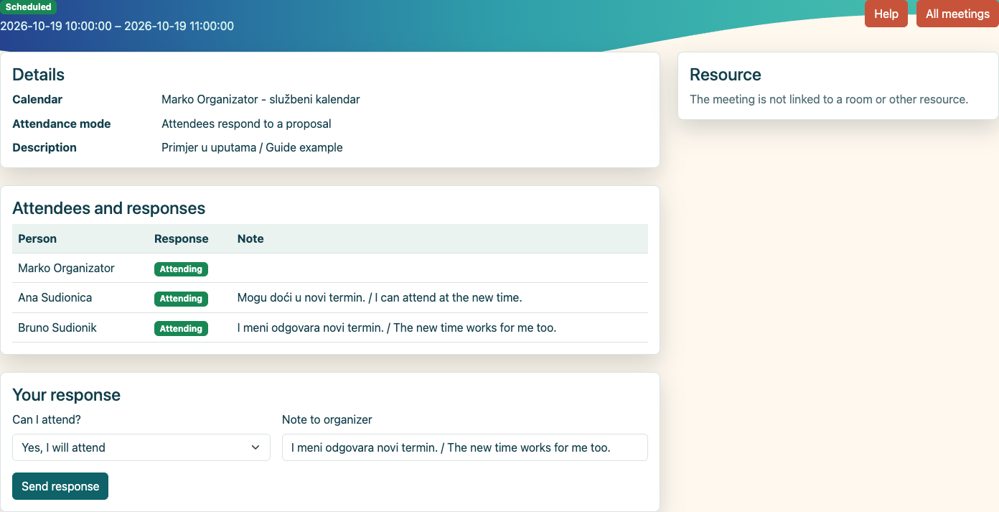Luego de las aceptaciones requeridas, se programa la reunión.

## 17. Asistente: no puede asistir o todavía no lo sabe

1.  Abra la reunión y elija **No puedo asistir** o **Quizás** en **Su respuesta**.
2.  Añada un comentario útil, por ejemplo, «Proponga otra hora, por favor» o «Estoy pendiente de confirmar otro compromiso». No es necesario revelar motivos privados.
3.  Pulse **Enviar respuesta**.
4.  Check your row. La elección guardada y el comentario permanecen visibles cuando vuelve a abrir la reunión.

Rechazar la invitación no cancela la reunión completa. Responder «Quizás» no equivale a aceptarla. El organizador decide si busca otra hora o programa la reunión de todos modos. Si cambian sus circunstancias, puede modificar la respuesta mientras se sigan admitiendo respuestas.

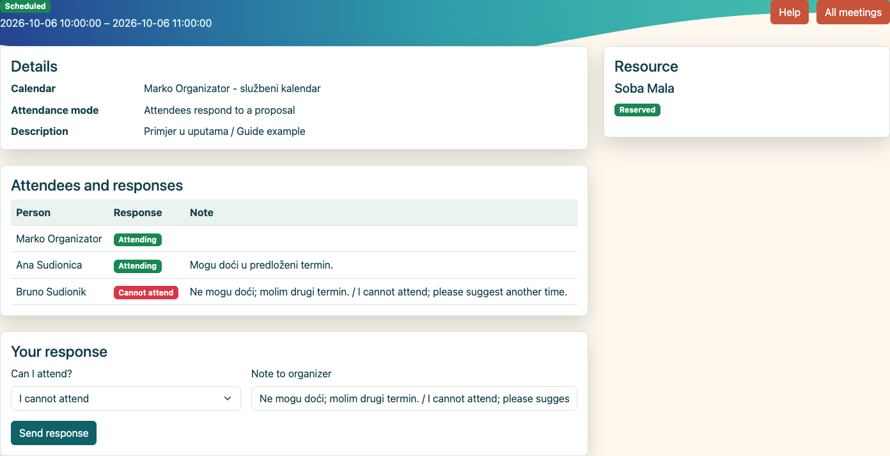Bruno rechaza asistir y pide otro horario.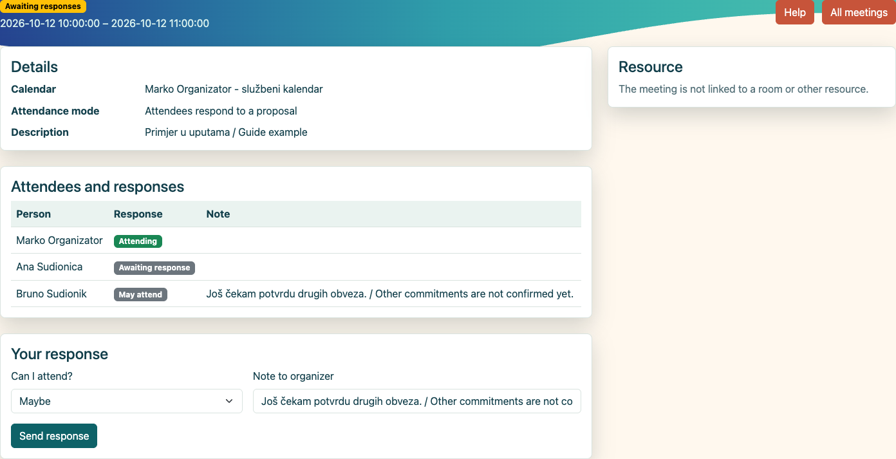Una respuesta tentativa tal vez con un comentario.

## 18. Organizador: decidir después de que alguien rechaza

1.  Abra la notificación de respuesta. Identifica a la persona y su comentario.
2.  Abra la reunión y revise toda la tabla de respuestas.
3.  Para una hora diferente, haga clic en **Editar**, cambie la fecha o el horario, vuelva a verificar la disponibilidad y guarde.
4.  Si la reunión aún debe utilizar este tiempo, haga clic deliberadamente en **Programar este tiempo de todos modos** en los detalles de la propuesta.
5.  Marque **Programado**. La respuesta rechazada sigue siendo visible; el sistema no lo convierte en aceptación.

La programación manual no pasa por alto la aprobación de la sala pendiente. El recurso debe resolverse primero.

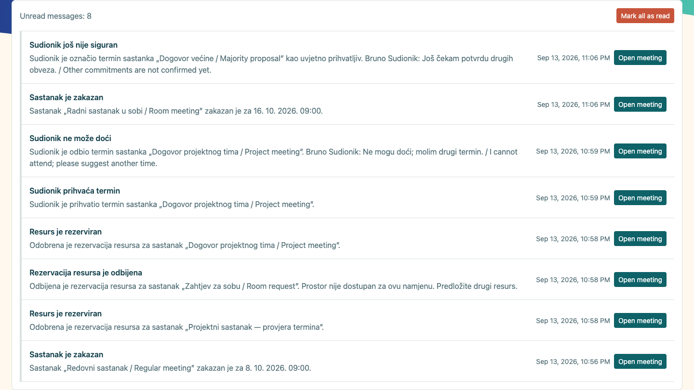El organizador ve las respuestas y los enlaces de las reuniones.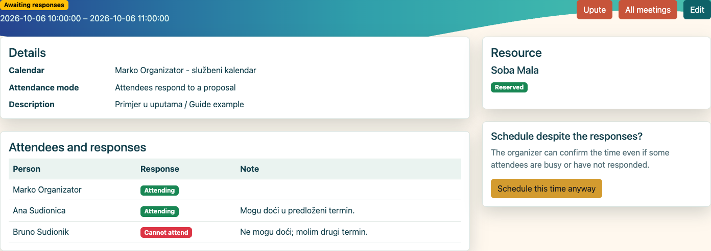La opción de programar conscientemente a pesar de las respuestas.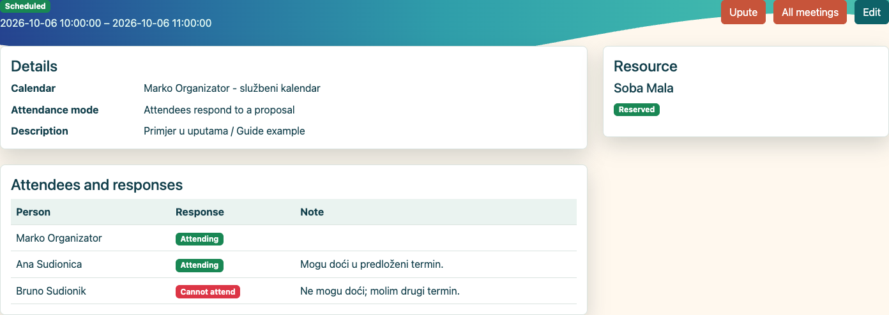La reunión programada todavía muestra que Bruno no puede asistir.

## 19. Cambiar la hora y solicitar respuestas nuevamente

1.  Abra la reunión existente y haga clic en **Editar**.
2.  Cambie la fecha, inicio o finalización. Elija el mismo recurso u otro.
3.  Haga clic en **Consultar horarios disponibles**. La antigua reunión no debe entrar en conflicto consigo misma.
4.  Seleccione la nueva tarjeta y guárdela, o envíe una nueva solicitud de sala.
5.  Los asistentes reciben una notificación con la nueva hora. Si se requieren respuestas, las respuestas anteriores se borran y se solicitan otras nuevas.

Aceptar la fecha anterior no significa aceptar la nueva. El encuentro conserva su identidad y vínculo; no se crea ninguna copia adicional. La nueva sala u hora debe pasar nuevamente las verificaciones de disponibilidad y cualquier aprobación requerida.

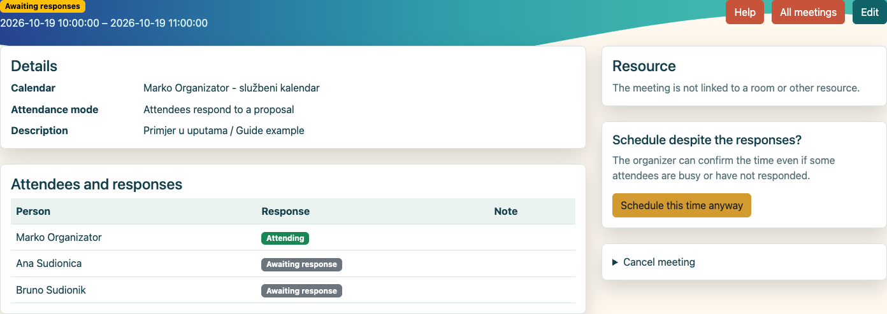La misma reunión en nueva fecha; Se solicitan nuevamente respuestas.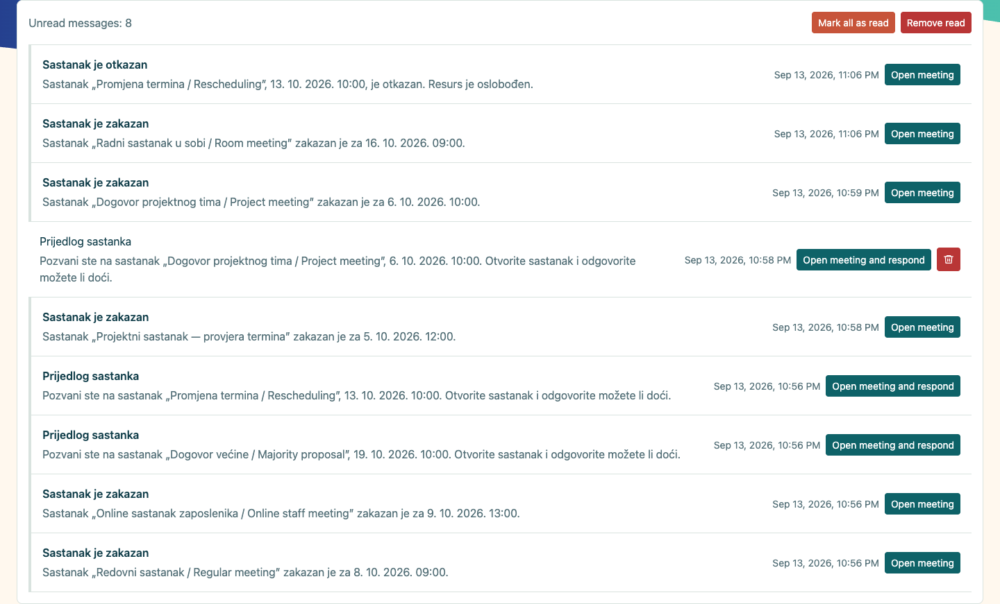Se notifica al asistente la nueva hora.

## 20. La mayoría acepta: comprendiendo el umbral

Ejemplo: un organizador y dos personas más tienen una reunión. **Programa cuando es aceptado por** se refiere a las dos personas cuyas respuestas espera el organizador. Una aceptación es del 50%; dos son 100%. Al 60%, una aceptación no es suficiente; al 50%, lo es. Quizás y No no cuentan como aceptación.

1.  Elija el umbral antes de enviar.
2.  Revise la tabla después de las respuestas. La propuesta espera hasta que se alcance el umbral.
3.  Una vez que se alcance el umbral y se confirme la sala, verifique que el estado sea Programado.

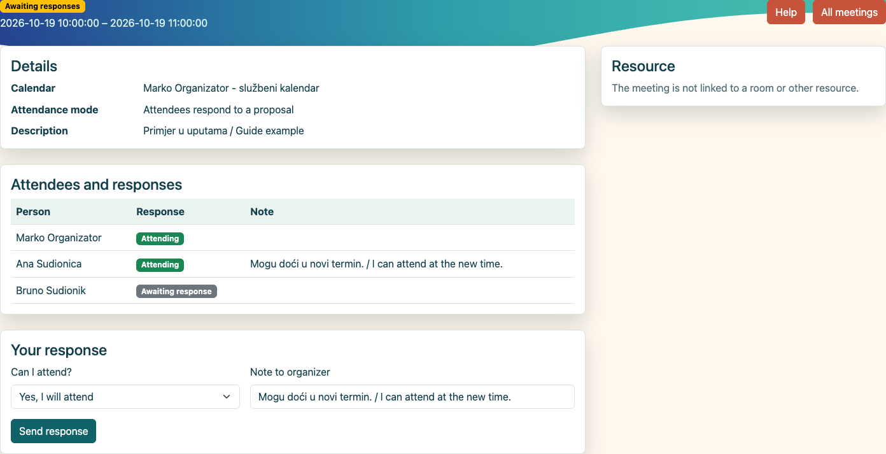Una de cada dos personas ha aceptado, por lo que aún no se ha alcanzado el umbral del 60%.

## 21. Online, su propia oficina y un evento para todos

1.  Marque **Sin recursos**. Deseleccione las habitaciones reales si es necesario.
2.  Coloque el enlace en línea o la dirección del lugar no listado en la descripción.
3.  Agregar personas o grupos; para un evento general, seleccione **Todos los usuarios activos**.
4.  Consulte la hora y elige la tarjeta Sin recurso.
5.  Guardar. No se crea ninguna reserva de sala ni solicitud de aprobación.

Esta reunión puede ser todavía obligatoria o una propuesta pendiente de respuesta. Todos significa todos los usuarios activos del sitio, no solo los empleados de una organización.

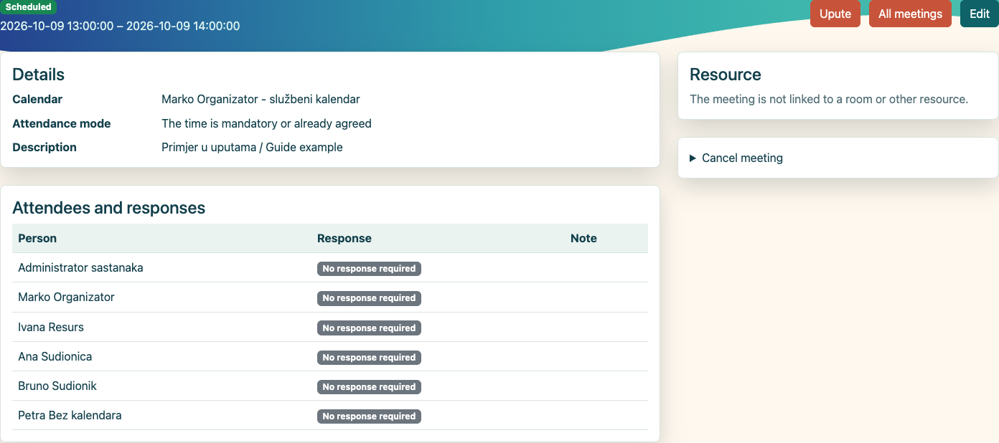Una reunión obligatoria para todos sin reserva de sala.

## 22. Cancelación y liberación de la sala

1.  Como organizador o editor autorizado, abra los detalles de la reunión.
2.  Expanda **Cancelar reunión**.
3.  Lea la advertencia y haga clic en **Confirmar cancelación** solo si no se llevará a cabo.
4.  Marque **Cancelado**. Se notifica a los asistentes y la reserva o solicitud vinculada deja de retener la sala.

El No de un asistente no es una cancelación. La reunión cancelada sigue siendo identificable en sus detalles como un registro de decisión, pero ya no cuenta como tiempo ocupado.

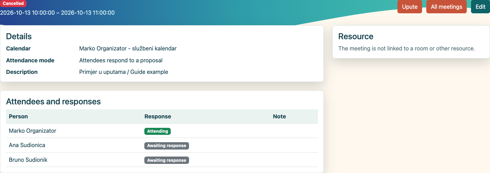Una reunión cancelada ya no ocupa asistentes ni la sala.

## 23. Dónde ven los asistentes las reuniones: calendario y notificaciones

1.  Abra **Calendarios**. La lista de calendario incluye la vista virtual **Mis reuniones**.
2.  Elija mes, semana o día y abra un evento. Conduce a los detalles de la reunión.
3.  No es necesario que las personas estén suscriptas automáticamente a cada equipo o calendario de recursos.
4.  En **Notificaciones**, utiliza el enlace de la reunión para responder, decidir una sala o revisar un cambio.

Una propuesta, una solicitud de sala pendiente y una reunión programada tienen estados diferentes. Verifica los detalles antes de asistir, no solo la presencia de un evento en el calendario. Una sala rechazada no es una sede confirmada.

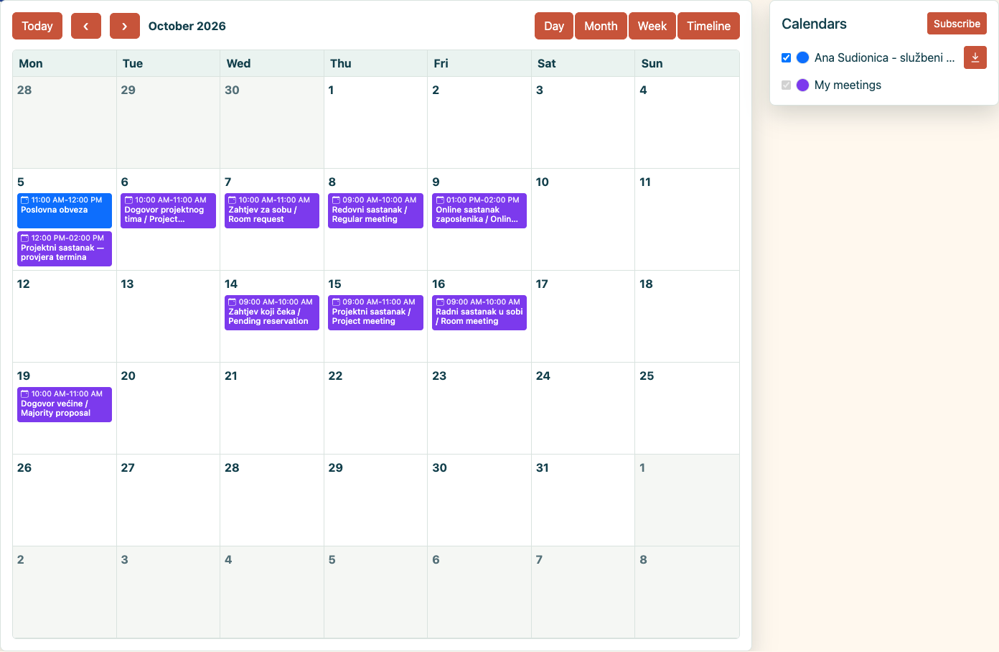Ana ve Mis reuniones junto con su calendario oficial sin suscribirse al calendario del equipo.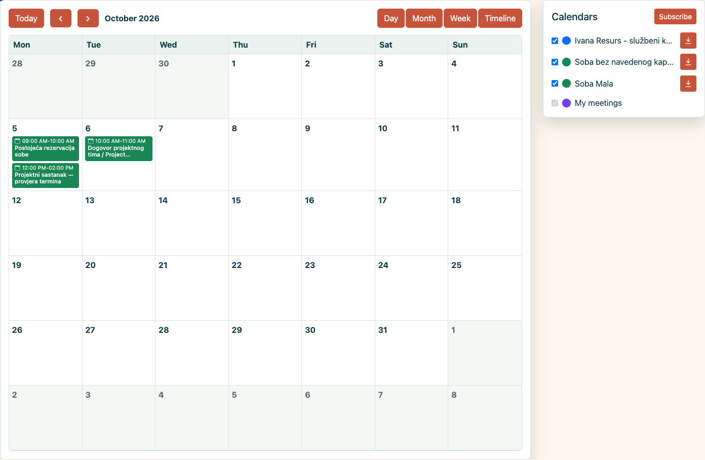Vista de calendario de un usuario que reserva recursos.

## 24. CalDAV y respondiendo desde un calendario externo

CalDAV descubrimiento incluye el calendario virtual **Mis reuniones**. Habilítelo en su cliente si no se muestra automáticamente. Contiene reuniones en las que usted participa como asistente, sin copias independientes en sus calendarios personales ni suscripciones obligatorias a los calendarios del equipo de origen.

1.  Abra la reunión en su calendario externo.
2.  Siga el enlace Simbioza en la descripción/URL del evento.
3.  Inicie sesión con su cuenta si es necesario.
4.  Responda o verifique el estado en Simbioza.

No se admite responder a través de botones nativos de Apple/Outlook/otros clientes: la funcionalidad completa de CalDAV Scheduling/iTIP no está implementada. La vista virtual es de sólo lectura. Si sigue únicamente su propio calendario fuente y no habilita Mis reuniones, no espere que aparezcan todas las reuniones de otros calendarios.

## 25. gestor: los asistentes predeterminados de un calendario

1.  Abra la configuración de la reunión para un calendario que pueda administrar.
2.  Agregue personas, grupos o todos los que normalmente deberían asistir.
3.  Guarde la configuración.
4.  Utilice **Incluir los asistentes predeterminados del calendario seleccionado** en un evento nuevo o existente cuando esa lista sea apropiada.

Un administrador gestiona la membresía del grupo. Para un equipo o departamento normal, seleccione su grupo en lugar de ingresar a cada miembro por separado. Una suscripción al calendario sigue siendo diferente de la participación en una reunión.

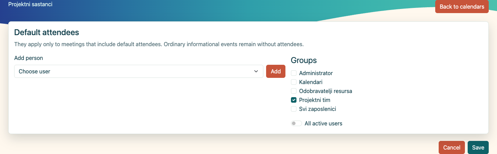El director asocia el grupo Projektni tim a un calendario de equipo.

## 26. Gestor: perfil de sala opcional

1.  Abra la configuración de reuniones del calendario de recursos.
2.  Si tiene la información, habilita su perfil e ingresa tipo, capacidad, ubicación y equipo.
3.  Si se desconoce la capacidad, déjela sin especificar. No inventes un número.
4.  Guardar. Estos detalles ayudan en la búsqueda, pero no se requiere un perfil para que exista un recurso.

La capacidad constituye una advertencia, no una prohibición estricta: se pueden elegir deliberadamente habitaciones más pequeñas y mucho más grandes. Las salas de capacidad desconocida se incluyen únicamente si el organizador lo permite.

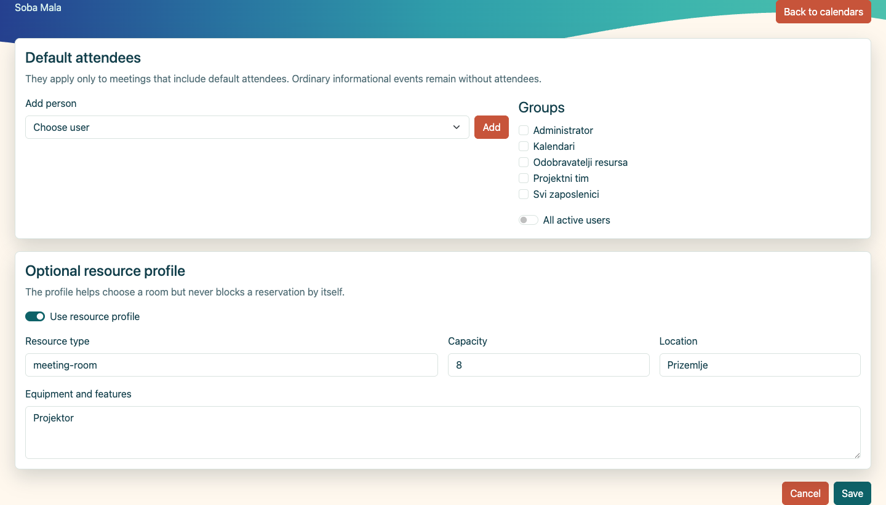Un perfil de sala opcional con capacidad, ubicación y equipamiento.

## 27. Calendarios importados e informativos sin asistentes

Es posible que una importación de Confluence no sepa quién asiste. Dichos calendarios y eventos podrán permanecer sin personas o grupos. Un horario de conferencias que un usuario simplemente sigue **no marca automáticamente a ese usuario como ocupado**.

1.  Después de la importación, revise el calendario y sus permisos de acceso.
2.  Si es informativo, no agregue asistentes solo para llenar un campo vacío.
3.  Si un evento realmente se convierte en una reunión, ábrelo y utiliza el planificador/editor de reuniones.
4.  Agregue personas o grupos reales, elija si se requieren respuestas y verifique la hora y la sala.
5.  Guardar después de comprobar. Desactive la herencia del calendario cuando el evento individual necesite diferentes asistentes.

El sistema no puede adivinar de manera confiable a los asistentes a partir del título de un evento importado. Un gestor o editor autorizado asocia personas y grupos.

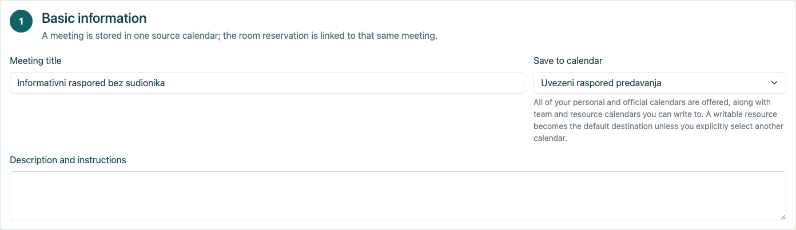El evento importado se selecciona para editarlo; se conserva su calendario fuente.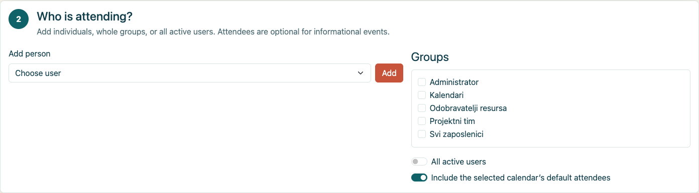La lista de asistentes permanece vacía hasta que una persona autorizada agregue personas o grupos.

## 28. Preguntas frecuentes y lista de verificación final

Elija esta vez solo cambia la tarjeta: ¿se guarda?

No. Si se necesita un aprobador, seleccione uno y confirme la elección primero. Luego haga clic en Guardar reunión o Enviar solicitud de reserva en la confirmación verde en esa misma tarjeta. Los detalles de la reunión confirman que se guardó.

¿Por qué no puedo ver por qué otra persona está ocupada?

Puede ver libre/ocupado sin acceso a su calendario. El título y el motivo son visibles solo con acceso de lectura al calendario fuente. La organización de una reunión no otorga acceso a notas privadas.

¿Por qué una persona parece libre pero responde que no?

Es posible que no registren todos los compromisos en Simbioza. La disponibilidad registrada no garantiza la asistencia. Utilice una propuesta con respuestas cuando necesite confirmación.

¿Por qué se celebra la sala si aún no está prevista la reunión?

Una solicitud de reserva protege la sala mientras el aprobador decide. El rechazo o la cancelación lo libera.

Sigo un calendario pero no soy asistente. ¿Por qué no me ocupa?

Lo siguiente es para verlo. La asistencia debe estar asociada explícitamente a través de una persona, grupo o Todos.

### Antes de enviar o asistir

- ¿El título es claro y la fecha y hora son correctas?
- ¿Las personas y los grupos son correctos, sin una selección accidental de Todos?
- ¿La sala está apta y confirmada o aún está pendiente su solicitud?
- ¿Se requieren respuestas o la asistencia es obligatoria?
- ¿Terminaste de guardar y no simplemente seleccionaste una tarjeta?
- Como asistente: ¿enviaste una respuesta y verificaste el estado final?
