# Réunions — pas à pas

> Les captures d’écran présentent l’interface en anglais.

## 1. Avant de commencer : qu’est-ce qu’une réunion

Ce guide vous guide dans la planification, la réservation d'une salle et la participation à une réunion. Aucune connaissance technique n'est requise. Ouvrez **Calendriers → Planifier une réunion**. Rouvrez les propositions, les réunions obligatoires et les demandes de réservation via **Mes réunions** ou un lien dans **Notifications** dans votre menu utilisateur.

**Une réunion n'est stockée qu'une seule fois.** Choisissez son calendrier source. Si la salle appartient à un autre calendrier, sa réservation est liée à cette même réunion : des copies indépendantes ne sont pas créées pour chaque participant. Les participants le voient via *Mes réunions*, même s'ils ne sont pas abonnés au calendrier de l'équipe.

Les exemples utilisent une nouvelle installation de test, des utilisateurs fictifs et des dates en octobre 2026. Toutes les captures d'écran utilisent le thème clair. Vos noms et dates peuvent différer ; les étapes sont les mêmes. Aucun véritable engagement privé n’est montré.

## 2. Rôles et autorisations

| Rôle | Ce que tu peux faire |
|----|----|
| Organisateur | Chaque utilisateur connecté peut vérifier les heures. Enregistrez dans un calendrier dans lequel vous pouvez écrire, sélectionnez des participants et demandez une réservation si vous ne pouvez pas écrire à la ressource. |
| Approbateur de ressources | Ouvrez la demande et approuvez ou rejetez la salle. L'organisateur choisit qui reçoit la demande ; il n’est pas nécessaire que cela s’adresse à tout le monde. |
| Participant | Voir votre réunion. Si une réponse est demandée, choisissez Oui, Peut-être ou Non et ajoutez un commentaire. Cela n’autorise pas à modifier le calendrier de quelqu’un d’autre ou à annuler la réunion. |
| Gestionnaire / administrateur de calendrier | Gérez l'accès, les participants par défaut et les profils de ressources facultatifs en fonction de vos autorisations. |

Être autorisé à visiter une chambre n’est pas la même chose qu’être autorisé à la réserver. L'abonnement à un calendrier d'équipe ne fait pas de vous un participant à chaque événement.

## 3. Vous n'avez pas votre propre calendrier

1.  Ouvrez le planificateur. Vous pouvez rechercher les heures disponibles sans votre propre calendrier.
2.  Si vous en souhaitez un, utilisez le panneau bleu pour choisir **Officiel** pour le travail, **Personnel** pour les engagements privés ou **Personnalisé** pour votre propre nom.
3.  Seul **Créer le calendrier sélectionné** le crée. L'ouverture du planificateur ne crée rien.
4.  Si vous pouvez déjà écrire dans un calendrier d'équipe ou de ressources, enregistrez-le sans créer le vôtre.

Les deux types appartiennent à une personne ; la façon dont vous les utilisez est votre choix. Gérez le calendrier, les importations et accédez-y ultérieurement dans les paramètres de votre calendrier.

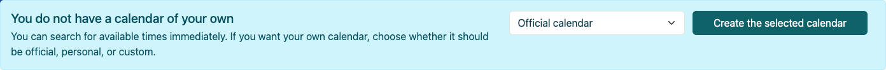Choisissez un type avant de créer un calendrier.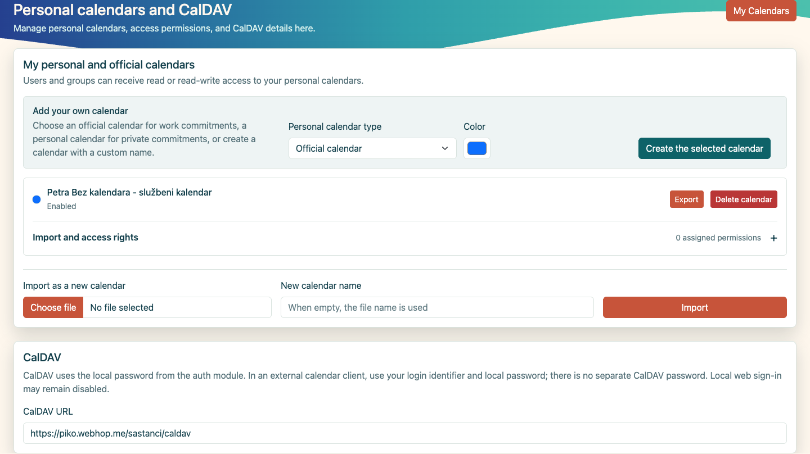Paramètres du calendrier personnel : les contrôles d'importation et d'accès se trouvent dans une section extensible.

## 4. Étape 1 — titre, description et calendrier de destination

1.  Saisissez un **Titre de la réunion** clair, par exemple « Réunion de projet ».
2.  Utilisez **Description et instructions** pour le sujet, l'ordre du jour ou le lien de la réunion en ligne.
3.  **Enregistrer dans le calendrier** propose vos calendriers personnels et officiels, ainsi que les calendriers d'équipe et de ressources dans lesquels vous pouvez écrire.
4.  Si vous souhaitez un calendrier d'équipe spécifique, sélectionnez-le vous-même. Ce choix demeure lorsque vous sélectionnez une heure et une salle.

Si vous n'avez pas explicitement choisi une autre destination, une salle accessible en écriture devient le calendrier source par défaut. Si vous ne pouvez pas écrire dans la salle, la source est votre calendrier personnel, officiel ou d'équipe sélectionné et la réservation de la salle y est liée.

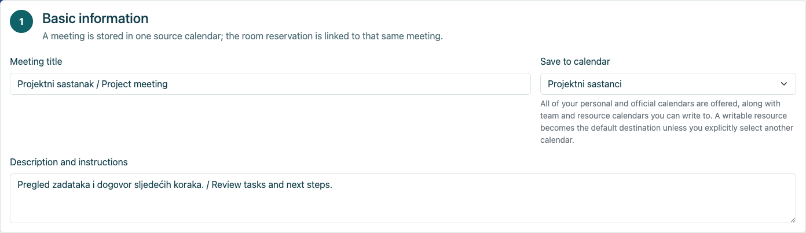L'organisateur a sélectionné un calendrier d'équipe comme source de réunion.

## 5. Étape 2 – personnes, groupes et tout le monde

1.  Pour un individu, ouvrez **Ajouter une personne**, recherchez un utilisateur et cliquez sur **Ajouter**. Répétez pour les autres.
2.  Pour une équipe, cochez un groupe tel que **Projektni tim**. Les membres du groupe d'authentification deviennent des participants sans entrer chaque personne.
3.  Pour une réunion à l'échelle de l'organisation, cochez **Tous les utilisateurs actifs**. Si le site compte également des utilisateurs externes, sélectionnez plutôt le groupe d'employés approprié lorsque seuls les employés doivent y assister.
4.  **Inclure les participants par défaut du calendrier sélectionné** ajoute les personnes et les groupes associés à ce calendrier. Désactivez-le lorsqu'ils ne sont pas nécessaires pour cet événement.

Une personne est comptée une fois même si elle est sélectionnée directement et via plusieurs groupes. Les abonnements ne sont pas des listes de présence. Les événements sans participants peuvent rester informatifs.

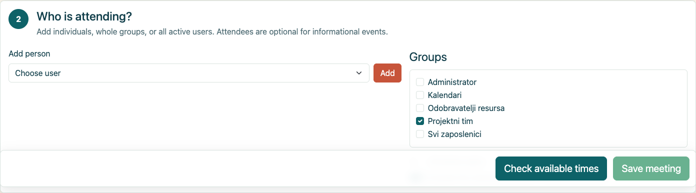Participants de groupe et héritage facultatif du calendrier.

## 6. Étape 3 : trouver le meilleur moment

1.  Sélectionnez **Trouver les meilleurs moments**.
2.  Entrez la première et la dernière date. Commencez par un ou quelques jours.
3.  Définissez le début au plus tôt, la fin au plus tard et la **Durée**.
4.  Vérifiez les jours de semaine autorisés, par exemple le lundi et le mercredi.
5.  Choisissez **Combien de participants doivent être disponibles ?** : Tout le monde, Grande majorité, Majorité ou toutes les options.
6.  Choisissez une salle à l'étape suivante et cliquez sur **Vérifier les horaires disponibles**.

Les meilleures options apparaissent en premier. Lisez toujours le nombre réel de participants disponibles : vérifier la disponibilité n’est pas la même chose que recevoir leurs réponses.

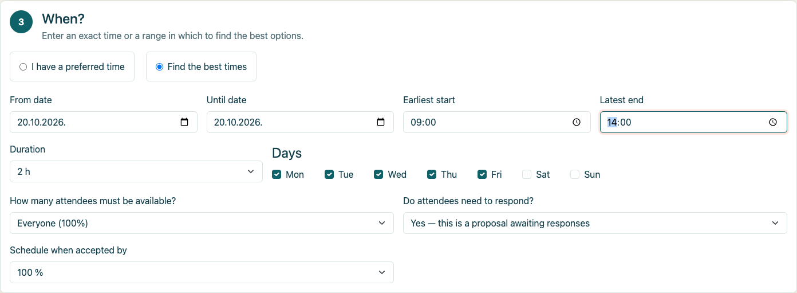Conditions de recherche : dates, heures, durée et jours de la semaine.

## 7. Étape 3a — vous avez déjà une heure préférée

1.  Sélectionnez **J'ai une heure préférée**.
2.  Entrez une date, un début et une fin. La fin doit être après le début.
3.  Ajoutez des participants et une ressource, puis cliquez sur **Vérifier les heures disponibles**.
4.  Lisez le nombre de participants disponibles et développez **Participants occupés** si nécessaire.
5.  Si certains ne peuvent pas y assister, modifiez la date ou l’heure, ou choisissez consciemment une réunion avec moins de participants disponibles.

La disponibilité inclut les calendriers et événements personnels et officiels qui incluent réellement la personne en tant que participant. Une personne n’est pas considérée comme occupée simplement parce qu’elle s’abonne à un calendrier d’information. Le système ne connaît que les engagements enregistrés dans Simbioza.

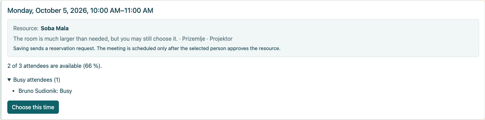L'organisateur voit que Bruno est occupé, mais pas les détails de son engagement privé.

## 8. Étape 4 — quelle pièce vérifier

1.  Sélectionnez une ou plusieurs pièces avec des cases à cocher. Cliquez à nouveau pour désélectionner.
2.  Si rien n'est sélectionné, **toutes les ressources réelles** sont vérifiées.
3.  Pour une réunion en ligne, votre propre bureau ou un restaurant non répertorié, cochez explicitement **Aucune ressource**. Cette option n'est jamais ajoutée automatiquement.
4.  Entrez le nombre de sièges requis. Si la capacité de certaines salles est inconnue, décidez si vous souhaitez inclure les **ressources sans capacité déclarée**.
5.  Cliquez sur **Vérifier les horaires disponibles**.

Un profil de ressource est facultatif. En cas de capacité inconnue, vérifiez vous-même l'adéquation. Une pièce beaucoup plus grande ou plus petite affiche un avertissement mais n'est pas interdite ; des chaises supplémentaires ou un aménagement différent peuvent être possibles.

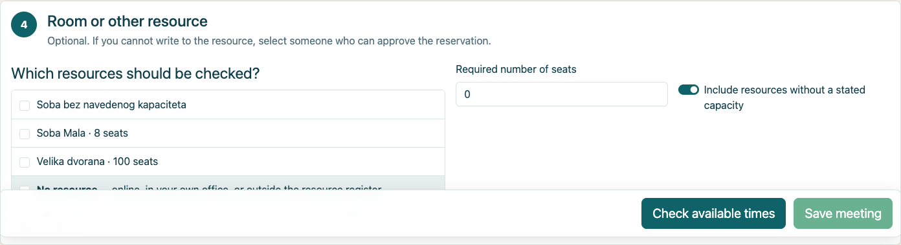Les cases à cocher peuvent être cochées et décochées ; Aucune ressource n'est un choix explicite.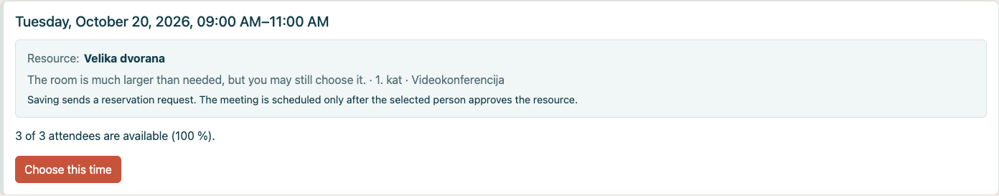Une grande pièce n'est pas interdite, mais l'avertissement vous aide à choisir.

## 9. Résultats — chaque carte a déjà un temps et une ressource

1.  Lisez la date et l’heure de la carte.
2.  Immédiatement en dessous, lisez le nom de la ressource, la capacité et les informations sur la salle disponible.
3.  Lisez la part des participants disponibles. La recherche dans toutes les pièces peut afficher plusieurs cartes pour le même temps, une pour chaque ressource gratuite.
4.  Cliquez sur **Choisir cette heure** sur la carte exacte que vous souhaitez. Il n’y a pas de liste déroulante de ressources ultérieure.
5.  Suivez la confirmation sur cette carte. Après avoir modifié les conditions de recherche, vérifiez et sélectionnez à nouveau une heure.

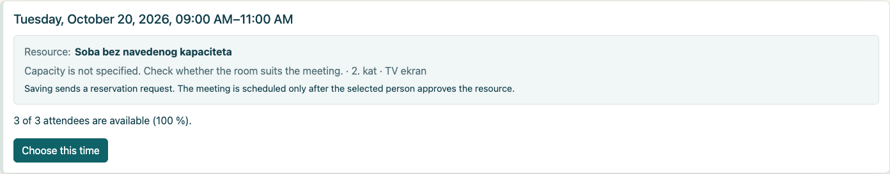L'heure et une salle spécifique constituent une option proposée.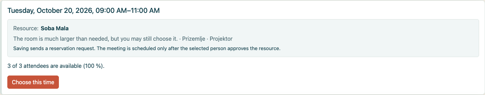Une autre carte propose le même temps avec une chambre différente.

## 10. Vous pouvez écrire dans le calendrier des ressources

1.  Sélectionnez une carte de chambre gratuite. Sa description indique que la réservation sera confirmée immédiatement.
2.  Cliquez sur **Choisir cette fois**.
3.  Dans la confirmation verte sur cette même carte, cliquez sur **Enregistrer la réunion**. Vous n'avez pas besoin de rechercher un « bouton final » non spécifié.
4.  Les détails de la réunion enregistrée s'ouvrent. La salle est réservée. Une réunion obligatoire est prévue ; une proposition attend toujours des réponses si vous avez choisi ce mode.

Sélectionner une heure n'est pas une sauvegarde. Terminez avec le bouton Enregistrer sur la carte sélectionnée. La chambre est à nouveau vérifiée à l'heure de sauvegarde car quelqu'un d'autre l'a peut-être réservée entre-temps.

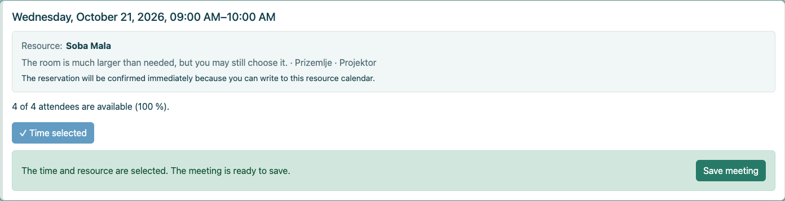Un utilisateur disposant d’un accès en écriture enregistre la confirmation de la carte.

## 11. Vous ne pouvez pas écrire à la ressource — demander une réservation

1.  Choisissez une chambre gratuite et cliquez sur **Choisir cette fois**.
2.  Un panneau de confirmation de réservation s'ouvre sur cette carte.
3.  Sélectionnez au moins une personne proposée qui peut approuver la salle. N'envoyez pas inutilement à tout le monde.
4.  Utilisez **Message à l'approbateur** pour expliquer la raison, par exemple « Veuillez réserver une salle pour l'équipe du projet ».
5.  Cliquez sur **Confirmer la sélection de l'heure**, puis sur **Envoyer la demande de réservation** dans la confirmation sur cette même carte.
6.  Cochez **En attente de confirmation des ressources** dans les détails. La réunion n'est pas encore programmée.

Si aucun approbateur n'est proposé, contactez le gestionnaire de calendrier. Vous ne pouvez pas contourner vous-même les autorisations de la salle.

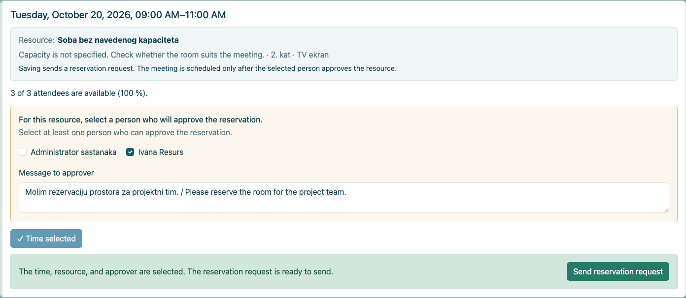L'organisateur sélectionne un approbateur et envoie la demande dans le délai choisi.

## 12. Que se passe-t-il si quelqu'un d'autre veut la chambre pendant que vous attendez

Une demande en attente de confirmation **retient temporairement la chambre**. Un autre organisateur est informé qu'une demande existe pour cette période. Cela s'applique aux utilisateurs disposant d'un accès en écriture ainsi qu'aux autres demandeurs.

1.  Si vous voyez un avertissement de demande en attente, ne considérez pas la chambre comme libre.
2.  Choisissez une autre salle ou une autre heure, ou attendez une décision.
3.  Le refus ou l'annulation libère la chambre afin qu'elle puisse être proposée dans un nouveau chèque.

Attendre n’est pas une approbation automatique. Une réservation définitive nécessite une approbation ; vérifier à nouveau au moment de la sauvegarde empêche de contourner une autre demande.

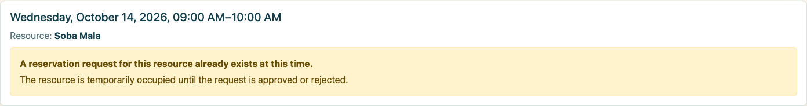Un autre organisateur constate que la salle est occupée par une demande antérieure en attente.

## 13. Approbateur — notification et approbation de la salle

1.  Ouvrez votre menu utilisateur, puis **Notifications**.
2.  Recherchez **Demande de réservation de ressources**. Vérifiez le titre et l’heure de la réunion.
3.  Cliquez sur le lien de la réunion. Il ouvre cette demande spécifique, pas seulement une liste générale.
4.  Dans la fiche **Ressource**, vérifiez la salle et ajoutez éventuellement un message à l'organisateur.
5.  Cliquez sur **Approuver**. La ressource devient **Réservée**.

L'organisateur est prévenu. Une réunion obligatoire ou déjà convenue devient alors programmée. Pour une proposition, les participants reçoivent l’invitation à répondre uniquement après confirmation de la salle.

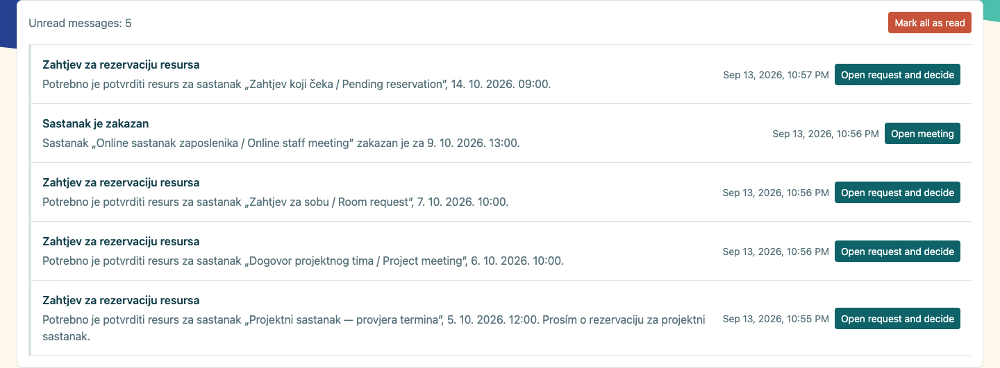Ivana reçoit une notification liée à la demande.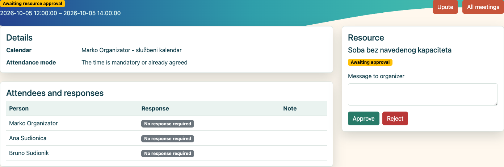L'approbateur décide dans la fiche Ressource.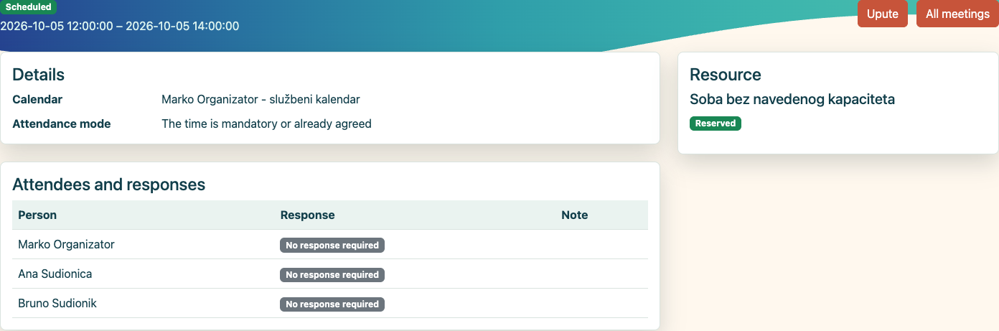Salle agréée et réunion obligatoire programmée.

## 14. Approbateur – rejet de la salle

1.  Ouvrez la demande depuis sa notification.
2.  Expliquez la raison dans **Message à l'organisateur**, par exemple que la salle n'est pas adaptée.
3.  Cliquez sur **Rejeter**.
4.  Cochez **Réservation de ressources rejetée**.

La chambre est libérée pour les autres. L'organisateur est averti et peut utiliser **Modifier** pour trouver une autre salle ou une autre heure et envoyer une nouvelle demande. Rejeter une salle est différent du refus d’un participant de participer.

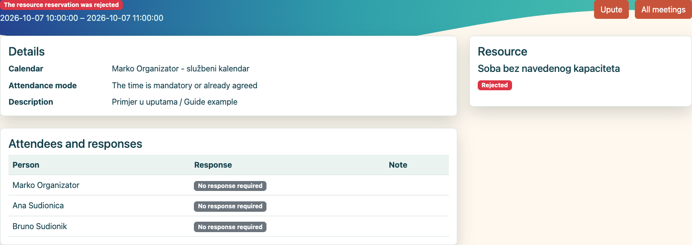La demande est rejetée ; l'organisateur voit le résultat dans les détails.

## 15. Rencontre ou proposition obligatoire — deux choix différents

Sous **Les participants doivent-ils répondre ?**, choisissez :

- **Non — obligatoire / heure déjà convenue** : les participants sont informés mais aucune réponse Oui/Non n'est demandée. Si la salle nécessite une approbation, cette approbation doit quand même passer en premier.
- **Oui — une proposition en attente de réponses** : réponse des participants. Sélectionnez également **Planifier lorsqu'il est accepté par** (100 %, 80 %, 60 % ou 50 %).

Le seuil de personne disponible utilisé dans la recherche est différent du seuil de réponse acceptée. Le premier permet de retrouver un temps à partir des engagements enregistrés ; le second détermine le moment où l'invitation est programmée. L'organisateur est exclu des personnes dont la confirmation est attendue.

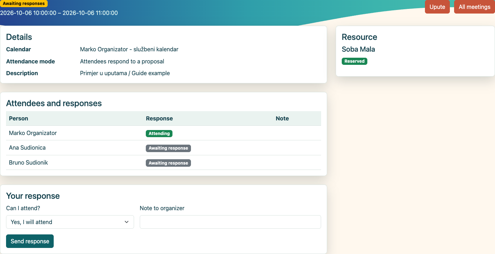Une proposition avec une table des participants et un formulaire de réponse.

## 16. Participant — accepter sa participation

1.  Ouvrez **Notifications** et recherchez **Proposition de réunion**.
2.  Ouvrez le lien de la réunion. Vérifiez sa date, son heure, sa salle et sa description.
3.  Sous **Votre réponse → Puis-je participer ?**, sélectionnez **Oui, j'y participerai**.
4.  Ajoutez éventuellement un commentaire pour l'organisateur.
5.  Cliquez sur **Envoyer la réponse**. La ligne de vos participants affiche **Participant**.

L'organisateur est informé de votre nom et de votre commentaire. Une fois qu’un nombre suffisant d’autres participants ont accepté, la réunion est programmée automatiquement. A 100%, toutes les personnes invitées sauf l'organisateur doivent accepter.

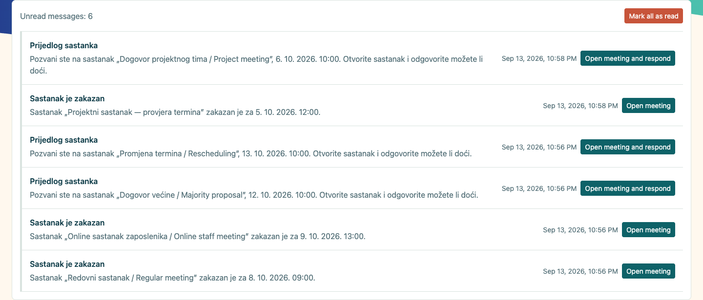Ana reçoit une invitation ; son lien ouvre la réunion spécifique.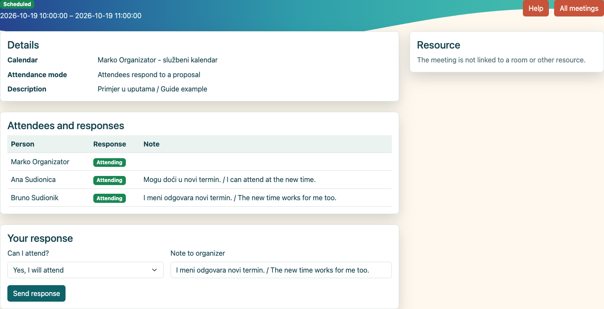Après les acceptations requises, la réunion est programmée.

## 17. Participant — vous ne pouvez pas assister ou n'êtes pas encore sûr

1.  Ouvrez la réunion et choisissez **Je ne peux pas y assister** ou **Peut-être** sous **Votre réponse**.
2.  Ajoutez un commentaire utile tel que « Veuillez suggérer un autre moment » ou « En attente d'un autre engagement ». Vous n'êtes pas obligé de divulguer des raisons privées.
3.  Cliquez sur **Envoyer la réponse**.
4.  Vérifiez votre ligne. Le choix et le commentaire enregistrés restent visibles lorsque vous rouvrez la réunion.

Le refus n’annule pas toute la réunion. Ce n’est peut-être pas une acceptation. L'organisateur décide de toute façon s'il doit trouver une nouvelle heure ou un nouvel horaire. Vous pouvez modifier votre réponse si les circonstances changent alors que les réponses restent activées.

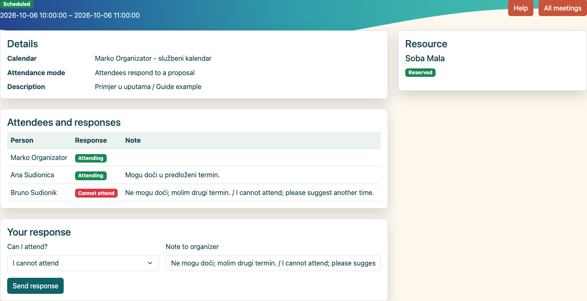Bruno refuse de venir et demande un autre rendez-vous.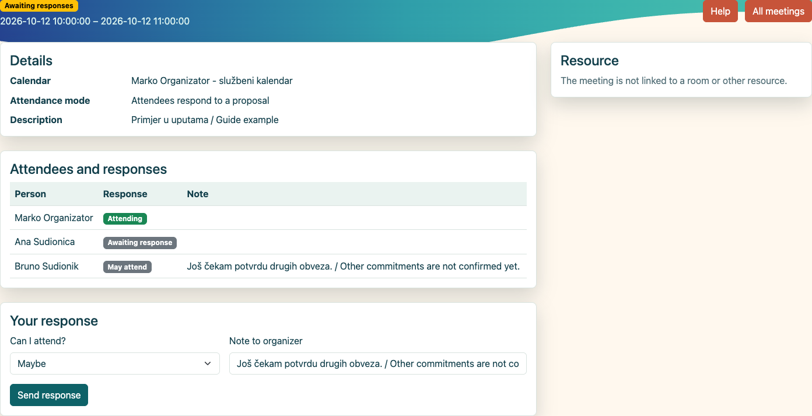Une réponse provisoire peut-être avec un commentaire.

## 18. Organisateur – décider après le refus de quelqu'un

1.  Ouvrez la notification de réponse. Il identifie la personne et son commentaire.
2.  Ouvrez la réunion et examinez l’intégralité du tableau de réponses.
3.  Pour une heure différente, cliquez sur **Modifier**, modifiez la date ou les heures, vérifiez à nouveau la disponibilité et enregistrez.
4.  Si la réunion doit quand même utiliser cette heure, cliquez délibérément sur **Planifier cette heure quand même** dans les détails de la proposition.
5.  Cochez **Planifié**. La réponse refusée reste visible ; le système ne le transforme pas en acceptation.

La planification manuelle ne contourne pas l'attente de l'approbation de la salle. La ressource doit être résolue en premier.

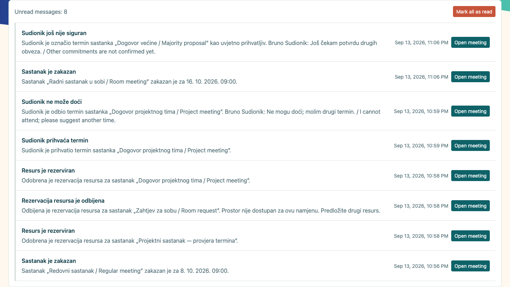L'organisateur voit les réponses et les liens de réunion.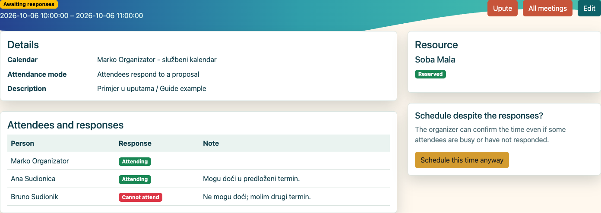La possibilité de planifier consciemment malgré les réponses.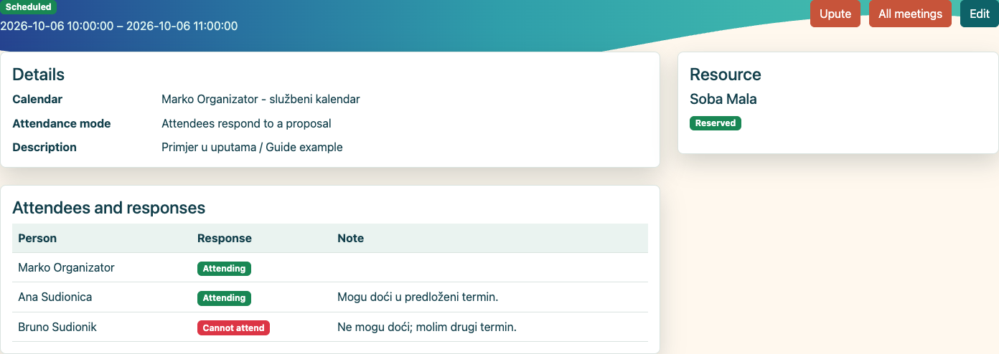La réunion prévue montre toujours que Bruno ne peut pas être présent.

## 19. Changer l'heure et demander à nouveau des réponses

1.  Ouvrez la réunion existante et cliquez sur **Modifier**.
2.  Modifiez la date, le début ou la fin. Choisissez la même ressource ou une autre.
3.  Cliquez sur **Vérifier les horaires disponibles**. L'ancienne réunion ne doit pas entrer en conflit avec elle-même.
4.  Sélectionnez la nouvelle carte et enregistrez-la, ou envoyez une nouvelle demande de chambre.
5.  Les participants reçoivent une notification avec la nouvelle heure. Si des réponses sont requises, les réponses précédentes sont effacées et de nouvelles sont demandées.

Accepter l’ancienne date ne signifie pas accepter la nouvelle. La rencontre conserve son identité et son lien ; aucune copie supplémentaire n'est créée. La nouvelle chambre ou la nouvelle heure doit à nouveau passer les contrôles de disponibilité et toute approbation requise.

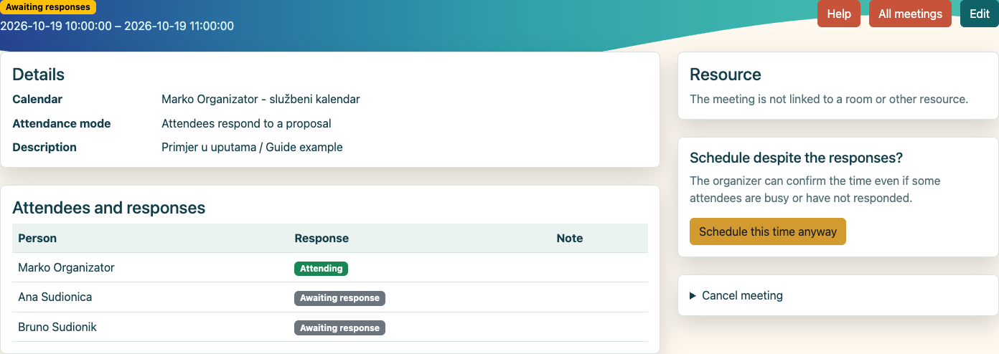La même réunion à une nouvelle date ; des réponses sont à nouveau demandées.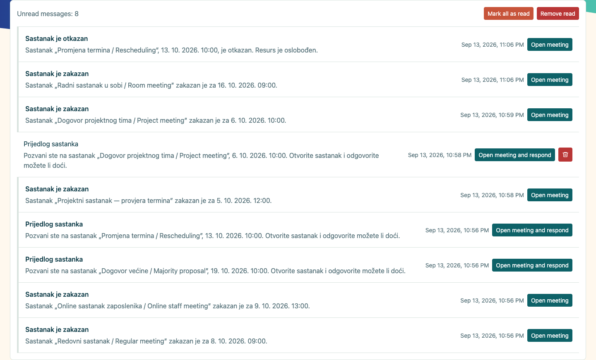Le participant est informé de la nouvelle heure.

## 20. Une majorité accepte – comprendre le seuil

Exemple : un organisateur et deux autres personnes ont une réunion. **Horaire lorsqu'il est accepté par** fait référence aux deux personnes dont l'organisateur attend les réponses. Une acceptation équivaut à 50 % ; deux sont à 100 %. À 60 %, une seule acceptation ne suffit pas ; à 50%, c'est le cas. Peut-être et Non ne comptent pas comme une acceptation.

1.  Choisissez le seuil avant l'envoi.
2.  Examinez le tableau après les réponses. La proposition attend que le seuil soit atteint.
3.  Une fois le seuil atteint et la salle confirmée, vérifiez que le statut est Programmé.

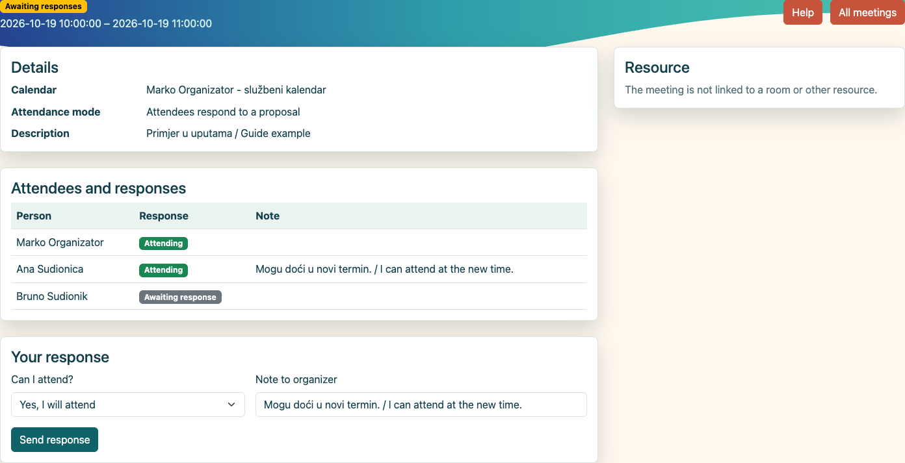Une personne sur deux a accepté, le seuil des 60 % n’est donc pas encore atteint.

## 21. En ligne, votre propre bureau et un événement pour tous

1.  Cochez **Aucune ressource**. Désélectionnez les pièces réelles si nécessaire.
2.  Mettez le lien en ligne ou l'adresse du lieu non répertorié dans la description.
3.  Ajouter des personnes ou des groupes ; pour un événement général, sélectionnez **Tous les utilisateurs actifs**.
4.  Vérifiez l’heure et choisissez la carte Aucune ressource.
5.  Sauvegarder. Aucune réservation de salle ou demande d'approbateur n'est créée.

Cette réunion peut encore être obligatoire ou une proposition en attente de réponses. Tout le monde désigne tous les utilisateurs actifs du site, et pas seulement les employés d'une organisation.

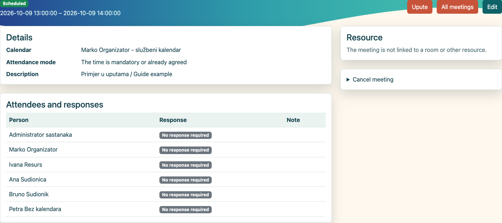Une réunion obligatoire pour tous sans réservation de salle.

## 22. Annulation et libération de la chambre

1.  En tant qu'organisateur ou éditeur autorisé, ouvrez les détails de la réunion.
2.  Développez **Annuler la réunion**.
3.  Lisez l'avertissement et cliquez sur **Confirmer l'annulation** uniquement si elle n'a pas lieu.
4.  Cochez **Annulé**. Les participants sont avertis et la réservation ou la demande liée cesse de réserver la salle.

Le non d’un participant ne constitue pas une annulation. La réunion annulée reste identifiable dans ses détails en tant qu'enregistrement de décision mais ne compte plus comme temps chargé.

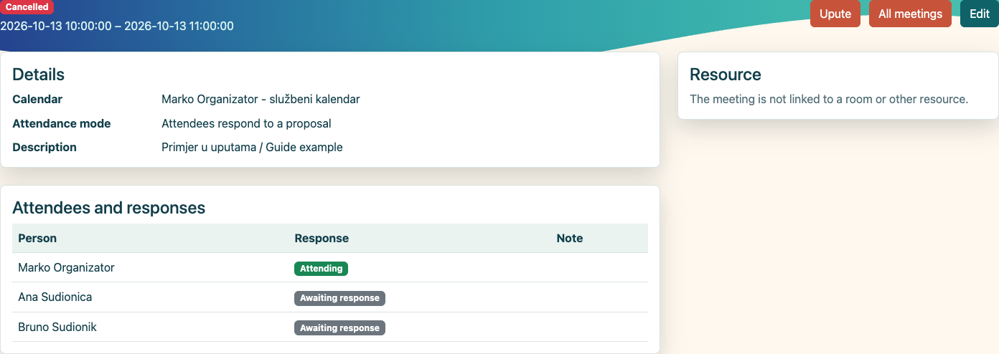Une réunion annulée n'occupe plus les participants ni la salle.

## 23. Où les participants voient les réunions : calendrier et notifications

1.  Ouvrez **Agendas**. La liste du calendrier inclut la vue virtuelle **Mes réunions**.
2.  Choisissez le mois, la semaine ou le jour et ouvrez un événement. Cela mène aux détails de la réunion.
3.  Il n’est pas nécessaire que les gens soient automatiquement abonnés à chaque calendrier d’équipe ou de ressource.
4.  Dans **Notifications**, utilisez le lien de réunion pour répondre, choisir une salle ou examiner une modification.

Une proposition, une demande de salle en attente et une réunion planifiée ont des statuts différents. Vérifiez les détails avant d'y assister, pas seulement la présence d'un événement dans le calendrier. Une salle refusée n’est pas un lieu confirmé.

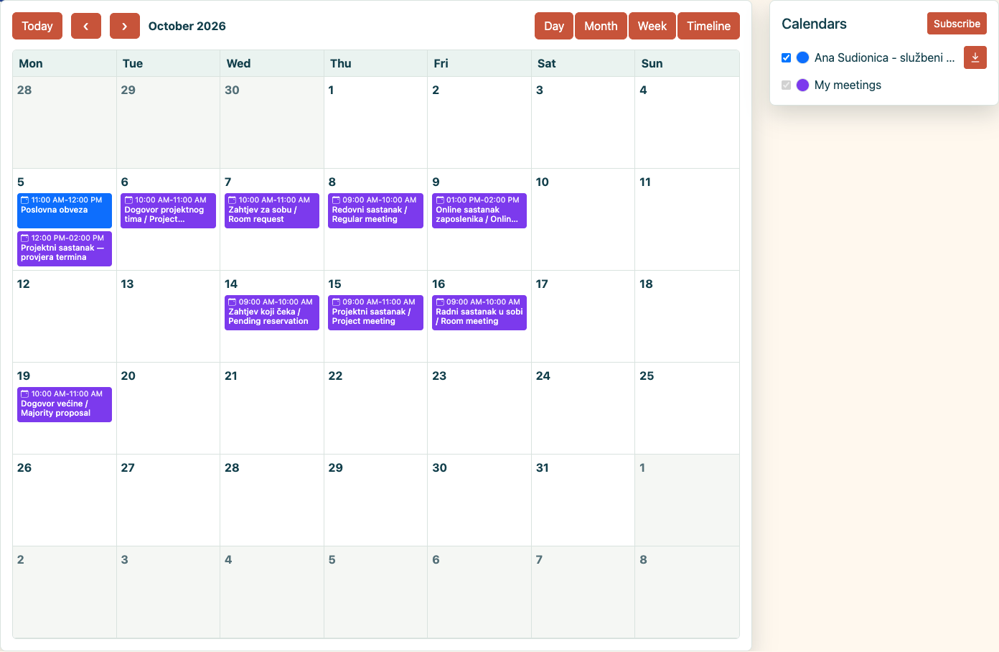Ana voit Mes réunions à côté de son calendrier officiel sans s'abonner au calendrier de l'équipe.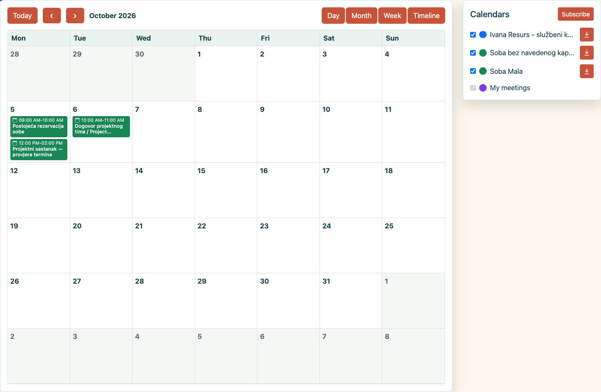Vue calendrier d'un utilisateur qui réserve des ressources.

## 24. CalDAV et réponse à partir d'un calendrier externe

La découverte CalDAV inclut le calendrier virtuel **Mes réunions**. Activez-le dans votre client s'il ne s'affiche pas automatiquement. Il contient des réunions auxquelles vous participez en tant que participant, sans copies indépendantes dans vos calendriers personnels ni abonnement obligatoire aux calendriers de l'équipe source.

1.  Ouvrez la réunion dans votre calendrier externe.
2.  Suivez le lien Simbioza dans la description/URL de l'événement.
3.  Connectez-vous avec votre compte si nécessaire.
4.  Répondez ou vérifiez l'état dans Simbioza.

La réponse via les boutons natifs Apple/Outlook/autres clients n'est pas prise en charge : la prise en charge complète de CalDAV Scheduling/iTIP n’est pas implémentée. La vue virtuelle est en lecture seule. Si vous suivez uniquement votre propre calendrier source et n'activez pas Mes réunions, ne vous attendez pas à ce que toutes les réunions des autres calendriers apparaissent.

## 25. Manager – les participants par défaut d'un calendrier

1.  Ouvrez les paramètres de réunion pour un calendrier que vous êtes autorisé à gérer.
2.  Ajoutez des personnes, des groupes ou toutes les personnes qui devraient normalement y assister.
3.  Enregistrez les paramètres.
4.  Utilisez **Inclure les participants par défaut du calendrier sélectionné** sur un événement nouveau ou existant lorsque cette liste est appropriée.

Un administrateur gère l'adhésion au groupe. Pour une équipe ou un service régulier, sélectionnez son groupe au lieu de saisir chaque membre séparément. Un abonnement au calendrier est toujours différent de la participation à une réunion.

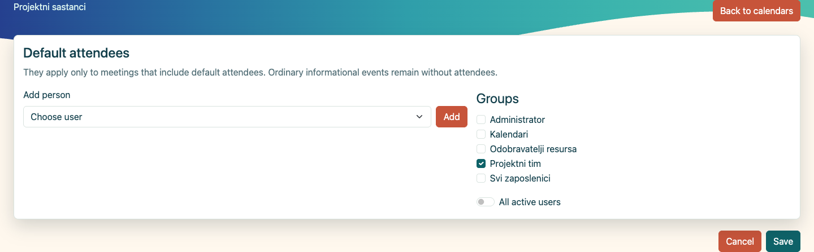Le manager associe le groupe Projektni tim à un calendrier d'équipe.

## 26. Manager — profil de chambre en option

1.  Ouvrez les paramètres de réunion du calendrier des ressources.
2.  Si vous disposez des informations, activez son profil et entrez le type, la capacité, l'emplacement et l'équipement.
3.  Si la capacité est inconnue, ne la spécifiez pas. N'inventez pas de nombre.
4.  Sauvegarder. Ces détails facilitent la recherche, mais un profil n'est pas requis pour qu'une ressource existe.

La capacité constitue un avertissement et non une interdiction stricte : des salles plus petites ou beaucoup plus grandes peuvent être délibérément choisies. Les salles de capacité inconnue ne sont incluses que si l’organisateur le permet.

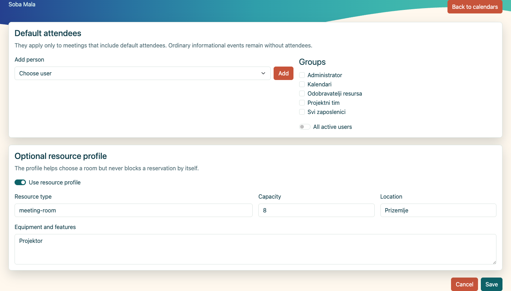Un profil de salle facultatif avec la capacité, l’emplacement et l’équipement.

## 27. Calendriers importés et informatifs sans participants

Une importation Confluence peut ne pas savoir qui participe. Ces calendriers et événements peuvent rester sans personnes ni groupes. Un horaire de cours qu'un utilisateur suit simplement **ne marque pas automatiquement cet utilisateur comme étant occupé**.

1.  Après l'importation, examinez le calendrier et ses autorisations d'accès.
2.  Si cela est informatif, n’ajoutez pas de participants uniquement pour remplir un champ vide.
3.  Si un événement doit réellement devenir une réunion, ouvrez-le et utilisez le planificateur/éditeur de réunions.
4.  Ajoutez les vraies personnes ou groupes, choisissez si des réponses sont requises et vérifiez l'heure et la salle.
5.  Enregistrez après vérification. Désactivez l'héritage du calendrier lorsque l'événement individuel nécessite différents participants.

Le système ne peut pas deviner de manière fiable les participants à partir du titre d'un événement importé. Un gestionnaire ou un éditeur autorisé associe des personnes et des groupes.

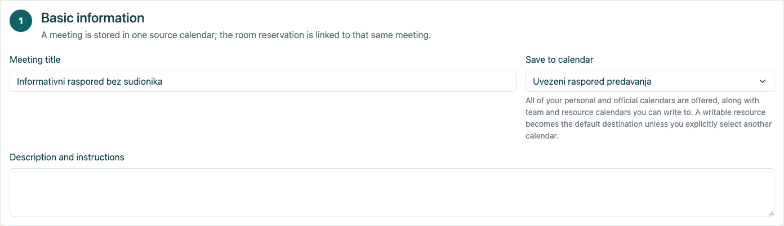L'événement importé est sélectionné pour édition ; son calendrier source est conservé.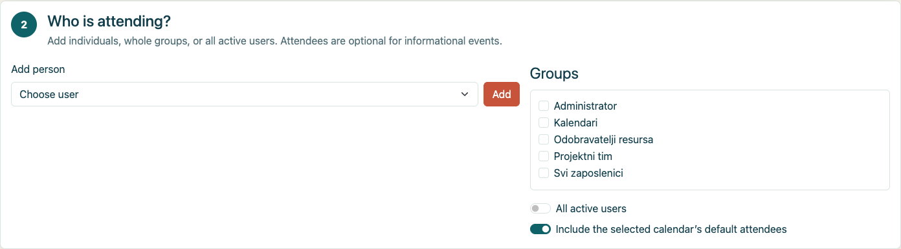La liste des participants reste vide jusqu'à ce qu'une personne autorisée ajoute des personnes ou des groupes.

## 28. Foire aux questions et liste de contrôle finale

Choisir cette fois ne modifie que la carte : est-elle enregistrée ?

Non. Si un approbateur est nécessaire, sélectionnez-en un et confirmez d’abord le choix. Cliquez ensuite sur Enregistrer la réunion ou Envoyer la demande de réservation dans la confirmation verte sur cette même carte. Les détails de la réunion confirment qu'elle a été enregistrée.

Pourquoi ne puis-je pas voir pourquoi une autre personne est occupée ?

Vous pouvez voir libre/occupé sans accéder à leur calendrier. Le titre et le motif sont visibles uniquement avec un accès en lecture au calendrier source. Organiser une réunion ne donne pas accès aux notes privées.

Pourquoi une personne a-t-elle l’air libre mais répond-elle non ?

Ils ne peuvent pas enregistrer tous les engagements dans Simbioza. Les disponibilités enregistrées ne garantissent pas la présence. Utilisez une proposition avec des réponses lorsqu'une confirmation est nécessaire.

Pourquoi la salle est-elle tenue si la réunion n'est pas encore programmée ?

Une demande de réservation protège la salle pendant que l'approbateur décide. Le rejet ou l'annulation le libère.

Je suis un calendrier mais je ne suis pas un participant. Pourquoi cela ne m'occupe-t-il pas ?

Ce qui suit est destiné à la visualisation. La participation doit être explicitement associée via une personne, un groupe ou tout le monde.

### Avant d'envoyer ou d'assister

- Le titre est-il clair et la date et l'heure sont-elles correctes ?
- Les personnes et les groupes sont-ils corrects, sans sélection accidentelle de Tout le monde ?
- La chambre est-elle adaptée et confirmée, ou sa demande est-elle toujours en attente ?
- Les réponses sont-elles obligatoires ou la présence est-elle obligatoire ?
- Avez-vous terminé d'enregistrer, pas seulement sélectionné une carte ?
- En tant que participant : avez-vous envoyé une réponse et vérifié le statut final ?
