# Sastanci — korak po korak

## 1. Prije početka: što je sastanak

Ova uputa vodi vas kroz planiranje, rezervaciju prostora i sudjelovanje na sastanku. Ne morate poznavati računalne sustave. Otvorite **Kalendari → Planiraj sastanak**. Svoje prijedloge, obavezne sastanke i zahtjeve za rezervaciju možete ponovno otvoriti preko **Moji sastanci** ili poveznice u **Obavijestima** u korisničkom izborniku.

**Sastanak se čuva samo jednom.** Odaberete izvorni kalendar. Ako je prostor u drugom kalendaru, rezervacija je povezana s istim sastankom: ne stvarate neovisne kopije kod svakog sudionika. Sudionik ga vidi u prikazu *Moji sastanci*, čak i ako ne prati timski kalendar.

Primjeri prikazuju novu testnu instalaciju, izmišljene korisnike i datume u listopadu 2026. Sve su snimke u svijetloj temi. Vaši nazivi i datumi mogu biti drukčiji, ali koraci su isti. Upute ne sadrže stvarne privatne obveze.

## 2. Uloge i prava

| Uloga | Što možete učiniti |
|----|----|
| Organizator | Svaki prijavljeni korisnik može provjeravati termine. Sastanak sprema u kalendar u koji smije pisati, bira sudionike i traži rezervaciju ako ne smije pisati u resurs. |
| Odobravatelj resursa | Otvara zahtjev i odobrava ili odbija prostor. Organizator bira kome šalje zahtjev; ne mora ga slati svima. |
| Sudionik | Vidi svoj sastanak. Ako je odgovor zatražen, bira Da, Možda ili Ne i dodaje napomenu. Ne može zbog toga uređivati tuđi izvorni kalendar niti otkazati sastanak. |
| Upravitelj kalendara / administrator | Uređuje prava, zadane sudionike i opcionalni profil resursa u skladu sa svojim ovlastima. |

Pravo gledanja prostora nije pravo rezerviranja. Pretplata na timski kalendar također vas ne čini sudionikom svakog njegovog događaja.

## 3. Nemate vlastiti kalendar

1.  Otvorite planer. Slobodne termine možete tražiti i bez vlastitog kalendara.
2.  Ako želite vlastiti kalendar, u plavom okviru odaberite **Službeni** za poslovne obveze, **Osobni** za privatne ili **Prilagođeni** za vlastiti naziv.
3.  Tek klik na **Izradi odabrani kalendar** stvara kalendar. Sam ulazak u planer ništa ne stvara.
4.  Ako već smijete pisati u neki timski ili resursni kalendar, možete spremati tamo bez izrade vlastitog kalendara.

Oba tipa vezana su uz osobu; način korištenja birate vi. Kalendar, uvoz i dodjelu prava kasnije uređujete u svojim postavkama kalendara.

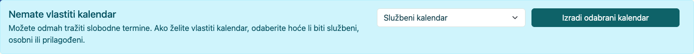Izbor prije izrade kalendara.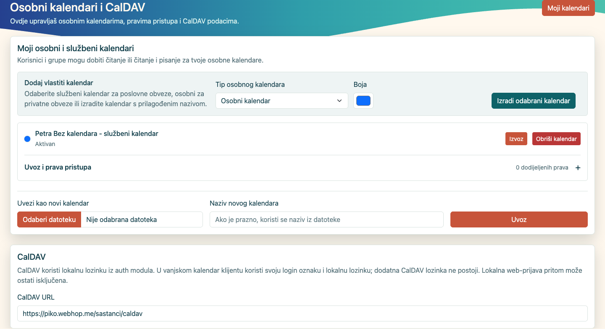Postavke osobnih kalendara: uvoz i prava pristupa nalaze se u proširivoj cjelini.

## 4. Korak 1 — naziv, opis i odredišni kalendar

1.  Unesite jasan **Naslov sastanka**, npr. „Projektni sastanak”.
2.  U **Opis i upute** napišite temu, dnevni red ili poveznicu za online sastanak.
3.  U **Spremi u kalendar** ponuđeni su vaši osobni i službeni kalendari te timski i resursni kalendari u koje smijete pisati.
4.  Želite li određeni timski kalendar, sami ga odaberite. Taj se izbor zadržava kada odaberete termin i prostor.

Ako niste sami odabrali drugo odredište, prostor u koji smijete pisati postaje zadani izvorni kalendar sastanka. Ako u prostor ne smijete pisati, izvor je vaš odabrani osobni, službeni ili timski kalendar, a rezervacija prostora je povezana s njim.

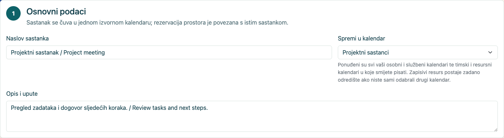Organizator je odabrao timski kalendar za izvorni sastanak.

## 5. Korak 2 — osobe, grupe i Svi

1.  Za pojedinca otvorite **Dodaj osobu**, pronađite korisnika i kliknite **Dodaj**. Ponovite za sljedeću osobu.
2.  Za tim označite grupu, npr. **Projektni tim**. Članovi Auth grupe postaju sudionici, bez pojedinačnog upisivanja.
3.  Za opći sastanak označite **Svi aktivni korisnici**. Ako želite samo zaposlenike, a na siteu postoje i vanjski korisnici, umjesto toga odaberite odgovarajuću grupu zaposlenika.
4.  **Uključi i zadane sudionike odabranog kalendara** dodaje osobe i grupe povezane s kalendarom. Isključite ako za ovaj događaj nisu potrebni.

Ista osoba računa se jednom i kada je izabrana izravno i kroz više grupa. Pretplate nisu popis sudionika. Događaj bez sudionika može ostati informativan.

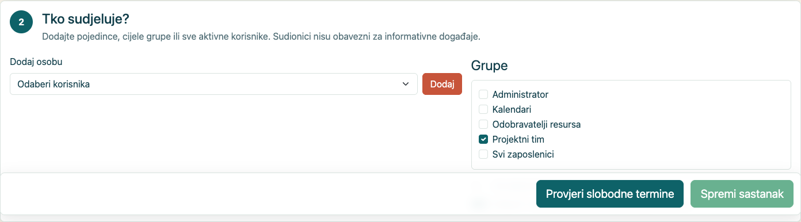Sudionici iz grupe i opcionalno nasljeđivanje iz kalendara.

## 6. Korak 3 — traženje najboljeg termina

1.  Odaberite **Pronađi najbolje termine**.
2.  Unesite početni i završni datum raspona. Za početak koristite jedan ili nekoliko dana.
3.  Postavite najraniji početak, najkasniji kraj i **Trajanje**.
4.  Označite dopuštene dane u tjednu, npr. ponedjeljak i srijedu.
5.  Odaberite **Koliko sudionika mora biti slobodno?**: Svi, Velika većina, Većina ili sve mogućnosti.
6.  Odaberite prostor u sljedećem koraku i kliknite **Provjeri slobodne termine**.

Najbolje mogućnosti prikazane su prve. Uvijek pročitajte stvarni broj slobodnih sudionika: provjera zauzetosti nije isto što i njihov odgovor na poziv.

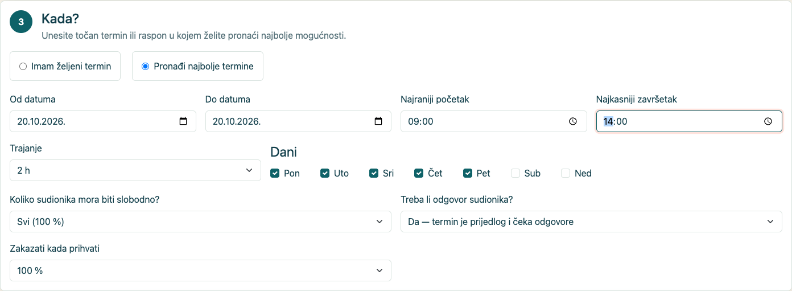Uvjeti pretrage: datumi, sati, trajanje i dani.

## 7. Korak 3a — već imate željeni termin

1.  Odaberite **Imam željeni termin**.
2.  Unesite datum, početak i kraj. Kraj mora biti nakon početka.
3.  Dodajte sudionike i resurs pa kliknite **Provjeri slobodne termine**.
4.  Pročitajte broj slobodnih sudionika i po potrebi otvorite **Zauzeti sudionici**.
5.  Ako neki ne mogu, promijenite sat ili datum, odnosno svjesno odaberite sastanak uz manji udio slobodnih.

Prikazuje se zauzetost iz osobnih i službenih kalendara te događaja koji stvarno uključuju osobu kao sudionika. Ne zaključuje se da je osoba zauzeta samo zato što prati informativni kalendar. Sustav zna samo obveze evidentirane u Simbiozi.

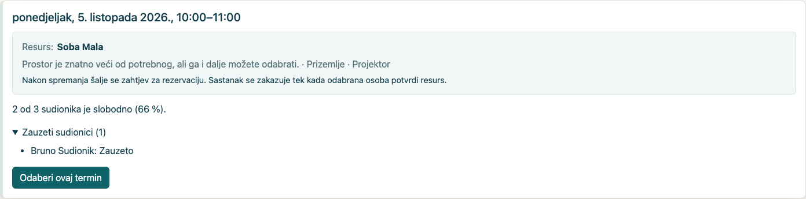Organizator vidi da je Bruno zauzet, ali ne vidi sadržaj njegove privatne obveze.

## 8. Korak 4 — koji prostor provjeriti

1.  Označite jedan ili više prostora checkboxovima. Ponovni klik uklanja oznaku.
2.  Ako ne označite ništa, provjeravaju se **svi stvarni resursi**.
3.  Za online sastanak, vlastiti ured ili restoran izvan evidencije izričito označite **Bez resursa**. Ta se mogućnost nikad ne dodaje automatski.
4.  Unesite potreban broj mjesta. Ako kapacitet nekih soba nije poznat, odlučite hoćete li uključiti **resurse bez navedenog kapaciteta**.
5.  Kliknite **Provjeri slobodne termine**.

Profil resursa je opcionalan. Za nepoznati kapacitet morate sami provjeriti odgovara li prostor. Znatno veća ili manja soba dobiva upozorenje, ali odabir nije zabranjen; možete organizirati dodatne stolice ili drugačiji raspored.

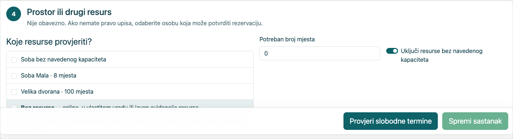Checkboxovi se mogu označiti i odznačiti; Bez resursa je izričit izbor.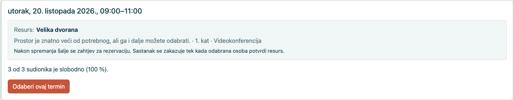Velika soba nije zabranjena, ali upozorenje pomaže pri izboru.

## 9. Rezultati — svaka kartica već ima termin i resurs

1.  Pročitajte datum i sat kartice.
2.  Odmah ispod pročitajte naziv resursa, kapacitet i dostupne podatke o prostoru.
3.  Pročitajte udio slobodnih sudionika. Ako tražite sve prostorije, isti termin može imati više kartica, po jednu za svaki slobodni resurs.
4.  Kliknite **Odaberi ovaj termin** na točno onoj kartici koju želite. Resurs se ne bira naknadno iz dropdowna.
5.  Slijedite potvrdu unutar te kartice. Nakon promjene uvjeta pretrage ponovno provjerite i odaberite termin.

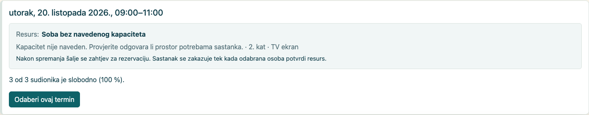Termin i konkretan prostor zajedno su jedna ponuđena mogućnost.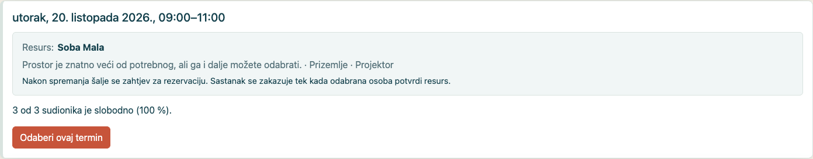Druga kartica nudi isti termin s drugim prostorom.

## 10. Smijete pisati u resursni kalendar

1.  Odaberite karticu slobodnog prostora. U opisu piše da se rezervacija odmah potvrđuje.
2.  Kliknite **Odaberi ovaj termin**.
3.  U zelenoj potvrdi na istoj kartici kliknite **Spremi sastanak**. Ne morate tražiti neodređeni „završni gumb”.
4.  Otvaraju se detalji spremljenog sastanka. Prostor je rezerviran. Obavezni sastanak je zakazan; prijedlog još čeka odgovore ako ste odabrali takav način.

To što ste odabrali termin nije spremanje. Završite gumbom za spremanje na odabranoj kartici. Pri spremanju ponovno se provjerava prostor, jer ga je u međuvremenu mogao rezervirati netko drugi.

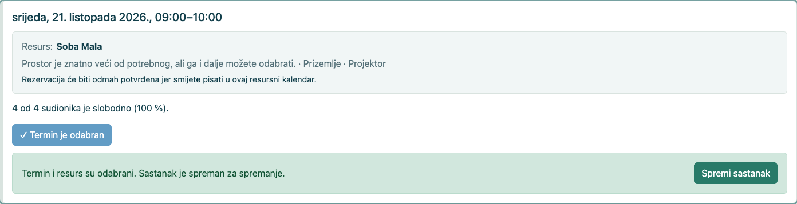Korisnik s pravom pisanja sprema sastanak iz potvrde na kartici.

## 11. Ne smijete pisati u resurs — zahtjev za rezervaciju

1.  Odaberite slobodni prostor i kliknite **Odaberi ovaj termin**.
2.  Na toj kartici otvara se okvir za potvrdu rezervacije.
3.  Označite barem jednu ponuđenu osobu koja može odobriti prostor. Ne šaljite svima ako nije potrebno.
4.  U **Poruka odobravatelju** napišite razlog, npr. „Molim sobu za projektni tim”.
5.  Kliknite **Potvrdi odabir termina**, zatim **Pošalji zahtjev za rezervaciju** u potvrdi na istoj kartici.
6.  U detaljima provjerite status **Čeka potvrdu resursa**. To još nije zakazan sastanak.

Ako nema ponuđenog odobravatelja, javite se upravitelju kalendara. Ne možete sami zaobići prava prostora.

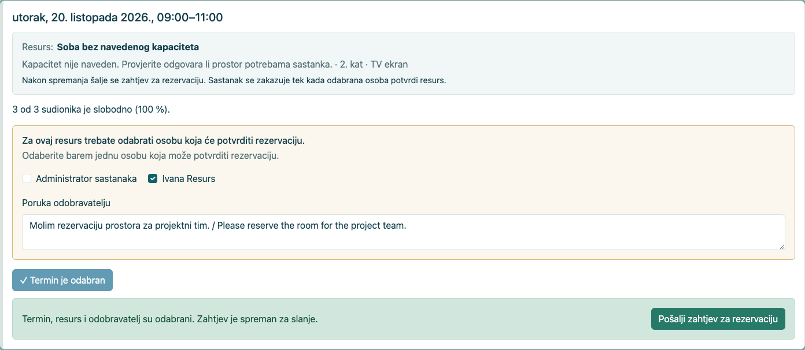Organizator bira odobravatelja i šalje zahtjev unutar odabranog termina.

## 12. Što ako netko drugi želi isti prostor dok čekate

Zahtjev koji čeka potvrdu **privremeno zauzima prostor**. Drugi organizator dobiva poruku da postoji zahtjev za taj termin. To vrijedi i za osobe koje imaju pravo pisanja, a ne samo za druge podnositelje zahtjeva.

1.  Ako vidite poruku o zahtjevu, nemojte smatrati taj prostor slobodnim.
2.  Odaberite drugi prostor ili termin, odnosno pričekajte odluku.
3.  Ako je zahtjev odbijen ili sastanak otkazan, prostor se oslobađa i može biti ponuđen u novoj provjeri.

Čekanje nije automatsko odobrenje. Konačna rezervacija nastaje tek nakon odobravanja; ponovna provjera pri spremanju sprječava upad u tuđi zahtjev.

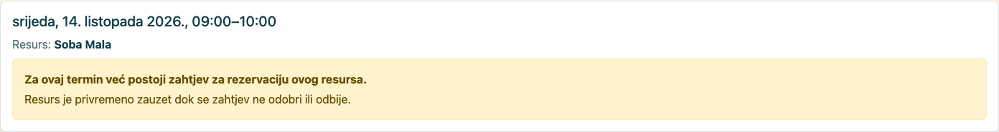Drugi organizator vidi da prostor čeka odluku o ranijem zahtjevu.

## 13. Odobravatelj — obavijest i odobravanje prostora

1.  Otvorite korisnički izbornik pa **Obavijesti**.
2.  Pronađite **Zahtjev za rezervaciju resursa**. Provjerite naziv sastanka i termin.
3.  Kliknite poveznicu za otvaranje sastanka. Ona vodi na točan zahtjev, ne samo na opću listu.
4.  U kartici **Resurs** pročitajte prostor i po potrebi unesite poruku organizatoru.
5.  Kliknite **Odobri**. Status resursa postaje **Rezerviran**.

Organizator dobiva obavijest. Obavezni ili već dogovoreni sastanak tada postaje zakazan. Ako je riječ o prijedlogu, sudionicima se šalje poziv za odgovor tek nakon potvrde prostora.

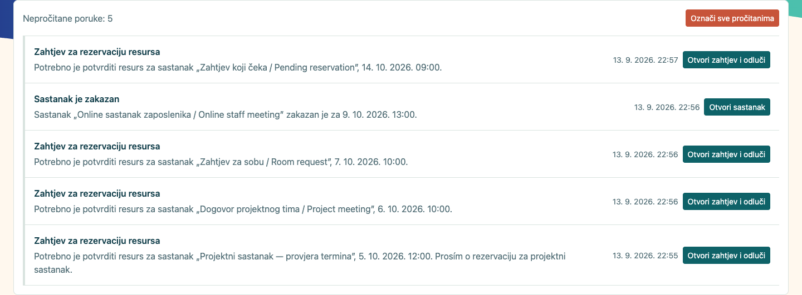Ivana dobiva obavijest s poveznicom na zahtjev.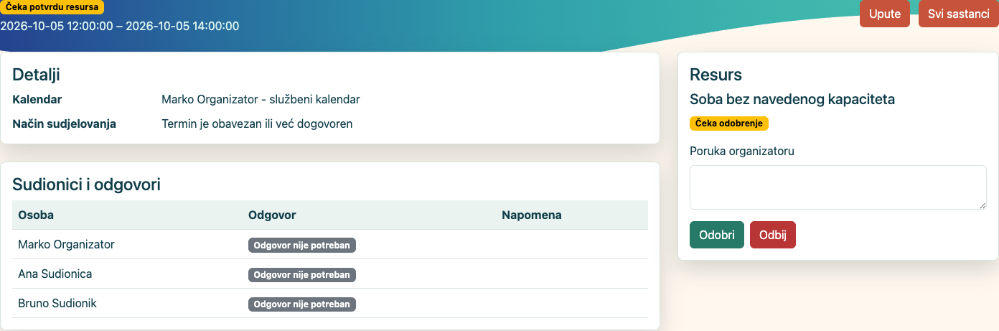Odobravatelj odlučuje u kartici Resurs.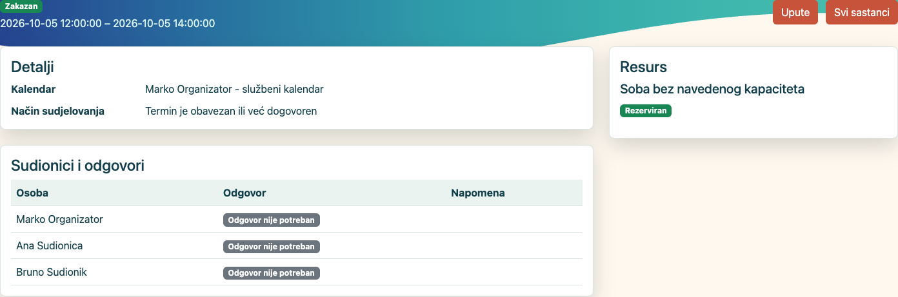Odobren prostor i zakazan obavezni sastanak.

## 14. Odobravatelj — odbijanje prostora

1.  Otvorite zahtjev iz obavijesti.
2.  Napišite razlog u **Poruka organizatoru**, npr. da prostor nije prikladan.
3.  Kliknite **Odbij**.
4.  Provjerite status **Rezervacija resursa je odbijena**.

Prostor je slobodan za druge. Organizator je obaviješten i može otvoriti **Uredi**, pronaći drugi resurs ili termin i poslati novi zahtjev. Odbijanje prostora nije odbijanje dolaska nekog sudionika.

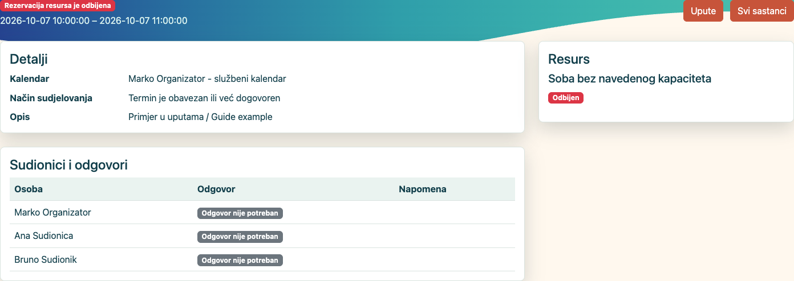Zahtjev je odbijen; organizator vidi ishod u detaljima.

## 15. Obavezan sastanak ili prijedlog — dva različita izbora

U **Treba li odgovor sudionika?** odaberite:

- **Ne — termin je obavezan / već dogovoren**: sudionicima se šalje obavijest, ali ne traži se Da/Ne. Ako je potreban prostor bez vašeg prava pisanja, prvo se čeka njegovo odobrenje.
- **Da — termin je prijedlog i čeka odgovore**: sudionici odgovaraju. Odaberite i **Zakazati kada prihvati** (100 %, 80 %, 60 % ili 50 %).

Prag slobodnih osoba u pretrazi i prag prihvaćenih odgovora nisu ista stvar. Prvi pomaže naći termin prema evidenciji, a drugi određuje kada poziv postaje zakazan. Pri računanju odgovora organizator se ne računa među osobe od kojih čeka potvrdu.

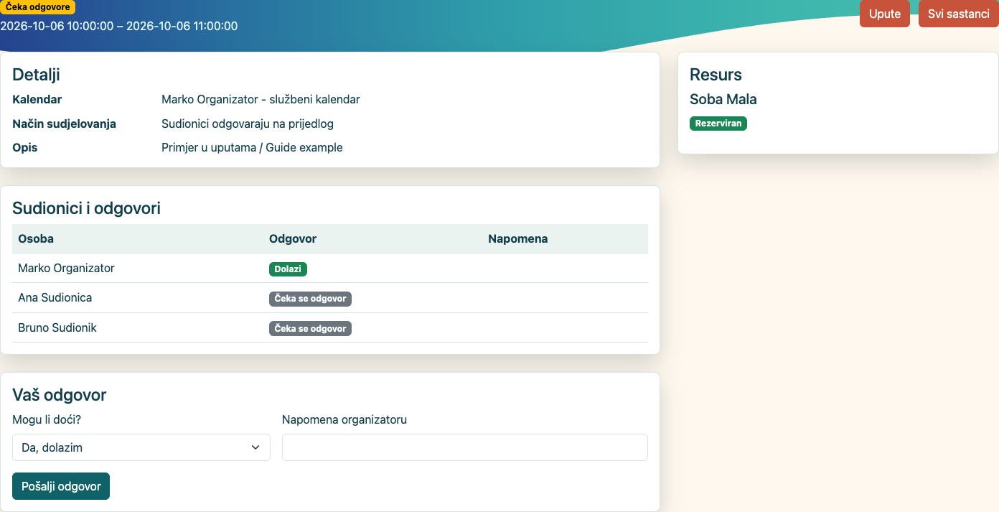Prijedlog s tablicom sudionika i obrascem za odgovor.

## 16. Sudionik — prihvaćanje dolaska

1.  Otvorite **Obavijesti** i pronađite **Prijedlog sastanka**.
2.  Kliknite poveznicu za otvaranje sastanka. Provjerite datum, vrijeme, prostor i opis.
3.  U **Vaš odgovor → Mogu li doći?** odaberite **Da, dolazim**.
4.  Po želji napišite napomenu organizatoru.
5.  Kliknite **Pošalji odgovor**. U tablici uz vaše ime piše **Dolazi**.

Organizator dobiva obavijest s vašim imenom i napomenom. Kada dovoljan udio ostalih sudionika prihvati, sastanak se automatski zakazuje. Kod praga 100 % čeka se prihvaćanje svih pozvanih osim organizatora.

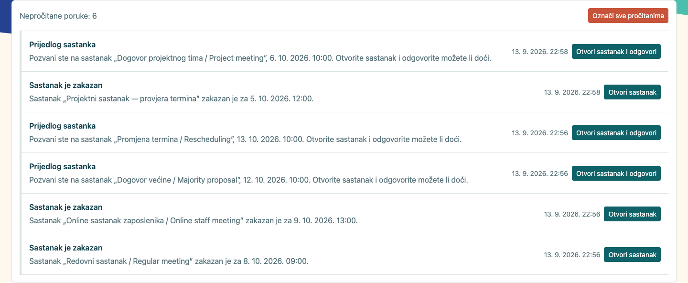Ana dobiva poziv; poveznica otvara konkretan sastanak.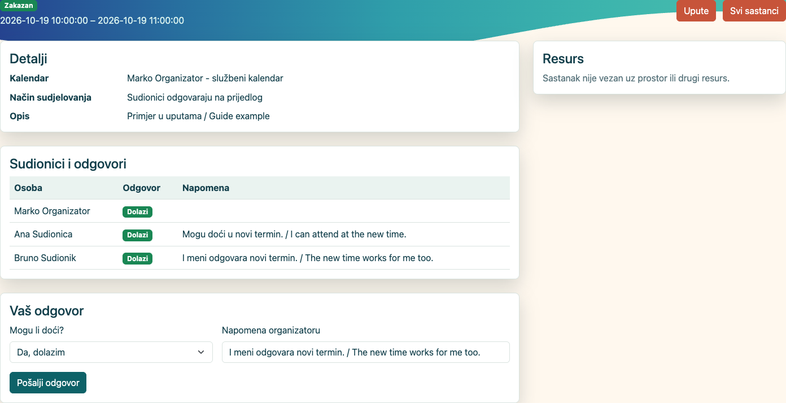Nakon potrebnih prihvaćanja sastanak je zakazan.

## 17. Sudionik — ne možete doći ili još niste sigurni

1.  Otvorite sastanak i u **Vaš odgovor** odaberite **Ne mogu** ili **Možda**.
2.  Dodajte korisnu napomenu, npr. „Molim drugi termin” ili „Čekam potvrdu druge obveze”. Ne morate otkrivati privatni razlog.
3.  Kliknite **Pošalji odgovor**.
4.  Provjerite odgovor uz svoje ime. Spremljeni izbor i napomena ostaju vidljivi i pri ponovnom otvaranju.

Odbijanje ne otkazuje cijeli sastanak. Možda nije prihvaćen dolazak. Organizator odlučuje treba li novi termin ili će ipak zakazati sastanak. Ako se okolnosti promijene, svoj odgovor možete promijeniti dok je odgovaranje omogućeno.

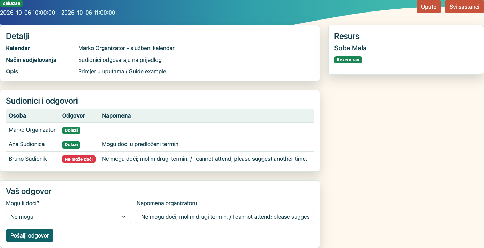Bruno odbija dolazak i traži drugi termin.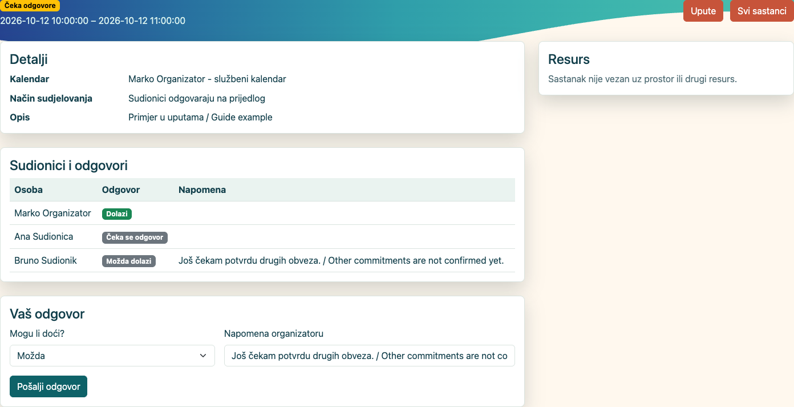Uvjetni odgovor Možda s napomenom.

## 18. Organizator — odluka nakon odbijenog dolaska

1.  Otvorite obavijest o odgovoru. Tekst navodi tko je odgovorio i njegovu napomenu.
2.  Otvorite sastanak i pregledajte cijelu tablicu odgovora.
3.  Za drugi termin kliknite **Uredi**, promijenite datum ili vrijeme, ponovno provjerite dostupnost i spremite.
4.  Ako sastanak ipak mora biti u tom terminu, svjesno kliknite **Ipak zakaži ovaj termin** u detaljima prijedloga.
5.  Provjerite status **Zakazan**. Odbijen odgovor ostaje vidljiv; sustav ga ne mijenja u prihvaćanje.

Ručno zakazivanje ne zaobilazi čekanje potvrde prostora. Najprije se mora riješiti resurs.

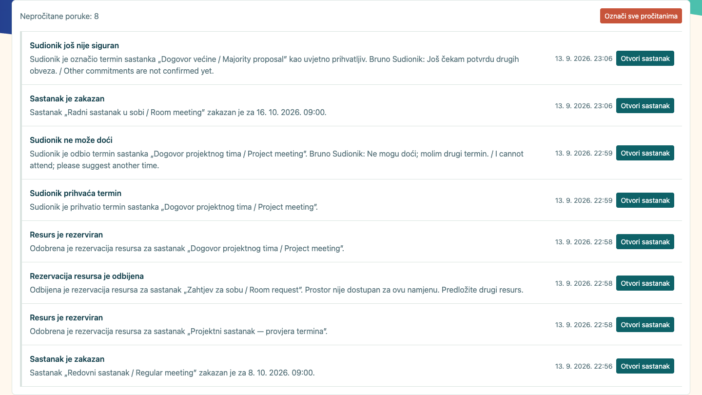Organizator vidi odgovore i poveznice na sastanke.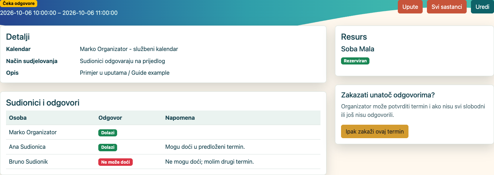Mogućnost svjesnog zakazivanja unatoč odgovorima.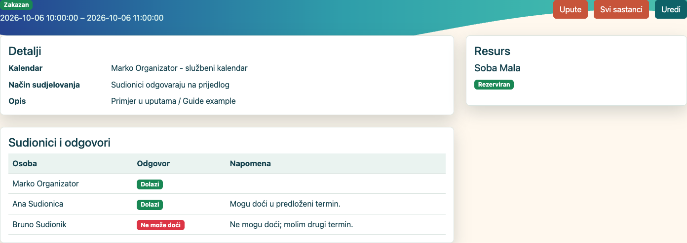Zakazan sastanak i dalje prikazuje da Bruno ne može doći.

## 19. Promjena termina i ponovno odgovaranje

1.  Otvorite postojeći sastanak i kliknite **Uredi**.
2.  Promijenite datum, početak ili kraj. Odaberite isti ili drugi resurs.
3.  Kliknite **Provjeri slobodne termine**. Stari sastanak ne smije sam sebi biti zapreka.
4.  Odaberite novu karticu i spremite, odnosno pošaljite novi zahtjev za prostor.
5.  Sudionici dobivaju obavijest s novim terminom. Ako je odgovor potreban, prethodni odgovori se brišu i traže se novi.

Prihvaćanje starog datuma ne znači prihvaćanje novog. Sastanak zadržava isti identitet i poveznicu; ne stvarate dodatnu kopiju. Novi prostor ili termin opet mora proći provjeru i eventualno odobravanje.

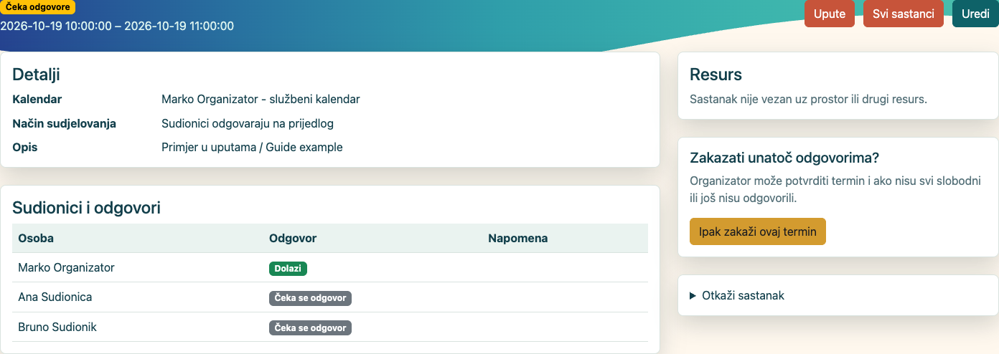Novi datum istog sastanka; ponovno se čekaju odgovori.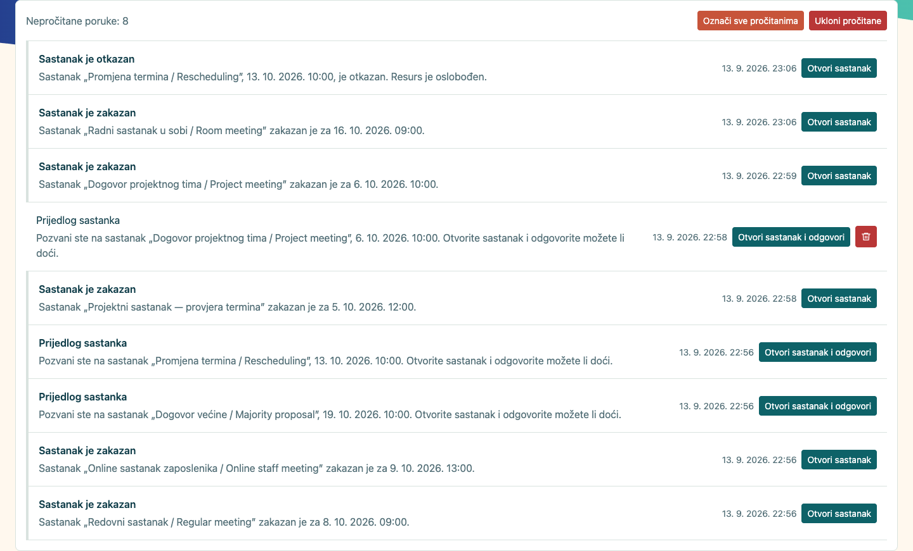Sudionik dobiva obavijest za novi termin.

## 20. Većina prihvaća — kako čitati prag

Primjer: organizator i dvije druge osobe imaju sastanak. Prag **Zakazati kada prihvati** odnosi se na dvije osobe od kojih organizator čeka odgovor. Jedno prihvaćanje je 50 %, dva su 100 %. Uz prag 60 % jedno prihvaćanje nije dovoljno; uz prag 50 % jest. Odgovor Možda ili Ne ne računa se kao prihvaćanje.

1.  Prije slanja odaberite željeni prag.
2.  Nakon odgovora pregledajte tablicu. Prijedlog čeka dok prag nije dosegnut.
3.  Ako je prag dosegnut i prostor potvrđen, provjerite status Zakazan.

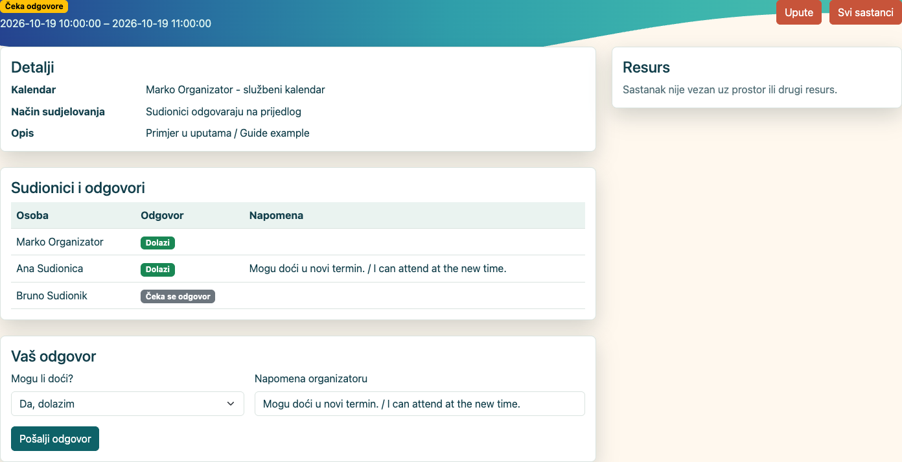Jedna od dvije osobe prihvaća, pa prag 60 % još nije dosegnut.

## 21. Online, vlastiti ured i događaj za sve

1.  U resursima označite **Bez resursa**. Po potrebi odznačite stvarne prostorije.
2.  U opis unesite online poveznicu ili adresu mjesta koje nije resurs.
3.  Dodajte osobe ili grupe; za opći događaj označite **Svi aktivni korisnici**.
4.  Provjerite termin i odaberite karticu Bez resursa.
5.  Spremite. Nema rezervacije prostorije ni zahtjeva odobravatelju.

I takav sastanak može biti obavezan ili prijedlog koji čeka odgovore. Svi znači svi aktivni korisnici sitea, ne samo zaposlenici neke organizacije.

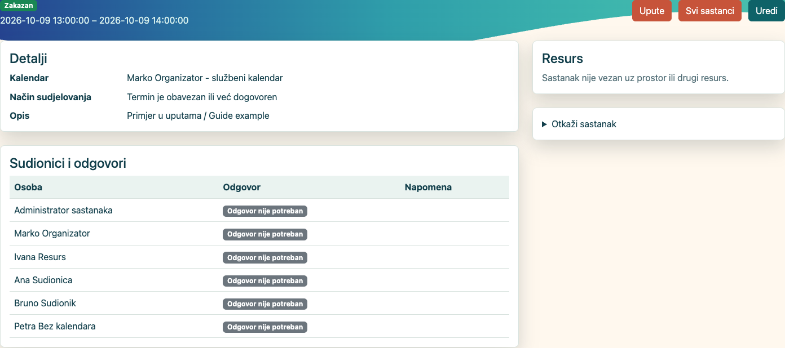Obavezan sastanak za sve bez rezervacije prostora.

## 22. Otkazivanje i oslobađanje prostora

1.  Kao organizator ili ovlašteni urednik otvorite detalje sastanka.
2.  Proširite **Otkaži sastanak**.
3.  Pročitajte upozorenje i kliknite **Potvrdi otkazivanje** samo ako se sastanak neće održati.
4.  Provjerite status **Otkazan**. Sudionicima se šalje obavijest, a povezana rezervacija ili zahtjev prestaje zauzimati prostor.

Sudionikovo Ne nije otkazivanje. Otkazani sastanak ostaje prepoznatljiv u detaljima kao trag odluke, ali se više ne računa kao zauzetost.

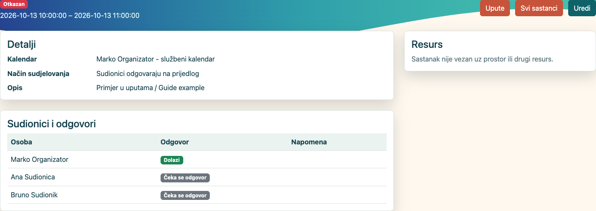Otkazani sastanak više ne zauzima sudionike ni prostor.

## 23. Gdje sudionik vidi sastanak: kalendar i obavijesti

1.  Otvorite **Kalendari**. U popisu kalendara nalazi se virtualni prikaz **Moji sastanci**.
2.  Odaberite mjesec, tjedan ili dan i otvorite događaj. Prikaz vodi na detalje sastanka.
3.  Nije potrebno automatski pretplaćivati osobu na svaki timski ili resursni kalendar.
4.  U **Obavijestima** koristite poveznicu na sastanak za odgovor, odluku o prostoru ili pregled promjene.

Prijedlog, zahtjev koji čeka i zakazani sastanak nisu isti status. Prije dolaska provjerite detalje, ne samo da se događaj vidi na kalendaru. Odbijen prostor ne znači potvrđeno mjesto sastanka.

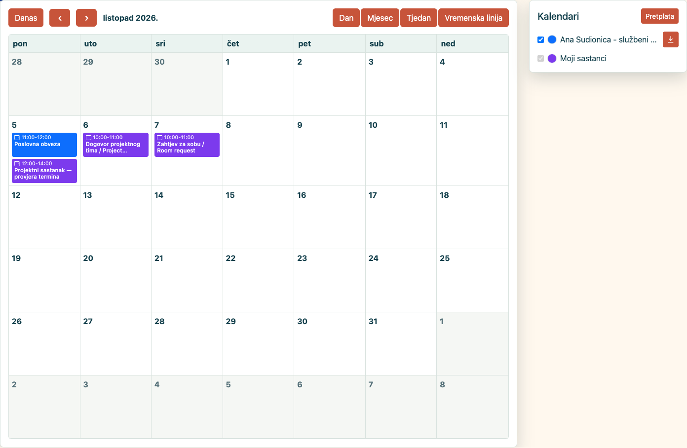Ana vidi Moje sastanke uz svoj službeni kalendar, bez pretplate na timski kalendar.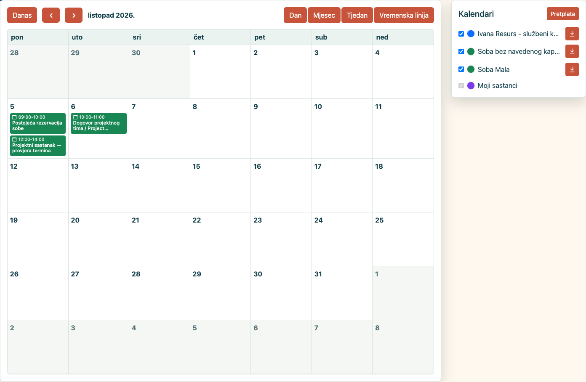Prikaz kalendara korisnika koji rezervira resurse.

## 24. CalDAV i odgovaranje iz vanjskog kalendara

Pri povezivanju CalDAV klijenta postoji virtualni kalendar **Moji sastanci**. Uključite ga u svom klijentu ako nije automatski prikazan. On sadrži sastanke povezane s vama kao sudionikom, bez zasebnih kopija u vašim osobnim kalendarima i bez obavezne pretplate na izvorni timski kalendar.

1.  Otvorite sastanak u vanjskom kalendaru.
2.  Slijedite poveznicu na Simbiozu u opisu / URL-u događaja.
3.  Prijavite se svojim računom ako niste prijavljeni.
4.  U Simbiozi pošaljite odgovor ili pogledajte status.

Odgovaranje kroz izvorne gumbe Apple/Outlook/ostalih klijenata nije podržano: puni CalDAV Scheduling/iTIP nije implementiran. Virtualni prikaz je samo za čitanje. Ako pratite samo vlastiti izvorni kalendar i ne uključite Moje sastanke, ne očekujte da će vam se svaki tuđi sastanak prikazati.

## 25. Upravitelj — zadani sudionici kalendara

1.  Otvorite postavke sastanaka za kalendar koji smijete uređivati.
2.  Dodajte osobe, grupe ili Svi koje uobičajeno trebaju sudjelovati.
3.  Spremite postavke.
4.  U novom ili postojećem događaju koristite **Uključi i zadane sudionike odabranog kalendara** kada želite taj popis.

Članstvo u grupama uređuje administrator. Za stalni tim ili odjel odaberite odgovarajuću grupu umjesto pojedinačnog upisivanja svih članova. Pretplata na kalendar i dalje nije isto što i sudjelovanje na sastanku.

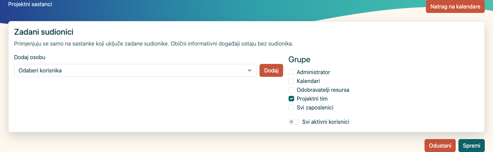Upravitelj povezuje grupu Projektni tim s timskim kalendarom.

## 26. Upravitelj — opcionalni profil prostorije

1.  Otvorite postavke sastanaka resursnog kalendara.
2.  Ako imate podatke, uključite profil resursa i unesite vrstu, kapacitet, lokaciju i opremu.
3.  Ako kapacitet nije poznat, ostavite ga bez podatka. Ne upisujte izmišljenu vrijednost.
4.  Spremite. Podaci pomažu u pretrazi, ali profil nije uvjet da prostor bude resurs.

Kapacitet je upozorenje pri odabiru, ne stroga zabrana: i manja i mnogo veća prostorija mogu se svjesno odabrati. Nepoznat kapacitet uključuje se samo ako organizator dopusti takve rezultate.

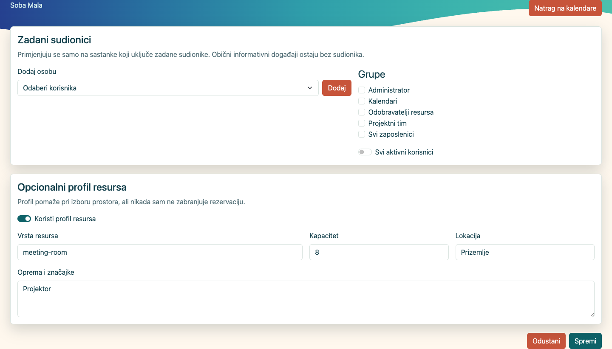Opcionalni profil sobe s kapacitetom, lokacijom i opremom.

## 27. Uvezeni i informativni kalendari bez sudionika

Uvoz iz Confluencea ne mora znati koje osobe sudjeluju. Takvi kalendari i događaji smiju ostati bez osoba i grupa. Raspored predavanja koji korisnik samo prati **ne zauzima automatski korisnika**.

1.  Nakon uvoza pregledajte kalendar i njegova prava.
2.  Ako je informativan, ne dodajte sudionike samo da biste popunili prazno polje.
3.  Ako događaj stvarno treba postati sastanak, otvorite ga i koristite planer / uređivanje sastanka.
4.  Dodajte stvarne osobe ili grupe, odaberite treba li odgovor te provjerite termin i prostor.
5.  Spremite nakon provjere. Za drukčije sudionike pojedinog događaja isključite nasljeđivanje iz kalendara.

Sustav ne može pouzdano pogoditi sudionike iz naslova uvezenog događaja. Vezivanje osoba/grupa radi upravitelj ili ovlašteni urednik.

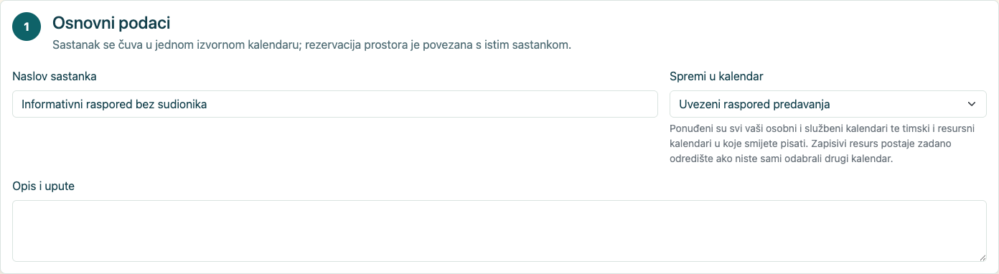Uvezeni događaj odabran je za uređivanje; čuva se izvorni kalendar.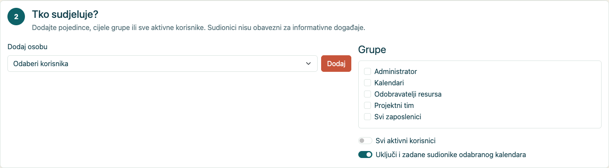Popis osoba i grupa ostaje prazan dok ih ovlaštena osoba ne doda.

## 28. Najčešća pitanja i završna provjera

Odaberi ovaj termin samo promijeni karticu — je li spremljeno?

Ne. Ako je potreban odobravatelj, najprije ga odaberite i potvrdite izbor. Zatim kliknite Spremi sastanak ili Pošalji zahtjev za rezervaciju u zelenoj potvrdi na istoj kartici. Detalji sastanka potvrđuju spremanje.

Zašto ne vidim razlog tuđe zauzetosti?

Vidite slobodno/zauzeto bez pristupa tuđem kalendaru. Naslov i razlog vidljivi su samo ako imate pravo čitanja izvornog kalendara. Privatne napomene nisu dostupne samo zato što organizirate sastanak.

Zašto osoba ima slobodan termin, a ipak kaže Ne?

Ne mora imati sve obveze unesene u Simbiozu. Evidencija zauzetosti nije jamstvo stvarnog dolaska. Koristite prijedlog s odgovorima kada to trebate potvrditi.

Zašto je prostor blokiran ako sastanak još nije zakazan?

Postoji zahtjev za rezervaciju. On štiti prostor dok odobravatelj ne odluči. Odbijanje ili otkazivanje ga oslobađa.

Pratim kalendar, ali nisam sudionik — zašto mi događaj ne zauzima termin?

Praćenje služi pregledavanju. Sudjelovanje mora biti izričito povezano osobom, grupom ili izborom Svi.

### Prije slanja ili dolaska

- Je li naziv jasan, datum i vrijeme ispravno?
- Jesu li osobe i grupe prave, bez slučajnog Svi?
- Je li prostor prikladan i potvrđen, odnosno zahtjev još čeka?
- Treba li odgovor ili je sastanak obavezan?
- Je li završeno spremanje, a ne samo odabir kartice?
- Za sudionika: jeste li poslali odgovor i pročitali konačni status?
