# Riunioni: passo dopo passo

> Le schermate mostrano l’interfaccia in inglese.

## 1. Prima di iniziare: che cos'è una riunione

Questa guida accompagna nella pianificazione, nella prenotazione di una sala e nella partecipazione a una riunione. Non servono conoscenze tecniche. Apri **Calendari → Pianifica una riunione**. Riapri proposte, riunioni obbligatorie e richieste di prenotazione da **Le mie riunioni** oppure da un collegamento in **Notifiche** nel menu utente.

**Una riunione viene archiviata una sola volta.** Scegli il calendario di origine. Se la sala appartiene ad un calendario diverso, la sua prenotazione è legata a quello stesso incontro: non vengono create copie indipendenti per ciascun partecipante. I partecipanti lo vedono tramite *Le mie riunioni*, anche se non sono iscritti al calendario del team.

Gli esempi utilizzano una nuova installazione di prova, utenti fittizi e date nell'ottobre 2026. Tutti gli screenshot utilizzano il tema chiaro. I tuoi nomi e le date potrebbero differire; i passaggi sono gli stessi. Non vengono mostrati impegni privati reali.

## 2. Ruoli e autorizzazioni

| Ruolo | Cosa puoi fare |
|----|----|
| Organizzatore | Ogni utente che ha effettuato l'accesso può verificare gli orari. Salva in un calendario per cui disponi di accesso in scrittura, seleziona i partecipanti e richiedi una prenotazione se non puoi scrivere nel calendario della risorsa. |
| Approvatore delle risorse | Apri la richiesta e approva o rifiuta la sala. L'organizzatore sceglie chi riceve la richiesta; non è necessario che vada a tutti. |
| Partecipante | Consulta la tua riunione. Se viene richiesta una risposta, scegli Sì, Forse o No e aggiungi un commento. Questo non concede l'autorizzazione a modificare il calendario di un'altra persona o ad annullare la riunione. |
| Gestore/amministratore del calendario | Gestisci l'accesso, i partecipanti predefiniti e i profili delle risorse opzionali in base alle tue autorizzazioni. |

Avere il permesso di visionare una sala non equivale a poterla prenotare. L'iscrizione al calendario di un team non ti rende partecipante a ogni evento.

## 3. Non hai il tuo calendario

1.  Apri lo strumento di pianificazione. Puoi cercare orari disponibili anche senza un calendario personale.
2.  Se ne desideri uno, utilizza il pannello blu per scegliere **Ufficiale** per lavoro, **Personale** per impegni privati o **Personalizzato** per il tuo nome.
3.  Il calendario viene creato soltanto con **Crea il calendario selezionato**. Aprire lo strumento di pianificazione non crea nulla.
4.  Se puoi già scrivere in un calendario del team o delle risorse, salva lì senza crearne uno tuo.

Entrambi i tipi appartengono a una persona; puoi scegliere come utilizzarli. Potrai gestire calendario, importazioni e accesso successivamente nelle impostazioni del calendario.

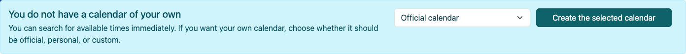Scegli un tipo prima di creare un calendario.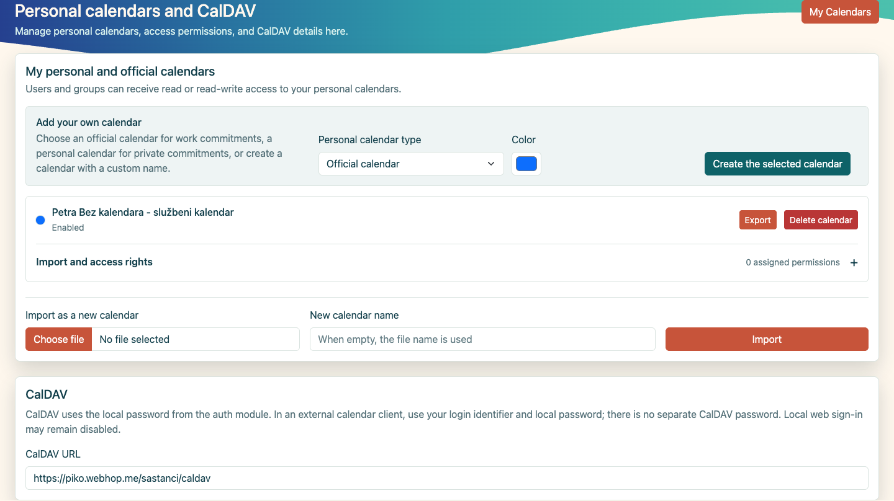Impostazioni del calendario personale: i controlli di importazione e accesso si trovano in una sezione espandibile.

## 4. Passaggio 1: titolo, descrizione e calendario di destinazione

1.  Inserisci un **Titolo della riunione** chiaro, ad esempio "Riunione di progetto".
2.  Utilizza la **Descrizione e istruzioni** per l'argomento, l'ordine del giorno o il collegamento alla riunione online.
3.  **Salva nel calendario** offre i tuoi calendari personali e ufficiali, oltre ai calendari del team e delle risorse a cui puoi scrivere.
4.  Se desideri un calendario di gruppo specifico, selezionalo esplicitamente. La scelta viene mantenuta quando selezioni un orario e una sala.

Se non hai scelto esplicitamente un'altra destinazione, il calendario di una sala in cui puoi scrivere diventa il calendario di origine predefinito. Se non puoi scrivere nel calendario della sala, l'origine è il calendario personale, di lavoro o di gruppo selezionato e la prenotazione della sala viene collegata a esso.

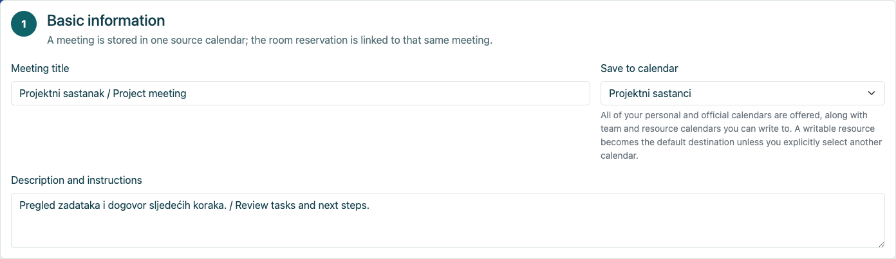L'organizzatore ha selezionato il calendario del team come origine della riunione.

## 5. Passaggio 2: persone, gruppi e Tutti

1.  Per un individuo, apri **Aggiungi persona**, trova un utente e fai clic su **Aggiungi**. Ripeti per gli altri.
2.  Per una squadra, seleziona un gruppo come **Projektni tim**. I membri del gruppo di autenticazione diventano partecipanti senza inserire ciascuna persona.
3.  Per una riunione a livello di organizzazione, seleziona **Tutti gli utenti attivi**. Se il sito ha anche utenti esterni, seleziona invece il gruppo di dipendenti appropriato quando solo i dipendenti dovrebbero partecipare.
4.  **Includi i partecipanti predefiniti del calendario selezionato** aggiunge persone e gruppi associati a quel calendario. Spegnilo quando non sono necessari per questo evento.

Una persona viene conteggiata una sola volta anche se selezionata direttamente e attraverso più gruppi. Le iscrizioni non costituiscono elenchi di presenze. Gli eventi senza partecipanti potrebbero rimanere informativi.

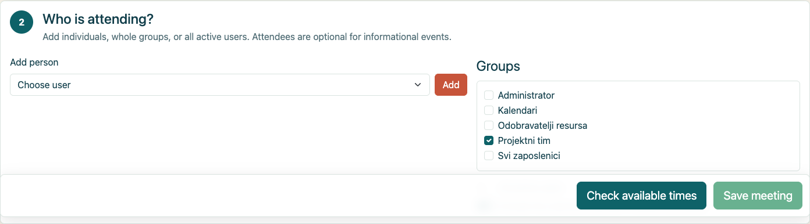Partecipanti selezionati tramite un gruppo ed eredità facoltativa dal calendario.

## 6. Passaggio 3 — trovare l'orario migliore

1.  Seleziona **Trova gli orari migliori**.
2.  Inserisci la prima e l'ultima data. Inizia con uno o pochi giorni.
3.  Imposta il primo inizio, l'ultima fine e la **Durata**.
4.  Controlla i giorni feriali consentiti, ad esempio lunedì e mercoledì.
5.  Scegli **Quanti partecipanti devono essere disponibili?**: Tutti, Ampia maggioranza, Maggioranza o tutte le opzioni.
6.  Scegli una sala nel passaggio successivo e fai clic su **Verifica gli orari disponibili**.

Le migliori opzioni vengono visualizzate per prime. Leggi sempre il numero effettivo dei partecipanti disponibili: verificare la disponibilità non equivale a ricevere le loro risposte.

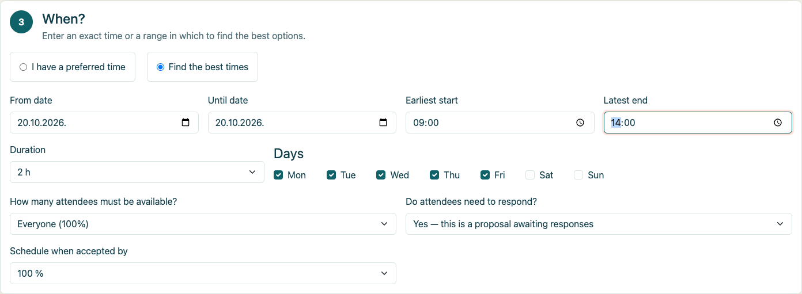Condizioni di ricerca: date, ore, durata e giorni feriali.

## 7. Passaggio 3a: hai già un orario preferito

1.  Seleziona **Ho un orario preferito**.
2.  Inserisci una data, un inizio e una fine. La fine deve essere dopo l'inizio.
3.  Aggiungi partecipanti e una risorsa, quindi fai clic su **Verifica gli orari disponibili**.
4.  Leggi il numero di partecipanti disponibili ed espandi **Partecipanti occupati** se necessario.
5.  Se alcuni non possono partecipare, modifica la data o l'ora oppure scegli consapevolmente un incontro con meno partecipanti disponibili.

La disponibilità include calendari ed eventi personali e ufficiali che includono effettivamente la persona come partecipante. Una persona non è considerata occupata semplicemente perché è iscritta a un calendario informativo. Il sistema conosce solo gli impegni registrati in Simbioza.

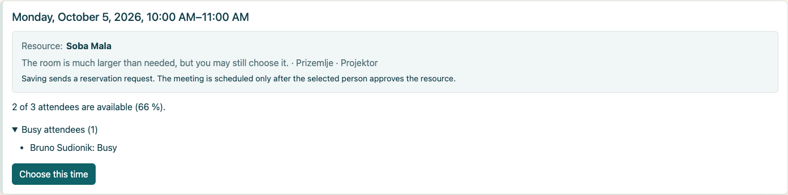L'organizzatore vede che Bruno è occupato, ma non i dettagli del suo impegno privato.

## 8. Passaggio 4: quale sala controllare

1.  Seleziona una o più sale con le caselle di controllo. Fare di nuovo clic per deselezionare.
2.  Se non viene selezionato nulla, vengono controllate **tutte le risorse effettive**.
3.  Per una riunione online, il tuo ufficio o un ristorante non elencato, seleziona esplicitamente **Nessuna risorsa**. Questa opzione non viene mai aggiunta automaticamente.
4.  Inserisci il numero di posti richiesto. Se alcune capacità delle sale sono sconosciute, decidi se includere **risorse senza una capacità dichiarata**.
5.  Fai clic su **Verifica gli orari disponibili**.

Un profilo di risorsa è facoltativo. Per capacità sconosciuta, verifica tu stesso l'idoneità. Una sala molto più grande o più piccola mostra un avvertimento ma non è vietata; potrebbero essere possibili sedie extra o una disposizione diversa.

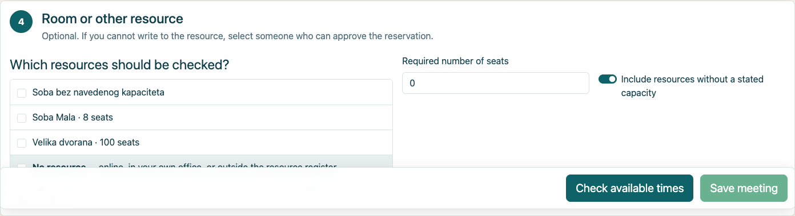Le caselle di controllo possono essere selezionate e deselezionate; Nessuna risorsa è una scelta esplicita.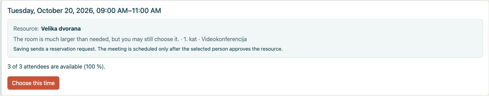Una sala grande non è vietata, ma l'avviso aiuta a scegliere.

## 9. Risultati — ogni scheda contiene già un orario e una risorsa

1.  Leggi la data e l'ora della scheda.
2.  Subito sotto, leggi il nome della risorsa, la capienza e le informazioni disponibili sulla sala.
3.  Leggi la percentuale di partecipanti disponibili. Cercando in tutte le sale possono comparire più schede per lo stesso orario, una per ogni risorsa libera.
4.  Fai clic su **Scegli questo orario** nella scheda esatta desiderata. Non compare successivamente un altro menu a discesa per scegliere la risorsa.
5.  Segui la conferma all'interno della scheda. Dopo aver cambiato le condizioni di ricerca, verifica e seleziona nuovamente un orario.

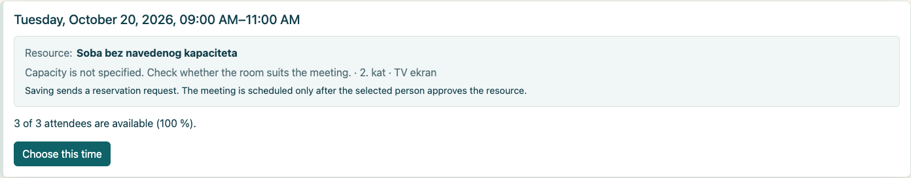L'orario e la sala specifica costituiscono un'opzione offerta.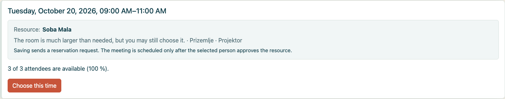Un'altra scheda offre lo stesso orario con una sala diversa.

## 10. Disponi di accesso in scrittura al calendario della risorsa

1.  Seleziona la scheda di una sala libera. La descrizione indica che la prenotazione verrà confermata immediatamente.
2.  Fai clic su **Scegli questo orario**.
3.  Nella conferma verde sulla stessa scheda, fai clic su **Salva riunione**. Non è necessario cercare un “pulsante finale” non specificato.
4.  Si aprono i dettagli della riunione salvata. La sala è prenotata. Una riunione obbligatoria risulta pianificata; una proposta resta in attesa delle risposte se hai scelto quella modalità.

Selezionare un orario non equivale a salvare. Completa con il pulsante di salvataggio nella scheda selezionata. La sala viene ricontrollata al momento del salvataggio perché nel frattempo qualcun altro potrebbe averla prenotata.

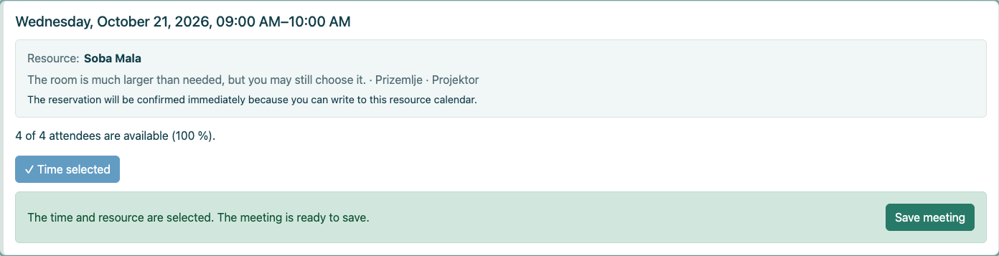Un utente con accesso in scrittura salva dalla conferma della scheda.

## 11. Non puoi scrivere alla risorsa: richiedi una prenotazione

1.  Scegli una sala libera e fai clic su **Scegli questo orario**.
2.  In quella scheda si apre un pannello di conferma della prenotazione.
3.  Seleziona almeno una persona offerta che può approvare la sala. Non inviare a tutti inutilmente.
4.  Utilizza **Messaggio all'approvatore** per spiegare il motivo, ad esempio "Prenota una sala per il team di progetto".
5.  Fai clic su **Conferma selezione orario**, quindi su **Invia richiesta di prenotazione** nella conferma sulla stessa scheda.
6.  Verifica lo stato **In attesa di conferma della risorsa** nei dettagli. La riunione non è ancora pianificata.

Se non viene offerto alcun approvatore, contatta il gestore del calendario. Non puoi ignorare tu stesso le autorizzazioni della sala.

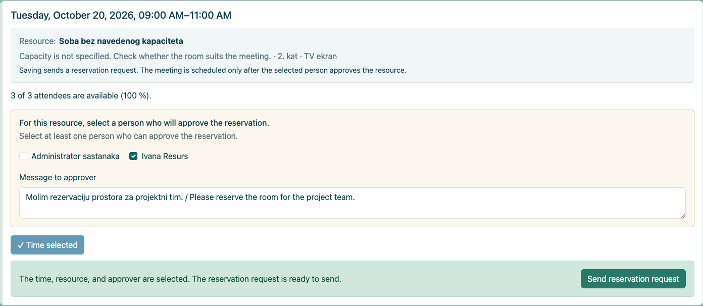L'organizzatore seleziona un approvatore e invia la richiesta nella scheda dell'orario scelto.

## 12. E se qualcun altro volesse la sala mentre aspetti?

Una richiesta in attesa di conferma **blocca temporaneamente la sala**. A un altro organizzatore viene detto che esiste una richiesta per quell'orario. Questo vale sia per gli utenti con accesso in scrittura che per altri richiedenti.

1.  Se vedi un avviso di richiesta in sospeso, non considerare la sala come libera.
2.  Scegli un'altra sala o orario oppure attendi una decisione.
3.  Il rifiuto o l'annullamento liberano la sala, che potrà essere proposta in una nuova verifica.

L'attesa non è un'approvazione automatica. Una prenotazione finale richiede l'approvazione; ricontrollare al momento del salvataggio impedisce di ignorare un'altra richiesta.

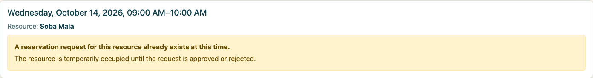Un altro organizzatore vede che la sala è occupata da una precedente richiesta in sospeso.

## 13. Approvatore: notifica e approvazione della sala

1.  Apri il menu utente, quindi **Notifiche**.
2.  Trova **Richiesta di prenotazione di risorse**. Controlla il titolo e l'orario della riunione.
3.  Fare clic sul collegamento della riunione. Apre quella richiesta specifica, non solo un elenco generale.
4.  Nella scheda **Risorsa**, controlla la sala e, facoltativamente, aggiungi un messaggio all'organizzatore.
5.  Fai clic su **Approva**. La risorsa diventa **Riservata**.

L'organizzatore viene avvisato. Viene quindi fissato un incontro obbligatorio o già concordato. Per una proposta, i partecipanti ricevono l'invito a rispondere solo dopo la conferma della sala.

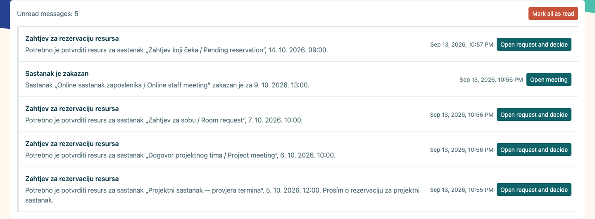Ivana riceve una notifica che collega alla richiesta.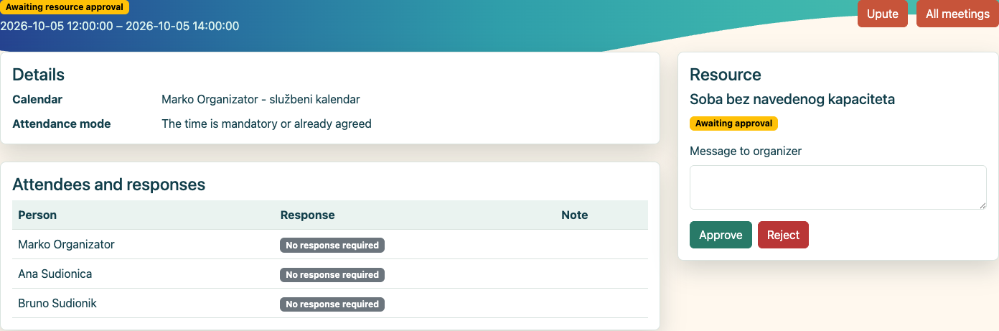L'approvatore decide nella scheda Risorsa.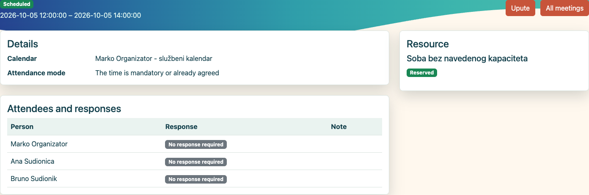Sala approvata e riunione obbligatoria programmata.

## 14. Approvatore: rifiuta la sala

1.  Apri la richiesta dalla sua notifica.
2.  Spiega il motivo nel **Messaggio all'organizzatore**, ad esempio che la sala non è adatta.
3.  Fai clic su **Rifiuta**.
4.  Verifica lo stato **Prenotazione della risorsa rifiutata**.

La sala viene liberata per gli altri. L'organizzatore viene avvisato e può utilizzare **Modifica** per trovare un'altra sala o orario e inviare una nuova richiesta. Rifiutare una sala è diverso dal rifiuto della presenza da parte di un partecipante.

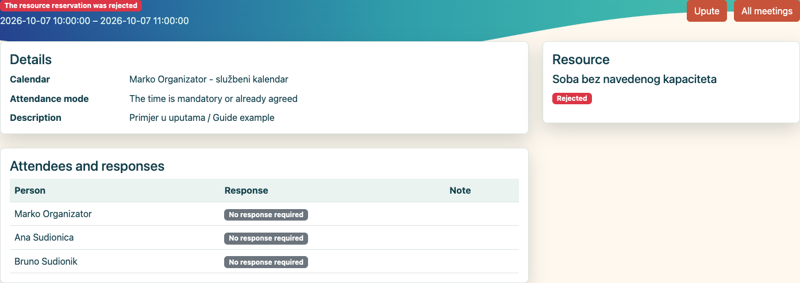La richiesta viene respinta; l'organizzatore vede il risultato nei dettagli.

## 15. Riunione o proposta obbligatoria: due scelte diverse

In **I partecipanti devono rispondere?**, scegli:

- **No — orario obbligatorio / già concordato**: i partecipanti ricevono una notifica, ma non viene richiesta una risposta Sì/No. Se la sala richiede approvazione, questa deve comunque essere ottenuta prima.
- **Sì — una proposta in attesa di risposte**: i partecipanti rispondono. Seleziona anche **Pianifica quando accetta il** (100%, 80%, 60% o 50%).

La soglia di persone disponibili usata nella ricerca è diversa dalla soglia delle risposte di accettazione. La prima aiuta a trovare un orario sulla base degli impegni registrati; la seconda determina quando l'invito diventa una riunione pianificata. L'organizzatore è escluso dalle persone di cui si attende conferma.

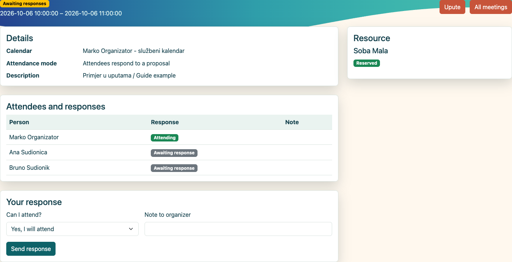Proposta con tabella dei partecipanti e modulo di risposta.

## 16. Partecipante: accetta la presenza

1.  Apri **Notifiche** e trova **Proposta di incontro**.
2.  Apri il collegamento della riunione. Controlla la data, l'ora, la sala e la descrizione.
3.  In **La tua risposta → Posso partecipare?**, seleziona **Sì, parteciperò**.
4.  Facoltativamente, aggiungi un commento per l'organizzatore.
5.  Fai clic su **Invia risposta**. La tua riga nella tabella dei partecipanti mostra **Parteciperà**.

L'organizzatore riceverà una notifica con il tuo nome e il tuo commento. Una volta che un numero sufficiente di altri partecipanti accetta, la riunione viene pianificata automaticamente. Al 100%, tutti gli invitati tranne l'organizzatore devono accettare.

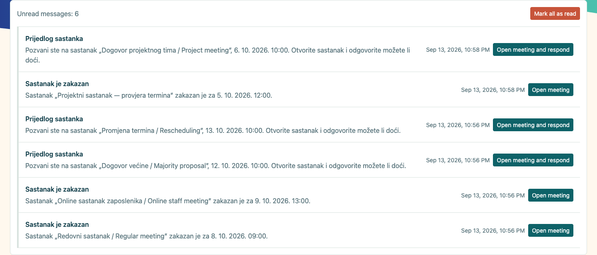Ana riceve un invito; il suo collegamento apre l'incontro specifico.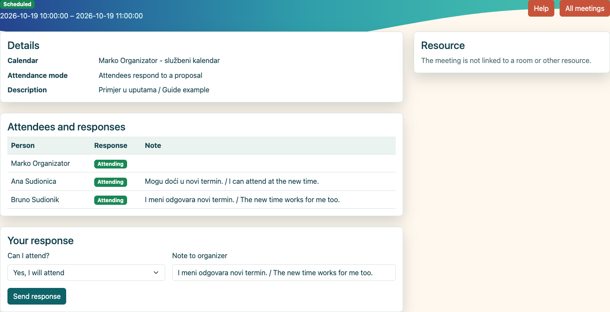Dopo le accettazioni richieste, la riunione viene pianificata.

## 17. Partecipante: non puoi partecipare o non sei ancora sicuro

1.  Apri la riunione e scegli **Non posso partecipare** o **Forse** in **La tua risposta**.
2.  Aggiungi un commento utile come “Suggerisci un altro orario” o “In attesa di un altro impegno”. Non è necessario rivelare motivi privati.
3.  Fai clic su **Invia risposta**.
4.  Controlla la tua riga. La scelta e il commento salvati rimangono visibili quando si riapre la riunione.

Rifiutare la partecipazione non annulla l'intera riunione. Forse non equivale a un'accettazione. L'organizzatore decide se cercare un altro orario o pianificare comunque la riunione. Puoi cambiare risposta se le circostanze cambiano, finché le risposte restano abilitate.

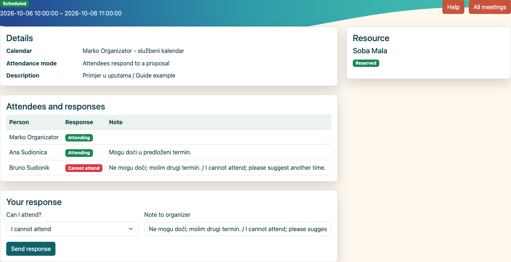Bruno rifiuta la partecipazione e chiede un altro orario.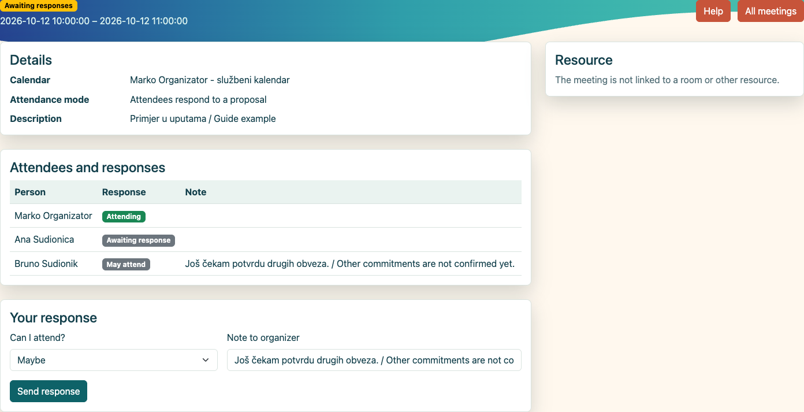Risposta provvisoria Forse, con un commento.

## 18. Organizzatore: decidere dopo che qualcuno rifiuta

1.  Apri la notifica di risposta. Identifica la persona e il suo commento.
2.  Apri la riunione ed esamina l'intera tabella delle risposte.
3.  Per un orario diverso, fai clic su **Modifica**, modifica la data o gli orari, ricontrolla la disponibilità e salva.
4.  Se la riunione deve comunque utilizzare questo orario, fai clic deliberatamente su **Pianifica comunque questo orario** nei dettagli della proposta.
5.  Seleziona **Pianificato**. La risposta rifiutata rimane visibile; il sistema non lo trasforma in accettazione.

La pianificazione manuale non aggira un'approvazione della sala ancora in sospeso. Occorre prima risolvere la richiesta della risorsa.

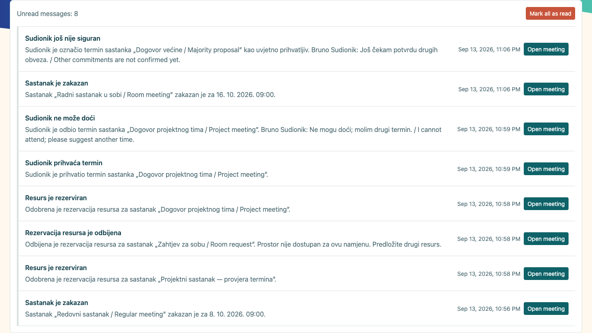L'organizzatore visualizza le risposte e i collegamenti alle riunioni.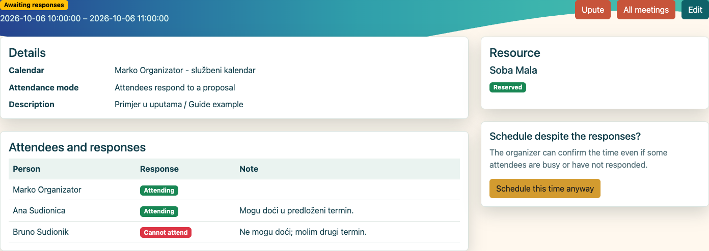La possibilità di pianificare consapevolmente nonostante le risposte.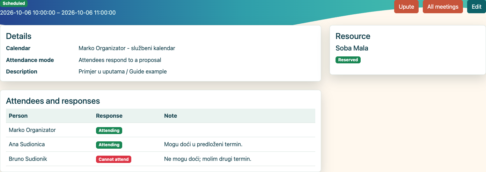Dall'incontro programmato risulta comunque che Bruno non può partecipare.

## 19. Modificare l'orario e richiedere nuovamente risposte

1.  Apri la riunione esistente e fai clic su **Modifica**.
2.  Modificare la data, l'inizio o la fine. Scegli la stessa o un'altra risorsa.
3.  Fai clic su **Verifica gli orari disponibili**. Il vecchio incontro non deve entrare in conflitto con se stesso.
4.  Seleziona la nuova scheda e salva, oppure invia una nuova richiesta per la sala.
5.  I partecipanti ricevono una notifica con il nuovo orario. Se sono necessarie risposte, le risposte precedenti vengono cancellate e ne vengono richieste di nuove.

Accettare la vecchia data non significa accettare quella nuova. L'incontro conserva la sua identità e il suo legame; non viene creata alcuna copia aggiuntiva. La nuova sala o orario dovrà nuovamente superare le verifiche di disponibilità e l'eventuale approvazione richiesta.

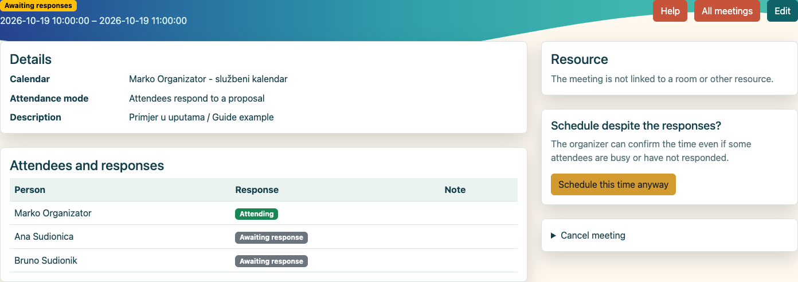La stessa riunione in una nuova data; vengono nuovamente richieste risposte.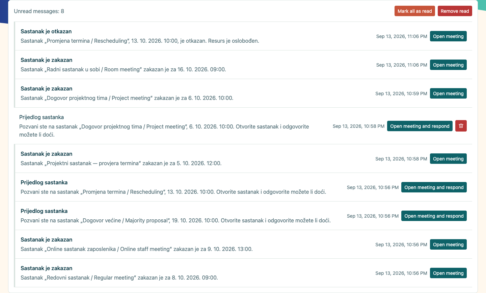Il partecipante viene informato del nuovo orario.

## 20. La maggioranza accetta, comprendendo la soglia

Esempio: una riunione comprende un organizzatore e altre due persone. **Pianifica quando accetta il** si riferisce alle due persone di cui l'organizzatore attende risposta. Un'accettazione corrisponde al 50%; due al 100%. Con una soglia del 60%, una sola accettazione non basta; con il 50%, basta. Forse e No non contano come accettazioni.

1.  Scegli la soglia prima dell'invio.
2.  Esamina la tabella dopo le risposte. La proposta attende fino al raggiungimento della soglia.
3.  Una volta raggiunta la soglia e confermata la sala, verificare che lo stato sia Programmato.

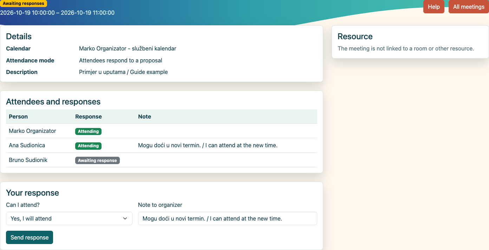Una persona su due ha accettato, quindi la soglia del 60% non è stata ancora raggiunta.

## 21. Online, nel tuo ufficio e un evento per tutti

1.  Seleziona **Nessuna risorsa**. Deseleziona le sale effettive, se necessario.
2.  Inserisci il link online o l'indirizzo di un luogo non elencato nella descrizione.
3.  Aggiungi persone o gruppi; per un evento generale seleziona **Tutti gli utenti attivi**.
4.  Controlla l'ora e scegli la scheda Nessuna risorsa.
5.  Salva. Non viene creata alcuna prenotazione della sala o richiesta di approvazione.

Questa riunione potrebbe essere ancora obbligatoria o una proposta in attesa di risposte. Per tutti si intendono tutti gli utenti attivi del sito, non solo i dipendenti di un'organizzazione.

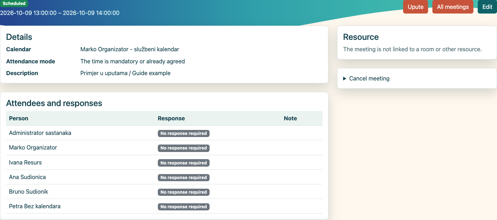Un incontro obbligatorio per tutti senza prenotazione della sala.

## 22. Cancellazione e liberazione della sala

1.  In qualità di organizzatore o redattore autorizzato, apri i dettagli della riunione.
2.  Espandi **Annulla riunione**.
3.  Leggi l'avviso e clicca su **Conferma cancellazione** solo se non avrà luogo.
4.  Verifica lo stato **Annullata**. I partecipanti ricevono una notifica e la prenotazione o richiesta collegata smette di occupare la sala.

Il No di un partecipante non equivale a un annullamento. La riunione annullata rimane identificabile nei suoi dettagli come record decisionale ma non viene più conteggiata come tempo occupato.

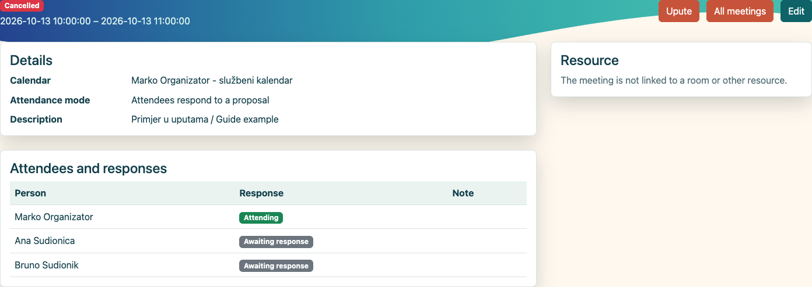Una riunione annullata non occupa più i partecipanti o la sala.

## 23. Dove i partecipanti vedono le riunioni: calendario e notifiche

1.  Apri **Calendari**. L'elenco dei calendari include la visualizzazione virtuale **Le mie riunioni**.
2.  Scegli mese, settimana o giorno e apri un evento. Porta ai dettagli della riunione.
3.  Non è necessario che le persone siano iscritte automaticamente a ogni calendario di team o risorse.
4.  In **Notifiche**, utilizza il collegamento alla riunione per rispondere, decidere una sala o rivedere una modifica.

Una proposta, una richiesta di sala in sospeso e una riunione pianificata hanno stati diversi. Controlla i dettagli prima di partecipare, non semplicemente la presenza di un evento nel calendario. Una sala rifiutata non è una sede confermata.

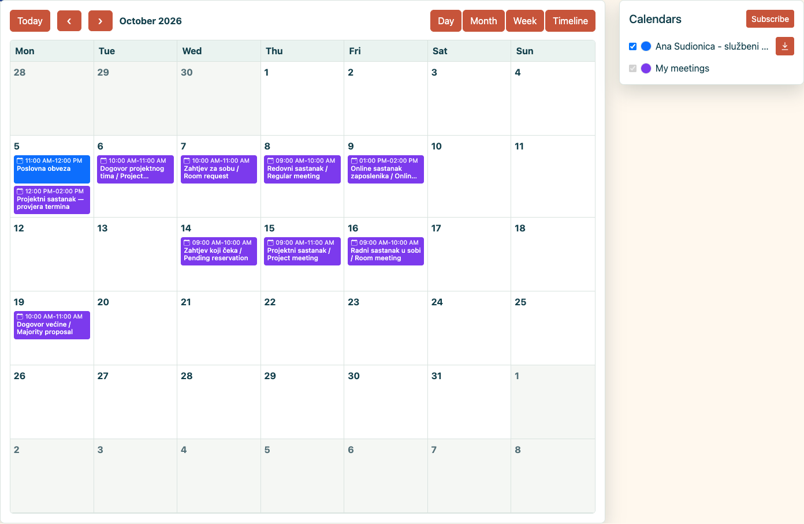Ana vede Le mie riunioni accanto al proprio calendario di lavoro senza iscriversi al calendario del gruppo.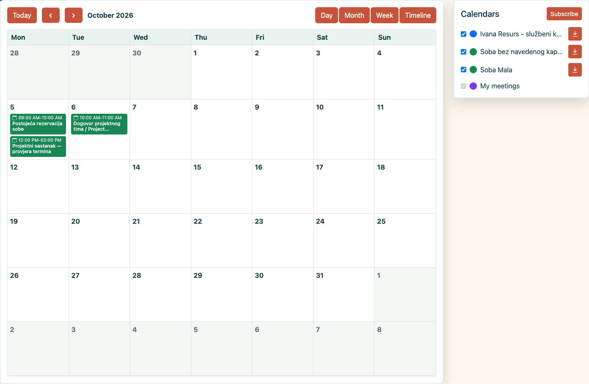Visualizzazione del calendario di un utente che prenota risorse.

## 24. CalDAV e risposta da un calendario esterno

Il rilevamento CalDAV include il calendario virtuale **Le mie riunioni**. Abilitalo nella tua applicazione se non compare automaticamente. Contiene le riunioni che ti coinvolgono come partecipante, senza copie indipendenti nei calendari personali né iscrizioni obbligatorie ai calendari di gruppo di origine.

1.  Apri la riunione nel tuo calendario esterno.
2.  Segui il collegamento Simbioza nella descrizione/URL dell'evento.
3.  Accedi con il tuo account se necessario.
4.  Rispondi o controlla lo stato in Simbioza.

La risposta tramite pulsanti nativi Apple/Outlook/altri client non è supportata: il supporto completo per CalDAV Scheduling/iTIP non è implementato. La vista virtuale è di sola lettura. Se segui solo il tuo calendario di origine e non abiliti Le mie riunioni, non aspettarti che vengano visualizzate tutte le riunioni di altri calendari.

## 25. Manager: i partecipanti predefiniti di un calendario

1.  Apri le impostazioni della riunione per un calendario che sei autorizzato a gestire.
2.  Aggiungi persone, gruppi o tutti coloro che normalmente dovrebbero partecipare.
3.  Salva le impostazioni.
4.  Utilizza **Includi i partecipanti predefiniti del calendario selezionato** su un evento nuovo o esistente quando l'elenco è appropriato.

Un amministratore gestisce l'appartenenza al gruppo. Per un team o un dipartimento normale, seleziona il relativo gruppo invece di inserire ogni membro separatamente. L'abbonamento al calendario è ancora diverso dalla partecipazione alla riunione.

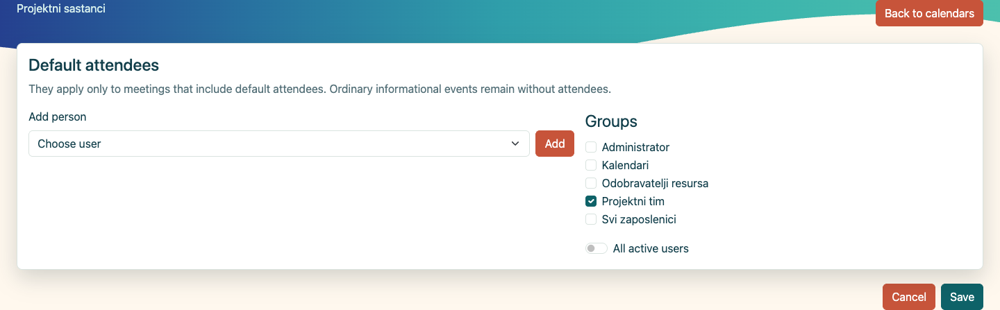Il responsabile associa il gruppo Projektni tim a un calendario di gruppo.

## 26. Manager: profilo della sala opzionale

1.  Apri le impostazioni della riunione del calendario delle risorse.
2.  Se disponi delle informazioni, abilita il relativo profilo e inserisci tipo, capacità, ubicazione e attrezzatura.
3.  Se la capacità è sconosciuta, lasciarla non specificata. Non inventare un numero.
4.  Salva. Questi dettagli aiutano la ricerca, ma non è necessario un profilo affinché una risorsa esista.

La capacità è un avvertimento, non un divieto severo: si possono scegliere deliberatamente sale più piccole o molto più grandi. Le sale con capacità sconosciuta sono incluse solo se l'organizzatore le consente.

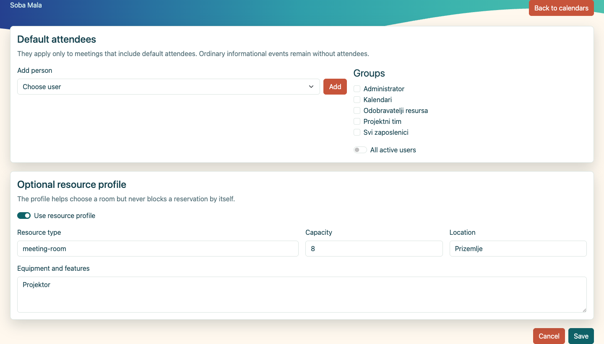Un profilo di sala opzionale con capacità, posizione e attrezzatura.

## 27. Calendari importati e informativi senza partecipanti

Un'importazione di Confluence potrebbe non sapere chi partecipa. Tali calendari ed eventi potrebbero rimanere senza persone o gruppi. Un orario delle lezioni che un utente si limita a seguire **non contrassegna automaticamente l'utente occupato**.

1.  Dopo l'importazione, esamina il calendario e le relative autorizzazioni di accesso.
2.  Se informativo, non aggiungere partecipanti solo per riempire un campo vuoto.
3.  Se un evento dovesse effettivamente diventare un meeting, aprilo e utilizza il pianificatore/editor del meeting.
4.  Aggiungi persone o gruppi reali, scegli se sono richieste risposte e controlla l'orario e la sala.
5.  Salva dopo aver controllato. Disattiva l'ereditarietà del calendario quando il singolo evento richiede partecipanti diversi.

Il sistema non è in grado di indovinare in modo affidabile i partecipanti dal titolo di un evento importato. Un manager o un redattore autorizzato associa persone e gruppi.

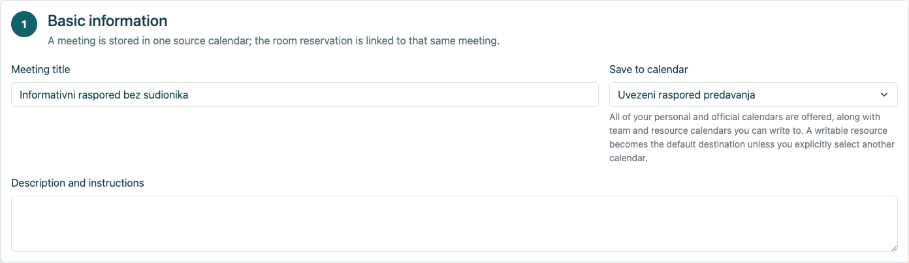L'evento importato viene selezionato per la modifica; il suo calendario di origine viene conservato.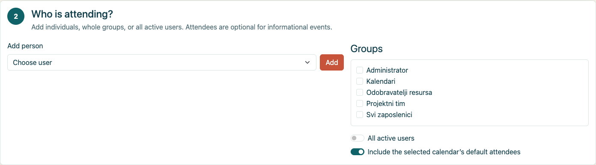L'elenco dei partecipanti rimane vuoto finché una persona autorizzata non aggiunge persone o gruppi.

## 28. Domande frequenti e lista di controllo finale

Scegli questo orario cambia soltanto la scheda: la riunione è salvata?

No. Se è necessario un approvatore, selezionane uno e conferma prima la scelta. Quindi fare clic su Salva incontro o Invia richiesta di prenotazione nella conferma verde sulla stessa scheda. I dettagli della riunione confermano che è stata salvata.

Perché non riesco a vedere perché un'altra persona è occupata?

Puoi vedere libero/occupato senza accedere al loro calendario. Il titolo e il motivo sono visibili solo con accesso in lettura al calendario di origine. L'organizzazione di una riunione non garantisce l'accesso alle note private.

Perché una persona sembra libera ma risponde di no?

Potrebbero non registrare tutti gli impegni in Simbioza. La disponibilità registrata non garantisce la partecipazione. Utilizza una proposta con risposte quando è necessaria la conferma.

Perché la sala rimane occupata se la riunione non è ancora pianificata?

Una richiesta di prenotazione protegge la sala mentre l'approvatore decide. Il rifiuto o l'annullamento lo rilasciano.

Seguo un calendario ma non sono un partecipante: perché non risulto occupato?

Seguire un calendario serve a visualizzarlo. La partecipazione deve essere associata esplicitamente tramite una persona, un gruppo o Tutti.

### Prima di inviare o partecipare

- Il titolo è chiaro e la data e l'ora sono corrette?
- Le persone e i gruppi sono corretti, senza una selezione accidentale di Tutti?
- La sala è idonea e confermata oppure la sua richiesta è ancora in sospeso?
- Sono richieste risposte oppure la partecipazione è obbligatoria?
- Hai finito di salvare e non hai semplicemente selezionato una scheda?
- Come partecipante: hai inviato una risposta e controllato lo stato finale?
