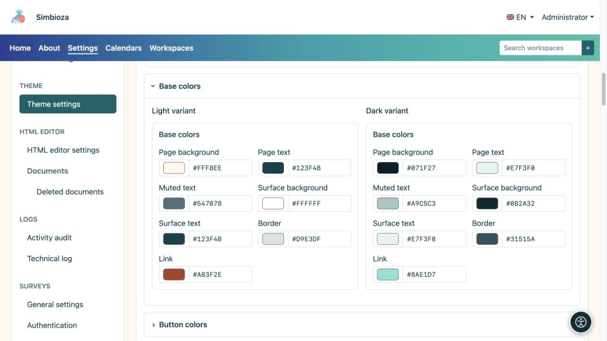
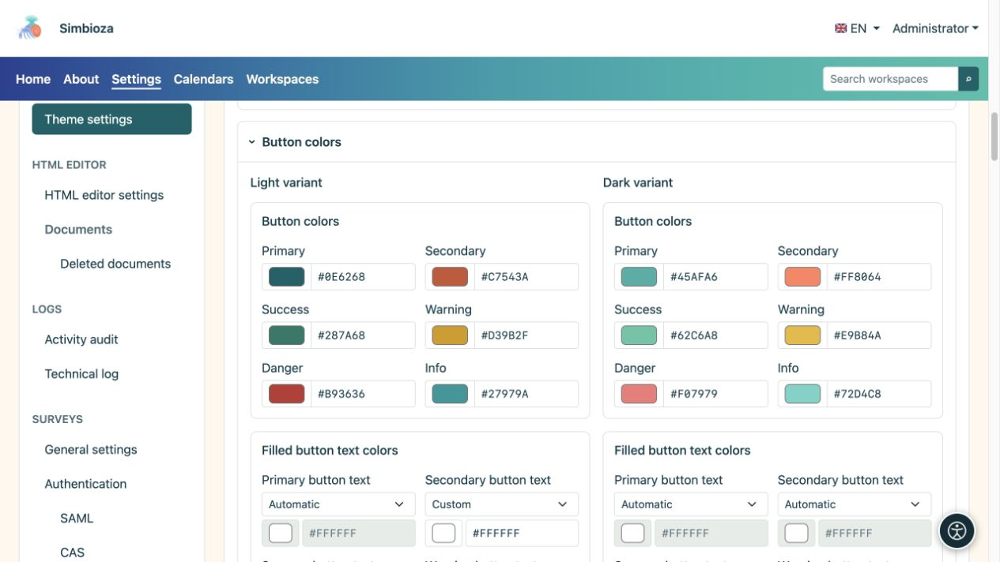
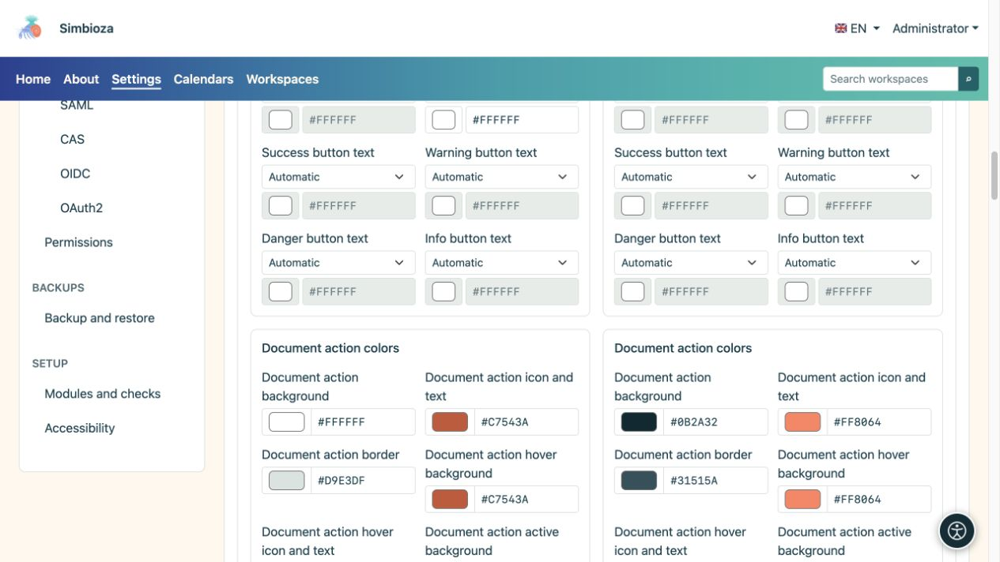
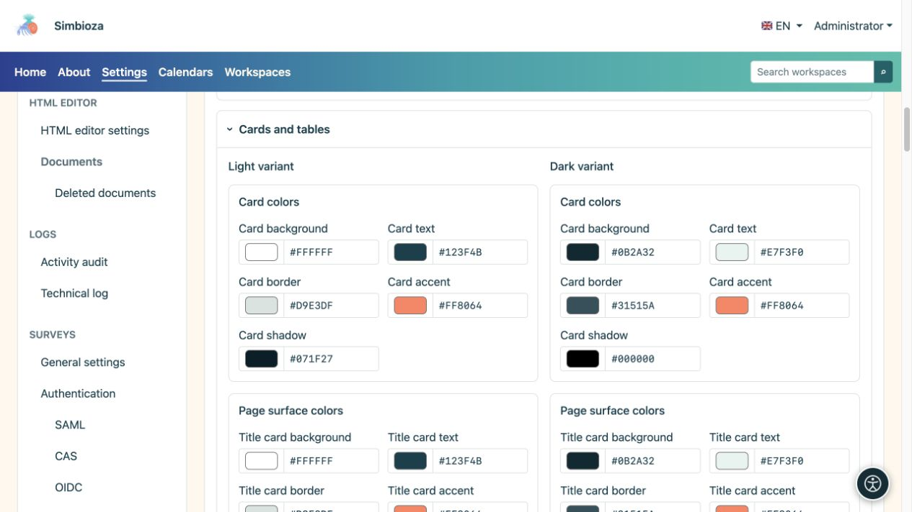
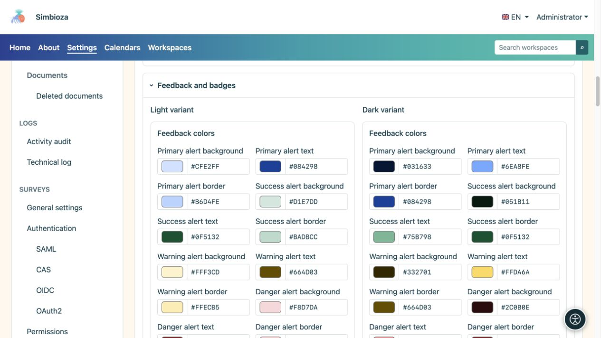
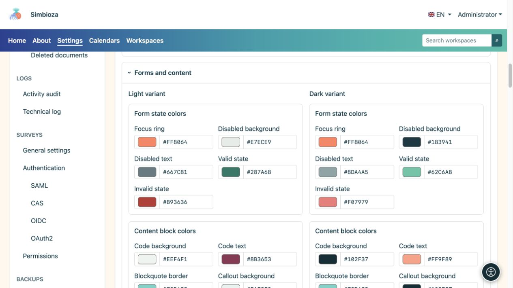
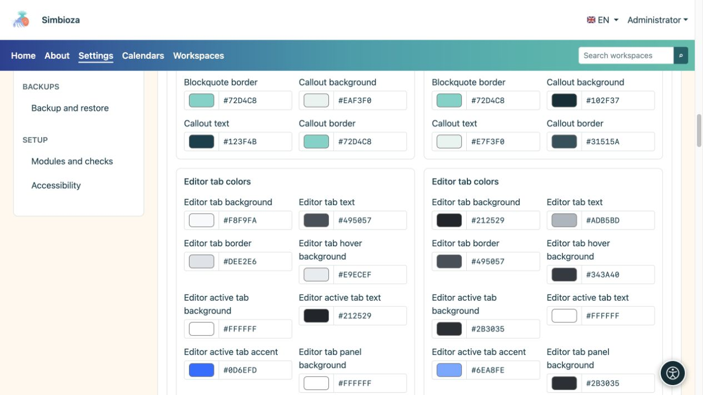

# Farben festlegen und Komponenten prüfen

> Die Bildschirmaufnahmen zeigen die englische Benutzeroberfläche.

[Designs](teme_de.md)

**Ziel:** Text, Bedienelemente und Nachrichten im Hell- und Dunkelmodus klar verständlich halten. Sie müssen nicht jedes Feld ändern: Verwenden Sie die Gruppe, die dem entspricht, was Sie anpassen möchten.

## Ändern Sie eine Farbe

1. Öffnen Sie den entsprechenden Abschnitt und aktivieren Sie **Helle Variante** oder **Dunkle Variante**.
2. Verwenden Sie den Farbwähler oder geben Sie den angebotenen HEX-Wert ein, z. B. `#276E82`.
3. Überprüfen Sie diese Komponente und ihre Zustände in der Vorschau unter dem Editor.
4. Überprüfen Sie die andere Variante und wählen Sie **Design speichern**.

**Ergebnis:** Die gespeicherte Farbe ändert sich zu diesem Zweck, ohne die andere Variante zu überschreiben. Eine primäre Schaltflächenfarbe legt nicht alle Schaltflächen-, Tabellen- und Nachrichtenfarben fest.

## Grundfarben

| Feldgruppe | Gilt für |
| --- | --- |
| Seitenhintergrund und Text | Haupthintergrund und Haupttext. |
| Stummgeschalteter Text | Unterstützende Angaben, die trotz reduzierter Hervorhebung lesbar bleiben müssen. |
| Oberflächenhintergrund und Text | Allgemeine Bauteiloberflächen. |
| Rand und Link | Elementgrenzen und Links. |

<figure>

<figcaption>Vergleichen Sie den Textkörper und den stummgeschalteten Text mit dem tatsächlichen Hintergrund.</figcaption>
</figure>

## Schaltflächen und Dokumentaktionen

Primär-, Sekundär-, Erfolgs-, Warn-, Gefahren- und Informationsfarben dienen unterschiedlichen Zwecken. Der Text für jeden der sechs Schaltflächentypen verfügt in beiden Varianten über einen eigenen Selektor:

| Textfarbmodus | Wirkung |
| --- | --- |
| Automatisch | Bestimmt die Textfarbe anhand des ausgewählten Schaltflächenhintergrunds. |
| Handbuch | Ermöglicht Ihre eigene Farbe; überprüfen Sie die Lesbarkeit erneut, nachdem Sie den Hintergrund geändert haben. |

**Dokumentaktionen** verfügen über separate Hintergrund-, Symbol-/Text-, Rahmen-, Hover- und Aktivzustandsfelder. Hierbei handelt es sich um Steuerelemente wie Symbole neben einem Dokument. Sie müssen nicht die gleichen Farben wie eine große Primärschaltfläche haben.

<figure>

<figcaption>Überprüfen Sie die gefüllten und umrandeten Schaltflächen, einschließlich ihres Normal- und Hover-Status.</figcaption>
</figure>

<figure>

<figcaption>Dokumentsteuerelemente verfügen über Farbeinstellungen, die von großen Aktionsschaltflächen getrennt sind.</figcaption>
</figure>

## Karten und Tische

- **Karten** haben Hintergrund-, Text-, Rahmen-, Akzent- und Schattenfarben.
- **Titel-, Inhalts- und Seitenkarten** verfügen über separate Hintergrund-, Text-, Rahmen- und Akzentfarben.
- **Tabellen** haben Kopfzeilenhintergrund/-text, reguläre Zeilenhintergrund/-text, alternative Zeilenhintergrund und Rahmen.

Form, Schattensichtbarkeit und Akzentposition werden unter [Inhalt und Karten](teme-sadrzaj-kartice_de.md) festgelegt. Durch die Auswahl einer Schattenfarbe wird kein deaktivierter Schatten aktiviert.

<figure>

<figcaption>Getrennte Oberflächen ermöglichen einen ruhigeren Titel, klare Inhalte und lesbare Seitenkarten.</figcaption>
</figure>

## Nachrichten, Labels und Status

Primär-, Erfolgs-, Warn-, Gefahren- und Informationsmeldungen haben Hintergrund-, Text- und Rahmenfarben. **Badge**- und **Tag**-Etiketten haben ihren eigenen Hintergrund und Text. Erfolg und Warnung sollten auch durch Text oder Symbole und nicht nur durch Farbe verständlich sein.

<figure>

<figcaption>Wählen Sie Farben, die für jeden Nachrichtentyp unterschiedlich, aber lesbar sind.</figcaption>
</figure>

## Formulare und Inhaltsblöcke

| Gruppe | Was zu überprüfen ist |
| --- | --- |
| Fokus, deaktivierte Felder, gültige/ungültige Zustände | Der Tastaturfokus bleibt sichtbar; Deaktivierte Text- und Fehlermeldungen bleiben lesbar. |
| Code, Angebot und Callout | Code-Hintergrund/Text, Zitatrahmen und Callout-Hintergrund/Text/Rahmen. |
| Inhaltsregisterkarten des Editors | Standard-, Hover- und Aktivstatus, Rahmen, Akzent und Panel-Hintergrund/Text. |
| Herausgeber Akkordeon | Separate Überschriften- und Texthintergründe/Text. Öffnen und schließen Sie das Beispiel. |

<figure>

<figcaption>Die Lesbarkeit umfasst auch deaktivierte Felder, Fehler und den Tastaturfokus.</figcaption>
</figure>

<figure>

<figcaption>Inhaltsregisterkarten und die Hauptnavigation verwenden nicht unbedingt dieselbe Farbgruppe.</figcaption>
</figure>

## Endkontrolle

Die Vorschau umfasst Schaltflächen, Karten, eine Tabelle, Nachrichten, Registerkarten, Akkordeon, Code, einen Dialog, ein Dropdown-Menü und kurze Benachrichtigungen. Vergleichen Sie helle und dunkle Seiten und öffnen Sie dann echte Seiten mit einem Formular und längerem Inhalt. Wenn ein Text schwer lesbar ist, passen Sie seine Farbe oder die entsprechende Oberfläche an, anstatt den gesamten Hero-Bereich für eine Beschreibung zu ändern.
