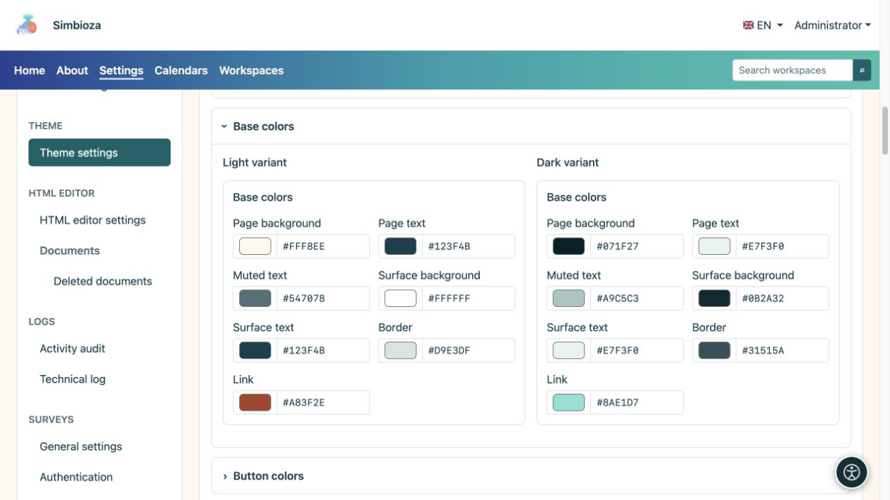
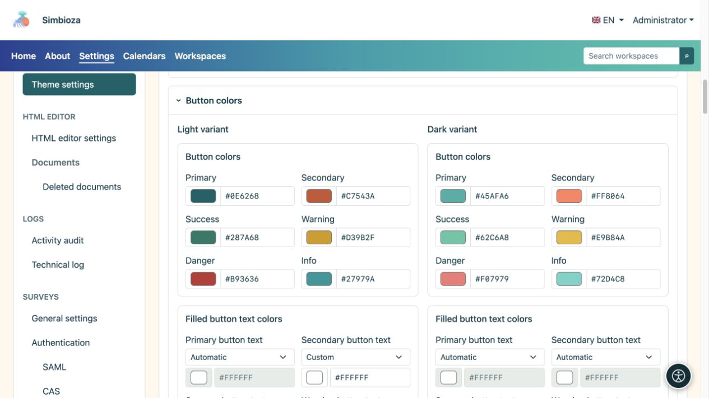
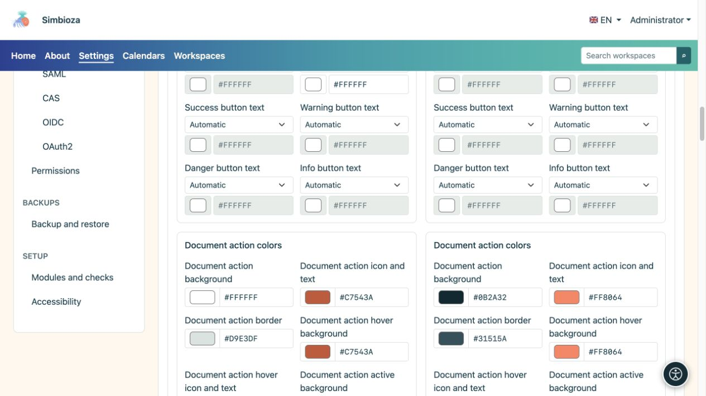
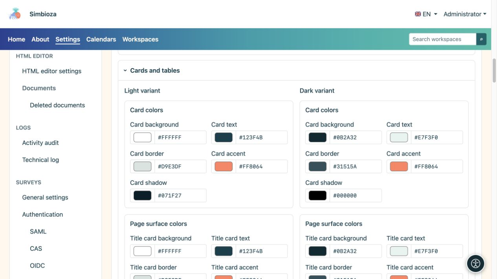
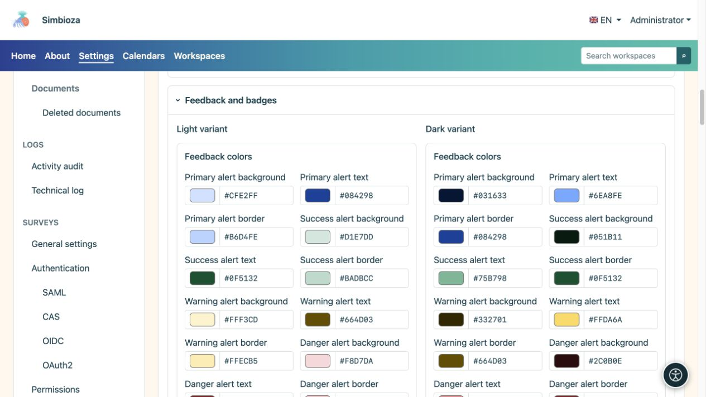
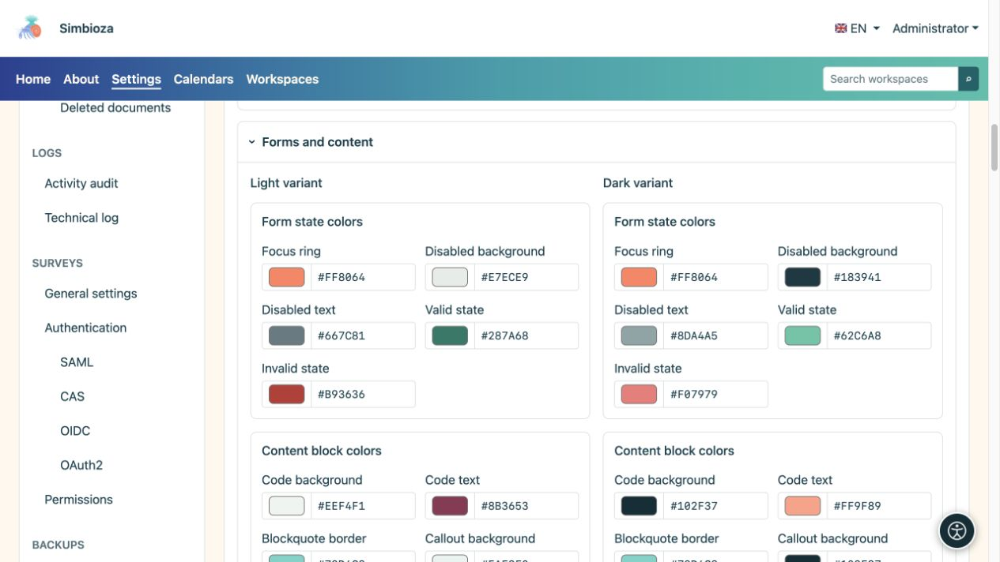
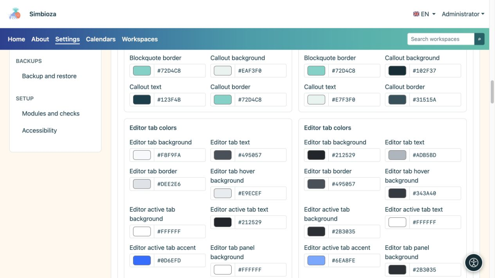

# Set colours and check components

[Themes](teme_en.md)

**Goal:** keep text, controls and messages clear in light and dark modes. You do not need to change every field: use the group matching what you want to adjust.

## Change one colour

1. Open the relevant section and check **Light variant** or **Dark variant**.
2. Use its colour picker or enter the offered HEX value, such as `#276E82`.
3. Inspect that component and its states in the preview below the editor.
4. Check the other variant and select **Save theme**.

**Result:** the saved colour changes for that purpose without overwriting the other variant. A primary-button colour does not set every button, table and message colour.

## Base colours

| Field group | Applies to |
| --- | --- |
| Page background and text | Main background and body text. |
| Muted text | Supporting details, which must remain readable despite reduced emphasis. |
| Surface background and text | General component surfaces. |
| Border and link | Element boundaries and links. |

<figure>

<figcaption>Check body and muted text against their actual backgrounds.</figcaption>
</figure>

## Buttons and document actions

Primary, secondary, success, warning, danger and info colours serve different purposes. Text for each of the six button types has its own selector in both variants:

| Text-colour mode | Effect |
| --- | --- |
| Automatic | Determines text colour from the chosen button background. |
| Manual | Enables your own colour; check readability again after changing the background. |

**Document actions** have separate background, icon/text, border, hover and active-state fields. These are controls such as icons beside a document; they need not have the same colours as a large primary button.

<figure>

<figcaption>Check filled and outlined buttons, including their ordinary and hover states.</figcaption>
</figure>

<figure>

<figcaption>Document controls have colour settings separate from large action buttons.</figcaption>
</figure>

## Cards and tables

- **Cards** have background, text, border, accent and shadow colours.
- **Title, content and side cards** have separate background, text, border and accent colours.
- **Tables** have header background/text, regular row background/text, alternate-row background and borders.

Shape, shadow visibility and accent position are set under [Content and cards](teme-sadrzaj-kartice_en.md). Choosing a shadow colour does not itself enable a disabled shadow.

<figure>

<figcaption>Separate surfaces allow a quieter title, distinct content and readable side cards.</figcaption>
</figure>

## Messages, labels and statuses

Primary, success, warning, danger and information messages have background, text and border colours. **Badge** and **tag** labels have their own background and text. Success and warning should also be understandable through text or icons rather than colour alone.

<figure>

<figcaption>Choose colours that are distinct but readable for each message type.</figcaption>
</figure>

## Forms and content blocks

| Group | What to check |
| --- | --- |
| Focus, disabled fields, valid/invalid states | Keyboard focus stays visible; disabled text and error messages remain readable. |
| Code, quotation and callout | Code background/text, quotation border, and callout background/text/border. |
| Editor content tabs | Default, hover and active states, border, accent and panel background/text. |
| Editor accordion | Separate heading and body backgrounds/text. Open and close the example. |

<figure>

<figcaption>Readability also covers disabled fields, errors and keyboard focus.</figcaption>
</figure>

<figure>

<figcaption>Content tabs and the main navigation do not necessarily use the same colour group.</figcaption>
</figure>

## Final check

Preview includes buttons, cards, a table, messages, tabs, accordion, code, a dialog, a dropdown and short notifications. Compare light and dark sides, then open real pages with a form and longer content. When one text is hard to read, adjust its colour or corresponding surface rather than changing the entire hero for one description.
