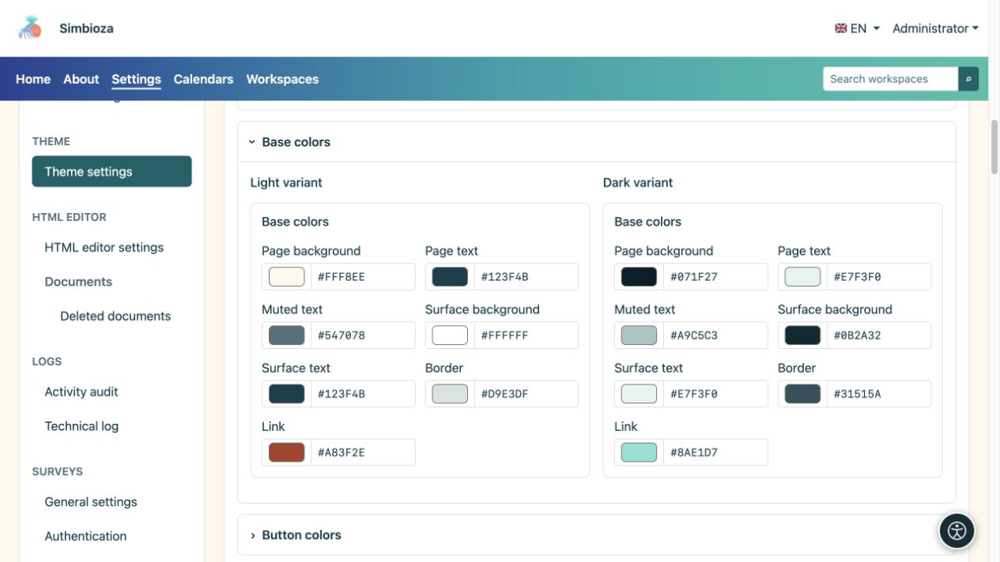
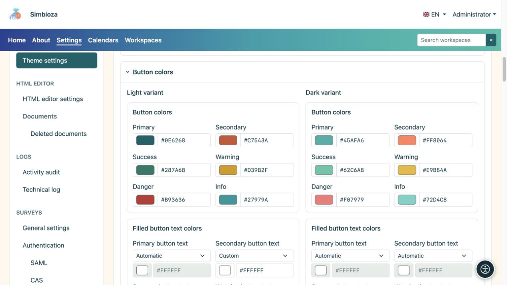
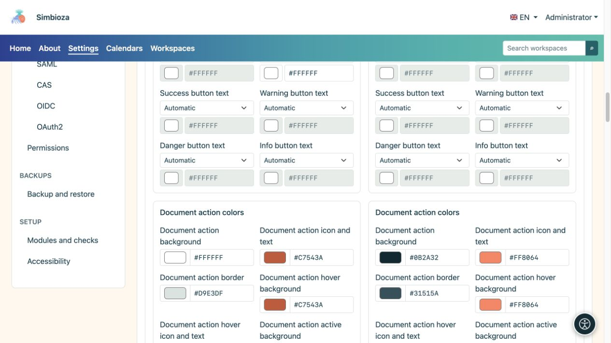
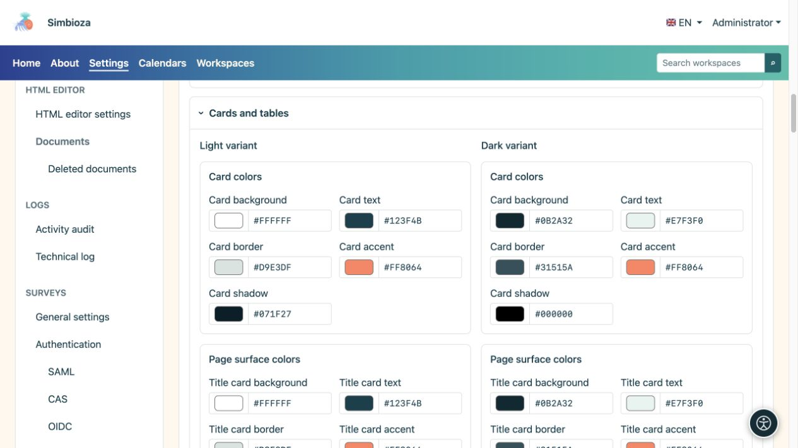
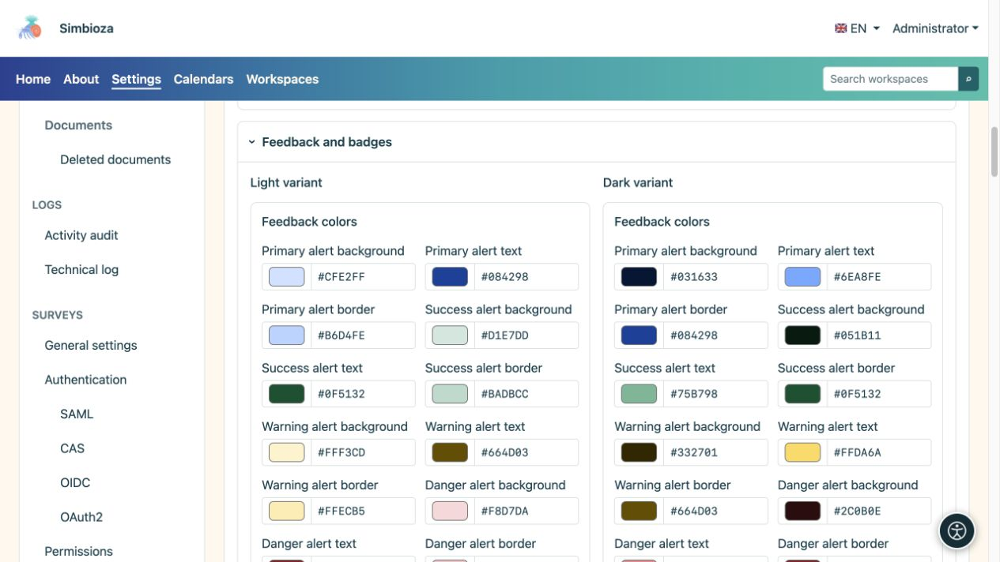
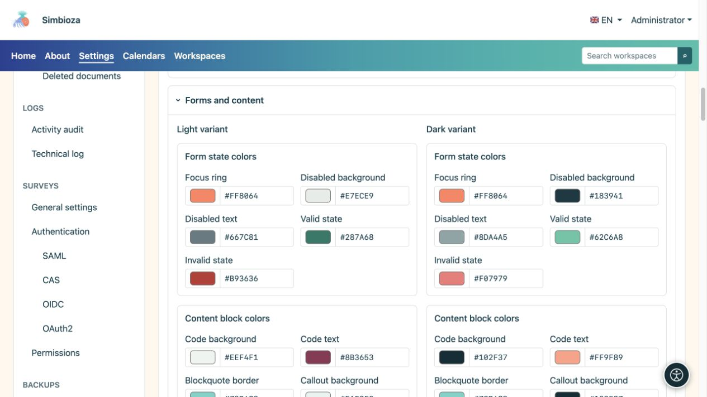
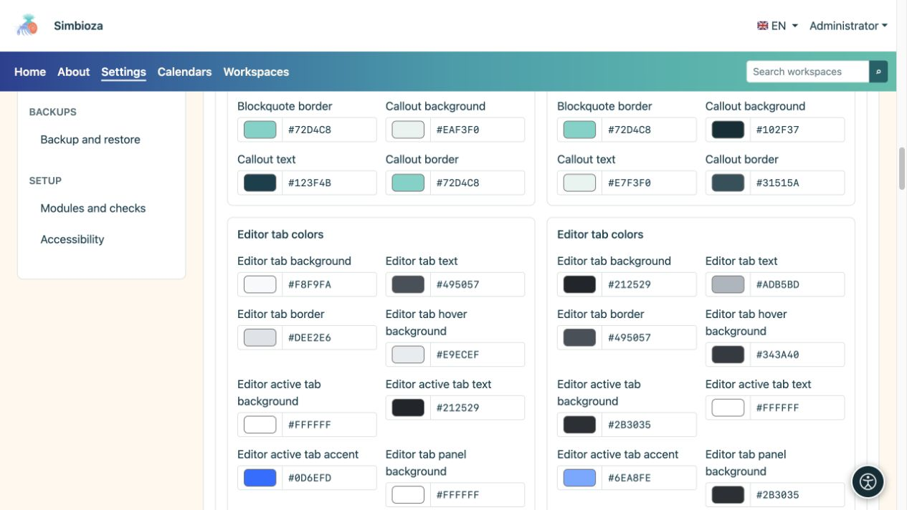

# Elegir colores y comprobar componentes

> Las capturas de pantalla muestran la interfaz en inglés.

[Temas](teme_es.md)

**Objetivo:** mantener el texto, los controles y los mensajes claros en los modos claro y oscuro. No es necesario cambiar todos los campos: utilice el grupo que coincida con lo que desea ajustar.

## cambiar un color

1. Abra la sección correspondiente y marque **Variante clara** o **Variante oscura**.
2. Utilice su selector de color o ingrese el valor HEX ofrecido, como `#276E82`.
3. Inspeccione ese componente y sus estados en la vista previa debajo del editor.
4. Marque la otra variante y seleccione **Guardar tema**.

**Resultado:** el color guardado cambia para ese propósito sin sobrescribir la otra variante. Un color de botón principal no establece el color de todos los botones, tablas y mensajes.

## Colores básicos

| grupo de campo | Se aplica a |
| --- | --- |
| Fondo y texto de la página | Fondo principal y texto del cuerpo. |
| Texto silenciado | Detalles de respaldo, que deben permanecer legibles a pesar del énfasis reducido. |
| Fondo de superficie y texto. | Superficies generales de los componentes. |
| Frontera y enlace | Límites y vínculos de elementos. |

<figure>

<figcaption>Compara el cuerpo y el texto silenciado con sus fondos reales.</figcaption>
</figure>

## Botones y acciones de documentos.

Los colores primarios, secundarios, de éxito, de advertencia, de peligro y de información tienen diferentes propósitos. El texto para cada uno de los seis tipos de botones tiene su propio selector en ambas variantes:

| Modo de color de texto | Efecto |
| --- | --- |
| Automático | Determina el color del texto a partir del fondo del botón elegido. |
| Manual | Habilita su propio color; verifique la legibilidad nuevamente después de cambiar el fondo. |

Las **acciones de documentos** tienen campos separados de fondo, icono/texto, borde, desplazamiento y estado activo. Se trata de controles como iconos al lado de un documento; no es necesario que tengan los mismos colores que un botón principal grande.

<figure>

<figcaption>Verifique los botones rellenos y delineados, incluidos sus estados normal y de desplazamiento.</figcaption>
</figure>

<figure>

<figcaption>Los controles de documentos tienen configuraciones de color independientes de los botones de acción grandes.</figcaption>
</figure>

## Tarjetas y tablas

- **Las tarjetas** tienen colores de fondo, texto, borde, acento y sombra.
- **El título, el contenido y las tarjetas laterales** tienen colores de fondo, texto, bordes y acentos separados.
- **Las tablas** tienen fondo/texto de encabezado, fondo/texto de fila normal, fondo de fila alternativa y bordes.

La forma, la visibilidad de las sombras y la posición del acento se establecen en [Contenido y tarjetas](teme-sadrzaj-kartice_es.md). La elección de un color de sombra no habilita por sí sola una sombra deshabilitada.

<figure>

<figcaption>Las superficies separadas permiten un título más silencioso, contenido distinto y tarjetas laterales legibles.</figcaption>
</figure>

## Mensajes, etiquetas y estados.

Los mensajes primarios, de éxito, de advertencia, de peligro y de información tienen colores de fondo, texto y bordes. Las etiquetas **Insignia** y **etiqueta** tienen su propio fondo y texto. El éxito y la advertencia también deben ser comprensibles a través de texto o íconos en lugar de solo colores.

<figure>

<figcaption>Elija colores que sean distintos pero legibles para cada tipo de mensaje.</figcaption>
</figure>

## Formularios y bloques de contenido.

| Grupo | Que comprobar |
| --- | --- |
| Enfoque, campos deshabilitados, estados válidos/inválidos | El foco del teclado permanece visible; Los mensajes de texto y de error deshabilitados siguen siendo legibles. |
| Código, cotización y rótulo | Fondo/texto del código, borde de cita y fondo/texto/borde de llamada. |
| Pestañas de contenido del editor | Estados predeterminados, de desplazamiento y activos, borde, acento y fondo/texto del panel. |
| acordeón editor | Separe los fondos/texto del encabezado y del cuerpo. Abra y cierra el ejemplo. |

<figure>

<figcaption>La legibilidad también cubre campos deshabilitados, errores y foco del teclado.</figcaption>
</figure>

<figure>

<figcaption>Las pestañas de contenido y la navegación principal no necesariamente utilizan el mismo grupo de colores.</figcaption>
</figure>

## control final

La vista previa incluye botones, tarjetas, una tabla, mensajes, pestañas, acordeón, código, un cuadro de diálogo, un menú desplegable y notificaciones breves. Compare los lados claros y oscuros, luego abra páginas reales con un formulario y contenido más extenso. Cuando un texto sea difícil de leer, ajuste su color o superficie correspondiente en lugar de cambiar todo el elemento principal por una descripción.
