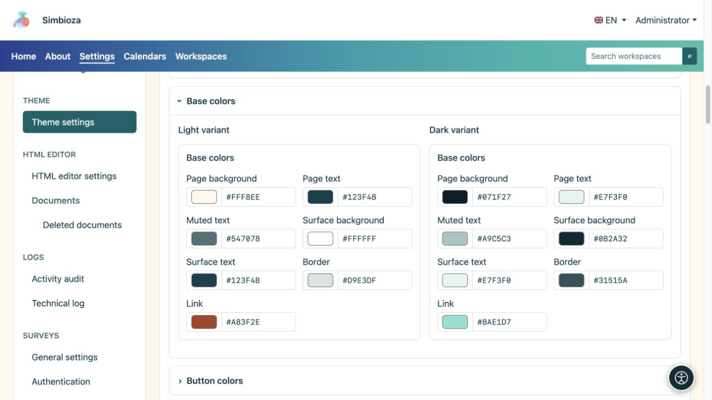
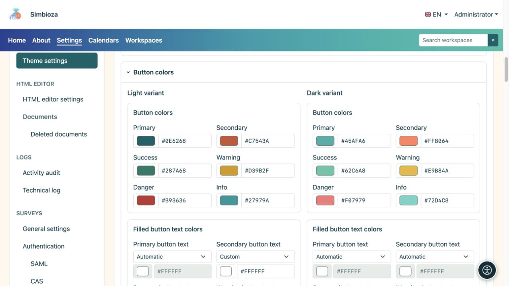
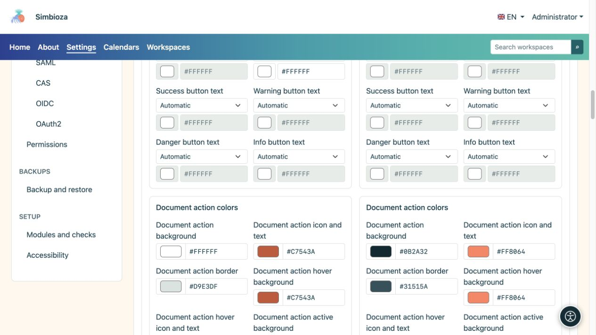
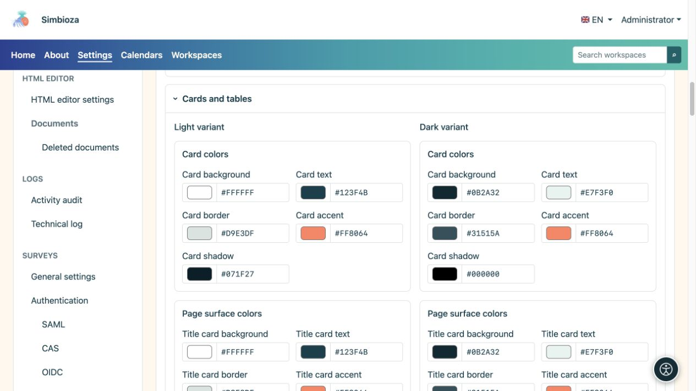
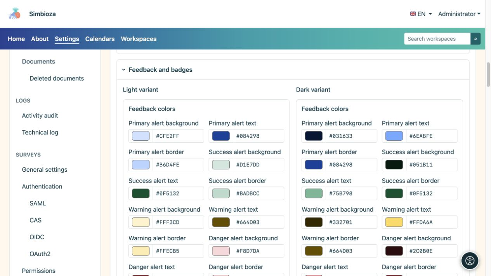
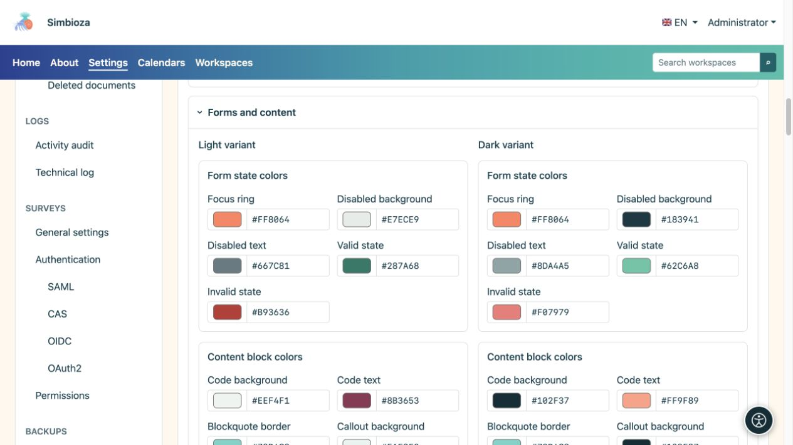
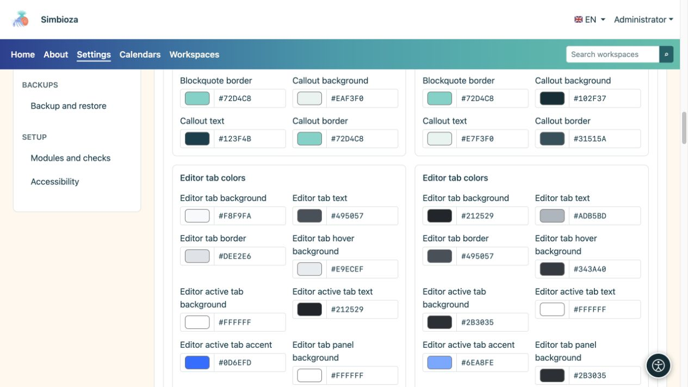

# Régler les couleurs et vérifier les composants

> Les captures d’écran présentent l’interface en anglais.

[Thèmes](teme_fr.md)

**Objectif :** gardez le texte, les commandes et les messages clairs en modes clair et sombre. Vous n'avez pas besoin de modifier tous les champs : utilisez le groupe correspondant à ce que vous souhaitez ajuster.

## Changer une couleur

1. Ouvrez la section correspondante et cochez **Variante claire** ou **Variante sombre**.
2. Utilisez son sélecteur de couleurs ou entrez la valeur HEX proposée, telle que `#276E82`.
3. Inspectez ce composant et ses états dans l'aperçu sous l'éditeur.
4. Vérifiez l'autre variante et sélectionnez **Enregistrer le thème**.

**Résultat :** la couleur enregistrée change à cet effet sans écraser l'autre variante. Une couleur de bouton principal ne définit pas la couleur de chaque bouton, tableau et message.

## Couleurs de base

| Groupe de terrain | S'applique à |
| --- | --- |
| Fond de page et texte | Contexte principal et corps du texte. |
| Texte masqué | Détails justificatifs, qui doivent rester lisibles malgré une emphase réduite. |
| Fond et texte de surface | Surfaces générales des composants. |
| Bordure et lien | Limites et liens des éléments. |

<figure>

<figcaption>Vérifiez le corps et le texte masqué par rapport à leur arrière-plan réel.</figcaption>
</figure>

## Boutons et actions de document

Les couleurs primaires, secondaires, de réussite, d’avertissement, de danger et d’information servent à des fins différentes. Le texte de chacun des six types de boutons possède son propre sélecteur dans les deux variantes :

| Mode couleur du texte | Effet |
| --- | --- |
| Automatique | Détermine la couleur du texte à partir de l'arrière-plan du bouton choisi. |
| Manuel | Permet votre propre couleur ; vérifiez à nouveau la lisibilité après avoir modifié l'arrière-plan. |

**Les actions sur les documents** ont des champs d'arrière-plan, d'icône/texte, de bordure, de survol et d'état actif distincts. Il s'agit de contrôles tels que des icônes à côté d'un document ; ils n'ont pas besoin d'avoir les mêmes couleurs qu'un gros bouton principal.

<figure>

<figcaption>Vérifiez les boutons remplis et soulignés, y compris leurs états ordinaires et de survol.</figcaption>
</figure>

<figure>

<figcaption>Les contrôles de document ont des paramètres de couleur distincts des grands boutons d'action.</figcaption>
</figure>

## Cartes et tableaux

- **Les cartes** ont des couleurs d'arrière-plan, de texte, de bordure, d'accent et d'ombre.
- **Le titre, le contenu et les cartes latérales** ont des couleurs d'arrière-plan, de texte, de bordure et d'accent distinctes.
- **Les tableaux** ont un arrière-plan/texte d'en-tête, un arrière-plan/texte de ligne standard, un arrière-plan et des bordures de ligne alternative.

La forme, la visibilité des ombres et la position de l'accent sont définies sous [Contenu et cartes](teme-sadrzaj-kartice_fr.md). Le choix d'une couleur d'ombre n'active pas en soi une ombre désactivée.

<figure>

<figcaption>Des surfaces distinctes permettent un titre plus discret, un contenu bien séparé et des cartes latérales lisibles.</figcaption>
</figure>

## Messages, étiquettes et statuts

Les messages primaires, de réussite, d'avertissement, de danger et d'information ont des couleurs d'arrière-plan, de texte et de bordure. Les étiquettes **Badge** et **tag** ont leur propre arrière-plan et leur propre texte. Le succès et l’avertissement doivent également être compréhensibles par le biais du texte ou des icônes plutôt que par la seule couleur.

<figure>

<figcaption>Choisissez des couleurs distinctes mais lisibles pour chaque type de message.</figcaption>
</figure>

## Formulaires et blocs de contenu

| Groupe | Que vérifier |
| --- | --- |
| Focus, champs désactivés, états valides/invalides | Le focus du clavier reste visible ; le texte désactivé et les messages d’erreur restent lisibles. |
| Code, devis et légende | Arrière-plan/texte du code, bordure de citation et arrière-plan/texte/bordure de légende. |
| Onglets de contenu de l'éditeur | États par défaut, de survol et actifs, bordure, accent et arrière-plan/texte du panneau. |
| Accordéon éditeur | Séparez les arrière-plans/texte du titre et du corps. Ouvrez et fermez l'exemple. |

<figure>

<figcaption>La lisibilité couvre également les champs désactivés, les erreurs et le focus clavier.</figcaption>
</figure>

<figure>

<figcaption>Les onglets de contenu et la navigation principale n'utilisent pas nécessairement le même groupe de couleurs.</figcaption>
</figure>

## Vérification finale

L'aperçu comprend des boutons, des cartes, un tableau, des messages, des onglets, un accordéon, du code, une boîte de dialogue, une liste déroulante et de courtes notifications. Comparez les côtés clairs et obscurs, puis ouvrez de vraies pages avec une forme et un contenu plus long. Lorsqu'un texte est difficile à lire, ajustez sa couleur ou la surface correspondante plutôt que de changer le bandeau principal entier pour une seule description.
