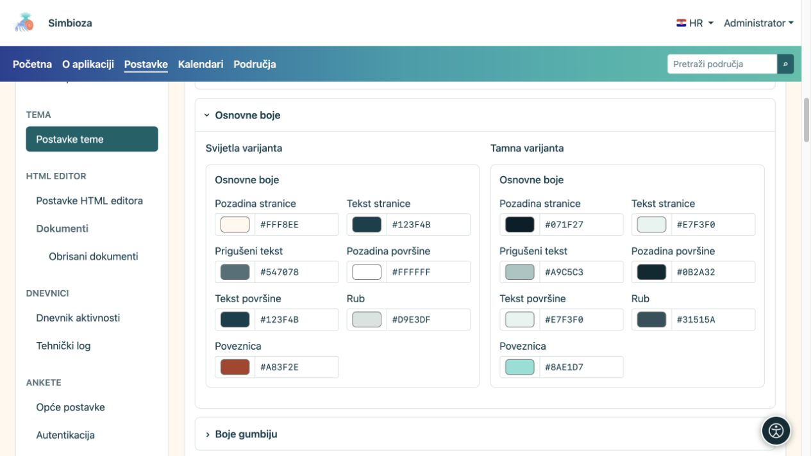
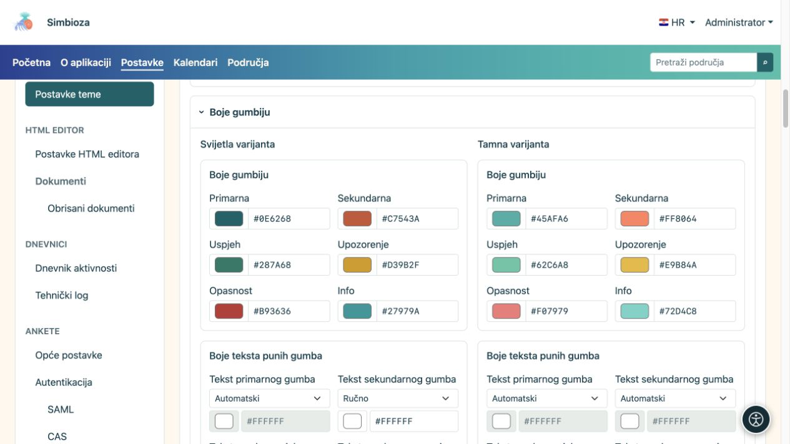
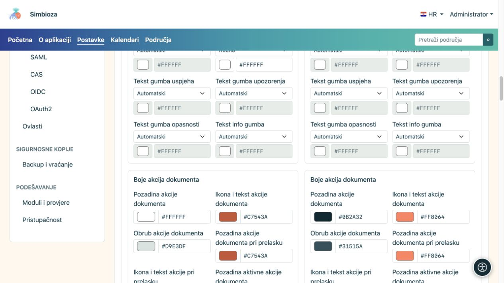
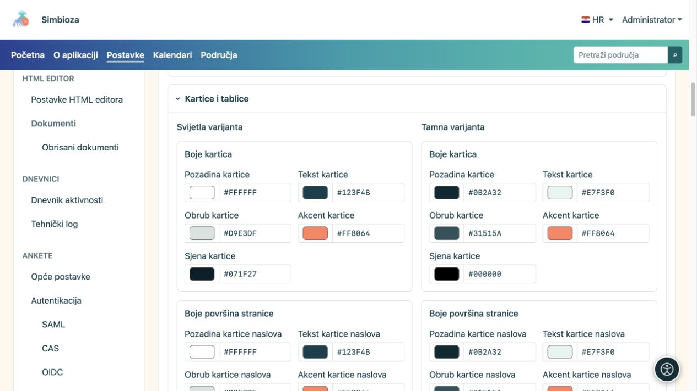
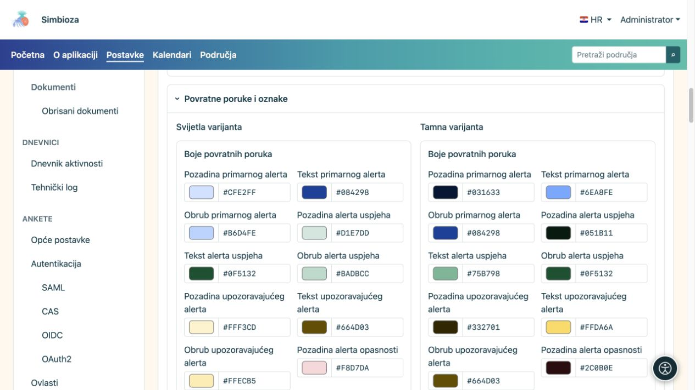
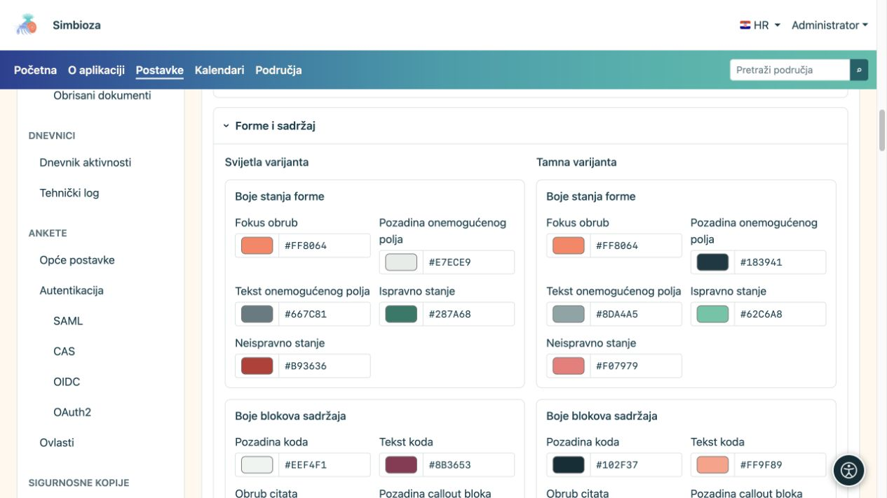
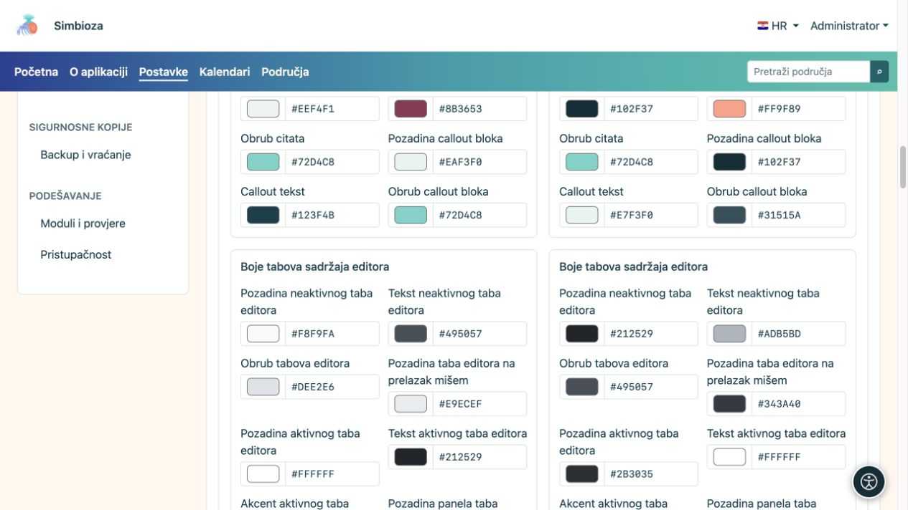

# Podesite boje i provjerite elemente

[Teme](teme_hr.md)

**Cilj:** tekst, kontrole i poruke ostaju jasni u svijetloj i tamnoj varijanti. Ne morate promijeniti svako polje: odaberite skupinu koja odgovara onomu što želite urediti.

## Kako promijeniti jednu boju

1. Otvorite odgovarajuću cjelinu i provjerite **Svijetla varijanta** ili **Tamna varijanta**.
2. Odaberite boju u biraču ili upišite ponuđenu HEX vrijednost, primjerice `#276E82`.
3. Pogledajte taj element i njegova stanja u pregledu ispod editora.
4. Provjerite i drugu varijantu pa odaberite **Spremi temu**.

**Rezultat:** mijenja se spremljena boja te namjene, bez prepisivanja druge varijante. Sama boja primarnog gumba ne određuje sve gumbe, tablice i poruke.

## Osnovne boje

| Skupina polja | Što boji |
| --- | --- |
| Pozadina i tekst stranice | Osnovnu podlogu i glavni tekst. |
| Prigušeni tekst | Pomoćne podatke; mora ostati čitljiv, iako je manje istaknut. |
| Pozadina i tekst površine | Opće površine komponenti. |
| Rub i poveznica | Granice elemenata i poveznice. |

<figure>

<figcaption>Osnovni tekst i prigušeni tekst provjerite na stvarnoj podlozi.</figcaption>
</figure>

## Gumbi i akcije dokumenta

Primarna, sekundarna, uspjeh, upozorenje, opasnost i info boje imaju različite namjene. Za tekst svake od šest vrsta gumba postoji zaseban izbor u obje varijante:

| Način boje teksta | Učinak |
| --- | --- |
| Automatski | Tekst se određuje prema odabranoj podlozi gumba. |
| Ručno | Uključuje vlastiti odabir boje; provjerite čitljivost i nakon promjene podloge. |

**Akcije dokumenta** imaju vlastita polja za pozadinu, ikonu/tekst, rub, prelazak pokazivačem i aktivno stanje. To su, primjerice, ikone uz dokument; nije nužno da imaju iste boje kao veliki primarni gumb.

<figure>

<figcaption>Provjerite i pune i obrubne gumbe, u uobičajenom stanju i pri prelasku pokazivačem.</figcaption>
</figure>

<figure>

<figcaption>Kontrole dokumenta imaju zasebne boje od velikih akcijskih gumba.</figcaption>
</figure>

## Kartice i tablice

- **Kartice** imaju podlogu, tekst, rub, akcent i boju sjene.
- **Kartica naslova, sadržaja i bočna kartica** imaju zasebne boje podloge, teksta, rubova i akcenata.
- **Tablice** imaju zaglavlje i njegov tekst, običan redak i njegov tekst, alternativni redak i rubove.

Oblik, uključivanje sjene i mjesto akcenta podešavaju se kroz [Sadržaj i kartice](teme-sadrzaj-kartice_hr.md). Boja sjene sama po sebi ne uključuje isključenu sjenu.

<figure>

<figcaption>Zasebne površine dopuštaju mirniji naslov, drugačiji sadržaj i čitljive bočne kartice.</figcaption>
</figure>

## Poruke, oznake i statusi

Poruke primarne vrste, uspjeha, upozorenja, opasnosti i informacije imaju podlogu, tekst i rub. Oznake **badge** i **tag** imaju vlastitu podlogu i tekst. Uspjeh i upozorenje trebaju ostati razumljivi i po tekstu/ikoni, ne samo po boji.

<figure>

<figcaption>Odaberite dovoljno različite, ali čitljive boje svih vrsta poruka.</figcaption>
</figure>

## Obrasci i blokovi sadržaja

| Skupina | Što provjeriti |
| --- | --- |
| Fokus, onemogućeno polje, ispravno/neispravno stanje | Fokus mora biti vidljiv tipkovnicom; tekst neaktivnog polja i poruka pogreške ostaju čitljivi. |
| Kod, citat i istaknuti blok | Podlogu/tekst koda te rub citata i podlogu, tekst i rub istaknutoga bloka. |
| Sadržajni tabovi editora | Neaktivno i aktivno stanje te prelazak pokazivačem, obrub, akcent i podlogu/tekst panela. |
| Accordion editora | Naslov i sadržaj imaju zasebne podloge i tekst. Otvorite i zatvorite primjer. |

<figure>

<figcaption>Čitljivost obuhvaća i neaktivna polja, pogreške i fokus.</figcaption>
</figure>

<figure>

<figcaption>Tabovi u sadržaju i glavni izbornik ne koriste nužno istu grupu boja.</figcaption>
</figure>

## Završna provjera

Pregled sadrži gumbe, kartice, tablicu, poruke, tabove, accordion, kod, dijalog, padajući izbornik i kratke obavijesti. Usporedite svijetlu i tamnu stranu te otvorite stvarnu stranicu s obrascem i dugim sadržajem. Ako je teško čitati jedan tekst, promijenite njegovu boju ili odgovarajuću podlogu; ne mijenjajte cijeli hero samo zbog jednog opisa.
