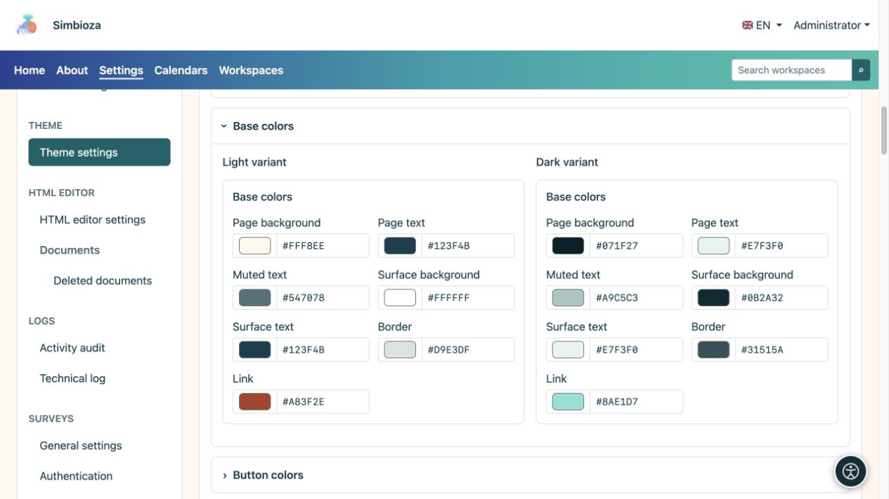
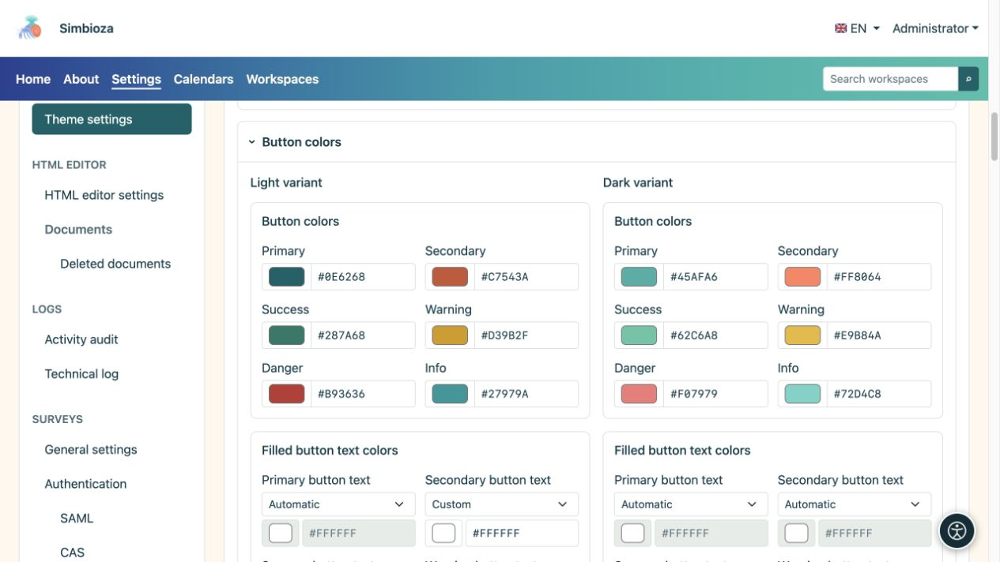
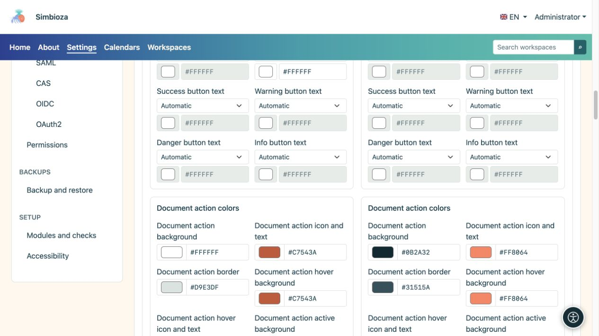
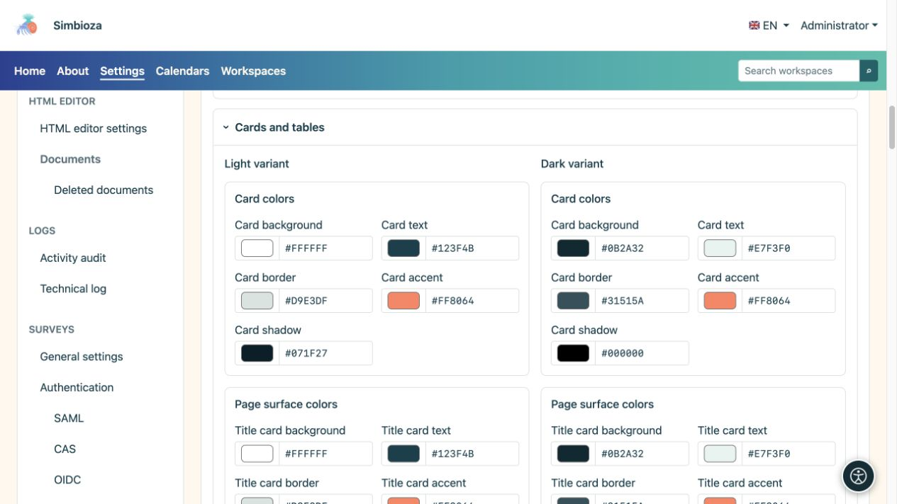
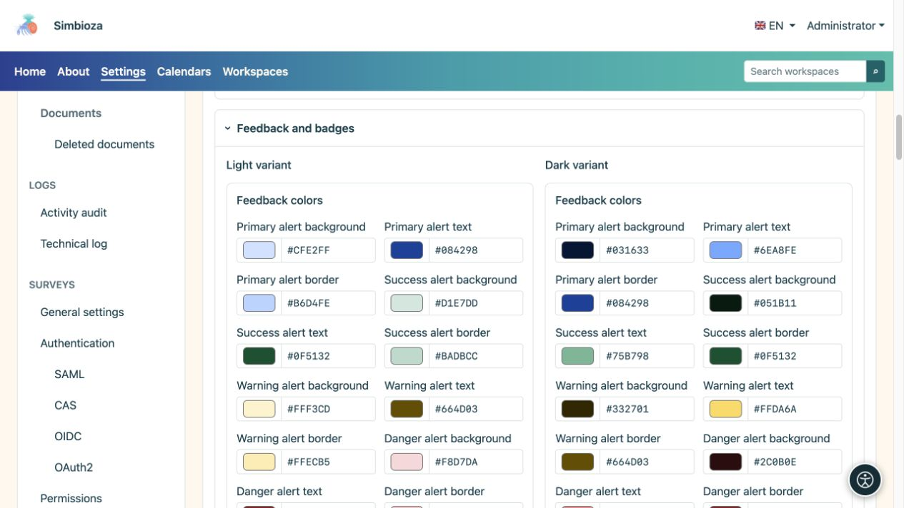
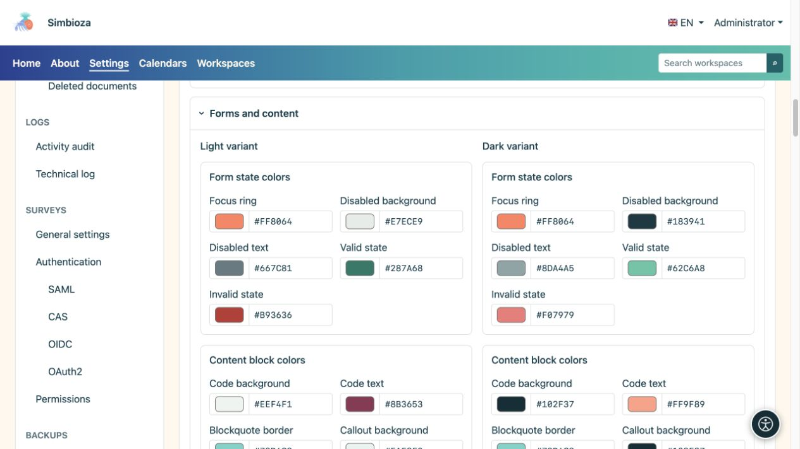
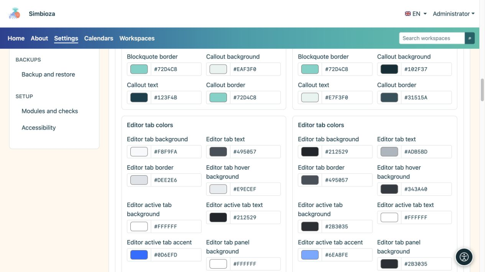

# Imposta i colori e controlla i componenti

> Le schermate mostrano l’interfaccia in inglese.

[Temi](teme_it.md)

**Obiettivo:** mantenere testo, controlli e messaggi chiari nelle modalità chiaro e scuro. Non è necessario modificare tutti i campi: utilizza il gruppo corrispondente a ciò che desideri modificare.

## Cambia un colore

1. Apri la sezione pertinente e seleziona **Variante chiara** o **Variante scura**.
2. Utilizza il selettore colori o inserisci il valore HEX offerto, ad esempio `#276E82`.
3. Esamina il componente e i suoi stati nell'anteprima sotto l'editor.
4. Controlla l'altra variante e seleziona **Salva tema**.

**Risultato:** il colore salvato cambia a tale scopo senza sovrascrivere l'altra variante. Il colore del pulsante principale non imposta il colore di ogni pulsante, tabella e messaggio.

## Colori di base

| Gruppo di campi | Si applica a |
| --- | --- |
| Sfondo e testo della pagina | Sfondo principale e corpo del testo. |
| Testo secondario | Dettagli di supporto, che devono rimanere leggibili nonostante la ridotta enfasi. |
| Sfondo e testo della superficie | Superfici generali dei componenti. |
| Bordo e collegamento | Bordi degli elementi e collegamenti. |

<figure>

<figcaption>Controlla il testo principale e quello secondario sui rispettivi sfondi reali.</figcaption>
</figure>

## Pulsanti e azioni sui documenti

I colori primario, secondario, di successo, di avvertimento, di pericolo e di informazioni hanno scopi diversi. Il testo per ciascuno dei sei tipi di pulsanti ha il proprio selettore in entrambe le varianti:

| Modalità colore testo | Effetto |
| --- | --- |
| Automatico | Determina il colore del testo dallo sfondo del pulsante scelto. |
| Manuale | Abilita il tuo colore; controlla nuovamente la leggibilità dopo aver cambiato lo sfondo. |

**Le azioni del documento** hanno campi separati per sfondo, icona/testo, bordo, passaggio del mouse e stato attivo. Si tratta di controlli come icone accanto a un documento; non è necessario che abbiano gli stessi colori di un pulsante principale grande.

<figure>

<figcaption>Controlla i pulsanti pieni e quelli con il solo bordo, inclusi gli stati normali e al passaggio del mouse.</figcaption>
</figure>

<figure>

<figcaption>I controlli del documento hanno impostazioni di colore separate dai pulsanti di azione di grandi dimensioni.</figcaption>
</figure>

## Riquadri e tabelle

- **Le schede** hanno colori di sfondo, testo, bordo, accenti e ombre.
- **Titolo, contenuto e schede laterali** hanno colori di sfondo, testo, bordo e accenti separati.
- Le **tabelle** hanno sfondo/testo dell'intestazione, sfondo/testo della riga regolare, sfondo e bordi della riga alternata.

Forma, visibilità dell'ombra e posizione dell'accento sono impostati in [Contenuto e schede](teme-sadrzaj-kartice_it.md). La scelta di un colore d'ombra non abilita di per sé un'ombra disabilitata.

<figure>

<figcaption>Le superfici separate consentono un titolo più sobrio, contenuti distinti e riquadri laterali leggibili.</figcaption>
</figure>

## Messaggi, etichette e stati

I messaggi principali, di successo, di avvertenza, di pericolo e di informazione hanno colori di sfondo, testo e bordi. Le etichette **badge** e **tag** hanno il proprio sfondo e testo. Il successo e l'avvertimento dovrebbero essere comprensibili anche attraverso il testo o le icone anziché solo attraverso il colore.

<figure>

<figcaption>Scegli colori distinti ma leggibili per ciascun tipo di messaggio.</figcaption>
</figure>

## Moduli e blocchi di contenuto

| Gruppo | Cosa controllare |
| --- | --- |
| Focus, campi disabilitati, stati validi/non validi | Il focus della tastiera rimane visibile; il testo disabilitato e i messaggi di errore rimangono leggibili. |
| Codice, citazioni e richiami | Sfondo/testo del codice, bordo delle citazioni e sfondo/testo/bordo dei richiami. |
| Schede dei contenuti dell'editor | Stati predefiniti, al passaggio del mouse e attivi, bordo, accento e sfondo/testo del pannello. |
| Pannelli espandibili dell'editor | Intestazione e sfondi/testo del corpo separati. Apri e chiudi l'esempio. |

<figure>

<figcaption>La leggibilità copre anche i campi disabilitati, gli errori e il focus della tastiera.</figcaption>
</figure>

<figure>

<figcaption>Le schede dei contenuti e la navigazione principale non utilizzano necessariamente lo stesso gruppo di colori.</figcaption>
</figure>

## Controllo finale

L'anteprima include pulsanti, riquadri, una tabella, messaggi, schede, pannelli espandibili, codice, una finestra di dialogo, un menu a discesa e brevi notifiche. Confronta il lato chiaro e quello scuro, poi apri pagine reali con un modulo e contenuti più lunghi. Se un testo è difficile da leggere, cambia il suo colore o la superficie corrispondente anziché modificare l'intera sezione principale per una sola descrizione.
