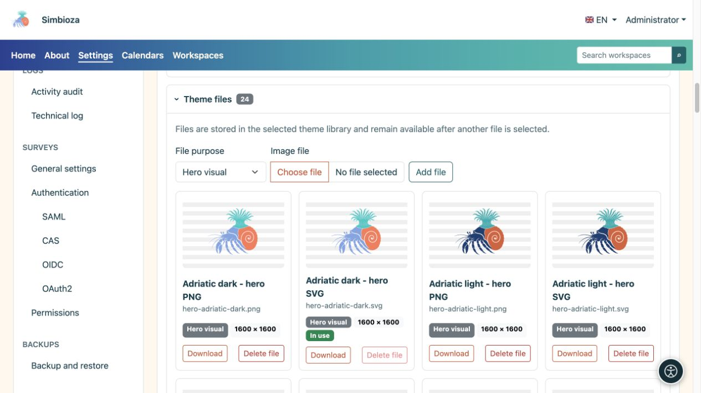
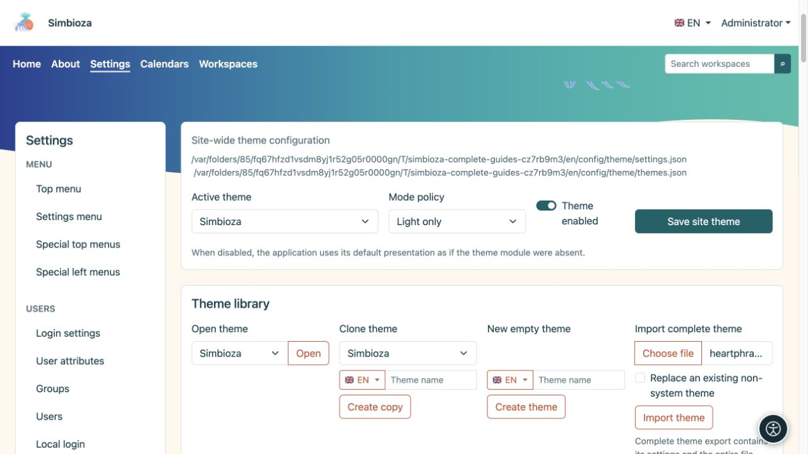

# Designdateien, Import und Export

> Die Bildschirmaufnahmen zeigen die englische Benutzeroberfläche.

[Designs](teme_de.md)

**Ziel:** Fügen Sie Ihre eigene Marke oder Illustration hinzu, bewahren Sie ein Design oder übertragen Sie es auf eine andere Installation. Es gibt zwei verschiedene ZIP-Exporte – wählen Sie entsprechend Ihrem Ziel.

## Fügen Sie der Designbibliothek ein Bild hinzu

1. Erweitern Sie **Designdateien** im geöffneten Design.
2. Wählen Sie eine **Bilddatei** und ihre Rolle.
3. Laden Sie es hoch. Unterstützte Bilder sind PNG, JPEG, GIF, WebP und sicheres SVG; eine einzelne Datei darf maximal 25 MiB groß sein.
4. Kehren Sie zu Header oder Hero zurück, wählen Sie die neue Datei für die entsprechende Variante aus und speichern Sie das Design.

| Dateirolle | Angeboten in |
| --- | --- |
| Hero-Bild | Auswahl des Hero-Bildes. |
| Anwendungssymbol | Passende Header-Marken-/Logo-Selektoren. |
| Logo | Auswahl des Header-Logos. |
| Andere | Wird in der Bibliothek aufbewahrt, ohne automatisch zum Hero-Bereich oder Logo zu werden. |

**Ergebnis:** Die Datei verbleibt in der Bibliothek dieses Designs. Das alleinige Hochladen ersetzt nicht die aktuell ausgewählte Markierung oder das aktuell ausgewählte Bild. Eine neue Datei löscht eine frühere nicht, Sie können also zu ihr zurückkehren. Die Listen spiegeln die verfügbaren Dateien wider und variieren daher je nach Design und Installation.

<figure>

<figcaption>Wählen Sie das hochgeladene Bild separat in Hero oder Header aus.</figcaption>
</figure>

Eine mit **In Verwendung** gekennzeichnete Datei kann nicht gelöscht werden, solange das Design darauf verweist. Wählen und speichern Sie zunächst einen Ersatz und entfernen Sie dann die unerwünschte Datei. Sie können separate helle und dunkle Versionen hochladen.

## Welchen Export benötigen Sie?

| Aktion | Inhalt | Zweck |
| --- | --- | --- |
| **Designpaket exportieren** | Demonstration HTML-Seiten, lokales CSS/JavaScript und erforderliche Bilder. | Überprüfen Sie das Erscheinungsbild außerhalb der Anwendung. Extrahieren Sie ZIP und öffnen Sie `index.html`. |
| **Komplettes Design exportieren** | Die Einstellungen eines Designs, das Prüfsummenmanifest und die gesamte Bibliothek, einschließlich derzeit nicht verwendeter Dateien. | Übertragen Sie es über **Komplettes Design importieren** oder behalten Sie eine bearbeitbare Kopie. |
| Design-Komponenten- oder Site-Backup | Das Design-Subsystem, alle gespeicherten Designs und Dateien im Backup-Bereich. | Administratorwiederherstellung; siehe [Backups](admin-sigurnosne-kopije_de.md). |

Ein Vorschaupaket exportiert nicht Ihre tatsächlichen Seiten, Benutzer oder Umfragen. Der vollständige Export eines einzelnen Designs ist keine vollständige Simbioza-Sicherung. Das private Design eines Arbeitsbereichs ist auch Teil seiner [Arbeitsbereichssicherung](podrucja-izvoz-backup_de.md).

## Importieren Sie ein gespeichertes Design

1. Suchen Sie in der Design-Bibliothek nach **Komplettes Design importieren**.
2. Wählen Sie ein ZIP, das mit **Komplettes Design exportieren** erstellt wurde.
3. Für eine separate Kopie lassen Sie **Vorhandenes Nicht-System-Design ersetzen** deaktiviert. Wenn die Identität bereits vorhanden ist, wählt der Import eine separate, nicht verwendete Identität.
4. Aktivieren Sie die Ersetzung nur, wenn Sie beabsichtigen, das vorhandene, nicht zum System gehörende Design zu ersetzen. Dieser Pfad überschreibt keine Systemthemen.
5. Wählen Sie **Design importieren** und prüfen Sie dessen Namen, Varianten und Dateien.
6. Um es global anzuwenden, wählen Sie das importierte Design als **Aktives Design** aus und speichern Sie die Site-Einstellungen.

**Ergebnis:** Das Design kann in dieser Installation bearbeitet werden. Falsche oder beschädigte Archive melden einen Fehler; Durch das Umbenennen eines Demonstrationspakets wird daraus kein vollständiger Export.

Wenn Sie ein gebündeltes Nicht-System-Design entfernen, sollte es bei normalen Upgrades nicht erneut hinzugefügt werden. Importieren Sie das vorbereitete ZIP, wenn Sie es zurückhaben möchten. Führen Sie vor dem Ersetzen Ihres benutzerdefinierten Designs einen aktuellen vollständigen Export durch.

<figure>

<figcaption>Wählen Sie einen vollständigen Export ZIP; Lassen Sie die Option „Ersetzen“ deaktiviert, wenn Sie eine separate Kopie wünschen.</figcaption>
</figure>
