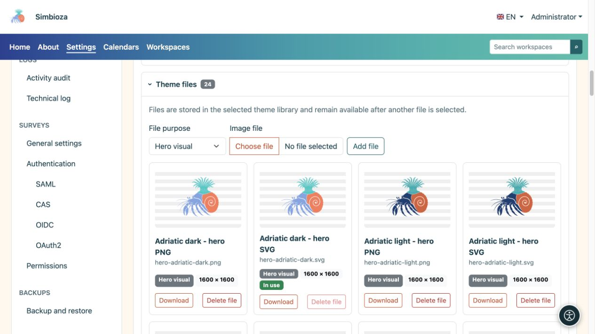
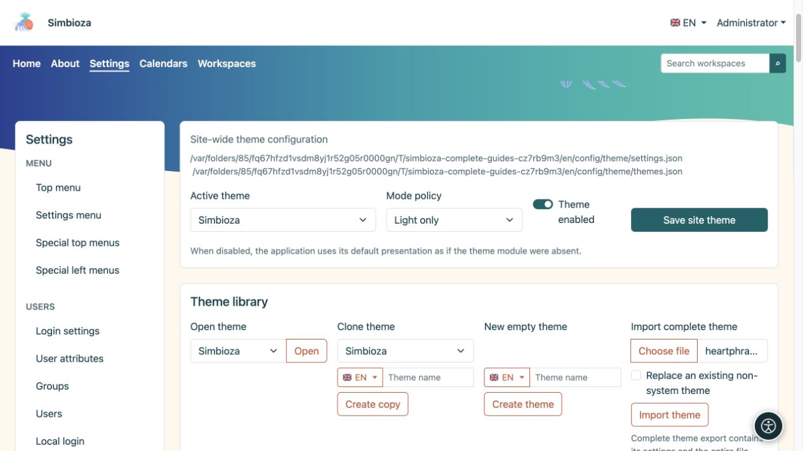

# Theme files, import and export

[Themes](teme_en.md)

**Goal:** add your own mark or illustration, preserve a theme or transfer it to another installation. There are two different ZIP exports — choose according to your goal.

## Add an image to the theme library

1. Expand **Theme files** in the open theme.
2. Choose an **Image file** and its role.
3. Upload it. Supported images are PNG, JPEG, GIF, WebP and safe SVG; an individual file may be at most 25 MiB.
4. Return to Header or Hero, select the new file for the relevant variant and save the theme.

| File role | Offered in |
| --- | --- |
| Hero visual | Hero image selection. |
| Application icon | Appropriate header mark/logo selectors. |
| Logo | Header logo selection. |
| Other | Retained in the library without automatically becoming a hero or logo. |

**Result:** the file remains in that theme's library. Uploading alone does not replace the currently selected mark or image. A new file does not delete an earlier one, so you may return to it. Lists reflect available files and therefore vary across themes and installations.

<figure>

<figcaption>Select the uploaded image separately in Hero or Header.</figcaption>
</figure>

A file marked **In use** cannot be deleted while the theme references it. Choose and save a replacement first, then remove the unwanted file. You may upload separate light and dark versions.

## Which export do you need?

| Action | Contents | Purpose |
| --- | --- | --- |
| **Export theme package** | Demonstration HTML pages, local CSS/JavaScript and required images. | Inspect appearance outside the application; extract the ZIP and open `index.html`. |
| **Export complete theme** | One theme's settings, checksum manifest and entire library, including currently unused files. | Transfer through **Import complete theme** or retain an editable copy. |
| Theme-component or site backup | The theme subsystem, all saved themes and files within the backup scope. | Administrator recovery; see [Backups](admin-sigurnosne-kopije_en.md). |

A preview package does not export your actual pages, users or surveys. A complete single-theme export is not a full Simbioza backup. A workspace's private theme is also part of its [workspace backup](podrucja-izvoz-backup_en.md).

## Import a saved theme

1. Find **Import complete theme** in Theme library.
2. Choose a ZIP created by **Export complete theme**.
3. For a separate copy, leave **Replace an existing non-system theme** off. If its identity already exists, import chooses a separate unused identity.
4. Enable replacement only when you intend to replace the existing non-system theme. This path does not overwrite system themes.
5. Select **Import theme** and inspect its name, both variants and files.
6. To apply it globally, select the imported theme as **Active theme** and save site settings.

**Result:** the theme is editable in this installation. Incorrect or damaged archives report an error; renaming a demonstration package does not turn it into a complete export.

If you remove a bundled non-system theme, ordinary upgrades should not add it again. Import its prepared ZIP when you want it back. Before replacing your customised theme, make a current complete export.

<figure>

<figcaption>Choose a complete-export ZIP; leave replacement off when you want a separate copy.</figcaption>
</figure>
