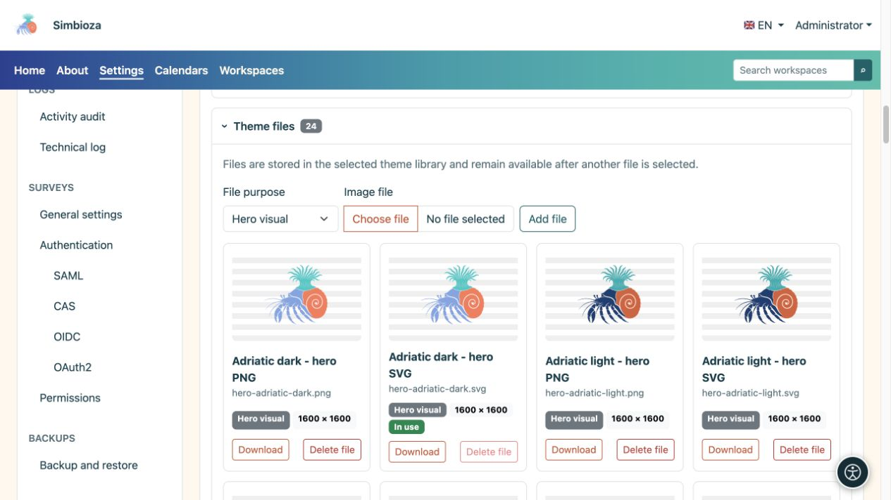
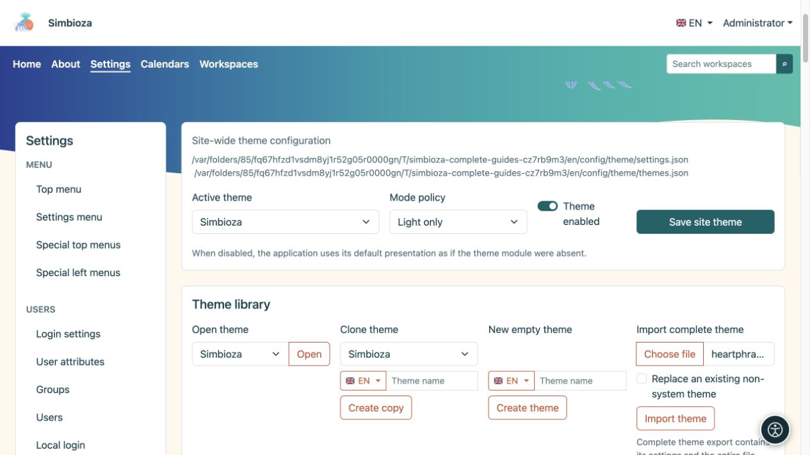

# Archivos del tema, importación y exportación

> Las capturas de pantalla muestran la interfaz en inglés.

[Temas](teme_es.md)

**Objetivo:** añadir su propia marca o ilustración, conservar un tema o transferirlo a otra instalación. Hay dos exportaciones ZIP diferentes: elija según su objetivo.

## Agregar una imagen a la biblioteca de temas

1. Expanda **Archivos de tema** en el tema abierto.
2. Elija un **archivo de imagen** y su función.
3. Súbelo. Las imágenes admitidas son PNG, JPEG, GIF, WebP y SVG seguro; un archivo individual puede tener como máximo 25 MiB.
4. Regrese al encabezado o al elemento principal, seleccione el nuevo archivo para la variante relevante y guarde el tema.

| Rol de archivo | Ofrecido en |
| --- | --- |
| Elemento principal visual | Selección de imagen de elemento principal. |
| Icono de aplicación | Selectores de logotipo/marca de encabezado apropiados. |
| Logo | Selección del logotipo del encabezado. |
| Otro | Se conserva en la biblioteca sin convertirse automáticamente en un elemento principal o logotipo. |

**Resultado:** el archivo permanece en la biblioteca de ese tema. La carga por sí sola no reemplaza la marca o imagen actualmente seleccionada. Un archivo nuevo no elimina uno anterior, por lo que puede volver a él. Las listas reflejan los archivos disponibles y, por lo tanto, varían según los temas e instalaciones.

<figure>

<figcaption>Seleccione la imagen cargada por separado en Hero o Header.</figcaption>
</figure>

Un archivo marcado **En uso** no se puede eliminar mientras el tema haga referencia a él. Primero elija y guarde un reemplazo, luego elimine el archivo no deseado. Puede cargar versiones claras y oscuras por separado.

## ¿Qué exportación necesitas?

| Acción | Contenido | Finalidad |
| --- | --- | --- |
| **Exportar paquete temático** | Páginas de demostración HTML, CSS/JavaScript local e imágenes requeridas. | Inspeccionar la apariencia fuera de la aplicación; extraiga el ZIP y abra `index.html`. |
| **Exportar tema completo** | La configuración de un tema, el manifiesto de suma de comprobación y la biblioteca completa, incluidos los archivos no utilizados actualmente. | Transfiere a través de **Importar tema completo** o conserva una copia editable. |
| Copia de seguridad del sitio o componente del tema | El subsistema de temas, todos los temas y archivos guardados dentro del alcance de la copia de seguridad. | Recuperación del administrador; consulte [Copias de seguridad](admin-sigurnosne-kopije_es.md). |

Un paquete de vista previa no exporta sus páginas, usuarios o encuestas reales. Una exportación completa de un solo tema no es una copia de seguridad Simbioza completa. El tema privado de un espacio de trabajo también forma parte de su [copia de seguridad del espacio de trabajo](podrucja-izvoz-backup_es.md).

## Importar un tema guardado

1. Busque **Importar tema completo** en la biblioteca de temas.
2. Elija un ZIP creado por **Exportar tema completo**.
3. Para obtener una copia separada, deje desactivado **Reemplazar un tema existente que no sea del sistema**. Si su identidad ya existe, la importación elige una identidad separada no utilizada.
4. Habilite el reemplazo solo cuando desee reemplazar el tema existente que no pertenece al sistema. Esta ruta no sobrescribe los temas del sistema.
5. Seleccione **Importar tema** e inspecciona su nombre, tanto variantes como archivos.
6. Para aplicarlo globalmente, seleccione el tema importado como **Tema activo** y guarde la configuración del sitio.

**Resultado:** el tema es editable en esta instalación. Los archivos incorrectos o dañados informan de un error; Cambiar el nombre de un paquete de demostración no lo convierte en una exportación completa.

Si elimina un tema incluido que no pertenece al sistema, las actualizaciones ordinarias no deberían volver a agregarlo. Importe su ZIP preparado cuando lo desee. Antes de reemplazar su tema personalizado, realice una exportación completa actual.

<figure>

<figcaption>Elija una exportación completa ZIP; deje el reemplazo desactivado cuando desee una copia separada.</figcaption>
</figure>
