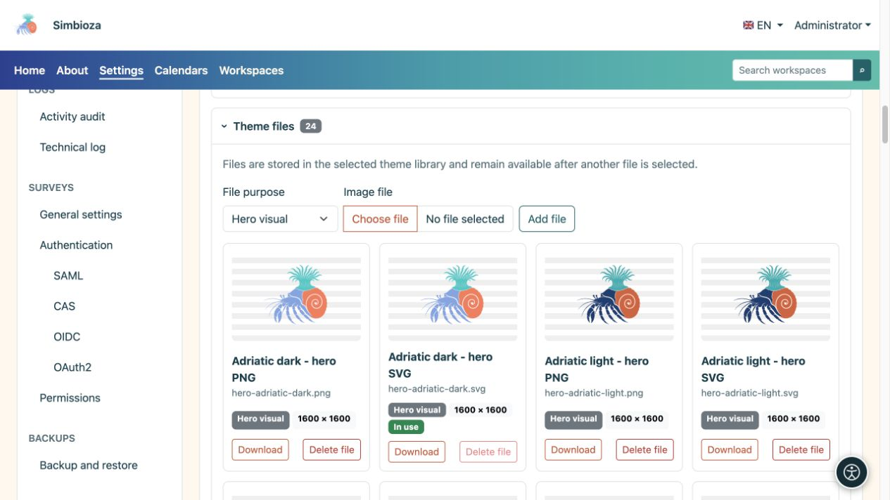
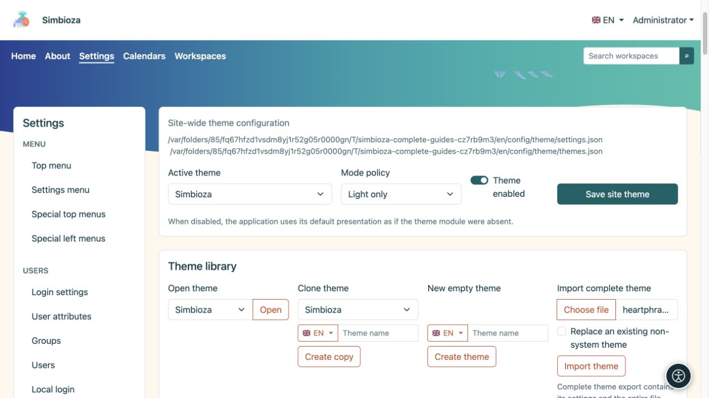

# Fichiers du thème, importation et exportation

> Les captures d’écran présentent l’interface en anglais.

[Thèmes](teme_fr.md)

**Objectif :** ajoutez votre propre marque ou illustration, conservez un thème ou transférez-le vers une autre installation. Il existe deux exportations ZIP différentes : choisissez en fonction de votre objectif.

## Ajouter une image à la bibliothèque de thèmes

1. Développez les **Fichiers de thème** dans le thème ouvert.
2. Choisissez un **fichier image** et son rôle.
3. Téléchargez-le. Les images prises en charge sont PNG, JPEG, GIF, WebP et SVG sécurisé ; un fichier individuel peut peser au maximum 25 Mio.
4. Revenez à l'en-tête ou au bandeau principal, sélectionnez le nouveau fichier pour la variante concernée et enregistrez le thème.

| Rôle du fichier | Offert en |
| --- | --- |
| Visuel du bandeau principal | Sélection d'images de bandeau principal. |
| Icône d'application | Sélecteurs de marque/logo d'en-tête appropriés. |
| Logo | Sélection du logo d'en-tête. |
| Autre | Conservé dans la bibliothèque sans devenir automatiquement un bandeau principal ou un logo. |

**Résultat :** le fichier reste dans la bibliothèque de ce thème. Le téléchargement seul ne remplace pas la marque ou l’image actuellement sélectionnée. Un nouveau fichier ne supprime pas un fichier antérieur, vous pouvez donc y revenir. Les listes reflètent les fichiers disponibles et varient donc selon les thèmes et les installations.

<figure>

<figcaption>Sélectionnez séparément l’image téléversée dans Bandeau principal ou En-tête.</figcaption>
</figure>

Un fichier marqué **En cours d'utilisation** ne peut pas être supprimé tant que le thème y fait référence. Choisissez et enregistrez d'abord un remplacement, puis supprimez le fichier indésirable. Vous pouvez télécharger des versions claires et sombres distinctes.

## De quelle exportation avez-vous besoin ?

| Action | Contenu | But |
| --- | --- | --- |
| **Package de thèmes d'exportation** | Démonstration HTML pages, CSS/JavaScript local et images requises. | Inspecter l'apparence à l'extérieur de l'application ; extrayez le ZIP et ouvrez `index.html`. |
| **Exporter le thème complet** | Les paramètres d'un thème, le manifeste de somme de contrôle et la bibliothèque entière, y compris les fichiers actuellement inutilisés. | Transférez via **Importer le thème complet** ou conservez une copie modifiable. |
| Sauvegarde d'un composant de thème ou d'un site | Le sous-système de thème, tous les thèmes et fichiers enregistrés dans la portée de sauvegarde. | Récupération de l'administrateur ; voir [Sauvegardes](admin-sigurnosne-kopije_fr.md). |

Un package de prévisualisation n’exporte pas vos pages, utilisateurs ou sondages réels. Une exportation complète d’un seul thème n’est pas une sauvegarde complète Simbioza. Le thème privé d'un espace de travail fait également partie de sa [sauvegarde de l'espace de travail](podrucja-izvoz-backup_fr.md).

## Importer un thème enregistré

1. Recherchez **Importer le thème complet** dans la bibliothèque de thèmes.
2. Choisissez un ZIP créé par **Exporter le thème complet**.
3. Pour une copie séparée, laissez **Remplacer un thème non système existant** désactivé. Si son identité existe déjà, l'importation choisit une identité distincte inutilisée.
4. Activez le remplacement uniquement lorsque vous avez l'intention de remplacer le thème non système existant. Ce chemin n'écrase pas les thèmes système.
5. Sélectionnez **Importer le thème** et inspectez son nom, ses variantes et ses fichiers.
6. Pour l'appliquer globalement, sélectionnez le thème importé comme **Thème actif** et enregistrez les paramètres du site.

**Résultat :** le thème est modifiable dans cette installation. Les archives incorrectes ou endommagées signalent une erreur ; Renommer un package de démonstration ne le transforme pas en une exportation complète.

Si vous supprimez un thème non système fourni, les mises à niveau ordinaires ne devraient pas l'ajouter à nouveau. Importez son ZIP préparé lorsque vous souhaitez le récupérer. Avant de remplacer votre thème personnalisé, effectuez un export complet en cours.

<figure>

<figcaption>Choisissez un ZIP d'exportation complète ; laissez le remplacement désactivé lorsque vous souhaitez une copie séparée.</figcaption>
</figure>
