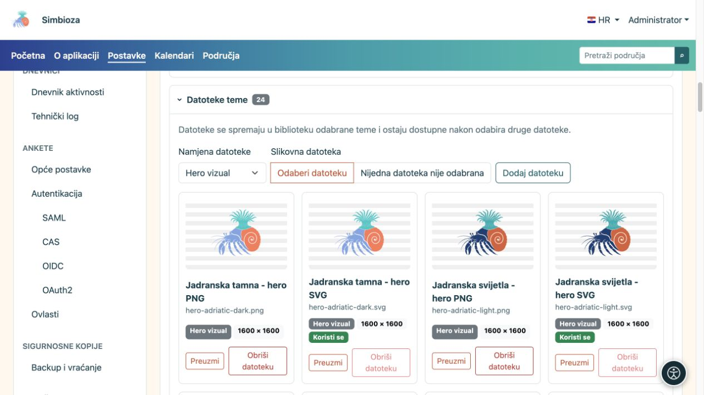
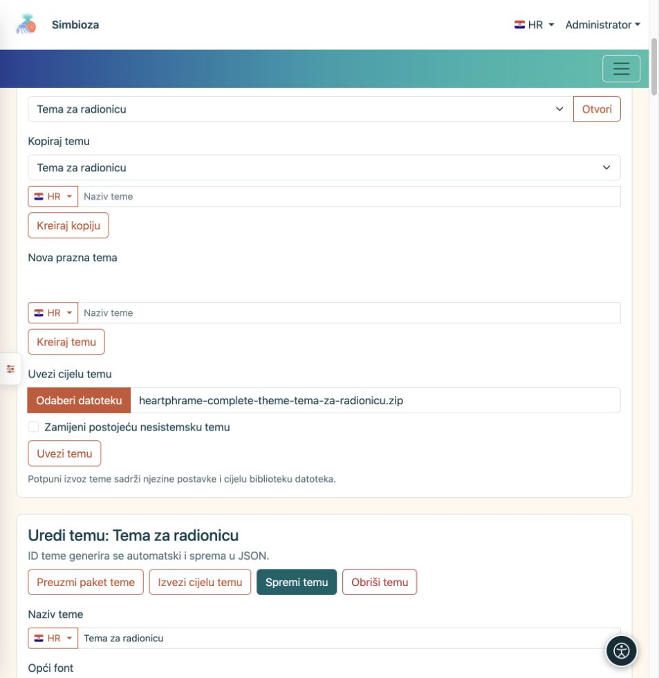

# Datoteke teme, uvoz i izvoz

[Teme](teme_hr.md)

**Cilj:** dodati vlastiti znak ili ilustraciju, sačuvati temu ili je prenijeti u drugu instalaciju. Postoje dva različita ZIP izvoza — odaberite prema cilju.

## Dodajte sliku u biblioteku teme

1. U otvorenoj temi proširite **Datoteke teme**.
2. Odaberite **Slikovnu datoteku** i odgovarajuću namjenu.
3. Prenesite datoteku. Dopuštene su PNG, JPEG, GIF, WebP i sigurne SVG slike; pojedinačna datoteka može imati najviše 25 MiB.
4. Vratite se u Zaglavlje ili Hero, odaberite novu datoteku za željenu varijantu i spremite temu.

| Namjena datoteke | Gdje se nudi |
| --- | --- |
| Hero vizual | U odabiru slike hero elementa. |
| Ikona aplikacije | U odgovarajućim odabirima znaka/logotipa zaglavlja. |
| Logotip | U odabiru logotipa zaglavlja. |
| Ostalo | Čuva se u biblioteci; ne postaje automatski hero ili logo. |

**Rezultat:** datoteka ostaje u biblioteci te teme. Sam prijenos ne zamjenjuje trenutačno odabrani znak ili sliku. Nova datoteka ne briše raniju; možete se vratiti na nju. Popisi prikazuju raspoložive datoteke pa se njihove stavke razlikuju među temama i instalacijama.

<figure>

<figcaption>Prenesenu sliku zatim zasebno odaberite u herou ili zaglavlju.</figcaption>
</figure>

Datoteka označena **Koristi se** ne briše se dok je tema upotrebljava. Najprije odaberite i spremite zamjenu, a tek potom uklonite nepotrebnu datoteku. Za drugu svijetlu/tamnu inačicu možete prenijeti zasebnu sliku.

## Koji izvoz trebate?

| Radnja | Što dobivate | Čemu služi |
| --- | --- | --- |
| **Preuzmi paket teme** | Demonstracijske HTML stranice, lokalni CSS/JavaScript i potrebne slike. | Pregledu izgleda izvan aplikacije; raspakirajte ZIP i otvorite `index.html`. |
| **Izvezi cijelu temu** | Postavke jedne teme, kontrolni manifest i cijelu njezinu biblioteku, uključujući trenutačno nekorištene datoteke. | Prijenosu kroz **Uvezi cijelu temu** ili čuvanju uređive kopije. |
| Backup komponente Teme ili sitea | Podsustav tema, sve spremljene teme i pripadajuće datoteke prema opsegu backupa. | Administratorskom oporavku; [sigurnosne kopije](admin-sigurnosne-kopije_hr.md). |

Paket za pregled nije izvoz vaših stvarnih stranica, korisnika ili anketa. Potpuni izvoz jedne teme nije backup cijele Simbioze. Privatna tema područja pripada i njegovu [backupu područja](podrucja-izvoz-backup_hr.md).

## Uvezite spremljenu temu

1. U Biblioteci tema pronađite **Uvezi cijelu temu**.
2. Odaberite ZIP izrađen radnjom **Izvezi cijelu temu**.
3. Za zasebnu kopiju ostavite **Zamijeni postojeću nesistemsku temu** isključeno. Ako tema istog identiteta postoji, uvoz dobiva zaseban slobodan identitet.
4. Uključite zamjenu samo kada doista želite zamijeniti postojeću nesistemsku temu. Sistemska tema ne prepisuje se tim putem.
5. Odaberite **Uvezi temu**, pregledajte naziv, obje varijante i datoteke.
6. Ako želite globalnu primjenu, izaberite uvezenu temu kao **Aktivnu temu** i spremite postavke sitea.

**Rezultat:** tema se može uređivati u ovoj instalaciji. Pogrešna ili oštećena arhiva prijavljuje pogrešku; nemojte preimenovati demonstracijski paket i očekivati da postane potpuni izvoz.

Ako ste uklonili neku priloženu nesistemsku temu, redovna nadogradnja ne treba je ponovno dodavati. Kada je ponovno želite, uvezite njezin pripremljeni ZIP. Prije zamjene vlastite prilagođene teme napravite aktualni potpuni izvoz.

<figure>

<figcaption>Odaberite ZIP potpunog izvoza; ne zamjenjujte postojeću temu ako želite zasebnu kopiju.</figcaption>
</figure>
